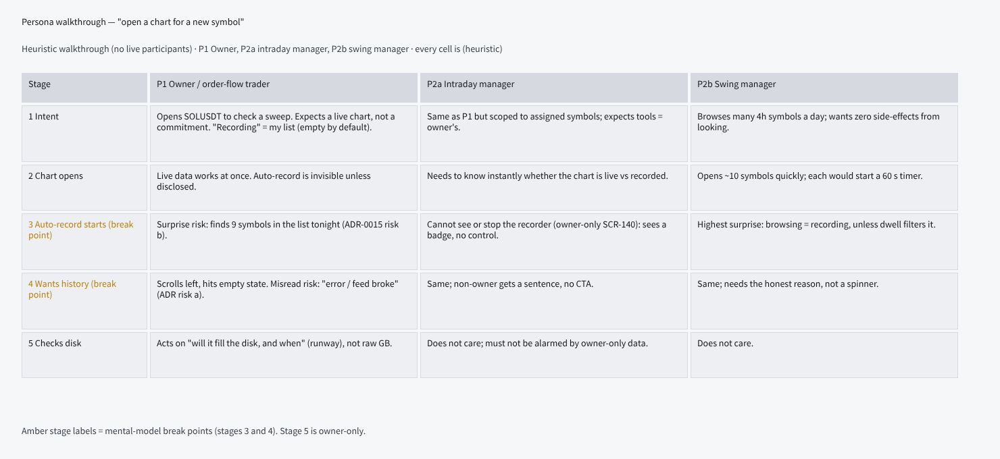
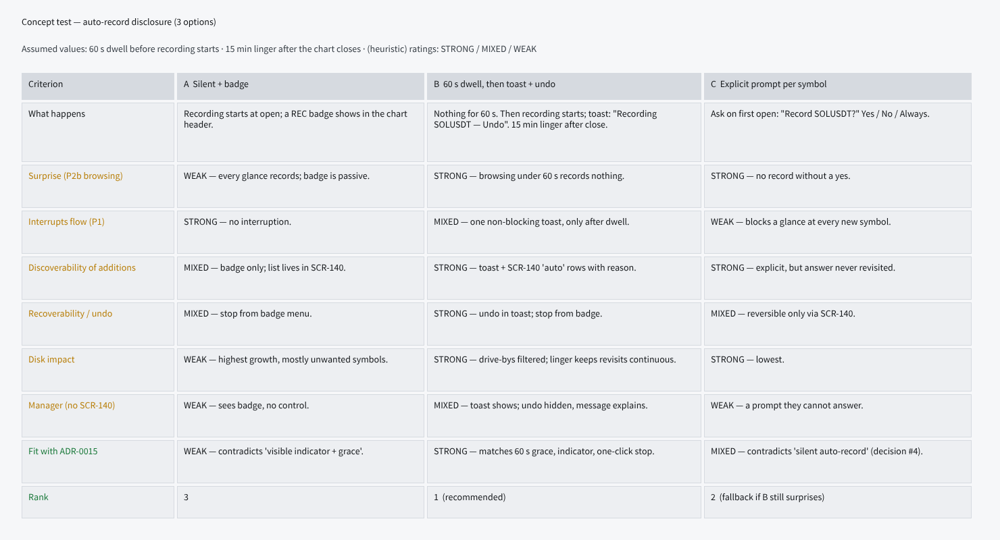
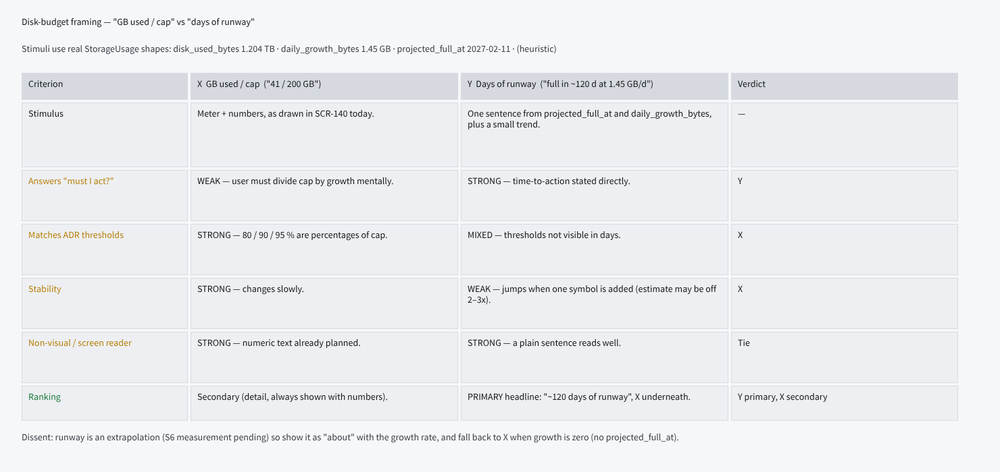
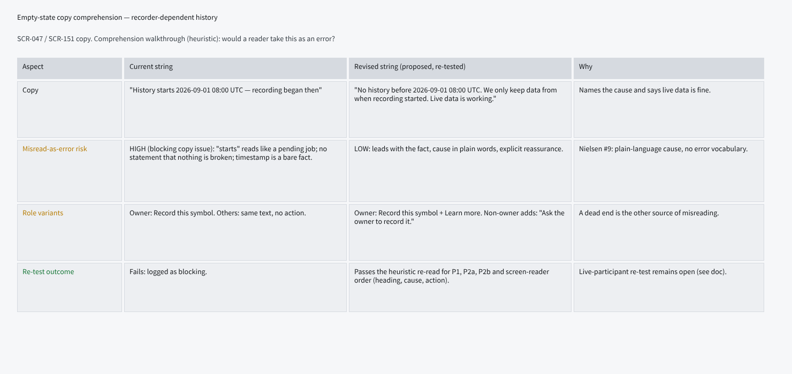

# E16-D01 — UX research: recorder mental model, auto-record surprise and disk-budget framing

- **Ticket:** E16-D01 (issue #322) · **Status:** Draft, every recommendation pending confirmation (owner approval
  pending) · **Method:** heuristic evaluation + persona walkthrough (see "Method note"; no live participants were run)
- **Scope:** SCR-140 recorder, SCR-047 chart empty state, SCR-151 empty-state pattern, every recorder-dependent view.
- **Out of scope (unchanged):** wireframes/hi-fi (E16-D02..D05), replay UX (E26), analytics instrumentation.
- **Inputs:** ADR-0015 (negative consequences a, b), `10-personas.md` P1/P2a/P2b, `22-api-openapi.yaml`
  (`/recording/storage`, `/recording/symbols/{id}`), `23-ws-protocol.md` §15.8, B11 in `28-statechart-catalogue.md`,
  `24-internal-schemas.md` §13.4.1, `20-architecture.md` §7.2, the shipped recorder code (`recorder/policy.py`,
  `budget.py`, `models.py`) and `auth/rbac_seed.json`. Code line numbers are as of `main` at `353c65ec`.

## Acceptance-criteria trace (E16-D01, issue #322)

Status key: **done** = delivered as the ticket words it; **heuristic-only** = delivered by the agent-delivery
adaptation (heuristic evaluation, no participants), so it stays a recommendation pending confirmation; **open** = needs
live sessions or an owner decision and is not claimed. The ticket stays open until the sessions in §5 run.

| Ticket AC or deliverable                                                                                     | Section, line                                     | Status         | Note                                                                       |
| ------------------------------------------------------------------------------------------------------------ | ------------------------------------------------- | -------------- | -------------------------------------------------------------------------- |
| AC1: three disclosure options tested with at least three participants                                        | §2 L99-106; §5 L233-252                           | open           | no participants; protocol written                                          |
| AC1: one option recommended, with reasoning and dissenting evidence                                          | §2 L99-117                                        | heuristic-only | B recommended; the toast conflicts with owner decision #4 (owner decision) |
| AC1: names the dwell and linger values it assumes (AC text: 60 s dwell, 15 min linger)                       | §2 "Dwell and linger" L119-124                    | open           | shipped linger default is 30 min; 15 min is a proposal (owner decision)    |
| AC2: disk framing, primary and secondary stated                                                              | §3 L178-199                                       | heuristic-only | state primary, GB used / cap secondary; contract asks listed               |
| AC3: a misread of "history starts" logged as a blocking copy issue                                           | §4 L203-207                                       | done           | logged as blocking                                                         |
| AC3: a revised string proposed                                                                               | §4 L209-227                                       | done           | proposed, not adopted (E16-D05, #373 owns the copy)                        |
| AC3: the revised string re-tested                                                                            | §4 L229-231; §5 L245                              | open           | heuristic re-read only                                                     |
| Deliverable: moderated walkthrough with the Owner and both manager personas, concept and comprehension tests | §5 L233-252                                       | open           | protocol written, not run                                                  |
| A11y note: one keyboard-only or screen-reader session                                                        | §5 L246                                           | open           | reading-order analysis only                                                |
| Deliverable: findings linked from SCR-140 (also SCR-047, SCR-151, catalogue invariant 3)                     | `14-screens-catalogue.md` L83, L997, L2539, L2734 | done           | pointers only; no empty-state string changed                               |
| DoD: no open question that would change the SCR-140 layout                                                   | §6 L279-292                                       | open           | five owner decisions and the contract asks                                 |

## Research boards (Penpot)

Page **`E16-D01 Recorder UX research`**, page id `89375c6a-c647-8027-8008-c83c09755287`:
`https://design.penpot.app/#/workspace?team-id=b564c72c-f31f-81ec-8008-b109a9175d0b&file-id=b564c72c-f31f-81ec-8008-b112c6fdc116&page-id=89375c6a-c647-8027-8008-c83c09755287`

1. Persona walkthrough — "open a chart for a new symbol":

   

   _Board v1 — superseded by the text above; re-export tracked in the follow-up issue (#2659)._

2. Concept-test matrix — auto-record disclosure (v1 assumes **60 s dwell, 15 min linger**; the shipped linger default is 30 min, §2):

   

   _Board v1 — superseded by the text above; re-export tracked in the follow-up issue (#2659)._

3. Disk framing — "GB used / cap" vs "days of runway":

   

   _Board v1 — superseded by the text above; re-export tracked in the follow-up issue (#2659)._

4. Empty-state copy comprehension:

   

   _Board v1 — superseded by the text above; re-export tracked in the follow-up issue (#2659)._

## Method note (Agent-delivery adaptation, owner decision 2026-09-25)

The ticket calls for moderated sessions with the Owner and both manager personas. Delivery here is a solo AI
agent with one human owner, so — exactly as in `e09-auth-mental-models.md` — live sessions are replaced by:
(1) a **heuristic evaluation** (Nielsen + trading heuristics from `05-accessibility-standard.md`),
(2) a **persona walkthrough** of P1, P2a and P2b against the real API shapes, and (3) a **session protocol**
(§5) and owner checklist for later. **No participant, quote, timing or count is fabricated; every finding is
`(heuristic)`.** Acceptance criteria that say "tested with at least three participants" are therefore met
only in the heuristic sense and remain **open for live confirmation**, so every recommendation below is
**recommended, pending confirmation**, not decided. Stimuli use real `RecordedSymbol` and `StorageUsage` field
names; the screen-reader criterion is covered by reading-order analysis only. Persona figures such as "about ten
symbols" for a browsing P2b or "nine symbols in the list" are **illustrative**: `10-personas.md` gives no symbol counts.

## 1. Mental model of "recording" (heuristic)

- **F1 (confidence: medium — follows from decision #4 and ADR-0015 wording).** P1 reads "recording" as "my list"
  (decision #4: empty by default). Auto-record on chart open contradicts that model unless it is disclosed at the
  moment it happens.
- **F2 (confidence: medium — depends on SCR-140 being owner-only, per the catalogue; see F6 for the role caveat).**
  P2a/P2b cannot reach SCR-140 (owner-only) yet are subject to auto-record. They need to see state (REC chip) without
  a control, and an honest sentence instead of a dead end.
- **F3 (confidence: low-medium — plausible but unobserved; needs a live session).** Live data works for any symbol
  regardless of recording (ADR-0015 driver), but not on every screen at every moment; "live data is fine" can be
  said only where it is true (§4).
- **F4 (confidence: high — stated in `policy.py`, `budget.py`, B11 and the contracts).** "Recording" is not on or off.
  The recorder also refuses (20-symbol cap; disk level 2), gates (disk level 3 drops rows as gaps), lingers after the
  last reason (30 min by default), degrades and errors. A REC chip that only says "recording" overclaims in each of
  those cases (C-2.14: gaps stay visible, never interpolated). States and contract gaps are in §2.
- **F5 (confidence: high — `removeRecordedSymbol` contract, `policy.py`, B11 INV-B11-a).** "Undo" is a promise the
  backend cannot keep: a stop is refused while the chart trigger is active, nothing suppresses auto-record per
  symbol, removing the last reason only starts the linger, and an open position can never be stopped. The honest
  control is "Stop recording", with those semantics (§2).
- **F6 (confidence: medium — `rbac_seed.json` against the E16 threat model; needs the owner's call).** "Non-owners
  cannot stop" is a UI assumption, not a server rule: Managers hold `recording:write`. Viewers are to see a recorded
  set reduced by role (threat model R-I2), so "not recording" in a Viewer's session can mean "restricted", not "no".

## 2. Auto-record disclosure — ranked recommendation

1. **Option B (recommended, pending confirmation; owner decision below): 60 s dwell, then a toast with a "Stop
   recording" action, REC chip afterwards.** Reasoning: browsing (P2b, illustratively ~10 symbols) records nothing;
   one non-blocking toast; matches the ADR-0015 mitigations.
2. **Option C (fallback): explicit prompt on first open per symbol.** Lowest disk and surprise, but it blocks a
   glance at price action for P1 and gives managers a prompt they cannot answer. It also contradicts "silent
   auto-record" (decision #4).
3. **Option A (rejected as drawn): silent + REC chip with no dwell.** Highest unwanted growth; contradicts
   "visible indicator + grace".

**Dissenting evidence (heuristic):** C beats B on surprise and disk; A beats B on interruption. B's toast action is
role-dependent (F6), so the toast is not the same for every persona. If live sessions show 60 s still catches
drive-bys, fall back to C. The 60 s dwell comes from ADR-0015; no value here is measured.

**B against the ADR-0015 baseline (OWNER DECISION).** ADR-0015 already specifies a 60 s dwell, a visible recording
indicator and a one-click stop for every option, so board 2's Option A (no dwell) is a straw man: B's rated lead on
surprise and disk impact comes from the dwell, not the toast. The toast is B's only addition to that baseline (call it
A′: dwell + REC chip + Stop, silent), and a toast contradicts owner decision #4, which makes auto-record silent. The
owner decides: accept the toast (B) or stay silent (A′, with the chip and Stop as the disclosure). The research leans
to B only for discoverability (F1), on heuristic grounds; if the owner stays silent, the toast rows drop out.

**Dwell and linger.** _Dwell:_ 60 s (`CV_RECORDER_AUTOSTART_DELAY_S`, ADR-0015); every source agrees. _Linger after
the last reason:_ **the shipped default is 30 min**: `CV_RECORDER_AUTOSTOP_GRACE_S=1800` (`20-architecture.md` §7.2),
the US-REC-002 NFR ("default 30 min") and `PolicyConfig.autostop_grace_s` (`recorder/policy.py`, line 138). The ticket
AC and board 2 still say 15 min. **15 min is a proposal, not a default: OWNER DECISION** (shorter saves disk but breaks
more revisits; the research has no data to choose). The value is runtime-configurable, so the copy must read the
configured value and never hard-code 15 or 30.

**Stop recording, not Undo.** The toast action and the chip menu say "Stop recording": nothing is un-recorded, and
the data is kept (replayable; `purge_data` is a separate, irreversible, owner-only action). What a stop can do today:

| Situation                       | What "Stop recording" does (contract and code)                                                                                                                                                                                                                                                                                                  | Copy or state to draw                                                               |
| ------------------------------- | ----------------------------------------------------------------------------------------------------------------------------------------------------------------------------------------------------------------------------------------------------------------------------------------------------------------------------------------------- | ----------------------------------------------------------------------------------- |
| Owner-added symbol (manual)     | Removes the manual reason. If no other reason remains the symbol **lingers for the configured grace** (B11 `lingering`), then stops                                                                                                                                                                                                             | "Stops in N min", data-kept note                                                    |
| Auto-recorded, chart still open | `DELETE /recording/symbols/{id}` is refused with **409 `conflict`** while the chart trigger is active unless `force=true`; no per-symbol suppress exists (`_desired()` in `policy.py` re-adds `chart_open` every tick), so a forced stop would restart within a tick. The only chart-open switch is the global `CV_RECORDER_AUTORECORD_ENABLED` | Cannot promise a stop: "Recording while this chart is open", with "Close the chart" |
| Auto-recorded, chart closed     | Already lingering (no reason left); stops after the grace                                                                                                                                                                                                                                                                                       | "Stops in N min"                                                                    |
| Position open                   | Never stops (INV-B11-a: an open position can never stop recording)                                                                                                                                                                                                                                                                              | Disabled, reason "A position is open"                                               |

**Dependencies:** E16-T02 (#405, shipped without a suppress or opt-out primitive) and E16-T08 (#492, the REST
surface that implements `removeRecordedSymbol`; the route is not built yet). An honest "Stop" while a chart is open
needs a suppress or immediate-stop primitive in T02 and its `force` semantics in T08. **OWNER DECISION:** fund that,
or ship "Stop recording" with the limits above. Option B's toast appears while the triggering chart is open, so it
is exactly the "chart still open" row and cannot offer a working stop until then. Until then the v1 board's
"Recoverability / undo: STRONG" and "one-click stop" claims are withdrawn.

**States the REC chip must show (the non-success paths).** A chip that only says "recording" is wrong in rows 3-5:

| State                                         | Source                                                                                                                                                              | The chip must say                                                                    |
| --------------------------------------------- | ------------------------------------------------------------------------------------------------------------------------------------------------------------------- | ------------------------------------------------------------------------------------ |
| Recording (manual, chart open, position open) | B11 `recording`                                                                                                                                                     | "Recording" and the reason                                                           |
| Lingering                                     | B11 `lingering`                                                                                                                                                     | "Recording, stops in N min"                                                          |
| Not recording: symbol cap                     | `RecorderCapRefused`, cause `symbol_cap`; 20 symbols (`CV_RECORDER_MAX_SYMBOLS`); an auto-start is refused and retried every tick, a manual add is refused with 422 | "Not recording: 20-symbol limit reached" (live data only)                            |
| Not recording: disk level 2                   | `RecorderCapRefused`, cause `disk_pressure`; level 2 (90 % used) refuses new chart-open starts, position and manual starts are never refused                        | "Not recording: disk nearly full"                                                    |
| Gated: disk level 3                           | B11 stays `recording`; the write gate drops rows of symbols without an open position as `backpressure_drop` gaps (`24-internal-schemas.md` §13.4.1)                 | "Recording gated: data is being dropped"; plain "Recording" would overclaim (C-2.14) |
| Degraded, error                               | B11 `degraded`, `error`                                                                                                                                             | the existing state words                                                             |
| Restricted or unknown                         | A role-limited session (Viewer, F6)                                                                                                                                 | "Recording status restricted", never "Not recording"                                 |

**Contract asks, for their own PR (contract-first, C-6.1; none of these fields exists today).** (1) `lingering`, with
its deadline, in the recorder status REST response and the WS `symbols[].state` enum; B11.8 requires it ("`lingering`
must also appear in the recorder status API and the admin panel"). (2) The disk-pressure `level` (0-3) and the
write-gate flag in `StorageUsage` and the WS `storage` object. (3) `cap_bytes` in both (§3). (4) A per-symbol refusal
marker (`symbol_cap` or `disk_pressure`), or an active-count and limit pair, so the UI draws "not recording" instead of
silence; the E16 threat model's abuse case AC-02 already expects "extra symbols live-only with UI note". (5) A
role-restricted marker (E16-FR-07). Natural home: E16-T08 (#492), or a small contract PR ahead of it and of E16-D02
(#323).

**The toast and its non-timed equal path.** The toast is a CMP-045 Toast (`role="status"`, polite; `action` = "Stop
recording"; pauses on hover and focus; persistent-log fallback in CMP-060 NotificationCenter) mounted by CMP-212
ToastHost (one polite live region, keyboard-dismissible, never steals focus). It is never the only path (WCAG 2.2.1):
the equal, non-timed path is the **REC chip** (the catalogue's name: SCR-100 watchlist rows, the CMP-219 SymbolPicker
recording chip, the chart header) whose menu offers "Stop recording", plus the SCR-140 row for the owner. The chip's
text always carries the state word, never colour alone.

**Roles (OWNER DECISION: do Managers keep `recording:write`?).** Managers hold `recording:write` (`rbac_seed.json`
lines 216-217), and the OpenAPI marks `PATCH` and `DELETE /recording/symbols/{id}` as `recording:write`. The E16
threat model (R-E1) reads permission 51 `recording:write` as "Owner + step-up only", and the sitemap (M-023) says
"Managers see status read-only": the sources disagree. Until the owner decides, the design must not say that
non-owners cannot stop: the chip menu follows the server-decided permission. Viewers hold `recording:read` only and,
per R-I2, see a reduced set, so for them the chip shows "restricted" (table above).

## 3. Disk framing — ranked recommendation

1. **Primary on SCR-140: a state, with a time only when there is one.** Three states. **Growing:** "auto-record
   pauses in about N days at X GB/day". **Steady or too early to tell:** growth ≤ 0 or unknown, where
   `projected_full_at` is `null` (the normal steady state under 30-day retention once the window is full; no figure
   exists below an hour of history). **Near limit:** ladder level 1 (80 % used, or runway ≤ 7 days), level 2
   (auto-record paused for new chart-open symbols), level 3 (data being dropped). It answers "must I act?" directly.
   - **Not `projected_full_at` as it stands.** It runs to the cap or the volume wall, that is 100 %
     (`project_full_at` in `budget.py`), not to the 90 % level-2 point where auto-record pauses, and it is `null`
     when growth is ≤ 0. The sentence therefore says "until auto-record pauses" and is computed to 90 %; until the
     contract carries the threshold, a figure taken from `projected_full_at` must say "until full".
   - **Illustrative stimulus (replaces the 1.204 TB and ~120 d on the v1 board):** 41 GB used of a 200 GB cap, growing
     1.45 GB/day. 100 % of the cap in about 110 days (`projected_full_at`); auto-record pauses at 90 % (180 GB) in
     about 96 days. The 200 GB cap is illustrative, not the ADR-0015 default (500 GB).
2. **Secondary: GB used / cap** meter with numeric text, always shown beneath; it carries the 80 / 90 / 95 %
   ADR-0015 thresholds and is stable. **Contract ask:** `cap_bytes` is absent from `StorageUsage` and from the WS
   `storage` object, and `StorageUsage.disk_used_bytes` is the volume's used space (total minus free), not the
   recorded bytes the ladder compares with the cap (the QuestDB and Parquet `tiers[].used_bytes`). The meter needs
   `cap_bytes` and a defined numerator.

**Dissent:** runway is an extrapolation (the 7-day S6 run is still pending; estimates may be off 2–3x) and jumps
when a symbol is added. Show "about", and show the steady state when `projected_full_at` is absent.

## 4. Empty-state copy — comprehension

**Blocking copy issue (heuristic).** "History starts <ts> — recording began then" reads like a pending job or an
error; it never says nothing is broken. Logged as **blocking** per the acceptance criterion. The string sits in three
places in the catalogue today (§0.5 invariant 3, SCR-047, SCR-151), and SCR-047's wireframe already words it
differently ("No recorded history for BTCUSDT before <ts>. Live data is streaming now."). This PR changes none of
them (it adds pointers, §6); E16-D05 (#373) owns the final copy.

**Revised string (proposed, not adopted).** "No history before <ts>. <cause sentence>. <live-data sentence, only
where true>" with the owner action **Record this symbol** + **Learn more** and, only where the role cannot record
(F6), "Ask the owner to record it". The v1 board's single sentence ("We only keep data from when recording started.
Live data is working.") is too broad in two ways:

1. **"Live data is working" is scoped to "where true"**, as SCR-047's own checklist already says: it is not said when
   the feed is disconnected (SCR-152) or the instrument is delisted, only when the live stream for that symbol is
   healthy.
2. **"We only keep data from when recording started" is one cause of several.** Name the cause that applies:

| Cause                                                                    | Proposed cause sentence (final copy is E16-D05's)                                                                              |
| ------------------------------------------------------------------------ | ------------------------------------------------------------------------------------------------------------------------------ |
| Never recorded before <ts>                                               | "Recording of <symbol> started then."                                                                                          |
| Removed by retention                                                     | "Older data was removed by the retention policy (<N> days)."                                                                   |
| Recording gap (feed outage, restart, or a disk-full gate drop)           | "Recording was interrupted between <t1> and <t2> (<reason>)." Gaps are shown as gaps, never interpolated (ADR-0015 decision 7) |
| Older history predates recording (imported archive, or exchange candles) | "Before <ts> this history was imported or built from candles, so it is coarser and has no order-book detail."                  |

Causes that are not recorder-dependent (the exchange returned no bars, the instrument is delisted) keep SCR-047's own
copy.

**Heuristic re-read (not a live re-test).** The revised structure reads as non-error for P1, P2a and P2b, with
heading → cause → action reading order. No live re-test happened; it is still open (§5). The v1 board's
"(proposed, re-tested)" wording is withdrawn.

## 5. Session protocol and owner checklist (to run later)

Static stimuli with real field names; at least three participants (the Owner, one intraday and one swing manager).
Record with consent; store on the tailnet only. Each task has a success criterion, so a result is a pass or a miss
rather than an impression.

| #   | Task (say it aloud)                                                                     | Stimulus                                                                                  | Success criterion                                                                                                                   | Also record                                                                                                                                                     |
| --- | --------------------------------------------------------------------------------------- | ----------------------------------------------------------------------------------------- | ----------------------------------------------------------------------------------------------------------------------------------- | --------------------------------------------------------------------------------------------------------------------------------------------------------------- |
| T1  | "What does 'recording' mean here? What happens when you open a chart for a new symbol?" | Board 1, stages 1-3                                                                       | Says nothing is recorded until they act, apart from open charts and positions (decision #4)                                         | Where they place auto-record, in their own words                                                                                                                |
| T2  | Dwell and toast probe: "Open SOLUSDT and tell me when something happens"                | A chart with a REC chip; after the 60 s dwell a toast "Recording SOLUSDT: Stop recording" | Notices the toast or chip without prompting, says what is being recorded and how to stop it                                         | Which path they use to stop (toast action or chip menu); whether the dwell and the stop-after value (15 or 30 min) feel surprising; the value they would expect |
| T3  | Browse probe (P2b): "Look at ten symbols for 20 s each"                                 | Ten charts, no toast under the dwell                                                      | Reports no side-effects and later finds none in SCR-140                                                                             | Surprise on learning which symbols were recorded                                                                                                                |
| T4  | Disk framing: "Which figure would you act on?"                                          | The three states (growing, steady, near limit) beside GB used / cap                       | Picks one figure, says whether to act now, reads "until auto-record pauses" correctly                                               | Confusion between "full" and "pauses"                                                                                                                           |
| T5  | Empty-state read-aloud, one cause per participant across the four causes                | The four strings of §4                                                                    | Does not call it an error; states the cause in their own words; says whether live data is fine                                      | Words they stumble on                                                                                                                                           |
| T6  | Screen-reader and keyboard-only pass                                                    | Toast, REC chip, empty state                                                              | Hears the toast once (polite); reaches "Stop recording" from the chip without the toast; hears heading, cause, action in that order | The chip name as read aloud                                                                                                                                     |
| T7  | Role probe: a Manager on an assigned symbol, and a Viewer                               | Chip menu per the server-decided permission; the "restricted" chip                        | The Manager can say what they may do; the Viewer does not read "restricted" as "not recording"                                      | What each expected to be able to do                                                                                                                             |

- Run at least one session keyboard-only or with a screen reader (T6).
- Owner checklist on #322: decide B or A′ (decision #4), the linger default (15 or 30 min), whether to fund a
  suppress primitive and whether Managers keep `recording:write`; then confirm the state-first disk framing and the
  revised copy structure.

## Accessibility

Boards use DS semantic tokens only. Pairs and WCAG 2.x ratios (same formula as
`docs/design/_tools/contrast_check.py`, run over the resolved token values):

| Use                                        | Foreground token               | Background token       | Ratio   | Result          |
| ------------------------------------------ | ------------------------------ | ---------------------- | ------- | --------------- |
| Cell text                                  | `color.text.primary`           | `color.surface.raised` | 15.62:1 | PASS AA         |
| Header cells                               | `color.text.primary`           | `color.surface.sunken` | 12.82:1 | PASS AA         |
| Subtitles, notes                           | `color.text.secondary`         | `color.surface.canvas` | 9.65:1  | PASS AA         |
| Board titles                               | `color.text.primary`           | `color.surface.canvas` | 16.78:1 | PASS AA         |
| Break-point labels (v1)                    | `color.status.warning.default` | `color.surface.raised` | 3.00:1  | **FAIL** (<4.5) |
| Rank labels (v1)                           | `color.status.success.default` | `color.surface.raised` | 4.68:1  | PASS            |
| `color.status.warning.strong` (considered) | on `color.surface.raised`      |                        | 4.11:1  | FAIL, not used  |

**Finding:** the amber stage/criterion labels fail AA and were colour-only, and board 1's footer legend ("Amber stage
labels = ...") keys its meaning to that colour. **Fix:** label text moves to `color.text.primary`; the non-colour cue is
explicit text ("BREAK POINT 3 — Auto-record starts"), the colour-keyed legend is replaced by that wording, and ratings are
the words STRONG / MIXED / WEAK. **Status: the boards were not edited** (no Penpot access in the fix rounds): the Penpot
page and the embedded PNGs still show v1 (amber labels, the colour-keyed legend, "re-tested" wording, the 1.204 TB
stimulus, the 15 min linger). Each is captioned "Board v1 — superseded" above, and the stale cells and the re-export are
tracked in #2659; the text of this report is the source of truth. No screen-reader session was run (heuristic
only). New in this revision, text only and with no new token pair: the toast follows CMP-045 / CMP-212 (polite live
region, never the only path, WCAG 2.2.1), and the REC chip names its state in text.

## 6. Folded into the catalogue / open questions

- SCR-140 links this report; SCR-047, SCR-151 and §0.5 invariant 3 get the same pointer. They are pointers only: no
  empty-state string in the catalogue is changed here (SCR-140's summary line is reworded to match this revision).
- **Owner decisions raised (none is made in this report):**
  1. Linger default: keep the shipped 30 min (US-REC-002) or move to 15 min (the ticket AC, a proposal) — §2.
  2. Toast (B) or silent (A′): the toast contradicts owner decision #4 — §2.
  3. Fund a suppress or immediate-stop primitive (E16-T02, E16-T08 `force`), or ship "Stop recording" with today's
     limits — §2.
  4. Whether Managers keep `recording:write` — §2 roles.
  5. Amend the recorder contract in its own PR before E16-D02: `lingering`, disk level and write gate, `cap_bytes`, a
     refusal marker, a role-restricted marker — §2, §3.
- Open: live confirmation of the 60 s dwell and the linger value, of the state-first disk framing, and of the
  empty-state structure (§5).
