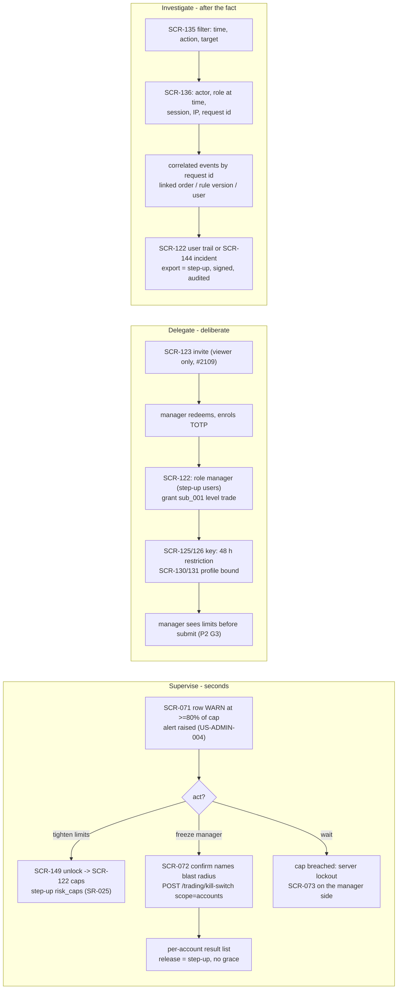
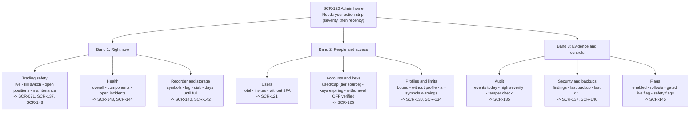

# E42-D01 — UX research: how the owner supervises, delegates and investigates in the admin area

- **Ticket:** E42-D01 (issue #830) · **Status:** Draft, every recommendation pending confirmation ·
  **Method:** heuristic evaluation + persona walkthrough against the catalogued screens and the
  contracts (see "Method note"; no live participant sessions were run)
- **Scope:** the admin area as catalogued, SCR-120..149 (`14-screens-catalogue.md` §10) and the global
  states it relies on (SCR-150..159, §11), read through US-ADMIN-001..014 and the P1 Owner, P4 Admin-hat
  and P2 Manager personas. Feeds E42-D02 (#831, wireframes) and E42-D03 (#886, hi-fi shell and users).
- **Out of scope (unchanged):** wireframes and hi-fi (E42-D02..D05); accounts/keys research (E27-D01,
  #732) and profiles research (E28-D01, #820); quantitative usability metrics (the population is one
  owner plus a few managers; this report is qualitative by necessity and says so).
- **Penpot:** the plugin was **not connected** in this session, so no boards or PNG exports exist yet.
  The research boards (§1) follow on the ticket's Penpot page when the bridge is up. The Mermaid
  diagrams below are additional, never the only deliverable (`docs/design/README.md`).

## Acceptance-criteria trace (E42-D01, issue #830)

Status key: **done** = delivered as the ticket words it; **heuristic-only** = delivered through the
ticket's Agent-delivery adaptation (heuristic evaluation, no participants), so it stays a recommendation
pending confirmation; **open** = needs live sessions, Penpot, or an owner decision, and is not claimed.
The ticket stays open until the §10 sessions run (or the owner waives them) and the Penpot boards exist.

| Ticket AC or deliverable                                                                                       | Section                                                                     | Status                           |
| -------------------------------------------------------------------------------------------------------------- | --------------------------------------------------------------------------- | -------------------------------- |
| AC1: at least three scripted sessions (supervise, delegate, investigate) completed and recorded with consent   | §4 persona walkthroughs (heuristic); §10 protocol, ready to run             | heuristic-only; sessions open    |
| AC2: card sort gives a recommended SCR-120 tile set and grouping, reconciled with the catalogue's stated tiles | §5, reconciliation table (every deviation argued, nothing dropped silently) | heuristic-only                   |
| AC3: every listed vocabulary term has a keep (one-line explanation) or replace (replacement) decision          | §6                                                                          | done, pending owner confirmation |
| AC4: each of the four risk probes has a finding (understood / partially / misunderstood) and the copy change   | §7                                                                          | heuristic-only                   |
| AC5: report merged and linked from E42-D02 and E42-D03; catalogue amendments filed                             | this file; §12 AM-1..AM-10; links on #831 and #886 are added by the lane    | open until merge                 |
| AC6: CDO (or delegate) review comment recorded                                                                 | the owner's `approved` comment on #830 (Agent-delivery adaptation)          | open                             |
| Deliverable: prioritised comprehension-risk list feeding E42-D02 and E42-D03 copy                              | §8                                                                          | heuristic-only                   |
| Deliverable: verbatim quotes                                                                                   | none exist and none are invented (§2)                                       | open (sessions)                  |
| Technical note: open-then-closed card sort; teach-back comprehension test                                      | §5 (heuristic run); §10 scenarios 4 and 5                                   | heuristic-only; live run open    |
| Accessibility note: at least one keyboard-only session                                                         | §10, keyboard-only pass on scenario 1                                       | open                             |
| Security note: sanitised fixtures only; recording retention stated                                             | §10 "Data handling"                                                         | done (rules stated)              |
| Observability: the list feeds the `empty_state_shown` and `admin.onboarding_abandoned` questions               | §8, "Post-launch signal" column                                             | done                             |
| Research boards in Penpot (mandatory evidence per `docs/design/README.md`)                                     | §1                                                                          | open (plugin not connected)      |

## 1. Research boards (Penpot) — pending

No Penpot page exists for this ticket yet; the plugin bridge was not connected in the delivering session.
When it is, the following boards are drawn on page `E42-D01 Admin UX research` of the CandleViewer file
and exported with `docs/design/_tools/penpot_export.py` into `docs/design/E42/img/`:

1. **Journey map, three lanes** (supervise, delegate, investigate) against the catalogued screens, with
   the gates (SCR-149 unlock, SCR-006 step-up) and the audit emissions marked, from §4.0.
2. **Card sort board**: the 26 information cards of §5.1, the open-sort bands of §5.2, and the closed
   sort against the catalogue's grouping of §5.3.
3. **Findings matrix**: F-S1..F-I6 against the heuristic set of §2, with the recommendation each feeds.
4. **Vocabulary board**: the §6 decisions as term → in-product line pairs, for the teach-back test.

Until those exist this report is incomplete as a design deliverable (README: "not a markdown file
alone"); the AC table above says so.

## 2. Method note (Agent-delivery adaptation, owner decision 2026-09-25)

The ticket asks for moderated, think-aloud sessions against a clickable prototype, an open-then-closed
card sort and a teach-back comprehension test. Delivery is a solo AI agent with one human owner and no
prototype (E42-D02 depends on this report), so, per the ticket's **Agent-delivery adaptations** clause and
the E09-D01 and E13-D01 precedents, the sessions are substituted with:

1. A **heuristic evaluation** of SCR-120..149 (plus SCR-071..073 where the supervise scenario starts
   outside the admin area, and SCR-150..159 where a global state is the admin screen's answer) against:
   - Nielsen's ten heuristics, cited as **H1** visibility of system status, **H2** match between the
     system and the real world, **H3** user control and freedom, **H4** consistency and standards,
     **H5** error prevention, **H6** recognition rather than recall, **H7** flexibility and efficiency,
     **H8** aesthetic and minimalist design, **H9** help users recognise, diagnose and recover from
     errors, **H10** help and documentation;
   - the trading-specific heuristics of `05-accessibility-standard.md`: **A-P** (§2 Perceivable: a state
     is never colour-only), **A-O** (§2 Operable and §3.1.4: every destructive gate is keyboard-operable,
     no timing trap), **A-U** (§2 Understandable: errors in plain language, predictable focus);
   - the persona-derived themes of `10-personas.md` §10 that bind this area: **T4** server-enforced
     safety that survives a dead UI, **T5** honest uncertainty, **T7** unmistakable Demo vs Live, **T8**
     secrets never visible, **T10** everything auditable and append-only, **T11** emergency mode is
     separate from configuration mode.
2. A **persona walkthrough** of the three scripted scenarios as P1 wearing the P4 hat, with the P2
   Manager's side of each scenario where the stories give it (§4).
3. A **heuristic card sort**: the information items the catalogue and the contracts put on the admin
   surface, sorted first by the question the owner is asking (open), then checked against the
   catalogue's own grouping (closed) (§5).
4. A **written session protocol** (§10) and an **owner walkthrough checklist** (§11) so the owner can
   turn every heuristic finding into an observed one later.

**Honest limits.** No participant quotes, task timings, success rates or card-sort agreement scores
exist, and none are invented. Every finding is labelled `(heuristic)` and traces to a line of a plan or
contract document, never to observed behaviour. Where the ticket's acceptance criteria want an observed
fact ("can the owner explain hash chain back?"), this report records the **risk** that the heuristic
evaluation can see and defers the fact to §10. All recommendations (R-\*) and decisions (AD-\*) are
therefore **recommendations pending confirmation** by the owner and by the §10 sessions. Confidence is
the strength of the basis, not a measurement: **High** = stated in a locked plan or contract document;
**Med** = sound heuristic reasoning from the catalogue text; **Low** = persona inference only.

**Inputs the ticket names that do not exist yet.** E27-D01 (#732) and E28-D01 (#820) are both open with no
report under `docs/design/research/`, so there is nothing to "read rather than repeat". Where keys and
profiles touch the admin modes, this report cites the E27 and E28 threat models
(`docs/security/threat-models/E27-accounts.md`, `E28-profiles-trade-groups.md`) and defers the rest to
those tickets. The E42 STRIDE model (E42-X01) is not written either; the security constraints below come
from `04-security-program.md` (SR rows), `docs/security/threat-models/e09-auth-rbac.md` and the admin
read-model decisions recorded on #963 (partial results, the kill switch never defaulted, the sub-account
tier reported as `unrecorded` only when the store answered "no row").

## 3. What the three modes have in common (and why one IA will not do)

The ticket's premise holds on the evidence (heuristic): the fourteen stories describe three different
states of mind, and the catalogue's screens already lean three ways.

| Mode            | Trigger and tempo                                                                         | What the owner needs first                                                                         | Screens that carry it                                     | Confirmation posture (`10-personas.md` §5 P4-R vs P4-E)                                  |
| --------------- | ----------------------------------------------------------------------------------------- | -------------------------------------------------------------------------------------------------- | --------------------------------------------------------- | ---------------------------------------------------------------------------------------- |
| **Supervise**   | Mid-session, seconds matter (US-ADMIN-004 "at a glance"; P4-E)                            | One true number with a timestamp, one safe action, proof the action landed                         | SCR-071/072/073 (outside admin), SCR-120, SCR-143/144     | One confirm naming the blast radius; **no typed ritual**; step-up only to undo           |
| **Delegate**    | Outside trading hours, deliberate, reversible (P4-R), except unbind/revoke with positions | The consequence of a grant before it is saved; the preconditions (key, profile, 48 h) in one place | SCR-121/122/123, SCR-125/126, SCR-130/131, flow §4 wizard | Typed confirmation for destructive items; step-up for roles, grants, caps (SR-025)       |
| **Investigate** | After the fact, calm but suspicious (US-ADMIN-009 "investigation is practical")           | Who, when, under what permissions, correlated with what else happened; proof the record is intact  | SCR-135/136, SCR-144, SCR-137, SCR-122 audit trail        | None to read; step-up to export (SR-025, SR-067); reads are themselves audited (SCR-136) |

Two consequences drive everything below. First, **the landing page must be ordered by tempo**, not by
module: the supervise facts come first because they are the ones read under time pressure (§5). Second,
**the same verb must not mean two things across modes**: "disable", "revoke", "locked" and "kill switch"
each currently carry two meanings in the plan (§6), and the delegate action that behaves like an
emergency (unbind or revoke with open positions) must borrow the emergency vocabulary, as P4-E scenario 9
already says for keys.

## 4. The three modes — persona walkthroughs and findings (all `(heuristic)`)

### 4.0 Journey overview

Every lane starts with a signal the owner did not choose, passes at least one server-side gate the UI
cannot fake (SR-025 step-up, SCR-149 unlock, RBAC 403 + audit) and ends with a record the owner can read
back (T10). The findings below are where the catalogued screens make that walk slower, more ambiguous or
less honest than the stories demand.

### 4.1 Supervise — "a manager's account is approaching its daily loss cap; what do you do?"

**Walkthrough (P1 at the terminal, P4 hat not yet on).** The signal is SCR-071's row for `sub_001` at
95 % of its cap with the state word `WARN` and an alert (US-ADMIN-004 "the row escalates visually with a
text label and an alert is raised"). The owner has four moves. _Wait_: the server enforces the cap
(US-ADMIN-003, `13-user-flows.md` §18.7), flattens per policy and locks the account; the manager sees
SCR-073. _Tighten now_: the cap override lives on SCR-122 (admin area, so SCR-149 unlock, then step-up
class `risk_caps`), and US-ADMIN-003 promises no forced liquidation, new entries blocked, reduce-only
kept. _Freeze_: SCR-071 `FREEZE sub_001` → SCR-072 → `POST /trading/kill-switch` with `scope: accounts`;
the manager's terminal goes read-only within 2 s with a banner naming who and when (P2 scenario 5).
_Talk_: outside the product. The manager's side is specified (SCR-073 copy, lockout until 00:00 UTC,
owner-override path with a typed reason, SCR-071).

| #    | Finding `(heuristic)`                                                                                                                                                                                                                                                                                                                                                                                                                                                                                                                                                      | Heuristic        | Rec  | Confidence (basis)                                                                               |
| ---- | -------------------------------------------------------------------------------------------------------------------------------------------------------------------------------------------------------------------------------------------------------------------------------------------------------------------------------------------------------------------------------------------------------------------------------------------------------------------------------------------------------------------------------------------------------------------------- | ---------------- | ---- | ------------------------------------------------------------------------------------------------ |
| F-S1 | Typed `FREEZE` on engage contradicts the persona rule and the user flow. SCR-071 asks for "hold-to-confirm + typed confirm" and SCR-072 "requires typing `FREEZE`"; `10-personas.md` §5 P4-E says "**no typed confirmation**, because a 15-second typing ritual during a runaway is itself the hazard. Step-up is required to **undo** (unfreeze), never to stop harm"; `13-user-flows.md` §20 says "single click, no typed confirmation since this is a safety action". Two locked documents disagree with the catalogue; the catalogue is the one that would be built.   | H7, H5, T11, A-O | R-S1 | High for the conflict (three documents); the resolution is an owner decision (OQ-1)              |
| F-S2 | The freeze dialog's option defaults disagree with the contract. SCR-072: "also cancel working orders" and "also flatten positions" are checkboxes "both default off"; `SetKillSwitchRequest` defaults `cancel_open_orders: true`, `flatten_positions: false`, `disarm_rules: true`. A dialog that shows "off" while the server defaults "on" changes the blast radius silently; `disarm_rules` is not drawn at all.                                                                                                                                                        | H4, H1, H5       | R-S2 | High (SCR-072 text vs `22-api-openapi.yaml`)                                                     |
| F-S3 | The supervise path has no registered hotkey and the shell's component list has no Safety control. P4-E wants a Safety control "reachable from every screen (rail footer + global hotkey)"; CMP-211 PanicButtons is "always-reachable ... in the top bar and system tray", but SCR-010's component list does not include it and neither `05-accessibility-standard.md` §3.2 nor `docs/generated/default-keymap.md` registers a kill-switch or freeze binding (Flatten all is `Ctrl+Shift+F`). SCR-124's "single documented hotkey" for exiting view-as is unregistered too. | H7, A-O, T11     | R-S3 | High for the gap (absent from both the keymap and the shell entry); the key itself is a proposal |
| F-S4 | "Approaching the cap" is a tightening decision, but the tightening control is three gates from the signal. SCR-071 carries the signal; the override is on SCR-122 behind the SCR-149 unlock and a `risk_caps` step-up; nothing on SCR-071 links to it. The gates are mandatory (SR-025); the walk is not.                                                                                                                                                                                                                                                                  | H7, H3           | R-S4 | Med (catalogue has no link; the gates are plan text)                                             |
| F-S5 | Freshness and partial results are the supervise tiles' honesty problem. US-ADMIN-004: "every figure carries a freshness timestamp"; `AdminOverview` slices carry `status: ok, error, unavailable` and `generated_at`; #963: the kill switch is never defaulted to `false` when unread, and open positions have no provider yet (`unavailable`). A slice rendered as `0 open positions`, or an empty tile, reads as "all good".                                                                                                                                             | T5, H1           | R-S5 | High (contract plus the #963 decision record)                                                    |
| F-S6 | The owner is told to freeze from the manager's row, but the per-manager row is on SCR-071 and the per-user actions are on SCR-121/122; a freeze is `risk.freeze` on an account scope, a disable is `users.disable` on a person. The two look alike in a menu and differ completely in effect (freeze touches no persisted configuration and unfreeze restores exactly the prior state, P4-E scenario 7; disable revokes sessions and grants).                                                                                                                              | H2, H5           | R-S6 | Med (persona text plus the two screens' menus)                                                   |

**Recommendations (supervise).**

- **R-S1 — engage is one confirm, release is step-up.** SCR-072 names the exact blast radius ("Freeze
  alex (sub_001): 1 account, 2 open positions, 3 working orders") and confirms with one keyboard-operable
  gesture (CMP-211 `confirmMode: "hold"` with the documented `Enter` hold, or `"single"`), never a typed
  word. Release (unfreeze, kill-switch off) keeps step-up with no grace (`killswitch` class) plus its own
  confirm. Catalogue amendment **AM-2**; owner decision **OQ-1**.
- **R-S2 — the dialog always sends all three options explicitly and shows all three**, including
  "disarm their rules", with one canonical default agreed between SCR-072 and the contract (OQ-1 asks
  which). No option is ever left to a server default the owner cannot see.
- **R-S3 — draw CMP-211 in the shell chrome and register a binding.** Proposal: `Ctrl+Shift+K` for the
  kill switch confirm (not in `default-keymap.md` today), to be registered per `05-accessibility-standard.md`
  §3.3 and checked by keymap lint before D02 asserts it (OQ-7). The view-as Exit hotkey needs the same
  treatment. D02 draws the controls, not the keys, until registered.
- **R-S4 — one link from the signal to the fix.** SCR-071's row menu gets "Tighten limits" deep-linking
  to SCR-122's caps section; the SCR-149 gate appears as an overlay with the destination preserved
  (SCR-149 checklist already requires the expiry-during-edit case); the resulting notice is the one
  E42-D03 scopes: "No positions will be closed. New entries are blocked; reduce-only actions remain
  available."
- **R-S5 — a tile never shows a number it did not receive.** One degraded/stale treatment (the E42-D02
  cross-screen pattern): "unavailable" or "error" in words, the slice's `generated_at` as "as of
  HH:MM:SS", and `kill_switch_engaged` rendered "unknown" whenever the trading slice is not `ok`. This is
  the on-screen form of #963's "never defaulted".
- **R-S6 — Freeze and Disable are never neighbours in one menu.** Freeze lives with the risk controls
  (SCR-071, CMP-211) and says "touches no settings; undo restores exactly"; Disable lives in user
  administration (SCR-121/122) and lists its cascade (§7, probe 1).

### 4.2 Delegate — "onboard a new manager and scope them to one sub-account"

**Walkthrough (P4-R).** SCR-123 invites the person; the contract grants `viewer` only
(`CreateUserRequest.roles` enum `[viewer]`, "Invites grant viewer only (#2109); the owner promotes after
activation"; SR-027). The manager redeems the link, sets a password and enrols TOTP (flow §4). The owner
then opens SCR-122: role `manager` (step-up class `users`), one grant `{sub_001, level: trade}` via
`PUT /users/{userId}/account-access`, the per-user caps override, and `live` per account. Preconditions
live elsewhere: the sub-account and its key on SCR-125/126 (Bybit's 48 h new-key restriction, P2 pain),
and a bound profile on SCR-130/131 ("unbound accounts ... cannot trade until bound"). US-ADMIN-013 (Should)
wraps all of this in a resumable wizard. The manager's test of success is P2 G3: limits visible before the
first submit.

| #    | Finding `(heuristic)`                                                                                                                                                                                                                                                                                                                                                                                                                                                                                                                                                                        | Heuristic   | Rec  | Confidence (basis)                                                      |
| ---- | -------------------------------------------------------------------------------------------------------------------------------------------------------------------------------------------------------------------------------------------------------------------------------------------------------------------------------------------------------------------------------------------------------------------------------------------------------------------------------------------------------------------------------------------------------------------------------------------- | ----------- | ---- | ----------------------------------------------------------------------- |
| F-D1 | The invite screen offers a role the contract forbids. SCR-123 lists "username, role, initial account assignments" and validates "role manager requires at least one account assignment"; `CreateUserRequest` allows only `viewer` and the owner promotes after activation. The delegate flow is therefore two deliberate steps, and the catalogue hides the second.                                                                                                                                                                                                                          | H4, H5, H1  | R-D1 | High (SCR-123 vs `22-api-openapi.yaml`, SR-027)                         |
| F-D2 | Unbinding is drawn as unticking a checkbox and pressing Save, but the story demands a forced choice and the contract has no field for it. SCR-122's mock is `[x] sub_001 trade [x] live [x]`; US-ADMIN-002 says "unbinding requires an explicit choice: leave positions (owner takes over) or flatten first"; `PUT /users/{userId}/account-access` takes `grants[]` only. The E27 model already has the pattern for keys and accounts (SR-E27-07: `leave_positions` or `flatten_first`, otherwise 409 with the consequence summary). E42-D03 scopes the dialog; nothing scopes the contract. | H5, T4, T11 | R-D2 | High (story, contract and SR-E27-07 text)                               |
| F-D3 | Disable sits next to Delete with synonyms and no consequences. SCR-121: "deactivate, delete; bulk deactivate"; SCR-122: "Deactivate", "suspend"; the API and US-ADMIN-001 say "disable" (`status=disabled`; `DELETE /users/{id}` is "Disable a user (soft delete)"); SR-029 adds a positions decision ("flatten or leave their positions with a recorded decision") that no screen mentions.                                                                                                                                                                                                 | H2, H5, H6  | R-D3 | High (four documents, three verbs)                                      |
| F-D4 | The capacity line can state a tier the system does not know. SCR-121 draws "3 of 5 used (20 with Business KYC)" and "Bybit allows 5 sub-accounts on your tier — you've used 5"; `SubaccountCapacity` returns `tier: null, cap: null` while `tier_source: unrecorded`, and omits `tier_source` when the store is unavailable (#963). US-ADMIN-014 NFR: "the tier is an explicit recorded fact, never inferred".                                                                                                                                                                               | T5, H1      | R-D4 | High (contract plus #963)                                               |
| F-D5 | Two gates, three durations, one word. The admin unlock (SCR-149: password + TOTP, 15 min, `auth.session_unlocked`) and the per-action step-up (`/auth/step-up`: password + TOTP, 5-minute grace per class, none for `live_enablement` and `killswitch`) are different mechanisms; `12-sitemap.md` §4 still says 30 minutes and "TOTP code (not password)". The delegate flow meets both gates in one sitting (enter admin, change role, change caps).                                                                                                                                        | H4, H1, H6  | R-D5 | High for the inconsistency (three documents); the wording is a proposal |
| F-D6 | "Cannot trade until a profile is bound" is a delegation precondition on a different screen from the delegation. SCR-130 flags unbound accounts; SCR-122's account row shows the bound profile name but has no "no profile" state; SCR-120's mock carries "1 account without risk caps (!)" that its checklist does not list. P4 pain: "fat-fingered admin action ... deleting a profile in use".                                                                                                                                                                                             | H1, H5      | R-D6 | Med (inferred from SCR-130 and SCR-122 text)                            |
| F-D7 | The 48 h key restriction is a wait the owner cannot shorten, so the flow must say _when_. US-ADMIN-013: "blocked with the exact unlock time and the rest of the flow continues"; SCR-122: granting live inside the window "shows a warning with the exact unlock time". Honoured in the plan; listed so D02 draws the absolute time and "Demo works meanwhile" (P2 scenario 1) rather than a generic warning.                                                                                                                                                                                | H1, H9      | R-D7 | High (plan text; a check for D02, not a defect)                         |

**Recommendations (delegate).**

- **R-D1 — SCR-123 invites a viewer and says so.** Drop the role picker; show "Invited as a viewer. You
  grant manager access and accounts after they sign in and enrol two-factor." Keep the pending-invite list
  with revoke and re-issue. **AM-4** (SCR-123 part).
- **R-D2 — unbind with positions is a consequence-first dialog, and the contract carries the choice.**
  Unticking an account that has open positions, working orders or running algos opens a dialog with
  exactly two named choices (§7, probe 3) and `Esc` meaning "cancel, nothing changed". The contract gains
  an explicit choice on `PUT /users/{userId}/account-access` (409 with the consequence summary when it is
  missing), mirroring SR-E27-07. Interface-first (C-6.1) before E42-T04 implements it and before E42-D03
  draws it as built. **AM-3**, **OQ-2**.
- **R-D3 — one verb per lifecycle action.** "Disable" (reversible, lists the cascade), "Delete (keeps
  history)" (typed username + step-up, states what is and is not removed), and "Sign out everywhere" for
  session revocation. No "deactivate", no "suspend". **AM-4** (SCR-121/122 part).
- **R-D4 — three capacity states, never a default cap.** Recorded: "3 of 5 sub-accounts used · Regular
  tier, recorded 2026-09-12 [change]"; unrecorded: "3 sub-accounts in use · Tier not recorded — record it
  to see your cap"; unavailable: "3 in use · cap unavailable right now". The at-capacity copy explains the
  Business KYC path and the isolation trade-off of sharing a sub-account (US-ADMIN-014). **AM-4**.
- **R-D5 — two verbs, two countdowns.** The area gate is "Unlock admin" and shows "Admin unlocked · 12:40
  left" in CMP-087's chrome (the catalogue already requires the indicator); the action gate is "Confirm it's
  you" and, inside a grace window, reuses E09-D02 §9's "Still trusted for this action · 02:14 remaining".
  Neither "re-authentication" nor "step-up" appears in product copy (§6). `12-sitemap.md` §4 is amended
  to 15 minutes and password + TOTP (related amendment, §12).
- **R-D6 — the precondition is shown where the grant is made.** SCR-122's account row gets a state "No
  risk profile — alex can't trade this account until one is bound [Create profile]", and SCR-120 carries
  the count (§5).
- **R-D7 — absolute times for the 48 h restriction**, plus "Demo trading works meanwhile", on SCR-122 and
  in the wizard.

### 4.3 Investigate — "an order was placed that you did not expect; find out who, when and under what permissions"

**Walkthrough (P4, calm).** SCR-135: filter by time range, action (an order submit), target (symbol or
account), severity; open the row; SCR-136 shows actor, "role at the time", session, IP, user agent,
request id, correlated events by request id and linked artefacts (the order, the rule version, the
profile diff). If the actor was a rule, SR-062 wants `actor_type = rule` plus `rule_id` and
`rule_version`. If the session looks wrong, SCR-137's active-sessions and failed-login views; if the
system caused it, SCR-144. Reading the record is itself recorded (`audit.record_viewed`). Export is a
step-up action (SR-025) producing signed NDJSON (`/admin/audit/export`), audited.

| #    | Finding `(heuristic)`                                                                                                                                                                                                                                                                                                                                                                                                                                       | Heuristic   | Rec  | Confidence (basis)                                                   |
| ---- | ----------------------------------------------------------------------------------------------------------------------------------------------------------------------------------------------------------------------------------------------------------------------------------------------------------------------------------------------------------------------------------------------------------------------------------------------------------- | ----------- | ---- | -------------------------------------------------------------------- |
| F-I1 | "Under what permissions" is not answerable from the record as contracted. SR-062 requires `role_at_time`; SCR-136 lists "role at the time"; CMP-173's `AuditEntry` has `role`; but the OpenAPI `AuditEntry` and the `audit_log` DDL (`21-database-schema.md` §3.10.1) have no role column and no `actor_type`, only a free-form `detail`. The current role is not the role at the time (US-ADMIN-001 role changes are audited precisely because they move). | H1, T10     | R-I1 | High (`22-api-openapi.yaml` and §3.10.1 vs SR-062, SCR-136, CMP-173) |
| F-I2 | The action vocabulary differs between documents, which breaks the "filter by action" step. SCR-135's mock: `order.submitted`, `account.key_rotated`, `risk.lockout_triggered`; §3.10.1's must-audit list: `orders.submit`, `api_key.rotate`, `risk.freeze_manager`; the `/admin/audit` example: `order.place`, `key.rotate`, `killswitch.engage`; SCR-121: `user.deactivated`. A filter built from any one list misses rows written under another.          | H4, H6      | R-I2 | High (four lists, no two equal)                                      |
| F-I3 | The integrity failure must not look like a UI error, and the landing page does not carry it. SCR-135 specifies the critical banner ("this is a security incident, not a UI error"); the nightly verifier raises a `critical` system event (§3.10.1); SCR-120's tile checklist has no audit or integrity item.                                                                                                                                               | H1, H9, T10 | R-I3 | High (SCR-135 and §3.10.1 text; SCR-120 checklist)                   |
| F-I4 | Jumping from a row to the thing it changed is the investigate accelerator and exists only as prose. SCR-135: "jump from any audit row to the related order, rule or user"; SCR-136: "linked artefacts"; the record carries `subject_type` and `subject_id`. Deleted or anonymised subjects have no live object to jump to.                                                                                                                                  | H7, H6      | R-I4 | Med (prose requirement; the route map is a proposal)                 |
| F-I5 | The manager's and viewer's view of the same question is deliberately smaller and must say so. US-ADMIN-009: a manager sees only entries describing their own actions, enforced server-side; SR-067: role-scoped projections, raw payloads owner-only; SCR-154 distinguishes "you lack the role" from "this account is not assigned to you".                                                                                                                 | H1, H9      | R-I5 | High (plan text)                                                     |
| F-I6 | Export is a step-up, signed, audited action drawn as a toolbar button, and the format drifts. SCR-135 shows `[csv]` and "export CSV/JSON"; the contract exports signed NDJSON with a detached signature (`/admin/audit/export`, permission `audit:export`); SR-025 and SR-067 require step-up for export.                                                                                                                                                   | H1, H4, A-O | R-I6 | High (SCR-135 vs the contract and SR rows)                           |

**Recommendations (investigate).**

- **R-I1 — the record carries the actor's role and type.** Add `actor_role` (role at the time) and
  `actor_type: human, rule, system` with `rule_id` and `rule_version` to `AuditEntry` and `audit_log`
  (SR-062), interface-first, before E42-T02 finishes. Until then SCR-136 shows "Role at the time: not
  recorded" and never infers from the current role. **AM-6**, **OQ-8**.
- **R-I2 — one registered action vocabulary, shown as labels.** The must-audit list in
  `21-database-schema.md` §3.10.1 is the registry (E27 TM KV10 / SR-E27-09: "one registered vocabulary");
  SCR-135's filter offers human labels mapped from it ("Order submitted", "Key rotated"); the raw code is
  visible in SCR-136. SCR-135's mock codes are corrected (**AM-9**).
- **R-I3 — an Audit tile on SCR-120** with "Tamper check: verified to 2026-09-14 00:00" or "Tamper check
  FAILED at entry 1,204,118 — treat as a security incident", high-severity count for today, and a link
  (§5).
- **R-I4 — `subject_type` → destination map drawn as link affordances**: order → order detail, rule → the
  rule version, user → SCR-122, account → SCR-125, flag → SCR-145, backup → SCR-146. A deleted or
  anonymised subject shows the label as recorded with "(deleted)" and no link; the record is not
  rewritten (append-only).
- **R-I5 — scope stated in the page header** of the manager/viewer variant ("Showing your actions only")
  and in the filtered-to-nothing state (SCR-151 class 2: "No actions by you match these filters").
- **R-I6 — export carries the audit-visibility marker** (E42-D02 convention: "recorded · needs your
  confirmation"), names the real format ("Signed export (NDJSON + signature)") and opens the step-up
  dialog. SCR-135's "CSV/JSON" wording is corrected (**AM-9**).

## 5. SCR-120 tile set and grouping (heuristic card sort)

### 5.1 The cards

Information items the catalogue (`14-screens-catalogue.md` §10) and the contracts (`AdminOverview`,
`CapacityReport`, `/admin/*`) put within reach of the landing page. Numbers are for the sort only.

| #   | Card                                                     | Source                                                         |
| --- | -------------------------------------------------------- | -------------------------------------------------------------- |
| 1   | Users total / active / invited                           | `AdminOverview.users`; SCR-121                                 |
| 2   | Users without two-factor                                 | `AdminOverview.users.without_mfa`; SCR-137                     |
| 3   | Invites pending                                          | SCR-120 mock; SCR-123                                          |
| 4   | Sub-accounts used, cap, tier and its source              | `CapacityReport.subaccounts`; US-ADMIN-014                     |
| 5   | Accounts total / enabled                                 | `AdminOverview.accounts`; SCR-125                              |
| 6   | Keys expiring within 30 d / invalid                      | `AdminOverview.accounts.keys_*`; SCR-125/128                   |
| 7   | Withdrawal permission verified at                        | SCR-125 footer; C-2.8                                          |
| 8   | Accounts without a bound profile / risk caps             | SCR-120 mock; SCR-130                                          |
| 9   | Symbols recording / degraded, recorder lag               | `AdminOverview.recorder`; SCR-140                              |
| 10  | Disk used / free, days until full, projection basis      | `AdminOverview.storage`, `CapacityReport.storage`; SCR-140/142 |
| 11  | Health overall and per component                         | WS `system`, `/admin/health`; SCR-143                          |
| 12  | Open incidents                                           | `AdminOverview.incidents`; SCR-144                             |
| 13  | Rate-budget utilisation per UID                          | `CapacityReport.rate_budget`; SCR-147                          |
| 14  | Flags: count, enabled, rollout in progress, gated flag   | `/admin/feature-flags`; SCR-145                                |
| 15  | Safety flags (`is_killswitch`, trading capability) state | `21-database-schema.md` §3.9; US-ADMIN-007                     |
| 16  | Last backup time / status / size                         | `/admin/backups`; SCR-146                                      |
| 17  | Last restore drill                                       | SCR-146; `21-database-schema.md` §8.4                          |
| 18  | Backup verification result                               | `/admin/backups/{id}/verify`; SCR-146                          |
| 19  | Audit events today, high-severity count                  | `/admin/audit`; SCR-135                                        |
| 20  | Audit chain verified to (tamper check)                   | `/admin/audit/verify`; SCR-135                                 |
| 21  | Security findings by severity, last scan                 | `/admin/security/summary`; SCR-137                             |
| 22  | Live trading enabled                                     | `AdminOverview.trading.live_enabled`; SCR-137/145              |
| 23  | Kill switch engaged, scope, by whom, since when          | `AdminOverview.trading.kill_switch_engaged`, `KillSwitch`      |
| 24  | Open positions across accounts                           | `AdminOverview.trading.open_positions` (no provider yet, #963) |
| 25  | Maintenance mode on / scheduled                          | SCR-148 (no contract, §12)                                     |
| 26  | Active sessions across users                             | SCR-137                                                        |

### 5.2 Open sort (heuristic): sorted by the question being asked

| Question (mode)                                               | Cards                             | Band name on SCR-120      |
| ------------------------------------------------------------- | --------------------------------- | ------------------------- |
| "Is anything wrong right now?" (supervise)                    | 22, 23, 24, 25, 11, 12, 9, 10, 13 | **Right now**             |
| "Who can do what?" (delegate)                                 | 1, 2, 3, 4, 5, 6, 7, 8, 26        | **People and access**     |
| "What happened, can I prove it, can I recover?" (investigate) | 19, 20, 21, 16, 17, 18, 14, 15    | **Evidence and controls** |

Reading order is the band order: the first band is the one read under time pressure. The persona basis
is `10-personas.md` §5 (P4 G5 health, G6 audit, G7 live/freeze) and the P4-E table (seconds matter
mid-session); the catalogue basis is SCR-120's own performance note (tiles resolve independently).

### 5.3 Closed sort against the catalogue's grouping

The catalogue groups the admin area as users / accounts / profiles / audit / health / flags / recorder /
security / backups (SCR-121..149 and the §0 navigation map). Checked card by card:

- **Survives as a tile:** users (1, 2, 3, 26), accounts (5, 6, 7, with keys inside), profiles (8),
  audit (19, 20), health (11, 12), flags (14, 15), recorder (9, 10, with storage inside).
- **Survives merged:** security (21, 2) and backups (16, 17, 18) become one tile; both are "is the
  installation safe and recoverable" posture items, both low-frequency, both owner-action-when-red
  (SCR-137 findings, SCR-146 "last-successful-backup age warning"). Each keeps its own route link.
- **Missing from the catalogue grouping:** the trading-safety facts (22, 23, 24, 25). They have an API
  slice (`AdminOverview.trading`) and a #963 decision ("the kill switch stays on the trading tile ... never
  defaulted to `false`") but no tile in SCR-120's checklist.
- **Facts, not areas:** "keys needing rotation" (6) and "storage" (10) are numbers an owner acts on
  from the accounts and recorder screens respectively; as tiles of their own they would send the owner
  to the same destination as their parent tile. They survive as lines on the tile face, not as tiles.

### 5.4 Reconciliation with the catalogue's stated tiles

SCR-120's checklist: "tiles for users, accounts, keys needing rotation, recorder, storage, health, flags
and last backup". Its ASCII mock shows a different eight: Users, Accounts (with key expiry), Profiles,
Recorder (with GB and retention), Health, Flags, Backups, Audit. The two disagree with each other
already; this table reconciles both.

| Stated tile (checklist / mock) | Decision                                           | Argument                                                                                                                                                                                                                                                                                                                                        |
| ------------------------------ | -------------------------------------------------- | ----------------------------------------------------------------------------------------------------------------------------------------------------------------------------------------------------------------------------------------------------------------------------------------------------------------------------------------------- |
| Users                          | **Keep** (band 2)                                  | US-ADMIN-001; `AdminOverview.users`; attention lines: invites pending, users without two-factor.                                                                                                                                                                                                                                                |
| Accounts                       | **Keep** (band 2), absorbs keys                    | `AdminOverview.accounts` already carries `keys_expiring_30d` and `keys_invalid`; SCR-125 is where both accounts and keys are acted on; the catalogue's own mock merges them ("Accounts 4/5 sub-accounts used - 1 key expires in 12 d").                                                                                                         |
| Keys needing rotation          | **Merged into Accounts**, number stays on the face | A separate tile duplicates the destination (SCR-125/127/128). The count and the soonest expiry remain visible on the Accounts tile and in the "Needs your action" strip (§5.6), so nothing is lost; P4 scenario 2 (rotate on schedule, T−14 d warning) is served by the strip.                                                                  |
| Recorder                       | **Keep** (band 1), absorbs storage                 | P4 pain "not knowing that the recorder silently stopped three days ago"; `AdminOverview.recorder`; the mock merges GB and retention into it.                                                                                                                                                                                                    |
| Storage                        | **Merged into Recorder**, both numbers on the face | Disk headroom (`days_until_full`, with its `projection_basis`) answers the same question as recorder state: "will my history keep accruing?" SCR-140 already shows the disk meter on the recorder page; SCR-142 is a page section. The `estimated` basis and `days_until_full = 0` at zero headroom (#963) are shown in words.                  |
| Health                         | **Keep** (band 1), absorbs open incidents          | US-ADMIN-011; fed by WS `system` at 1 Hz plus `/admin/health`, which SCR-120's performance note already allows ("plus `system` for live tiles"); `AdminOverview.incidents.open` as its attention line.                                                                                                                                          |
| Flags                          | **Keep** (band 3)                                  | US-ADMIN-007 "the current state of every flag ... is listed"; the gated `live` flag and any safety flag off-default are attention lines. Needs `/admin/feature-flags` (small list) or an additive slice, see §5.7.                                                                                                                              |
| Last backup                    | **Keep inside "Security and backups"** (band 3)    | A stale or failed backup is an owner action (SCR-146 checklist); the restore drill date belongs beside it (§8.4 of the schema doc). Merged with security posture, not dropped; the tile links to SCR-146 and SCR-137 separately.                                                                                                                |
| Profiles (mock only)           | **Keep** (band 2) as "Profiles and limits"         | F-D6: an account without a bound profile cannot trade; SCR-130 flags it; the mock carries the count. It is a delegation precondition, so it sits in the delegate band.                                                                                                                                                                          |
| Audit (mock only)              | **Keep** (band 3)                                  | F-I3: the chain-verification state is a security incident when it fails and must not be one click away; US-ADMIN-008 integrity verification; the recent-activity use E42-D03 already assumes (CMP-173 in SCR-120).                                                                                                                              |
| Trading safety (neither)       | **Add** (band 1, first tile)                       | US-ADMIN-004 "supervise at a glance"; P4 G7; `AdminOverview.trading` exists; #963 forbids defaulting the kill switch. Shows live enabled, kill switch (engaged by whom, since when, scope), open positions ("unavailable" until a provider exists), maintenance mode. Without it the landing page cannot answer "is trading on and is it safe". |

Result: **nine tiles in three bands of three**, every stated tile accounted for, three merges argued,
three additions argued (two of them from the catalogue's own mock).

### 5.5 Information architecture

### 5.6 The "Needs your action" strip

SCR-120's checklist asks for "alerts for anything requiring owner action, with the action linked". The
recommendation (**R-IA1**) is one strip above the bands that aggregates every tile's attention item,
ordered by severity then recency, each item a link to the exact control: "Key for sub_002 expires in
12 d → Rotate", "Audit tamper check failed → Open audit log", "alex has no two-factor → Open user", "Tier
not recorded → Record tier". Empty is a sentence, never blank: "Nothing needs your action" (SCR-151).
Items are text-prefixed "Attention:" as SCR-120's A11y line already requires (A-P).

### 5.7 Data sources and the "one call" promise

`AdminOverview` covers users, accounts (with keys), recorder, storage, trading and incidents. Health
comes over WS `system` and `/admin/health`, which the performance note allows. Flags, backups, audit and
security posture are **not** in the overview call; they need `/admin/feature-flags`, `/admin/backups`,
`/admin/audit` (count plus verify state) and `/admin/security/summary`, or additive slices on
`AdminOverview` (additive, C-6.3). SCR-120's statement "aggregates ... in one call plus `system`" is
therefore not true for four of the nine tiles. The amendment (**AM-1**) says either "one overview call plus
`system` plus up to four small reads, each tile independent" or asks E42-T01's successor for the slices;
the choice is **OQ-5**. In both cases each tile shows its own slice's `generated_at` and status (R-S5),
and a slice reported `unavailable` is rendered as that word.

## 6. Vocabulary decision list

The ticket's rule: a term the owner cannot explain back is a copy defect, not a training problem
(`05-accessibility-standard.md` §2 Understandable; a term a user cannot explain cannot be an accessible
name either). Decisions are for **product copy**; API fields, audit codes, statechart names and
documentation keep their technical terms. All decisions pending owner confirmation (**OQ-6**).

| Term                           | Where it appears                                                                | Decision                                                     | In-product line or replacement                                                                                                                                                                                                                                                       | Why `(heuristic)`                                                                                                                                                                                                     |
| ------------------------------ | ------------------------------------------------------------------------------- | ------------------------------------------------------------ | ------------------------------------------------------------------------------------------------------------------------------------------------------------------------------------------------------------------------------------------------------------------------------------ | --------------------------------------------------------------------------------------------------------------------------------------------------------------------------------------------------------------------- |
| **step-up**                    | SR-025, `/auth/step-up`, SCR-006, US-ONB-005, the sitemap                       | **Replace** in copy                                          | Dialog title "Confirm it's you"; body "This action needs your password and a code." Inside a grace window: "Still trusted for this action · 02:14 remaining" (E09-D02 §9). For `live_enablement` and `killswitch`: "This always needs a fresh code."                                 | H2: "step-up" names the mechanism, not what the user does. The title is owned by the shared SCR-005/006 chassis (E09-D02/D06); E42 reuses it and raises any conflict there.                                           |
| **re-authentication**          | SCR-149 title, `14-screens-catalogue.md` §10 preamble, CMP-087                  | **Replace** in copy                                          | "Unlock admin" (gate title); chrome badge "Admin unlocked · 12:40 left"; gate body keeps the catalogue sentence "Admin screens need a fresh confirmation" and adds "It stays unlocked for 15 minutes."                                                                               | F-D5: a different mechanism from the action gate needs a different verb; the countdown makes the 15 minutes visible (H1), as SCR-149 already requires.                                                                |
| **elevation**                  | `elevated_until`, statechart B16 `auth × elevation`, ADR-0020                   | **Replace**: never user-facing                               | Shown only as the countdown above ("Still trusted for this action ..."); audit rows show "Confirmed with a fresh code at 14:02".                                                                                                                                                     | H2; the word has no everyday meaning for the owner's task and collides with "elevation of privilege" in the threat models.                                                                                            |
| **impersonation / view as**    | SCR-121 row menu, SCR-124                                                       | **Keep "View as"**, drop "impersonation" everywhere in copy  | Menu: "View as alex (read-only)". Banner: "Viewing as alex (read-only) — you cannot act. alex has been notified. [Exit]". Entry: "Why are you viewing as alex?" (mandatory reason, 30-minute limit, recorded at high severity).                                                      | SCR-124's own banner wording; "impersonation" implies acting as the person, which is exactly what the mode forbids (H2, H5). Contract gap: see AM-5 and OQ-4.                                                         |
| **hash chain**                 | US-ADMIN-008, SCR-135 "integrity: chain verified", SCR-136, SR-063              | **Replace** in primary copy, keep in the technical detail    | "Tamper check: verified to 2026-09-14 00:00 UTC" / "Tamper check failed at entry N — treat this as a security incident." Detail line: "Each record is linked to the one before it (hash chain), so any change or gap shows here."                                                    | H2; the owner must act on "failed", not on the construction. SCR-136 keeps the raw record and hashes for the technically literate owner (P4 "understands encryption envelopes").                                      |
| **append-only**                | US-ADMIN-008, SCR-135 "stated on screen", SCR-136, C-5.7                        | **Replace** in copy                                          | "Records can only be added, never edited or deleted." (SCR-135 page statement and SCR-136 footer).                                                                                                                                                                                   | SCR-135/136 already ask for the statement in words; "append-only" is the engineering term for it (H2).                                                                                                                |
| **kill switch**                | P4 G7, CMP-211, SCR-071/072, `/trading/kill-switch`, `KillSwitch`               | **Keep**, always with a scope word; never for flags          | Control: "Kill switch — all accounts". Confirm: "Stops trading on every account: new orders are blocked, working orders are cancelled, rules are disarmed. Positions stay open unless you choose to flatten." Targeted scope is called "Freeze alex (sub_001)", never "kill switch". | It is the owner's own word (`10-personas.md` P4 G7) and the global control's name across the plan. The flag kind `is_killswitch` is called a "safety flag" in copy (US-ADMIN-007) so the word keeps one meaning (H4). |
| **maintenance mode**           | SCR-148, sitemap R-356/R-903                                                    | **Keep**                                                     | "Maintenance mode blocks new orders and pauses algos for everyone while you work. Recording continues. Exchange-side stop-losses stay active. Managers see a notice." (SCR-148's consequence list.)                                                                                  | A common term with the right everyday meaning; the one-liner carries the two facts that matter for money (orders blocked, native stops unaffected, C-2.6).                                                            |
| **flag**                       | SCR-145, US-ADMIN-007, CMP-095/179                                              | **Keep "feature flag"** in headings; rows speak plainly      | Row: the flag's plain description first ("Shows the liquidation-heat estimate"), the key second; toggles are labelled with the flag name (SCR-145 A11y). Group "Safety flags — these change what trading can do and need a fresh code."                                              | SCR-145 already requires plain descriptions; the heading keeps the term the owner uses (P4 scenario 4 "flips the ... feature flag").                                                                                  |
| disable / deactivate / suspend | SCR-121/122 ("deactivate", "suspend"), API and US-ADMIN-001 ("disable")         | **One verb: "Disable"**                                      | "Disable alex" with the cascade list (§7, probe 1); "Enable" to reverse.                                                                                                                                                                                                             | F-D3; H2, H4.                                                                                                                                                                                                         |
| delete (user)                  | SCR-121/122, US-ADMIN-001, `DELETE /users/{id}?purge=true`                      | **Keep, qualified**: "Delete (keeps history)"                | §7, probe 2.                                                                                                                                                                                                                                                                         | The word alone promises erasure the system does not perform (H2, H5).                                                                                                                                                 |
| locked                         | SCR-121 "LOCKED (risk lockout)", `UserStatus.locked` (sign-in lockout), SCR-073 | **Split**: "Locked out (sign-in)" vs "Trading locked (risk)" | Status chip text differs; both carry the until-time.                                                                                                                                                                                                                                 | Two states, one word (H4, H5); a sign-in lockout and a risk lockout have different fixes.                                                                                                                             |
| revoke                         | sessions (`/me/sessions`), keys (US-ACCT-006), grants (`account-access`)        | **Keep only with its object**                                | "Sign out everywhere" (sessions), "Revoke key" (keys), "Remove account access" (grants).                                                                                                                                                                                             | Three objects, one verb (H4); the grant case has the open-positions choice attached (§7, probe 3).                                                                                                                    |
| freeze                         | SCR-071/072, P4-E, `risk.freeze`                                                | **Keep**, targeted scope only                                | "Freeze alex (sub_001)" with the blast radius; "Unfreeze" needs a fresh code.                                                                                                                                                                                                        | R-S1, R-S6; keeps "kill switch" global and "freeze" targeted (H4, T11).                                                                                                                                               |
| restore                        | SCR-146, `/admin/backups/{id}/restore`                                          | **Keep, qualified**: "Restore CandleViewer data"             | §7, probe 4.                                                                                                                                                                                                                                                                         | The qualifier blocks the "undo my trades" reading (H2, H5).                                                                                                                                                           |

## 7. The four risk probes

Each probe states the fact, where the plan puts it, the heuristic finding (**understood / partially
understood / misunderstood risk**: what the evaluation expects the owner's mental model to be, given the
copy as written, not an observation) and the copy change that follows.

### Probe 1 — disabling a user revokes sessions but keeps data

- **Fact.** US-ADMIN-001: sessions revoked within 5 s, rules disarmed, data retained. API:
  `status=disabled`, all sessions and all account grants revoked, rows never hard-deleted. SR-029 adds:
  pending rule actions cancelled, and positions either flattened or left "with a recorded decision".
- **Where it lives.** SCR-121 row menu ("deactivate"), SCR-122 danger zone ("Deactivate"), no consequence
  copy in either entry.
- **Finding `(heuristic)`: partially understood risk.** The owner will expect "deactivate" to stop the
  person signing in (true) but has no cue that grants are removed, that the person's armed rules stop, or
  that open positions on their accounts need a decision (SR-029). The reversible half ("you can enable
  them again; nothing is deleted") is also unstated, so the owner may hesitate when hesitation is the
  hazard.
- **Copy change (R-P1).** Title: **"Disable alex"**. Body, as a list: "Signs alex out everywhere within 5
  seconds. · Removes alex's access to sub_001 and sub_002. · Disarms alex's rules. · Keeps everything:
  journal, rules, settings and audit history stay. · You can enable alex again at any time." If alex's
  accounts hold open positions or working orders, the two-choice block from probe 3 is embedded (SR-029's
  "recorded decision"). Confirm button: "Disable alex". Step-up (`users` class) applies (SR-025).
- **Contract note.** SR-029's positions decision has no field on `PATCH /users/{id}` or on
  `DELETE /users/{id}`; it rides on the same choice as probe 3 (**AM-3**, **OQ-2**).

### Probe 2 — deleting keeps anonymised history

- **Fact.** US-ADMIN-001: "audit and journal history is retained under an anonymised reference, and the
  deletion itself is audited." API: `DELETE /users/{id}?purge=true` "anonymises PII after the 90-day
  retention window". E42-T04: `users.email` and `users.username` are anonymised after 90 days;
  `audit_log.actor_label` is "denormalised by design ... and therefore untouched"; `actor_ip` retained.
  `21-database-schema.md` §12: username "retained in `audit_log.actor_label` after erase (pseudonymised to
  `deleted-user-<id8>`)". The audit table forbids `UPDATE` (§3.10.1 trigger, C-5.7), so an in-place
  pseudonymisation of `actor_label` cannot happen; the two statements cannot both be true.
- **Where it lives.** SCR-121: "deleting a user requires typing their username plus step-up and explains
  what happens to their rules and journal entries (retained, reattributed to 'deleted user')".
- **Finding `(heuristic)`: misunderstood risk.** "Delete" plus "reattributed to 'deleted user'" reads as
  "their name disappears from the history now". Neither is true as contracted: the login and e-mail are
  anonymised **after 90 days**, and audit rows **keep the name they were written with** (E42-T04). The
  owner who deletes a departed manager to "clean up" will later find the name throughout the audit log
  and may suspect the deletion failed, or, worse, may believe the history was altered. The §12 wording
  would promise the opposite.
- **Copy change (R-P2).** Title: **"Delete alex (keeps history)"**. Body: "alex can't sign in again. ·
  Their journal, rules and audit history are kept. · After 90 days their e-mail and login name are
  anonymised. · Audit records already written keep the name they were written with — records can only be
  added, never changed. · This can't be undone." Typed username, step-up (`users` class). The 90-day
  figure is the contract's; if the owner wants immediate anonymisation of the `users` row, that is a
  contract change, not copy.
- **Contract note.** Resolve §12 (pseudonymised `actor_label`) against E42-T04 (untouched `actor_label`);
  the copy above is true under E42-T04's reading, which is the only one the append-only trigger permits
  (**OQ-3**).

### Probe 3 — unbinding with open positions forces a choice

- **Fact.** US-ADMIN-002: "unbinding requires an explicit choice: leave positions (owner takes over) or
  flatten first." E27 model for the sibling case (last key, account disable or delete): SR-E27-07,
  explicit `leave_positions` or `flatten_first`, otherwise 409 with the consequence summary. P4-E
  scenario 9: the action "looks routine but behaves like an emergency".
- **Where it lives.** SCR-122's account checkboxes and Save; no dialog in the catalogue; E42-D03 scopes
  one ("two named choices, no dismissal that silently picks one"). `PUT /users/{userId}/account-access`
  has no choice field (F-D2).
- **Finding `(heuristic)`: misunderstood risk.** As catalogued, unticking `sub_001` and saving is a
  settings edit. The owner's model will be "alex loses access" and nothing about the positions, which
  stay open on Bybit with their native stop-losses (C-2.6) but with nobody in the app managing them (the
  "orphaned algos" P4-E names). The absence of any field in the contract means the server could not
  refuse the silent path even if the UI wanted it to.
- **Copy change (R-P3).** On unticking an account with positions, orders or algos, a dialog
  (`role="alertdialog"`, focus on Cancel): "alex has 2 open positions and 3 working orders on sub_001.
  Choose what happens when you remove their access:" — choice A **"Leave positions open — you take over"**:
  "The positions and orders stay as they are on Bybit. Their exchange stop-losses stay active. You manage
  them from now on. Any algos alex was running on this account are stopped." Choice B **"Flatten first,
  then remove access"**: "Closes both positions at market and cancels the 3 orders, then removes alex's
  access. Nothing is left for you to manage." Neither is pre-selected; `Esc` and Cancel mean "nothing
  changed". Step-up (`users` class). Result list per entity (P4-E "fail safe and loud").
- **Contract note.** Add the choice to `PUT /users/{userId}/account-access` with a 409 + consequence
  summary when it is missing and positions exist, mirroring SR-E27-07 (**AM-3**, **OQ-2**); the same
  field serves probe 1.

### Probe 4 — restore changes nothing on Bybit

- **Fact.** `/admin/backups/{id}/restore`: "Trading is force-disabled for the duration and must be
  re-enabled explicitly afterwards, so a restore can never silently resume order flow against stale OMS
  state." `21-database-schema.md` §8.3: reconciliation after any restore is mandatory and automated;
  unknown exchange orders are adopted as `untracked` for owner review; an audit-chain break blocks
  startup in `live`. SCR-146: "restore is blocked while any position is open unless the owner explicitly
  acknowledges ('You have 2 open positions. A restore does not change anything on Bybit. Continue?')".
- **Where it lives.** SCR-146 restore wizard, impact-preview step.
- **Finding `(heuristic)`: partially understood risk.** The sentence exists, which is why this is not
  "misunderstood", but "does not change anything on Bybit" can be read two ways: as reassurance ("this is
  safe") or as the warning it is meant to be ("your real positions will not follow the rewind"). The
  dangerous model is the first: the owner believes a restore to 08:45 undoes the trades made after
  08:45. It does not; it rewinds CandleViewer's records while Bybit keeps the real state, which is why the
  reconciliation and the forced re-enable exist. The wizard also says "market history is not restored
  from these backups" while the contract's `components` enum includes `questdb` and `parquet`, which are
  the market history; one of them is wrong (**AM-7**).
- **Copy change (R-P4).** Title: **"Restore CandleViewer data from 2026-09-13 04:00"**. Body: "Bybit is
  not affected: your real positions and orders stay exactly as they are now. · This rewinds
  CandleViewer's own records (users, settings, orders as recorded, audit) to 2026-09-13 04:00. Anything
  recorded after that time is replaced. · Trading is switched off during the restore and stays off until
  you turn it back on. · Before you can, CandleViewer re-reads Bybit; anything it no longer recognises is
  listed for you to review." Open-positions variant adds: "You have 2 open positions. They stay open on
  Bybit with their exchange stop-losses." Typed confirmation of the backup date, step-up, reason field
  (the contract requires `reason`).

## 8. Prioritised comprehension-risk list (feeds E42-D02 and E42-D03 copy)

Ranked by (money or trust at stake × likelihood the copy as written produces the wrong model); both are
heuristic judgements. "Feeds" names the artefact that must carry the fix; "Post-launch signal" is what
to watch, per the ticket's observability note.

| #     | Comprehension risk `(heuristic)`                                                                                | Severity | Feeds                                                    | Post-launch signal                                                                                               |
| ----- | --------------------------------------------------------------------------------------------------------------- | -------- | -------------------------------------------------------- | ---------------------------------------------------------------------------------------------------------------- |
| CR-1  | Freeze needs a typed word, so the owner delays or mistypes during a runaway (F-S1, F-S2)                        | High     | D02 destructive-action ladder; SCR-072 (AM-2)            | Time from SCR-072 open to `risk.freeze`; `risk.freeze` with `outcome != success`                                 |
| CR-2  | Unbinding is a settings edit; positions are orphaned without a decision (F-D2, probe 3)                         | High     | D03 unbind dialog; AM-3 contract                         | 409 count on `account-access` without the choice; `positions` left `untracked` after a grant change              |
| CR-3  | Restore is read as "undo trades" (probe 4)                                                                      | High     | D05 (SCR-146) copy; AM-7                                 | `backup.restored` followed by `untracked` orders; restores with open positions acknowledged                      |
| CR-4  | Delete is read as "erases the name from history now" (probe 2)                                                  | Med-High | D03 delete dialog; OQ-3                                  | `users.delete` events followed by audit searches for the deleted username (the owner looking for "missing" rows) |
| CR-5  | "Disable" / "deactivate" / "suspend" are read as different things, or Disable is read as Delete (F-D3, probe 1) | Med      | D03 SCR-121/122 (AM-4)                                   | `users.disable` reverted by `users.enable` within minutes; `empty_state_shown{surface: users, reason: filtered}` |
| CR-6  | Two gates, three durations: the owner cannot predict when a code will be asked (F-D5)                           | Med      | D02 re-auth interruption pattern; CMP-087 badge; sitemap | `auth.step_up_failed` and `auth.session_unlocked` rates per admin session; abandoned edits after a gate          |
| CR-7  | A tile's `unavailable` or `error` slice is read as zero or "fine" (F-S5)                                        | Med      | D02 degraded/stale expression; D03 SCR-120               | Slice `status != ok` frequency vs owner clicks into the degraded area                                            |
| CR-8  | "Kill switch" used for a flag kind, and "freeze" vs "kill switch" blur (§6)                                     | Med      | D04 SCR-145 grouping; D02 vocabulary                     | Flag toggles on safety flags reverted within minutes                                                             |
| CR-9  | The sub-account cap is shown as 5 when the tier is unrecorded (F-D4)                                            | Med      | D03 capacity line                                        | `settings.change` on `accounts.subaccount_tier`; at-capacity state shown with `tier_source = unrecorded`         |
| CR-10 | "Locked" means sign-in lockout and risk lockout (§6)                                                            | Med      | D03 SCR-121 status chips                                 | Owner opens SCR-122 sessions for a risk-locked user (wrong fix path)                                             |
| CR-11 | The tamper-check failure is read as a UI error (F-I3)                                                           | Med      | D04 SCR-135 integrity state; D03 SCR-120 Audit tile      | `audit.viewed` without `security.*` follow-up after a verifier `critical` event                                  |
| CR-12 | "Under what permissions" cannot be answered; the owner infers from today's role (F-I1)                          | Med      | AM-6 contract; D04 SCR-136                               | SCR-136 opened then SCR-122 opened for the same actor (the owner looking up the role by hand)                    |
| CR-13 | "View as" is read as "act as", or the owner does not know the target is told (§6)                               | Low-Med  | D03 SCR-124 banner and entry dialog; OQ-4                | Write attempts refused during view-as (`authz.denied` with the view-as session)                                  |
| CR-14 | Invite appears to grant "manager" but grants viewer; the owner forgets the second step (F-D1)                   | Med      | D03 SCR-123; wizard (D05)                                | `admin.onboarding_abandoned`; invited users still `viewer` with no grants 7 days after redemption                |
| CR-15 | Export looks like a CSV download; the owner is surprised by the code prompt and the NDJSON file (F-I6)          | Low      | D04 SCR-135 export affordance                            | `audit.exported` attempts abandoned at step-up                                                                   |

`empty_state_shown{surface, reason}` is the generic signal for CR-5, CR-7 and CR-12's "looked in the wrong
place" variants; `admin.onboarding_abandoned` is specific to CR-14 and the wizard. Both are analytics
events already named in the catalogue (SCR-151) and the ticket.

## 9. Recommended decisions AD-1..AD-10 (pending confirmation; testable by E42-D02 and E42-D03)

| #     | Decision                                                                                                                                                                                             | Wireframe or hi-fi violates it if...                                                                             | Basis                                                                |
| ----- | ---------------------------------------------------------------------------------------------------------------------------------------------------------------------------------------------------- | ---------------------------------------------------------------------------------------------------------------- | -------------------------------------------------------------------- |
| AD-1  | SCR-120 is three bands in tempo order (Right now; People and access; Evidence and controls), nine tiles, with the "Needs your action" strip above them                                               | tiles are ordered by module, a stated tile is missing without the §5.4 argument, or the strip is absent          | §5; High for the trading tile (contract and #963), Med for the bands |
| AD-2  | A tile never shows a number it did not receive: `unavailable`/`error` in words, `generated_at` shown, kill switch "unknown" when the slice is not `ok`                                               | a degraded slice renders `0`, a blank, or a green state                                                          | F-S5; High                                                           |
| AD-3  | Engaging a freeze or the kill switch is one keyboard-operable confirm naming the blast radius and all three options explicitly; release is step-up with no grace                                     | a typed word is required to engage, an option relies on a server default, or release has no step-up              | F-S1, F-S2; High for the conflict, owner decision OQ-1               |
| AD-4  | Unbinding (and disabling) a user with positions, orders or algos opens the two-choice dialog with no pre-selection and `Esc` = cancel                                                                | a checkbox plus Save removes a grant while positions exist, or a default choice is pre-selected                  | F-D2, probes 1 and 3; High                                           |
| AD-5  | Lifecycle verbs are "Disable", "Enable", "Delete (keeps history)", "Sign out everywhere"; status chips split "Locked out (sign-in)" from "Trading locked (risk)"                                     | "deactivate", "suspend" or a bare "Locked" appears                                                               | F-D3, §6; High                                                       |
| AD-6  | The area gate is "Unlock admin" with a visible 15-minute countdown; the action gate is "Confirm it's you" with E09-D02 §9's grace wording; neither "step-up" nor "re-authentication" appears in copy | either word appears in product copy, or the countdown is missing from the admin chrome                           | F-D5, §6; wording Med, mechanism High                                |
| AD-7  | Capacity has three drawn states (recorded, unrecorded, unavailable); the cap is never shown unless `tier_source = recorded`                                                                          | "5" or "20" is shown with the tier unknown                                                                       | F-D4; High                                                           |
| AD-8  | Audit copy says "Tamper check" and "records can only be added, never edited or deleted"; the failure state names a security incident; SCR-120 carries the check                                      | "hash chain" or "append-only" is the primary label, or the failure looks like a toast                            | F-I3, §6; High                                                       |
| AD-9  | SCR-136 shows "Role at the time" from the record or "not recorded", never the current role; action filters are labels from the registered vocabulary                                                 | the current role is displayed as the role at the time, or filter values are raw codes from a non-registered list | F-I1, F-I2; High                                                     |
| AD-10 | Restore copy leads with "Bybit is not affected", states the rewind, the forced trading-off and the reconciliation review                                                                             | the dialog leads with the backup list, or omits the reconciliation step                                          | probe 4; High                                                        |

## 10. Session protocol (ready to run; owner or a future moderator)

**Prototype.** The E42-D02 wireframes as a clickable Penpot prototype (SCR-149 → SCR-120 → each screen),
with the states named in §4 reachable by a moderator switch (degraded tile, integrity failure, open
positions on an account, tier unrecorded).

**Fixtures (sanitised, mandatory).** The E42-Q01 black-box fixture set, or until it exists a hand-made
one with the same rules: fictional users (the catalogue's `alex`, `bea`, `carol`), fictional sub-accounts
and UIDs, the `demo` environment only, synthetic audit rows, no real API key or fingerprint, no real
balance, no real audit entry (C-13.5 for recorded data; the ticket's security note for the rest).

**Participants.** The owner; a manager if one is available (P2). One owner plus one manager is a full
run. Consent for screen and voice recording is recorded on #830 before the first session.

**Scenario 1 — supervise (about 10 min).** Start on the terminal with SCR-071 showing `sub_001` at 95 %
of its cap. Prompt: "A manager's account is approaching its daily loss cap. What do you do?" Observe,
without prompting, where the participant looks first and what they reach for (freeze, tighten, wait).
Then ask: "What did you expect typing `FREEZE` would protect you from?" / "Which of the three options
(cancel orders, flatten, disarm rules) did you believe were on?" / "How would you know the freeze
landed?" Record verbatim. **Run this scenario keyboard-only** (mouse unplugged): the participant must
reach the Safety control, confirm, and read the result list by keyboard alone; note every point where
they could not.

**Scenario 2 — delegate (about 15 min).** Prompt: "Onboard a new manager and scope them to sub_001."
Observe the invite step (does the participant look for a role picker?), the grant step, and the
precondition hunt (key, 48 h restriction, profile). Then unbind the account while the fixture shows two
open positions. Ask: "What do you believe just happened to those positions?" / "Who manages them now?"
Record verbatim.

**Scenario 3 — investigate (about 10 min).** Prompt: "An order was placed on sub_002 at 13:58 that you
did not expect. Find out who placed it, when, and under what permissions." Observe the filter path (time,
action, target), whether the participant finds the role at the time, and whether they use the request-id
correlation. Ask: "How sure are you this record was not altered? What on the screen tells you?"

**Scenario 4 — card sort (about 15 min).** _Open:_ the 26 cards of §5.1 as physical or Penpot cards;
"group these as you would want them on the admin home, and name the groups". _Closed:_ the catalogue's
nine groups as labelled piles; "now place each card into one of these". Record both sorts; the §5.2 bands
are the hypothesis under test, not the answer sheet.

**Scenario 5 — teach-back (about 10 min).** For each term in §6, show the control or label in the
prototype and ask: "Explain this to me as if I were a new manager." Score each as explained /
partially / not explained; any "not explained" on a kept term reopens its §6 decision. Then the four
probes of §7 as statements: "Disabling alex deletes their journal — true or false, and why?" and the
three siblings.

**Debrief (about 5 min).** Any workaround stated or demonstrated ("I'd keep a second tab open so the
admin unlock doesn't expire") is recorded verbatim and raised as STRIDE input for E42-X01, not designed
around.

**Data handling.** Recordings (screen and voice) contain PII (`21-database-schema.md` §12 classes P1/P2;
`04-security-program.md` asset A-19). They are stored only on the owner's encrypted host, never in the
repository, Penpot, GitHub, RelayRoom or any chat; transcripts quote the fixture names only. Retention:
until E42-D07 (design QA) signs off, then deleted, with the deletion noted on #830. Findings are appended
to this file as a dated addendum, never as a new document, so the AC table can be completed with
observed facts.

## 11. Owner walkthrough checklist (to post on #830)

- [ ] From the terminal with `sub_001` at 95 % of cap, freeze the manager keyboard-only; say what you
      expected typing `FREEZE` to add, and whether you knew which of cancel / flatten / disarm were on
- [ ] Open SCR-120 with one tile degraded; say what you believe the trading tile's blank or "unavailable"
      means
- [ ] Invite a user; say what role you believe they will have after they redeem the link
- [ ] Remove a manager's access to an account that holds two open positions; say, before confirming,
      what you expect to happen to the positions and who manages them afterwards
- [ ] Disable a user, then delete a user; say the difference in your own words, and when you believe the
      name disappears from the audit log
- [ ] Find an unexpected order in the audit log; say how you would establish the actor's role at the
      time, and what tells you the record was not altered
- [ ] Start a restore with an open position; say what you expect to happen to that position on Bybit
- [ ] Explain back, as if to a new manager: "Confirm it's you", "Unlock admin", "View as", "Tamper
      check", "Kill switch", "Safety flag", "Maintenance mode"
- [ ] Say which of the nine SCR-120 tiles you would remove, and what you looked for and did not find
- [ ] Comment `approved` on #830, or leave rework notes referencing the F-, R-, AD- and AM- ids above

## 12. Catalogue amendments (proposed, minimal; `14-screens-catalogue.md` unless stated)

Raised as proposals, not silently designed around. Each is the smallest text change that makes the
catalogue consistent with the stories, the contracts and the findings above.

| #     | Entry                       | Amendment                                                                                                                                                                                                                                                                                                                                                                                                  | From             |
| ----- | --------------------------- | ---------------------------------------------------------------------------------------------------------------------------------------------------------------------------------------------------------------------------------------------------------------------------------------------------------------------------------------------------------------------------------------------------------- | ---------------- |
| AM-1  | SCR-120                     | Replace the tile checklist item with the nine tiles in three bands of §5.4 plus the "Needs your action" strip; change the performance note from "one call plus `system`" to "the overview call plus `system` plus up to four small reads (flags, backups, audit, security), each tile independent" **or** record the additive-slice decision (OQ-5); add "a tile never shows a number it did not receive". | §5, R-S5         |
| AM-2  | SCR-071, SCR-072            | Engage: remove "typed confirm" / "requires typing `FREEZE`"; one keyboard-operable confirm (hold or single) naming the blast radius; draw all three options (cancel working orders, flatten, disarm rules) with one canonical default aligned with `SetKillSwitchRequest`. Release: keep step-up (no grace) plus confirm. Pending OQ-1.                                                                    | F-S1, F-S2       |
| AM-3  | SCR-122 (+ OpenAPI)         | Unbinding or disabling with open positions, orders or algos opens the two-choice dialog (probe 3); `PUT /users/{userId}/account-access` gains the explicit choice and a 409 + consequence summary when it is missing, mirroring SR-E27-07; contract-first (C-6.1) before E42-T04 and E42-D03.                                                                                                              | F-D2             |
| AM-4  | SCR-121, SCR-122, SCR-123   | Verbs: "Disable" / "Enable" / "Delete (keeps history)" / "Sign out everywhere"; status chips "Locked out (sign-in)" vs "Trading locked (risk)"; capacity line with the three states of R-D4; SCR-123 invites a viewer only (no role picker) and says the manager grant is a second step.                                                                                                                   | F-D1, F-D3, F-D4 |
| AM-5  | SCR-124                     | Mark view-as "contract pending": no endpoint, WS frame, permission or SR row exists; E42-X01 must cover it; D02/D03 draw it as "pending contract", not as built; register the Exit hotkey per `05-accessibility-standard.md` §3.3; fix the story reference (US-ADMIN-002/008, not US-ADMIN-007).                                                                                                           | §6, OQ-4         |
| AM-6  | SCR-136 (+ OpenAPI, schema) | `AuditEntry` and `audit_log` gain `actor_role` and `actor_type` (human, rule, system) with `rule_id`/`rule_version` (SR-062); SCR-136 shows "Role at the time: not recorded" until the data exists.                                                                                                                                                                                                        | F-I1             |
| AM-7  | SCR-146                     | Resolve "market history is not restored from these backups" against the restore `components` enum (`postgres, questdb, parquet, config`); adopt the probe-4 copy, leading with "Bybit is not affected" and naming the forced trading-off and the reconciliation review.                                                                                                                                    | probe 4          |
| AM-8  | SCR-148                     | Name the contract (a `/admin/maintenance` endpoint, or the flag key the sitemap's R-903 implies) and the story; US-REL-004 does not exist in `11-user-stories.md`.                                                                                                                                                                                                                                         | §5.1 card 25     |
| AM-9  | SCR-122..149 (traceability) | Remove the dangling story references: SCR-122 `US-ADMIN-006`, SCR-123 `US-ADMIN-003`, SCR-124 `US-ADMIN-007`, SCR-145 `US-REL-003`, SCR-146 `US-ADMIN-013..015`, SCR-148 `US-REL-004`, SCR-149 `US-ADMIN-016`, keeping each entry's second (correct) "Stories" line; correct SCR-135's action codes to the §3.10.1 registry and "CSV/JSON" to the signed NDJSON export.                                    | F-I2, F-I6       |
| AM-10 | SCR-145                     | Flag key naming: SCR-145 shows `live_trading_enabled`, the contract's gated example is `trading.live_enabled`; pick one. Group trading-capability flags under "Safety flags" (US-ADMIN-007) and never label a flag "kill switch".                                                                                                                                                                          | §6               |

**Related amendments outside the catalogue (for their owners):**

- `12-sitemap.md` §4: the step-up TTL (30 min) and mechanism ("TOTP code (not password)") are stale against
  SCR-149 (15 min, password + TOTP) and `/auth/step-up` (password + TOTP, 5-minute per-class grace); name
  the two gates separately (F-D5).
- `21-database-schema.md` §12 vs E42-T04: `actor_label` cannot be pseudonymised in place under the
  append-only trigger; make the §12 row say what E42-T04 does, or change E42-T04 (OQ-3).
- `05-accessibility-standard.md` §3.2 keymap: register bindings for the kill-switch confirm, freeze and
  the view-as Exit (OQ-7).
- `22-api-openapi.yaml`: AM-3 (account-access choice), AM-6 (audit role and actor type), AM-8
  (maintenance), and the view-as contract if OQ-4 keeps the feature.

## 13. Open questions for the owner

- **OQ-1 (AM-2, OWNER DECISION).** Confirm that engaging a freeze or the kill switch needs **no typed
  word** (personas P4-E and flow §20) and that SCR-071/072 are amended; and choose the canonical default
  for "cancel working orders" (API: on; SCR-072: off). Release keeps step-up with no grace either way.
- **OQ-2 (AM-3).** Add the explicit open-positions choice to `PUT /users/{userId}/account-access` (and
  to disable) before E42-T04 implements and E42-D03 draws it? Proposed owner of the contract PR: the
  E42-T04 lane, interface-first (C-6.1).
- **OQ-3 (probe 2).** Which is right about a deleted user's audit rows: `21-database-schema.md` §12
  (pseudonymised `actor_label`) or E42-T04 (untouched)? The append-only trigger permits only the latter;
  the probe-2 copy assumes it. Also: is the 90-day delay before anonymising the `users` row intended?
- **OQ-4 (AM-5).** Is "view as" in v1 at all? It has no contract, no permission, no SR row and no STRIDE
  coverage, and its value against audit plus SCR-122's "effective permissions" view is unmeasured. If
  kept: contract-first ticket plus E42-X01 coverage before D03 draws it as built.
- **OQ-5 (AM-1).** Accept the nine-tile, three-band SCR-120 and the "Needs your action" strip? And:
  additive `AdminOverview` slices for flags, backups, audit and security (C-6.3), or four small reads?
- **OQ-6 (§6).** Confirm the vocabulary decisions, in particular "Confirm it's you" / "Unlock admin" as
  the two gate titles (the SCR-005/006 chassis is E09-D02/D06's; any conflict is raised there), and
  "Tamper check" for the chain verification.
- **OQ-7 (R-S3).** Register the kill-switch confirm (proposed `Ctrl+Shift+K`, free in
  `default-keymap.md`), freeze and view-as Exit bindings per `05-accessibility-standard.md` §3.3, or pick
  others. D02 draws the controls without asserting keys until then.
- **OQ-8 (AM-6).** Add `actor_role` and `actor_type` to the audit record before E42-T02 closes, so
  "under what permissions" is answerable from the record rather than inferred?
- **OQ-9 (AM-8).** Maintenance mode: an endpoint or a flag? The sitemap says flag, the catalogue audits
  `maintenance.enabled|disabled`, the contract has neither.
- **OQ-10 (AM-7).** Restore scope: do the backups restore market history (`questdb`, `parquet`
  components) or not (SCR-146 checklist)? The probe-4 copy depends on it.
- **OQ-11 (§10).** Run the sessions once E42-D02's prototype exists, with a manager if one is available?
  Findings are appended here as a dated addendum so the AC table can be completed with observed facts.

## 14. Constraints honoured

No recommendation here relaxes: server-side enforcement of RBAC, risk caps and scope (C-2.12, C-12.4,
C-12.5); step-up for the SR-025 action classes including audit export and retention changes; no grace for
`live_enablement` and `killswitch`; the native stop-loss invariant stated wherever a position is left
unmanaged (C-2.6); withdrawal permission off and verified (C-2.8); every admin action audited and the
audit table append-only (C-2.9, C-5.7, C-12.8); secrets never rendered (C-2.7, T8); environment-scoped
counts (C-2.11); flags never gating a safety invariant (C-4.14) and statecharts recording while synchronous
code enforces (C-2.21); the hard-404 of admin routes for non-owners (SCR-155 checklist). The release of a
freeze or kill switch keeps its step-up; only the **engage** gesture is proposed to lose the typed word,
which is the persona document's own rule (T11). WCAG 2.2 AA applies to every admin screen (C-14.1); every
state word proposed above is text, never colour alone (A-P).

## 15. References

`docs/plan/10-personas.md` §2 P1, §3 P2, §5 P4 and P4-R/P4-E, §7, §10 · `11-user-stories.md` §26
US-ADMIN-001..014, US-ONB-005, US-ONB-009, US-ACCT-006 · `14-screens-catalogue.md` §0, §10 SCR-120..149,
§11 SCR-150..159, SCR-071..073 · `15-component-catalogue.md` CMP-087, CMP-093, CMP-095, CMP-099,
CMP-173..179, CMP-210, CMP-211 · `18-traceability-matrix.md` §2.26 · `12-sitemap.md` §2 R-300..R-360,
§4 · `13-user-flows.md` §4, §18.7, §20 · `22-api-openapi.yaml` `/users`, `/users/{userId}`,
`/users/{userId}/account-access`, `/roles`, `/permissions`, `/admin/*`, `/me/sessions`, `/auth/step-up`,
`/trading/kill-switch`, schemas `AdminOverview`, `CapacityReport`, `SubaccountCapacity`, `AuditEntry`,
`KillSwitch`, `SetKillSwitchRequest`, `FeatureFlag`, `CreateUserRequest`, `UserStatus` ·
`23-ws-protocol.md` §6.2, §15.9 · `21-database-schema.md` §3.1, §3.9, §3.10, §8.2–8.4, §12 ·
`20-architecture.md` §3.10, §3.11 · `04-security-program.md` SR-025, SR-027, SR-029, SR-055, SR-060..069
· `05-accessibility-standard.md` §2, §3.1, §3.2, §3.3, §4, §10 · `docs/generated/default-keymap.md` ·
`27-adrs/ADR-0010-auth-and-rbac.md`, `ADR-0009-secrets-and-key-management.md`,
`ADR-0020-session-access-token-and-revocation-model.md`, `ADR-0025-audit-query-and-index-strategy.md` ·
`docs/security/threat-models/e09-auth-rbac.md`, `E27-accounts.md` (SR-E27-07, KV-D03),
`E28-profiles-trade-groups.md` · issues #963 (admin read-model decisions), #831 (E42-D02), #886
(E42-D03), #732 (E27-D01, open), #820 (E28-D01, open), #2109 (invites grant viewer) · precedents
`docs/design/research/e09-auth-mental-models.md`, `e13-indicator-mental-models.md`, `docs/design/E09/E09-D02.md`
§9, `E09-D06.md`.

— hpe-worker-1
