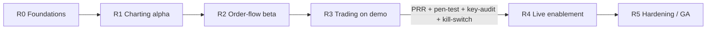
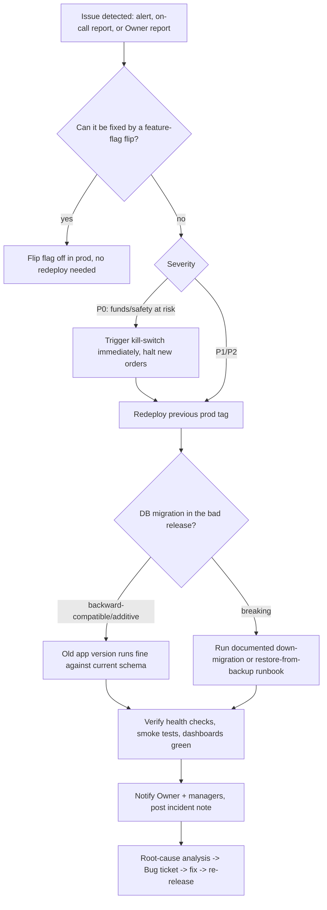

# 07 — Release Management & Production Readiness Review (PRR)

Status: locked. Companion to `01-sdlc-and-branching.md` (branching, environment promotion) and `02-definition-of-ready-done.md` (per-ticket DoD). Defines the release train, semver policy, changelog automation, release checklist, PRR checklist, the Live-enablement gate, rollback procedure, and post-release monitoring for CandleViewer.

---

## 1. Release train: R0–R5

Releases are cut as trains, not continuously — `main` deploys to **dev** continuously, but promotion to **staging (demo)** and **prod (live)** happens at named train boundaries so PRR and soak time are meaningful. Each train corresponds to a roadmap milestone in `30-release-roadmap.md`; trains are cumulative (each includes everything from the prior train plus new scope).

| Train  | Name            | Scope (representative, full detail in `30-release-roadmap.md`)                                                                                                                                                                                              | Target environment on completion | Live-enablement gate applies?                                  |
| ------ | --------------- | ----------------------------------------------------------------------------------------------------------------------------------------------------------------------------------------------------------------------------------------------------------- | -------------------------------- | -------------------------------------------------------------- |
| **R0** | Foundations     | Repo/infra scaffolding, auth/RBAC skeleton, Postgres/QuestDB/Parquet wiring, CI/CD, observability baseline, Electron shell boots, WebGL engine spike decision made                                                                                          | dev, smoke on staging            | No                                                             |
| **R1** | Charting alpha  | Custom WebGL chart engine core (candles, volume, basic overlays), symbol/timeframe browsing, recorder for user-selected symbols, connectivity smoke-tests against testnet                                                                                   | staging (demo)                   | No                                                             |
| **R2** | Order-flow beta | Footprint, volume/delta profiles, Deep-Stats rows, big-trades, CVD, DOM liquidity heatmap, speed-of-tape, imbalance tracker, iceberg/stop-run _estimated_ detectors, market regime                                                                          | staging (demo)                   | No                                                             |
| **R3** | Trading on demo | Full execution loop against **Bybit demo**: order ticket, chart/DOM trading, brackets, scaled orders, emulated OCO/iceberg/TWAP/chase, rule engine (form + node-graph editors), paper-trading validation, multi-account trade-group fan-out (demo accounts) | staging (demo), soaked           | No (no real funds yet)                                         |
| **R4** | Live enablement | Same feature set as R3 validated against **Bybit live** with real funds; owner/admin screens fully hardened (users/roles, Bybit accounts & keys, per-account profiles, audit log, system health, feature flags)                                             | prod (live)                      | **Yes — mandatory**                                            |
| **R5** | Hardening / GA  | Performance hardening, chaos/failover resilience, journal/analytics maturity, accessibility and security debt burn-down, general availability for the owner + all managers                                                                                  | prod (live)                      | Yes, re-verified (not a first-time gate, but checklist re-run) |

**R5 (and any post-R4 release) Live-enablement gate trigger rule:** the full four-item Live-enablement gate (§6: pen-test, key-permission audit, kill-switch test, plus the standard PRR) is re-run **in full, all four items, no subset** for R5 itself, because R5 is defined as touching resilience/chaos/failover and security-debt burn-down — areas that directly affect the fan-out safety invariant and key handling. For releases _after_ R5 (R6+, not yet named), the full four-item gate is mandatory again only if the release "meaningfully changes OMS/fan-out/keys" (§6 heading); a release that touches neither is not required to re-run the Live-enablement gate at all (standard PRR §5 still applies), and the PRR sign-off note must state explicitly which of the two cases applied and why, so "ambiguous scope" is never silently assumed in either direction.

Trains are not fixed-length by calendar; a train completes when its scope's Epics are Done per `02-definition-of-ready-done.md` and its PRR passes. Expected cadence is roughly every 4–8 sprints depending on scope, tracked live in `30-release-roadmap.md` and `31-sprint-plan.md`.



---

## 2. Semantic versioning (semver)

Format: `MAJOR.MINOR.PATCH` (e.g., `1.4.2`), applied to the whole monorepo release artifact (backend + frontend + Electron shell versioned together, since they ship as one product to one owner/team — no independent per-package public API to consumers outside this org).

| Bump      | Trigger                                                                                                                                                                                                                                                                                                                                         |
| --------- | ----------------------------------------------------------------------------------------------------------------------------------------------------------------------------------------------------------------------------------------------------------------------------------------------------------------------------------------------- |
| **MAJOR** | Breaking change to a persisted schema without a migration path, breaking change to the OpenAPI/WS contract that isn't backward compatible, or a release-train boundary that fundamentally changes trading semantics (e.g., R3→R4 live-enablement is treated as a MAJOR bump: `0.x.y` while pre-live, `1.0.0` at first Live-enablement release). |
| **MINOR** | New user-facing capability (new Story/Epic scope shipped), backward-compatible API/WS additions, new screen/feature behind a flag defaulting on.                                                                                                                                                                                                |
| **PATCH** | Bug fixes, backward-compatible internal changes, dependency bumps, hotfixes.                                                                                                                                                                                                                                                                    |

Conventional commits (`01-sdlc-and-branching.md` §6.2) drive the bump automatically: any commit with `!` or a `BREAKING CHANGE:` footer since the last tag forces MAJOR; presence of `feat:` commits (no breaking) forces MINOR; otherwise PATCH. Pre-`1.0.0` (before R4 Live-enablement), the project stays in `0.x.y` per standard semver pre-1.0 convention (anything may still change); `1.0.0` is declared explicitly at the first Live-enablement release, not automatically.

---

## 3. Changelog automation

- Every PR must include a changelog fragment: either a Conventional-Commits-parseable title/body (preferred, fully automated) or an explicit `Changelog: <one-line user-facing summary>` footer for cases where the commit message alone doesn't read well as a changelog line (e.g., multi-commit PRs squash-merged).
- CI renders a read-only preview of the **Unreleased** section on every merge to `main` and on PRs that touch `CHANGELOG.md` or the changelog tooling (`.github/workflows/changelog.yml`, job summary). It never commits, because `main` is protected (C-4.1). `CHANGELOG.md` changes only through reviewed PRs, never by CI. A sync PR runs the changelog sync command (`AGENTS.md` §4) whenever the preview reports more than 300 pending entries (so each PR stays within C-4.8), and again before each release cut (§4.1). Any PR may also add or curate lines by hand (see the `Security` bullet below). Sync is idempotent: each changelog-worthy commit since the last release tag appears exactly once in `CHANGELOG.md`, either under **Unreleased** (`Features`, `Fixes`, `Performance`, `Security` or `Breaking Changes`) or in a version section. An entry line counts for a commit only through the reference it ends with: the commit's `(sha)` or its PR number `(#N)`. Sync never removes or duplicates an existing entry. Curate by adding, rewording or moving lines while keeping their trailing `(#N)` or `(sha)` reference. Remove lines only in a finalised version section; exact-duplicate lines are the exception and may be deleted anywhere (sync collapses them too).
- At release-train cut time, the Unreleased section is finalized under the new version heading with the release date, and a GitHub Release is drafted automatically from it (tag `vX.Y.Z`, body = changelog section).
- Security-relevant fixes are called out in a `Security` subsection but **without exploit details** — a general description only (e.g., "Hardened API-key decryption path against timing side-channel"), full detail retained internally in the Security engineer's incident/finding tracker, not published in the public/shared changelog. The fixing PR writes the impact-only `Security` line itself, ending with its PR number `(#N)`. Sync then omits that commit's generated `Fixes` line.
- Changelog is reviewed by the ticket owner as part of PR review — an inaccurate or missing changelog line blocks merge queue enqueue (same as a failing required check) for any PR that isn't `chore:`/`ci:`/`docs:`-only.

---

## 4. Release checklist

Executed by the release owner (rotates among Architect/DevSecOps/a nominated lead) at every train cut, before promoting the release candidate from staging soak to a tagged release.

### 4.1 Pre-cut (on `main`, before branching `release/*`)

- [ ] All Epics/Stories targeted for this train are Done per `02-definition-of-ready-done.md` (board rollup shows 100% or explicit descope decisions recorded).
- [ ] No open `priority/p0-critical` or `priority/p1-high` bugs against in-scope areas.
- [ ] Full test pyramid green on `main` tip: unit, contract, integration (recorded Bybit fixtures), E2E (Playwright web + Electron), load/perf (k6/Locust + engine FPS benchmarks + ingestion soak), security scans (SAST/SCA/secrets/DAST/container), a11y (axe-core CI).
- [ ] **E2E order-flow subset (`@demo-rest-only` tagged specs) green against staging (demo)**: per `01-sdlc-and-branching.md` §9, demo has no WS order entry (REST only, per `24-owner-decisions.md`). Any order-placement/order-management E2E scenario in the pyramid above must run through the REST order-entry path against demo and assert no WS order-entry frames were sent; a release cannot proceed if the `@demo-rest-only` job is skipped, failing, or if any order-entry E2E spec is found still asserting over WS against demo.
- [ ] Coverage thresholds met (≥85% backend/engine, ≥80% frontend) — no regression from previous release.
- [ ] `CHANGELOG.md` Unreleased synced by a reviewed sync PR (the changelog preview reports 0 pending) and reviewed for accuracy and completeness.

### 4.2 Cut & soak

- [ ] `release/<semver>` branch cut from `main`.
- [ ] Deployed to **staging (demo)**.
- [ ] Soak period ≥48h (longer for R4/R5 — see §6) with synthetic + real demo-account traffic, monitored dashboards (Grafana) checked daily for anomalies.
- [ ] Any bug found during soak is fixed via a PR merged to `main` **and** cherry-picked into `release/<semver>` (never edited only on the release branch); soak clock restarts only if a P0/P1 is found, not for every P2/P3 cherry-pick.
- [ ] Stakeholder/Owner demo at Sprint Review performed against this staging build; explicit acceptance recorded.

### 4.3 PRR gate

- [ ] Full PRR checklist (§5) executed and passed, sign-off recorded from Architect, DevSecOps, Security, QA lead.
- [ ] **[R4 and any release re-touching Live-enablement scope only]** Live-enablement gate (§6) passed.

### 4.4 Cut to prod

- [ ] Tag `vX.Y.Z` created from `release/<semver>` HEAD.
- [ ] GitHub Release published with generated changelog.
- [ ] **Test-only settings absent (E16 R-E3, E16-FR-11):** the production config (live, and staging on demo) sets none of `CV_TEST_CLOCK`, `CV_TEST_CLOCK_FILE`, `CV_ALLOW_SHARED_VOLUME`, `CV_ACCOUNT_FIXTURE` and `CV_ACCOUNT_FIXTURE_DIR`; boot refuses the two test-clock keys outside a keyless testnet (#2086), `CV_ALLOW_SHARED_VOLUME` outside testnet (#1741), and the two account-fixture keys outside a keyless synthetic demo and in any release image, which carries no fixture transport (#2893).
- [ ] Deploy to **prod (live)** using the same deployment automation validated on staging (no manual prod-only steps — if a manual step is unavoidable, it's documented in a runbook and rehearsed on staging first).
- [ ] Feature flags for any train-scoped functionality flipped to their intended prod default (often still off, ramped gradually — see §8 post-release monitoring).
- [ ] Rollback procedure (§7) reconfirmed ready (previous tag deployable, DB migrations reversible or forward-only-safe) before traffic is allowed to reach the new build unattended.
- [ ] Post-release monitoring window opened (§8).
- [ ] `main` merged/rebased to ensure no divergence from `release/<semver>` (any soak-time cherry-picks that only landed on the release branch are forward-ported).

---

## 5. PRR (Production Readiness Review) checklist

Run as a ceremony (`01-sdlc-and-branching.md` §3) before every release-train prod promotion. Attendees: Architect, DevSecOps, Security engineer, QA lead, on-call owner (rotates). Go/no-go decision recorded on the release ticket; a "no-go" sends the release back to staging soak with named follow-up actions and re-schedules the PRR.

### 5.1 Observability

- [ ] Structured logs emitted for all critical paths (order placement, fan-out, rule-engine evaluation, WS reconnects) with correlation IDs traceable from ticket order → exchange order → account.
- [ ] Prometheus metrics exported: request latency/error-rate per endpoint, WS message throughput/lag, ingestion tick rate, book-engine processing latency, OMS order round-trip latency, rule-engine evaluation latency, recorder disk usage/rate.
- [ ] Grafana dashboards exist and are reviewed live in the PRR meeting: system health overview, trading activity, ingestion/recorder health, security/audit activity.
- [ ] Alerting rules configured and tested (a synthetic alert is fired and confirmed to reach the on-call channel) for: WS disconnect sustained >N seconds, exchange 5xx rate spike, rate-limit code `10018` hit, OMS order rejected repeatedly, fan-out partial-failure (some accounts filled, some didn't), disk usage approaching recorder retention budget, auth failures spike (possible credential-stuffing/misconfig).

### 5.2 Runbooks

- [ ] Runbook exists for: WS disconnect/reconnect storm, exchange outage/5xx, rate-limit breach handling, OMS stuck-order reconciliation, fan-out partial-failure recovery, database failover (Postgres), QuestDB/Parquet recovery from corruption, feature-flag emergency kill, full-system rollback.
- [ ] Each runbook has been read through (not necessarily fully rehearsed for every one — see restore drill below for the subset that must be rehearsed) by the on-call rotation members.
- [ ] On-call rotation and escalation path defined and reachable (who is paged, how, backup contact).

### 5.3 Backups & restore drill

**Targets (pass/fail budget for the drill below):**

| System                                                           | RPO (max acceptable data loss)                                                                   | RTO (max acceptable time to restore)                                                             |
| ---------------------------------------------------------------- | ------------------------------------------------------------------------------------------------ | ------------------------------------------------------------------------------------------------ |
| Postgres (accounts, RBAC, rule configs, orders/journal metadata) | ≤15 minutes (continuous WAL archiving between full backups)                                      | ≤2 hours to a booting, queryable instance in a scratch environment                               |
| QuestDB hot-tier (recent OHLC/tick data)                         | ≤24 hours (accepted, since it is reconstructible from Parquet cold-tier + re-ingestion)          | ≤4 hours to reconstruct the most-recently-traded symbol's hot-tier data via cold-tier replay     |
| Parquet/DuckDB cold tier (historical bars/ticks)                 | 0 (immutable, append-only, redundantly stored — no acceptable loss of already-committed history) | ≤4 hours to restore access to at least one symbol's full history from the off-box redundant copy |

A drill run that exceeds either the RPO or RTO figure above for the system under test is a **fail**: it blocks PRR sign-off (§5) and must be logged as a P1 finding in `32-risk-register.md` with a remediation Task ticket, not merely noted and waved through.

- [ ] Postgres: automated backup schedule confirmed running (frequency, retention, off-host copy) and consistent with the ≤15-minute RPO target above (full backup cadence + WAL/continuous archiving interval reviewed).
- [ ] QuestDB hot-tier: backup/export strategy confirmed (or explicitly accepted as replaceable-from-Parquet-cold-tier + re-ingestion, documented as such), consistent with the ≤24h RPO / ≤4h RTO targets above.
- [ ] Parquet/DuckDB cold tier: storage location redundancy confirmed (e.g., replicated disk/off-box copy), retention policy (30-day default, pin-to-keep) enforced by an automated job, verified.
- [ ] **Restore drill executed** (not just "backups exist" — an actual restore-to-a-scratch-environment is performed) at least once per release train touching data-layer changes, and at minimum once before R4: Postgres restored from backup and app boots against it; QuestDB/Parquet cold-tier restore validated for at least one symbol's history. Drill result (time-to-restore, any gaps found) recorded in `32-risk-register.md`, and measured against the RPO/RTO targets table above — **result is explicitly marked pass or fail against those targets**, not just recorded as a raw number.

### 5.4 Capacity

- [ ] Load test results (k6/Locust) reviewed against expected concurrent load (owner + a few account managers — small user count, but high message-rate WS fan-out and multi-account order fan-out are the real load vectors) with headroom margin stated (target: comfortably handle 3–5x expected peak).
- [ ] Chart-engine FPS benchmark reviewed (footprint + heatmap rendering at target density) against the budget in `06-performance-and-load-standard.md`.
- [ ] Ingestion soak test result reviewed (sustained tick/L2 ingestion over a multi-hour run with no memory growth/backlog).
- [ ] Per-account Bybit rate-limit budget reviewed for the fan-out account count in scope for this release (rate limits are per-UID — confirm fan-out to N accounts stays under limits with margin).

### 5.5 Security sign-off

- [ ] SAST (CodeQL/Semgrep/Bandit), SCA (Dependabot/pip-audit/npm audit), secrets scanning, DAST (OWASP ZAP), and container scan (Trivy) all clean or have accepted-risk sign-off with expiry dates for re-check.
- [ ] STRIDE threat models for all Epics in this train's scope reviewed as a set (not just individually at Epic-close) for cross-Epic interaction risks.
- [ ] Audit log verified append-only and complete for the actions in scope (account/key changes, rule changes, RBAC changes).
- [ ] API keys confirmed envelope-encrypted at rest; withdrawal permission confirmed OFF on all configured exchange keys (spot-check at least one account's key config in the admin screen during the review).

### 5.6 Rollback rehearsal

- [ ] Rollback procedure (§7) executed at least once in staging as a rehearsal (not just documented) before this PRR is signed off for R4, and periodically (at least once every 2 trains) thereafter.
- [ ] Rehearsal confirms: previous tag redeploys cleanly, DB migration compatibility (either reversible or the new migration is additive/backward-compatible so the old app version still runs against it), feature flags can be flipped off without a redeploy.

---

## 6. Live-enablement gate (R4 only, and any subsequent release that meaningfully changes OMS/fan-out/keys)

This gate is **additional to**, not a replacement for, the standard PRR (§5). It exists specifically because R4 is the first release where real funds are at risk.

- [ ] **Pen-test**: an independent (external or at minimum a different engineer than the implementers) penetration test performed against the deployed staging build covering: auth/RBAC bypass attempts, API-key exfiltration paths, OMS/order-injection abuse, rate-limit/DoS behavior, admin-screen privilege escalation, Tailscale-network-boundary assumptions (confirm no unintended public exposure). Findings triaged; all Critical/High findings resolved before go-live; Medium/Low findings either resolved or explicitly risk-accepted by the Owner in writing.
- [ ] **Key-permission audit**: every configured Bybit API key (all accounts, main + sub-accounts) manually verified in the Bybit account settings (not just trusted from app config) to have: withdrawal permission OFF, IP whitelist set to the Tailscale-reachable address(es) only, trade+read scope only (no unnecessary broader scope).
- [ ] **Kill-switch test**: the emergency stop mechanism (a feature-flag-or-equivalent that immediately halts all new order placement / rule-engine execution / fan-out across all accounts) is exercised end-to-end in staging: triggered, confirmed no new orders can be placed while active, confirmed existing open positions/orders are unaffected (kill-switch stops new risk-taking, it does not itself force-close positions unless a separate documented "flatten all" runbook is also invoked), and confirmed it can be released cleanly afterward.
- [ ] Owner (basiltt) explicitly signs off in writing (a ticket comment is sufficient) authorizing Live enablement, having reviewed the pen-test summary and key-permission audit results.

Only after all four boxes are checked may the release proceed to the "Cut to prod" step (§4.4) with Live trading enabled. If any Critical pen-test finding cannot be resolved before the planned cut date, the release either slips or ships with Live-trading behind a flag still OFF (demo-only) until resolved — Live-enablement is never rushed to hit a calendar date.

---

## 7. Rollback procedure

Applies to any prod release, invoked when post-release monitoring (§8) detects a regression, or when a hotfix (`01-sdlc-and-branching.md` §8) requires reverting instead of forward-fixing.



Rules:

1. **Feature flags are the first line of rollback** — any release-train scoped functionality should be flippable off without a redeploy; this is why flags are mandatory for user-visible Story-level work (`01-sdlc-and-branching.md` §10.4).
2. **Kill-switch before rollback** for any P0 involving live order flow — stop new risk first, then roll back the deployment; do not let a slow redeploy leave the system placing orders on known-bad code any longer than necessary.
3. **Database migrations must default to backward-compatible/additive** so that rolling back the app tag never requires an emergency schema down-migration under pressure; a breaking migration is only permitted with an explicit, PRR-reviewed down-migration script tested in the rollback rehearsal (§5.6).
4. **Every rollback produces an incident note** (what broke, detection method, time-to-detect, time-to-mitigate, root cause once known) filed to `32-risk-register.md` and reviewed at the next retro.
5. **Communication**: Owner and any active account managers are notified immediately on any live-trading-impacting rollback, before the RCA is complete — status first, explanation follows.

---

## 8. Post-release monitoring

- **First 24h ("hypercare")**: on-call engineer (rotates, named on the release ticket) actively watches Grafana dashboards and alert channel continuously; no unrelated deploys to prod during this window.
- **First 7 days**: daily check of key metrics (order success rate, WS uptime/reconnect frequency, ingestion gaps, rule-engine evaluation error rate, recorder disk trend) against the pre-release baseline; any statistically meaningful regression opens a Bug ticket immediately, `priority/p0` or `p1` depending on user impact.
- **Feature-flag ramp**: newly shipped user-visible features default to off or owner-only in prod immediately post-release, then ramped to all managers over the following days once hypercare confirms stability — this is the default rollout pattern for any Story behind a flag, not just a contingency.
- **Ongoing**: metrics from §5.1 feed the standing Grafana dashboards reviewed at each Sprint Review and each subsequent PRR, so trend regressions across releases (not just within one release) are caught; `32-risk-register.md` is updated whenever monitoring surfaces a new systemic risk (e.g., a recorder disk-growth trend approaching budget).
- Post-release monitoring findings that indicate a design or architecture gap are fed back into Refinement as new Epics/Tasks/Bugs — this is the explicit loop-closing step connecting release operations back into the sprint-planning cycle described in `01-sdlc-and-branching.md`.

## 9. Alert runbooks (E04-T05)

Every Prometheus alert in `infra/prometheus/alerts/` links to its section here (CI: `infra/alertmanager/check_alert_rules.py`). Two severities only: **Page** (act now, bypasses quiet hours) and **Ticket** (next working session). Payloads carry component, severity and this link only. Every section below carries the same seven elements (what fired, user impact, what is still safe, first three diagnostic commands with the healthy result, remediation, escalation, verify recovery). `Q` queries use the local Prometheus at `127.0.0.1:9090`. Runbooks never contain credentials: secrets live in the host keychain (SR-002); steps that touch keys or trading state name the required role and are audited.

> **Validation status (E04-T07).** Literal execution of three runbooks by a non-author against staging has **not** been performed: no staging stack exists in the agent-delivery environment. This is tracked as a follow-up on the ticket and requires an explicit owner exception or a human run before the DoD box is ticked. Findings from that run must be folded back into the affected sections.

<a id="alert-bybitclockdriftwarning"></a>

### BybitClockDriftWarning

| Element               | Detail                                                                                                                                                          |
| --------------------- | --------------------------------------------------------------------------------------------------------------------------------------------------------------- |
| 1. What fired         | Signed offset between this host and Bybit server time is between 500 ms and 2000 ms for 2 minutes (`exchange_clock_drift_ms`). Severity: Ticket.                |
| 2. User impact        | None yet. Order entry is still allowed; signed requests risk rejection (`10002`) if drift keeps growing.                                                        |
| 3. What is still safe | Trading, native stop-losses and market data. Native exchange stop-losses already resting on Bybit are unaffected; they execute without this system.             |
| 5. Remediation        | Follow `docs/plan/runbooks/clock-sync.md` (resync with `sudo chronyc makestep`; after host sleep run `wsl --shutdown` and relaunch). Never widen `recv_window`. |
| 6. Escalation         | Owner on-call if drift is still above 500 ms after 30 minutes.                                                                                                  |
| 7. Verify recovery    | `exchange_clock_drift_ms` back within +/-500 ms for 5 minutes; the alert resolves in Alertmanager.                                                              |

**4. First three diagnostic commands** (run from the repo root; expected healthy result: `value` within -500..500; `System clock synchronized: yes`; System time under 0.05 seconds.)

```bash
curl -s 'http://127.0.0.1:9090/api/v1/query' --data-urlencode 'query=exchange_clock_drift_ms'
timedatectl status | grep -E 'synchronized|NTP'
chronyc tracking | grep -E 'System time|Leap'
```

<a id="alert-bybitclockdriftcritical"></a>

### BybitClockDriftCritical

| Element               | Detail                                                                                                                                                              |
| --------------------- | ------------------------------------------------------------------------------------------------------------------------------------------------------------------- |
| 1. What fired         | Offset exceeds 2000 ms for 1 minute (`exchange_clock_drift_ms`). Severity: Page.                                                                                    |
| 2. User impact        | Order entry is refused by the clock guard (`ClockDriftError`); new orders, fan-out and rule actions cannot be placed.                                               |
| 3. What is still safe | Existing positions and their native exchange stop-losses are unaffected. Read-only screens still work.                                                              |
| 5. Remediation        | Resync the host clock per `docs/plan/runbooks/clock-sync.md`. Do not edit `recv_window_ms`. No role is needed for a host resync; any restart of the api is audited. |
| 6. Escalation         | Owner immediately; if not fixed in 15 minutes, manage open positions directly on the exchange.                                                                      |
| 7. Verify recovery    | Drift back under 1500 ms (the `ClockDriftBlockingTrading` clear point) and a test order on demo succeeds.                                                           |

**4. First three diagnostic commands** (run from the repo root; expected healthy result: `value` within -500..500; clock synchronized.)

```bash
curl -s 'http://127.0.0.1:9090/api/v1/query' --data-urlencode 'query=exchange_clock_drift_ms'
timedatectl status | grep -E 'synchronized|NTP'
chronyc tracking | grep -E 'System time|Leap'
```

<a id="alert-bybitclockoffsetstale"></a>

### BybitClockOffsetStale

| Element               | Detail                                                                                                                                                                            |
| --------------------- | --------------------------------------------------------------------------------------------------------------------------------------------------------------------------------- |
| 1. What fired         | Offset not re-measured for over 15 minutes (`clock_offset_age_seconds` > 900). Severity: Ticket.                                                                                  |
| 2. User impact        | The last known offset is still applied but ages out; drift may be undetected.                                                                                                     |
| 3. What is still safe | Trading continues; native stop-losses are unaffected.                                                                                                                             |
| 5. Remediation        | If the time endpoint is unreachable fix host egress/DNS; if reachable restart the api container: `docker compose -f infra/compose/docker-compose.yml --profile core restart api`. |
| 6. Escalation         | Owner if age stays above 900 s for an hour.                                                                                                                                       |
| 7. Verify recovery    | `clock_offset_age_seconds` drops below 60 after the next probe cycle.                                                                                                             |

**4. First three diagnostic commands** (run from the repo root; expected healthy result: age under 900; HTTP `200`.)

```bash
curl -s 'http://127.0.0.1:9090/api/v1/query' --data-urlencode 'query=clock_offset_age_seconds'
docker compose -f infra/compose/docker-compose.yml --profile core logs --since 15m api | grep -i clock
curl -s -o /dev/null -w '%{http_code}
' https://api.bybit.com/v5/market/time
```

<a id="alert-latencybudgetbreach"></a>

### LatencyBudgetBreach

| Element               | Detail                                                                                                                                                                                  |
| --------------------- | --------------------------------------------------------------------------------------------------------------------------------------------------------------------------------------- |
| 1. What fired         | p95 tick-to-paint above 250 ms for 60 s (`cv:e2e_tick_to_paint_seconds:p95_1m`). Ticket.                                                                                                |
| 2. User impact        | Charts feel laggy; no order is affected.                                                                                                                                                |
| 3. What is still safe | Order entry, stop-losses and recording. Native exchange stop-losses already resting on Bybit are unaffected; they execute without this system.                                          |
| 5. Remediation        | Open the Grafana System health and Market data dashboards and find the stage that grew. Close extra chart panes; if the api is CPU-bound restart it (`docker compose ... restart api`). |
| 6. Escalation         | Owner if it persists across two sessions; file a perf ticket.                                                                                                                           |
| 7. Verify recovery    | p95 under 0.25 for 15 minutes.                                                                                                                                                          |

**4. First three diagnostic commands** (run from the repo root; expected healthy result: p95 under 0.25; loop lag p99 under 0.1; api CPU under 80%.)

```bash
curl -s 'http://127.0.0.1:9090/api/v1/query' --data-urlencode 'query=cv:e2e_tick_to_paint_seconds:p95_1m'
curl -s 'http://127.0.0.1:9090/api/v1/query' --data-urlencode 'query=histogram_quantile(0.99,sum by (le)(rate(event_loop_lag_seconds_bucket[5m])))'
docker compose -f infra/compose/docker-compose.yml stats --no-stream
```

<a id="alert-ticktopaintslofastburn"></a>

### TickToPaintSloFastBurn

| Element               | Detail                                                                                                               |
| --------------------- | -------------------------------------------------------------------------------------------------------------------- |
| 1. What fired         | Error budget of the tick-to-paint SLO burning above 14.4x over 1 h and 6x over 6 h. Ticket.                          |
| 2. User impact        | Sustained slow charts; the budget exhausts within days.                                                              |
| 3. What is still safe | Trading path. Native exchange stop-losses already resting on Bybit are unaffected; they execute without this system. |
| 5. Remediation        | As for LatencyBudgetBreach; check deploy annotations in Grafana and roll back the suspect release per section 7.     |
| 6. Escalation         | Owner; freeze feature releases until burn is below 1.                                                                |
| 7. Verify recovery    | Both burn rates under 1 for 1 hour.                                                                                  |

**4. First three diagnostic commands** (run from the repo root; expected healthy result: Both burn rates below 1.)

```bash
curl -s 'http://127.0.0.1:9090/api/v1/query' --data-urlencode 'query=cv:slo_tick_to_paint:burn_rate_1h'
curl -s 'http://127.0.0.1:9090/api/v1/query' --data-urlencode 'query=cv:slo_tick_to_paint:burn_rate_6h'
curl -s 'http://127.0.0.1:9090/api/v1/query' --data-urlencode 'query=cv:e2e_tick_to_paint_seconds:p95_1m'
```

<a id="alert-watchdog"></a>

### Watchdog

| Element               | Detail                                                                                                                           |
| --------------------- | -------------------------------------------------------------------------------------------------------------------------------- |
| 1. What fired         | Always firing by design. It is not an incident.                                                                                  |
| 2. User impact        | If its notification STOPS arriving, the Prometheus -> Alertmanager -> webhook pipeline is dead and no other alert can reach you. |
| 3. What is still safe | Trading and native stop-losses are unaffected; you are blind, not broken.                                                        |
| 5. Remediation        | See [Observability stack is down](#observability-stack-is-down).                                                                 |
| 6. Escalation         | Owner if the dead-man heartbeat is missing for 10 minutes.                                                                       |
| 7. Verify recovery    | Heartbeat arrives at the dead-man receiver again.                                                                                |

**4. First three diagnostic commands** (run from the repo root; expected healthy result: Both services `healthy`; `OK`; one Watchdog series with value 1.)

```bash
docker compose -f infra/compose/docker-compose.yml --profile obs ps prometheus alertmanager
curl -s http://127.0.0.1:9093/-/healthy
curl -s 'http://127.0.0.1:9090/api/v1/query' --data-urlencode 'query=ALERTS{alertname="Watchdog"}'
```

<a id="alert-expectedmetricmissingnakedpositionalertstotal"></a>

### ExpectedMetricMissingNakedPositionAlertsTotal

| Element               | Detail                                                                                                             |
| --------------------- | ------------------------------------------------------------------------------------------------------------------ |
| 1. What fired         | `absent()` guard: a catalogued metric is not emitted (all `ExpectedMetricMissing*` rules). Ticket.                 |
| 2. User impact        | The alert that depends on that metric is blind.                                                                    |
| 3. What is still safe | Trading.                                                                                                           |
| 5. Remediation        | Expected until the owning epic ships (catalogue status `planned`). Otherwise fix the emitter or its scrape target. |
| 6. Escalation         | Owner of the emitting epic.                                                                                        |
| 7. Verify recovery    | Guard clears within 15 minutes.                                                                                    |

**4. First three diagnostic commands** (run from the repo root; expected healthy result: empty vector; count above 0.)

```bash
curl -s 'http://127.0.0.1:9090/api/v1/query' --data-urlencode 'query=absent(<metric from the alert name>)'
curl -s http://127.0.0.1:8000/metrics | grep -c '^<metric>'
grep -n '<metric>' services/api/candleviewer/observability/metrics_catalogue.py
```

<a id="alert-expectedmetricmissingomsunknownorders"></a>

### ExpectedMetricMissingOmsUnknownOrders

| Element               | Detail                                                                                                             |
| --------------------- | ------------------------------------------------------------------------------------------------------------------ |
| 1. What fired         | `absent()` guard: a catalogued metric is not emitted (all `ExpectedMetricMissing*` rules). Ticket.                 |
| 2. User impact        | The alert that depends on that metric is blind.                                                                    |
| 3. What is still safe | Trading.                                                                                                           |
| 5. Remediation        | Expected until the owning epic ships (catalogue status `planned`). Otherwise fix the emitter or its scrape target. |
| 6. Escalation         | Owner of the emitting epic.                                                                                        |
| 7. Verify recovery    | Guard clears within 15 minutes.                                                                                    |

**4. First three diagnostic commands** (run from the repo root; expected healthy result: empty vector; count above 0.)

```bash
curl -s 'http://127.0.0.1:9090/api/v1/query' --data-urlencode 'query=absent(<metric from the alert name>)'
curl -s http://127.0.0.1:8000/metrics | grep -c '^<metric>'
grep -n '<metric>' services/api/candleviewer/observability/metrics_catalogue.py
```

<a id="alert-expectedmetricmissingpgup"></a>

### ExpectedMetricMissingPgUp

| Element               | Detail                                                                                                             |
| --------------------- | ------------------------------------------------------------------------------------------------------------------ |
| 1. What fired         | `absent()` guard: a catalogued metric is not emitted (all `ExpectedMetricMissing*` rules). Ticket.                 |
| 2. User impact        | The alert that depends on that metric is blind.                                                                    |
| 3. What is still safe | Trading.                                                                                                           |
| 5. Remediation        | Expected until the owning epic ships (catalogue status `planned`). Otherwise fix the emitter or its scrape target. |
| 6. Escalation         | Owner of the emitting epic.                                                                                        |
| 7. Verify recovery    | Guard clears within 15 minutes.                                                                                    |

**4. First three diagnostic commands** (run from the repo root; expected healthy result: empty vector; count above 0.)

```bash
curl -s 'http://127.0.0.1:9090/api/v1/query' --data-urlencode 'query=absent(<metric from the alert name>)'
curl -s http://127.0.0.1:8000/metrics | grep -c '^<metric>'
grep -n '<metric>' services/api/candleviewer/observability/metrics_catalogue.py
```

<a id="alert-expectedmetricmissingbybitclockdriftms"></a>

### ExpectedMetricMissingBybitClockDriftMs

| Element               | Detail                                                                                                             |
| --------------------- | ------------------------------------------------------------------------------------------------------------------ |
| 1. What fired         | `absent()` guard: a catalogued metric is not emitted (all `ExpectedMetricMissing*` rules). Ticket.                 |
| 2. User impact        | The alert that depends on that metric is blind.                                                                    |
| 3. What is still safe | Trading.                                                                                                           |
| 5. Remediation        | Expected until the owning epic ships (catalogue status `planned`). Otherwise fix the emitter or its scrape target. |
| 6. Escalation         | Owner of the emitting epic.                                                                                        |
| 7. Verify recovery    | Guard clears within 15 minutes.                                                                                    |

**4. First three diagnostic commands** (run from the repo root; expected healthy result: empty vector; count above 0.)

```bash
curl -s 'http://127.0.0.1:9090/api/v1/query' --data-urlencode 'query=absent(<metric from the alert name>)'
curl -s http://127.0.0.1:8000/metrics | grep -c '^<metric>'
grep -n '<metric>' services/api/candleviewer/observability/metrics_catalogue.py
```

<a id="alert-expectedmetricmissingdiskusedratio"></a>

### ExpectedMetricMissingDiskUsedRatio

| Element               | Detail                                                                                                             |
| --------------------- | ------------------------------------------------------------------------------------------------------------------ |
| 1. What fired         | `absent()` guard: a catalogued metric is not emitted (all `ExpectedMetricMissing*` rules). Ticket.                 |
| 2. User impact        | The alert that depends on that metric is blind.                                                                    |
| 3. What is still safe | Trading.                                                                                                           |
| 5. Remediation        | Expected until the owning epic ships (catalogue status `planned`). Otherwise fix the emitter or its scrape target. |
| 6. Escalation         | Owner of the emitting epic.                                                                                        |
| 7. Verify recovery    | Guard clears within 15 minutes.                                                                                    |

**4. First three diagnostic commands** (run from the repo root; expected healthy result: empty vector; count above 0.)

```bash
curl -s 'http://127.0.0.1:9090/api/v1/query' --data-urlencode 'query=absent(<metric from the alert name>)'
curl -s http://127.0.0.1:8000/metrics | grep -c '^<metric>'
grep -n '<metric>' services/api/candleviewer/observability/metrics_catalogue.py
```

<a id="alert-expectedmetricmissingauditchainverificationfailurestotal"></a>

### ExpectedMetricMissingAuditChainVerificationFailuresTotal

| Element               | Detail                                                                                                             |
| --------------------- | ------------------------------------------------------------------------------------------------------------------ |
| 1. What fired         | `absent()` guard: a catalogued metric is not emitted (all `ExpectedMetricMissing*` rules). Ticket.                 |
| 2. User impact        | The alert that depends on that metric is blind.                                                                    |
| 3. What is still safe | Trading.                                                                                                           |
| 5. Remediation        | Expected until the owning epic ships (catalogue status `planned`). Otherwise fix the emitter or its scrape target. |
| 6. Escalation         | Owner of the emitting epic.                                                                                        |
| 7. Verify recovery    | Guard clears within 15 minutes.                                                                                    |

**4. First three diagnostic commands** (run from the repo root; expected healthy result: empty vector; count above 0.)

```bash
curl -s 'http://127.0.0.1:9090/api/v1/query' --data-urlencode 'query=absent(<metric from the alert name>)'
curl -s http://127.0.0.1:8000/metrics | grep -c '^<metric>'
grep -n '<metric>' services/api/candleviewer/observability/metrics_catalogue.py
```

<a id="alert-expectedmetricmissingwsconnectionstate"></a>

### ExpectedMetricMissingWsConnectionState

| Element               | Detail                                                                                                             |
| --------------------- | ------------------------------------------------------------------------------------------------------------------ |
| 1. What fired         | `absent()` guard: a catalogued metric is not emitted (all `ExpectedMetricMissing*` rules). Ticket.                 |
| 2. User impact        | The alert that depends on that metric is blind.                                                                    |
| 3. What is still safe | Trading.                                                                                                           |
| 5. Remediation        | Expected until the owning epic ships (catalogue status `planned`). Otherwise fix the emitter or its scrape target. |
| 6. Escalation         | Owner of the emitting epic.                                                                                        |
| 7. Verify recovery    | Guard clears within 15 minutes.                                                                                    |

**4. First three diagnostic commands** (run from the repo root; expected healthy result: empty vector; count above 0.)

```bash
curl -s 'http://127.0.0.1:9090/api/v1/query' --data-urlencode 'query=absent(<metric from the alert name>)'
curl -s http://127.0.0.1:8000/metrics | grep -c '^<metric>'
grep -n '<metric>' services/api/candleviewer/observability/metrics_catalogue.py
```

<a id="alert-expectedmetricmissingbookresynctotal"></a>

### ExpectedMetricMissingBookResyncTotal

| Element               | Detail                                                                                                             |
| --------------------- | ------------------------------------------------------------------------------------------------------------------ |
| 1. What fired         | `absent()` guard: a catalogued metric is not emitted (all `ExpectedMetricMissing*` rules). Ticket.                 |
| 2. User impact        | The alert that depends on that metric is blind.                                                                    |
| 3. What is still safe | Trading.                                                                                                           |
| 5. Remediation        | Expected until the owning epic ships (catalogue status `planned`). Otherwise fix the emitter or its scrape target. |
| 6. Escalation         | Owner of the emitting epic.                                                                                        |
| 7. Verify recovery    | Guard clears within 15 minutes.                                                                                    |

**4. First three diagnostic commands** (run from the repo root; expected healthy result: empty vector; count above 0.)

```bash
curl -s 'http://127.0.0.1:9090/api/v1/query' --data-urlencode 'query=absent(<metric from the alert name>)'
curl -s http://127.0.0.1:8000/metrics | grep -c '^<metric>'
grep -n '<metric>' services/api/candleviewer/observability/metrics_catalogue.py
```

<a id="alert-expectedmetricmissingeventlooplagsecondsbucket"></a>

### ExpectedMetricMissingEventLoopLagSecondsBucket

| Element               | Detail                                                                                                             |
| --------------------- | ------------------------------------------------------------------------------------------------------------------ |
| 1. What fired         | `absent()` guard: a catalogued metric is not emitted (all `ExpectedMetricMissing*` rules). Ticket.                 |
| 2. User impact        | The alert that depends on that metric is blind.                                                                    |
| 3. What is still safe | Trading.                                                                                                           |
| 5. Remediation        | Expected until the owning epic ships (catalogue status `planned`). Otherwise fix the emitter or its scrape target. |
| 6. Escalation         | Owner of the emitting epic.                                                                                        |
| 7. Verify recovery    | Guard clears within 15 minutes.                                                                                    |

**4. First three diagnostic commands** (run from the repo root; expected healthy result: empty vector; count above 0.)

```bash
curl -s 'http://127.0.0.1:9090/api/v1/query' --data-urlencode 'query=absent(<metric from the alert name>)'
curl -s http://127.0.0.1:8000/metrics | grep -c '^<metric>'
grep -n '<metric>' services/api/candleviewer/observability/metrics_catalogue.py
```

<a id="alert-expectedmetricmissingruleautodisarmtotal"></a>

### ExpectedMetricMissingRuleAutodisarmTotal

| Element               | Detail                                                                                                             |
| --------------------- | ------------------------------------------------------------------------------------------------------------------ |
| 1. What fired         | `absent()` guard: a catalogued metric is not emitted (all `ExpectedMetricMissing*` rules). Ticket.                 |
| 2. User impact        | The alert that depends on that metric is blind.                                                                    |
| 3. What is still safe | Trading.                                                                                                           |
| 5. Remediation        | Expected until the owning epic ships (catalogue status `planned`). Otherwise fix the emitter or its scrape target. |
| 6. Escalation         | Owner of the emitting epic.                                                                                        |
| 7. Verify recovery    | Guard clears within 15 minutes.                                                                                    |

**4. First three diagnostic commands** (run from the repo root; expected healthy result: empty vector; count above 0.)

```bash
curl -s 'http://127.0.0.1:9090/api/v1/query' --data-urlencode 'query=absent(<metric from the alert name>)'
curl -s http://127.0.0.1:8000/metrics | grep -c '^<metric>'
grep -n '<metric>' services/api/candleviewer/observability/metrics_catalogue.py
```

<a id="alert-expectedmetricmissingenvmismatchattemptstotal"></a>

### ExpectedMetricMissingEnvMismatchAttemptsTotal

| Element               | Detail                                                                                                             |
| --------------------- | ------------------------------------------------------------------------------------------------------------------ |
| 1. What fired         | `absent()` guard: a catalogued metric is not emitted (all `ExpectedMetricMissing*` rules). Ticket.                 |
| 2. User impact        | The alert that depends on that metric is blind.                                                                    |
| 3. What is still safe | Trading.                                                                                                           |
| 5. Remediation        | Expected until the owning epic ships (catalogue status `planned`). Otherwise fix the emitter or its scrape target. |
| 6. Escalation         | Owner of the emitting epic.                                                                                        |
| 7. Verify recovery    | Guard clears within 15 minutes.                                                                                    |

**4. First three diagnostic commands** (run from the repo root; expected healthy result: empty vector; count above 0.)

```bash
curl -s 'http://127.0.0.1:9090/api/v1/query' --data-urlencode 'query=absent(<metric from the alert name>)'
curl -s http://127.0.0.1:8000/metrics | grep -c '^<metric>'
grep -n '<metric>' services/api/candleviewer/observability/metrics_catalogue.py
```

<a id="alert-expectedmetricmissingcredentialexpirydays"></a>

### ExpectedMetricMissingCredentialExpiryDays

| Element               | Detail                                                                                                             |
| --------------------- | ------------------------------------------------------------------------------------------------------------------ |
| 1. What fired         | `absent()` guard: a catalogued metric is not emitted (all `ExpectedMetricMissing*` rules). Ticket.                 |
| 2. User impact        | The alert that depends on that metric is blind.                                                                    |
| 3. What is still safe | Trading.                                                                                                           |
| 5. Remediation        | Expected until the owning epic ships (catalogue status `planned`). Otherwise fix the emitter or its scrape target. |
| 6. Escalation         | Owner of the emitting epic.                                                                                        |
| 7. Verify recovery    | Guard clears within 15 minutes.                                                                                    |

**4. First three diagnostic commands** (run from the repo root; expected healthy result: empty vector; count above 0.)

```bash
curl -s 'http://127.0.0.1:9090/api/v1/query' --data-urlencode 'query=absent(<metric from the alert name>)'
curl -s http://127.0.0.1:8000/metrics | grep -c '^<metric>'
grep -n '<metric>' services/api/candleviewer/observability/metrics_catalogue.py
```

<a id="alert-expectedmetricmissingauthloginfailurestotal"></a>

### ExpectedMetricMissingAuthLoginFailuresTotal

| Element               | Detail                                                                                                             |
| --------------------- | ------------------------------------------------------------------------------------------------------------------ |
| 1. What fired         | `absent()` guard: a catalogued metric is not emitted (all `ExpectedMetricMissing*` rules). Ticket.                 |
| 2. User impact        | The alert that depends on that metric is blind.                                                                    |
| 3. What is still safe | Trading.                                                                                                           |
| 5. Remediation        | Expected until the owning epic ships (catalogue status `planned`). Otherwise fix the emitter or its scrape target. |
| 6. Escalation         | Owner of the emitting epic.                                                                                        |
| 7. Verify recovery    | Guard clears within 15 minutes.                                                                                    |

**4. First three diagnostic commands** (run from the repo root; expected healthy result: empty vector; count above 0.)

```bash
curl -s 'http://127.0.0.1:9090/api/v1/query' --data-urlencode 'query=absent(<metric from the alert name>)'
curl -s http://127.0.0.1:8000/metrics | grep -c '^<metric>'
grep -n '<metric>' services/api/candleviewer/observability/metrics_catalogue.py
```

<a id="alert-expectedmetricmissingauthlockoutstotal"></a>

### ExpectedMetricMissingAuthLockoutsTotal

| Element               | Detail                                                                                                             |
| --------------------- | ------------------------------------------------------------------------------------------------------------------ |
| 1. What fired         | `absent()` guard: a catalogued metric is not emitted (all `ExpectedMetricMissing*` rules). Ticket.                 |
| 2. User impact        | The alert that depends on that metric is blind.                                                                    |
| 3. What is still safe | Trading.                                                                                                           |
| 5. Remediation        | Expected until the owning epic ships (catalogue status `planned`). Otherwise fix the emitter or its scrape target. |
| 6. Escalation         | Owner of the emitting epic.                                                                                        |
| 7. Verify recovery    | Guard clears within 15 minutes.                                                                                    |

**4. First three diagnostic commands** (run from the repo root; expected healthy result: empty vector; count above 0.)

```bash
curl -s 'http://127.0.0.1:9090/api/v1/query' --data-urlencode 'query=absent(<metric from the alert name>)'
curl -s http://127.0.0.1:8000/metrics | grep -c '^<metric>'
grep -n '<metric>' services/api/candleviewer/observability/metrics_catalogue.py
```

<a id="alert-expectedmetricmissingauthzdeniedtotal"></a>

### ExpectedMetricMissingAuthzDeniedTotal

| Element               | Detail                                                                                                             |
| --------------------- | ------------------------------------------------------------------------------------------------------------------ |
| 1. What fired         | `absent()` guard: a catalogued metric is not emitted (all `ExpectedMetricMissing*` rules). Ticket.                 |
| 2. User impact        | The alert that depends on that metric is blind.                                                                    |
| 3. What is still safe | Trading.                                                                                                           |
| 5. Remediation        | Expected until the owning epic ships (catalogue status `planned`). Otherwise fix the emitter or its scrape target. |
| 6. Escalation         | Owner of the emitting epic.                                                                                        |
| 7. Verify recovery    | Guard clears within 15 minutes.                                                                                    |

**4. First three diagnostic commands** (run from the repo root; expected healthy result: empty vector; count above 0.)

```bash
curl -s 'http://127.0.0.1:9090/api/v1/query' --data-urlencode 'query=absent(<metric from the alert name>)'
curl -s http://127.0.0.1:8000/metrics | grep -c '^<metric>'
grep -n '<metric>' services/api/candleviewer/observability/metrics_catalogue.py
```

<a id="alert-expectedmetricmissingcredentialverificationfailurestotal"></a>

### ExpectedMetricMissingCredentialVerificationFailuresTotal

| Element               | Detail                                                                                                             |
| --------------------- | ------------------------------------------------------------------------------------------------------------------ |
| 1. What fired         | `absent()` guard: a catalogued metric is not emitted (all `ExpectedMetricMissing*` rules). Ticket.                 |
| 2. User impact        | The alert that depends on that metric is blind.                                                                    |
| 3. What is still safe | Trading.                                                                                                           |
| 5. Remediation        | Expected until the owning epic ships (catalogue status `planned`). Otherwise fix the emitter or its scrape target. |
| 6. Escalation         | Owner of the emitting epic.                                                                                        |
| 7. Verify recovery    | Guard clears within 15 minutes.                                                                                    |

**4. First three diagnostic commands** (run from the repo root; expected healthy result: empty vector; count above 0.)

```bash
curl -s 'http://127.0.0.1:9090/api/v1/query' --data-urlencode 'query=absent(<metric from the alert name>)'
curl -s http://127.0.0.1:8000/metrics | grep -c '^<metric>'
grep -n '<metric>' services/api/candleviewer/observability/metrics_catalogue.py
```

<a id="alert-expectedmetricmissingomsraterejecttotal"></a>

### ExpectedMetricMissingOmsRateRejectTotal

| Element               | Detail                                                                                                             |
| --------------------- | ------------------------------------------------------------------------------------------------------------------ |
| 1. What fired         | `absent()` guard: a catalogued metric is not emitted (all `ExpectedMetricMissing*` rules). Ticket.                 |
| 2. User impact        | The alert that depends on that metric is blind.                                                                    |
| 3. What is still safe | Trading.                                                                                                           |
| 5. Remediation        | Expected until the owning epic ships (catalogue status `planned`). Otherwise fix the emitter or its scrape target. |
| 6. Escalation         | Owner of the emitting epic.                                                                                        |
| 7. Verify recovery    | Guard clears within 15 minutes.                                                                                    |

**4. First three diagnostic commands** (run from the repo root; expected healthy result: empty vector; count above 0.)

```bash
curl -s 'http://127.0.0.1:9090/api/v1/query' --data-urlencode 'query=absent(<metric from the alert name>)'
curl -s http://127.0.0.1:8000/metrics | grep -c '^<metric>'
grep -n '<metric>' services/api/candleviewer/observability/metrics_catalogue.py
```

<a id="alert-expectedmetricmissingegressipchangestotal"></a>

### ExpectedMetricMissingEgressIpChangesTotal

| Element               | Detail                                                                                                             |
| --------------------- | ------------------------------------------------------------------------------------------------------------------ |
| 1. What fired         | `absent()` guard: a catalogued metric is not emitted (all `ExpectedMetricMissing*` rules). Ticket.                 |
| 2. User impact        | The alert that depends on that metric is blind.                                                                    |
| 3. What is still safe | Trading.                                                                                                           |
| 5. Remediation        | Expected until the owning epic ships (catalogue status `planned`). Otherwise fix the emitter or its scrape target. |
| 6. Escalation         | Owner of the emitting epic.                                                                                        |
| 7. Verify recovery    | Guard clears within 15 minutes.                                                                                    |

**4. First three diagnostic commands** (run from the repo root; expected healthy result: empty vector; count above 0.)

```bash
curl -s 'http://127.0.0.1:9090/api/v1/query' --data-urlencode 'query=absent(<metric from the alert name>)'
curl -s http://127.0.0.1:8000/metrics | grep -c '^<metric>'
grep -n '<metric>' services/api/candleviewer/observability/metrics_catalogue.py
```

<a id="alert-nakedpositiondetected"></a>

### NakedPositionDetected

| Element               | Detail                                                                                                                                                                                                     |
| --------------------- | ---------------------------------------------------------------------------------------------------------------------------------------------------------------------------------------------------------- |
| 1. What fired         | A position exists without a native exchange stop-loss (`naked_position_alerts_total` increased). Page.                                                                                                     |
| 2. User impact        | Real money is exposed without the protective stop required by C-2.6.                                                                                                                                       |
| 3. What is still safe | Other accounts that carry stops. The exchange does not protect this position.                                                                                                                              |
| 5. Remediation        | Attach a stop in the web app (position row, Set stop) or flatten on the exchange now; then find why attachment failed from the log traceId. Requires Owner or the assigned Manager; the action is audited. |
| 6. Escalation         | Owner immediately; never ticket-priority.                                                                                                                                                                  |
| 7. Verify recovery    | Position shows a native stop in the app and on Bybit; no new increase for 15 minutes.                                                                                                                      |

**4. First three diagnostic commands** (run from the repo root; expected healthy result: increase equal to 0.)

```bash
curl -s 'http://127.0.0.1:9090/api/v1/query' --data-urlencode 'query=increase(naked_position_alerts_total[5m])'
docker compose -f infra/compose/docker-compose.yml --profile core --profile obs logs --since 15m api | grep -i 'naked' | tail -20
docker compose -f infra/compose/docker-compose.yml --profile core --profile obs logs --since 15m api | grep -i 'trading-stop' | tail -20
```

<a id="alert-omsunknownorders"></a>

### OmsUnknownOrders

| Element               | Detail                                                                                                                                                                                                       |
| --------------------- | ------------------------------------------------------------------------------------------------------------------------------------------------------------------------------------------------------------ |
| 1. What fired         | Orders in unknown state for 60 s (`oms_unknown_orders` > 0). Page.                                                                                                                                           |
| 2. User impact        | The OMS cannot say whether an order is live; fan-out and risk numbers may be wrong.                                                                                                                          |
| 3. What is still safe | Native stop-losses on the exchange.                                                                                                                                                                          |
| 5. Remediation        | Trigger reconciliation from the admin Orders screen (Owner; audited) or restart the api, which reconciles against REST on startup. Compare with Bybit open orders; never resubmit under a new `orderLinkId`. |
| 6. Escalation         | Owner immediately if not zero in 5 minutes.                                                                                                                                                                  |
| 7. Verify recovery    | `oms_unknown_orders` is 0 for 5 minutes.                                                                                                                                                                     |

**4. First three diagnostic commands** (run from the repo root; expected healthy result: value 0.)

```bash
curl -s 'http://127.0.0.1:9090/api/v1/query' --data-urlencode 'query=oms_unknown_orders'
docker compose -f infra/compose/docker-compose.yml --profile core --profile obs logs --since 15m api | grep -i 'unknown' | tail -20
docker compose -f infra/compose/docker-compose.yml --profile core --profile obs logs --since 15m api | grep -i 'reconcil' | tail -20
```

<a id="alert-postgresdown"></a>

### PostgresDown

| Element               | Detail                                                                                                                                                                 |
| --------------------- | ---------------------------------------------------------------------------------------------------------------------------------------------------------------------- |
| 1. What fired         | `pg_up` == 0 for 1 minute. Page.                                                                                                                                       |
| 2. User impact        | Auth, audit and OMS state cannot be written; order entry fails closed.                                                                                                 |
| 3. What is still safe | Native exchange stop-losses; market-data recording to QuestDB.                                                                                                         |
| 5. Remediation        | `docker compose -f infra/compose/docker-compose.yml --profile core up -d postgres`. If the volume is damaged restore per section 5.3. Never delete `cv-postgres-data`. |
| 6. Escalation         | Owner immediately.                                                                                                                                                     |
| 7. Verify recovery    | `pg_up` returns 1 and the api `/healthz` returns 200.                                                                                                                  |

**4. First three diagnostic commands** (run from the repo root; expected healthy result: `healthy`; log shows `ready to accept connections`; `accepting connections`.)

```bash
docker compose -f infra/compose/docker-compose.yml --profile core ps postgres
docker compose -f infra/compose/docker-compose.yml --profile core logs --tail 30 postgres
docker compose -f infra/compose/docker-compose.yml --profile core exec postgres pg_isready
```

<a id="alert-clockdriftblockingtrading"></a>

### ClockDriftBlockingTrading

| Element               | Detail                                                                    |
| --------------------- | ------------------------------------------------------------------------- |
| 1. What fired         | Drift above 1500 ms for 1 minute (`bybit_clock_drift_ms`). Page.          |
| 2. User impact        | Order entry is blocked until time sync recovers.                          |
| 3. What is still safe | Existing positions and native stop-losses.                                |
| 5. Remediation        | Resync per `docs/plan/runbooks/clock-sync.md`. Never widen `recv_window`. |
| 6. Escalation         | Owner immediately.                                                        |
| 7. Verify recovery    | Drift under 500 ms; a demo test order is accepted.                        |

**4. First three diagnostic commands** (run from the repo root; expected healthy result: value within -500..500; synchronized yes.)

```bash
curl -s 'http://127.0.0.1:9090/api/v1/query' --data-urlencode 'query=bybit_clock_drift_ms'
timedatectl status | grep -E 'synchronized|NTP'
chronyc tracking | grep 'System time'
```

<a id="alert-diskcritical"></a>

### DiskCritical

| Element               | Detail                                                                                                                                                                                                                                                                |
| --------------------- | --------------------------------------------------------------------------------------------------------------------------------------------------------------------------------------------------------------------------------------------------------------------- |
| 1. What fired         | Recorded data above 95% of `CV_DISK_CAP_GB` for 2 minutes (`disk_used_ratio`). Page.                                                                                                                                                                                  |
| 2. User impact        | New rows of symbols without an open position are dropped as explicit gaps; open positions keep recording.                                                                                                                                                             |
| 3. What is still safe | Trading, native stop-losses and recorded data (nothing is deleted).                                                                                                                                                                                                   |
| 5. Remediation        | The recorder's write gate already drops new rows of symbols without an open position (`backpressure_drop` gaps). Run the recorder retention roll-off, shorten retention, unpin or reduce depth; move cold Parquet to the archive disk. Never delete database volumes. |
| 6. Escalation         | Owner immediately.                                                                                                                                                                                                                                                    |
| 7. Verify recovery    | Ratio under 0.8 for 15 minutes.                                                                                                                                                                                                                                       |

**4. First three diagnostic commands** (run from the repo root; expected healthy result: ratio under 0.8.)

```bash
curl -s 'http://127.0.0.1:9090/api/v1/query' --data-urlencode 'query=disk_used_ratio'
df -h /
docker system df
```

<a id="alert-auditchainverificationfailed"></a>

### AuditChainVerificationFailed

| Element               | Detail                                                                                                                                                                                                                                                                  |
| --------------------- | ----------------------------------------------------------------------------------------------------------------------------------------------------------------------------------------------------------------------------------------------------------------------- |
| 1. What fired         | The audit hash chain failed verification (`audit_chain_verification_failures_total` increased). Page. No `[RESOLVED]` message follows: it clears 10 minutes after the failing run, not when the chain is repaired (`resolves: window`, the `page_event` receiver).      |
| 2. User impact        | Possible tampering or corruption of the audit log; audit evidence is untrustworthy.                                                                                                                                                                                     |
| 3. What is still safe | Native stop-losses are unaffected. A break does not stop order entry yet (posture pending #2904, `04-security-program.md` §8.1), so the Owner decides: the lever today is the global kill switch (`04-security-program.md` §9.1).                                       |
| 5. Remediation        | Do not modify audit tables. Whether or not the alert has cleared, snapshot the database, identify the first broken link from the verifier log and escalate as a security incident per `SECURITY.md`.                                                                    |
| 6. Escalation         | Owner and security reviewer immediately.                                                                                                                                                                                                                                |
| 7. Verify recovery    | A known break is re-found, and paged again, at every start-up and every nightly run while it stands. Recovery is IR-06's restore path (`04-security-program.md` §10.3): the next whole-chain run passes on the restored chain, and the cause is in the incident record. |

**Interim state (#2111, until #2966).** The start-up and nightly verify job ships inert: no `VerifyRunner` is wired yet, so no run happens and the API logs `audit.verify_job_not_wired` at boot. Its two series sit at rest (`cv_audit_verify_last_ok_timestamp_seconds` reads 0 and `cv_audit_verify_runs_total` has no series). The check fails open: a missing run raises no alert. Nothing walks the chain on a schedule, so the verification control in `04-security-program.md` §8.1 is not yet in force, and row 7's re-detection at every start-up and nightly run begins only when #2966 wires the runner. One residual outlasts that: `AuditVerifyNotPassing` (the next section) reads the gauge within one process and the counter across restarts, so if the API restarts more often than every 26 hours and no run ever ends, both clauses of the page stay silent. That is a double fault, and it can arise only once #2966 wires the runner: until then the job is inert.

**4. First three diagnostic commands** (run from the repo root; expected healthy result: increase 0.)

```bash
curl -s 'http://127.0.0.1:9090/api/v1/query' --data-urlencode 'query=increase(audit_chain_verification_failures_total[10m])'
docker compose -f infra/compose/docker-compose.yml --profile core --profile obs logs --since 15m api | grep -i 'audit' | tail -20
docker compose -f infra/compose/docker-compose.yml --profile core ps postgres
```

<a id="alert-auditverifynotpassing"></a>

### AuditVerifyNotPassing

| Element               | Detail                                                                                                                                                                                                                                                                                                                                                                                                                                                                                                                                                                                                                                                                                     |
| --------------------- | ------------------------------------------------------------------------------------------------------------------------------------------------------------------------------------------------------------------------------------------------------------------------------------------------------------------------------------------------------------------------------------------------------------------------------------------------------------------------------------------------------------------------------------------------------------------------------------------------------------------------------------------------------------------------------------------ |
| 1. What fired         | No start-up or nightly audit chain verify run has passed for 26 hours (#2111): the daily run plus 2 hours. Within one process, `cv_audit_verify_last_ok_timestamp_seconds` (the job's start, then the end of each run that passed) is over 26 hours old. Across restarts, `cv_audit_verify_runs_total{result}` shows runs that ended in the last 26 hours and none that passed. A run that stops (deadline, hasher busy, an entry over the cap, store unavailable, a runner error, still running 60 seconds past its deadline) or finds a break is not a pass. No verify runner wired (0, no counter series) never pages; the API logs `audit.verify_job_not_wired` at boot instead. Page. |
| 2. User impact        | The audit chain is not being checked: tampering or corruption would go unseen.                                                                                                                                                                                                                                                                                                                                                                                                                                                                                                                                                                                                             |
| 3. What is still safe | Audit records are still written. Native stop-losses are unaffected. A break found by a run pages on its own (AuditChainVerificationFailed).                                                                                                                                                                                                                                                                                                                                                                                                                                                                                                                                                |
| 5. Remediation        | Read the stop reason from the job's `audit.verify_job_run` log lines; `audit.verify_job_died` means the loop ended and no run follows until the API restarts. `timeout`: raise `CV_AUDIT_VERIFY_NIGHTLY_DEADLINE_S` (`24-internal-schemas.md` §15.4, at most 21600) and restart the API to apply it; above 5400 seconds also raise this rule's 26 hours to 24 hours plus the deadline plus 30 minutes, or it pages while a run that will pass is still going. `store_unavailable`: follow PostgresDown. `entry_too_large`: an entry the walk cannot check, escalate. A restart is not a fix on its own (row 7). Never edit audit tables.                                                   |
| 6. Escalation         | Owner and security reviewer if the start-up run after a restart also stops, or at once for `entry_too_large`.                                                                                                                                                                                                                                                                                                                                                                                                                                                                                                                                                                              |
| 7. Verify recovery    | The next `audit.verify_job_run` line (the start-up run 5 minutes after a restart, or the nightly run) has `outcome` `ok` and `cv_audit_verify_runs_total{result="ok"}` went up; the alert then resolves. Judge recovery by that line, not by the alert clearing: a restart can clear it until its start-up run ends.                                                                                                                                                                                                                                                                                                                                                                       |

**4. First three diagnostic commands** (run from the repo root; expected healthy result: `result="ok"` above 0 over the last 26 hours, and an `outcome` of `ok` in the last day.)

```bash
curl -s 'http://127.0.0.1:9090/api/v1/query' --data-urlencode 'query=sum by (env, result) (increase(cv_audit_verify_runs_total[26h]))'
docker compose -f infra/compose/docker-compose.yml --profile core --profile obs logs --since 26h api | grep -E 'audit.verify_job_(run|died)' | tail -5
docker compose -f infra/compose/docker-compose.yml --profile core ps postgres
```

<a id="alert-syntheticalert"></a>

### SyntheticAlert

| Element               | Detail                                                                                                               |
| --------------------- | -------------------------------------------------------------------------------------------------------------------- |
| 1. What fired         | The deliberate drill alert (`cv_synthetic_alert` == 1). Page.                                                        |
| 2. User impact        | None: it proves the page path works.                                                                                 |
| 3. What is still safe | Everything.                                                                                                          |
| 5. Remediation        | Confirm the page reached the on-call channel, then stop the drill (`python infra/alertmanager/alert_drill.py stop`). |
| 6. Escalation         | None.                                                                                                                |
| 7. Verify recovery    | The alert resolves in Alertmanager.                                                                                  |

**4. First three diagnostic commands** (run from the repo root; expected healthy result: 0 after stop.)

```bash
curl -s 'http://127.0.0.1:9090/api/v1/query' --data-urlencode 'query=cv_synthetic_alert'
curl -s http://127.0.0.1:9093/api/v2/alerts | head -c 400
python infra/alertmanager/alert_drill.py stop
```

<a id="alert-publicwsdown"></a>

### PublicWsDown

| Element               | Detail                                                                                                               |
| --------------------- | -------------------------------------------------------------------------------------------------------------------- |
| 1. What fired         | The public Bybit WebSocket reports state 0 for 1 minute. Ticket.                                                     |
| 2. User impact        | Live charts stop updating; book health degrades; recording gaps.                                                     |
| 3. What is still safe | Orders and native stop-losses (the private channel is separate).                                                     |
| 5. Remediation        | Usually self-heals via reconnect with backoff; if not, restart the api. Check the Bybit status page and host egress. |
| 6. Escalation         | Owner if down more than 30 minutes.                                                                                  |
| 7. Verify recovery    | State 1 and `topic_staleness_seconds` under 2 s for books.                                                           |

**4. First three diagnostic commands** (run from the repo root; expected healthy result: state 1 for public; HTTP 200.)

```bash
curl -s 'http://127.0.0.1:9090/api/v1/query' --data-urlencode 'query=ws_connection_state'
docker compose -f infra/compose/docker-compose.yml --profile core --profile obs logs --since 15m api | grep -i 'public' | tail -20
curl -s -o /dev/null -w '%{http_code}\n' https://api.bybit.com/v5/market/time
```

<a id="alert-bookresynchigh"></a>

### BookResyncHigh

| Element               | Detail                                                                                                        |
| --------------------- | ------------------------------------------------------------------------------------------------------------- |
| 1. What fired         | More than 5 order-book resyncs per minute for 5 minutes (`book_resync_total`). Ticket.                        |
| 2. User impact        | Book and heatmap flicker; footprint accuracy suspect.                                                         |
| 3. What is still safe | Orders and stops.                                                                                             |
| 5. Remediation        | Read the `reason` label: gaps point to network loss, checksum to a decoder bug (file a bug with the traceId). |
| 6. Escalation         | Owner if sustained for an hour.                                                                               |
| 7. Verify recovery    | Rate below 5 per minute for 15 minutes.                                                                       |

**4. First three diagnostic commands** (run from the repo root; expected healthy result: total under 5 per minute.)

```bash
curl -s 'http://127.0.0.1:9090/api/v1/query' --data-urlencode 'query=sum by (reason)(rate(book_resync_total[5m]))*60'
docker compose -f infra/compose/docker-compose.yml --profile core --profile obs logs --since 15m api | grep -i 'resync' | tail -20
curl -s 'http://127.0.0.1:9090/api/v1/query' --data-urlencode 'query=topic_staleness_seconds'
```

<a id="alert-eventlooplaghigh"></a>

### EventLoopLagHigh

| Element               | Detail                                                                                                        |
| --------------------- | ------------------------------------------------------------------------------------------------------------- |
| 1. What fired         | p99 event-loop lag above 100 ms for 5 minutes. Ticket.                                                        |
| 2. User impact        | Everything is slower; heartbeats may be missed.                                                               |
| 3. What is still safe | Native stop-losses.                                                                                           |
| 5. Remediation        | Find the blocking call from the slow-callback log; restart the api to recover; file a bug naming the blocker. |
| 6. Escalation         | Owner.                                                                                                        |
| 7. Verify recovery    | p99 under 0.1 for 15 minutes.                                                                                 |

**4. First three diagnostic commands** (run from the repo root; expected healthy result: p99 under 0.1; api CPU under 80%.)

```bash
curl -s 'http://127.0.0.1:9090/api/v1/query' --data-urlencode 'query=histogram_quantile(0.99,sum by (le)(rate(event_loop_lag_seconds_bucket[5m])))'
docker compose -f infra/compose/docker-compose.yml stats --no-stream api
docker compose -f infra/compose/docker-compose.yml --profile core --profile obs logs --since 15m api | grep -i 'slow' | tail -20
```

<a id="alert-diskhigh"></a>

### DiskHigh

| Element               | Detail                                                                                           |
| --------------------- | ------------------------------------------------------------------------------------------------ |
| 1. What fired         | Recorded data between 80% and 95% of `CV_DISK_CAP_GB` for 5 minutes (`disk_used_ratio`). Ticket. |
| 2. User impact        | Headroom shrinking; DiskCritical follows.                                                        |
| 3. What is still safe | Everything.                                                                                      |
| 5. Remediation        | Run recorder roll-off, archive cold data, prune images (not volumes).                            |
| 6. Escalation         | Owner within one working session.                                                                |
| 7. Verify recovery    | Ratio below 0.8.                                                                                 |

**4. First three diagnostic commands** (run from the repo root; expected healthy result: ratio under 0.8.)

```bash
curl -s 'http://127.0.0.1:9090/api/v1/query' --data-urlencode 'query=disk_used_ratio'
df -h /
docker system df
```

<a id="alert-ruleautodisarm"></a>

### RuleAutodisarm

| Element               | Detail                                                                                           |
| --------------------- | ------------------------------------------------------------------------------------------------ |
| 1. What fired         | A rule disarmed itself (`rule_autodisarm_total` increased). Ticket.                              |
| 2. User impact        | That rule no longer acts; the strategy it implements is idle.                                    |
| 3. What is still safe | Orders already placed and their stops.                                                           |
| 5. Remediation        | Read the disarm reason, fix the cause, re-arm from the Rules screen (Owner or Manager; audited). |
| 6. Escalation         | Rule owner.                                                                                      |
| 7. Verify recovery    | Rule is armed and no new increase.                                                               |

**4. First three diagnostic commands** (run from the repo root; expected healthy result: increase 0.)

```bash
curl -s 'http://127.0.0.1:9090/api/v1/query' --data-urlencode 'query=increase(rule_autodisarm_total[15m])'
docker compose -f infra/compose/docker-compose.yml --profile core --profile obs logs --since 15m api | grep -i 'autodisarm' | tail -20
docker compose -f infra/compose/docker-compose.yml --profile core --profile obs logs --since 15m api | grep -i 'rule' | tail -20
```

<a id="alert-envmismatchattempt"></a>

### EnvMismatchAttempt

| Element               | Detail                                                                                                    |
| --------------------- | --------------------------------------------------------------------------------------------------------- |
| 1. What fired         | A demo/live environment mismatch was attempted (`env_mismatch_attempts_total` increased). Ticket.         |
| 2. User impact        | The isolation guard (C-2.11) blocked it; no order was sent.                                               |
| 3. What is still safe | All accounts; the guard worked.                                                                           |
| 5. Remediation        | Identify the actor from the audit record; correct the account/environment binding. Never relax the guard. |
| 6. Escalation         | Owner and security reviewer.                                                                              |
| 7. Verify recovery    | No new increase.                                                                                          |

**4. First three diagnostic commands** (run from the repo root; expected healthy result: increase 0.)

```bash
curl -s 'http://127.0.0.1:9090/api/v1/query' --data-urlencode 'query=increase(env_mismatch_attempts_total[15m])'
docker compose -f infra/compose/docker-compose.yml --profile core --profile obs logs --since 15m api | grep -i 'env_mismatch' | tail -20
docker compose -f infra/compose/docker-compose.yml --profile core --profile obs logs --since 15m api | grep -i 'audit' | tail -20
```

<a id="alert-credentialexpiryapproaching"></a>

### CredentialExpiryApproaching

| Element               | Detail                                                                                                                                                                             |
| --------------------- | ---------------------------------------------------------------------------------------------------------------------------------------------------------------------------------- |
| 1. What fired         | An exchange credential expires in under 14 days (`credential_expiry_days`). Ticket.                                                                                                |
| 2. User impact        | Trading on that account stops when it expires.                                                                                                                                     |
| 3. What is still safe | Existing stops.                                                                                                                                                                    |
| 5. Remediation        | Rotate the key in the admin Accounts screen (Owner; audited). Withdrawal permission must be off. Never paste a key in chat or tickets; secrets live in the host keychain (SR-002). |
| 6. Escalation         | Owner.                                                                                                                                                                             |
| 7. Verify recovery    | `credential_expiry_days` min above 14.                                                                                                                                             |

**4. First three diagnostic commands** (run from the repo root; expected healthy result: min above 14.)

```bash
curl -s 'http://127.0.0.1:9090/api/v1/query' --data-urlencode 'query=credential_expiry_days'
docker compose -f infra/compose/docker-compose.yml --profile core --profile obs logs --since 15m api | grep -i 'credential' | tail -20
docker compose -f infra/compose/docker-compose.yml --profile core --profile obs logs --since 15m api | grep -i 'expiry' | tail -20
```

<a id="alert-authloginfailurespike"></a>

### AuthLoginFailureSpike

| Element               | Detail                                                                                |
| --------------------- | ------------------------------------------------------------------------------------- |
| 1. What fired         | More than 10 failed logins in 10 minutes. Ticket.                                     |
| 2. User impact        | Possible brute force or a misconfigured client.                                       |
| 3. What is still safe | Trading.                                                                              |
| 5. Remediation        | Identify the source in logs; confirm lockouts engaged; reset only via the Owner flow. |
| 6. Escalation         | Owner and security reviewer if unexplained.                                           |
| 7. Verify recovery    | Failures return to baseline.                                                          |

**4. First three diagnostic commands** (run from the repo root; expected healthy result: a few at most.)

```bash
curl -s 'http://127.0.0.1:9090/api/v1/query' --data-urlencode 'query=sum by (method)(increase(auth_login_failures_total[10m]))'
docker compose -f infra/compose/docker-compose.yml --profile core --profile obs logs --since 15m api | grep -i 'login' | tail -20
docker compose -f infra/compose/docker-compose.yml --profile core --profile obs logs --since 15m api | grep -i 'lockout' | tail -20
```

<a id="alert-authlockouts"></a>

### AuthLockouts

| Element               | Detail                                                                                  |
| --------------------- | --------------------------------------------------------------------------------------- |
| 1. What fired         | An account lockout occurred (`auth_lockouts_total`). Ticket.                            |
| 2. User impact        | A user is locked out.                                                                   |
| 3. What is still safe | Trading by other users.                                                                 |
| 5. Remediation        | Confirm with the user; unlock via the admin Users screen (Owner, 2FA re-auth; audited). |
| 6. Escalation         | Owner.                                                                                  |
| 7. Verify recovery    | No new lockouts.                                                                        |

**4. First three diagnostic commands** (run from the repo root; expected healthy result: increase 0.)

```bash
curl -s 'http://127.0.0.1:9090/api/v1/query' --data-urlencode 'query=increase(auth_lockouts_total[10m])'
docker compose -f infra/compose/docker-compose.yml --profile core --profile obs logs --since 15m api | grep -i 'lockout' | tail -20
docker compose -f infra/compose/docker-compose.yml --profile core --profile obs logs --since 15m api | grep -i 'login' | tail -20
```

<a id="alert-authdisabledusersessionrevoked"></a>

### AuthDisabledUserSessionRevoked

| Element               | Detail                                                                                                                                                                                                                                                                                                                                                                                                                                                                                                                                                                                                                                                  |
| --------------------- | ------------------------------------------------------------------------------------------------------------------------------------------------------------------------------------------------------------------------------------------------------------------------------------------------------------------------------------------------------------------------------------------------------------------------------------------------------------------------------------------------------------------------------------------------------------------------------------------------------------------------------------------------------- |
| 1. What fired         | A live session of a disabled or deleted user was found and revoked on its next use (`auth_disabled_user_sessions_revoked_total` rose, once per revoked session; SR-029): something set the user's status without revoking their sessions. Ticket. Alertmanager mutes tickets 22:00 to 07:00 UTC and never sends one that fires and resolves inside it, so this alert is held firing for 9 h 30 m after its 15-minute window (`keep_firing_for`): a night event is sent at 07:00, a day event is re-sent every 4 h while held. The hold covers a mute of up to about 9 h 40 m (a wider `CV_ALERT_QUIET_HOURS` breaks it); a Prometheus restart drops it. |
| 2. User impact        | None for other users. The request that found the session was refused with `401`, and the sockets on that session were closed with `bye` `user_disabled` and `4403`. What the session could read between the status change and that request is the exposure; a socket that never calls REST keeps streaming until its access token ends, at most 12 minutes (`docs/ops/runbooks/auth-rbac.md` section 4).                                                                                                                                                                                                                                                |
| 3. What is still safe | The session is revoked and cannot act again: every REST route refuses it, and orders are REST only. Other users, trading and native exchange stop-losses are unaffected. The series carries no user, session or token.                                                                                                                                                                                                                                                                                                                                                                                                                                  |
| 5. Remediation        | Find the session in the API log: `auth.disabled_user_session_revoked` carries `session_id`, `user_id` and `user_status` (`None`: the user row is gone). No audit row is written for it yet (#3120), and no disable route exists yet (`docs/ops/runbooks/auth-rbac.md` section 4), so a stray session means a status edit made outside the application, or a disable path that skipped its sweep. Ask the Owner whether anyone changed that user's status. If nobody did, treat it as an incident: follow `SECURITY.md` and do not open a public issue.                                                                                                  |
| 6. Escalation         | Owner; security reviewer if nobody can say who changed the status.                                                                                                                                                                                                                                                                                                                                                                                                                                                                                                                                                                                      |
| 7. Verify recovery    | No new increase for 15 minutes, then the 9 h 30 m hold: the alert resolves about 9 h 45 m after the last event, so it stays open until then whatever the state. The real check is `increase(auth_disabled_user_sessions_revoked_total[15m])` at 0 and the session shown as revoked with reason `user_disabled`. After a Prometheus restart the hold is gone: read `increase(auth_disabled_user_sessions_revoked_total[10h])` once for a night event.                                                                                                                                                                                                    |

**4. First three diagnostic commands** (run from the repo root; expected healthy result: increase 0, no `auth.disabled_user_session_revoked` line, and no `user_disabled` revocation you cannot account for.)

```bash
curl -s 'http://127.0.0.1:9090/api/v1/query' --data-urlencode 'query=sum by (env) (increase(auth_disabled_user_sessions_revoked_total[1h]))'
docker compose -f infra/compose/docker-compose.yml --profile core --profile obs logs --since 1h api | grep 'auth.disabled_user_session_revoked' | tail -20
curl -s 'http://127.0.0.1:9090/api/v1/query' --data-urlencode 'query=sum by (reason) (increase(auth_session_revocations_total[1h]))'
```

<a id="alert-authzdeniedspike"></a>

### AuthzDeniedSpike

| Element               | Detail                                                                                      |
| --------------------- | ------------------------------------------------------------------------------------------- |
| 1. What fired         | More than 20 authorization denials in 10 minutes. Ticket.                                   |
| 2. User impact        | Possible privilege probing or a UI bug.                                                     |
| 3. What is still safe | Trading; RBAC held server-side.                                                             |
| 5. Remediation        | Check which permission; confirm no IDOR attempt; fix the UI if it offers forbidden actions. |
| 6. Escalation         | Security reviewer if unexplained.                                                           |
| 7. Verify recovery    | Denials back to baseline.                                                                   |

**4. First three diagnostic commands** (run from the repo root; expected healthy result: low single digits.)

```bash
curl -s 'http://127.0.0.1:9090/api/v1/query' --data-urlencode 'query=sum by (permission)(increase(authz_denied_total[10m]))'
docker compose -f infra/compose/docker-compose.yml --profile core --profile obs logs --since 15m api | grep -i 'denied' | tail -20
docker compose -f infra/compose/docker-compose.yml --profile core --profile obs logs --since 15m api | grep -i 'forbidden' | tail -20
```

<a id="alert-credentialverificationfailures"></a>

### CredentialVerificationFailures

| Element               | Detail                                                                                                           |
| --------------------- | ---------------------------------------------------------------------------------------------------------------- |
| 1. What fired         | The hourly key check failed (`credential_verification_failures_total`). Ticket.                                  |
| 2. User impact        | A key may be revoked or have withdrawal permission on; that account is blocked.                                  |
| 3. What is still safe | Other accounts and existing stops.                                                                               |
| 5. Remediation        | Read the `reason` label. If withdrawal is on, turn it off at the exchange, then rotate the key (Owner; audited). |
| 6. Escalation         | Owner immediately if the reason is withdrawal.                                                                   |
| 7. Verify recovery    | The next hourly check passes.                                                                                    |

**4. First three diagnostic commands** (run from the repo root; expected healthy result: increase 0.)

```bash
curl -s 'http://127.0.0.1:9090/api/v1/query' --data-urlencode 'query=increase(credential_verification_failures_total[1h])'
docker compose -f infra/compose/docker-compose.yml --profile core --profile obs logs --since 15m api | grep -i 'verif' | tail -20
docker compose -f infra/compose/docker-compose.yml --profile core --profile obs logs --since 15m api | grep -i 'withdraw' | tail -20
```

<a id="alert-omsraterejects"></a>

### OmsRateRejects

| Element               | Detail                                                                  |
| --------------------- | ----------------------------------------------------------------------- |
| 1. What fired         | Exchange rate-limit rejects occurred (`oms_rate_reject_total`). Ticket. |
| 2. User impact        | Orders delayed or refused; the reserve protects stop and cancel paths.  |
| 3. What is still safe | Stop and cancel paths via the reserve.                                  |
| 5. Remediation        | Reduce fan-out burst or spread legs; back-off is automatic.             |
| 6. Escalation         | Owner if repeated.                                                      |
| 7. Verify recovery    | No rejects for 30 minutes.                                              |

**4. First three diagnostic commands** (run from the repo root; expected healthy result: increase 0; remaining well above 0.)

```bash
curl -s 'http://127.0.0.1:9090/api/v1/query' --data-urlencode 'query=increase(oms_rate_reject_total[10m])'
docker compose -f infra/compose/docker-compose.yml --profile core --profile obs logs --since 15m api | grep -i '10006\|10018' | tail -20
curl -s 'http://127.0.0.1:9090/api/v1/query' --data-urlencode 'query=bybit_rate_remaining'
```

<a id="alert-egressipchanged"></a>

### EgressIpChanged

| Element               | Detail                                                                                    |
| --------------------- | ----------------------------------------------------------------------------------------- |
| 1. What fired         | The host egress IP changed (`egress_ip_changes_total`). Ticket.                           |
| 2. User impact        | Exchange API keys with an IP allowlist will fail.                                         |
| 3. What is still safe | Existing stops.                                                                           |
| 5. Remediation        | Add the new IP to the Bybit key allowlist at the exchange (never widen to all addresses). |
| 6. Escalation         | Owner.                                                                                    |
| 7. Verify recovery    | Credential verification passes.                                                           |

**4. First three diagnostic commands** (run from the repo root; expected healthy result: increase 0.)

```bash
curl -s 'http://127.0.0.1:9090/api/v1/query' --data-urlencode 'query=increase(egress_ip_changes_total[1h])'
docker compose -f infra/compose/docker-compose.yml --profile core --profile obs logs --since 15m api | grep -i 'egress' | tail -20
curl -s https://api.ipify.org
```

<a id="alert-alertmanagernotificationsfailed"></a>

### AlertmanagerNotificationsFailed

| Element               | Detail                                                                                                                                                  |
| --------------------- | ------------------------------------------------------------------------------------------------------------------------------------------------------- |
| 1. What fired         | Alertmanager failed to deliver a notification. Ticket.                                                                                                  |
| 2. User impact        | Alerts may not reach you.                                                                                                                               |
| 3. What is still safe | Trading.                                                                                                                                                |
| 5. Remediation        | Check the webhook provider status and the webhook secret path (no URL is stored in the repo); then run `python infra/alertmanager/alert_drill.py fire`. |
| 6. Escalation         | Owner.                                                                                                                                                  |
| 7. Verify recovery    | The drill alert arrives.                                                                                                                                |

**4. First three diagnostic commands** (run from the repo root; expected healthy result: 0; `OK`.)

```bash
curl -s 'http://127.0.0.1:9090/api/v1/query' --data-urlencode 'query=increase(alertmanager_notifications_failed_total[10m])'
docker compose -f infra/compose/docker-compose.yml --profile obs logs --since 15m alertmanager | grep -i 'notify\|error' | tail
curl -s http://127.0.0.1:9093/-/healthy
```

<a id="alert-wsoriginrefusalshigh"></a>

### WsOriginRefusalsHigh

| Element               | Detail                                                                                                                                                                                                                                                                                                                                                                                                                                                                                                                                                                                                                                                                                                                                                                                                                                                                                                                                                                                                                                                                                                  |
| --------------------- | ------------------------------------------------------------------------------------------------------------------------------------------------------------------------------------------------------------------------------------------------------------------------------------------------------------------------------------------------------------------------------------------------------------------------------------------------------------------------------------------------------------------------------------------------------------------------------------------------------------------------------------------------------------------------------------------------------------------------------------------------------------------------------------------------------------------------------------------------------------------------------------------------------------------------------------------------------------------------------------------------------------------------------------------------------------------------------------------------------- |
| 1. What fired         | More than 20 WebSocket upgrades refused by the SR-042 / SR-183 Origin check in 10 min (`cv_ws_closes_total{reason="origin_forbidden"}`). Ticket.                                                                                                                                                                                                                                                                                                                                                                                                                                                                                                                                                                                                                                                                                                                                                                                                                                                                                                                                                        |
| 2. User impact        | A refused upgrade never opens: HTTP 403 on the upgrade, no `bye` (`23-ws-protocol.md` §2.5). The browser sees close `1006` and backs off. If an app origin is missing from `CV_ALLOWED_ORIGINS`, that app gets no live data or private updates.                                                                                                                                                                                                                                                                                                                                                                                                                                                                                                                                                                                                                                                                                                                                                                                                                                                         |
| 3. What is still safe | Refusals fail closed before negotiation, auth or any store access, so nothing is subscribed. REST is unaffected. Off-mesh sources never reach the check (MeshOnly runs first). A slow or failed refusal audit delays the close by at most 2 s and never admits the upgrade.                                                                                                                                                                                                                                                                                                                                                                                                                                                                                                                                                                                                                                                                                                                                                                                                                             |
| 5. Remediation        | Group the `auth.ws_origin_refused` audit rows by `reason` (the check) and `actor_ip`, as for `auth.csrf_refused` (#2269). Rows are capped at 20 per source address per minute (and 64 refusal audits in flight), the `ws upgrade refused` warnings at 10 lines per cause per minute, then one `ws upgrade refusals suppressed` line; the counter has the total. `actor_ip` and the warnings' `source_ip` are the TCP peer, or the right-most hop a configured trusted proxy forwarded (#2275; `docs/ops/runbooks/ws-server-limits.md`). `cross_site` from one address: a cross-site page in that user's browser is opening sockets; close it, and block the address if it persists. `origin_not_allowed` or `origin_null` from known app clients: `CV_ALLOWED_ORIGINS` is missing an app origin; add its exact serialised origin, never a tool-only entry or a wildcard. `origin_missing`: a non-browser client must send a listed app origin. `auth.ws_origin_refused.audit_unavailable` or `.audit_slow` lines: the audit sink is failing or slow; fix it (WAL) as for `CsrfRefusalAuditUnavailable`. |
| 6. Escalation         | Security reviewer; Owner if a cross-site campaign is confirmed (`SECURITY.md`).                                                                                                                                                                                                                                                                                                                                                                                                                                                                                                                                                                                                                                                                                                                                                                                                                                                                                                                                                                                                                         |
| 7. Verify recovery    | `increase(cv_ws_closes_total{reason="origin_forbidden"}[10m])` is back under the threshold, and the web client's connection chip shows `live`.                                                                                                                                                                                                                                                                                                                                                                                                                                                                                                                                                                                                                                                                                                                                                                                                                                                                                                                                                          |

**4. First three diagnostic commands** (run from the repo root; expected healthy result: few or no refusals, no `ws upgrade refused` lines and no `auth.ws_origin_refused` audit-failure lines.)

```bash
curl -s 'http://127.0.0.1:9090/api/v1/query' --data-urlencode 'query=sum(increase(cv_ws_closes_total{reason="origin_forbidden"}[1h]))'
curl -s "http://${CV_METRICS_BIND:-127.0.0.1:9108}/metrics" | grep '^cv_ws_closes_total{.*origin_forbidden'  # the private metrics listener, not the API port
docker compose -f infra/compose/docker-compose.yml --profile core --profile obs logs --since 15m api | grep -E 'ws upgrade refus|auth.ws_origin_refused' | tail -20
```

<a id="alert-wsfanoutp95overbudget"></a>

### WsFanoutP95OverBudget

| Element               | Detail                                                                                                                                                                                                                                                                                                                                                                                                                                                                                                                                                                                                                                                                                                                                     |
| --------------------- | ------------------------------------------------------------------------------------------------------------------------------------------------------------------------------------------------------------------------------------------------------------------------------------------------------------------------------------------------------------------------------------------------------------------------------------------------------------------------------------------------------------------------------------------------------------------------------------------------------------------------------------------------------------------------------------------------------------------------------------------ |
| 1. What fired         | The p95 of `cv_ws_fanout_seconds` (the gateway segment of budget #6, `06-performance-and-load-standard.md` §2) was above 20 ms for 5 minutes, judged over a 5-minute window holding at least 40 sampled frames. The series observes one frame in 32, so a quiet window (an idle workspace) never fires this alert. Ticket.                                                                                                                                                                                                                                                                                                                                                                                                                 |
| 2. User impact        | Live data (book, bars, footprint, trades, and the private order and position updates on the same sockets) reaches clients late: charts and the DOM lag. Order entry and risk checks do not use this path, but they share the api's event loop: if `EventLoopLagHigh` also fires, treat order latency as affected too; otherwise only the display of their results is late.                                                                                                                                                                                                                                                                                                                                                                 |
| 3. What is still safe | Native exchange stop-losses already resting on Bybit are unaffected; they execute without this system. Order entry, the OMS, risk caps and recording do not use this path, but they share the event loop (element 2): they are safe only while `EventLoopLagHigh` is quiet.                                                                                                                                                                                                                                                                                                                                                                                                                                                                |
| 5. Remediation        | The span runs from a subscription's turn in the hub to the socket send, so one congested client's drain wait, a slow consumer's backlog and replay frames are all inside it (`20-architecture.md` §12.1). First rule out one bad client: `slow_consumer` closes or `backpressure` re-snapshots in the same period point at a client, not the server. Several slow clients at once, or a high loop-lag reading, point at the api: the gateway shares its event loop. Ease the load by closing heavy panes (heatmap, deep footprint) and ending idle replay sessions. Restart the api only if the loop stays saturated: `docker compose -f infra/compose/docker-compose.yml --profile core restart api` (clients reconnect and re-snapshot). |
| 6. Escalation         | Owner if it persists across two sessions; file a perf ticket with the p95, the connection count and the loop-lag reading.                                                                                                                                                                                                                                                                                                                                                                                                                                                                                                                                                                                                                  |
| 7. Verify recovery    | The 5-minute p95 is back under 0.02 for 15 minutes and the alert resolves. Silence on a day with no traffic is not recovery: it also needs the 40 sampled frames, so check the fan-out panel on the Market data dashboard.                                                                                                                                                                                                                                                                                                                                                                                                                                                                                                                 |

**4. First three diagnostic commands** (run from the repo root; expected healthy result: p95 under 0.02, loop-lag p99 under 0.1, and no `slow_consumer` or `backpressure` lines, or only for one `connection_id`.)

```bash
curl -s 'http://127.0.0.1:9090/api/v1/query' --data-urlencode 'query=histogram_quantile(0.95, sum by (le) (rate(cv_ws_fanout_seconds_bucket[5m])))'
curl -s 'http://127.0.0.1:9090/api/v1/query' --data-urlencode 'query=histogram_quantile(0.99, sum by (le) (rate(event_loop_lag_seconds_bucket[5m])))'
docker compose -f infra/compose/docker-compose.yml --profile core --profile obs logs --since 30m api | grep -E 'ws close|ws resync' | grep -E 'slow_consumer|backpressure' | tail -20
```

<a id="alert-wsupstreamdesynchigh"></a>

### WsUpstreamDesyncHigh

| Element               | Detail                                                                                                                                                                                                                                                                                                                                                                                                                                                                                                                                                                                                       |
| --------------------- | ------------------------------------------------------------------------------------------------------------------------------------------------------------------------------------------------------------------------------------------------------------------------------------------------------------------------------------------------------------------------------------------------------------------------------------------------------------------------------------------------------------------------------------------------------------------------------------------------------------ |
| 1. What fired         | More than 5 `upstream_desync` re-snapshots in the last hour, held for 5 minutes (`cv_ws_resync_total{reason="upstream_desync"}`). `23-ws-protocol.md` §16.3: target under 1 an hour per topic, hard fail above 5. The counter has no topic label (a symbol must never be one) and one desync re-snapshots every subscription to that book, so this is the gateway-wide total: it cannot miss a topic over the line, but many clients on one desync reach it sooner. Ticket.                                                                                                                                  |
| 2. User impact        | Each re-snapshot replaces the client's book with a fresh one (`23-ws-protocol.md` §7.4): the DOM redraws and the topic has no deltas until the snapshot lands. Repeated desyncs mean the upstream book feed is unreliable.                                                                                                                                                                                                                                                                                                                                                                                   |
| 3. What is still safe | A client never shows a book patched across a gap: drop-and-rebuild is the only recovery. Orders, risk checks and recording do not read this fan-out; native exchange stop-losses already resting on Bybit are unaffected; they execute without this system.                                                                                                                                                                                                                                                                                                                                                  |
| 5. Remediation        | Group the `ws resync` lines with `reason=upstream_desync` by `ch`. One symbol: look at that symbol's upstream book (`IngestionBookResyncRateHigh`, `BookResyncStorm`) and the Bybit status page. Every symbol at once: the public socket or the host (`PublicWsDown`, `ClockDriftBlockingTrading`, egress, DNS). If no single `ch` is over 5 in the hour, the total is clients multiplying a few desyncs: note it and let it clear. Restart the api only if the ingestion alerts also fire and the feed does not self-heal: `docker compose -f infra/compose/docker-compose.yml --profile core restart api`. |
| 6. Escalation         | Owner if a topic stays over 5 an hour for a second hour, or an ingestion page alert (`BookResyncStorm`) fires with it.                                                                                                                                                                                                                                                                                                                                                                                                                                                                                       |
| 7. Verify recovery    | The hourly count is back at or under 5 (target: under 1 per topic); the 1-hour window clears an hour after the last desync.                                                                                                                                                                                                                                                                                                                                                                                                                                                                                  |

**4. First three diagnostic commands** (run from the repo root; expected healthy result: at most one `upstream_desync` re-snapshot an hour for any `ch`, and no upstream book resyncs.)

```bash
curl -s 'http://127.0.0.1:9090/api/v1/query' --data-urlencode 'query=sum by (reason) (increase(cv_ws_resync_total[1h]))'
docker compose -f infra/compose/docker-compose.yml --profile core --profile obs logs --since 1h api | grep 'ws resync' | grep upstream_desync | tail -30
curl -s 'http://127.0.0.1:9090/api/v1/query' --data-urlencode 'query=sum by (symbol) (increase(ingest_book_resyncs_total[1h]))'
```

<a id="alert-wsslowconsumerclosed"></a>

### WsSlowConsumerClosed

| Element               | Detail                                                                                                                                                                                                                                                                                                                                                                                                                                                                                                                                                                                                                                                                                 |
| --------------------- | -------------------------------------------------------------------------------------------------------------------------------------------------------------------------------------------------------------------------------------------------------------------------------------------------------------------------------------------------------------------------------------------------------------------------------------------------------------------------------------------------------------------------------------------------------------------------------------------------------------------------------------------------------------------------------------- |
| 1. What fired         | At least one client WebSocket was closed with `slow_consumer` (close code 4429) in the last 15 minutes (`cv_ws_closes_total{reason="slow_consumer"}`). The connection's outbound queue overflowed because the client was not draining it (`23-ws-protocol.md` §8.4). Ticket. Alertmanager mutes tickets 22:00 to 07:00 UTC and never sends one that fires and resolves inside it, so this alert is held firing for 9 h 30 m after its 15-minute window (`keep_firing_for`): a night close is sent at 07:00, a day close is re-sent every 4 h while held. The hold covers a mute of up to about 9 h 40 m (a wider `CV_ALERT_QUIET_HOURS` breaks it); a Prometheus restart drops it.     |
| 2. User impact        | That user's live feed stopped: charts and the DOM froze until the client reconnected. It backs off, resubscribes and gets fresh snapshots (`23-ws-protocol.md` §9.2, §9.3).                                                                                                                                                                                                                                                                                                                                                                                                                                                                                                            |
| 3. What is still safe | Every other connection: each has its own bounded queue, so one slow client cannot stall the rest. Orders, the OMS and risk checks. Native exchange stop-losses already resting on Bybit are unaffected; they execute without this system.                                                                                                                                                                                                                                                                                                                                                                                                                                              |
| 5. Remediation        | Find the connection: the `ws close` line with `reason=slow_consumer` carries `connection_id`, `user_id` and `session_id`, and the `ws.connection.closed` audit row (severity warning) is the record. The cause is usually the client: a hidden tab or window still subscribed to heavy topics (the client must `ctl` visual topics to 1000 ms or slower while hidden, `23-ws-protocol.md` §8.5), a weak Tailscale link, or too many panes. Ask the user to cut the subscription set (heatmap, footprint, deep books) and reload; the client reconnects by itself. Several users closed together is a server stall, not a client: go to `WsFanoutP95OverBudget` and `EventLoopLagHigh`. |
| 6. Escalation         | Owner if the same user is closed more than twice in an hour, or three or more users are closed together.                                                                                                                                                                                                                                                                                                                                                                                                                                                                                                                                                                               |
| 7. Verify recovery    | No new `slow_consumer` close for 15 minutes, then the 9 h 30 m hold: the alert resolves about 9 h 45 m after the last close, so it stays open until then whatever the state. The real check is `increase(cv_ws_closes_total{reason="slow_consumer"}[15m])` at 0 and the user's connection chip showing `live`. After a Prometheus restart the hold is gone: read `increase(cv_ws_closes_total{reason="slow_consumer"}[10h])` once for a night close.                                                                                                                                                                                                                                   |

**4. First three diagnostic commands** (run from the repo root; expected healthy result: no `slow_consumer` closes, and a connection count that matches the clients you expect.)

```bash
curl -s 'http://127.0.0.1:9090/api/v1/query' --data-urlencode 'query=sum(increase(cv_ws_closes_total{reason="slow_consumer"}[1h]))'
docker compose -f infra/compose/docker-compose.yml --profile core --profile obs logs --since 1h api | grep 'ws close' | grep slow_consumer | tail -20
curl -s 'http://127.0.0.1:9090/api/v1/query' --data-urlencode 'query=sum(cv_ws_connections_in_use)'
```

<a id="alert-wssequencegapdetected"></a>

### WsSequenceGapDetected

| Element               | Detail                                                                                                                                                                                                                                                                                                                                                                                                                                                                                                                                                                                                                                                                                                                                                                                                                                                                                                                                                                                                                                                             |
| --------------------- | ------------------------------------------------------------------------------------------------------------------------------------------------------------------------------------------------------------------------------------------------------------------------------------------------------------------------------------------------------------------------------------------------------------------------------------------------------------------------------------------------------------------------------------------------------------------------------------------------------------------------------------------------------------------------------------------------------------------------------------------------------------------------------------------------------------------------------------------------------------------------------------------------------------------------------------------------------------------------------------------------------------------------------------------------------------------ |
| 1. What fired         | A client reported a sequence gap: `cv_ws_sequence_gaps_detected_total` rose in the last 10 minutes (a `resync` frame with reason `sequence_gap`, `23-ws-protocol.md` §7.5). The server does not check the claim, so this is a client report, not a server measurement. Ticket: it does not page, because no server-side continuity count exists to confirm a client's report. Alertmanager mutes tickets 22:00 to 07:00 UTC and never sends one that fires and resolves inside it, so this alert is held firing for 9 h 30 m after its 10-minute window (`keep_firing_for`): a night gap is sent at 07:00, a day gap is re-sent every 4 h while held. The hold covers a mute of up to about 9 h 35 m (a wider `CV_ALERT_QUIET_HOURS` breaks it); a Prometheus restart drops it.                                                                                                                                                                                                                                                                                    |
| 2. User impact        | Little: on a gap the client discards that topic's state and re-snapshots (`23-ws-protocol.md` §7.1), so its view is right again within one snapshot. The cost is the cause: the server's guarantee that every `d` carries `s = previous_s + 1` was broken, or the client lost a frame.                                                                                                                                                                                                                                                                                                                                                                                                                                                                                                                                                                                                                                                                                                                                                                             |
| 3. What is still safe | Trading: the OMS, risk checks and recording do not depend on this fan-out, and the client never renders state across a gap. Native exchange stop-losses already resting on Bybit are unaffected; they execute without this system.                                                                                                                                                                                                                                                                                                                                                                                                                                                                                                                                                                                                                                                                                                                                                                                                                                 |
| 5. Remediation        | Treat a gap as a correctness bug, not a capacity condition: do not raise the threshold or silence it. A WebSocket is ordered and reliable, so a missing number means the server numbered a frame it never sent (or sent out of order), or the client dropped one before its sequence check; the `ws client resync` line logged for the same resync carries the client's stated reason (`client_reason`), its `client_last_seq` when it is a plain integer, and the server's `server_seq`, so the two sides can be compared. Keep the evidence before the logs rotate: the `ws client resync` and `ws resync` lines nearest the moment the counter stepped (every client-initiated resync logs `reason=client_resync` on `ws resync`, whatever the client's stated reason, with `connection_id`, `ch` and `previous_seq`), the same minutes' `ws close`, `slow_consumer` and `backpressure` lines, and the affected client's support bundle (E04-S02). File a `type/bug` ticket for the E17 sequencing owner, P0 or P1 by how often it repeats, with that evidence. |
| 6. Escalation         | The E17 sequencing owner takes the bug; the Owner if gaps arrive on several connections at once, which points at the send path.                                                                                                                                                                                                                                                                                                                                                                                                                                                                                                                                                                                                                                                                                                                                                                                                                                                                                                                                    |
| 7. Verify recovery    | No new gap for 10 minutes, then the 9 h 30 m hold: the alert resolves about 9 h 40 m after the last gap, so check `increase(cv_ws_sequence_gaps_detected_total[10m])` for the real state. That clears the ticket, not the bug; the bug is closed by a regression test that fails without the fix. After a Prometheus restart the hold is gone: read `increase(cv_ws_sequence_gaps_detected_total[10h])` once for a night gap.                                                                                                                                                                                                                                                                                                                                                                                                                                                                                                                                                                                                                                      |

**4. First three diagnostic commands** (run from the repo root; expected healthy result: a count of 0, few or no `ws client resync` lines, and no closes or `backpressure` re-snapshots around the gap.)

```bash
curl -s 'http://127.0.0.1:9090/api/v1/query' --data-urlencode 'query=increase(cv_ws_sequence_gaps_detected_total[1h])'
docker compose -f infra/compose/docker-compose.yml --profile core --profile obs logs --since 30m api | grep -E 'ws client resync|ws resync' | grep -E 'client_reason|client_resync' | tail -20
docker compose -f infra/compose/docker-compose.yml --profile core --profile obs logs --since 30m api | grep -E 'ws close|slow_consumer|backpressure' | tail -20
```

<a id="alert-wsauditwritefailed"></a>

### WsAuditWriteFailed

| Element               | Detail                                                                                                                                                                                                                                                                                                                                                                                                                                                                                                                                                                                                                                                                                                                                                                                                                           |
| --------------------- | -------------------------------------------------------------------------------------------------------------------------------------------------------------------------------------------------------------------------------------------------------------------------------------------------------------------------------------------------------------------------------------------------------------------------------------------------------------------------------------------------------------------------------------------------------------------------------------------------------------------------------------------------------------------------------------------------------------------------------------------------------------------------------------------------------------------------------- |
| 1. What fired         | At least one WS audit row was not confirmed written in the last 15 minutes (`cv_ws_audit_failures_total`, SR-186, #2174). WS audit rows are best effort (E17 threat model WS-R04): the close, private subscription, refusal, revocation or failed `auth` a row records happened anyway, so this counter is the one sign of the gap. Ticket. Like `WsSlowConsumerClosed`, it is held firing for 9 h 30 m after its window (`keep_firing_for`), so a night failure is sent at 07:00.                                                                                                                                                                                                                                                                                                                                               |
| 2. User impact        | None on what the connections are allowed to do; a stalled writer delays a refusal's `sub_ok`, a new private subscription's first `snap`, a failed-`auth` close and the next frame of a socket whose resync loop was revoked by up to 2 s each. For that window the audit trail can miss who subscribed to a private topic (`ws.subscribe.granted`) or was refused one (`ws.subscribe.denied`), which subscriptions a revocation or a resync loop removed (`ws.subscription.revoked`), why a socket closed (`ws.connection.closed`), or a socket's third failed `auth` (`auth.login_failed`).                                                                                                                                                                                                                                     |
| 3. What is still safe | Orders, amendments, cancels and the kill switch go over REST (`23-ws-protocol.md` §1.2), and the WS carries no API-key action: their audit is the REST path's (C-2.9), which this alert does not cover. Revocations, refusals and closes take effect whatever happens to their row: no WS decision depends on its row; only that socket's own reply, close or next frame waits, at most 2 s.                                                                                                                                                                                                                                                                                                                                                                                                                                     |
| 5. Remediation        | Read the reason first. `error`: the sink raised, so the row is lost; the audit writer stopped or failed: fix it as for `CsrfRefusalAuditUnavailable` (the audit WAL, the disk). `abandoned`: a revocation fan-out gave up its remaining rows after 3 failed in a row; the same writer fault. `timeout`: the writer did not confirm a row within its 2 s bound, so it may still have landed: look it up by `object_id` in the audit log before calling it lost, and treat the writer as stalled (disk latency, a burst of audited writes). `cancelled`: a cancellation cut the wait, most often a handler that outlived uvicorn's drain during a deploy (#2827); outside a deploy, a socket that ended mid-write. The log lines below name each row: record the window, users and actions of every confirmed gap on the incident. |
| 6. Escalation         | Owner if `error` or `abandoned` keep rising after the writer is fixed, or rows are lost outside a deploy; the security reviewer when a gap covers a refusal or a revocation.                                                                                                                                                                                                                                                                                                                                                                                                                                                                                                                                                                                                                                                     |
| 7. Verify recovery    | `increase(cv_ws_audit_failures_total[15m])` back at 0 under every reason, then the 9 h 30 m hold: the alert resolves about 9 h 45 m after the last failure. After a Prometheus restart the hold is gone: read `increase(cv_ws_audit_failures_total[10h])` once for a night failure.                                                                                                                                                                                                                                                                                                                                                                                                                                                                                                                                              |

The log lines that name the rows: `ws audit not confirmed` (a fan-out or resync revocation row, or a refused permission snapshot's: `action`, `object_id`, `actor_user_id`), `ws audit rows abandoned` (`rows`, `cause`, `in_flight`, `actor_user_ids`), `ws close audit not confirmed`, `ws subscribe-granted audit not confirmed`, `ws subscribe-denied audit not confirmed` and `ws auth-failure audit not confirmed` (each with the socket's `connection_id`), and `auth.ws_origin_refused.audit_slow` or `.audit_unavailable` for a refused upgrade's row, or the tracker it shares with REST refusals, `auth.csrf_refused.audit_failed_late`, when that row's write fails after its wait ended (counted `error` only if the wait was cancelled; a timed-out one already counted `timeout`).

**4. First three diagnostic commands** (run from the repo root; expected healthy result: no increase under any reason, and none of the log lines above.)

```bash
curl -s 'http://127.0.0.1:9090/api/v1/query' --data-urlencode 'query=sum by (reason) (increase(cv_ws_audit_failures_total[1h]))'
docker compose -f infra/compose/docker-compose.yml --profile core --profile obs logs --since 1h api | grep -E 'ws (audit|close audit|subscribe-(granted|denied) audit|auth-failure audit)|ws_origin_refused\.audit|audit_failed_late' | tail -30
curl -s "http://${CV_METRICS_BIND:-127.0.0.1:9108}/metrics" | grep '^cv_ws_audit_failures_total'  # the private metrics listener, not the API port
```

<a id="alert-expectedmetricmissing"></a>

### ExpectedMetricMissing (all `ExpectedMetricMissing*` guards)

| Element               | Detail                                                                                                             |
| --------------------- | ------------------------------------------------------------------------------------------------------------------ |
| 1. What fired         | `absent()` guard: a catalogued metric is not emitted (all `ExpectedMetricMissing*` rules). Ticket.                 |
| 2. User impact        | The alert that depends on that metric is blind.                                                                    |
| 3. What is still safe | Trading.                                                                                                           |
| 5. Remediation        | Expected until the owning epic ships (catalogue status `planned`). Otherwise fix the emitter or its scrape target. |
| 6. Escalation         | Owner of the emitting epic.                                                                                        |
| 7. Verify recovery    | Guard clears within 15 minutes.                                                                                    |

**4. First three diagnostic commands** (run from the repo root; expected healthy result: empty vector; count above 0.)

```bash
curl -s 'http://127.0.0.1:9090/api/v1/query' --data-urlencode 'query=absent(<metric from the alert name>)'
curl -s http://127.0.0.1:8000/metrics | grep -c '^<metric>'
grep -n '<metric>' services/api/candleviewer/observability/metrics_catalogue.py
```

<a id="alert-supportbundlesecretdetected"></a>

### SupportBundleSecretDetected

| Element               | Detail                                                                                                                                                                                                      |
| --------------------- | ----------------------------------------------------------------------------------------------------------------------------------------------------------------------------------------------------------- |
| 1. What fired         | The support-bundle secret scan failed closed (`support_bundle_generations_total{result="secret_detected"}` increased). Ticket.                                                                              |
| 2. User impact        | No bundle was produced; a secret reached logs or diagnostics upstream (SR-124).                                                                                                                             |
| 3. What is still safe | Trading is unaffected. The bundle was not shared.                                                                                                                                                           |
| 5. Remediation        | Find the leaking logger from the log line (field name only, never the value); add a redaction rule plus a regression test. Treat the exposed credential as compromised and rotate it (Owner role; audited). |
| 6. Escalation         | Owner and security reviewer; follow `SECURITY.md`.                                                                                                                                                          |
| 7. Verify recovery    | A new bundle generation succeeds with result `ok`.                                                                                                                                                          |

**4. First three diagnostic commands** (run from the repo root; expected healthy result: No `secret_detected` lines.)

```bash
curl -s 'http://127.0.0.1:9090/api/v1/query' --data-urlencode 'query=increase(support_bundle_generations_total[1h])'
docker compose -f infra/compose/docker-compose.yml --profile core --profile obs logs --since 15m api | grep -i 'secret_detected' | tail -20
sed -n 1,40p services/api/candleviewer/observability/redaction.py
```

<a id="alert-csrfrefusalshigh"></a>

### CsrfRefusalsHigh / CsrfRefusalAuditUnavailable / CsrfRefusalAuditDegraded

| Element               | Detail                                                                                                                                                                                                                                                                                                                           |
| --------------------- | -------------------------------------------------------------------------------------------------------------------------------------------------------------------------------------------------------------------------------------------------------------------------------------------------------------------------------- |
| 1. What fired         | `CsrfRefusalsHigh`: more than 20 SR-041 refusals in 10 min. `CsrfRefusalAuditUnavailable`: an `auth.csrf_refused` audit write failed. `CsrfRefusalAuditDegraded`: a write was slow or the in-flight cap was full (reasons below). Ticket.                                                                                        |
| 2. User impact        | Refused writes return `403 csrf_token_invalid`. Past a budget or the in-flight cap the reply is the same 403 + `Retry-After` with no audit row (reasons below). Legitimate users see failed saves only if their client is broken.                                                                                                |
| 3. What is still safe | Refusals fail closed: nothing was changed by a refused request. Off-mesh traffic never reaches the guard (MeshOnly runs first).                                                                                                                                                                                                  |
| 5. Remediation        | Group `auth.csrf_refused` rows by `reason` and `actor_ip`. `cross_origin`/`missing` from one IP: a cross-site attempt; block it. `wrong_session` across users after a deploy: check `CV_AUTH_CSRF_KEY_HEX` matches on every process (rotation: `docs/ops/runbooks/auth-rbac.md`). `audit_unavailable`: fix the audit sink (WAL). |
| 6. Escalation         | Security reviewer; Owner if a cross-site campaign is confirmed (`SECURITY.md`).                                                                                                                                                                                                                                                  |
| 7. Verify recovery    | `increase(auth_csrf_refused_total[10m])` back under the threshold; no new `audit_unavailable`, `audit_slow` or `audit_saturated` for 15 min.                                                                                                                                                                                     |

Each refusal also counts under an audit reason when its record was not written normally; all nine reasons of the counter exist as series from process start.

- `audit_throttled`: past the budget of 20 audited refusals per minute for each live session, and for each source IP (everything else). Deliberate flood control: no alert of its own.
- `audit_saturated`: 64 audit writes already in flight, so this one was not attempted (`CsrfRefusalAuditDegraded`). `audit_slow`: the guard stopped waiting at 2 s; the write may still land (`CsrfRefusalAuditDegraded`). Both mean the audit WAL is stalled (disk latency, a wedged fsync), which also delays every other audited action: fix the disk first.
- `audit_unavailable`: the write failed, also after the guard stopped waiting (`CsrfRefusalAuditUnavailable`). Those refusals have no audit row: bound the gap with the `auth.csrf_refused` log lines. A write still running at shutdown counts too, but the metrics listener has stopped by then: the signal is the log line `shutdown with N CSRF-refusal audit(s) still in flight`.

**4. First three diagnostic commands** (run from the repo root; expected healthy result: few or no refusals, none `audit_unavailable`, `audit_slow` or `audit_saturated`.)

```bash
curl -s 'http://127.0.0.1:9090/api/v1/query' --data-urlencode 'query=sum by (reason) (increase(auth_csrf_refused_total[1h]))'
curl -s "http://${CV_METRICS_BIND:-127.0.0.1:9108}/metrics" | grep '^auth_csrf_refused_total'  # the private metrics listener, not the API port
docker compose -f infra/compose/docker-compose.yml --profile core --profile obs logs --since 15m api | grep 'auth.csrf_refused' | tail -20
```

<a id="alert-netbindingunsafe"></a>

### NetBindingUnsafe

| Element               | Detail                                                                                                                                                                                                                                                                                  |
| --------------------- | --------------------------------------------------------------------------------------------------------------------------------------------------------------------------------------------------------------------------------------------------------------------------------------- |
| 1. What fired         | The mesh-only binding guard (E09-T04, US-ONB-008) reports unsafe: `net_binding_safe` is 0. A listener is on `0.0.0.0`/`::` or outside the mesh/loopback CIDR allow-list, or the check failed or timed out (fail-closed). Page, no hold time.                                            |
| 2. User impact        | The process-wide read-only gate is tripped: the OMS validator refuses order placement until a passing check clears it. No flag, config or role overrides it. The `system` WS topic carries the reason code.                                                                             |
| 3. What is still safe | Native stop-losses already on the exchange. Off-mesh requests are still refused by `MeshOnlyMiddleware` before any credential is read. Market data and reads continue.                                                                                                                  |
| 5. Remediation        | Follow `docs/ops/runbooks/auth-rbac.md` section 6: read the reason code, list the API process's listening sockets on the host, fix the bind or the WSL port-proxy rule, then restart the API or wait for the hourly re-check. Nothing clears the gate by hand. Never disable the check. |
| 6. Escalation         | Owner now. A public listener you cannot explain is an exposure incident: follow `SECURITY.md`.                                                                                                                                                                                          |
| 7. Verify recovery    | `net_binding_safe` is 1 again for the env and the alert resolves; a `system` event with reason `net.binding_safe` ends the read-only state.                                                                                                                                             |

**4. First three diagnostic commands** (run from the repo root; expected healthy result: 1 for every env, and `"mesh_binding_safe":true`.)

```bash
curl -s 'http://127.0.0.1:9090/api/v1/query' --data-urlencode 'query=min by (env) (net_binding_safe)'
curl -s "http://${CV_METRICS_BIND:-127.0.0.1:9108}/metrics" | grep '^net_binding_safe'  # the private metrics listener, not the API port
curl -s http://127.0.0.1:8000/readyz  # mesh_binding_safe and mesh_reason_code
```

<a id="alert-authrecoverycodeused"></a>

### AuthRecoveryCodeUsed

| Element               | Detail                                                                                                                                                                                                                                                                                                                                                                                                                                                                                                                                                                                                                                                                                                                                                                            |
| --------------------- | --------------------------------------------------------------------------------------------------------------------------------------------------------------------------------------------------------------------------------------------------------------------------------------------------------------------------------------------------------------------------------------------------------------------------------------------------------------------------------------------------------------------------------------------------------------------------------------------------------------------------------------------------------------------------------------------------------------------------------------------------------------------------------- |
| 1. What fired         | A recovery code was accepted at `/auth/mfa/recovery`: `auth_recovery_codes_used_total` rose (SR-022, each use alerts the Owner). Page, no hold time, so quiet hours never mute it (a muted ticket that resolves inside the quiet window is never sent). Uses less than 15 minutes apart share one page; the audit log lists each. The count moves before the audit write, so it can exceed the `auth.recovery_code_used` rows (see Remediation). No `[RESOLVED]` message follows: the alert clears 15 minutes after the last use because the window moved on, not because anyone acted, so a resolved page would read as handled (`resolves: window`, the `page_event` receiver).                                                                                                 |
| 2. User impact        | The user who used it must re-enrol TOTP. If the account holder did not use it, someone has that user's password and a recovery code: treat the account as compromised.                                                                                                                                                                                                                                                                                                                                                                                                                                                                                                                                                                                                            |
| 3. What is still safe | The code is spent and cannot be reused. Other users and trading are unaffected. The series carries no user, IP or code value.                                                                                                                                                                                                                                                                                                                                                                                                                                                                                                                                                                                                                                                     |
| 5. Remediation        | Whether or not the alert has cleared, find each use in the audit log (`auth.recovery_code_used`: the user id and `actor_ip`) and confirm it with that user out of band. If no row matches a use, the audit write failed after the code was consumed (the caller got an error, today a 500) or the audit service was inactive: treat it as an audit-availability incident (C-2.9), check the API log and the audit sink, look for `auth.mfa_failed` rows around it, and treat the use as unconfirmed until the user confirms it. If the account holder did not use it: follow `SECURITY.md`, reset their TOTP (`docs/ops/runbooks/auth-rbac.md` section 2; per its step 4 they cannot log back in until #2295) and escalate to disable the user (section 4 is BLOCKED until #965). |
| 6. Escalation         | Owner; security reviewer if the account holder did not use it.                                                                                                                                                                                                                                                                                                                                                                                                                                                                                                                                                                                                                                                                                                                    |
| 7. Verify recovery    | Every use in the window is confirmed by its user or handled as a compromise. The increase being back to 0 is necessary but not enough: it comes 15 minutes after the last use whether or not anyone has reviewed it, and sends no message.                                                                                                                                                                                                                                                                                                                                                                                                                                                                                                                                        |

**4. First three diagnostic commands** (run from the repo root, as an Owner; expected healthy result: increase 0, and each `auth.recovery_code_used` entry confirmed by its user.)

```bash
curl -s 'http://127.0.0.1:9090/api/v1/query' --data-urlencode 'query=sum by (env) (increase(auth_recovery_codes_used_total[1h]))'
curl -s -H "Authorization: Bearer $TOKEN" "$API/admin/audit?action=auth.recovery_code_used"
curl -s -H "Authorization: Bearer $TOKEN" "$API/admin/audit?action=auth.mfa_failed"  # failed guesses before the use
```

<a id="alert-authbreakglassused"></a>

### AuthBreakGlassUsed

| Element               | Detail                                                                                                                                                                                                                                                                                                                                                                                                                                                                                                                                                                                                                                                                                                                                                                                                                                                                                                                                                                                                                                                                                                                                                                                                                                                                                                                                                                                                                                                                                                                                                                                                                                                                                                                                                                                                                                                                                                                                                                                                                                                                                                                                                                                                                                                                                                                                                                                                                                                                                                        |
| --------------------- | ------------------------------------------------------------------------------------------------------------------------------------------------------------------------------------------------------------------------------------------------------------------------------------------------------------------------------------------------------------------------------------------------------------------------------------------------------------------------------------------------------------------------------------------------------------------------------------------------------------------------------------------------------------------------------------------------------------------------------------------------------------------------------------------------------------------------------------------------------------------------------------------------------------------------------------------------------------------------------------------------------------------------------------------------------------------------------------------------------------------------------------------------------------------------------------------------------------------------------------------------------------------------------------------------------------------------------------------------------------------------------------------------------------------------------------------------------------------------------------------------------------------------------------------------------------------------------------------------------------------------------------------------------------------------------------------------------------------------------------------------------------------------------------------------------------------------------------------------------------------------------------------------------------------------------------------------------------------------------------------------------------------------------------------------------------------------------------------------------------------------------------------------------------------------------------------------------------------------------------------------------------------------------------------------------------------------------------------------------------------------------------------------------------------------------------------------------------------------------------------------------------- |
| 1. What fired         | An offline break-glass reset (E09-S11, SR-023) left a critical `break_glass_used` system event that nobody has resolved: `auth_break_glass_unresolved_events`, the number of such events, is 1 or more. The CLI runs only while cv-api is stopped, so this fires within a couple of minutes of the restart that follows it, then repeats every 30 minutes while an event stays unresolved. Page, no hold time, so quiet hours never mute it. Every run, completed or not, also raises AuthBreakGlassAttempted (its own section). If the reads behind this page fail it stays silent, and AuthBreakGlassStateReadFailing (a ticket) says so. It reads the unresolved events, not the records the boot fold-in moves: the CLI flushes its records to `audit_log` before it exits, so a use folds nothing in. The alert's identity is the same whatever the count, so a second reset while one is unresolved raises no new page: only the count moves. No `[RESOLVED]` message follows: the alert also ends when cv-api has been down for 15 minutes, which would read as handled while the event is unresolved (`resolves: window`, the `page_event` receiver).                                                                                                                                                                                                                                                                                                                                                                                                                                                                                                                                                                                                                                                                                                                                                                                                                                                                                                                                                                                                                                                                                                                                                                                                                                                                                                                                                 |
| 2. User impact        | The named Owner's MFA methods and sessions were revoked, and no login, session or token was minted: they re-enrol TOTP at the next sign-in (online re-enrolment is #2295). If the Owner did not run it, someone with host access and the KEK reset the Owner's second factor.                                                                                                                                                                                                                                                                                                                                                                                                                                                                                                                                                                                                                                                                                                                                                                                                                                                                                                                                                                                                                                                                                                                                                                                                                                                                                                                                                                                                                                                                                                                                                                                                                                                                                                                                                                                                                                                                                                                                                                                                                                                                                                                                                                                                                                 |
| 3. What is still safe | Native exchange stop-losses, and every other user's sessions (the reset revokes only the named Owner's). The CLI's records are critical, append-only `auth.break_glass_*` rows in `audit_log`. The series has no user, IP, run id or path.                                                                                                                                                                                                                                                                                                                                                                                                                                                                                                                                                                                                                                                                                                                                                                                                                                                                                                                                                                                                                                                                                                                                                                                                                                                                                                                                                                                                                                                                                                                                                                                                                                                                                                                                                                                                                                                                                                                                                                                                                                                                                                                                                                                                                                                                    |
| 5. Remediation        | Whether or not the alert has cleared, work in this order. (a) Read the count (command 1) and ask the people who had the host whether the Owner ran it and when. Neither step needs a sign-in, which matters: the reset revoked every session and MFA method of the named Owner, who cannot sign in again until #2295 (online TOTP re-enrolment, open) lands. (b) Find the run in the audit log: `auth.break_glass_attempt` then `auth.break_glass_reset` (actor `system:breakglass`; one run's rows share a `request_id`, which is also the event's `correlation_id`), and `auth.break_glass_refused` for runs that changed nothing, which raise AuthBreakGlassAttempted but not this page. On the host read them with command 2, which needs no sign-in. Command 3 needs an Owner token, so it works only once an Owner has re-enrolled; a Manager reads only their own audit entries, so no one else can read these rows through the API. (c) If the Owner ran it, the event stays unresolved until the Owner resolve route exists (E09-S12, not built yet; filing it is #2710 item 2): silence the alert in Alertmanager for at most 24 hours, naming the `request_id` and the count from command 1 in the comment, and do not edit `system_events` by hand. The silence also hides a second reset's page, which the alert cannot tell from the first (the count rises from 1 to 2 and nothing new fires); it does not hide AuthBreakGlassAttempted, a separate alert that pages on every run. So re-issue it only after command 1 shows the count in the comment, and when it ends compare the `auth.break_glass_reset` rows with those already accounted for (element 7). (d) If the Owner did not run it, it is an S1 incident (`SECURITY.md` section 7): the break-glass path's blast radius is a full host compromise (`docs/security/threat-models/e09-auth-rbac.md` section 3.6.1), so assume the KEK and every stored exchange key are exposed. Revoke the keys at Bybit first, notify the Owner, and audit every order and account action in the window (`SECURITY.md` section 4 "If a secret is exposed", steps 1, 2 and 4). Rotating the KEK (step 3 there) cannot start yet: `docs/ops/runbooks/kek-custody.md` opens its "KEK rotation" section with "Do not start a KEK rotation until #2266 ships", because the re-wrap step has no entry point. Until it ships, enrol no replacement exchange key (it would be wrapped under the exposed KEK) and leave the interim decision to the Owner. |
| 6. Escalation         | Owner now; security reviewer if the Owner did not run it (`SECURITY.md`).                                                                                                                                                                                                                                                                                                                                                                                                                                                                                                                                                                                                                                                                                                                                                                                                                                                                                                                                                                                                                                                                                                                                                                                                                                                                                                                                                                                                                                                                                                                                                                                                                                                                                                                                                                                                                                                                                                                                                                                                                                                                                                                                                                                                                                                                                                                                                                                                                                     |
| 7. Verify recovery    | Every `auth.break_glass_attempt` and `auth.break_glass_reset` row since the last review is accounted for (a count above the one in the silence comment is a second reset: handle it as a new one), the Owner can sign in again, and `auth_break_glass_unresolved_events` is 0 for the env once the events are resolved. The alert clearing is not the check: it also clears when cv-api has been down for 15 minutes, and sends no message. Until E09-S12 ships, a second reset during a silence raises no second page of this alert (AuthBreakGlassAttempted still pages on the run).                                                                                                                                                                                                                                                                                                                                                                                                                                                                                                                                                                                                                                                                                                                                                                                                                                                                                                                                                                                                                                                                                                                                                                                                                                                                                                                                                                                                                                                                                                                                                                                                                                                                                                                                                                                                                                                                                                                        |

**4. First three diagnostic commands** (run from the repo root; expected healthy result: 0 for every env, and each `auth.break_glass_*` row accounted for. Commands 1 and 2 need no sign-in. Command 3 needs an Owner token, so it works only once an Owner has re-enrolled, #2295.)

```bash
curl -s 'http://127.0.0.1:9090/api/v1/query' --data-urlencode 'query=max by (env) (auth_break_glass_unresolved_events)'
docker compose -f infra/compose/docker-compose.yml --profile core exec -e PGOPTIONS='-c default_transaction_read_only=on' postgres psql -U "${POSTGRES_USER:-cv}" -d "${POSTGRES_DB:-candleviewer}" -c "SELECT id, event_ts, action, outcome, reason, request_id FROM audit_log WHERE action IN ('auth.break_glass_attempt', 'auth.break_glass_refused', 'auth.break_glass_reset') ORDER BY id DESC LIMIT 20"  # read-only, on the host
curl -s -H "Authorization: Bearer $TOKEN" "$API/admin/audit?action=auth.break_glass_reset"  # then action=auth.break_glass_attempt and action=auth.break_glass_refused
```

<a id="alert-authbreakglassattempted"></a>

### AuthBreakGlassAttempted

| Element               | Detail                                                                                                                                                                                                                                                                                                                                                                                                                                                                                                                                                                                                                                                                                                                                                                                                                                                                                                                                                                                                                                                                                                                                                                                                                                                                                                                                                                                                                                                                                     |
| --------------------- | ------------------------------------------------------------------------------------------------------------------------------------------------------------------------------------------------------------------------------------------------------------------------------------------------------------------------------------------------------------------------------------------------------------------------------------------------------------------------------------------------------------------------------------------------------------------------------------------------------------------------------------------------------------------------------------------------------------------------------------------------------------------------------------------------------------------------------------------------------------------------------------------------------------------------------------------------------------------------------------------------------------------------------------------------------------------------------------------------------------------------------------------------------------------------------------------------------------------------------------------------------------------------------------------------------------------------------------------------------------------------------------------------------------------------------------------------------------------------------------------ |
| 1. What fired         | A break-glass CLI run was recorded since Prometheus last read the count: `auth_break_glass_attempts`, the number of `auth.break_glass_attempt` rows in `audit_log` (one per run, written before any check, whatever its outcome), rose (SR-023). A run that changed nothing (refused: not an Owner, KEK not proven, no terminal, cv-api running, a wrong confirmation, no recovery code, cancelled) raises only this page, because it leaves no `break_glass_used` event. A completed reset raises it too, together with AuthBreakGlassUsed. A run that could reach neither the host journal nor `audit_log` writes no row and pages nothing: only the CLI's own log has it. Page, no hold time, so quiet hours never mute it. The CLI runs only while cv-api is stopped, so this fires at the first scrape after the restart that follows the run (within a couple of minutes of a run refused because cv-api was running), and ends 15 minutes later because the window moved on, not because anyone acted: runs less than 15 minutes apart share one page. No `[RESOLVED]` message follows (`resolves: window`, the `page_event` receiver). It compares with a sample from before the run, so with no sample in the 7 days before the last 15 minutes (a Prometheus with no history of the series, or a refused run after cv-api was stopped for more than a week) it sees no rise. If the reads behind it fail it stays silent, and AuthBreakGlassStateReadFailing (a ticket) says so. |
| 2. User impact        | None by itself: a refused run changed nothing (the impact of a completed reset is under AuthBreakGlassUsed). It is an attempt to use the offline reset path, which needs shell access to the host and the KEK. If the Owner did not make it, someone with host access tried that path, and the reason on the refusal row says which check stopped them (`docs/security/threat-models/e09-auth-rbac.md` section 3.6.1).                                                                                                                                                                                                                                                                                                                                                                                                                                                                                                                                                                                                                                                                                                                                                                                                                                                                                                                                                                                                                                                                     |
| 3. What is still safe | Every user's sessions, MFA methods and recovery codes (a refused run revokes nothing), native exchange stop-losses, and trading. The run's records are critical, append-only `auth.break_glass_*` rows in `audit_log` (actor `system:breakglass`), the attempt written before any check ran. The series has no user, IP, run id or path.                                                                                                                                                                                                                                                                                                                                                                                                                                                                                                                                                                                                                                                                                                                                                                                                                                                                                                                                                                                                                                                                                                                                                   |
| 5. Remediation        | Whether or not the alert has cleared, account for every run: find its rows in the audit log (commands 2 and 3). One run's rows share a `request_id`: `auth.break_glass_attempt`, then `auth.break_glass_refused` (its `reason` names the check that stopped it, for example `kek_unproven`, `not_owner`, `api_running`, `no_tty` or `confirmation_mismatch`) or `auth.break_glass_reset`. An `attempt` row with no closing row is a run that was cut short (a crash or a kill): treat it the same way. Ask the people who had the host whether the Owner ran it and when. A run that ends in `auth.break_glass_reset` also raised AuthBreakGlassUsed: follow that section too. If the Owner did not run it, someone with host access tried the reset path: it is an S1 incident (`SECURITY.md` section 7), so follow step (d) of AuthBreakGlassUsed's remediation, including that KEK rotation cannot start until #2266 ships. There is nothing to resolve or silence: a refused run leaves no event behind, and the alert ends by itself.                                                                                                                                                                                                                                                                                                                                                                                                                                                 |
| 6. Escalation         | Owner now; security reviewer if the Owner did not run it (`SECURITY.md`).                                                                                                                                                                                                                                                                                                                                                                                                                                                                                                                                                                                                                                                                                                                                                                                                                                                                                                                                                                                                                                                                                                                                                                                                                                                                                                                                                                                                                  |
| 7. Verify recovery    | Every `auth.break_glass_attempt` row since the last review is accounted for, and the count in command 1 is the number you have reviewed. The alert clearing is not the check: it ends 15 minutes after the rise whether or not anyone has looked, and sends no message.                                                                                                                                                                                                                                                                                                                                                                                                                                                                                                                                                                                                                                                                                                                                                                                                                                                                                                                                                                                                                                                                                                                                                                                                                    |

**4. First three diagnostic commands** (run from the repo root; expected healthy result: the count you last reviewed, and each `auth.break_glass_*` row accounted for. Commands 1 and 2 need no sign-in. Command 3 needs an Owner token; after a completed reset the Owner must first re-enrol, #2295.)

```bash
curl -s 'http://127.0.0.1:9090/api/v1/query' --data-urlencode 'query=max by (env) (auth_break_glass_attempts)'
docker compose -f infra/compose/docker-compose.yml --profile core exec -e PGOPTIONS='-c default_transaction_read_only=on' postgres psql -U "${POSTGRES_USER:-cv}" -d "${POSTGRES_DB:-candleviewer}" -c "SELECT id, event_ts, action, outcome, reason, request_id FROM audit_log WHERE action IN ('auth.break_glass_attempt', 'auth.break_glass_refused', 'auth.break_glass_reset') ORDER BY id DESC LIMIT 20"  # read-only, on the host
curl -s -H "Authorization: Bearer $TOKEN" "$API/admin/audit?action=auth.break_glass_refused"  # then action=auth.break_glass_attempt
```

<a id="alert-authbreakglassstatereadfailing"></a>

### AuthBreakGlassStateReadFailing

| Element               | Detail                                                                                                                                                                                                                                                                                                                                                                                                                                                                                                                                                                                                                                                                                                                                                                                                                                                                                                                                                                                                                                                                                                                                                                                                                                                                                                                                                                                                                                                 |
| --------------------- | ------------------------------------------------------------------------------------------------------------------------------------------------------------------------------------------------------------------------------------------------------------------------------------------------------------------------------------------------------------------------------------------------------------------------------------------------------------------------------------------------------------------------------------------------------------------------------------------------------------------------------------------------------------------------------------------------------------------------------------------------------------------------------------------------------------------------------------------------------------------------------------------------------------------------------------------------------------------------------------------------------------------------------------------------------------------------------------------------------------------------------------------------------------------------------------------------------------------------------------------------------------------------------------------------------------------------------------------------------------------------------------------------------------------------------------------------------ |
| 1. What fired         | cv-api failed to read the break-glass state from Postgres at least 10 times in 15 minutes: `auth_break_glass_state_read_failures_total` rose (SR-125, detection health). The state is two counts, each read by a statement of its own once a minute and counted on its own: the unresolved `break_glass_used` events (`auth_break_glass_unresolved_events`, behind AuthBreakGlassUsed and the WS notice) and the CLI runs on record (`auth_break_glass_attempts`, behind AuthBreakGlassAttempted). A failed read keeps the last value of its gauge, which is 0 in a fresh process, and the `absent()` guards cannot see it because the series exist. So while this fires, a break-glass use raises no page and no WS notice; the pages follow once the reads recover. Ticket, so muted in quiet hours (22:00 to 07:00 UTC by default): one still firing when they end is sent then, and one that clears inside them is never sent. A reader that starts failing when quiet hours begin therefore leaves both pages blind for up to 9 hours before anyone is told, and one that recovers overnight is never reported; the pages catch up on the next successful read (see 3). That window is accepted as the cost of a ticket, as it is for the `ExpectedMetricMissing*` guards of the same two series, which a missing series would blind for as long. The threshold is above a Postgres restart of a couple of minutes (PostgresDown pages for that). |
| 2. User impact        | None on trading. The break-glass detection is blind while it lasts: a reset or a refused run during it is not paged, and the WS notice (which reads the same cached state) does not appear.                                                                                                                                                                                                                                                                                                                                                                                                                                                                                                                                                                                                                                                                                                                                                                                                                                                                                                                                                                                                                                                                                                                                                                                                                                                            |
| 3. What is still safe | The records: every run writes critical, append-only `auth.break_glass_*` rows to `audit_log` whatever the reader does, and a completed reset's `break_glass_used` event is in `system_events`. The next successful read, a minute later, publishes both. Native exchange stop-losses and trading are untouched.                                                                                                                                                                                                                                                                                                                                                                                                                                                                                                                                                                                                                                                                                                                                                                                                                                                                                                                                                                                                                                                                                                                                        |
| 5. Remediation        | Read the `series` and `error` fields of the `auth.break_glass_state_read_failed` log lines: `series` says which statement fails (`unresolved` reads `system_events`, `attempts` reads `audit_log`), `error` is the class only (a revoked grant or a renamed column is a database error, a stuck lock or load is `TimeoutError`, 5 seconds per read). Check Postgres first (PostgresDown, `/readyz`), then that the API's role can still read the table, and that migrations are at head. Fix the cause: the next minute's read recovers and the gauges catch up on their own, so a use during the failure then pages. While it lasts, read the state by hand every hour with command 3 and compare it with the gauges: an unresolved count above `auth_break_glass_unresolved_events`, or a run count above `auth_break_glass_attempts`, is a break-glass use that has not paged (follow AuthBreakGlassUsed or AuthBreakGlassAttempted). Do not edit `system_events` or `audit_log`.                                                                                                                                                                                                                                                                                                                                                                                                                                                                   |
| 6. Escalation         | Owner at the next review (a ticket, so a failure that starts overnight is first told when quiet hours end and one that heals overnight is not told at all: see 1); now if command 3 shows an unresolved event or a run count you have not reviewed.                                                                                                                                                                                                                                                                                                                                                                                                                                                                                                                                                                                                                                                                                                                                                                                                                                                                                                                                                                                                                                                                                                                                                                                                    |
| 7. Verify recovery    | Command 1 returns 0 (no failed read in 15 minutes) and the gauges equal the counts of command 3. The ticket resolves by itself.                                                                                                                                                                                                                                                                                                                                                                                                                                                                                                                                                                                                                                                                                                                                                                                                                                                                                                                                                                                                                                                                                                                                                                                                                                                                                                                        |

**4. First three diagnostic commands** (run from the repo root; expected healthy result: 0, no log line, and the two counts equal to the gauges of AuthBreakGlassUsed and AuthBreakGlassAttempted.)

```bash
curl -s 'http://127.0.0.1:9090/api/v1/query' --data-urlencode 'query=sum by (env) (increase(auth_break_glass_state_read_failures_total[15m]))'
docker compose -f infra/compose/docker-compose.yml --profile core logs --since 15m api | grep 'auth.break_glass_state_read_failed' | tail -20
docker compose -f infra/compose/docker-compose.yml --profile core exec -e PGOPTIONS='-c default_transaction_read_only=on' postgres psql -U "${POSTGRES_USER:-cv}" -d "${POSTGRES_DB:-candleviewer}" -c "SELECT (SELECT count(*) FROM system_events WHERE component = 'auth' AND kind = 'break_glass_used' AND resolved_at IS NULL) AS unresolved, (SELECT count(*) FROM audit_log WHERE action = 'auth.break_glass_attempt') AS attempts"  # read-only, on the host
```

<a id="alert-authauditoutcomelost"></a>

### AuthAuditOutcomeLost / AuthAuditOutcomesLostBurst

| Element               | Detail                                                                                                                                                                                                                                                                                                                                                                                                                                                                                                                                                                                                                                                                                                                                                                                                                                                                                                                                                                                                                                                                                                                            |
| --------------------- | --------------------------------------------------------------------------------------------------------------------------------------------------------------------------------------------------------------------------------------------------------------------------------------------------------------------------------------------------------------------------------------------------------------------------------------------------------------------------------------------------------------------------------------------------------------------------------------------------------------------------------------------------------------------------------------------------------------------------------------------------------------------------------------------------------------------------------------------------------------------------------------------------------------------------------------------------------------------------------------------------------------------------------------------------------------------------------------------------------------------------------- |
| 1. What fired         | `AuthAuditOutcomeLost`: an outcome audit record could not be written after the action it records had been taken (`auth_audit_outcome_lost_total{action}`). Ticket. `AuthAuditOutcomesLostBurst`: more than 5 in 15 min, so the audit sink is failing while sessions are still being revoked. Page. No `[RESOLVED]` message follows it: it clears when its 15-minute window moves on (at the latest 15 minutes after the last loss), not when the sink is repaired, so a resolved page would read as recovered (`resolves: window`, the `page_event` receiver).                                                                                                                                                                                                                                                                                                                                                                                                                                                                                                                                                                    |
| 2. User impact        | None from the lost record: the action stands and its answer was sent (sign-out `204`, a handled refresh-token reuse or a disabled user's refresh `401`). While the sink refuses records, sign-out, revoking a session and refreshing a token answer `503` and change nothing (write-ahead, C-2.9): nobody can sign out or revoke, and no refresh succeeds, so each access token lapses within 12 min.                                                                                                                                                                                                                                                                                                                                                                                                                                                                                                                                                                                                                                                                                                                             |
| 3. What is still safe | Every action has its write-ahead record; only the outcome row is missing. The `sessions` row (`revoked_at`, `revoked_reason`) says what happened, and the log line `auth.session_audit.outcome_lost` names the action and the session. Positions keep their native exchange stop-loss (C-2.6). The same sink gates every other write-ahead action, orders included (E27 threat model KV-D04): read the page as an outage of all audited actions.                                                                                                                                                                                                                                                                                                                                                                                                                                                                                                                                                                                                                                                                                  |
| 5. Remediation        | Whether or not the alert has cleared, check the audit sink and restore it first: a full or unwritable audit WAL (disk full, wrong permissions, a wedged fsync) or a stopped writer. Then list the gap: each `outcome_lost` line is one session, reuse or refused-refresh event without its row (`error` `cancelled`, `timeout` or the class name of an unexpected writer error that also answered the request `500`: the request was cancelled, the sink did not answer within the audit timeout, or the writer failed, while that row was being written, so it may have landed: check the trail; the rows after it were not tried. A sign-out cancelled while it revoked has a `cancelled` line for each session it targeted and no row for any: its `sessions` row (`revoked_at`) says whether it was revoked. A refresh of a live token cancelled while the service ran has one `cancelled` line for `auth.refresh_reuse_detected` whether or not the service found a reuse: the family's `sessions` rows (`revoked_reason` `rotation_reuse`) say); note them in the incident record. The lost row cannot be replayed (below). |
| 6. Escalation         | Security reviewer; the Owner on the page (a window of the audit trail is missing). `SECURITY.md` if the failure has no disk or process explanation (possible tampering).                                                                                                                                                                                                                                                                                                                                                                                                                                                                                                                                                                                                                                                                                                                                                                                                                                                                                                                                                          |
| 7. Verify recovery    | A sign-out of a throwaway test session writes an `auth.logout` row and an `auth.session_revoked` row: that is the check, and a `503` from it means the sink still refuses records. No new `auth.session_audit.outcome_lost` lines and `increase(auth_audit_outcome_lost_total[15m])` back to 0 for 15 min are necessary but not enough: the page clears within 15 minutes of the last loss whether or not the sink works again, and sends no message.                                                                                                                                                                                                                                                                                                                                                                                                                                                                                                                                                                                                                                                                             |

Rule 2 of `docs/plan/04-security-program.md` section 8.3 asks a lost outcome record to alert and to be enqueued for a durable retry. The alert is these two rules. The ticket is muted 22:00-07:00 UTC by default (`CV_ALERT_QUIET_HOURS`) and stays active only 15 minutes after the last loss, so a lone loss at night is not delivered and the page (more than 5 in 15 minutes) does not cover it: read the counter and the `outcome_lost` log lines in the morning (the same limit as the lockout ticket, #2621). The retry is not built: it is the time-boxed exception EX-07 in section 16.2, which ends when the journal-first lane (#3009) exists. Until then a lost row stays lost. `auth.logout` is written before anything is revoked and names the sessions it targets (the first 50 and their count), so a logout whose `auth.session_revoked` rows are missing is still recorded as an intent. `action` is `auth.session_revoked` (one per session `POST /auth/logout` revoked), `auth.refresh_reuse_detected` (the concurrent-refresh race) or `auth.session_refreshed` (`denied`, reason `user_disabled`: a disabled user's refused refresh, which leaves the attempt's write-ahead `success` row uncorrected); a value outside that set counts as `other`. Both rules use the component `auth_audit`, not `auth`, so the page never hides the `auth` tickets (lockouts, step-up, CSRF) while the sink is failing.

No page does not mean the sink is healthy: the page reads only outcome rows lost after an action, while a refusing sink makes every sign-out, revoke and refresh fail closed at its write-ahead record with a `503` that no counter or alert sees. Those refusals show only as `auth.session_audit.writer_refused` log lines (the third command below greps them); a counter for them is requested under #3009 and E27 KV-D04 (#2267). A page that has cleared is no better evidence: it clears with its window, and a sink that still refuses records leaves nothing to count (row 7).

**4. First three diagnostic commands** (run from the repo root; expected healthy result: no losses, no `audit WAL unavailable` lines.)

```bash
curl -s 'http://127.0.0.1:9090/api/v1/query' --data-urlencode 'query=sum by (action) (increase(auth_audit_outcome_lost_total[1h]))'
docker compose -f infra/compose/docker-compose.yml --profile core --profile obs logs --since 15m api | grep 'auth.session_audit.outcome_lost' | tail -20
docker compose -f infra/compose/docker-compose.yml --profile core --profile obs logs --since 15m api | grep -E 'audit WAL unavailable|auth.session_audit.writer_refused' | tail -20
```

<a id="observability-stack-is-down"></a>

### Observability stack is down

What to trust when Prometheus, Grafana or Alertmanager is the thing that failed.

**Watchdog meaning.** The `Watchdog` alert fires permanently and is routed to the dead-man receiver. **No Watchdog notification means the alerting pipeline is dead, not that everything is well.** Silence from the pager is never evidence of health while the heartbeat is missing.

| Element               | Detail                                                                                                                                                                                                                                                                                    |
| --------------------- | ----------------------------------------------------------------------------------------------------------------------------------------------------------------------------------------------------------------------------------------------------------------------------------------- |
| 1. What fired         | Dead-man heartbeat stopped, or Prometheus / Alertmanager / Grafana is unhealthy.                                                                                                                                                                                                          |
| 2. User impact        | No alerts, no dashboards. Trading itself is unaffected.                                                                                                                                                                                                                                   |
| 3. What is still safe | Order entry, the OMS, risk caps and native exchange stop-losses run in the api and on Bybit and do not depend on the obs profile.                                                                                                                                                         |
| 5. Remediation        | Restart the obs profile: `docker compose -f infra/compose/docker-compose.yml --profile obs up -d`. Meanwhile trust, in order: the api `/healthz` and the in-app health screen, the Bybit web UI for positions and stops, then host tools (`df`, `docker ps`). Do not trust a quiet pager. |
| 6. Escalation         | Owner if not restored within 15 minutes; check positions manually every 15 minutes until then.                                                                                                                                                                                            |
| 7. Verify recovery    | Watchdog heartbeat arrives again; `python infra/alertmanager/alert_drill.py fire` pages and `stop` resolves.                                                                                                                                                                              |

**4. First three diagnostic commands**

```bash
docker compose -f infra/compose/docker-compose.yml --profile obs ps
curl -s http://127.0.0.1:9090/-/healthy; curl -s http://127.0.0.1:9093/-/healthy
curl -s http://127.0.0.1:3001/api/health
```

Healthy: all obs services `healthy`; `Prometheus Server is Healthy.`, `OK`; Grafana JSON with `"database": "ok"`.

### GA defect alerts (E49-T02)

Dashboard `GA readiness - defects` (`infra/grafana/dashboards/ga-defects.json`, generated by `infra/grafana/generate_dashboards.py`) plots open defects against the R5 exit targets (P0/P1 = 0, P2 <= 10 at the S26 boundary, 2027-03-25) with two projections: a linear fit and a 3-week trailing rate. Projections are not commitments; an undefined projection shows "no value" rather than a number. Metrics are pushed by `python -m tools.ga_defects.run defects|ledger` via the pushgateway; any panel older than 2 hours reads `STALE`. The weekly snapshot is appended to `docs/plan/backlog/artifacts/e49-triage-log.md` by the `snapshot` command. All three alerts below are handled in the weekly triage ritual (`docs/plan/backlog/artifacts/e49-triage-ritual.md`).

<a id="alert-gadefectforecastslipping"></a>

#### GADefectForecastSlipping

| Element                            | Detail                                                                                                                                                                                                                 |
| ---------------------------------- | ---------------------------------------------------------------------------------------------------------------------------------------------------------------------------------------------------------------------- |
| 1. What fired                      | Linear zero-crossing forecast later than 2027-03-25, or undefined while P0/P1 are open, for 3 days. Severity: Ticket.                                                                                                  |
| 2. User impact                     | None today; GA date at risk.                                                                                                                                                                                           |
| 3. What is still safe              | Trading and all safety invariants are unaffected.                                                                                                                                                                      |
| 4. First three diagnostic commands | Open the dashboard; `curl -s 'http://127.0.0.1:9090/api/v1/query?query=ga_defect_forecast_days_to_zero'` (healthy: value <= days to 2027-03-25); `curl -s 'http://127.0.0.1:9090/api/v1/query?query=ga_defects_open'`. |
| 5. Remediation                     | Re-plan a wave at the triage ritual: raise fix-now capacity or take owner-accepted P2 exceptions.                                                                                                                      |
| 6. Escalation                      | Owner.                                                                                                                                                                                                                 |
| 7. Verify recovery                 | Forecast days <= days to GA for a full evaluation; alert resolves.                                                                                                                                                     |

<a id="alert-gadefectarrivalexceedsclosure"></a>

#### GADefectArrivalExceedsClosure

| Element                            | Detail                                                                                                                                                                                    |
| ---------------------------------- | ----------------------------------------------------------------------------------------------------------------------------------------------------------------------------------------- |
| 1. What fired                      | `ga_defects_arrived_7d > ga_defects_closed_7d` for 1 hour. Severity: Ticket. The annotation lists the top three components.                                                               |
| 2. User impact                     | None directly; the open curve cannot converge.                                                                                                                                            |
| 3. What is still safe              | Trading and safety invariants.                                                                                                                                                            |
| 4. First three diagnostic commands | `curl -s 'http://127.0.0.1:9090/api/v1/query?query=ga_defects_arrived_7d'`; `...query=ga_defects_closed_7d`; `...query=topk(3,ga_defects_open_by_component)`. Healthy: arrived <= closed. |
| 5. Remediation                     | Check the By-component and By-root-cause views; schedule a themed wave.                                                                                                                   |
| 6. Escalation                      | QA lead, then Owner.                                                                                                                                                                      |
| 7. Verify recovery                 | Closed >= arrived on the 7-day window.                                                                                                                                                    |

<a id="alert-gadefectslabreached"></a>

#### GADefectSLABreached

| Element                            | Detail                                                                                                                                                                                                      |
| ---------------------------------- | ----------------------------------------------------------------------------------------------------------------------------------------------------------------------------------------------------------- |
| 1. What fired                      | At least one untriaged P0/P1 bug is past its business-time triage SLA (`sla-breached`). Severity: Ticket (a triage backlog, not a trading emergency; the owner is paged separately by P0 incident process). |
| 2. User impact                     | A severe defect is unowned.                                                                                                                                                                                 |
| 3. What is still safe              | Existing safeguards (kill switch, native SL) remain in force.                                                                                                                                               |
| 4. First three diagnostic commands | `gh issue list --label sla-breached --state open`; `curl -s 'http://127.0.0.1:9090/api/v1/query?query=ga_defects_sla_state'`; `gh issue view <n>`. Healthy: no rows.                                        |
| 5. Remediation                     | Triage the issue now: severity, owner, decision per the ritual taxonomy; apply `triaged`.                                                                                                                   |
| 6. Escalation                      | Owner immediately for P0.                                                                                                                                                                                   |
| 7. Verify recovery                 | `sla-breached` label cleared on all P0/P1; alert resolves within one push interval.                                                                                                                         |

<a id="dev-environment-rebuild"></a>

### Dev environment rebuild (PRR-lite gate item)

Rebuild a developer or staging stack from scratch without losing source of truth (`30-release-roadmap.md` section 4.4). Needs no credentials; secrets are re-supplied from the host keychain (SR-002), never from the repo.

| Element               | Detail                                                                                                                                                                                                                                                                                                                                                                                                                                                                                                                                           |
| --------------------- | ------------------------------------------------------------------------------------------------------------------------------------------------------------------------------------------------------------------------------------------------------------------------------------------------------------------------------------------------------------------------------------------------------------------------------------------------------------------------------------------------------------------------------------------------ |
| 1. What fired         | Not an alert: run when the stack is corrupt, drifted, or being handed to a new machine.                                                                                                                                                                                                                                                                                                                                                                                                                                                          |
| 2. User impact        | Local data in compose volumes is discarded if you choose the clean path.                                                                                                                                                                                                                                                                                                                                                                                                                                                                         |
| 3. What is still safe | The repo, Postgres backups (section 5.3), recorded Parquet on the archive disk, and every exchange-side position and stop.                                                                                                                                                                                                                                                                                                                                                                                                                       |
| 5. Remediation        | 1) `git pull --rebase origin main`. 2) `docker compose -f infra/compose/docker-compose.yml --profile core --profile obs down` (add `-v` ONLY for a deliberate wipe of dev data; never on a stack holding real trading history). 3) `docker compose -f infra/compose/docker-compose.yml --profile core --profile obs up -d --build`. 4) `bash infra/scripts/healthcheck.sh core obs`. 5) Apply migrations: `uv run --project services/api alembic upgrade head`. 6) Restore Postgres from the latest backup per section 5.3 if history is needed. |
| 6. Escalation         | Owner if healthcheck is not green after two attempts.                                                                                                                                                                                                                                                                                                                                                                                                                                                                                            |
| 7. Verify recovery    | `healthcheck.sh` exits 0; api `/healthz` returns 200; Grafana System health dashboard loads; `python infra/alertmanager/alert_drill.py fire` then `stop` shows page then resolve.                                                                                                                                                                                                                                                                                                                                                                |

**4. First three diagnostic commands**

```bash
docker compose -f infra/compose/docker-compose.yml --profile core --profile obs ps
bash infra/scripts/healthcheck.sh core obs; echo "exit=$?"
curl -s http://127.0.0.1:8000/healthz
```

Healthy: every service `healthy`; `exit=0`; HTTP 200 body from `/healthz`.
