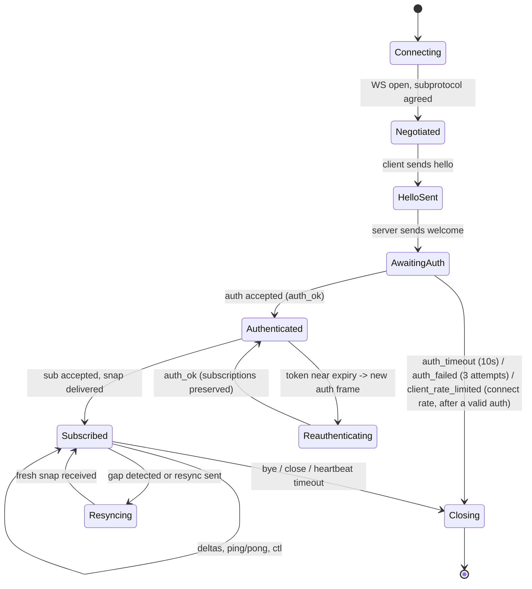
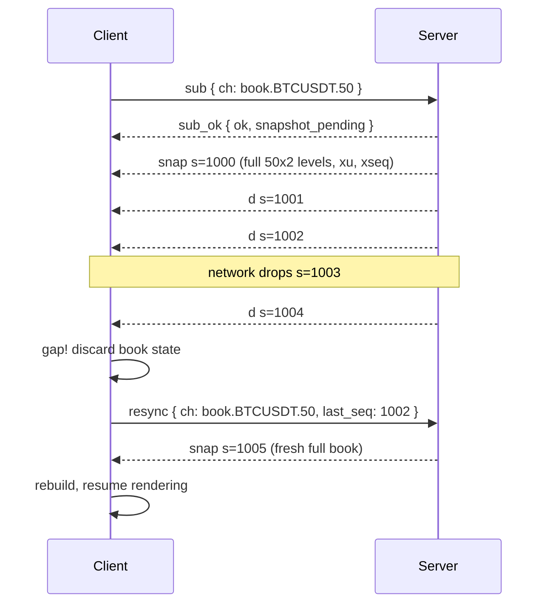
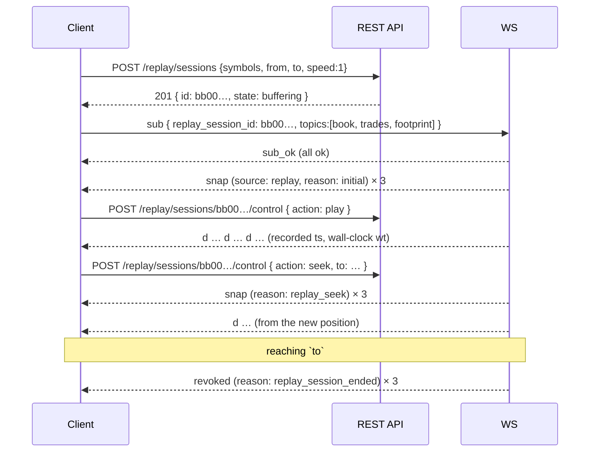

# 23 — Client WebSocket Protocol

Status: **Baseline, approved for build planning.** Date 2026-09-14. Owner: basiltt. Architect-owned document.
Scope guard: **web app only** (React + custom WebGL chart engine + Electron shell); owner/admin screens live **inside** the web app behind RBAC; **no Android**; **Bybit USDT linear perpetuals only** in v1. The protocol is nonetheless deliberately client-agnostic (arch P1) so a mobile client can be added later without server rework.
Upstream: `00-planning-brief.md`, `docs/research/24-owner-decisions.md`, `20-architecture.md`, `21-database-schema.md`, `22-api-openapi.yaml`.
Downstream: `24-internal-schemas.md`, `26-chart-engine-design.md`, `03-testing-strategy.md` (contract tests), `06-performance-and-load-standard.md`.

---

## 0. Table of contents

1. [Scope, goals and non-goals](#1-scope-goals-and-non-goals)
2. [Endpoint, versioning and negotiation](#2-endpoint-versioning-and-negotiation)
3. [Framing: envelope, encodings and the binary format](#3-framing-envelope-encodings-and-the-binary-format)
4. [Connection lifecycle and the authentication handshake](#4-connection-lifecycle-and-the-authentication-handshake)
5. [Subscribe / unsubscribe](#5-subscribe--unsubscribe)
6. [Topic catalogue](#6-topic-catalogue)
7. [Snapshot + delta semantics, sequencing and resync](#7-snapshot--delta-semantics-sequencing-and-resync)
8. [Throttling, coalescing and backpressure](#8-throttling-coalescing-and-backpressure)
9. [Heartbeats, timeouts, reconnection and RBAC revocation](#9-heartbeats-timeouts-reconnection-and-rbac-revocation)
10. [Error frames and the error-code catalogue](#10-error-frames-and-the-error-code-catalogue)
11. [Replay sessions over the same socket](#11-replay-sessions-over-the-same-socket)
12. [Worked example sessions](#12-worked-example-sessions)
13. [JSON Schemas — control frames](#13-json-schemas--control-frames)
14. [JSON Schemas — public data payloads](#14-json-schemas--public-data-payloads)
15. [JSON Schemas — private data payloads](#15-json-schemas--private-data-payloads)
16. [Conformance, limits and test matrix](#16-conformance-limits-and-test-matrix)
    - [16.5 Validation tooling and the CI contract gate](#165-validation-tooling-and-the-ci-contract-gate)
    - [16.6 Open items tracked into implementation](#166-open-items-tracked-into-implementation)

---

## 1. Scope, goals and non-goals

This document specifies the **client-facing** WebSocket protocol between the CandleViewer web app (browser or Electron shell) and the CandleViewer backend. It is _not_ the Bybit protocol; the backend's upstream Bybit connections are an internal concern described in `20-architecture.md` §5–§7.

### 1.1 Binding goals

| #   | Goal                                                                  | How the protocol meets it                                                                                                               |
| --- | --------------------------------------------------------------------- | --------------------------------------------------------------------------------------------------------------------------------------- |
| G1  | One socket carries everything the app needs after the REST bootstrap. | Multiplexed topics on a single connection; no per-widget sockets.                                                                       |
| G2  | The chart engine can upload frames to the GPU with minimal CPU work.  | Binary payload encoding with fixed-layout typed arrays for the hot topics (§3.4).                                                       |
| G3  | Correctness under loss is deterministic, not best-effort.             | Snapshot+delta with per-topic sequence numbers and an explicit resync protocol (§7), never a checksum (Bybit has none — digest 06 §19). |
| G4  | A slow or backgrounded client can never grow server memory.           | Coalescing queues with fixed depth and forced re-snapshot (§8), never unbounded buffering (arch P6).                                    |
| G5  | Authorisation is server-authoritative and revocable mid-connection.   | Per-subscribe permission checks plus live revocation frames (§9.5) (arch P8).                                                           |
| G6  | Live and replay are the same code path on both sides.                 | `replay_session_id` on subscribe routes the same topics from the replay clock (§11) (arch P2).                                          |
| G7  | Heuristic values are never presented as facts.                        | `estimated: true` on every heuristic payload (arch P10).                                                                                |

### 1.2 Non-goals

- **Order entry over WS.** Orders, amendments, cancels and kill-switch go over REST (`22-api-openapi.yaml`). Rationale: order entry needs idempotency keys, RFC 9457 error bodies, per-request RBAC and audit correlation, all of which REST already gives us; and the demo environment forbids WS order entry upstream anyway (digest 06 §11). The WS carries order _state_ (the `orders` topic), which is the source of truth for fills.
- **Bulk history.** Windows of bars, footprint, profiles and metrics come from REST. The WS only carries the live tail plus the initial snapshot needed to attach to it.
- **File transfer / exports.** Handled by REST jobs (`/admin/jobs/{jobId}`).
- **Cross-client presence or chat.** Out of scope for v1.

---

## 2. Endpoint, versioning and negotiation

### 2.1 Endpoint

```
wss://<host>/api/v1/ws
```

Same origin, same Tailscale-only exposure and same TLS termination as REST. Plain `ws://` is accepted only on loopback for local development.

### 2.2 Subprotocol negotiation

The client lists the subprotocols it can speak in `Sec-WebSocket-Protocol`, and the server picks by its own order (below):

```
Sec-WebSocket-Protocol: cv.v1.msgpack, cv.v1.json
```

| Subprotocol     | Meaning                                                                                                                                |
| --------------- | -------------------------------------------------------------------------------------------------------------------------------------- |
| `cv.v1.msgpack` | Envelope encoded as MessagePack; binary payloads permitted (§3.4). **Preferred.**                                                      |
| `cv.v1.json`    | Envelope encoded as UTF-8 JSON text frames; binary payloads are base64-encoded inside the envelope. Debugging and third-party clients. |

The server echoes exactly one. A client offering no recognised subprotocol is closed with `1002` before the handshake completes.

**As built (#2486).** The gateway refuses such an upgrade before `accept`. A real server therefore answers it with HTTP `403` and no WebSocket close code; only an in-process test client reports `1002`.

**As built (#2483).** Both are served, in the server's order: `cv.v1.msgpack` whenever the client offers it, wherever it sits in the offer, else `cv.v1.json`. On `cv.v1.msgpack` every frame, both ways, is one binary WebSocket message holding one MessagePack map; on `cv.v1.json` every frame is one text message. A client frame of the other kind (text on `cv.v1.msgpack`, binary on `cv.v1.json`) is `frame_malformed` (§3.6).

**Decision — why MessagePack and not a bespoke binary envelope.** The envelope must stay human-inspectable in DevTools, must tolerate additive schema evolution, and must decode fast in the browser. MessagePack gives all three with a mature, small (~8 kB) decoder, and lets us carry raw `bin` fields with **zero-copy** access to their `ArrayBuffer` — so the _hot_ payloads (book deltas, bars, footprint cells, heatmap columns) get a hand-rolled fixed-layout binary format (§3.4) _inside_ a self-describing envelope. A fully bespoke envelope was rejected: it would save ~20 bytes per frame while costing every debugging session and every schema change. JSON-only was rejected: measured decode cost of a 200-level book delta is ~4× MessagePack and produces GC garbage on every frame, which the 100 ms heatmap cadence cannot afford.

### 2.3 Protocol version

`cv.v1` is the wire contract described here. Rules:

- **Additive changes** (new topic, new optional field, new error code) do **not** bump the version. Clients MUST ignore unknown fields and unknown topic names.
- **Breaking changes** (field removal, semantic change, envelope layout change) introduce `cv.v2`, served in parallel for at least one release.
- The server states the exact build in the `welcome` frame (`protocol`, `server_version`, `git_sha`). A client whose `min_server_version` expectation is unmet SHOULD warn but MAY continue.

### 2.4 Relationship to REST

| Need                                                       | Surface                                                 |
| ---------------------------------------------------------- | ------------------------------------------------------- |
| Authenticate, obtain access token                          | REST `/auth/login`, `/auth/mfa/verify`, `/auth/refresh` |
| Bootstrap history (bars, footprint, profiles, metrics)     | REST `/market/*`                                        |
| Attach to the live tail                                    | **WS** subscribe → snapshot → deltas                    |
| Place/amend/cancel orders, kill-switch                     | REST `/orders`, `/trade-groups`, `/trading/kill-switch` |
| Observe order/position/execution/wallet state              | **WS** private topics                                   |
| Configuration CRUD                                         | REST                                                    |
| Config change notifications (flags, settings, rules armed) | **WS** `system`, `rules`                                |

### 2.5 Origin check on the upgrade (SR-042, SR-183)

The server checks the upgrade request's `Origin` header against the app-origin allow-list before anything else in §2–§4 runs: before subprotocol negotiation (§2.2), before `accept`, and before any frame, auth (§4.3) or store access. The allow-list is the one REST uses, `CV_ALLOWED_ORIGINS` (SR-042). Each entry must be a serialised origin (`scheme://host[:port]`: lowercase, ASCII host, no path, no default port), and a bad entry fails startup. When the list is empty, every upgrade is refused. An `Origin` matches an entry when it is equal to it once a trailing `/` is dropped. Header names are matched case-insensitively.

| Upgrade request                                                                  | Result                         |
| -------------------------------------------------------------------------------- | ------------------------------ |
| Exactly one `Origin`, in the allow-list, whatever `Sec-Fetch-Site` says          | Continues to §2.2              |
| No `Origin` header                                                               | Refused (`origin_missing`)     |
| More than one `Origin` header                                                    | Refused (`origin_not_allowed`) |
| `Origin: null` (a sandboxed frame, or a `file:` or `data:` page), even if listed | Refused (`origin_null`)        |
| `Origin` not in the allow-list, with `Sec-Fetch-Site: cross-site` or `same-site` | Refused (`cross_site`)         |
| `Origin` not in the allow-list, any other `Sec-Fetch-Site`                       | Refused (`origin_not_allowed`) |

- **The allow-list decides.** A listed origin is admitted even on a `cross-site` or `same-site` fetch, so a listed app origin on another site works: the packaged Electron shell's `app://` origin, or a dev page on another port. A foreign page cannot make a browser send a listed `Origin`, so `Sec-Fetch-Site` adds nothing on top of the list. It only labels the refusal of an unlisted origin: `cross_site` is the cross-site WebSocket hijacking signature, while `origin_not_allowed` on a same-origin fetch usually means the list is missing an app origin.
- **Refusal.** The server closes with `4403` (reason `origin_forbidden`) before `accept`, the same way an off-mesh source is refused. The ASGI server answers the upgrade request with HTTP `403 Forbidden` and the socket never opens. There is no `bye` (S11 applies once a socket is open), and the close code never reaches the client. A browser only sees a failed connection (close event `1006`), so it backs off as for any other failure (§9.2). Every retry is refused the same way.
- **No exemption for non-browser clients.** REST accepts a request without `Origin` because the SR-041 token still binds it. The WS upgrade has no second control before `accept`, so here a missing `Origin` is refused. The difference is deliberate (SR-042). The endpoint is same-origin (§2.1), and every supported client is a browser engine, which always sends `Origin` on the upgrade. Any other client MUST send an `Origin` that is already listed for the app: the debugging and third-party clients of §2.2, a future mobile client (the client-agnostic scope note at the top of this document), and the planned k6 WS fan-out load test (C-13.9). Never add a tool-only entry, because `CV_ALLOWED_ORIGINS` also widens the REST CSRF allow-list. A client that cannot send a listed origin needs its own ticketed, token-authenticated path, not an exemption.
- **Electron.** The packaged shell loads `file://` and would send `null`, which is always refused. Before it opens `/ws`, it must load the UI from a listable origin: an `app://`-style scheme that is in the list, or a same-origin proxy.
- **Defence in depth.** Authentication is still the first-frame bearer token (§4.3), which a cross-site page cannot read. This check stops a cross-site page from opening a socket at all (cross-site WebSocket hijacking).
- **Observability.** Each refusal increments `cv_ws_closes_total{reason="origin_forbidden"}`, which the `WsOriginRefusalsHigh` alert reads (runbook in `07-release-and-prr.md`). It also logs one `ws upgrade refused` warning with the bounded cause and the source address MeshOnly admitted, never a header value. That address is the TCP peer, or the right-most `X-Forwarded-For` hop when the peer is the configured trusted proxy (`CV_MESH_TRUSTED_PROXY_HEADER` and `CV_MESH_TRUSTED_PROXY_ADDRESS`); uvicorn never rewrites it (#2275). At most 10 such lines are logged per cause per minute; the next refusal logs one `ws upgrade refusals suppressed` line, and the rest of that minute is only counted. Each refusal is also audited (C-2.9, #2269): one `auth.ws_origin_refused` record, written before the close, with `actor_ip` (that address), `reason` (the bounded check above), `object_kind` `ws_upgrade`, outcome `failure` and severity `warning`, and never a header value. The writes are bounded as the REST CSRF refusals are (C-2.18): at most 20 records per source address per minute, and at most 64 refusal audits in flight, a cap shared with the REST refusal audits. Past either bound the upgrade is still refused and counted, but no record is written. The close waits at most 2 s for the record: a slow write is left to finish (and drained at shutdown), a failed one is logged, and neither admits the upgrade.

---

## 3. Framing: envelope, encodings and the binary format

### 3.1 The envelope

Every frame in both directions is a single map with this shape. Field order is irrelevant; short keys are used deliberately to keep per-frame overhead near 30 bytes.

```jsonc
{
  "t": "d", // type   — see table below
  "id": "c-0007", // correlation id (client→server requests and their replies)
  "ch": "trades.BTCUSDT", // channel/topic (data, snapshot, delta, topic-scoped errors)
  "s": 1048577, // sequence number, per (connection, topic)
  "ts": 1789132262104, // server send time, epoch milliseconds UTC
  "e": "b", // payload encoding: "j" = inline structured, "b" = binary blob
  "p": {}, // payload (map) or binary blob (bytes)
}
```

| `t`                 | Name                  | Direction | Purpose                                                                          |
| ------------------- | --------------------- | --------- | -------------------------------------------------------------------------------- |
| `hello`             | hello                 | C→S       | First frame; declares client identity and capabilities.                          |
| `welcome`           | welcome               | S→C       | Server capabilities, limits, negotiated encoding, heartbeat policy.              |
| `auth`              | auth                  | C→S       | Presents the bearer access token.                                                |
| `auth_ok`           | auth accepted         | S→C       | Identity, permissions, account scope, environments.                              |
| `sub`               | subscribe             | C→S       | Subscribe to one or more topics.                                                 |
| `sub_ok`            | subscribe result      | S→C       | Per-topic accept/reject.                                                         |
| `unsub`             | unsubscribe           | C→S       | Unsubscribe from topics.                                                         |
| `unsub_ok`          | unsubscribe result    | S→C       | Confirmation.                                                                    |
| `snap`              | snapshot              | S→C       | Full state for a topic; resets the sequence baseline.                            |
| `d`                 | delta                 | S→C       | Incremental update; requires an unbroken sequence.                               |
| `resync`            | resync request        | C→S       | Client asks for a fresh snapshot on a topic.                                     |
| `revoked`           | subscription revoked  | S→C       | Server ended a subscription (permission/scope/kill), or narrowed it (§9.5).      |
| `permission_change` | authorisation changed | S→C       | Live re-resolved identity, permissions and scope; precedes any `revoked` (§9.5). |
| `ping`              | ping                  | both      | Liveness probe.                                                                  |
| `pong`              | pong                  | both      | Liveness reply, echoes `id`.                                                     |
| `err`               | error                 | S→C       | Request-scoped or topic-scoped error.                                            |
| `ctl`               | control               | C→S       | Runtime tuning of an existing subscription (throttle, depth, filters).           |
| `ctl_ok`            | control result        | S→C       | Confirmation of `ctl`.                                                           |
| `bye`               | goodbye               | S→C       | Server is closing the connection; carries the reason before the close frame.     |

**The correlation `id` (#2572).** `id` is a string of at most 64 characters (§13.1). The server echoes a request's `id` on its replies only when it is one. Any other `id` (not a string, or longer than 64 characters) is dropped before the frame is handled, so no reply carries it. The frame is otherwise handled as sent, and its reply has no `id` to correlate it by. This holds for every client frame, `hello` and `auth` included.

**The span id `sp` (E17-T06, #571).** `sp` is a synthetic span id. It names the fan-out span the server times for a frame (`cv_ws_fanout_seconds`: the hub's turn to the socket), and is not an OpenTelemetry id (ADR-0014 §5). It is 16 lowercase hex characters, the W3C Trace Context `span-id` form (8 random bytes, never all zeros). It lets one frame be followed from the gateway to the client's paint (`06-performance-and-load-standard.md` §7.2, budgets #3 and #6): the server can log the frame's fan-out under it, and a client that keeps performance marks can tag them with it. A server data frame (`snap` or `d`) carries one when it is sampled and latency telemetry is on; no other frame does.

- **Sampled.** Only a subset of data frames is sampled: at most one frame in `N` of a subscription, where `N` is a server constant (today 32: the frames whose fan-out is timed). In a chunked `snap`, only the chunk that carries `s` can be sampled (§3.6). Control frames and `system` frames never are. With latency telemetry off (`CV_TELEMETRY_ENABLED=false`), no frame carries `sp`.
- **Fresh.** Each `sp` is drawn for one frame on one connection from a cryptographically secure generator (8 bytes, e.g. `secrets.token_hex(8)`), fresh for every frame: never a counter or a seeded PRNG. It is never reused, never shared between connections and never derived from an order, account, user, session or request identifier. It names the frame and nothing else.
- **Inert.** It has no protocol meaning. A client MUST NOT change how it sequences, applies, acknowledges or resyncs a frame because `sp` is present or absent (tagging its own performance marks with it is allowed), and MUST NOT send it in any frame. The server ignores an `sp` on a client frame: it never reads, echoes or logs it. It is a string under both `cv.v1.json` and `cv.v1.msgpack` (24 bytes of JSON text, 20 of MessagePack), and it lives on the envelope, never in a CVWB body (§3.4).
- **Room.** Every frame the server sizes against the 4 MiB cap (§3.6) is sized with at least 24 bytes set aside for `sp`, so the sizing never depends on whether a frame ends up sampled, and no frame, `sp` included, exceeds the cap.
- **Additive.** It changes no version (§2.3): a client that does not know `sp` ignores it.

### 3.2 Encoding field `e`

| Value | Meaning                                                                                                                                                                                           |
| ----- | ------------------------------------------------------------------------------------------------------------------------------------------------------------------------------------------------- |
| `j`   | `p` is a structured map, encoded natively by the negotiated envelope codec (MessagePack map or JSON object).                                                                                      |
| `b`   | `p` is an opaque byte string in the fixed-layout binary format of §3.4. Under `cv.v1.json` it is a base64 string and `"e":"b64"` is used instead, so a JSON client can never mistake it for text. |

Control frames (`hello`, `welcome`, `auth`, `sub`, `err`, …) are **always** `e: "j"`. Only data frames may be binary, and only on the topics listed in §3.4. One exception runs the other way: on a binary `bars` subscription the server sends a frame structured (`e: "j"`) when kind 4 cannot carry it, by the single trigger defined in §3.4 (body_kind 4, structured fallback), and a client MUST accept either encoding.

### 3.3 Why sequence numbers live on the envelope

`s` is scoped to `(connection, topic)` and increments by exactly 1 per frame delivered on that topic, starting at the `s` of the `snap` that opened the stream. It is **not** the exchange's `u`/`seq` — those are carried inside book payloads as `xu`/`xseq` for diagnostics. Keeping our own counter means:

- gap detection is uniform across every topic, including derived ones Bybit has no sequence for (footprint, metrics, heatmap);
- coalescing (§8) is visible to the client — a coalesced delta still consumes exactly one sequence number, so "no gap" always means "no loss of _state_", even when it means loss of _intermediate frames_.

### 3.4 Binary payload format (`e: "b"`)

Used on the hot topics: `book.*`, `trades.*`, `bars.*`, `footprint.*`, `heatmap.*`. Everything else is structured.

All integers are **little-endian**. Prices and sizes are transported as **scaled 64-bit integers**, using the per-symbol `price_scale` and `qty_scale` announced in the topic's snapshot (`bars` frames carry their own, see body_kind 4) — this avoids both float rounding and decimal-string parsing in the render path.

**Common header (24 bytes)**

| Offset | Size | Type  | Field            | Notes                                                                           |
| ------ | ---- | ----- | ---------------- | ------------------------------------------------------------------------------- |
| 0      | 4    | `u32` | `magic`          | `0x43565742` (`"CVWB"`). Rejects accidental mis-routing.                        |
| 4      | 1    | `u8`  | `format_version` | `1`; `2` for body_kind 4 (bars, #2014) and 5 (footprint, #2529).                |
| 5      | 1    | `u8`  | `body_kind`      | 1=book_snapshot, 2=book_delta, 3=trades, 4=bars, 5=footprint, 6=heatmap_column. |
| 6      | 1    | `u8`  | `flags`          | bit0 `estimated`, bit1 `coalesced`, bit2 `replay`, bit3 `partial`.              |
| 7      | 1    | `u8`  | `price_scale`    | Decimal exponent: real = int / 10^price_scale.                                  |
| 8      | 1    | `u8`  | `qty_scale`      | Same for sizes.                                                                 |
| 9      | 3    | —     | `reserved`       | Zero.                                                                           |
| 12     | 4    | `u32` | `record_count`   | Number of records in the body.                                                  |
| 16     | 8    | `u64` | `ts_base_ms`     | Epoch-ms base; per-record times are `u32` offsets from this.                    |

**body_kind 1/2 — book snapshot / delta.** `record_count` records of 17 bytes:

| Size | Type  | Field                                          |
| ---- | ----- | ---------------------------------------------- |
| 1    | `u8`  | `side` (0 = bid, 1 = ask)                      |
| 8    | `i64` | `price` (scaled)                               |
| 8    | `u64` | `size` (scaled; **0 means delete this level**) |

Snapshots carry every level within the subscribed depth (a `book` snapshot: capped at the engine tier, §7.7), bid side descending then ask side ascending. Deltas carry only changed levels. After the records, a snapshot appends a 16-byte trailer: `u64 xu` (Bybit update id), `u64 xseq` (Bybit cross-sequence).

**body_kind 3 — trades.** `record_count` records of 22 bytes:

| Size | Type  | Field                                                                                     |
| ---- | ----- | ----------------------------------------------------------------------------------------- |
| 4    | `u32` | `ts_offset_ms` from `ts_base_ms`                                                          |
| 8    | `i64` | `price` (scaled)                                                                          |
| 8    | `u64` | `size` (scaled)                                                                           |
| 1    | `u8`  | `side` (0 = buy/taker-lift, 1 = sell/taker-hit) — Bybit gives the aggressor side directly |
| 1    | `u8`  | `flags` (bit0 block trade, bit1 liquidation-origin, bit2 cluster-aggregated)              |

**body_kind 4 — bars.** Requires header `format_version = 2` (#2014); a `format_version = 1` bars body (69-byte records without identity) is no longer sent. `record_count` records of 85 bytes, little-endian like every field here: `u64 generation`, `u64 index` (the §8.2 bar key), `u32 ts_offset_ms`, `i64 o,h,l,c`, `u64 v`, `u64 turnover`, `u32 trades`, `i64 delta`, `u8 flags` (bit0 `confirm`). `o`, `h`, `l`, `c` are scaled by `price_scale`; `v`, `turnover` and `delta` by `qty_scale`, as both reference decoders read them. **Scales are per frame** (unlike the other kinds, §7.2): every kind-4 frame carries its own `price_scale` and `qty_scale` in its header, and a client MUST decode each frame with its own header's scales, never with those of the snapshot or of an earlier frame. The server picks each frame's scales, never coarser than the instrument's, so that they hold every bar of the frame exactly: a snapshot can need finer ones than the instrument's (bars recorded before a tick-size change), and a delta takes the scales its own bars need. Every scaled field except `turnover` is exact at its frame's scales; `turnover` (price × qty) is rounded half-even to `qty_scale` in kind 4, and the structured form carries it as an exact decimal string (§14.3). `delta` is 0 unless the subscription set `include_delta`, which the frame's `meta.include_delta` echoes (§6.1). The version is bumped rather than the fields appended because records have a fixed stride: a v1 decoder reading 69-byte records from an 85-byte body would misread every record after the first without noticing.

**body_kind 4 — structured fallback.** Kind 4 carries every field exactly except `turnover`, which it always rounds (above). The fallback trigger is defined here, once. A bars frame cannot be sent as kind 4 when (1) its values do not fit kind 4: a scaled value, `turnover` included, is outside its 64-bit field's range at the frame's scales, or the scales that hold every price and size exactly (`delta` counts only with `include_delta`) do not fit the header's `u8` scale fields (`ts_offset_ms` aside: a bar beyond its span starts a new frame, §3.6); (2) a `d` carries an amended close (`amended: true`, §8.2): kind 4 has no amended bit and gains none, and a snapshot item cannot carry `amended` (an update flag, 24 §3.2), so this arm applies to `d` frames only; or (3) the symbol's instrument scales, the floor of the frame's scales, are unavailable to the server. On a binary subscription the server then sends that `d` frame, or the whole snapshot, structured (`e: "j"`, the §14.3 payload); it never rounds or clamps the value and never closes the connection for it. A snapshot never mixes encodings: if any of its bars cannot be sent as kind 4, the whole snapshot is sent structured. A client MUST accept either encoding on any binary `bars` subscription, frame by frame, and MUST apply an amended close by the §8.2 rule. Sequence numbers stay contiguous across both (§3.3), and `sub_ok.effective.encoding` stays `binary`.

A structured frame carries the full §14.3 item, so on a binary subscription a fallback frame also carries what kind 4 has no slot for: `close_t_ms` (non-time bars), `min_delta` and `max_delta` (with `include_delta`), and an exact `turnover`. On a binary subscription a client MUST ignore `close_t_ms`, `min_delta` and `max_delta` wherever they appear and treat them as absent, so a bar's shape never depends on the frame's encoding (it would otherwise hold values that a later kind-4 replacement of the bar has overtaken). `turnover` is a value, not a shape: a bar's replacement carries it rounded (kind 4) or exact (structured), and the client stores what the latest frame carried.

If an emission cannot be built even structured (a value no valid bar has: not finite, or too large to write), the server does not send it and counts it (`bar_emit_sink_errors_total`). It takes no sequence number, so no gap shows, and §7.1's guarantee 3 does not hold for it: this is the sanctioned loss named there. The bars publisher refuses such an emission before any frame exists, so the §10.1 encode-failure path (a `backpressure` re-snapshot of a droppable topic) never sees it; that path covers a frame that was built and then failed in the connection's encoder or emit. It is not the only sanctioned loss: the emit path also skips the WS sink for an emission when the sink times out or raises (counted in the same metric, 24 §3.5), with the same effect. A lost forming update is superseded by the bar's next update; a lost `close` is not, and leaves the bar at `confirm: false` on the client while later indexes stream, until the series' next snapshot (a resync, §7.5, or any §7.4 trigger). That snapshot repairs the series, not necessarily the bar that caused the loss: a bar that cannot be built even structured cannot be put in a snapshot either, and that subscription then stays `snapshot_pending` (§7.7). A valid bar cannot cause the first case, so each occurrence is a counted server fault (a residual in the E12 threat model, BR-13).

**body_kind 5 — footprint.** Requires header `format_version = 2` (#2529); a `format_version = 1` footprint body (8-byte group prefixes without identity) is no longer sent. `record_count` per-bar groups, each opening with a 28-byte prefix, little-endian like every field here: `u64 generation`, `u64 index` (the §8.2 bar key), `u32 ts_offset_ms`, `u32 cell_count`, `u8 flags`, then 3 reserved zero bytes; then `cell_count` × 33 bytes: `i64 price`, `u64 bid_volume`, `u64 ask_volume`, `u32 trades`, `u8 flags` (bit0 buy-imbalance, bit1 sell-imbalance, bit2 in-stack, bit3 POC). The group `flags` byte works like kind 4's: bit0 `confirm` (1 = the bar is closed, 0 = still forming), the binary twin of §14.4 `confirm`; bits 1–7 are reserved, 0 on send and ignored on receive, so a later flag is additive. The version is bumped rather than the fields appended because the group prefix has a fixed stride: a v1 decoder reading 8-byte prefixes from a body with 28-byte prefixes would take `generation` for `ts_offset_ms` and `cell_count` and misread every group without noticing. v2 replaces v1 with no deprecation entry and no dual-serve release (C-6.3) because no footprint frame was ever produced (the footprint snapshot source is still pending in `ws_wiring.PENDING_ADAPTERS`, #2197), as with the precedents #2019, #2380 and #2400. Body kinds 1–3 and 6 stay at `format_version = 1`.

**body_kind 6 — heatmap column.** One time-bucket column: `u32 ts_offset_ms`, `i64 price_min`, `i64 price_step`, `u32 row_count`, then `row_count` × 16 bytes: `u64 bid_size`, `u64 ask_size`. The renderer uploads this straight into a texture row.

**Reserved record bytes.** Bars (85 B) and footprint cells (33 B) records end in 4 reserved zero bytes after `flags` (the listed fields total 81 B / 29 B), and each footprint group prefix (28 B) ends in 3 after its `flags` (25 B listed); the encoder writes zeros and decoders ignore them. The byte layout of every kind is declared once in `packages/protocol/cvwb-layout.json` (E17-T02).

**Client obligations.** A client MUST validate `magic` and `format_version` (and MUST reject, as `frame_malformed`, a `(body_kind, format_version)` pair it does not know — e.g. a v1 decoder receiving v2 bars; the code is `frame_malformed` on the wire and decoders MAY surface the more specific diagnostic `unsupported_format_version` locally, which maps to `frame_malformed` in §10), and MUST treat a body whose length disagrees with `record_count` as a protocol error (`frame_malformed`, §10) and resync. For fixed-stride bodies (body_kind 4, bars) the rule is exact: body length MUST equal `24 + record_count × record_size`; both a short body and trailing bytes are `frame_malformed`. Forward compatibility is carried by `format_version`, not by trailing bytes. Variable-layout body kinds continue to ignore trailing bytes after the last declared record.

### 3.5 Compression

`permessage-deflate` is negotiated at the WebSocket layer and is **enabled for `cv.v1.json`, disabled for `cv.v1.msgpack`**. Reason: the binary payloads are already dense and near-incompressible; deflating them burns CPU on both ends for <5 % gain and adds latency jitter at the 10–20 ms book cadence. JSON frames compress ~6× and are not on the latency-critical path.

**As built (#2483).** The extension is agreed in the upgrade, before the gateway accepts a subprotocol, so the server makes the §2.2 choice there first, from the same offer. When it will be `cv.v1.msgpack`, the server agrees to no extension, whatever the client offers; a `cv.v1.json` upgrade gets `permessage-deflate` when the client offers it. The transport's message cap (256 KiB plus 4 KiB) applies to the inflated message.

### 3.6 Frame size limits

| Limit                              | Value   | Enforcement                                                                                                                                                                                                                                                                                                                                                                   |
| ---------------------------------- | ------- | ----------------------------------------------------------------------------------------------------------------------------------------------------------------------------------------------------------------------------------------------------------------------------------------------------------------------------------------------------------------------------- |
| Max inbound frame (client→server)  | 256 KiB | Exceeding closes with `1009`.                                                                                                                                                                                                                                                                                                                                                 |
| Max inbound frame before `auth_ok` | 8 KiB   | Until the first `auth_ok`, `hello` included: the frame's encoded bytes are checked before any scan or decode; exceeding closes with `bye frame_too_big` and `1009`. With each enum list naming every member once, the largest conforming frame then is an `auth` with a 4 096-character ASCII `access_token` (about 4.2 KiB), so 8 KiB is headroom, not a format limit.       |
| Max inbound JSON nesting depth     | 32      | As-built (SR-184): pre-scanned before decode; deeper or malformed frames, and any binary frame, are a `frame_malformed` protocol violation (3 strikes -> `4400`), never `1011`. The deepest client frame in `ws-schema.json` (`sub`/`ctl`: envelope -> topic entry -> `options` -> list) nests at most 6 levels counting the envelope, so 32 is headroom, not a format limit. |
| Max inbound JSON containers        | 1 024   | As-built (SR-184): `[` plus `{` characters, counted before the depth scan and the decode (strings are not skipped, so it can only over-count); more is a `frame_malformed` protocol violation (3 strikes -> `4400`), never scanned or decoded. The widest client frame (a 50-topic `sub`, every option list full) has about 400, so 1 024 is headroom, not a format limit.    |
| Max outbound frame (server→client) | 4 MiB   | Server splits snapshots into `partial` chunks (header flag bit3), and a `bars` `d` into several `d` frames, rather than exceeding it.                                                                                                                                                                                                                                         |
| Max topics per `sub` frame         | 50      | Longer frame refused whole with `too_many_topics` (`field: topics`) before any entry is read, §5.2.                                                                                                                                                                                                                                                                           |
| Max topics per `unsub` frame       | 50      | Longer frame refused whole with `invalid_options` (`field: topics`), §5.3.                                                                                                                                                                                                                                                                                                    |
| Max subscriptions per connection   | 200     | New subscribes rejected with `subscription_limit`.                                                                                                                                                                                                                                                                                                                            |
| Max `bars.*` subs per connection   | 16      | Further `bars.*` subscribes rejected with `subscription_limit` (SR-E12-07, §6.1).                                                                                                                                                                                                                                                                                             |
| Max connections per user           | 8       | Oldest idle connection is closed with `bye` when exceeded.                                                                                                                                                                                                                                                                                                                    |

Snapshot chunking: a `snap` larger than 4 MiB is sent as N frames sharing one `id`, each binary frame with `partial` set, the last one clearing it. All chunks consume **one** sequence number in total, assigned to the final chunk; intermediate chunks carry `s: null`. The frames of one set share that `id`; a single-frame `snap` has none. `partial` is a CVWB header bit, so a structured chunk has none: in either encoding the signals are the shared `id` and `s: null` on every chunk but the last. A client assembles and applies the set as §7.2 says (a `generation_swap` replacement included). A snapshot is all binary or all structured (§3.4), never a mix. A set is left incomplete only when the server drops the subscription's queued frames after the head was sent (§8.4: the ladder, or a control frame that supersedes them; §10.1: a chunk that cannot be encoded, or whose emission raises), and the client then replaces it as §7.2 says. The server never starts a ladder check between the chunks of one snapshot it is queuing, so a check never drops the head of a set and leaves its tail queued.

Bars chunking: a `bars` frame, in either encoding, stays within the 4 MiB outbound limit, and a kind-4 frame also splits by the time-span rule below. A kind-4 snapshot sends its frames as chunks (1 000 daily bars take 20 kind-4 frames), a structured snapshot is chunked by size only, and a delta sends its frames as several `d` frames, each with its own `s`, in order.

Time span of a binary bars or footprint frame: per-bar times are `u32` offsets from the header's `ts_base_ms` (§3.4), so one frame spans at most 2³²−1 ms (about 49.7 days). Bars (body_kind 4) and footprint (body_kind 5) share one rule: a new frame starts when a bar's open time is more than 2³²−1 ms after the frame's `ts_base_ms` or earlier than it (offsets are unsigned), whatever the frame's size, and inside a snapshot those frames are `partial` chunks as above, each with its own `ts_base_ms` (200 daily footprint bars span about 1.7 × 10¹⁰ ms). Clients key bars by `(generation, index)` (§8.2), never by frame or chunk.

**MessagePack client frames (as built, SR-185; #2509, #2483).** The size cap (8 KiB until `auth_ok`, 256 KiB after) is checked first, as for JSON. msgpack's C unpacker then decodes the frame under these bounds: nesting 32 (as for JSON), at most 128 entries in an array and 32 in a map, and at most 16 384 values in the frame, 72 until `auth_ok` (each container, array element, map key and map value counts one; the widest conforming `hello` has 36). A frame past any of them is a `frame_malformed` protocol violation (3 strikes -> `4400`), never `1011`. So are an ext type (a timestamp included), a binary string, a map key that is not a string, NaN or an infinity, invalid UTF-8, truncated input, trailing bytes and a text frame. On `cv.v1.json`, likewise, a binary frame is `frame_malformed` and is never read as JSON. The bounds cover every list and object the server acts on: the longest list is a `rules` sub's 100 `rule_ids`, the widest object an `opts`. Past them, the JSON path answers per topic or per option, or ignores the part, where this one refuses the frame: an option list longer than 128, an `opts` or envelope wider than 32 keys, and a `hello` or `auth` array longer than 128, or, before `auth_ok`, any frame past 72 values. A `sub` or `unsub` naming more than 50 topics is refused whole on both paths, with no strike: a `sub` with `too_many_topics` (§5.2), an `unsub` with `invalid_options` (§5.3), both naming `field: topics`; past 128 topics this decoder refuses the frame first, as `frame_malformed`.

---

## 4. Connection lifecycle and the authentication handshake

### 4.1 State machine



**Key property:** re-authentication happens **in place**. When the access token is about to expire the client refreshes it over REST and sends a new `auth` frame on the _same_ socket; subscriptions, sequence numbers and book state are all preserved. There is no reconnect-on-token-refresh, which would otherwise force a full re-snapshot every 10 minutes.

### 4.2 `hello` → `welcome`

The client sends `hello` immediately on open. The server replies `welcome` with the limits the client must respect. A client that sends anything other than `hello` first is closed with `1002`.

```jsonc
// C→S
{
  "t": "hello",
  "id": "c-0001",
  "p": {
    "client": "candleviewer-web",
    "client_version": "1.0.0",
    "shell": "electron", // "electron" | "browser"
    "protocol": "cv.v1",
    "encodings": ["binary", "structured"],
    "capabilities": [
      "binary_book",
      "binary_bars",
      "binary_footprint",
      "binary_heatmap",
      "coalescing",
      "replay",
    ],
    "locale": "en-GB",
    "clock_ms": 1789132261980,
  },
}
```

```jsonc
// S→C
{
  "t": "welcome",
  "id": "c-0001",
  "ts": 1789132262002,
  "p": {
    "protocol": "cv.v1",
    "encoding": "msgpack",
    "server_version": "1.0.0",
    "git_sha": "a91f0c3",
    "connection_id": "ws_0193f2bc1d40",
    "server_time_ms": 1789132262002,
    "clock_skew_ms": 22,
    "auth_required": true,
    "auth_timeout_ms": 10000,
    "heartbeat": { "interval_ms": 15000, "timeout_ms": 45000 },
    "limits": {
      "max_subscriptions": 200,
      "max_topics_per_request": 50,
      "max_inbound_frame_bytes": 262144,
      "max_outbound_frame_bytes": 4194304,
      "min_throttle_ms": 50,
      "max_symbols_per_connection": 40,
    },
    "features": { "replay": true, "binary_payloads": true, "coalescing": true },
  },
}
```

`limits.max_inbound_frame_bytes` applies once `auth_ok` is sent. Until then a frame may be at most 8 KiB, and a MessagePack frame at most 72 values (§3.6).

`clock_skew_ms` = server time minus the client's `clock_ms`. The UI surfaces a warning above ±2 000 ms because a skewed client mis-renders "bar closes in N seconds" countdowns.

`features.coalescing` reports whether this server coalesces (§8.2). It mirrors `CV_WS_BACKPRESSURE_ENABLED` (§4.3, §8.4): `true` while the flag is on, `false` while it is off, and the flag is switched on only once the §8 mechanisms are all wired and the chaos scenarios have passed (§8.4 Rollout). The `welcome` example above shows a server with the flag on. The schema is unchanged: §13.3 already types every `features` value as a boolean.

### 4.3 `auth` → `auth_ok`

```jsonc
// C→S
{
  "t": "auth",
  "id": "c-0002",
  "p": {
    "access_token": "<JWT — example placeholder>",
    "environments": ["live", "demo"],
  },
}
```

```jsonc
// S→C
{
  "t": "auth_ok",
  "id": "c-0002",
  "ts": 1789132262110,
  "p": {
    "user_id": "9f1c2b4e-0a1d-4f2b-9e3a-11c0ffee0001",
    "username": "basiltt",
    "roles": ["owner"],
    "permissions": [
      "marketdata:read",
      "orders:read",
      "orders:write",
      "positions:write",
      "audit:read",
    ],
    "account_scope": [],
    "allowed_environments": ["live", "demo"],
    "session_id": "5e1a0c33-2b44-4f10-9a22-77aa11bb22cc",
    "token_expires_at_ms": 1789132862110,
    "kill_switch": { "engaged": false, "scope": "global" },
  },
}
```

Rules:

- The token is **never** sent in the URL query string (it would land in proxy logs and browser history). Header auth is impossible for browser WebSockets, so the first-frame `auth` pattern is used.
- Until `auth_ok`, the only accepted frames are `auth` and `ping`; a `pong` (the reply to a server `ping`) is dropped without a reply and counts toward the inbound rate (§8.5). Anything else → `err` with `not_authenticated` and the connection closes after 3 such frames.
- `auth_timeout_ms` (10 s) without a successful `auth` → `bye` with `auth_timeout`, close code `4401`.
- Three failed `auth` attempts → `bye` with `auth_failed`, close `4401`, and a `warning` audit entry.
- An `auth` or re-`auth` whose session is enrolment-only (its user must enrol TOTP first; `22-api-openapi.yaml`, "Enrolment-only session") is refused at once and the socket closes: `bye` with reason `mfa_enrollment_required`, close `4403`. It does not count as a failed `auth`. The client completes enrolment over REST and connects again with the full session's token.
- An `auth` or re-`auth` whose session holds a view-as context that the server ended (`22-api-openapi.yaml`, "View-as session") is refused the same way: `bye` with reason `view_as_expired`, close `4403`, and it does not count as a failed `auth`. The client clears the context over REST (`DELETE /auth/session/view-as`) and connects again (§9.6).
- `token_expires_at_ms` tells the client when to re-`auth`. The client SHOULD refresh at `expires_at - 60 s`. If the token expires without re-auth, the server sends `bye` (`token_expired`, `4401`) and closes — subscriptions are not silently continued on an expired identity.

**As built (E17-S01, #2132; wired by #377).** These details are binding:

- `account_scope` lists the caller's granted accounts for a Manager or Viewer; for an Owner it is `[]`, meaning **all** accounts (the example above is an Owner). The same rule applies to the `permission_change` frame (§9.5).
- Failed `auth` attempts 1 and 2 each get `err` `auth_failed` and the socket stays open. The 3rd closes with `bye auth_failed` + `4401`. A `warning` audit entry (`auth.login_failed`, `reason: ws_auth_failed`, never the token) is written.
- A failed `auth` also logs `ws auth failed` (`warning`; E17-T06, #571) with `connection_id`, `reason` (the `cv_ws_auth_failures_total` set), `attempt`, `reauth` and `source_ip`, and the upgrade's `request_id`. It never carries the token, the exception text or a traceback.
- A failed re-`auth` keeps the prior identity until its token expires. A re-`auth` that resolves to a different user is refused.
- Each call an `auth` or re-`auth` makes is bounded (#2155): the session service's token check, the principal read and, on a first `auth`, its SR-189 re-read get 6 s apiece (`AUTH_CALL_TIMEOUT_S`). A call still pending at its bound is a server fault, not a failed `auth`: the socket closes with `bye internal_error` + `1011`, a re-`auth`'s too (ending the prior identity), as for an authenticator that reports no expiry (below). It is no strike, writes no `auth.login_failed` row and is not counted in `cv_ws_auth_failures_total`; the registrations the `auth` made (the revocation hub's, the registry's) are dropped as a failure's are, and it logs `ws auth call timed out` (`warning`) with the call's name. A call that fails within its bound, with its own `TimeoutError` included, is a failed `auth` as before. 6 s is longer than the principal store's own 5 s bound, so a slow store still yields its deny-all principal first, and shorter than the default 10 s auth window.
- `token_expires_at_ms` is the presented token's real expiry: the first instant the session service refuses it on time grounds (`issued_at` + the ADR-0020 access-token TTL, capped by the session's absolute expiry). There is no gateway-side default, and a re-`auth` takes the new token's expiry. The gateway checks the expiry before every frame it dequeues or sends, on both its monotonic and its wall clock, whichever reaches it first. At the expiry it drops everything still queued, and the next frame is the `bye`: `token_expired` + `4401`, or the `bye` of a close already under way. A token that is already expired when its `auth` is processed is refused like any failed `auth`. An authenticator that reports no timezone-aware expiry is a server fault: `bye internal_error` + `1011`, and nothing is served (#2259).
- A revocation published to the `RevocationHub` closes the sockets already authenticated with that session the same way: queued frames are dropped and the next frame is the `bye`. Every session revocation is published, from the session service after the row update (#2272): logout, a revoked session, sign-out everywhere, refresh-token reuse, the failed-unlock limit and the owner TOTP reset all end with `bye session_revoked` + `4401`. Absolute expiry is published too, when `refresh` or `require_active` observes it, but a socket normally ends first with `token_expired` at its token deadline (above). That publish matters only for a socket still registered on the session. A refresh-token rotation is not a revocation: the socket stays open for its in-place re-`auth` (§4.1). An `auth` or re-`auth` that is in flight when its session is revoked gets no `auth_ok` (#2739). The socket ends the same way, with the `bye` and close code the hub sends for that reason (`4403` for `user_disabled`). It registers with the hub for the presented session as soon as the session service accepts the token, so a revocation published after that closes it. One published after the session service read the session as live, but before the socket registered, is read from the hub's memory of revoked sessions. Each is kept for one access-token lifetime; past 4 096 sessions the oldest is forgotten first, which reopens this window for that session only. A re-`auth` drops the old session's registration only once it is accepted, so a revocation of either session while it is in flight closes the socket. A first `auth` refused this way is an unauthenticated close and writes no `ws.connection.closed` row (below). Still open: a socket on a session rotated out over REST that has not re-`auth`ed yet is not closed by a revocation of the successor session. It ends at its own token's expiry, and a re-`auth` with the revoked successor's token is refused like any failed `auth`. The idle lock intentionally does not end the socket (E09-S03).
- Three malformed or unexpected frames after `hello` close with `bye bad_client` + `4400`.
- The heartbeat-timeout `bye` (`heartbeat_timeout`) uses `1001`.
- More than 8 connections per user: the oldest idle one is closed with `too_many_connections` (`4429`).
- Both subprotocols are served, `cv.v1.msgpack` first (§2.2, #2483). Its client frames are decoded under the SR-185 bounds (§3.6), and its data frames carry CVWB payloads raw, as `e: "b"` (§3.2).
- New connections per user are rate limited (#2558): at most `CV_WS_MAX_AUTHS_PER_USER_PER_MIN` (20 by default, 1 to 600) sockets may complete their first successful `auth` in any sliding 60 s window. A failed `auth` (it has its own 3 strikes) and an in-place re-`auth` do not count; only a new socket's first successful `auth` does. The socket that would exceed the limit gets `bye` `client_rate_limited` with `retry_after_ms` (the time until the oldest counted `auth` leaves the window, at least 1 000) and `reconnect: true`, then close `4429`, **instead of** `auth_ok`. It never becomes authenticated, so it writes no `ws.connection.closed` row, which is the point: a valid token cannot open and close sockets in a tight loop and add one audit row per close. Every refusal is counted in `cv_ws_connect_rate_limited_total` (and in `cv_ws_closes_total{reason="client_rate_limited"}`, a series the inbound frame limiter's `4429` shares). The warning that names the user and the peer address is capped: it is logged for a user's first refusal in a window. The count is per user, kept in memory per process, and forgotten once a user's window is empty.
- Sockets that have not authenticated yet are capped per process (#2155): a socket counts from `accept` to its first `auth_ok`, and at most 64 count at a time (`MAX_UNAUTHENTICATED_SOCKETS`: 8 users with 8 sockets each, all reconnecting at once). A re-`auth` never counts, and a socket that ends any other way (a close by either side, a fault, a cancellation) stops counting then. Past the cap a new socket is accepted and at once gets `bye server_shedding_load` with `retry_after_ms` 10 000 (the auth timeout, the longest a counted socket may still wait for `auth_ok`) and `reconnect: true`, then close `1013`, before any frame is read. It is never counted and writes no audit row, as it has no identity. The `bye` and the close get the 2 s close flush deadline (§4.4). Each refusal is counted in `cv_ws_closes_total{reason="server_shedding_load"}`, which is never capped. Its `ws socket shed` warning, with the cap and the peer address, is capped as §2.5's is: at most 10 a minute, then one `ws socket sheds suppressed` line, and the rest of that minute is only counted.
- `welcome.server_version` / `git_sha` come from settings (`CV_VERSION`, `CV_GIT_SHA`). `auth_ok.kill_switch` reflects the live kill-switch state at the time of the `auth`.
- Settings (`CV_WS_*`): `CV_WS_AUTH_TIMEOUT_S` (10), `CV_WS_MAX_INBOUND_FRAME_BYTES` (262 144), `CV_WS_MAX_CONNECTIONS_PER_USER` (8), `CV_WS_MAX_AUTHS_PER_USER_PER_MIN` (20), `CV_WS_SHUTDOWN_GRACE_MS` (5 000), `CV_WS_SHUTDOWN_EXPECTED_DOWNTIME_MS` (20 000), `CV_WS_QUEUE_BYTES` (8 388 608, floor 4 194 304), `CV_WS_QUEUE_FRAMES` (2 000, floor 256) and `CV_WS_CLASSIFY_INTERVAL_MS` (1 000). The defaults are the values in this section, §8.3, §8.4 and §9.4. `CV_WS_BACKPRESSURE_ENABLED` (off) turns on the §8 mechanisms, and `welcome.features.coalescing` follows it (§4.2); it is a C-4.13 flag, removed with #2900. `CV_WS_QUEUE_BYTES` and `CV_WS_QUEUE_FRAMES` may be lowered down to their floors and never below them, and never raised above the values here (a raise needs a security review, E17 threat model §6); `CV_WS_CLASSIFY_INTERVAL_MS` is held to 500-10 000. The floors, 4 194 304 bytes and 256 frames, are typo guards that refuse, at startup, a byte budget under one maximum outbound frame or a frame budget under the 200 allowed subscriptions (§3.6), either of which would close a connection at its first large frame or its first round of snapshots. At a floor nothing more than one maximum frame is promised to fit.
- `auth_ok` carries `user_id`, `roles`, `permissions`, `account_scope`, `session_id`, `token_expires_at_ms` and `kill_switch`. It does not carry `username` or `allowed_environments`, which the examples above show and §13.4 marks optional (#2486).
- `auth_ok.kill_switch` carries the same role-filtered view as the `system` topic (§15.9), on a first `auth` and on an in-place re-`auth` alike: the whole object for the Owner; for a Manager or Viewer only `engaged`, `scope`, `engaged_at_ms` and the `exchange_account_ids` its `account_scope` lists. A connection whose principal holds no role gets no `kill_switch` (the field is optional, §13.4).
- When an authenticated connection ends, one `ws.connection.closed` audit row is attempted (#2486):
  - its reason is the close reason: the `bye`'s (`other` if it is not a §13.6 reason); else `internal_error` after a fault; else `shutdown` when the server is shutting down (§9.4) and its host ended the socket (uvicorn's own `1012`, or the cancellation of the handler when uvicorn's graceful timeout expires); else `client_closed`: a close the client sent, a drop that a read or a failed send saw, or its own `1012` while the server runs. While the server is shutting down the label is best effort: a client's own `1012`, and a client that drops unseen just before the host cancels the handler, cannot be told from the host and read `shutdown`; and a send that fails in that window cannot be told from a socket the host has already closed, so a host's `1012` can read `client_closed` (the failed send ends the writer, which stops a reader that is busy, in a re-auth that hangs, before it reads the `1012`). Both labels are `info` rows. uvicorn's own `1012` under `--reload` reads `client_closed`, because `--reload` does not mark the server as shutting down;
  - it is `warning` for `auth_failed`, `slow_consumer` and `internal_error`, and `info` otherwise;
  - with the backpressure flag on, a close also carries an `after_state` of at most two bounded fields (E17-T03). `trigger` says what drove the close, from a closed vocabulary of three values: `budget` or `redrop` for a `slow_consumer` close of §8.4 step 3, and `flush_deadline` only for a close that had no step 3 trigger and whose `bye` flush missed its 2 s deadline (§4.4, §8.4). `flush_abandoned: true` is added whenever that deadline expired, whatever the close's reason, and is never written as `false`. So a step 3 close whose flush also expires keeps `budget` or `redrop` and gains `flush_abandoned: true`, and any other close whose flush expires carries `{"trigger": "flush_deadline", "flush_abandoned": true}`. The row's reason stays the `bye`'s, no other field or value is written, and it stays one row, not a second action. The other `slow_consumer` closes carry no step 3 trigger: the flag-off 1 024-frame close carries nothing, and the registry's eviction of a connection whose `permission_change` or `revoked` send stalled or failed (the 2 s fan-out send timeout, E17 threat model §6), which is also a `slow_consumer` close, carries `trigger` `flush_deadline` and `flush_abandoned: true` when its own flush expires and nothing otherwise;
  - it carries E04's `request_id` and never the token;
  - it is best effort, bounded at 2 s, and a write that has not started is abandoned if the handler is cancelled while waiting for it (E17 threat model WS-R04).

  An unauthenticated close writes no row; its 3rd failed `auth` is already audited.

- Gateway metrics as built: connections in use are `cv_ws_connections_in_use` (the ticket's `cv_ws_clients`), and `cv_ws_closes_total` is labelled by `reason` alone, because each reason has one close code (#2486).

### 4.4 Close codes

| Code   | Name            | Meaning                                       | Client action                                |
| ------ | --------------- | --------------------------------------------- | -------------------------------------------- |
| `1000` | normal          | Clean shutdown by either side.                | Do not auto-reconnect if user-initiated.     |
| `1001` | going away      | Server restarting or client navigating away.  | Reconnect with backoff.                      |
| `1002` | protocol error  | Malformed handshake or frame sequence.        | Fix client; do not hot-loop reconnect.       |
| `1009` | too big         | Inbound frame exceeded the limit.             | Fix client.                                  |
| `1011` | internal error  | Unhandled server fault.                       | Reconnect with backoff.                      |
| `1012` | service restart | Server exiting without the §9.4 sequence.     | Reconnect with backoff; see §9.4.            |
| `1013` | try again later | Server shedding load.                         | Reconnect after `Retry-After` hint in `bye`. |
| `4401` | unauthenticated | Auth timeout, auth failure, or token expiry.  | Refresh token over REST, reconnect.          |
| `4403` | forbidden       | Permissions revoked entirely (user disabled). | Return to login (see below); do not retry.   |
| `4429` | rate limited    | Too many frames or reconnects.                | Back off per `bye.retry_after_ms`.           |
| `4400` | bad client      | Repeated protocol violations.                 | Surface a bug report; do not hot-loop.       |

A refused upgrade (§2.5) also uses `4403`, with reason `origin_forbidden`. It is sent before `accept`, so the client gets HTTP `403` and no `bye`. An `auth` or re-`auth` refused because the session is enrolment-only (§4.3) also closes with `4403`, reason `mfa_enrollment_required`. The client does not return to login: it finishes TOTP enrolment over REST, then connects with the full session's token, and never auto-retries. As built (#2155), `1013` has one cause: a socket shed at the cap on sockets that have not authenticated yet (§4.3).

A view-as switch (§9.6) closes every socket of its session with `4401`, reason `view_as_changed`, and the client reconnects into the new scope as after any `4401` (§9.2). A view-as context that the server ended closes them with `4403`, reason `view_as_expired`, as it does an `auth` or re-`auth` while the context is held. The client does not return to login: it clears the context over REST before it connects again, and never auto-retries.

`bye` is always sent _before_ the close frame (S11, §16.1; the gateway's two exceptions are noted below the example, and the host's own `1012` closes are in §9.4) so the client has a machine-readable reason:

```jsonc
{
  "t": "bye",
  "ts": 1789132999000,
  "p": {
    "code": 1013,
    "reason": "server_shedding_load",
    "message": "Ingest backlog exceeded threshold; shedding non-essential connections.",
    "retry_after_ms": 5000,
    "reconnect": true,
  },
}
```

**Two gateway exceptions.** First (#2486, as built), a frame over the transport limit (`SERVER_WS_MAX_SIZE`, 260 KiB: the 256 KiB cap plus 4 KiB of headroom, #2182) is closed with `1009` by the server layer before the gateway sees it, so no `bye` comes first. A frame between the gateway's cap (§3.6: 256 KiB, or 8 KiB until `auth_ok`) and 260 KiB gets the gateway's `bye frame_too_big`, then `1009`. Second (#2132), the flush deadline: on deadline expiry the flush is abandoned and the transport closes with no `bye`. The deadline is the close flush the gateway already has, `CLOSE_FLUSH_TIMEOUT_S` (2 s, the term §9.4 budgets; there is no second 2 s); at it the writer is cancelled, because a peer that is not reading could not receive a `bye`. The `bye` is always enqueued (on the priority lane with the flag on) before the 2 s starts: the server abandons an undeliverable flush, never the attempt. The client sees the connection end without a `bye` and reconnects as for any drop (§9.2). With the backpressure flag on an expiry is observable: the close's `ws.connection.closed` audit row carries `flush_abandoned: true` in its `after_state`, next to the `trigger` that §4.3 defines for it (`flush_deadline` only when the close had no step 3 trigger), and `cv_ws_overflow_total{reason="close_flush_deadline"}` counts it (§8.4, "Closing under the budget"); flag off, as built, neither is recorded. As built, the 2 s starts when the reader returns (the next frame the peer sends, a disconnect or a decode fault), so a peer that is silent as well as not reading is ended by the transport keepalive alone (15 s ping, 45 s timeout). With the backpressure flag on, it starts when the close is queued, after the `bye` is enqueued (§8.4). The host's own `1012` closes (§9.4: the development reloader, a forced exit, a failed planned shutdown) are uvicorn's and also come with no `bye`.

---

## 5. Subscribe / unsubscribe

### 5.1 `sub`

```jsonc
{
  "t": "sub",
  "id": "c-0010",
  "p": {
    "topics": [
      { "ch": "book.BTCUSDT.50", "opts": { "throttle_ms": 50, "encoding": "binary" } },
      { "ch": "trades.BTCUSDT", "opts": { "min_size": "0.5", "encoding": "binary" } },
      { "ch": "bars.BTCUSDT.time.1", "opts": { "encoding": "binary", "include_delta": true } },
      {
        "ch": "footprint.BTCUSDT.time.5",
        "opts": { "encoding": "binary", "price_grouping": 1, "imbalance_ratio": 3, "min_stack": 3 },
      },
      {
        "ch": "metrics.BTCUSDT",
        "opts": { "metrics": ["cvd", "tape_acceleration", "adx"], "throttle_ms": 250 },
      },
      {
        "ch": "orders",
        "opts": { "exchange_account_ids": ["a1000000-0000-4000-8000-000000000001"] },
      },
    ],
    "snapshot": true,
    "replay_session_id": null,
  },
}
```

| Field               | Type      | Default | Meaning                                                                                                                                                          |
| ------------------- | --------- | ------- | ---------------------------------------------------------------------------------------------------------------------------------------------------------------- |
| `topics[].ch`       | string    | —       | Topic name (§6).                                                                                                                                                 |
| `topics[].opts`     | map       | `{}`    | Topic-specific options; unknown keys are rejected, never ignored, so typos surface immediately.                                                                  |
| `snapshot`          | bool      | `true`  | When false, the client attaches to deltas only — valid _only_ if it already holds consistent state for that topic from a REST bootstrap and supplies `from_seq`. |
| `replay_session_id` | uuid/null | `null`  | Routes market-data topics from a replay clock (§11).                                                                                                             |

**As built (#2399):** a `topics` entry may also be a bare topic name (`"ticker.BTCUSDT"`), read as `{ "ch": "ticker.BTCUSDT" }`. The §13.5 schema lists only the object form, and clients should send that.

**Universal options** accepted on every topic:

| Option        | Type                       | Default                | Notes                                                                                                                                              |
| ------------- | -------------------------- | ---------------------- | -------------------------------------------------------------------------------------------------------------------------------------------------- |
| `throttle_ms` | int                        | per-topic (§6)         | Minimum interval between frames; floored at `limits.min_throttle_ms` (50).                                                                         |
| `encoding`    | `"binary"`\|`"structured"` | binary where supported | Rejected with `encoding_unsupported` if the topic has no binary form. Under `cv.v1.json`, binary frames are `e: "b64"` (§3.2).                     |
| `coalesce`    | bool                       | `true`                 | Disabling is honoured only while the client keeps up; the server re-enables it under pressure and says so in a `connection_quality` notice (§8.3). |

**As built (#2823).** `encoding_unsupported` is answered only for a topic with no binary form (§6.1), on either subprotocol: there is no `b64` capability to negotiate. The server does not read `hello.capabilities` or `hello.encodings`, so neither changes a reply. A `cv.v1.json` client that asks for `binary`, or leaves `encoding` to default on a topic that has a binary form, gets that topic's binary frames as `e: "b64"` (§3.2). The default is `binary` where the topic has a binary form and `structured` where it has none.

### 5.2 `sub_ok`

Every requested topic gets exactly one result. Partial success is normal — one bad topic never fails the batch.

**A malformed `sub` is refused whole (#2396, #2399, #2292).** The rule above covers topics, not entries that are not topics. A `sub` whose shape breaks §13.5 in one of the following ways gets one `err` instead of a `sub_ok`, with the code `invalid_options` unless the way names another: nothing is subscribed, and it is not a protocol strike (§4.3). The ways are:

- the payload is not an object, or has a key other than `topics`, `snapshot` and `replay_session_id` (`field`: `p`);
- `topics` is missing or not a non-empty array (`field`: `topics`);
- `topics` has more than 50 entries, the `maxItems` of §13.5 and `welcome`'s `max_topics_per_request`: the code is `too_many_topics` (`field`: `topics`; SR-192). The length is checked before any entry is read, so the check costs the same however long the array is; the reply carries no result per entry, and no audit record is written;
- an entry is neither an object nor a string, or a string that is not a topic name (`field`: `topics[i]`);
- an entry object's `ch` is missing or not a topic name (`field`: `topics[i].ch`).

When more than one applies, the first in this list names the code and the `field`; the last two are checked entry by entry, so the first entry that breaks either names it. A topic name is `common.schema.json#/$defs/topic`, and `field` never echoes what the client sent. Every other §13.5 violation stays per topic: an unknown key in a topic entry, a `snapshot` that is not a boolean or a `replay_session_id` that is not a uuid gives that topic `invalid_options`. So every `sub_ok.results[].ch` is a valid topic name, and a `sub_ok` holds at most 50 results. A well-formed topic the server cannot serve (unknown, unsupported symbol, bad `opts`, denied) still gets its own result. This is an orchestrator contract decision (2026-10-15); the owner may override it.

**Audit (SR-192, #2292).** The refusals in one `sub_ok` that are audited, every `forbidden` and `account_scope_denied` and any refusal of a private-family topic, are one `ws.subscribe.denied` record for the frame, never one per topic. Each such refusal has an `object_id`, its topic family, and a `reason`, its code; for a `machines` topic they are the full `ch` and, when its entity was refused, the internal reason (§6.4). The record's `object_id` and `reason` are the first refusal's. It has an `after_state` only when the frame has two or more such refusals: their `count`, every code among them (`codes`, sorted) and the `[object_id, reason]` pairs of the first 10 in request order (`refusals`). A topic name the client sent is recorded only for a `machines` topic (§6.4); any other is recorded by its family. A `sub` refused whole writes no record.

```jsonc
{
  "t": "sub_ok",
  "id": "c-0010",
  "ts": 1789132262300,
  "p": {
    "results": [
      {
        "ch": "book.BTCUSDT.50",
        "ok": true,
        "sub_id": "s_01",
        "snapshot_pending": true,
        "effective": { "throttle_ms": 50, "encoding": "binary", "depth": 50 },
      },
      {
        "ch": "trades.BTCUSDT",
        "ok": true,
        "sub_id": "s_02",
        "snapshot_pending": true,
        "effective": { "throttle_ms": 100, "encoding": "binary", "min_size": "0.5" },
      },
      {
        "ch": "bars.BTCUSDT.time.1",
        "ok": true,
        "sub_id": "s_03",
        "snapshot_pending": true,
        "effective": {
          "throttle_ms": 250,
          "encoding": "binary",
          "include_delta": true,
          "history": 500,
        },
      },
      {
        "ch": "footprint.BTCUSDT.time.5",
        "ok": true,
        "sub_id": "s_04",
        "snapshot_pending": true,
        "effective": { "throttle_ms": 250, "encoding": "binary", "price_grouping": 1 },
      },
      {
        "ch": "metrics.BTCUSDT",
        "ok": true,
        "sub_id": "s_05",
        "snapshot_pending": true,
        "effective": { "throttle_ms": 250, "metrics": ["cvd", "tape_acceleration", "adx"] },
      },
      {
        "ch": "orders",
        "ok": false,
        "error": {
          "code": "account_scope_denied",
          "message": "None of the requested accounts are in scope.",
        },
      },
    ],
  },
}
```

`effective` echoes the options **after** clamping, so a client that asked for `throttle_ms: 5` sees it became 50 and can stop expecting 200 fps.

### 5.3 `unsub`

```jsonc
{ "t": "unsub", "id": "c-0020", "p": { "topics": ["book.BTCUSDT.50"] } }
{ "t": "unsub_ok", "id": "c-0020", "ts": 1789132999100, "p": { "results": [ { "ch": "book.BTCUSDT.50", "ok": true } ] } }
```

Unsubscribing from an unknown or already-removed topic is **not** an error (`ok: true`, `noop: true`) — this keeps teardown idempotent during pane close races.

**A malformed `unsub` is refused whole (#2572, #2875).** As for `sub` (§5.2), an `unsub` whose shape breaks §13.5 in one of the following ways gets one `err` `invalid_options` instead of an `unsub_ok`: nothing is unsubscribed, and it is not a protocol strike (§4.3). The ways are:

- the payload is not an object, or has a key other than `topics` (`field`: `p`);
- `topics` is missing or not a non-empty array (`field`: `topics`);
- `topics` has more than 50 entries, the `maxItems` of §13.5 and `welcome`'s `max_topics_per_request` (`field`: `topics`). The length is checked before any entry is read, so the check costs the same however long the array is, and the reply carries no result per entry. A `sub` over 50 is refused the same way, with `too_many_topics` (§5.2);
- an entry is not a string, or is a string that is not a topic name (`field`: `topics[i]`).

When more than one applies, the first in this list names the `field`. A topic name is `common.schema.json#/$defs/topic`, and `field` never echoes what the client sent. So every `unsub_ok.results[].ch` is a valid topic name, and an `unsub_ok` holds at most 50 results. A well-formed name that holds no subscription is still `ok: true, noop: true`, as above.

**As built (E17-S02, #2159):** `unsub` of `system` returns `ok: false` and the topic stays attached (§6.2).

### 5.4 `ctl` — retuning a live subscription

Retuning the throttle without tearing down the subscription or re-snapshotting:

```jsonc
{ "t": "ctl", "id": "c-0030", "ch": "book.BTCUSDT.50", "p": { "throttle_ms": 200 } }
{ "t": "ctl_ok", "id": "c-0030", "ch": "book.BTCUSDT.50", "ts": 1789133000000, "p": { "effective": { "throttle_ms": 200 } } }
```

Changing `depth`, `price_grouping`, `time_bucket_ms` or the `metrics` list **invalidates the current state**, so the server answers `ctl_ok` with `"resnapshot": true` and immediately sends a fresh `snap` that continues the sequence: it takes the next number and carries `meta.previous_seq` (§7.7). Its reason is `reconfigure`, unless a snapshot was already pending for another reason. The client must discard its prior state on seeing that flag.

**As built (#2823).** `ctl` takes the keys of §13.6, and of those only the ones the topic's own options include (§6.1): `throttle_ms`, `coalesce` and `paused` on every topic the client subscribed to, `min_size` on `trades`, `price_grouping` on `footprint`, `heatmap` and `profile`, `depth` and `time_bucket_ms` on `heatmap`, and `metrics` on `metrics`. `system` is attached to every connection (§6.2), not held as a subscription, so a `ctl` for it gets `not_subscribed`. A change to `depth`, `price_grouping`, `time_bucket_ms` or `metrics` re-snapshots when the effective value changes. `throttle_ms`, `coalesce` and `min_size` never do, and a resume does (below). `bar_type` and `param` are not `ctl` keys: on `bars` and `footprint` they are in the topic name, and on `metrics` they are options of `sub` (§6.1), echoed in `effective` and fixed there. A `ctl` that names one of them, or any other key (`encoding`, `from_seq`, `from_ts_ms`, a scope option of §6.2, `depth` on `book`, a typo), gets `err` `invalid_options` with the key as `field`, and changes nothing. To change a bar series, `unsub` and `sub` again.

**Pause and resume (#2517).** While `paused: true`, the server emits no `d` for the subscription and consumes no sequence number. The pause holds until a `ctl` sets `paused: false`: a `ctl` that omits `paused` (a hidden window's throttle change, §8.5) leaves it in place, and its `ctl_ok.effective` echoes `paused: true`. A `ctl` that resumes the subscription (`paused: false` after `paused: true`) also answers `"resnapshot": true`, and a `snap` comes before any further `d`, as for an identity change. Otherwise the updates published during the pause would be lost with no gap to show it. Pausing, or resuming a subscription that is not paused, does not re-snapshot.

**As built (E17-S02, #2159):** a `sub` that would take a connection past 40 distinct symbols is refused per topic with `subscription_limit`. More than 50 topics in one `sub` refuses the whole frame with `too_many_topics` (§5.2, #2292).

**The envelope `ch` (#2572).** A `ctl` whose `ch` is present and not `null`, but is not a topic name (`common.schema.json#/$defs/topic`: not a string, or a string of another shape) gets `err` `invalid_options` (`field`: `ch`) and changes nothing. It is not a protocol strike (§4.3). The `err` carries no `ch`, because the envelope `ch` is a topic name (§13.1) and the server never echoes one that is not. A `ctl` with no `ch` (absent or `null`) gets `not_subscribed` without one, as before. A topic name that holds no subscription gets `not_subscribed` with that name.

**Why `ctl` exists.** The UI changes throttle constantly: a pane that scrolls out of view drops to 1 000 ms, a maximised DOM goes to 20 ms, a backgrounded Electron window goes to 1 000 ms for everything. Doing that with unsub/sub would re-snapshot a 200-level book every time the user switches tabs.

---

## 6. Topic catalogue

Topic names are dot-separated, lower-case, with symbols in Bybit's native upper-case form: `{family}.{symbol}[.{param}...]`.

### 6.1 Public market-data topics

| Topic                                   | Options                                                                                                                                                             | Snapshot                                           | Default throttle                          | Binary     | Payload schema                                               |
| --------------------------------------- | ------------------------------------------------------------------------------------------------------------------------------------------------------------------- | -------------------------------------------------- | ----------------------------------------- | ---------- | ------------------------------------------------------------ |
| `book.{symbol}.{depth}`                 | `depth` ∈ {1, 50, 200, 500} (in the name), `throttle_ms`                                                                                                            | Full book to depth (as built: §7.7)                | 50 ms (depth 1 → 20 ms; 200/500 → 100 ms) | ✔ kind 1/2 | [`BookSnapshot`](#141-booksnapshot--bookdelta) / `BookDelta` |
| `trades.{symbol}`                       | `min_size`, `cluster_window_ms`, `cluster_tolerance_ticks`                                                                                                          | Last 200 prints                                    | 100 ms                                    | ✔ kind 3   | [`TradesBatch`](#142-tradesbatch)                            |
| `bars.{symbol}.{bar_type}.{param}`      | `include_delta` (false), `history` (0–1 000, default 500)                                                                                                           | Last `history` bars, forming bar last              | 250 ms                                    | ✔ kind 4   | [`BarsBatch`](#143-barsbatch)                                |
| `footprint.{symbol}.{bar_type}.{param}` | `price_grouping`, `imbalance_ratio`, `min_stack`, `min_imbalance_volume`, `history` (≤200)                                                                          | Last `history` bars of cells                       | 250 ms                                    | ✔ kind 5   | [`FootprintUpdate`](#144-footprintupdate)                    |
| `heatmap.{symbol}`                      | `time_bucket_ms` ∈ {100,250,500,1000,5000} (**client-derived, see §6.1.1**; server fallback `500`), `price_grouping`, `depth`, `window_seconds` (≤900, default 900) | Window of columns, capped at the 2 000 most recent | = `time_bucket_ms`                        | ✔ kind 6   | [`HeatmapColumn`](#145-heatmapcolumn)                        |
| `profile.{symbol}.{kind}`               | `kind` ∈ {volume, delta, tpo}, `split`, `session_anchor`, `price_grouping`, `value_area_pct`                                                                        | Current period profile                             | 1 000 ms                                  | ✖          | [`ProfileUpdate`](#146-profileupdate)                        |
| `metrics.{symbol}`                      | `metrics` (array of metric codes), `bar_type`, `param`                                                                                                              | Current values                                     | 250 ms                                    | ✖          | [`MetricsUpdate`](#147-metricsupdate)                        |
| `ticker.{symbol}`                       | —                                                                                                                                                                   | Current ticker                                     | 250 ms                                    | ✖          | [`TickerUpdate`](#148-tickerupdate)                          |
| `ticker`                                | `symbols` (≤40)                                                                                                                                                     | All requested tickers                              | 250 ms                                    | ✖          | `TickerUpdate` (batched)                                     |
| `liquidations.{symbol}`                 | `min_notional_usd`, `cluster_window_ms`                                                                                                                             | Last 100                                           | 500 ms                                    | ✖          | [`LiquidationBatch`](#149-liquidationbatch)                  |
| `liquidations`                          | `symbols`, `min_notional_usd`                                                                                                                                       | Last 100 across symbols                            | 500 ms                                    | ✖          | `LiquidationBatch`                                           |

**As built (#2823).** The registry keeps one option map per family and, but for `book` (by depth) and `heatmap` (its `time_bucket_ms`), one default throttle per family. So a family's two shapes share both: the batched `ticker` defaults to 250 ms, like `ticker.{symbol}`. §13.5 lists the union of every topic's options without saying which topic takes which. The registry decides, and refuses any other key with `invalid_options` (§5.1). Beyond the options in the table, `ticker.{symbol}` and `liquidations.{symbol}` also accept `symbols`, and the batched `liquidations` also accepts `cluster_window_ms`. On a per-symbol shape `symbols` is checked and echoed in `sub_ok.effective` and counts toward the 40-symbol limit (§16.2), but what is served is the symbol in the name. `params` is in §13.5, yet no topic takes it yet: `metrics` with `params` is `invalid_options` (`field`: `params`). E23-T02 (#658) plans per-metric `params` on `metrics`.

Notes that bite if ignored:

- **`book` depth is in the topic name, not the options**, because changing depth changes the identity of the state. `book.BTCUSDT.50` and `book.BTCUSDT.200` are two independent subscriptions with independent sequences.
- **`bars` `param` follows the REST convention** of `22-api-openapi.yaml` `/market/bars`: `time` → interval code (`1`,`5`,`60`,`D`…), `tick` → trades per bar, `volume` → base volume, `range` → ticks, `delta` → signed volume, `renko` → ticks or `atr:14`, `pnf` → `box:reversal`, `heikin_ashi` → underlying interval. Dots are illegal in `param`; `atr:14` and `10:3` use a colon for exactly this reason.
- **`footprint` and `bars` for the same `(symbol, bar_type, param)` are separate subscriptions** and each carries its own sequence. They are guaranteed _consistent_ (both derived from the same builder) but not _synchronised_ frame-for-frame; the client joins them by `(generation, index)` (§8.2; footprint bars carry the key, §14.4).
- **Unconfirmed bars.** The last bar in any `bars`/`footprint` frame may have `confirm: false`. A client MUST NOT treat it as closed — this is the flicker bug Bybit's own `confirm` flag exists to prevent.
- **`bars` snapshot and options (E12-T06, #399).**
  - **What the topic carries.** Only bars built from the recorded tape (row source `tape` or `parquet`), each keyed by `(generation, index)` (§8.2). Kline-backfilled rows have no builder index and no order flow, so they are never sent on WS; REST `/market/bars` and `/market/klines` serve them. A `bars` snapshot therefore carries no `meta.sources`.
  - **Snapshot.** The `history` most recent bars of the series, oldest to newest as REST `/market/bars` orders them (index order within the one generation served), the forming bar (when one exists) last with `confirm: false`. The forming bar counts toward `history`, so `history: 1` is the forming bar, or the last closed bar when none is forming. `history` is 0–1 000 and defaults to 500, the §12.1 chart depth; `history: 0` sends an empty `bars` array (deltas only). A series with no tape yet also gets an empty `bars` array, then deltas as bars form. A `bars` subscribe never returns `no_data_recorded`, neither the refusal nor the §12.6 warning: REST's 422 is about a requested window, which a subscription does not have. A kind-4 snapshot spanning more than 2³²−1 ms (1 000 daily bars do) arrives as several `partial` chunks (§3.6), each with its own `ts_base_ms`, and a structured snapshot is chunked by size only; clients key bars by `(generation, index)`, never by chunk. Any change of the series' generation while subscribed, in either direction (a new epoch after a builder cold start, #2662, or an ADR-0033 rebuild swap), is a swap: the server sends a new `snap` with `meta.reason: "generation_swap"` (§7.4), never a `d`.
  - **`meta`.** A `bars` snapshot's `meta` carries the series' `spec_hash` and `build_version` (SR-E12-14). `build_version` is the lowest among the bars sent, the forming bar counting as the running build, so a served bar is never traced to newer code than the code that built it. An empty snapshot (`history: 0`, or no tape yet) has no bar to take it from and carries the running `build_version`. On a live subscription the envelope `ts` is the snapshot's generation time (REST's `meta.generated_at`); on a replay subscription `ts` is the recorded time and `wt` is the wall-clock send time (§11). Every `bars` snapshot and delta's `meta.include_delta` echoes the option; a client MUST treat `delta` as absent unless it is `true`, and absent means `false` (§16.1 C13).
  - **`include_delta`.** It defaults to false, unlike REST `/market/bars` (true), so a client that bootstraps over REST passes it explicitly on both. When true, structured items carry `delta`, `min_delta` and `max_delta`; `cvd` is never sent per bar (the client sums `delta`). When false those are omitted and kind-4 records carry `delta = 0`. `trades` is always sent, although REST gates it behind `include_delta`. `include_delta` and `history` are fixed at subscribe, not `ctl` keys: change them with `unsub` and `sub`. `sub_ok.effective` echoes both, defaults included.
  - **Encodings.** A binary `bars` subscription gets kind 4 (§3.4), except where §3.4's one fallback trigger fires. Then that `d` frame, or the whole snapshot, is sent structured (`e: "j"`); a snapshot never mixes encodings. A client MUST accept either encoding on any binary `bars` subscription, frame by frame, and MUST apply an amended close by the §8.2 rule; `s` stays contiguous across both. Kind-4 scales are per frame: decode each frame with its own header's scales, never the snapshot's. A structured frame also carries `close_t_ms`, `min_delta` and `max_delta`, which kind 4 lacks: on a binary subscription a client ignores them wherever they appear (§3.4). An emission neither form can carry is not sent and is counted, and the next snapshot repairs the series, not necessarily that bar (§3.4).
  - **Refusals, per topic in `sub_ok`, never clamped.** More distinct bar series than a spec cap allows (8 per user, 32 per symbol, 512 per server) gets `subscription_limit`. A spec the server cannot build, or a `param` outside the server's bounds for its `bar_type` (SR-E12-03, the same bounds as REST `/market/bars`), gets `invalid_topic_format`; the message may name the bound but never lists spec hashes or other users' series. A refusal because the bar service is shutting down is `internal_error` (retryable), not `invalid_topic_format`. More than 16 `bars.*` subscriptions on one connection, live and replay alike, gets `subscription_limit` (SR-E12-07). A `history` outside 0–1 000 or a non-boolean `include_delta` gets `invalid_options` naming the field. While the `bars_enabled` setting is off, every `bars.*` topic gets `unknown_topic`; the setting goes when E12-T06 completes. `footprint.*` keeps §7.7's pending behaviour until its producer (#2197), but its `param` is bounded like `bars.*` (SR-E12-03), and a spec the server cannot build is refused `invalid_topic_format`, wherever a builder could serve it: live with the bar service wired, or replay.

#### 6.1.1 `heatmap.time_bucket_ms` — normative default (resolves open item W3)

`time_bucket_ms` has **no fixed default**. Shipping one constant was rejected: 1 000 ms wastes the DOM detail a 4 K pane can show, and 100 ms on a laptop pane produces columns narrower than one device pixel, which the renderer then has to aggregate away (`26-chart-engine-design.md` §3.8) — paying full bandwidth for pixels that are discarded.

The default is therefore **derived, and the derivation is part of the contract**: one heatmap column SHOULD occupy **≥ 2 device pixels** and **≤ 8 device pixels** of horizontal space.

```
ideal_ms   = (window_seconds * 1000) / (pane_css_width_px * devicePixelRatio / 3)
bucket_ms  = smallest allowed value ≥ ideal_ms, from {100, 250, 500, 1000, 5000}
```

The `/3` targets a 3-device-pixel column — the midpoint of the legibility band, leaving headroom for the zoom in both directions before a re-subscribe is needed.

**Resolution ladder** (evaluated top-down; the first rule that applies wins):

| #   | Rule                                                                                                                                                                                                                                       |
| --- | ------------------------------------------------------------------------------------------------------------------------------------------------------------------------------------------------------------------------------------------ |
| 1   | The user explicitly set `time_bucket_ms` on the pane → use it verbatim, never auto-change it. The pane shows an "auto" affordance to hand control back.                                                                                    |
| 2   | The client computes `bucket_ms` from the formula above and sends it on `sub`. **This is the normal path**; a compliant client always sends the option.                                                                                     |
| 3   | The option is absent from `sub` (non-visual client, headless test, CLI tool) → the server applies **`500`**. This is a transport fallback, not a UX default, and is chosen as the mid-rung that is never catastrophic in either direction. |

**Reference values** at the shipped default `window_seconds: 900`, chart pane occupying ~62 % of viewport width:

| Display                     | Pane CSS px | DPR | Device px | `ideal_ms` | Selected                        |
| --------------------------- | ----------- | --- | --------- | ---------- | ------------------------------- |
| 4 K, 100 % scale (3840)     | 2380        | 1   | 2380      | 1134       | **5000**† → clamped to **1000** |
| 4 K, 150 % scale (2560 CSS) | 1587        | 1.5 | 2380      | 1134       | **1000**                        |
| 2 560 × 1 440               | 1587        | 1   | 1587      | 1701       | **5000**† → clamped to **1000** |
| 1 920 × 1 080               | 1190        | 1   | 1190      | 2269       | **5000**† → clamped to **1000** |
| MacBook 14" (1512 CSS)      | 937         | 2   | 1874      | 1441       | **1000**                        |
| Half-width pane, 1 920      | 595         | 1   | 595       | 4538       | **5000**                        |

† **Ladder clamp.** Because the allowed set is coarse, jumping from 1 000 ms straight to 5 000 ms would sacrifice five-fold detail to save at most ~1.5 device pixels of column width. The client therefore clamps upward selection at **1000 ms** whenever `ideal_ms ≤ 2500`; only a genuinely small pane (`ideal_ms > 2500`) takes the 5 000 ms rung. This clamp is normative and is asserted by unit test `heatmap_bucket_selection`.

**Re-derivation.** On pane resize, DPR change (monitor move), or `window_seconds` change, the client re-derives. If the result differs from the active value it sends `ctl { time_bucket_ms }` **debounced by 400 ms**, and the server answers `ctl_ok` with `resnapshot: true` (§5.4) — bucket size changes the identity of the state, exactly like `depth`.

**Bandwidth consequence** (reference: BTCUSDT, `depth: 200`, `price_grouping: 1`, `window_seconds: 900`, binary kind 6, ~400 populated price rows/column @ 4 B):

| Bucket   | Columns/s | Steady-state bandwidth | Initial window snapshot                                                                                                                   |
| -------- | --------- | ---------------------- | ----------------------------------------------------------------------------------------------------------------------------------------- |
| 100 ms   | 10        | ~16 KiB/s              | 9 000 columns, ~14 MiB → **rejected for the initial snapshot; server caps the snapshot window to 2 000 columns and back-fills on scroll** |
| 250 ms   | 4         | ~6.4 KiB/s             | 3 600 columns, ~5.6 MiB → snapshot-capped                                                                                                 |
| 500 ms   | 2         | ~3.2 KiB/s             | 1 800 columns, ~2.8 MiB                                                                                                                   |
| 1 000 ms | 1         | ~1.6 KiB/s             | 900 columns, ~1.4 MiB                                                                                                                     |
| 5 000 ms | 0.2       | ~0.3 KiB/s             | 180 columns, ~0.3 MiB                                                                                                                     |

The 2 000-column snapshot cap applies at every bucket size: the server sends the most recent 2 000 columns in `snap` and serves anything older through REST `GET /market/heatmap` on scroll-back. This keeps the §16.3 "full re-snapshot < 700 KiB" budget reachable at 1 000 ms and bounds the worst case at the finer rungs.

**Design review.** This rule is a spec decision made by the protocol and chart-engine owners, not a guess: the design team owns only the _visual_ band (the 2–8 device-pixel legibility range and the 3 px target) and the "auto" affordance's appearance. Any change to those two numbers changes the formula's `/3` divisor and the clamp threshold, and therefore requires a change to this section plus a re-run of `heatmap_bucket_selection` — it cannot be adjusted silently in CSS or component code. Tracked as design ticket **DES-HEATMAP-01** (Sprint 03), scope limited to confirming the legibility band on the reference 4 K and 1 080 p displays.

### 6.2 Private topics

The account-scoped private topics (below) intersect the requested `exchange_account_ids` with the caller's granted scope and silently narrow (reporting the effective list in `sub_ok.effective`). Requesting _only_ out-of-scope accounts is an error (`account_scope_denied`). `machines.{entity}.state` is scoped by the entity it names (§6.4).

| Topic          | Options                                              | Snapshot                             | Default throttle       | Payload schema                              |
| -------------- | ---------------------------------------------------- | ------------------------------------ | ---------------------- | ------------------------------------------- |
| `orders`       | `exchange_account_ids`, `symbols`, `open_only`       | All open orders                      | 0 ms (never throttled) | [`OrderUpdate`](#151-orderupdate)           |
| `positions`    | `exchange_account_ids`, `symbols`                    | All open positions                   | 100 ms                 | [`PositionUpdate`](#152-positionupdate)     |
| `executions`   | `exchange_account_ids`, `symbols`                    | Last 100 fills                       | 0 ms (never throttled) | [`ExecutionUpdate`](#153-executionupdate)   |
| `wallet`       | `exchange_account_ids`                               | Current balances + account health    | 500 ms                 | [`WalletUpdate`](#154-walletupdate)         |
| `trade_groups` | `exchange_account_ids`, `status`                     | Active groups                        | 100 ms                 | [`TradeGroupUpdate`](#155-tradegroupupdate) |
| `rules`        | `exchange_account_ids`, `rule_ids`, `include_events` | Armed/simulating rules + state       | 250 ms                 | [`RuleUpdate`](#156-ruleupdate)             |
| `alerts`       | `unacked_only`                                       | Unacked deliveries                   | 250 ms                 | [`AlertUpdate`](#157-alertupdate)           |
| `recorder`     | `symbols`                                            | Current recorder status              | 1 000 ms               | [`RecorderUpdate`](#158-recorderupdate)     |
| `system`       | —                                                    | Current health + flags + kill-switch | 1 000 ms               | [`SystemUpdate`](#159-systemupdate)         |

**`orders` and `executions` are never throttled or coalesced.** Losing an intermediate order state or dropping a fill would corrupt the OMS mirror the UI renders and the journal derives from. If a client cannot keep up with these two topics, the server closes the connection (`4429`) rather than silently degrading them — a slow client must not be able to see a wrong position.

**`system` is auto-subscribed.** Every authenticated connection is subscribed to `system` implicitly at `auth_ok`; it carries kill-switch transitions, feature-flag changes, degraded-data notices, exchange connectivity changes and planned-shutdown warnings. A client may not unsubscribe from it.

**As built (#377).** Kill-switch transitions are pushed on `system` as a `kill_switch` frame (§12.5) before the re-evaluation in §9.5 runs, so the UI can disable order entry on that frame alone. A live public subscription takes one shared upstream lease per `(symbol, family)` on the E08 ingestion streams. The lease is released 30 s after the last consumer leaves. Families with no ingestion stream yet stay `snapshot_pending`.

**As built (#2823).** Of the private topics, `orders`, `positions`, `executions`, `wallet`, `trade_groups` and `rules` are account-scoped, and each needs `exchange_account_ids` on `sub`. Without it the result is `account_scope_denied`, for an Owner and a Manager alike: an absent list is an empty request, so nothing is in scope, and an Owner's all-accounts scope (`account_scope: []`, §4.3) is not read as a default. An explicit empty list is `invalid_options` (`field`: `exchange_account_ids`), although §13.5 sets no `minItems`, so an Owner must not forward its own `account_scope` (`[]`). A client names its accounts from `auth_ok.account_scope` or, as an Owner, from REST `GET /exchange-accounts`. `alerts` is scoped to its user, and `recorder` and `system` are not scoped, so none of the three takes accounts.

**Metrics as built (E17-S02, #2823).** `cv_ws_subscribe_total{topic,result}` counts each topic result of a `sub_ok`: `topic` holds the topic family (`unknown` for a name no family owns) and `result` is `ok` or the §10.2 code (the ticket's `{family,result}`). `cv_ws_client_topics_depth`, a histogram, observes the subscriptions a connection holds after each `sub_ok` and `unsub_ok` (the ticket's `cv_ws_topics_per_client` gauge). `cv_ws_upstream_consumers_in_use{symbol,topic}` is the number of consumers of the shared upstream leases above, per symbol and topic family (the ticket's `cv_ws_upstream_refcount{symbol,family}`): symbols past the first 20 share `symbol="other"`, and a series is removed when it reaches 0. `cv_ws_revoked_total{reason}` is as the ticket names it. `20-architecture.md` §12.1 lists all four.

#### 6.2.1 `alerts` topic (contract only)

> **Ships after E17-S03 (#411) / E17-T03 (#412) fan-out primitives — no emitter before.** Until then the
> topic is specified but not served: no alerts-only emitter is built ahead of E17, and clients use
> `GET /v1/alerts/deliveries` and `GET /v1/notifications`.

Payload: [`AlertUpdate`](#157-alertupdate); `message` is the delivery `body`, falling back to `title`.
Throttle and coalescing reuse the §6.2 defaults (250 ms per connection); no new values are
introduced, and deliveries are discrete records, so none are coalesced away. Permission `alerts:read`, own alerts only (§6.3). Desktop-channel outcomes are reported over REST via
`POST /v1/alerts/deliveries/{deliveryId}/desktop-outcome`, not over this socket.

### 6.3 Topic → permission matrix

| Topic family                                                                                     | Required permission | Scope narrowing             |
| ------------------------------------------------------------------------------------------------ | ------------------- | --------------------------- |
| `book`, `trades`, `bars`, `footprint`, `heatmap`, `profile`, `metrics`, `ticker`, `liquidations` | `marketdata:read`   | none                        |
| `orders`, `trade_groups`                                                                         | `orders:read`       | granted accounts            |
| `positions`                                                                                      | `positions:read`    | granted accounts            |
| `executions`                                                                                     | `executions:read`   | granted accounts            |
| `wallet`                                                                                         | `accounts:read`     | granted accounts            |
| `rules`                                                                                          | `rules:read`        | granted accounts (bindings) |
| `alerts`                                                                                         | `alerts:read`       | own alerts only             |
| `recorder`                                                                                       | `recording:read`    | none                        |
| `system`                                                                                         | — (implicit)        | content filtered by role    |
| `machines.{entity}.state`                                                                        | per kind, §6.4      | per entity, §6.4            |

Permissions are checked **at subscribe time and again on every change to the user's grants** (§9.5). A viewer subscribing to `orders` succeeds (read-only) but any attempt to act comes over REST, where `orders:write` is enforced.

### 6.4 Statechart machine state: `machines.{entity}.state` (E17-T08)

One topic per instance of a catalogue machine (`28-statechart-catalogue.md` B1–B20). It carries the state the machine publishes on state entry (C-2.20). The statechart side feeds it: the plugin's `on_transition` hook (E50-T60), plus the bring-up and latch publishes below. The gateway answers `sub`, `snap`, `resync` and deltas only from what was published, never imports `statechart/factory.py` or `statechart/persistence.py`, and never holds or queries an `Interpreter`. The publisher slice adds an import-linter `forbidden` contract that keeps `candleviewer.ws` off those two modules, because the existing C-2.20 contract covers only the market-data modules. **Status: partly built (E17-T08 publisher, slices 1 and 1b; C-4.13 waiver on #414, issuecomment-6223511770).** The server parses the topic, authorises `sub` per entity and answers it from the registry, and a registry publish fans out and wakes a pending subscription, but nothing publishes to the registry yet. In the check order below, a subscriber therefore gets `forbidden` when the kind's permission or a `deny_pending_decision` cell refuses it; otherwise `account_scope_denied` for an account-scoped kind and `forbidden` for a user-scoped kind (`alert`, `replay`, `session`), the refusals a foreign entity gets, because no entity has an entry; and `sub_ok` with `snapshot_pending: true` for an unscoped kind.

| Topic                     | Options               | Snapshot                            | Default throttle | Payload schema                                   |
| ------------------------- | --------------------- | ----------------------------------- | ---------------- | ------------------------------------------------ |
| `machines.{entity}.state` | universal only (§5.1) | The entity's latest published state | 100 ms           | [`MachineStateUpdate`](#1510-machinestateupdate) |

**Entity grammar.** `{entity}` is `{kind}` for a singleton, otherwise `{kind}:{id}`. The kind set is closed. `uuid` means the lowercase canonical form (`0a000000-0000-4000-8000-000000000001`), so each machine has exactly one topic name, and `symbol` is the §13 `symbol`. An unknown kind, or an id that does not fit its kind, is `invalid_topic_format`. The longest topic, `machines.reconciliation:{uuid}.state`, has 66 characters; every topic fits the §13 `topic` pattern and its 120-character limit. `book:{symbol}` names the B14 machine of the symbol's active book tier: the supervisor keys its machines by environment, symbol and tier depth, but the tier is internal, so a tier change continues on the same topic.

| B     | `{entity}`                    | `machine_kind`                    | Id format | Scope (bound by the owning module) | `context_summary` keys                         |
| ----- | ----------------------------- | --------------------------------- | --------- | ---------------------------------- | ---------------------------------------------- |
| B1    | `order:{order_id}`            | `order`                           | uuid      | the order's account                | `symbol`, `halted_by_kill`, `recon_misses`     |
| B2    | `trade_group:{group_id}`      | `trade_group`                     | uuid      | every leg's account                | —                                              |
| B3    | `leg:{leg_id}`                | `leg`                             | uuid      | the leg's account                  | —                                              |
| B4–B7 | `algo:{algo_id}`              | `oco`, `iceberg`, `twap`, `chase` | uuid      | the run's account                  | —                                              |
| B10   | `alert:{alert_id}`            | `alert`                           | uuid      | its user (`user_id`)               | `severity`, `delivery_attempts`, `storm_count` |
| B11   | `recording:{symbol}`          | `recording`                       | symbol    | none                               | `symbol`, `gap_count_24h`                      |
| B12   | `replay:{replay_id}`          | `replay`                          | uuid      | its user (`user_id`)               | —                                              |
| B14   | `book:{symbol}`               | `book`                            | symbol    | none                               | `symbol`, `resync_count`                       |
| B16   | `session:{session_id}`        | `session`                         | uuid      | its user (`user_id`)               | `mfa_satisfied`, `step_up_failures`            |
| B17   | `live_gate`                   | `live_gate`                       | singleton | none                               | —                                              |
| B18   | `kill_switch`                 | `kill_switch`                     | singleton | none                               | `scope`, `cancel_working`, `flatten`           |
| B19   | `reconciliation:{account_id}` | `reconciliation`                  | uuid      | that account                       | —                                              |
| B20   | `risk_lockout:{account_id}`   | `risk_lockout`                    | uuid      | that account                       | —                                              |

B8 `position_protection`, B9 `rule_instance`, B13 `ws_conn` and B15 `paper_account` have no public id yet (§16.6 W9), so they are not in the grammar.

**Scope binding.** Each registry entry carries the immutable scope in the column above. The owning module takes it from its own record, not from the machine's context (the B4–B7, B10 and B12 contexts hold no account or user), and binds it when it builds the machine and again when it restores one. An entry of a scoped kind that has no scope is refused to every role: `decide()` refuses a missing account to every role, and a user-scoped kind has no wider view (D2 on #414). The publisher counts and logs each such entry when it is published (Observability, below), so a missing binding is never a silent refusal.

**Payload** ([`MachineStateUpdate`](#1510-machinestateupdate); the field list is owned by `24-internal-schemas.md` §17.6). A `snap` and a `d` carry the same whole object. A `d` replaces the previous payload; nothing is merged.

- `state` is the published state: the active direct child of the chart root. The `order` and `session` charts are parallel, so `state` is the active state of their first region (`lifecycle`, `auth`), and `regions` maps every region to its active state. Values are the chart's own state ids (`statechart/machines/*.machine.json`, C-2.19) and change only with `machine_hash`. `state` is never a nested path, and never the owning section's domain enum (`orders.state` and the other domain topics carry those).
- `tags` is the sorted union of the chart `tags` on every active state, for example `terminal`, `protected`, `naked`, `trading_blocked` or `critical`.
- `degraded` is the `chain_trips` latch (`29-statechart-adoption-plan.md` §1.3). While it is set, the synchronous `ChainTripLatch.admit_command` refuses order-path commands for the machine until an operator acknowledges it (C-2.21). It is unrelated to the `degraded` chart tag.
- `machine_hash` is the chart's sha256 (`machine_hashes.lock`), so a client can tell when it is reading a chart build it was not built against.
- `environment` and `updated_at_ms` (the time of the reported change) are always present; `context_summary` is optional.

**`context_summary` redaction.** These rules also bind the context summary of E42-T07. Only the keys listed for the kind above are sent, and a kind with none never sends the field; §15.10 closes the keys per `machine_kind`. Values are scalars read from the machine's own context. Never sent:

- secrets, keys, signatures or tokens (C-2.7, C-12.6);
- user ids or names (C-12.4);
- free text such as `reason` or `error`, and `_fault` or `_deferred`;
- `*_us` deadlines, exchange ids such as `order_link_id`, and ids of other entities;
- prices, quantities, P&L, balances or limits, which have their own topics, because a machine's context is not the book of record (`28` §1.3 A7);
- counts that span accounts.

Adding a key is a contract change to this table and to §15.10.

**Snapshot and deltas.** The server keeps each entity's latest payload in a registry that only the publisher writes.

- An authorised `sub` gets `sub_ok` with `snapshot_pending: true`, then a `snap` from the registry (`meta.reason: initial`).
- There is never a `snap` without a published state. For a scoped kind, an entity with no entry (unknown, not yet published or removed) is refused exactly like a foreign one (Authorisation, below); the client subscribes again once the entity appears on its domain topic. For an unscoped kind (`recording`, `book`, `live_gate`, `kill_switch`), an entity with no entry is not refused, because there is no scope to protect: the subscription stays `snapshot_pending` until the first publish on its topic wakes it (§7.7). A pending `machines` subscription is never retried on inbound frames. A `symbol` that is not a known instrument is `unsupported_symbol`.
- A `machines` subscription never takes an upstream or bar lease and never triggers auto-record. A `recording:` or `book:` entity counts toward the 40-symbol cap per connection (§16.2).
- Every later publish is a `d` on the subscription's own sequence (§7.7). `resync` works as for every topic (§7.4, §7.5).
- A machine is published when it enters its initial state, on every transition, once at bring-up after a restore (a restore re-runs no entry action, `28` §21.4), and whenever `degraded` changes.
- The registry holds one entry per running machine, so it is bounded by the live interpreters it mirrors (C-2.18). The payload whose `tags` contain `terminal` is the entity's last; its entry stays for 60 s, and at most 10 000 terminal entries are kept, oldest removed first (§16.2).
- When an entry is removed (retention expiry, a supervisor stopping its machine, or shutdown), each live subscription to it gets `revoked` with `topic_removed`. `resubscribe_allowed` is `true` for an unscoped kind, whose fresh `sub` is accepted as pending, and `false` for a scoped kind, whose fresh `sub` is refused.

**Coalescing and options.** Whole-object last-write-wins, with at most one pending payload per subscription (§8.2). A burst of transitions, such as a chain of `after:` timers, therefore yields one `d` carrying the latest state. Intermediate states are not delivered: this is a state topic, not an event log (history is in `machine_events`, E42-T07).

- Structured only: `encoding: "binary"` is `encoding_unsupported`.
- Universal options only: any other key, including `exchange_account_ids`, is `invalid_options`.
- As a private topic it cannot be replayed (`replay_session_id` is `invalid_options`), and its snapshots are never shared between subscriptions.
- `snapshot: false` needs `from_seq`, as on every topic (otherwise `invalid_options`), and is then always answered with `snapshot_forced: true`, because no per-entity history is kept.

**Authorisation.** Checked per entity at `sub`, in this order; the first step that refuses decides the result.

1. **Permission.** Lacking the kind's read permission is `forbidden`.
2. **Role.** A `deny_pending_decision` cell (W6–W8) is `forbidden` for every entity of that kind.
3. **Registry and scope.** The decision reads the in-memory registry entry synchronously, never through an awaited lookup, so it cannot interleave with a §9.5 re-evaluation (SR-189).
   - Account-scoped kind (B1, B3, B4–B7, B20): an entity with no entry, an entry with no account, or an account outside the caller's grants is `account_scope_denied`, with the §6.2 message.
   - User-scoped kind (B10, B12, B16): an entity with no entry, an entry with no user, or another user's entity is `forbidden`, Owner included (D2).
   - B2 and B19 reach this step only for the Owner until W6 and W8 are decided, and then follow the account-scoped results. An unscoped kind has nothing to check here (Snapshot and deltas, above).

The columns use the actors and outcomes of the RBAC matrix (`services/api/tests/contract/rbac/matrix.yaml`). The entity is on account A, which only `manager_with_grant` holds; for `alert`, `replay` and `session`, the entity is the caller's own. An unauthenticated caller always gets `not_authenticated`.

| B     | Kind             | Read rule (the REST read it mirrors)                              | owner    | manager_with_grant | manager_without_grant  | viewer                 | State                        |
| ----- | ---------------- | ----------------------------------------------------------------- | -------- | ------------------ | ---------------------- | ---------------------- | ---------------------------- |
| B1    | `order`          | `orders:read` on its account (`GET /orders/{orderId}`)            | `sub_ok` | `sub_ok`           | `account_scope_denied` | `account_scope_denied` | executable                   |
| B2    | `trade_group`    | `orders:read`; a group spans accounts                             | `sub_ok` | `forbidden`        | `forbidden`            | `forbidden`            | `deny_pending_decision` (W6) |
| B3    | `leg`            | `orders:read` on its account (`GET /trade-groups/{tradeGroupId}`) | `sub_ok` | `sub_ok`           | `account_scope_denied` | `account_scope_denied` | executable                   |
| B4–B7 | `algo`           | `orders:read` on its account (E33-T02)                            | `sub_ok` | `sub_ok`           | `account_scope_denied` | `account_scope_denied` | executable                   |
| B10   | `alert`          | `alerts:read`, own alerts (`GET /alerts/{alertId}`)               | `sub_ok` | `sub_ok`           | `sub_ok`               | `sub_ok`               | executable                   |
| B11   | `recording`      | `recording:read` (`GET /recording/status`)                        | `sub_ok` | `sub_ok`           | `sub_ok`               | `sub_ok`               | executable                   |
| B12   | `replay`         | `replay:read`, own sessions (`GET /replay/sessions/{replayId}`)   | `sub_ok` | `sub_ok`           | `sub_ok`               | `sub_ok`               | executable                   |
| B14   | `book`           | `marketdata:read`, as `book.{symbol}.{depth}`                     | `sub_ok` | `sub_ok`           | `sub_ok`               | `sub_ok`               | executable                   |
| B16   | `session`        | own sessions, no permission (`GET /me/sessions`)                  | `sub_ok` | `sub_ok`           | `sub_ok`               | `sub_ok`               | executable                   |
| B17   | `live_gate`      | none defined                                                      | `sub_ok` | `forbidden`        | `forbidden`            | `forbidden`            | `deny_pending_decision` (W7) |
| B18   | `kill_switch`    | `orders:read` (`GET /trading/kill-switch`)                        | `sub_ok` | `sub_ok`           | `sub_ok`               | `sub_ok`               | executable                   |
| B19   | `reconciliation` | none defined                                                      | `sub_ok` | `forbidden`        | `forbidden`            | `forbidden`            | `deny_pending_decision` (W8) |
| B20   | `risk_lockout`   | `positions:read` on its account (`GET /risk/summary`)             | `sub_ok` | `sub_ok`           | `account_scope_denied` | `account_scope_denied` | executable                   |

- **Owner.** The Owner may watch every entity of an account-scoped or unscoped kind: C-12.4 makes the Owner full admin, `decide()` grants the Owner every account, and the statechart inspector (E42-T07, E42-S08) is an Owner surface. A user-scoped kind (`alert`, `replay`, `session`) stays self-scoped for every role, Owner included, because it mirrors self-scoped REST reads (D2 on #414).
- **No existence oracle.** A refusal depends only on the kind and the caller, never on whether the entity exists or whose it is, and the server does the same work for an unknown entity as for a foreign one.
- **`deny_pending_decision`.** A cell whose rule waits for an owner decision (§16.6 W6–W8). It is not the RBAC matrix's `not_executable` (authorisation unreachable in CI): its cells run and expect `forbidden`. The publisher slice adds this table to the matrix as executed per-kind cells (13 kinds × 5 actors).
- **On a change.** Every RBAC change (§9.5) re-applies the whole row to each live subscription, not just the permission. A subscription the new principal may no longer hold is revoked with `permission_revoked` (role or permission lost, so a demoted Owner loses `trade_group`, `live_gate` and `reconciliation`) or `account_scope_changed` (account lost), with `resubscribe_allowed: false`. A disabled user gets `bye` with 4403, and a revoked own session closes with 4401.
- **Audit.** Each refusal (`ws.subscribe.denied`; up to the first 10 of a `sub` frame, §5.2) and revocation (`ws.subscription.revoked`) of a `machines` subscription records the full `ch` and one internal reason, which goes only where the non-Owner projection drops it: the `reason` column, and the `after_state` of the one record a `sub` frame's refusals share, which lists the first 10 (§5.2). It is `role`, `unknown`, `foreign` or `unscoped` on an authorisation refusal (any other refusal records its §10.2 code), and `role`, `foreign` or `evicted` on a revocation (C-12.8). The `action`, `object_kind`, `outcome` and `severity` are identical for every reason, so the fields a Manager can read about their own events (SR-067) never vary with it (the non-Owner projection is being narrowed by E42-T02 F9). The reason stays server-side; the client sees only the codes above. `evicted` is used only when a subscription is revoked, so no tombstone of a removed entity is kept, and a later `sub` to it is `unknown`.

**Observability.** `cv_machine_ws_publish_total{entity_kind}` counts one per payload the publisher records, not per subscriber frame. `entity_kind` takes only the kind names above. The publisher registers it in the metric catalogue next to E50-T60's `cv_machine_*` families. `cv_machine_ws_scope_missing_total{entity_kind}` counts each payload of a scoped kind published without a scope, with a warning log; any increase is a binding defect, because that entry is refused to every role. `cv_machine_ws_registry_full_total{entity_kind}` counts each payload for a new entity refused because the registry is full (§16.2), with an error log. A later payload whose scope differs from its entry's keeps the entry's scope, with a warning log. Each of these logs writes at most one line per kind per minute; the counters carry the rate. Subscribe outcomes stay on `cv_ws_subscribe_total{topic="machines",result}`.

---

## 7. Snapshot + delta semantics, sequencing and resync

### 7.1 The contract

For every topic, the server guarantees:

1. The first data frame after a successful `sub` (with `snapshot: true`) is a `snap`. It carries complete state and an initial sequence `s0`.
2. Every subsequent `d` on that topic carries `s = previous_s + 1`.
3. Applying every `d` in order to the `snap` state yields exactly the server's state, except for a `bars` update the server lost without a gap (§3.4).
4. A `snap` may appear at **any** time (server-initiated resync, §7.4). It resets the baseline; the client discards prior state for that topic.

The client guarantees:

1. It tracks `last_seq` per topic.
2. On receiving `d` with `s != last_seq + 1`, it **immediately discards local state for that topic** and issues `resync`. It does **not** attempt to patch around the gap.
3. It never renders state assembled across a gap.



### 7.2 Snapshot frame

```jsonc
{
  "t": "snap",
  "ch": "book.BTCUSDT.50",
  "s": 1000,
  "ts": 1789132262400,
  "e": "b",
  "p": "<binary: header body_kind=1 + 100 records + 16-byte trailer>",
}
```

Structured equivalent (`cv.v1.json`, or `encoding: "structured"`):

```jsonc
{
  "t": "snap",
  "ch": "book.BTCUSDT.50",
  "s": 1000,
  "ts": 1789132262400,
  "e": "j",
  "p": {
    "symbol": "BTCUSDT",
    "depth": 50,
    "price_scale": 1,
    "qty_scale": 3,
    "xu": 884120113,
    "xseq": 77120044901,
    "bids": [
      ["63120.40", "12.501"],
      ["63120.30", "4.220"],
    ],
    "asks": [
      ["63120.60", "9.870"],
      ["63120.70", "18.004"],
    ],
    "stale": false,
  },
}
```

Every `snap` payload additionally carries, for _any_ topic:

| Field                      | Meaning                                                                                                  |
| -------------------------- | -------------------------------------------------------------------------------------------------------- |
| `price_scale`, `qty_scale` | Scaling exponents for that symbol's binary frames; valid until the next `snap`, except `bars` (§3.4).    |
| `stale`                    | True when the backend's own upstream feed is behind its freshness SLO. The UI shows the staleness badge. |
| `estimated`                | True on topics whose content is heuristic (some `metrics` series).                                       |
| `source`                   | `"live"` or `"replay"`.                                                                                  |

A `snap` over 4 MiB arrives as a chunk set (§3.6). The client assembles the set in order and applies it when its final chunk, the one with a non-null `s` (a binary chunk also has `partial` cleared; a structured chunk has no `partial`, §3.6), has arrived. A `snap` of the same subscription (the same `ch` and, on replay, the same `rs`) with a new `id`, or with none, replaces an incomplete set whatever its `reason`: the client discards the chunks it holds and starts again from that frame. When `unsub_ok`, or a `revoked` that ends the subscription (§9.5), arrives, the client discards the set with the rest of that subscription's state.

### 7.3 Delta frame

Book delta, structured form:

```jsonc
{
  "t": "d",
  "ch": "book.BTCUSDT.50",
  "s": 1001,
  "ts": 1789132262452,
  "e": "j",
  "p": {
    "xu": 884120114,
    "xseq": 77120044902,
    "bids": [
      ["63120.40", "11.900"],
      ["63120.20", "0"],
    ],
    "asks": [["63120.60", "0"]],
    "coalesced": false,
  },
}
```

Semantics, identical in binary and structured form:

- A level with size `"0"` is **removed**.
- A level not mentioned is **unchanged**.
- Levels outside the subscribed depth are never sent; if the top-of-book moves such that a previously-sent level falls outside depth, it is sent with size `0` so the client's window stays exactly `depth` levels per side.

### 7.4 Server-initiated resync

The server sends a fresh `snap` without being asked when:

| Trigger                                                    | Reason                                                                                     |
| ---------------------------------------------------------- | ------------------------------------------------------------------------------------------ |
| Upstream Bybit book desync (gap in `u`)                    | Bybit provides no checksum; the only correct recovery is drop-and-rebuild (digest 06 §19). |
| Upstream reconnect / resubscribe                           | Continuity across the upstream gap cannot be proven.                                       |
| Backpressure overflow on that topic (§8.4)                 | Cheaper and safer than replaying a deep queue.                                             |
| `ctl` that invalidates state (depth, grouping, metric set) | New state identity.                                                                        |
| A scope narrowing (§9.5)                                   | A removed account's rows must not outlive the narrowing. Flag on only.                     |
| Instrument metadata revision (tick size change)            | Scales in prior frames are no longer valid.                                                |
| Replay seek                                                | The replay clock jumped.                                                                   |
| Bar series generation change, up or down (`bars.*`, §8.2)  | A new epoch (cold start, #2662) or a rebuild swap (ADR-0033): any change is a swap.        |

The `snap` carries `reason` so the client can distinguish a routine attach from an incident:

```jsonc
{
  "t": "snap",
  "ch": "book.BTCUSDT.200",
  "s": 4402,
  "ts": 1789133100000,
  "e": "b",
  "meta": { "reason": "upstream_desync", "previous_seq": 4401 },
  "p": "<binary>",
}
```

`reason` ∈ `initial` | `client_resync` | `upstream_desync` | `upstream_reconnect` | `backpressure` | `reconfigure` | `instrument_revision` | `replay_seek` | `generation_swap`.

`reason` stays a closed `enum` in the schema (§13 `snapMeta`), and so in the generated TypeScript union: it is the server's set, pinned to the server's own list by a unit test. It is open for clients. A client MUST NOT reject a frame, or validate `reason`, against that `enum`; it treats a `reason` it does not know as a routine re-snapshot, discarding the topic's state and replacing it with the `snap` (§7.1, C5, C18). The openness is a documented rule (this paragraph, C18, the schema `description`, §16.5), not something the schema enforces, so a later reason is additive under C-6.3 (a field documented as open-ended) provided clients follow it.

A `bars.*` subscription gets the `instrument_revision` snap too: the server re-snapshots every subscription of the symbol. Bars scales are per frame (§3.4), so a decoder needs nothing from it and it is a plain re-snapshot. A tick-size change also starts a new epoch, and so a new generation, for range and renko series (ADR-0033), so the same event can be followed by a `generation_swap` snap. Both are routine.

`generation_swap` applies to live `bars.*` subscriptions; `footprint.*` follows once it has a producer (#2197), its items carrying the bar key already (#2529). A replay subscription never sees it: a rebuild swap is deferred (or the rebuild refused with `bar_rebuild_busy`) while a replay session reads the series (ADR-0033, Decision 2, item 6), and a generation change after a seek arrives as `replay_seek`. A series' generation is an opaque epoch that a builder cold start (#2662) or an ADR-0033 rebuild swap replaces, normally with a higher one. **Any change of generation, in either direction, is a swap:** clients compare generations for equality only, and the server never drops an emission as stale for carrying a lower one. The server sends a `snap`, never a `d`; the bars the client holds belong to the previous generation, so it MUST replace its whole series with the snapshot's bars and never merge bars across generations (§8.2). One live builder serves a series at a time. That is a server invariant, which the rebuild flip (E12-S12, #535) must keep, with no client backstop: a client has no check for a `d` item at a generation other than its series', so a violation would merge generations silently. Nor does the server rate-limit its own swap snapshots (§7.5 limits client `resync`s only): the invariant is what bounds them, and `cv_ws_resync_total{reason="generation_swap"}` shows a storm. An ADR-0033 rebuild swap also invalidates REST cursors over that series (22-api promises `invalid_cursor` on `/market/bars`, which the route does not enforce yet); a cold-start epoch does not, but a client cannot tell the two apart, so it restarts its history paging on any swap and does not wait for `invalid_cursor`. A swap is routine, not an incident.

`upstream_desync` and `backpressure` are counted as incidents in Prometheus (`cv_ws_resync_total{reason}`) with alert thresholds in `06-performance-and-load-standard.md`.

### 7.5 Client-initiated resync

```jsonc
{
  "t": "resync",
  "id": "c-0040",
  "ch": "book.BTCUSDT.50",
  "p": { "last_seq": 1002, "reason": "sequence_gap" },
}
```

The server replies with a `snap` on that topic (correlated by `ch`, not by `id`). Rate limit: **5 resyncs per topic per minute**; exceeding it returns `err` `resync_rate_limited` and the server closes the subscription with `revoked`, because a client resyncing in a tight loop is broken and is consuming snapshot-build cost that harms every other consumer.

The envelope `ch` follows the `ctl` rule (§5.4): a `ch` that is present and not `null`, but is not a topic name, gets `err` `invalid_options` (`field`: `ch`) with no `ch` (#2572). That takes no snapshot, spends none of the limit above and does not revoke the subscription.

### 7.6 Attaching without a snapshot

A client that already bootstrapped over REST may attach to deltas only:

```jsonc
{
  "t": "sub",
  "id": "c-0050",
  "p": {
    "snapshot": false,
    "topics": [
      { "ch": "bars.BTCUSDT.time.1", "opts": { "from_seq": null, "from_ts_ms": 1789132000000 } },
    ],
  },
}
```

The server accepts this **only** when it can prove continuity: it holds state covering `from_ts_ms` and no resync occurred since. Otherwise it answers `sub_ok` with `ok: true, snapshot_forced: true` and sends a `snap` anyway. The client must handle the forced snapshot; it may not assume its REST-derived state survived.

### 7.7 As built (E17-S03, #2178; wired by #377)

- Each (connection, subscription) has its own sequence domain. A `snap` takes exactly one sequence number. `meta.previous_seq` is present whenever an earlier `snap` or `d` existed.
- While a subscription is `snapshot_pending`, no `d` is sent on it. Snapshots come from the owning module (book, bars, order-flow). Until a module's adapter has landed (#2197 order-flow), its families stay `snapshot_pending` and no `snap` is emitted; a `book` subscription (#2196) is snapped only while its book is live, and a `bars` one (#2195) only from the live series it holds; each stays pending otherwise. Such a pending subscription is never an error; the §6.1 `bars.*` refusals happen at subscribe, before it is pending. A `footprint.*` subscription stays pending until #2197, but it is bounded at subscribe as §6.1 says.
- `snapshot: false` without provable continuity is answered with `snapshot_forced: true` (§7.6).
- `book` topics (#2196) never claim continuity: the book module keeps no delta history and the book publisher (#604) starts its deltas at the attach point, so every `snapshot: false` attach to a `book` topic is `snapshot_forced` until a publisher catch-up exists. A `book` snapshot holds the best `min(depth, tier)` levels per side, the tier being the depth the book module keeps for the symbol, and its `depth` field is that served depth (`sub_ok`'s `effective.depth` still echoes the topic's). Until the book publisher (#604) lands, a `book` subscription gets that `snap` and no `d`.
- A `resync` with no `ch` (absent or `null`), or with an unknown `reason`, is answered with `err` `frame_malformed`. A `ch` that is present and not `null`, but is not a topic name, is answered with `invalid_options` instead (§7.5, #2572).
- A §7.4 resync of a subscription that already awaits a `snap` keeps that `snap`'s `reason`, as `ctl` does (§5.4), except that `upstream_desync`, an incident, replaces any reason but `initial` and `backpressure` (#2831).
- A topic held for a `backpressure` snapshot (§8.4 step 2) answers a client resync (§7.5) with that `snap` only: the resync still counts against the 5-per-minute limit, and the overflow ladder alone sends the `snap` (#2831).
- Every `revoked` frame, including the §7.5 `resync_rate_limited` one, always carries `resubscribe_allowed`. It is `true` only when a scope narrowed and some accounts were kept (E17-S02, #2159).
- Snapshots over 4 MiB are chunked. Public snapshots are cached per topic and identity. Private snapshots are never cached or shared.
- Metrics: `cv_ws_resync_total{reason}`, `cv_ws_snapshot_bytes{topic}`, `cv_ws_snapshot_build_seconds{topic}`, `cv_ws_sequence_gaps_detected_total` and `cv_ws_stale_topics_in_use`. A `bars` snapshot counts as stale while its series' builder is quarantined (#2195); `BarsBatch` (§14.3) has no `stale` field yet, so only the gauge shows it.
- Logs (E17-T06, #571): each line carries `connection_id` and never a frame, a payload or a token. `ws resync` is logged for every `snap` but `initial` (`warning` for `upstream_desync` and `backpressure`, `info` for the rest; with `ch`, `reason`, `previous_seq`). A §7.5 `resync` of a subscribed `ch` logs `ws client resync` with `ch`, `client_reason`, `server_seq` (the last number the server allocated on that `ch`) and `client_last_seq`, which is left out unless it is an integer from 0 to 2^53 - 1 (`warning` for `sequence_gap`, `info` for the other reasons). The resync that exceeds the 5-per-minute limit also logs `ws resync rate limited` (`warning`, with `limit` and `window_s`). A line the socket's own handler logs carries the upgrade's `request_id`; one a publisher or a revocation triggers carries that trigger's context instead.

---

## 8. Throttling, coalescing and backpressure

### 8.1 The three mechanisms, and when each applies

| Mechanism      | What it does                                                               | Applied to                                                          | Loss of information?                                    |
| -------------- | -------------------------------------------------------------------------- | ------------------------------------------------------------------- | ------------------------------------------------------- |
| **Throttling** | Releases a topic's pending updates at most once per `throttle_ms`.         | All topics except `orders`, `executions` and `system` flag frames.  | No — state is complete at each emission.                |
| **Coalescing** | Merges all pending updates for a topic into one frame.                     | Book, bars, footprint, heatmap, metrics, ticker, positions, wallet. | Intermediate _frames_ are lost; final _state_ is exact. |
| **Shedding**   | Drops the subscription and forces a re-snapshot, or closes the connection. | Last resort under sustained overflow.                               | Yes — recovered by re-snapshot.                         |

### 8.2 Coalescing rules per topic family

| Family                          | Coalescing rule                                                                                                                                               | Rationale                                                      |
| ------------------------------- | ------------------------------------------------------------------------------------------------------------------------------------------------------------- | -------------------------------------------------------------- |
| `book`                          | Per price level, last-write-wins; deletes win over earlier updates at the same level.                                                                         | The book is a map; only the current value matters.             |
| `bars`                          | Per bar `(generation, index)`, last-write-wins; a confirmed bar never replaced by an unconfirmed one, except a confirmed update with `amended: true` (below). | The in-progress bar is overwritten many times per second.      |
| `footprint`                     | Per (bar, price) cell, values summed for the _same_ bar, replaced across bars.                                                                                | Cells are cumulative within a bar.                             |
| `heatmap`                       | Per time-bucket column, last-write-wins; whole columns dropped only if the bucket is complete and already sent.                                               | Columns are the atomic render unit.                            |
| `metrics`                       | Per series (metric code and `params`), last point wins.                                                                                                       | Scalar time series.                                            |
| `ticker`, `wallet`, `positions` | Whole-object last-write-wins.                                                                                                                                 | Snapshot-shaped.                                               |
| `machines`                      | Whole-object last-write-wins; at most one pending payload per subscription (§6.4).                                                                            | A state topic: only the latest state matters.                  |
| `trades`, `liquidations`        | **Append, never merge** — throttling batches them into arrays.                                                                                                | Every print matters for the tape and CVD.                      |
| `orders`, `executions`          | **Never coalesced, never throttled.**                                                                                                                         | State-machine transitions and fills must be seen individually. |
| `system`                        | `feature_flags`: per flag key, last-write-wins, a key is never dropped. `notice`, `kill_switch`, `shutdown_notice`: **never coalesced**.                      | A flag delta carries only changed keys; notices are events.    |

**Bar key (#2014).** Within a channel (one `spec_hash`) every bar — of every `bar_type`, time bars included — is keyed by `(generation, index)` (24 §3.1), never by `t_ms`: non-time bars can share an open time, and `index` restarts at 0 only inside a fresh generation/epoch (ADR-0033; a builder cold start begins one, #2662). No two bars of one channel share `(generation, index)`, barring the clock-regression residual and a restore whose tape lost trades after the watermark (24 §3.5). A channel streams one generation at a time; any change of generation, in either direction, is a swap and arrives as a new snapshot (ADR-0033 client ingestion): a `snap` with `meta.reason: "generation_swap"` (§7.4), never a `d`. Clients compare generations for equality only, and MUST replace their whole series with that snapshot, never merging bars across generations. The server never drops an emission as stale for carrying a lower generation. One live builder serves a series at a time, which is what lets a channel stream one generation at a time: a server invariant that the rebuild flip (E12-S12, #535) must keep, with no client backstop (§7.4). Clients key their bar stores the same way. **Footprint bars take the same key (#2529; decided with E12-T06):** §14.4 bar items carry `generation` and `index`, and so does each CVWB kind-5 group prefix (`format_version = 2`, §3.4), so two footprint bars that share an open time are never merged. Footprint items carry no `amended` (§14.4 has no such field, and kind-5 group `flags` bit1 stays reserved), so the carve-out below does not apply to them, and this contract defines no way to republish a late trade into a confirmed footprint bar: clients keep a confirmed footprint bar as received (the coalescer holds that within one window only), the series' `bars` topic carries the `amended` bar, and that bar's footprint cells are corrected only by the next `snap`, which is authoritative (§7.1). Delivering a late trade on `footprint` sooner is decided with the producer (#2197) and would be additive.

**Amended bars (#2018, 24 §3.2).** A late trade can re-close an already-confirmed bar; the server then emits a `confirm: true` item with `amended: true` at the same `(generation, index)`. This is the one carve-out to "confirmed is final": a confirmed→confirmed replacement is permitted (and coalesced last-write-wins) only when the incoming item sets `amended`. A confirmed→unconfirmed replacement is never permitted. Clients replace the stored bar by key and re-render it (on a binary `bars` subscription the stored bar never holds `close_t_ms`, `min_delta` or `max_delta`, whichever encoding the frame came in: §3.4). A kind-4 record carries no amended bit, so the server always sends an amended close in a structured (`e: "j"`) `d` frame, even on a binary subscription (§3.4 structured fallback), and a client MUST apply it by this rule whichever encoding the rest of the subscription uses.

**Footprint increments (#412).** A `footprint` delta carries, per cell, the volume added since the previous frame of the same bar: `bid_volume`, `ask_volume`, `delta`, `total_volume` and `trades` are increments that clients add to the stored cell, which is what makes summing lossless. Every other bar or cell field (`poc_price`, the value area, `is_poc`, `imbalances`, `unfinished_auction`, the bar-level `delta`) is the bar's current value and replaces the stored one.

**Completed heatmap buckets (#412).** Once a bucket's `complete: true` column has been sent, the server drops any later column for that bucket instead of re-sending or regressing it.

**Positions removed, then re-opened (#412).** `removed` ids apply after the `positions` upserts of the same frame. When a position id is removed and then upserted again within one window, the server closes the frame before the upsert, so the removal and the re-open reach the client in two frames.

**Wallet balances and account health (E27-T04).** A `wallet` frame carries two keyed lists, each merged last-write-wins per key: `balances` per (`exchange_account_id`, `coin`) and `health` per `exchange_account_id` (§15.4). `health` entries apply in arrival order: `changed_at_ms` follows the wall clock, which can step back, so it dates a state and never orders two entries. A delta that only reports health carries an empty `balances`; it still changes state, so it is merged and never discarded as carrying nothing new, and a merged frame keeps the latest `health` entry of every account its window touched.

**Client rules the merges rely on (#412).** Clients enforce the bar confirmed/amended precedence themselves, so a window's merge never has to know what earlier windows sent. Within one `positions` frame, `removed` applies after the upserts. An entity whose `updated_at_ms` equals the stored one replaces it (the later frame wins; §15). Event-like metrics (`iceberg`, `stop_run`, `absorption`, `exhaustion`) keep only the latest point of a window, as any series does.

**Families without a merge rule (#412).** `profile`, `trade_groups`, `rules`, `alerts` and `recorder` are throttled but never merged: the frames a window collects leave back to back when it closes, unchanged. Their frames count against the §8.4 budget like any other, and overflow follows the §8.4 ladder.

A coalesced frame sets `coalesced: true` (structured) or header flag bit1 (binary), and carries `coalesced_count` — the number of source updates merged. The UI uses this to drive the "feed compressed" indicator on the tape-speed widget rather than silently under-reporting activity.

### 8.3 Adaptive throttling

The server tracks per-connection outbound queue depth and round-trip `ping`/`pong` latency, and classifies each connection every second:

| Class         | Condition                            | Server behaviour                                                                 |
| ------------- | ------------------------------------ | -------------------------------------------------------------------------------- |
| `healthy`     | queue < 25 % of budget, RTT < 150 ms | Honour requested throttles.                                                      |
| `lagging`     | queue 25–60 %, or RTT 150–500 ms     | Multiply non-critical throttles by 2; force `coalesce: true`.                    |
| `saturated`   | queue 60–90 %, or RTT > 500 ms       | Multiply by 4; drop `heatmap` and `profile` to 1 000 ms; emit a `system` notice. |
| `overflowing` | queue > 90 %                         | §8.4.                                                                            |

The queue depth is the larger of the byte and frame fractions of the §8.4 budget. RTT is sampled with a server `ping` every classification interval (§9.1); while a probe is unanswered, its age counts as the RTT. A class worsens at once and improves only after two consecutive samples of a better class, so throttles do not oscillate.

Class changes, in both directions, are announced so the UI can be honest about degraded fidelity:

```jsonc
{
  "t": "d",
  "ch": "system",
  "s": 88,
  "ts": 1789133200000,
  "e": "j",
  "p": {
    "kind": "connection_quality",
    "class": "saturated",
    "queue_pct": 72,
    "rtt_ms": 640,
    "applied": {
      "throttle_multiplier": 4,
      "forced_coalesce": true,
      "degraded_topics": ["heatmap.BTCUSDT", "profile.BTCUSDT.volume"],
    },
  },
}
```

### 8.4 Backpressure and overflow (arch P6)

Each connection has a **bounded** outbound budget: 8 MiB or 2 000 frames, whichever binds first. There is no growth path — this is the property that makes a pathological client harmless.

**Rollout (E17-T03, #412).** §8.1 to §8.4, and the two figures elsewhere that repeat them (the RTT probe in §9.1, the queue budget in §16.2), describe the server with `CV_WS_BACKPRESSURE_ENABLED` on (§4.3): a C-4.13 flag, off by default, removed with #2900. While it is off, the gateway keeps its previous bound: one FIFO queue with a 1 024-frame push bound, and no byte budget, lanes, ladder, coalescing or throttling (a `throttle_ms` that a client asks for is echoed in `effective` and not applied); its overflow closes the connection `slow_consumer` (`4429`). The flag swaps the mechanism that enforces the bound; the bound itself exists in both states (C-2.18), so the flag gates no safety invariant (C-4.14). The _flag off_ notes below say where the previous gateway differs. The wiring lands in slices (#412), flag first, so a build can carry the flag, its settings and `welcome.features.coalescing` (§4.2) before it carries every mechanism: the flag is switched on in staging only after the last slice and #410's chaos scenarios 2 (slow consumer) and 3 (burst) pass.

**Lanes.** The queue has two lanes, and the priority lane is sent first. The priority lane carries every control frame (`welcome`, `auth_ok`, `sub_ok`, `unsub_ok`, `ctl_ok`, `err`, `permission_change`, `revoked`, `ping`, `pong`, `bye`) and every `orders`, `executions` and `system` frame: the frames that step 1 never drops. The normal lane carries the rest. Order holds within a lane, so `sub_ok` precedes an `orders` snapshot, `auth_ok` precedes the `system` frames after it, and `permission_change` precedes an `orders` `revoked`. A control frame can overtake queued market data, so one that ends or resets a subscription's stream makes the frames of that subscription still queued on the normal lane stale, and queuing it drops them together with the subscription's throttle window: nothing of the old stream arrives after `unsub_ok`, after the `ctl_ok` of a re-snapshot, after a `revoked`, or after a scope narrowing (§9.5). What the priority lane holds of that subscription (`orders`, `executions`) is queued ahead of the control frame in the same lane and is delivered before it, so it is not dropped. Both lanes count toward the same 8 MiB / 2 000-frame budget: a peer that cannot drain the priority lane gets the step 3 close like any other, and no lane is unbounded (C-2.18). _Flag off:_ one queue in arrival order, so nothing overtakes anything and nothing needs invalidating.

**Closing under the budget.** Every server-initiated close flushes under one 2 s deadline: the close flush the gateway already has (`CLOSE_FLUSH_TIMEOUT_S`, the term §9.4 budgets), never a second 2 s on top of it. With the flag on, the `bye` is always enqueued on the priority lane before the 2 s deadline is armed, and the deadline runs from the moment the close is queued, independently of the writer, so a writer parked in a send is cancelled at the deadline: the server abandons an undeliverable flush, never the attempt. The `bye` and the close marker are the only items admitted past the budget: one small frame, so the bound holds to within one frame, and the budget never refuses the `bye` (WS-D01). A close that ends the identity (token expiry, session revocation, a disabled user: §4.3, §9.5) and every `slow_consumer` close (step 3, and the eviction of a connection whose `permission_change` or `revoked` could not be sent: §4.3) clear both lanes and send the `bye` next. Every other server-initiated close (`shutdown`, `heartbeat_timeout`, `client_rate_limited`, `internal_error` and the rest) sends what the priority lane holds, then the `bye`, and discards the normal lane. On deadline expiry the flush is abandoned and the transport closes with no `bye` (§4.4). The audit row and `cv_ws_closes_total` still carry the reason of the `bye` that was queued, and the expiry is observable: the row carries `flush_abandoned: true`, next to the `trigger` that §4.3 defines for it (`flush_deadline` only when the close had no step 3 trigger), and `cv_ws_overflow_total{reason="close_flush_deadline"}` counts it, recorded when the deadline expires, whatever the close reason, in addition to `close_budget` or `close_redrop` when step 3 fired (step 4). So that series counts every expired flush, not only the closes an overflow caused, and a step 3 close whose flush also expires counts under two values. The slow-consumer `bye` carries `retry_after_ms` 3 000 and one fixed, generic `message` for both step 3 triggers: a `redrop` close happens under budget, so the message never quotes a size. The close's audit row records the trigger and any expiry (§4.3). _Flag off:_ the `bye` follows every frame already queued (a close that ends the identity still sends it next), under the same 2 s, which starts when the reader returns (§4.4), and an expiry records no `after_state` field and no label; the closes with no gateway deadline are the `internal_error` close after a writer fault (§10.1), whose `bye` and `1011` the handler sends itself, and a close on a peer that neither reads nor sends, which the transport keepalive ends (§4.4), as built. The slow-consumer `bye` has no `retry_after_ms` or `hint`, and its `message` reads `slow consumer`.

On overflow the server acts in this order:

1. **Drop the queued frames and coalescable pending state** of the offending topics and mark them `resnapshot_required`. Every throttled topic can be dropped this way, the append-only `trades` and `liquidations` included; a dropped topic recovers through its snapshot (step 2), never by a replay of what was dropped. `orders` and `executions` (never throttled), control frames (`sub_ok`, `err`, `pong`, ...) and `system` frames are never dropped. A paused subscription (§5.4) is shed without the mark: its queued frames and throttle window are discarded, no `backpressure` snapshot is sent for it, and the `reconfigure` snapshot that its resume answers with recovers it.
2. Send `snap` with `reason: "backpressure"` for each such topic once the queue drains below 50 %. Snapshots are queued one at a time, each only while the queue, earlier snapshots included, is still below 50 %.
3. Send `bye` with `slow_consumer` and close `4429` when either:
   - the queue is still over budget after the drop, because what remains cannot be dropped: `orders` or `executions`, or a backlog of control or `system` frames (S6); or
   - three drops in a row each remove a topic's `backpressure` snapshot before it was sent: the client drains too slowly for that topic to recover (a snapshot larger than the budget never could).
4. Record `cv_ws_overflow_total{reason}`, where `reason` is `drop` (step 1), `unmergeable` (step 1 for a topic whose update cannot be merged, such as footprint bars sharing an open time, #2529), `resnapshot` (step 2), `close_budget` / `close_redrop` (the two step-3 triggers), or `close_flush_deadline` (not a ladder step: a close of any reason whose 2 s flush expired, counted in addition to its step 3 value when step 3 fired; see "Closing under the budget"), and, if step 3 fires, write a `warning` audit entry: the connection's close audit, `ws.connection.closed` with reason `slow_consumer` (#2486), not a second action.

A client that is closed as a slow consumer should reconnect with backoff and _reduce its subscription set_ — the `bye` payload names the topics that were most expensive (up to five, by queued plus pending bytes when the overflow began, largest first; empty when no topic held any):

```jsonc
{
  "t": "bye",
  "ts": 1789133300000,
  "p": {
    "code": 4429,
    "reason": "slow_consumer",
    "message": "Client is not draining its outbound queue.",
    "retry_after_ms": 3000,
    "reconnect": true,
    "hint": {
      "most_expensive_topics": [
        "heatmap.BTCUSDT",
        "book.BTCUSDT.500",
        "footprint.BTCUSDT.tick.1000",
      ],
    },
  },
}
```

**Snapshot size while the client drains (#2552).** Step 2 queues a `backpressure` snapshot as soon as the queue is below 50 %, so a snapshot queued while the client is still draining has only the rest of the budget: as little as about half of it (4 MiB or 1 000 frames). A larger one is dropped again by the next over-budget check and queued again at a later drain; it is delivered once the client has drained enough for it to fit, and a snapshot that never fits ends in the step-3 close.

### 8.5 Client-side obligations

- **Backgrounded windows.** When the Electron window or browser tab is hidden, the client MUST `ctl` all visual topics to ≥1 000 ms. It MUST NOT unsubscribe (that would force a full re-snapshot on return).
- **Off-screen panes.** A pane scrolled out of view goes to 1 000 ms; a collapsed pane unsubscribes from its visual topics entirely.
- **Render decoupling.** The renderer runs off `requestAnimationFrame`, never off frame arrival. Feed cadence (10–200 ms upstream) and render cadence (60 fps) are independent — this is explicitly called out because coupling them is the classic cause of jank under burst (digest 06 §19).
- **Inbound rate limit.** Clients may send at most 30 frames/second and 300 frames/minute (excluding `pong` once `auth_ok` is sent; before that a `pong` counts like any other frame). Exceeding yields `err` `client_rate_limited`, then close `4429`.

---

## 9. Heartbeats, timeouts, reconnection and RBAC revocation

### 9.1 Heartbeats

- The **client** sends `ping` every `welcome.heartbeat.interval_ms` (15 s default). The server replies `pong` echoing `id` and including its own clock.
- The **server** also sends unsolicited `ping` when it has sent nothing for 20 s; the client MUST reply `pong` within 10 s.
- With the backpressure flag on (§8.4 Rollout), the **server** also sends `ping` every `CV_WS_CLASSIFY_INTERVAL_MS` (1 s) as the RTT probe for adaptive throttling (§8.3); the client replies `pong` echoing `id`, as for any server ping. Flag off, there is no probe.
- Either side seeing no traffic at all for `heartbeat.timeout_ms` (45 s) closes the connection.

```jsonc
{ "t": "ping", "id": "c-hb-118", "ts": 1789133400000, "p": { "client_ms": 1789133400000 } }
{ "t": "pong", "id": "c-hb-118", "ts": 1789133400012, "p": { "server_ms": 1789133400012, "rtt_hint_ms": 12 } }
```

WebSocket-level ping/pong control frames are _also_ enabled at the transport layer for proxy keepalive, but application-level `ping` is what drives the RTT measurement used by adaptive throttling (§8.3) — transport pings are invisible to the application in browsers.

**RTT probe (#2552).** The server keeps at most one RTT probe `ping` outstanding per connection and retires one left unanswered for 10 s (its age counts as one RTT sample, and a fresh probe follows). A `pong` whose `id` is not the outstanding probe's (unknown, already answered or retired) is ignored at the cost of one comparison; it creates no state.

### 9.2 Reconnection

Client reconnect policy is mandated (it is a contract-test assertion, not a suggestion):

| Attempt | Delay  | Jitter  |
| ------- | ------ | ------- |
| 1       | 500 ms | ±250 ms |
| 2       | 1 s    | ±500 ms |
| 3       | 2 s    | ±1 s    |
| 4       | 5 s    | ±2 s    |
| 5       | 10 s   | ±5 s    |
| 6+      | 30 s   | ±10 s   |

- Full jitter is mandatory — a deterministic backoff turns a server restart into a synchronised thundering herd from every open pane.
- On close codes `1002`, `4400`, `4403` the client does **not** auto-reconnect; it surfaces an error, because retrying a protocol or authorisation fault is pure load.
- On `4401` the client refreshes its token over REST **first**, then reconnects.
- The client shows a connection-state chip (`live` / `reconnecting` / `degraded` / `offline`) at all times; charts render last-known state greyed with a staleness age.

### 9.3 Resubscription after reconnect

There is **no session resumption** in v1. A new connection starts from `hello` and re-subscribes from scratch; every topic re-snapshots. Rationale: resumption requires the server to buffer per-topic history against a possibly-never-returning client, which contradicts the bounded-memory principle (arch P6). The cost is bounded — a full re-snapshot of a realistic 4-pane workspace is ~600 KiB binary — and the correctness benefit is absolute.

The client SHOULD restore subscriptions in priority order so the screen becomes useful fastest: `system` (implicit) → private (`orders`, `positions`, `executions`, `wallet`) → the focused pane's topics → other panes' topics.

### 9.4 Planned shutdown

Before a deploy or restart the server broadcasts on `system`, then closes with `1001` after a 5-second grace period:

```jsonc
{
  "t": "d",
  "ch": "system",
  "s": 91,
  "ts": 1789133500000,
  "e": "j",
  "p": {
    "kind": "shutdown_notice",
    "reason": "deploy",
    "closing_in_ms": 5000,
    "message": "Backend restarting for release 1.0.1.",
    "expected_downtime_ms": 20000,
  },
}
```

The UI uses `expected_downtime_ms` to show a countdown instead of a bare "disconnected", and — critically — **disables the order ticket** for the duration, because a restart mid-submission is exactly when a double-send would happen.

**As built (#2546).** The sequence runs when the server is asked to exit (SIGTERM, Ctrl+C), before uvicorn's own shutdown. uvicorn fails every open WebSocket with `1012` before the application's shutdown hook runs, so the planned shutdown cannot live in that hook. Order:

1. The server stops accepting connections. A client that reconnects during the grace is refused at TCP and retries with backoff, instead of connecting and then getting a bare `1012`.
2. Every authenticated connection whose principal holds a role gets the `shutdown_notice` (§15.9).
3. After the grace period, every connection gets `bye` `shutdown` with `retry_after_ms` = `expected_downtime_ms`, then close `1001`.
4. uvicorn's shutdown and the application's teardown follow.

The grace and downtime come from `CV_WS_SHUTDOWN_GRACE_MS` and `CV_WS_SHUTDOWN_EXPECTED_DOWNTIME_MS`. The grace must fit the api stop budget (`CV_API_STOP_BUDGET_S`, 30 s by default) together with the 2 s socket flush, the bounded uvicorn drain, one module's hard stop bound (its 15 s grace plus 1 s) and two 0.1 s ticks of uvicorn's, so it is at most 6.8 s at the defaults; settings refuse a larger one. That maximum is a limit, not a target: the sum then equals the budget and the other modules' normal stop time has nothing left (the 5 s default leaves 1.8 s). The lifespan's own stops before the module teardown are outside that sum. Most are short (health, the pools, the background tasks), but two can use the whole budget alone: `BarsRuntime.stop` (up to 30 s once `bars_enabled` is on) and the metrics listener's drain (no bound); bounding them is #2878. The drain (`CV_UVICORN_DRAIN_TIMEOUT_S`, 5 s by default) may not be shorter than one close can need after `WsRuntime.stop()` stopped waiting, the 2 s flush plus the 2 s audit write, so 4 s, and settings refuse a shorter one: a close that stays within those bounds attempts its `ws.connection.closed` row (§4.3) until its own 2 s bound, and uvicorn's drain does not cut that attempt short (at the 4 s floor the margin is only uvicorn's 0.1 s settle sleep; the 5 s default leaves 1.1 s). A handler that outlives the drain is still cancelled, and its row can be lost; waiting for such tails is #2827, which adds a 2 s term to the sum. Three cases still close with uvicorn's own `1012`, and no `bye`:

- the development reloader (`--reload`), which runs a plain uvicorn server;
- a forced exit: a second Ctrl+C (SIGINT), before or during the grace, cuts the planned shutdown short and uvicorn then skips the application's teardown. A cut-short shutdown logs the warning `planned ws shutdown cut short` (reason `force_exit`, lifespan teardown skipped, and `started` for whether the planned shutdown had begun);
- a failed planned shutdown: it logs `planned ws shutdown failed` with its traceback, and uvicorn's shutdown and the application's teardown still run.

A client treats `1012` like `1001`: it reconnects with backoff (§4.4). In the last two cases the server has marked itself as shutting down, so the close audit row (§4.3) says `shutdown`, except that a send that fails after the host closed the socket can make it say `client_closed` (§4.3); under `--reload` it says `client_closed`. The start of the planned shutdown logs `open_connections` and `notified_connections`: the open connections, and the authenticated ones among them, which are offered the `shutdown_notice` (step 2: a connection whose principal holds no role gets none).

### 9.5 Mid-connection authorisation changes

Authorisation is re-evaluated on every change to the user's roles, permissions or account grants, and on kill-switch transitions. Affected subscriptions are ended with `revoked` (except a scope narrowing that keeps some accounts, which continues in place, below) — never silently emptied, which would look like a flat book or a closed position.

Before any `revoked` frames, the server sends one `permission_change` frame carrying the connection's re-resolved identity, so the client can refresh its permission-gated UI without a reconnect. It is sent on registry-driven re-evaluations (role, permission and grant changes, and kill-switch transitions, applied through `ConnectionRegistry`), even when no subscription is affected. The in-place re-`auth` path (§4.3) does not send it: it answers with `auth_ok` and forwards only the `revoked` frames. The payload is the identity subset of `auth_ok` (`user_id`, `roles`, `permissions`, `account_scope`), so it carries no `session_id`, `token_expires_at_ms`, `kill_switch`, `username` or `allowed_environments`; the session itself is unchanged. `account_scope` is built as in `auth_ok`: for an **owner** it is `[]`, meaning **all** accounts (an owner holds no per-account grants), while for a manager or viewer it lists the accounts they hold a view grant on, so `[]` there means none. Schema: §13.4.

```jsonc
{
  "t": "permission_change",
  "ts": 1789133600000,
  "p": {
    "user_id": "9f1c2b4e-0a1d-4f2b-9e3a-11c0ffee0001",
    "roles": ["manager"],
    "permissions": ["marketdata:read", "orders:read"],
    "account_scope": ["a1000000-0000-4000-8000-000000000001"],
  },
}
```

Then one `revoked` frame per affected subscription:

```jsonc
{
  "t": "revoked",
  "ch": "positions",
  "ts": 1789133600000,
  "p": {
    "reason": "account_scope_changed",
    "message": "Access to account a1000000-…-0002 was withdrawn.",
    "removed_accounts": ["a1000000-0000-4000-8000-000000000002"],
    "resubscribe_allowed": true,
  },
}
```

`reason` ∈ `permission_revoked` | `account_scope_changed` | `user_disabled` | `session_revoked` | `key_revoked` | `account_disabled` | `replay_session_ended` | `resync_rate_limited` | `topic_removed`.

If the user is disabled entirely, the server sends `bye` with `4403` and closes. A live session of a disabled (or deleted) user that no disable revoked (#2911) is revoked as `user_disabled` the first time a request authenticates it, idle-locked or not: a REST request that authenticates the session by its access token (or, on an operation allowed while idle-locked, by its `cv_refresh` cookie), or a socket `auth`. `POST /auth/logout` is the exception: it identifies the session without that check and ends it as a logout. The revocation is published, so the REST request answers 401 and every socket already running on that session ends with `bye` `user_disabled` and `4403`. The socket whose first `auth` presented the token is not registered yet: it gets `err` `auth_failed` like any refused `auth` (§4.3), not `bye` `user_disabled`. If only a scope narrowed, other subscriptions continue untouched and `resubscribe_allowed: true` invites the client to re-subscribe with the reduced set. The invitation is optional: that `revoked` does not end the subscription, which continues with the kept accounts. With the backpressure flag on, the next data frame on that `ch` is the `reconfigure` `snap` described next, which the client applies as a new baseline (§7.1, item 4); a new `sub` is needed only to change the set.

**Narrowed subscriptions (E17-T03).** A subscription that kept some accounts is not left holding what it received under the old scope. The discard is part of the narrowing itself: before any frame that announces it (`permission_change`, `revoked`, or `auth_ok` after an in-place re-`auth`) is queued, the server drops the subscription's throttle window and every frame of it still queued on the normal lane (§8.4). What the priority lane holds of it (`orders`, `executions`) is queued ahead of `permission_change` in the same lane and is delivered before it. Only then does the server re-pend the subscription for a `snap` with `reason: "reconfigure"` (§5.4: unless another reason is already pending; §7.7: no `d` is sent until that `snap`); the `snap` is built under the new scope, carries only the kept accounts and replaces everything the client holds for that topic. So no row of a removed account is delivered after the first frame that announces the narrowing: `permission_change`, or `auth_ok` on an in-place re-`auth`, which sends none. A subscription dropped outright loses its window and its queued normal-lane frames the same way. _Flag off:_ the subscription is narrowed in place and not re-snapshotted; the single FIFO queue sends everything already queued ahead of `permission_change`.

### 9.6 View-as sessions (read-only, #3085)

An Owner can view the app as another user, read-only (`22-api-openapi.yaml`, "View-as session"; SCR-124). The view-as context belongs to one session: every socket authenticated on that session follows it, and sockets on the viewer's other sessions are unaffected. The gateway enforces these rules synchronously from the session's server-side state, as REST does (C-2.21).

- **Scope.** While the context is live, the session's `auth_ok` (§4.3) carries its own `user_id` and `session_id` and the target's `roles`, `permissions` and `account_scope`. `account_scope` is built for the target as §4.3 builds it for a Manager or Viewer; a target is never an Owner. Every `sub` is authorised against that scope by §6.3 and §6.4 exactly as if the target had sent it: topics and entities scoped to the subscriber's own data (`alerts`, and the user-scoped kinds `alert`, `replay` and `session` of §6.4) resolve to the target, and `system` content is filtered by the target's role. Nothing the viewer may see and the target may not is delivered. View-as is the one audited exception to §6.4's rule that a user-scoped kind stays self-scoped for every role: only for the life of a context, and only on its session, the target's own entities are the subscriber's. A change to the target's roles or grants re-evaluates the session's sockets as §9.5 re-evaluates the target's own.
- **Action frames.** `cv.v1` has no action frame. Every client frame type of §3.1 (`hello`, `auth`, `ping`, `pong`, `sub`, `unsub`, `ctl`, `resync`) reads or tunes the connection; orders and every other change go over REST (§1.2), where a viewing session is read-only. A client frame type added later that changes server-side state is an action frame unless the change that adds it lists it here as a read frame. While the session holds a context, the server answers every action frame with `err` `view_as_read_only` (§10.2) carrying the frame's `id`, keeps the socket open, changes nothing, and writes one `admin.view_as_refused` record whose object is the frame type, never its payload, within the viewer's refusal record budget (`22-api-openapi.yaml`, "View-as session"). If that record is due and cannot be written, the `err` is sent anyway. A frame type this document does not define stays a protocol violation (§4.3).
- **Start and end.** Starting a context, or ending a live one with `DELETE /auth/session/view-as`, replaces the socket's scope, and §9.5 only narrows a scope in place, so neither is applied in place. The server drops every frame still queued for each socket authenticated on the session, sends `bye` `view_as_changed` with `reconnect: true` and closes `4401`, as a revocation does (§4.3). The client reconnects (§9.2), re-reads `GET /auth/session/view-as` and authenticates again. The new `auth_ok` and every subscription are evaluated afresh in the new scope (§9.3), so no subscription, sequence number or queued frame from one scope reaches the client in the other.
- **Server-side end.** When the server ends the context (at `expires_at`, or when the viewer or the target stops being eligible), the sockets end the same way, but with `bye` `view_as_expired` (`reconnect: false`) and close `4403`, so the client does not reconnect on its own (§9.2). While the context is held, an `auth` or re-`auth` on the session is refused with that `bye` and close (§4.3). The client clears the context over REST (`DELETE /auth/session/view-as`), then connects again.
- **In-place re-`auth`.** A refresh rotation carries the context to the successor session, so a re-`auth` with the successor's token keeps the socket and its scope (§4.1). A re-`auth` whose session's view-as state differs from the socket's (it holds no context, or another one) gets `bye` `view_as_changed` and close `4401` instead of `auth_ok`.
- **Audit.** Every record the gateway writes for a socket of the session (`ws.subscribe.denied`, `ws.connection.closed`, `admin.view_as_refused`) names the viewer and the viewer's session as the actor, never the target.

---

## 10. Error frames and the error-code catalogue

### 10.1 Error frame shape

Errors mirror the REST problem model (`22-api-openapi.yaml` §C2) so the same client-side error-mapping table serves both surfaces.

```jsonc
{
  "t": "err",
  "id": "c-0010",
  "ch": "footprint.BTCUSDT.time.5",
  "ts": 1789133700000,
  "p": {
    "code": "invalid_options",
    "message": "min_stack must be between 2 and 10.",
    "retryable": false,
    "field": "min_stack",
    "request_id": "urn:cv:req:0193f2bd-4411-7c02-9911-aa22bb33cc44",
    "close": false,
  },
}
```

- `id` present → the error answers a specific client request.
- `ch` present → the error is scoped to one topic; other topics are unaffected.
- Neither present → connection-level error.
- `close: true` → a `bye` and close frame follow immediately.

**Outbound encode or emit failure (E17-T03).** A frame the server cannot encode, or whose emission raises (a non-finite number, say), is a server fault; a frame that only meets a full queue is not, that is the §8.4 ladder. What follows depends on the frame (§8.4 lanes):

- A **droppable** frame (a `d` or `snap` of a throttled topic): its topic drops to a `backpressure` re-snapshot (§8.4 steps 1 and 2) and the failure counts as a malformed update (`cv_ws_malformed_updates_total`); the connection stays open. A snapshot that itself cannot be built or encoded is parked and retried on the drain cadence (a coarse timer, or when its source rebuilds), never once per send or in a hot loop.
- A **non-droppable** frame (`orders`, `executions`, a control frame or `system`): the connection closes with `bye` `internal_error` and `1011` (§4.4). It fails closed and never drops silently, because a client that missed an order transition or a `revoked` would act on a false state. The close is audited (`ws.connection.closed`, reason `internal_error`, `warning`: §4.3) and counted (`cv_ws_closes_total{reason="internal_error"}`), and the offending frame is logged by type, topic family and error class, never its payload.

_Flag off:_ a frame that the connection's encoder cannot serialise (`json.dumps`, or MessagePack on `cv.v1.msgpack`) faults the writer and closes the connection `internal_error` (`1011`) the same way, droppable or not; that close is audited (§4.3) and counted (`cv_ws_closes_total{reason="internal_error"}`, #2968), but the handler sends its `bye` and `1011` itself, with no flush deadline, as built (§8.4). A non-finite number is not such a frame: `json.dumps` writes `NaN` or `Infinity`, which is not valid JSON, and MessagePack packs it as a float, so the frame is sent. With the flag on, both encoders refuse it (a producer bug either way), so it is the encode failure above on either codec.

### 10.2 Catalogue

**Single canonical registry.** This table is **not** an independently maintained list. It is a _rendering of a partition of the one product-wide error registry_ that lives in `22-api-openapi.yaml`:

- `x-error-codes` — codes that can appear in an HTTP `problem+json` body. Seven of them are dual-surface (marked `surface: [rest, ws]`) and appear in this table with identical slug and identical meaning: `forbidden`, `account_scope_denied`, `no_data_recorded`, `degraded_data`, `exchange_unavailable`, `internal_error`, `view_as_read_only`.
- `x-error-codes-ws` — WS-only transport/stream codes with no REST analogue as a _status_, each carrying a `rest_analogue` field pointing at the nearest REST code so the client's single error-mapping table can collapse both surfaces.

`tools/errorcodes/generate.py` emits `error_codes.py` and `errorCodes.ts` from that YAML alone, and CI gate **`error_registry_single_source`** (`22-api-openapi.yaml` §`x-contract-validation.gates`) asserts that the _Code_ column below equals the union of the two registry blocks — exactly, no extras, no omissions. Adding a code here without adding it there fails the build, and vice versa; drift between the two documents is structurally impossible rather than merely discouraged.

The `REST` column shows the REST code a client may fold this into; “=” means the very same code exists on both surfaces.

| Code                       | Scope      | `retryable` | REST                   | Meaning / client action                                                              |
| -------------------------- | ---------- | ----------- | ---------------------- | ------------------------------------------------------------------------------------ |
| `protocol_violation`       | connection | no          | —                      | Frame out of order or malformed envelope. Fix the client; closes.                    |
| `frame_malformed`          | connection | no          | —                      | Binary body inconsistent with its header. Closes.                                    |
| `unsupported_protocol`     | connection | no          | —                      | No mutually supported subprotocol.                                                   |
| `not_authenticated`        | connection | no          | `unauthenticated`      | Frame sent before `auth_ok`.                                                         |
| `auth_failed`              | connection | no          | `unauthenticated`      | Token invalid or signature rejected. Re-login.                                       |
| `auth_timeout`             | connection | no          | —                      | No `auth` within 10 s.                                                               |
| `token_expired`            | connection | yes         | `unauthenticated`      | Refresh over REST and re-`auth` (in place or on a new socket).                       |
| `forbidden`                | topic      | no          | =                      | Missing permission for the topic family.                                             |
| `account_scope_denied`     | topic      | no          | =                      | None of the requested accounts are in scope.                                         |
| `view_as_read_only`        | request    | no          | =                      | Action frame on a view-as session (§9.6); `cv.v1` defines none yet. Nothing changes. |
| `unknown_topic`            | topic      | no          | `not_found`            | Topic not in the catalogue, or `bars.*` while the bars feature is off (§6.1).        |
| `invalid_topic_format`     | topic      | no          | `validation_failed`    | Malformed topic (bad depth, dotted `param`, unknown bar type) or bad spec (§6.1).    |
| `unsupported_symbol`       | topic      | no          | `unsupported_category` | Not a Bybit USDT linear perpetual, or unknown instrument.                            |
| `invalid_options`          | topic      | no          | `validation_failed`    | Option out of range, of the wrong type, or an unknown key. `field` names it.         |
| `encoding_unsupported`     | topic      | no          | —                      | Binary requested on a structured-only topic.                                         |
| `subscription_limit`       | topic      | yes         | `rate_limited`         | A subscription (§3.6) or bars spec cap (§6.1) is reached. Unsubscribe something.     |
| `too_many_topics`          | request    | yes         | `rate_limited`         | More than 50 topics in one `sub`. Split the request.                                 |
| `duplicate_subscription`   | topic      | no          | `conflict`             | Already subscribed; use `ctl` to retune.                                             |
| `not_subscribed`           | topic      | no          | `not_found`            | `ctl`/`resync` on a topic with no subscription.                                      |
| `resync_rate_limited`      | topic      | yes         | `rate_limited`         | >5 resyncs/min on one topic; subscription revoked.                                   |
| `client_rate_limited`      | connection | yes         | `rate_limited`         | Inbound frame rate or per-user connect rate (`bye`, §4.3) exceeded. Back off.        |
| `slow_consumer`            | connection | yes         | —                      | Outbound queue overflow; closes `4429`.                                              |
| `no_data_recorded`         | topic      | no          | =                      | Topic needs recorded history that does not exist. Start recording first.             |
| `degraded_data`            | topic      | yes         | =                      | Upstream stale beyond SLO; data will resume. Show the staleness badge.               |
| `exchange_unavailable`     | topic      | yes         | =                      | Upstream disconnected; subscription stays open and will re-snapshot.                 |
| `replay_session_not_found` | topic      | no          | `not_found`            | Unknown or destroyed `replay_session_id`.                                            |
| `replay_session_ended`     | topic      | no          | `gone`                 | Replay finished or was destroyed; subscription revoked.                              |
| `internal_error`           | any        | yes         | =                      | Server fault; `request_id` correlates to logs and the audit trail.                   |
| `user_disabled`            | connection | no          | `forbidden`            | The account was disabled mid-session. `bye` + close `4403` follow; do not reconnect. |

`mfa_enrollment_required` is deliberately absent from this table: it is a REST-only code (`x-error-codes`). An enrolment-only session never gets past `auth` (§4.3), so the WebSocket carries that refusal only as `bye.reason`, never as an `err` code.

`view_as_expired` is absent for the same reason: a session whose view-as context the server ended never gets past `auth` (§4.3, §9.6), so the WebSocket carries it only as `bye.reason`. The other view-as codes (`view_as_self_target`, `view_as_owner_target`, `view_as_active`) answer `POST /admin/view-as` only.

### 10.3 Mapping to UI treatment

| Class                   | Codes                                                        | UI                                                              |
| ----------------------- | ------------------------------------------------------------ | --------------------------------------------------------------- |
| Fatal, user must act    | `auth_failed`, `forbidden`, `user_disabled`                  | Modal, route to login or an explanatory screen.                 |
| Transient, self-healing | `degraded_data`, `exchange_unavailable`, `token_expired`     | Inline staleness badge + connection chip; no modal.             |
| Client bug              | `protocol_violation`, `frame_malformed`, `invalid_options`   | Console error + a "report a bug" toast; never a silent swallow. |
| Capacity                | `slow_consumer`, `subscription_limit`, `client_rate_limited` | Toast advising fewer panes; auto-reduce throttles.              |
| View-as read-only       | `view_as_read_only`                                          | The control stays disabled, with the read-only reason (§9.6).   |

---

## 11. Replay sessions over the same socket

Replay uses the **same topics, the same framing and the same code path** on both sides (arch P2). The only difference is the clock.

1. Create the session over REST: `POST /replay/sessions` → `{ id, state: "buffering", … }`.
2. Subscribe on the WS with `replay_session_id` set:

```jsonc
{
  "t": "sub",
  "id": "c-0060",
  "p": {
    "replay_session_id": "bb000000-0000-4000-8000-000000000001",
    "topics": [
      { "ch": "book.BTCUSDT.200", "opts": { "encoding": "binary" } },
      { "ch": "trades.BTCUSDT", "opts": { "encoding": "binary" } },
      { "ch": "footprint.BTCUSDT.time.5", "opts": { "encoding": "binary" } },
    ],
  },
}
```

3. Control playback over REST (`POST /replay/sessions/{id}/control`); the WS reflects the result.

Rules:

- Data frames from a replay session carry `source: "replay"` in `snap` metadata and header flag bit2 in binary frames. A client MUST render replay data in a visually distinct chrome so it can never be mistaken for live.
- `ts` on replay frames is the **original recorded time**, not wall-clock. The envelope adds `wt` (wall-clock send time) on replay frames so latency instrumentation still works.
- A `seek` produces `snap` frames with `reason: "replay_seek"` on every subscribed topic.
- `pause` stops frames; sequence numbers simply stop advancing. No keepalive frames are sent on paused topics, but the connection heartbeat continues.
- Reaching `to` puts the session in `finished` and emits one `revoked` per topic with `reason: "replay_session_ended"`.
- Live and replay subscriptions **may coexist** on one connection (a live DOM beside a replayed chart). They are distinct subscriptions; `book.BTCUSDT.200` live and `book.BTCUSDT.200` replay are disambiguated by `sub_id`, and replay frames carry `rs` (the replay session id) in the envelope.
- Private topics **cannot** be replayed. A `sub` with `replay_session_id` that names `orders`/`positions`/`executions`/`wallet` is rejected with `invalid_options`. Paper-trading state during replay comes from the paper matcher on the normal private topics, tagged `is_paper: true` (the `environment` field keeps its real value — `demo`, or `live` when replaying live-recorded data — because the environment and the paper/real distinction are orthogonal).



---

## 12. Worked example sessions

The sessions show a server with `CV_WS_BACKPRESSURE_ENABLED` on (§8.4), so `welcome.features.coalescing` is `true` in them (§4.2).

### 12.1 Cold start of a trading workspace (happy path)

```jsonc
// 1. open wss://…/api/v1/ws with Sec-WebSocket-Protocol: cv.v1.msgpack, cv.v1.json
// 2. handshake
C→S {"t":"hello","id":"c-1","p":{"client":"candleviewer-web","client_version":"1.0.0","shell":"electron","protocol":"cv.v1","capabilities":["binary_book","binary_bars","binary_footprint","binary_heatmap","coalescing","replay"],"clock_ms":1789132261980}}
S→C {"t":"welcome","id":"c-1","ts":1789132262002,"p":{"protocol":"cv.v1","encoding":"msgpack","server_version":"1.0.0","git_sha":"a91f0c3","connection_id":"ws_0193f2bc1d40","server_time_ms":1789132262002,"clock_skew_ms":22,"auth_required":true,"auth_timeout_ms":10000,"heartbeat":{"interval_ms":15000,"timeout_ms":45000},"limits":{"max_subscriptions":200,"max_topics_per_request":50,"max_inbound_frame_bytes":262144,"max_outbound_frame_bytes":4194304,"min_throttle_ms":50,"max_symbols_per_connection":40},"features":{"replay":true,"binary_payloads":true,"coalescing":true}}}

// 3. authenticate
C→S {"t":"auth","id":"c-2","p":{"access_token":"eyJhbGciOiJFZERTQSJ9…","environments":["live","demo"]}}
S→C {"t":"auth_ok","id":"c-2","ts":1789132262110,"p":{"user_id":"9f1c2b4e-0a1d-4f2b-9e3a-11c0ffee0001","username":"basiltt","roles":["owner"],"permissions":["marketdata:read","orders:read","orders:write","positions:read","positions:write","executions:read","accounts:read","rules:read","alerts:read","recording:read","audit:read"],"account_scope":[],"allowed_environments":["live","demo"],"session_id":"5e1a0c33-2b44-4f10-9a22-77aa11bb22cc","token_expires_at_ms":1789132862110,"kill_switch":{"engaged":false,"scope":"global"}}}
S→C {"t":"snap","ch":"system","s":1,"ts":1789132262112,"e":"j","p":{"kind":"health","health":"healthy","kill_switch":{"engaged":false,"scope":"global"},"feature_flags":{"trading.live_enabled":false,"rules.graph_editor":true},"exchange":{"public_ws":"connected","private_ws":"connected","rest":"healthy"},"clock_offset_ms":4,"degraded_topics":[]}}

// 4. subscribe (private first, then the focused pane). An Owner's account_scope is [] (§4.3), so an
//    account-scoped private topic takes its ids from REST GET /exchange-accounts (§6.2)
C→S {"t":"sub","id":"c-3","p":{"snapshot":true,"topics":[
      {"ch":"orders","opts":{"exchange_account_ids":["a1000000-0000-4000-8000-000000000001","a1000000-0000-4000-8000-000000000002"]}},
      {"ch":"positions","opts":{"exchange_account_ids":["a1000000-0000-4000-8000-000000000001","a1000000-0000-4000-8000-000000000002"]}},
      {"ch":"executions","opts":{"exchange_account_ids":["a1000000-0000-4000-8000-000000000001","a1000000-0000-4000-8000-000000000002"]}},
      {"ch":"wallet","opts":{"exchange_account_ids":["a1000000-0000-4000-8000-000000000001","a1000000-0000-4000-8000-000000000002"]}},
      {"ch":"book.BTCUSDT.50","opts":{"throttle_ms":50,"encoding":"binary"}},
      {"ch":"trades.BTCUSDT","opts":{"encoding":"binary"}},
      {"ch":"bars.BTCUSDT.time.1","opts":{"encoding":"binary","include_delta":true,"history":500}},
      {"ch":"footprint.BTCUSDT.time.5","opts":{"encoding":"binary","price_grouping":1,"imbalance_ratio":3,"min_stack":3,"history":60}},
      {"ch":"metrics.BTCUSDT","opts":{"metrics":["cvd","tape_acceleration","adx"]}},
      {"ch":"ticker.BTCUSDT"}]}}
S→C {"t":"sub_ok","id":"c-3","ts":1789132262290,"p":{"results":[
      {"ch":"orders","ok":true,"sub_id":"s_01","snapshot_pending":true,"effective":{"exchange_account_ids":["a1000000-0000-4000-8000-000000000001","a1000000-0000-4000-8000-000000000002"],"throttle_ms":0}},
      {"ch":"positions","ok":true,"sub_id":"s_02","snapshot_pending":true,"effective":{"exchange_account_ids":["a1000000-0000-4000-8000-000000000001","a1000000-0000-4000-8000-000000000002"],"throttle_ms":100}},
      {"ch":"executions","ok":true,"sub_id":"s_03","snapshot_pending":true,"effective":{"exchange_account_ids":["a1000000-0000-4000-8000-000000000001","a1000000-0000-4000-8000-000000000002"],"throttle_ms":0}},
      {"ch":"wallet","ok":true,"sub_id":"s_04","snapshot_pending":true,"effective":{"exchange_account_ids":["a1000000-0000-4000-8000-000000000001","a1000000-0000-4000-8000-000000000002"],"throttle_ms":500}},
      {"ch":"book.BTCUSDT.50","ok":true,"sub_id":"s_05","snapshot_pending":true,"effective":{"throttle_ms":50,"encoding":"binary","depth":50}},
      {"ch":"trades.BTCUSDT","ok":true,"sub_id":"s_06","snapshot_pending":true,"effective":{"throttle_ms":100,"encoding":"binary"}},
      {"ch":"bars.BTCUSDT.time.1","ok":true,"sub_id":"s_07","snapshot_pending":true,"effective":{"throttle_ms":250,"encoding":"binary","include_delta":true,"history":500}},
      {"ch":"footprint.BTCUSDT.time.5","ok":true,"sub_id":"s_08","snapshot_pending":true,"effective":{"throttle_ms":250,"encoding":"binary"}},
      {"ch":"metrics.BTCUSDT","ok":true,"sub_id":"s_09","snapshot_pending":true,"effective":{"throttle_ms":250}},
      {"ch":"ticker.BTCUSDT","ok":true,"sub_id":"s_10","snapshot_pending":true,"effective":{"throttle_ms":250}}]}}

// 5. snapshots, then the live tail
S→C {"t":"snap","ch":"book.BTCUSDT.50","s":1000,"ts":1789132262400,"e":"b","p":"<CVWB kind=1, 100 records, trailer xu/xseq>"}
S→C {"t":"snap","ch":"orders","s":1,"ts":1789132262402,"e":"j","p":{"orders":[{"id":"0a000000-0000-4000-8000-000000000001","exchange_account_id":"a1000000-0000-4000-8000-000000000001","symbol":"BTCUSDT","side":"buy","order_type":"limit","intent":"entry","state":"partially_filled","qty":"0.500","filled_qty":"0.200","remaining_qty":"0.300","price":"63100.00","avg_fill_price":"63099.80","stop_loss":"62900.00","take_profit":"63600.00","environment":"live","updated_at_ms":1789132211000}]}}
S→C {"t":"snap","ch":"bars.BTCUSDT.time.1","s":1,"ts":1789132262404,"e":"b","meta":{"reason":"initial","spec_hash":"5b1e0c7d9a4f2e3b8c6d0a1f9e2b7c4d3a6f8e1b0c9d2a5f7e4b3c8d1a0f6e9b","build_version":1,"include_delta":true},"p":"<CVWB kind=4, 500 records>"}
S→C {"t":"d","ch":"book.BTCUSDT.50","s":1001,"ts":1789132262452,"e":"b","p":"<CVWB kind=2, 3 records>"}
S→C {"t":"d","ch":"bars.BTCUSDT.time.1","s":2,"ts":1789132262480,"e":"b","meta":{"include_delta":true},"p":"<CVWB kind=4, 1 record (forming bar)>"}
S→C {"t":"d","ch":"trades.BTCUSDT","s":2,"ts":1789132262500,"e":"b","p":"<CVWB kind=3, 14 records>"}
S→C {"t":"d","ch":"metrics.BTCUSDT","s":2,"ts":1789132262650,"e":"j","p":{"symbol":"BTCUSDT","series":[{"metric":"cvd","estimated":false,"unit":"base_volume","t_ms":1789132262600,"v":"-453.122"},{"metric":"tape_acceleration","estimated":false,"unit":"ratio","t_ms":1789132262600,"v":"1.42"},{"metric":"adx","estimated":false,"unit":"index","t_ms":1789132262600,"v":"28.10"}]}}
// ... book s=1002 to 1023 omitted ...
// s=1024 is a multiple of 32, so the book frame is sampled: it alone carries a span id (§3.1)
S→C {"t":"d","ch":"book.BTCUSDT.50","s":1024,"ts":1789132263604,"e":"b","sp":"7c1e9a04d3b58f62","p":"<CVWB kind=2, 2 records>"}
S→C {"t":"d","ch":"book.BTCUSDT.50","s":1025,"ts":1789132263656,"e":"b","p":"<CVWB kind=2, 3 records>"}
```

### 12.2 A fill arriving while a trade group is filling

```jsonc
S→C {"t":"d","ch":"executions","s":12,"ts":1789132311402,"e":"j","p":{"executions":[{"id":"0e000000-0000-4000-8000-000000000001","exec_id":"b2f9c5a1-77d0-4c1a-9a02-cc1f2e3d4a5b","order_id":"0a000000-0000-4000-8000-000000000001","exchange_account_id":"a1000000-0000-4000-8000-000000000001","symbol":"BTCUSDT","side":"buy","exec_qty":"0.200","exec_price":"63099.80","exec_value":"12619.96","fee":"6.941","fee_coin":"USDT","is_maker":false,"exec_type":"Trade","exec_pnl":"0","ts_ms":1789132311402}]}}
S→C {"t":"d","ch":"orders","s":13,"ts":1789132311404,"e":"j","p":{"orders":[{"id":"0a000000-0000-4000-8000-000000000001","exchange_account_id":"a1000000-0000-4000-8000-000000000001","symbol":"BTCUSDT","state":"partially_filled","filled_qty":"0.200","remaining_qty":"0.300","avg_fill_price":"63099.80","updated_at_ms":1789132311404,"change":"fill"}]}}
S→C {"t":"d","ch":"positions","s":9,"ts":1789132311460,"e":"j","p":{"positions":[{"id":"0d000000-0000-4000-8000-000000000001","exchange_account_id":"a1000000-0000-4000-8000-000000000001","symbol":"BTCUSDT","side":"long","position_idx":0,"size":"0.200","avg_price":"63099.80","mark_price":"63118.90","unrealised_pnl":"3.82","liq_price":"57021.40","stop_loss":"62900.00","take_profit":"63600.00","native_stop_present":true,"trade_group_id":"0c000000-0000-4000-8000-000000000001","r_multiple":"0.10","updated_at_ms":1789132311460}]}}
S→C {"t":"d","ch":"trade_groups","s":4,"ts":1789132311462,"e":"j","p":{"trade_groups":[{"id":"0c000000-0000-4000-8000-000000000001","status":"partially_open","updated_at_ms":1789132311462,"totals":{"requested_legs":3,"submitted_legs":2,"rejected_legs":1,"filled_qty":"0.200","target_qty":"0.496"},"legs":[{"id":"0b000000-0000-4000-8000-000000000001","exchange_account_id":"a1000000-0000-4000-8000-000000000001","status":"partially_filled","filled_qty":"0.200"},{"id":"0b000000-0000-4000-8000-000000000002","exchange_account_id":"a1000000-0000-4000-8000-000000000001","status":"submitted","filled_qty":"0"},{"id":"0b000000-0000-4000-8000-000000000003","exchange_account_id":"a1000000-0000-4000-8000-000000000001","status":"rejected","error":{"code":"risk_limit_breached","message":"max_daily_loss_usd 1500 already realised (-1522.40)","retryable":false}}]}]}}
```

Note the ordering guarantee: **`executions` is emitted before the `orders` transition it caused, and before the `positions` update it produced.** Causal order is preserved across private topics on one connection, so a UI that updates position-from-fill never sees the effect before the cause.

### 12.3 Sequence gap and recovery

```jsonc
S→C {"t":"d","ch":"book.BTCUSDT.50","s":1002,"ts":1789132262504,"e":"b","p":"<…>"}
// s=1003 lost in transit
S→C {"t":"d","ch":"book.BTCUSDT.50","s":1004,"ts":1789132262608,"e":"b","p":"<…>"}
C→S {"t":"resync","id":"c-90","ch":"book.BTCUSDT.50","p":{"last_seq":1002,"reason":"sequence_gap"}}
S→C {"t":"snap","ch":"book.BTCUSDT.50","s":1005,"ts":1789132262700,"e":"b","meta":{"reason":"client_resync","previous_seq":1004},"p":"<CVWB kind=1, full book>"}
```

### 12.4 Upstream desync (Bybit `u` gap) — server-initiated

```jsonc
S→C {"t":"d","ch":"system","s":14,"ts":1789132900000,"e":"j","p":{"kind":"exchange_state","public_ws":"resyncing","message":"Orderbook update-id gap on BTCUSDT; rebuilding.","affected_symbols":["BTCUSDT"]}}
S→C {"t":"snap","ch":"book.BTCUSDT.50","s":2210,"ts":1789132900400,"e":"b","meta":{"reason":"upstream_desync","previous_seq":2209},"p":"<CVWB kind=1, full book>"}
S→C {"t":"d","ch":"system","s":15,"ts":1789132900420,"e":"j","p":{"kind":"exchange_state","public_ws":"connected","message":"Orderbook rebuilt.","affected_symbols":["BTCUSDT"]}}
```

### 12.5 Kill-switch engaged by another session

```jsonc
S→C {"t":"d","ch":"system","s":22,"ts":1789133000000,"e":"j","p":{
  "kind":"kill_switch",
  "kill_switch":{"engaged":true,"scope":"global","engaged_at_ms":1789133000000,"engaged_by":"9f1c2b4e-0a1d-4f2b-9e3a-11c0ffee0001","engaged_by_username":"basiltt","reason":"Exchange behaving abnormally — manual halt"},
  "actions":{"orders_cancelled":7,"positions_flattened":3,"rules_disarmed":4},
  "severity":"critical"}}
```

The frame above is as the Owner receives it. A Manager or Viewer receives the §15.9 cut: no `engaged_by`, `engaged_by_username`, `reason` or `actions`, and only the accounts its `account_scope` lists.

The UI must disable order entry on this frame alone, as C12 says, without waiting for a REST poll.

### 12.6 Subscribing to a symbol with no recorded history

```jsonc
C→S {"t":"sub","id":"c-70","p":{"topics":[{"ch":"footprint.SOLUSDT.time.5","opts":{"encoding":"binary","history":60}}]}}
S→C {"t":"sub_ok","id":"c-70","ts":1789133100000,"p":{"results":[{"ch":"footprint.SOLUSDT.time.5","ok":true,"sub_id":"s_40","snapshot_pending":true,"warning":{"code":"no_data_recorded","message":"SOLUSDT recording started 00:04:12 ago; only 1 complete bar of history is available."}}]}}
S→C {"t":"snap","ch":"footprint.SOLUSDT.time.5","s":1,"ts":1789133100100,"e":"b","meta":{"reason":"initial","recording_started_at_ms":1789132848000,"history_bars":1},"p":"<CVWB kind=5, 1 bar>"}
```

Subscribing to a symbol that is **not recorded at all** triggers auto-record (owner decision #4 — "auto-record any symbol with an open chart") and returns the same warning with `history_bars: 0`. Live topics (`book`, `trades`, `ticker`) work immediately for any symbol regardless of recording state; only the derived, history-dependent topics are affected. `bars.*` never carries this warning: an empty `bars` array is its signal (§6.1).

### 12.7 Slow consumer degradation, then recovery

```jsonc
S→C {"t":"d","ch":"system","s":30,"ts":1789133200000,"e":"j","p":{"kind":"connection_quality","class":"saturated","queue_pct":72,"rtt_ms":640,"applied":{"throttle_multiplier":4,"forced_coalesce":true,"degraded_topics":["heatmap.BTCUSDT"]}}}
S→C {"t":"snap","ch":"heatmap.BTCUSDT","s":812,"ts":1789133201000,"e":"b","meta":{"reason":"backpressure","previous_seq":811},"p":"<CVWB kind=6 columns>"}
// client reacts: collapses two panes, lowers throttles
C→S {"t":"ctl","id":"c-80","ch":"book.BTCUSDT.500","p":{"throttle_ms":500}}
S→C {"t":"ctl_ok","id":"c-80","ch":"book.BTCUSDT.500","ts":1789133202000,"p":{"effective":{"throttle_ms":500},"resnapshot":false}}
C→S {"t":"unsub","id":"c-81","p":{"topics":["heatmap.BTCUSDT","profile.BTCUSDT.volume"]}}
S→C {"t":"unsub_ok","id":"c-81","ts":1789133202100,"p":{"results":[{"ch":"heatmap.BTCUSDT","ok":true},{"ch":"profile.BTCUSDT.volume","ok":true}]}}
S→C {"t":"d","ch":"system","s":31,"ts":1789133210000,"e":"j","p":{"kind":"connection_quality","class":"healthy","queue_pct":8,"rtt_ms":31,"applied":{"throttle_multiplier":1,"forced_coalesce":false,"degraded_topics":[]}}}
```

### 12.8 Watching an order's machine state (`machines.{entity}.state`, §6.4)

```jsonc
// a manager granted account a1…01 only: the order is on a1…01, the lockout is on a1…02
C→S {"t":"sub","id":"c-100","p":{"topics":[{"ch":"machines.order:0a000000-0000-4000-8000-000000000001.state"},{"ch":"machines.risk_lockout:a1000000-0000-4000-8000-000000000002.state"}]}}
S→C {"t":"sub_ok","id":"c-100","ts":1789134000000,"p":{"results":[{"ch":"machines.order:0a000000-0000-4000-8000-000000000001.state","ok":true,"sub_id":"s_41","snapshot_pending":true,"effective":{"throttle_ms":100,"encoding":"structured","coalesce":true}},{"ch":"machines.risk_lockout:a1000000-0000-4000-8000-000000000002.state","ok":false,"error":{"code":"account_scope_denied","message":"None of the requested accounts are in scope."}}]}}
S→C {"t":"snap","ch":"machines.order:0a000000-0000-4000-8000-000000000001.state","s":1,"ts":1789134000010,"e":"j","meta":{"reason":"initial","source":"live"},"p":{"machine_kind":"order","state":"submitted","regions":{"lifecycle":"submitted","protection":"sl_pending"},"tags":[],"degraded":false,"machine_hash":"743dfaada4e382a4c29d40a582e454285aa3f4d5142b1ade45603086c8087255","environment":"live","updated_at_ms":1789133999990,"context_summary":{"symbol":"BTCUSDT","halted_by_kill":false,"recon_misses":0}}}
// a fill and the exchange-confirmed native SL land inside one 100 ms window: one d, latest state only
S→C {"t":"d","ch":"machines.order:0a000000-0000-4000-8000-000000000001.state","s":2,"ts":1789134000120,"e":"j","p":{"machine_kind":"order","state":"partially_filled","regions":{"lifecycle":"partially_filled","protection":"sl_present"},"tags":["protected"],"degraded":false,"machine_hash":"743dfaada4e382a4c29d40a582e454285aa3f4d5142b1ade45603086c8087255","environment":"live","updated_at_ms":1789134000101,"context_summary":{"symbol":"BTCUSDT","halted_by_kill":false,"recon_misses":0}}}
// later the owner withdraws the manager's grant on a1…01 (after the §9.5 permission push)
S→C {"t":"revoked","ch":"machines.order:0a000000-0000-4000-8000-000000000001.state","ts":1789134060000,"p":{"reason":"account_scope_changed","message":"Access to one or more accounts was withdrawn.","removed_accounts":["a1000000-0000-4000-8000-000000000001"],"resubscribe_allowed":false}}
```

The refused lockout and an unknown order id would get the identical `account_scope_denied` result, so the reply never says whether an entity exists (§6.4).

---

## 13. JSON Schemas — control frames

All schemas are JSON Schema **2020-12**. They live in the repo as
`packages/ws-schemas/src/*.schema.json` and are the artefact the contract tests validate every
recorded frame against (`03-testing-strategy.md` §contract). `$id` values are stable URIs;
`cv://ws/v1/...` resolves to that package.

Shared definitions used throughout:

```json
{
  "$schema": "https://json-schema.org/draft/2020-12/schema",
  "$id": "cv://ws/v1/common.schema.json",
  "title": "CandleViewer WS — shared definitions",
  "$defs": {
    "decimal": {
      "type": "string",
      "pattern": "^-?[0-9]+(\\.[0-9]+)?$",
      "description": "Arbitrary-precision decimal as a string; never a JSON number."
    },
    "symbol": { "type": "string", "pattern": "^[A-Z0-9]{2,20}USDT$" },
    "uuid": { "type": "string", "format": "uuid" },
    "epochMs": { "type": "integer", "minimum": 0, "description": "Epoch milliseconds, UTC." },
    "seq": { "type": ["integer", "null"], "minimum": 0 },
    "topic": {
      "type": "string",
      "minLength": 1,
      "maxLength": 120,
      "pattern": "^[a-z_]+(\\.[A-Za-z0-9:_-]+)*$"
    },
    "environment": {
      "$comment": "Mirrors OpenAPI `Environment` / Postgres `exchange_env` exactly. `paper` is NOT a member: paper trading is the orthogonal boolean `is_paper`, because a paper fill still belongs to a real environment (demo, or live during a replay) and collapsing the two would lose that.",
      "enum": ["live", "demo", "testnet"]
    },
    "isPaper": {
      "type": "boolean",
      "default": false,
      "description": "True when the fill/order came from the paper matcher rather than the exchange. Mirrors the `is_paper` column."
    },
    "side": { "enum": ["buy", "sell"] },
    "barType": {
      "enum": ["time", "tick", "volume", "range", "delta", "renko", "pnf", "heikin_ashi"]
    },
    "depth": { "enum": [1, 50, 200, 500] },
    "errorCode": {
      "$comment": "GENERATED from 22-api-openapi.yaml x-error-codes-ws + x-error-codes[surface contains ws]. Do not hand-edit; CI gate error_registry_single_source regenerates and diffs.",
      "enum": [
        "protocol_violation",
        "frame_malformed",
        "unsupported_protocol",
        "not_authenticated",
        "auth_failed",
        "auth_timeout",
        "token_expired",
        "user_disabled",
        "forbidden",
        "account_scope_denied",
        "view_as_read_only",
        "unknown_topic",
        "invalid_topic_format",
        "unsupported_symbol",
        "invalid_options",
        "encoding_unsupported",
        "subscription_limit",
        "too_many_topics",
        "duplicate_subscription",
        "not_subscribed",
        "resync_rate_limited",
        "client_rate_limited",
        "slow_consumer",
        "no_data_recorded",
        "degraded_data",
        "exchange_unavailable",
        "replay_session_not_found",
        "replay_session_ended",
        "internal_error"
      ]
    },
    "error": {
      "type": "object",
      "required": ["code", "message"],
      "properties": {
        "code": { "$ref": "#/$defs/errorCode" },
        "message": { "type": "string", "maxLength": 1000 },
        "retryable": { "type": "boolean", "default": false },
        "field": { "type": "string" },
        "request_id": { "type": "string" },
        "close": { "type": "boolean", "default": false }
      },
      "additionalProperties": false
    },
    "snapMeta": {
      "type": "object",
      "properties": {
        "reason": {
          "enum": [
            "initial",
            "client_resync",
            "upstream_desync",
            "upstream_reconnect",
            "backpressure",
            "reconfigure",
            "instrument_revision",
            "replay_seek",
            "generation_swap"
          ],
          "description": "The server's closed set. A client MUST NOT validate against it: an unknown value is a routine re-snapshot (§7.4, C18)."
        },
        "previous_seq": { "$ref": "#/$defs/seq" },
        "recording_started_at_ms": { "$ref": "#/$defs/epochMs" },
        "history_bars": { "type": "integer", "minimum": 0 },
        "source": { "enum": ["live", "replay"], "default": "live" },
        "spec_hash": {
          "type": "string",
          "pattern": "^[0-9a-f]{64}$",
          "description": "bars snapshots: the series' bar spec (SR-E12-14)."
        },
        "build_version": {
          "type": "integer",
          "minimum": 1,
          "description": "bars snapshots: the lowest bar builder version among the bars sent (SR-E12-14, §6.1)."
        },
        "include_delta": {
          "type": "boolean",
          "description": "bars snapshots and deltas: echoes the subscription's include_delta, so a kind-4 delta of 0 is never read as real (§6.1)."
        }
      },
      "additionalProperties": false
    }
  }
}
```

### 13.1 Envelope

```json
{
  "$schema": "https://json-schema.org/draft/2020-12/schema",
  "$id": "cv://ws/v1/envelope.schema.json",
  "title": "CandleViewer WS envelope",
  "type": "object",
  "required": ["t"],
  "properties": {
    "t": {
      "enum": [
        "hello",
        "welcome",
        "auth",
        "auth_ok",
        "sub",
        "sub_ok",
        "unsub",
        "unsub_ok",
        "snap",
        "d",
        "resync",
        "revoked",
        "permission_change",
        "ping",
        "pong",
        "err",
        "ctl",
        "ctl_ok",
        "bye"
      ]
    },
    "id": {
      "type": "string",
      "maxLength": 64,
      "description": "Correlation id; echoed on replies."
    },
    "ch": { "$ref": "cv://ws/v1/common.schema.json#/$defs/topic" },
    "s": { "$ref": "cv://ws/v1/common.schema.json#/$defs/seq" },
    "ts": { "$ref": "cv://ws/v1/common.schema.json#/$defs/epochMs" },
    "wt": {
      "$ref": "cv://ws/v1/common.schema.json#/$defs/epochMs",
      "description": "Wall-clock send time; present only on replay frames where `ts` is the recorded time."
    },
    "rs": {
      "$ref": "cv://ws/v1/common.schema.json#/$defs/uuid",
      "description": "Replay session id; present only on replay frames."
    },
    "sp": {
      "type": "string",
      "minLength": 16,
      "maxLength": 16,
      "pattern": "^[0-9a-f]{16}$",
      "not": { "const": "0000000000000000" },
      "description": "Span id of a sampled frame (W3C span-id form, never all zeros); only on a snap or d that carries s, never on the system topic (§3.1)."
    },
    "e": { "enum": ["j", "b", "b64"], "default": "j" },
    "meta": { "$ref": "cv://ws/v1/common.schema.json#/$defs/snapMeta" },
    "p": {}
  },
  "additionalProperties": false,
  "allOf": [
    {
      "if": { "properties": { "t": { "const": "d" } }, "required": ["t"] },
      "then": { "required": ["ch", "s", "ts", "p"] }
    },
    {
      "if": { "properties": { "t": { "const": "snap" } }, "required": ["t"] },
      "then": { "required": ["ch", "ts", "p"] }
    },
    {
      "if": { "properties": { "e": { "const": "b" } }, "required": ["e"] },
      "then": { "properties": { "p": { "type": "string", "contentEncoding": "binary" } } }
    },
    {
      "if": { "required": ["sp"] },
      "then": {
        "properties": {
          "t": { "enum": ["snap", "d"] },
          "ch": { "not": { "const": "system" } },
          "s": { "type": "integer" }
        },
        "required": ["s"]
      }
    }
  ]
}
```

A `snap` sent as a chunk set (§3.6) carries `s: null` on every chunk but the last, which takes the set's one sequence number; the chunks share one `id`. The envelope has no `partial` field: `partial` is a CVWB header bit (§3.4), so on either encoding the shared `id` marks a `snap` as a chunk of a set (a single-frame `snap` has none) and `s: null` marks a chunk that is not the last; the set is assembled and applied as §7.2 says. That `id` is an opaque server-minted set id, never a request's: clients compare it for equality only. No other frame carries `s: null`: a single-frame `snap`, the final chunk and every `d` carry an integer `s` (§7.1).

### 13.2 `hello`

```json
{
  "$schema": "https://json-schema.org/draft/2020-12/schema",
  "$id": "cv://ws/v1/hello.schema.json",
  "type": "object",
  "required": ["client", "client_version", "protocol"],
  "properties": {
    "client": { "type": "string", "maxLength": 60 },
    "client_version": { "type": "string", "maxLength": 32 },
    "shell": { "enum": ["electron", "browser", "other"] },
    "protocol": { "const": "cv.v1" },
    "encodings": { "type": "array", "items": { "enum": ["binary", "structured"] } },
    "capabilities": {
      "type": "array",
      "items": {
        "enum": [
          "binary_book",
          "binary_bars",
          "binary_trades",
          "binary_footprint",
          "binary_heatmap",
          "coalescing",
          "replay",
          "partial_snapshots"
        ]
      }
    },
    "locale": { "type": "string", "maxLength": 16 },
    "clock_ms": { "$ref": "cv://ws/v1/common.schema.json#/$defs/epochMs" }
  },
  "additionalProperties": false
}
```

### 13.3 `welcome`

```json
{
  "$schema": "https://json-schema.org/draft/2020-12/schema",
  "$id": "cv://ws/v1/welcome.schema.json",
  "type": "object",
  "required": [
    "protocol",
    "encoding",
    "server_version",
    "connection_id",
    "server_time_ms",
    "auth_required",
    "heartbeat",
    "limits"
  ],
  "properties": {
    "protocol": { "const": "cv.v1" },
    "encoding": { "enum": ["msgpack", "json"] },
    "server_version": { "type": "string" },
    "git_sha": { "type": "string" },
    "connection_id": { "type": "string" },
    "server_time_ms": { "$ref": "cv://ws/v1/common.schema.json#/$defs/epochMs" },
    "clock_skew_ms": { "type": "integer" },
    "auth_required": { "type": "boolean" },
    "auth_timeout_ms": { "type": "integer", "minimum": 1000, "maximum": 60000 },
    "heartbeat": {
      "type": "object",
      "required": ["interval_ms", "timeout_ms"],
      "properties": {
        "interval_ms": { "type": "integer", "minimum": 1000, "maximum": 120000 },
        "timeout_ms": { "type": "integer", "minimum": 5000, "maximum": 300000 }
      },
      "additionalProperties": false
    },
    "limits": {
      "type": "object",
      "required": [
        "max_subscriptions",
        "max_topics_per_request",
        "max_inbound_frame_bytes",
        "max_outbound_frame_bytes",
        "min_throttle_ms"
      ],
      "properties": {
        "max_subscriptions": { "type": "integer" },
        "max_topics_per_request": { "type": "integer" },
        "max_inbound_frame_bytes": { "type": "integer" },
        "max_outbound_frame_bytes": { "type": "integer" },
        "min_throttle_ms": { "type": "integer" },
        "max_symbols_per_connection": { "type": "integer" }
      },
      "additionalProperties": false
    },
    "features": { "type": "object", "additionalProperties": { "type": "boolean" } }
  },
  "additionalProperties": false
}
```

### 13.4 `auth`, `auth_ok`, `permission_change`

```json
{
  "$schema": "https://json-schema.org/draft/2020-12/schema",
  "$id": "cv://ws/v1/auth.schema.json",
  "type": "object",
  "required": ["access_token"],
  "properties": {
    "access_token": { "type": "string", "minLength": 20, "maxLength": 4096 },
    "environments": {
      "type": "array",
      "items": { "$ref": "cv://ws/v1/common.schema.json#/$defs/environment" },
      "description": "Environments this connection intends to observe; intersected with the token's grants."
    }
  },
  "additionalProperties": false
}
```

```json
{
  "$schema": "https://json-schema.org/draft/2020-12/schema",
  "$id": "cv://ws/v1/auth_ok.schema.json",
  "type": "object",
  "required": [
    "user_id",
    "roles",
    "permissions",
    "account_scope",
    "session_id",
    "token_expires_at_ms"
  ],
  "properties": {
    "user_id": { "$ref": "cv://ws/v1/common.schema.json#/$defs/uuid" },
    "username": { "type": "string" },
    "roles": {
      "type": "array",
      "items": {
        "enum": ["owner", "manager", "viewer"],
        "x-db-enum": "role_name",
        "description": "Closed set: OpenAPI RoleName / role_name enum (22-api-openapi.yaml) and CONSTITUTION C-12.4 (Owner, Manager, Viewer); custom roles are out of scope for v1."
      }
    },
    "permissions": { "type": "array", "items": { "type": "string" } },
    "account_scope": {
      "type": "array",
      "items": { "$ref": "cv://ws/v1/common.schema.json#/$defs/uuid" }
    },
    "allowed_environments": {
      "type": "array",
      "items": { "$ref": "cv://ws/v1/common.schema.json#/$defs/environment" }
    },
    "session_id": { "$ref": "cv://ws/v1/common.schema.json#/$defs/uuid" },
    "token_expires_at_ms": { "$ref": "cv://ws/v1/common.schema.json#/$defs/epochMs" },
    "kill_switch": { "$ref": "cv://ws/v1/system.schema.json#/$defs/killSwitch" }
  },
  "additionalProperties": false
}
```

`permission_change` (S→C, §9.5) carries a dedicated payload schema:

```json
{
  "$schema": "https://json-schema.org/draft/2020-12/schema",
  "$id": "cv://ws/v1/permission_change.schema.json",
  "type": "object",
  "required": ["user_id", "roles", "permissions", "account_scope"],
  "properties": {
    "user_id": { "$ref": "cv://ws/v1/common.schema.json#/$defs/uuid" },
    "roles": {
      "type": "array",
      "items": {
        "enum": ["owner", "manager", "viewer"],
        "x-db-enum": "role_name",
        "description": "Closed set: OpenAPI RoleName / role_name enum (22-api-openapi.yaml) and CONSTITUTION C-12.4 (Owner, Manager, Viewer); custom roles are out of scope for v1."
      }
    },
    "permissions": { "type": "array", "items": { "type": "string" } },
    "account_scope": {
      "type": "array",
      "items": { "$ref": "cv://ws/v1/common.schema.json#/$defs/uuid" }
    }
  },
  "additionalProperties": false
}
```

### 13.5 `sub`, `sub_ok`, `unsub`, `unsub_ok`

```json
{
  "$schema": "https://json-schema.org/draft/2020-12/schema",
  "$id": "cv://ws/v1/sub.schema.json",
  "type": "object",
  "required": ["topics"],
  "properties": {
    "topics": {
      "type": "array",
      "minItems": 1,
      "maxItems": 50,
      "items": {
        "type": "object",
        "required": ["ch"],
        "properties": {
          "ch": { "$ref": "cv://ws/v1/common.schema.json#/$defs/topic" },
          "opts": { "$ref": "#/$defs/options" }
        },
        "additionalProperties": false
      }
    },
    "snapshot": { "type": "boolean", "default": true },
    "replay_session_id": {
      "oneOf": [{ "$ref": "cv://ws/v1/common.schema.json#/$defs/uuid" }, { "type": "null" }]
    }
  },
  "additionalProperties": false,
  "$defs": {
    "options": {
      "type": "object",
      "description": "Union of universal and topic-specific options. Unknown keys are rejected with `invalid_options`.",
      "properties": {
        "throttle_ms": { "type": "integer", "minimum": 0, "maximum": 60000 },
        "encoding": { "enum": ["binary", "structured"] },
        "coalesce": { "type": "boolean", "default": true },
        "from_seq": { "$ref": "cv://ws/v1/common.schema.json#/$defs/seq" },
        "from_ts_ms": { "$ref": "cv://ws/v1/common.schema.json#/$defs/epochMs" },

        "min_size": { "$ref": "cv://ws/v1/common.schema.json#/$defs/decimal" },
        "cluster_window_ms": { "type": "integer", "minimum": 0, "maximum": 5000 },
        "cluster_tolerance_ticks": { "type": "integer", "minimum": 0, "maximum": 20 },

        "include_delta": { "type": "boolean" },
        "history": { "type": "integer", "minimum": 0, "maximum": 1000 },

        "price_grouping": { "type": "integer", "minimum": 1, "maximum": 1000 },
        "imbalance_ratio": { "type": "number", "minimum": 1.5, "maximum": 20 },
        "min_stack": { "type": "integer", "minimum": 2, "maximum": 10 },
        "min_imbalance_volume": { "$ref": "cv://ws/v1/common.schema.json#/$defs/decimal" },

        "time_bucket_ms": {
          "enum": [100, 250, 500, 1000, 5000],
          "default": 500,
          "description": "Client SHOULD derive this per §6.1.1 rather than sending a constant; 500 is the non-visual-client fallback."
        },
        "depth": { "$ref": "cv://ws/v1/common.schema.json#/$defs/depth" },
        "window_seconds": { "type": "integer", "minimum": 10, "maximum": 900 },

        "split": { "enum": ["composite", "session", "fixed"] },
        "session_anchor": { "enum": ["utc_day", "funding_8h", "custom"] },
        "value_area_pct": { "type": "number", "minimum": 50, "maximum": 95 },

        "metrics": {
          "type": "array",
          "minItems": 1,
          "maxItems": 12,
          "items": { "type": "string" }
        },
        "bar_type": { "$ref": "cv://ws/v1/common.schema.json#/$defs/barType" },
        "param": { "type": "string", "maxLength": 24 },
        "params": { "type": "object", "additionalProperties": true },

        "exchange_account_ids": {
          "type": "array",
          "maxItems": 25,
          "items": { "$ref": "cv://ws/v1/common.schema.json#/$defs/uuid" }
        },
        "symbols": {
          "type": "array",
          "maxItems": 40,
          "items": { "$ref": "cv://ws/v1/common.schema.json#/$defs/symbol" }
        },
        "open_only": { "type": "boolean" },
        "status": { "type": "array", "items": { "type": "string" } },
        "rule_ids": {
          "type": "array",
          "items": { "$ref": "cv://ws/v1/common.schema.json#/$defs/uuid" }
        },
        "include_events": { "type": "boolean" },
        "unacked_only": { "type": "boolean" },
        "min_notional_usd": { "$ref": "cv://ws/v1/common.schema.json#/$defs/decimal" }
      },
      "additionalProperties": false
    }
  }
}
```

```json
{
  "$schema": "https://json-schema.org/draft/2020-12/schema",
  "$id": "cv://ws/v1/sub_ok.schema.json",
  "type": "object",
  "required": ["results"],
  "properties": {
    "results": {
      "type": "array",
      "items": {
        "type": "object",
        "required": ["ch", "ok"],
        "properties": {
          "ch": { "$ref": "cv://ws/v1/common.schema.json#/$defs/topic" },
          "ok": { "type": "boolean" },
          "sub_id": { "type": "string" },
          "snapshot_pending": { "type": "boolean" },
          "snapshot_forced": { "type": "boolean" },
          "effective": { "type": "object", "additionalProperties": true },
          "warning": { "$ref": "cv://ws/v1/common.schema.json#/$defs/error" },
          "error": { "$ref": "cv://ws/v1/common.schema.json#/$defs/error" }
        },
        "additionalProperties": false
      }
    }
  },
  "additionalProperties": false
}
```

```json
{
  "$schema": "https://json-schema.org/draft/2020-12/schema",
  "$id": "cv://ws/v1/unsub.schema.json",
  "type": "object",
  "required": ["topics"],
  "properties": {
    "topics": {
      "type": "array",
      "minItems": 1,
      "maxItems": 50,
      "items": { "$ref": "cv://ws/v1/common.schema.json#/$defs/topic" }
    }
  },
  "additionalProperties": false
}
```

```json
{
  "$schema": "https://json-schema.org/draft/2020-12/schema",
  "$id": "cv://ws/v1/unsub_ok.schema.json",
  "type": "object",
  "required": ["results"],
  "properties": {
    "results": {
      "type": "array",
      "items": {
        "type": "object",
        "required": ["ch", "ok"],
        "properties": {
          "ch": { "$ref": "cv://ws/v1/common.schema.json#/$defs/topic" },
          "ok": { "type": "boolean" },
          "noop": { "type": "boolean" }
        },
        "additionalProperties": false
      }
    }
  },
  "additionalProperties": false
}
```

### 13.6 `ctl`, `ctl_ok`, `resync`, `revoked`, `ping`/`pong`, `bye`

```json
{
  "$schema": "https://json-schema.org/draft/2020-12/schema",
  "$id": "cv://ws/v1/ctl.schema.json",
  "type": "object",
  "minProperties": 1,
  "properties": {
    "throttle_ms": { "type": "integer", "minimum": 0, "maximum": 60000 },
    "coalesce": { "type": "boolean" },
    "depth": { "$ref": "cv://ws/v1/common.schema.json#/$defs/depth" },
    "price_grouping": { "type": "integer", "minimum": 1, "maximum": 1000 },
    "metrics": { "type": "array", "items": { "type": "string" } },
    "min_size": { "$ref": "cv://ws/v1/common.schema.json#/$defs/decimal" },
    "time_bucket_ms": {
      "enum": [100, 250, 500, 1000, 5000],
      "description": "Re-derived bucket (§6.1.1); triggers `resnapshot: true`."
    },
    "paused": {
      "type": "boolean",
      "description": "Client-side pause; the server stops emitting but keeps state."
    }
  },
  "additionalProperties": false
}
```

```json
{
  "$schema": "https://json-schema.org/draft/2020-12/schema",
  "$id": "cv://ws/v1/ctl_ok.schema.json",
  "type": "object",
  "required": ["effective"],
  "properties": {
    "effective": { "type": "object", "additionalProperties": true },
    "resnapshot": {
      "type": "boolean",
      "default": false,
      "description": "When true, a fresh `snap` follows and prior state must be discarded."
    }
  },
  "additionalProperties": false
}
```

```json
{
  "$schema": "https://json-schema.org/draft/2020-12/schema",
  "$id": "cv://ws/v1/resync.schema.json",
  "type": "object",
  "required": ["reason"],
  "properties": {
    "last_seq": { "$ref": "cv://ws/v1/common.schema.json#/$defs/seq" },
    "reason": {
      "enum": ["sequence_gap", "decode_error", "state_corrupt", "client_restart", "manual"]
    }
  },
  "additionalProperties": false
}
```

```json
{
  "$schema": "https://json-schema.org/draft/2020-12/schema",
  "$id": "cv://ws/v1/revoked.schema.json",
  "type": "object",
  "required": ["reason", "message"],
  "properties": {
    "reason": {
      "enum": [
        "permission_revoked",
        "account_scope_changed",
        "user_disabled",
        "session_revoked",
        "key_revoked",
        "account_disabled",
        "replay_session_ended",
        "resync_rate_limited",
        "topic_removed"
      ]
    },
    "message": { "type": "string" },
    "removed_accounts": {
      "type": "array",
      "items": { "$ref": "cv://ws/v1/common.schema.json#/$defs/uuid" }
    },
    "resubscribe_allowed": { "type": "boolean", "default": false }
  },
  "additionalProperties": false
}
```

```json
{
  "$schema": "https://json-schema.org/draft/2020-12/schema",
  "$id": "cv://ws/v1/heartbeat.schema.json",
  "title": "ping / pong payloads",
  "type": "object",
  "properties": {
    "client_ms": { "$ref": "cv://ws/v1/common.schema.json#/$defs/epochMs" },
    "server_ms": { "$ref": "cv://ws/v1/common.schema.json#/$defs/epochMs" },
    "rtt_hint_ms": { "type": "integer", "minimum": 0 }
  },
  "additionalProperties": false
}
```

```json
{
  "$schema": "https://json-schema.org/draft/2020-12/schema",
  "$id": "cv://ws/v1/bye.schema.json",
  "type": "object",
  "required": ["code", "reason", "message"],
  "properties": {
    "code": { "enum": [1000, 1001, 1002, 1009, 1011, 1013, 4400, 4401, 4403, 4429] },
    "reason": { "type": "string", "maxLength": 64 },
    "message": { "type": "string", "maxLength": 1000 },
    "retry_after_ms": { "type": "integer", "minimum": 0 },
    "reconnect": { "type": "boolean" },
    "hint": {
      "type": "object",
      "properties": {
        "most_expensive_topics": {
          "type": "array",
          "maxItems": 5,
          "items": { "$ref": "cv://ws/v1/common.schema.json#/$defs/topic" }
        }
      },
      "additionalProperties": false
    }
  },
  "additionalProperties": false
}
```

---

## 14. JSON Schemas — public data payloads

These describe the **structured** form. The binary form of the same topic carries exactly the
same information in the layout of §3.4; the contract tests decode binary frames and validate the
result against these schemas, which is what keeps the two representations from drifting.

### 14.1 `BookSnapshot` / `BookDelta`

```json
{
  "$schema": "https://json-schema.org/draft/2020-12/schema",
  "$id": "cv://ws/v1/book.schema.json",
  "title": "book.{symbol}.{depth}",
  "type": "object",
  "required": ["symbol", "bids", "asks"],
  "properties": {
    "symbol": { "$ref": "cv://ws/v1/common.schema.json#/$defs/symbol" },
    "depth": { "$ref": "cv://ws/v1/common.schema.json#/$defs/depth" },
    "price_scale": { "type": "integer", "minimum": 0, "maximum": 18 },
    "qty_scale": { "type": "integer", "minimum": 0, "maximum": 18 },
    "xu": {
      "type": "integer",
      "description": "Bybit orderbook update id `u`, for diagnostics only."
    },
    "xseq": { "type": "integer", "description": "Bybit cross-topic sequence `seq`." },
    "bids": {
      "$ref": "#/$defs/levels",
      "description": "Descending by price. Size \"0\" deletes the level."
    },
    "asks": {
      "$ref": "#/$defs/levels",
      "description": "Ascending by price. Size \"0\" deletes the level."
    },
    "stale": { "type": "boolean", "default": false },
    "coalesced": { "type": "boolean", "default": false },
    "coalesced_count": { "type": "integer", "minimum": 1 }
  },
  "additionalProperties": false,
  "$defs": {
    "levels": {
      "type": "array",
      "items": {
        "type": "array",
        "minItems": 2,
        "maxItems": 2,
        "items": { "$ref": "cv://ws/v1/common.schema.json#/$defs/decimal" }
      }
    }
  }
}
```

### 14.2 `TradesBatch`

```json
{
  "$schema": "https://json-schema.org/draft/2020-12/schema",
  "$id": "cv://ws/v1/trades.schema.json",
  "title": "trades.{symbol}",
  "type": "object",
  "required": ["symbol", "trades"],
  "properties": {
    "symbol": { "$ref": "cv://ws/v1/common.schema.json#/$defs/symbol" },
    "trades": {
      "type": "array",
      "items": {
        "type": "object",
        "required": ["ts_ms", "price", "size", "side"],
        "properties": {
          "id": { "type": "string" },
          "ts_ms": { "$ref": "cv://ws/v1/common.schema.json#/$defs/epochMs" },
          "price": { "$ref": "cv://ws/v1/common.schema.json#/$defs/decimal" },
          "size": { "$ref": "cv://ws/v1/common.schema.json#/$defs/decimal" },
          "side": {
            "$ref": "cv://ws/v1/common.schema.json#/$defs/side",
            "description": "Taker/aggressor side, taken directly from Bybit `S`."
          },
          "is_block_trade": { "type": "boolean", "default": false },
          "is_liquidation": { "type": "boolean", "default": false },
          "cluster_size": { "type": "integer", "minimum": 1, "default": 1 },
          "tick_direction": { "enum": ["PlusTick", "ZeroPlusTick", "MinusTick", "ZeroMinusTick"] }
        },
        "additionalProperties": false
      }
    },
    "dropped": {
      "type": "integer",
      "minimum": 0,
      "description": "Prints filtered out by `min_size` since the previous frame; never silent."
    }
  },
  "additionalProperties": false
}
```

### 14.3 `BarsBatch`

```json
{
  "$schema": "https://json-schema.org/draft/2020-12/schema",
  "$id": "cv://ws/v1/bars.schema.json",
  "title": "bars.{symbol}.{bar_type}.{param}",
  "type": "object",
  "required": ["symbol", "bar_type", "param", "bars"],
  "properties": {
    "symbol": { "$ref": "cv://ws/v1/common.schema.json#/$defs/symbol" },
    "bar_type": { "$ref": "cv://ws/v1/common.schema.json#/$defs/barType" },
    "param": { "type": "string", "maxLength": 24 },
    "bars": {
      "type": "array",
      "items": {
        "type": "object",
        "required": ["generation", "index", "t_ms", "o", "h", "l", "c", "v", "confirm"],
        "properties": {
          "generation": {
            "type": "integer",
            "minimum": 0,
            "description": "ADR-0033 series generation (= epoch): an opaque id that a builder cold start or a rebuild replaces, normally with a higher one; index restarts inside it. Compare for equality only: a change in either direction is a new epoch. Never read it as a time. Part of the coalescing key (§8.2)."
          },
          "index": {
            "type": "integer",
            "minimum": 0,
            "description": "Bar index, strictly increasing within a generation; with generation, the coalescing key (§8.2). t_ms may repeat for non-time bars."
          },
          "t_ms": {
            "$ref": "cv://ws/v1/common.schema.json#/$defs/epochMs",
            "description": "Bar open time."
          },
          "close_t_ms": {
            "$ref": "cv://ws/v1/common.schema.json#/$defs/epochMs",
            "description": "Present for non-time bars."
          },
          "o": { "$ref": "cv://ws/v1/common.schema.json#/$defs/decimal" },
          "h": { "$ref": "cv://ws/v1/common.schema.json#/$defs/decimal" },
          "l": { "$ref": "cv://ws/v1/common.schema.json#/$defs/decimal" },
          "c": { "$ref": "cv://ws/v1/common.schema.json#/$defs/decimal" },
          "v": { "$ref": "cv://ws/v1/common.schema.json#/$defs/decimal" },
          "turnover": {
            "$ref": "cv://ws/v1/common.schema.json#/$defs/decimal",
            "description": "Price × qty, an exact decimal string. CVWB kind 4 rounds it half-even to qty_scale (§3.4)."
          },
          "trades": { "type": "integer", "minimum": 0 },
          "confirm": {
            "type": "boolean",
            "description": "False for the in-progress bar. A client MUST NOT treat it as closed."
          },
          "amended": {
            "type": "boolean",
            "default": false,
            "description": "Optional. True when a late trade re-closed an already-confirmed bar at this (generation, index); the client replaces the stored bar by key and re-renders (§8.2). Structured payloads only: binary records carry no amended bit, so a frame that carries an amended close is always sent structured, even on a binary subscription (§3.4)."
          },
          "delta": { "$ref": "cv://ws/v1/common.schema.json#/$defs/decimal" },
          "cvd": { "$ref": "cv://ws/v1/common.schema.json#/$defs/decimal" },
          "min_delta": { "$ref": "cv://ws/v1/common.schema.json#/$defs/decimal" },
          "max_delta": { "$ref": "cv://ws/v1/common.schema.json#/$defs/decimal" }
        },
        "additionalProperties": false
      }
    },
    "coalesced": { "type": "boolean", "default": false },
    "coalesced_count": { "type": "integer", "minimum": 1 }
  },
  "additionalProperties": false
}
```

`generation` is an opaque u64 epoch, not always `0`: a builder cold start moves a series to a new one, normally higher (24 §3.1, §3.5). Clients compare for equality; a change in either direction is a new epoch (§8.2). They never read it as a time.

### 14.4 `FootprintUpdate`

```json
{
  "$schema": "https://json-schema.org/draft/2020-12/schema",
  "$id": "cv://ws/v1/footprint.schema.json",
  "title": "footprint.{symbol}.{bar_type}.{param}",
  "type": "object",
  "required": ["symbol", "bar_type", "param", "bars"],
  "properties": {
    "symbol": { "$ref": "cv://ws/v1/common.schema.json#/$defs/symbol" },
    "bar_type": { "$ref": "cv://ws/v1/common.schema.json#/$defs/barType" },
    "param": { "type": "string", "maxLength": 24 },
    "tick_size": { "$ref": "cv://ws/v1/common.schema.json#/$defs/decimal" },
    "price_grouping": { "type": "integer", "minimum": 1 },
    "bars": {
      "type": "array",
      "items": {
        "type": "object",
        "required": ["generation", "index", "t_ms", "cells"],
        "properties": {
          "generation": {
            "type": "integer",
            "minimum": 0,
            "description": "ADR-0033 series generation (= epoch), as for the `bars[]` item (§14.3): an opaque id that a builder cold start or a rebuild replaces, normally with a higher one; index restarts inside it. Compare for equality only: a change in either direction is a new epoch. Never read it as a time. Part of the bar key (§8.2)."
          },
          "index": {
            "type": "integer",
            "minimum": 0,
            "description": "Bar index, strictly increasing within a generation; with generation, the bar key (§8.2), which also joins this bar to the same bar on the series' bars topic (§6.1). t_ms may repeat for non-time bars."
          },
          "t_ms": { "$ref": "cv://ws/v1/common.schema.json#/$defs/epochMs" },
          "close_t_ms": { "$ref": "cv://ws/v1/common.schema.json#/$defs/epochMs" },
          "confirm": { "type": "boolean" },
          "poc_price": { "$ref": "cv://ws/v1/common.schema.json#/$defs/decimal" },
          "value_area_high": { "$ref": "cv://ws/v1/common.schema.json#/$defs/decimal" },
          "value_area_low": { "$ref": "cv://ws/v1/common.schema.json#/$defs/decimal" },
          "delta": { "$ref": "cv://ws/v1/common.schema.json#/$defs/decimal" },
          "unfinished_auction": {
            "type": "object",
            "properties": { "high": { "type": "boolean" }, "low": { "type": "boolean" } },
            "additionalProperties": false
          },
          "cells": {
            "type": "array",
            "items": {
              "type": "object",
              "required": ["price", "bid_volume", "ask_volume"],
              "properties": {
                "price": { "$ref": "cv://ws/v1/common.schema.json#/$defs/decimal" },
                "bid_volume": {
                  "$ref": "cv://ws/v1/common.schema.json#/$defs/decimal",
                  "description": "Volume traded into the bid (taker sells)."
                },
                "ask_volume": {
                  "$ref": "cv://ws/v1/common.schema.json#/$defs/decimal",
                  "description": "Volume traded into the ask (taker buys)."
                },
                "delta": { "$ref": "cv://ws/v1/common.schema.json#/$defs/decimal" },
                "total_volume": { "$ref": "cv://ws/v1/common.schema.json#/$defs/decimal" },
                "trades": { "type": "integer", "minimum": 0 },
                "is_poc": { "type": "boolean", "default": false }
              },
              "additionalProperties": false
            }
          },
          "imbalances": {
            "type": "array",
            "items": {
              "type": "object",
              "required": ["price", "direction", "ratio"],
              "properties": {
                "price": { "$ref": "cv://ws/v1/common.schema.json#/$defs/decimal" },
                "direction": { "$ref": "cv://ws/v1/common.schema.json#/$defs/side" },
                "ratio": { "$ref": "cv://ws/v1/common.schema.json#/$defs/decimal" },
                "stacked": { "type": "boolean", "default": false },
                "stack_size": { "type": "integer", "minimum": 1 },
                "estimated": { "type": "boolean", "default": false }
              },
              "additionalProperties": false
            }
          }
        },
        "additionalProperties": false
      }
    },
    "coalesced": { "type": "boolean", "default": false },
    "coalesced_count": { "type": "integer", "minimum": 1 }
  },
  "additionalProperties": false
}
```

### 14.5 `HeatmapColumn`

```json
{
  "$schema": "https://json-schema.org/draft/2020-12/schema",
  "$id": "cv://ws/v1/heatmap.schema.json",
  "title": "heatmap.{symbol}",
  "type": "object",
  "required": ["symbol", "time_bucket_ms", "columns"],
  "properties": {
    "symbol": { "$ref": "cv://ws/v1/common.schema.json#/$defs/symbol" },
    "time_bucket_ms": {
      "enum": [100, 250, 500, 1000, 5000],
      "description": "Effective bucket in force, echoing what the client derived per §6.1.1 (or 500 if the client sent none)."
    },
    "price_grouping": { "type": "integer", "minimum": 1 },
    "depth": { "$ref": "cv://ws/v1/common.schema.json#/$defs/depth" },
    "columns": {
      "type": "array",
      "items": {
        "type": "object",
        "required": ["t_ms", "price_min", "price_step", "bids", "asks"],
        "properties": {
          "t_ms": { "$ref": "cv://ws/v1/common.schema.json#/$defs/epochMs" },
          "price_min": { "$ref": "cv://ws/v1/common.schema.json#/$defs/decimal" },
          "price_step": { "$ref": "cv://ws/v1/common.schema.json#/$defs/decimal" },
          "bids": {
            "type": "array",
            "items": { "type": "number", "minimum": 0 },
            "description": "Resting bid size per price row, ascending from `price_min`."
          },
          "asks": { "type": "array", "items": { "type": "number", "minimum": 0 } },
          "complete": {
            "type": "boolean",
            "description": "False while the time bucket is still accumulating."
          }
        },
        "additionalProperties": false
      }
    },
    "max_value": { "type": "number" },
    "estimated": { "type": "boolean", "default": false },
    "coalesced": { "type": "boolean", "default": false },
    "coalesced_count": { "type": "integer", "minimum": 1 }
  },
  "additionalProperties": false
}
```

### 14.6 `ProfileUpdate`

```json
{
  "$schema": "https://json-schema.org/draft/2020-12/schema",
  "$id": "cv://ws/v1/profile.schema.json",
  "title": "profile.{symbol}.{kind}",
  "type": "object",
  "required": ["symbol", "kind", "profiles"],
  "properties": {
    "symbol": { "$ref": "cv://ws/v1/common.schema.json#/$defs/symbol" },
    "kind": { "enum": ["volume", "delta", "tpo"] },
    "split": { "enum": ["composite", "session", "fixed"] },
    "profiles": {
      "type": "array",
      "items": {
        "type": "object",
        "required": ["period_start_ms", "rows"],
        "properties": {
          "period_start_ms": { "$ref": "cv://ws/v1/common.schema.json#/$defs/epochMs" },
          "period_end_ms": { "$ref": "cv://ws/v1/common.schema.json#/$defs/epochMs" },
          "total_volume": { "$ref": "cv://ws/v1/common.schema.json#/$defs/decimal" },
          "poc_price": { "$ref": "cv://ws/v1/common.schema.json#/$defs/decimal" },
          "value_area_high": { "$ref": "cv://ws/v1/common.schema.json#/$defs/decimal" },
          "value_area_low": { "$ref": "cv://ws/v1/common.schema.json#/$defs/decimal" },
          "naked_poc": { "type": "boolean" },
          "rows": {
            "type": "array",
            "items": {
              "type": "object",
              "required": ["price", "volume"],
              "properties": {
                "price": { "$ref": "cv://ws/v1/common.schema.json#/$defs/decimal" },
                "volume": { "$ref": "cv://ws/v1/common.schema.json#/$defs/decimal" },
                "buy_volume": { "$ref": "cv://ws/v1/common.schema.json#/$defs/decimal" },
                "sell_volume": { "$ref": "cv://ws/v1/common.schema.json#/$defs/decimal" },
                "delta": { "$ref": "cv://ws/v1/common.schema.json#/$defs/decimal" },
                "tpo_count": { "type": "integer", "minimum": 0 }
              },
              "additionalProperties": false
            }
          },
          "hvn": {
            "type": "array",
            "items": { "$ref": "cv://ws/v1/common.schema.json#/$defs/decimal" }
          },
          "lvn": {
            "type": "array",
            "items": { "$ref": "cv://ws/v1/common.schema.json#/$defs/decimal" }
          }
        },
        "additionalProperties": false
      }
    }
  },
  "additionalProperties": false
}
```

### 14.7 `MetricsUpdate`

```json
{
  "$schema": "https://json-schema.org/draft/2020-12/schema",
  "$id": "cv://ws/v1/metrics.schema.json",
  "title": "metrics.{symbol}",
  "type": "object",
  "required": ["symbol", "series"],
  "properties": {
    "symbol": { "$ref": "cv://ws/v1/common.schema.json#/$defs/symbol" },
    "bar_type": { "$ref": "cv://ws/v1/common.schema.json#/$defs/barType" },
    "param": { "type": "string" },
    "series": {
      "type": "array",
      "items": {
        "type": "object",
        "required": ["metric", "t_ms", "v"],
        "properties": {
          "metric": {
            "enum": [
              "cvd",
              "delta",
              "min_max_delta",
              "trades_per_sec",
              "volume_per_sec",
              "book_updates_per_sec",
              "tape_acceleration",
              "imbalance_ratio",
              "absorption",
              "exhaustion",
              "iceberg",
              "stop_run",
              "adx",
              "atr",
              "hurst",
              "regime",
              "vwap",
              "open_interest_delta",
              "funding_basis",
              "liquidation_intensity"
            ]
          },
          "t_ms": { "$ref": "cv://ws/v1/common.schema.json#/$defs/epochMs" },
          "v": {
            "oneOf": [
              { "$ref": "cv://ws/v1/common.schema.json#/$defs/decimal" },
              { "type": "null" }
            ]
          },
          "unit": {
            "enum": ["base_volume", "index", "ratio", "confidence", "usd", "price", "count"]
          },
          "estimated": {
            "type": "boolean",
            "default": false,
            "description": "True for heuristic metrics (iceberg, stop_run, absorption, exhaustion)."
          },
          "params": { "type": "object", "additionalProperties": true },
          "meta": {
            "type": "object",
            "additionalProperties": true,
            "description": "Event detail for event-like metrics, e.g. {price, side, reloads}."
          }
        },
        "additionalProperties": false
      }
    },
    "coalesced": { "type": "boolean", "default": false },
    "coalesced_count": { "type": "integer", "minimum": 1 }
  },
  "additionalProperties": false
}
```

### 14.8 `TickerUpdate`

```json
{
  "$schema": "https://json-schema.org/draft/2020-12/schema",
  "$id": "cv://ws/v1/ticker.schema.json",
  "title": "ticker.{symbol} / ticker",
  "type": "object",
  "required": ["tickers"],
  "properties": {
    "tickers": {
      "type": "array",
      "items": {
        "type": "object",
        "required": ["symbol", "last_price", "ts_ms"],
        "properties": {
          "symbol": { "$ref": "cv://ws/v1/common.schema.json#/$defs/symbol" },
          "last_price": { "$ref": "cv://ws/v1/common.schema.json#/$defs/decimal" },
          "mark_price": { "$ref": "cv://ws/v1/common.schema.json#/$defs/decimal" },
          "index_price": { "$ref": "cv://ws/v1/common.schema.json#/$defs/decimal" },
          "bid1_price": { "$ref": "cv://ws/v1/common.schema.json#/$defs/decimal" },
          "bid1_size": { "$ref": "cv://ws/v1/common.schema.json#/$defs/decimal" },
          "ask1_price": { "$ref": "cv://ws/v1/common.schema.json#/$defs/decimal" },
          "ask1_size": { "$ref": "cv://ws/v1/common.schema.json#/$defs/decimal" },
          "price_change_pct_24h": { "$ref": "cv://ws/v1/common.schema.json#/$defs/decimal" },
          "high_24h": { "$ref": "cv://ws/v1/common.schema.json#/$defs/decimal" },
          "low_24h": { "$ref": "cv://ws/v1/common.schema.json#/$defs/decimal" },
          "volume_24h": { "$ref": "cv://ws/v1/common.schema.json#/$defs/decimal" },
          "turnover_24h": { "$ref": "cv://ws/v1/common.schema.json#/$defs/decimal" },
          "open_interest": { "$ref": "cv://ws/v1/common.schema.json#/$defs/decimal" },
          "open_interest_value": { "$ref": "cv://ws/v1/common.schema.json#/$defs/decimal" },
          "funding_rate": { "$ref": "cv://ws/v1/common.schema.json#/$defs/decimal" },
          "next_funding_time_ms": { "$ref": "cv://ws/v1/common.schema.json#/$defs/epochMs" },
          "ts_ms": { "$ref": "cv://ws/v1/common.schema.json#/$defs/epochMs" },
          "stale": { "type": "boolean", "default": false }
        },
        "additionalProperties": false
      }
    },
    "coalesced": { "type": "boolean", "default": false },
    "coalesced_count": { "type": "integer", "minimum": 1 }
  },
  "additionalProperties": false
}
```

### 14.9 `LiquidationBatch`

```json
{
  "$schema": "https://json-schema.org/draft/2020-12/schema",
  "$id": "cv://ws/v1/liquidations.schema.json",
  "title": "liquidations.{symbol} / liquidations",
  "type": "object",
  "required": ["liquidations"],
  "properties": {
    "liquidations": {
      "type": "array",
      "items": {
        "type": "object",
        "required": ["symbol", "ts_ms", "side", "price", "size"],
        "properties": {
          "symbol": { "$ref": "cv://ws/v1/common.schema.json#/$defs/symbol" },
          "ts_ms": { "$ref": "cv://ws/v1/common.schema.json#/$defs/epochMs" },
          "side": { "$ref": "cv://ws/v1/common.schema.json#/$defs/side" },
          "price": { "$ref": "cv://ws/v1/common.schema.json#/$defs/decimal" },
          "size": { "$ref": "cv://ws/v1/common.schema.json#/$defs/decimal" },
          "notional_usd": { "$ref": "cv://ws/v1/common.schema.json#/$defs/decimal" },
          "cluster_size": { "type": "integer", "minimum": 1, "default": 1 }
        },
        "additionalProperties": false
      }
    },
    "note": {
      "type": "string",
      "description": "Bybit batches at most one allLiquidation push per symbol per 500 ms; counts are lower bounds."
    }
  },
  "additionalProperties": false
}
```

---

## 15. JSON Schemas — private data payloads

Every private payload carries `environment` so a UI showing live and demo side by side can never
confuse them (arch P9), and every entity carries `updated_at_ms` so late-arriving frames can be
discarded rather than applied out of order; an entity whose `updated_at_ms` equals the stored one
replaces it (the later frame wins).

### 15.1 `OrderUpdate`

```json
{
  "$schema": "https://json-schema.org/draft/2020-12/schema",
  "$id": "cv://ws/v1/orders.schema.json",
  "title": "orders",
  "type": "object",
  "required": ["orders"],
  "properties": {
    "orders": {
      "type": "array",
      "items": {
        "type": "object",
        "required": ["id", "exchange_account_id", "symbol", "state", "updated_at_ms"],
        "properties": {
          "id": { "$ref": "cv://ws/v1/common.schema.json#/$defs/uuid" },
          "exchange_account_id": { "$ref": "cv://ws/v1/common.schema.json#/$defs/uuid" },
          "trade_group_id": {
            "oneOf": [{ "$ref": "cv://ws/v1/common.schema.json#/$defs/uuid" }, { "type": "null" }]
          },
          "trade_group_leg_id": {
            "oneOf": [{ "$ref": "cv://ws/v1/common.schema.json#/$defs/uuid" }, { "type": "null" }]
          },
          "parent_order_id": {
            "oneOf": [{ "$ref": "cv://ws/v1/common.schema.json#/$defs/uuid" }, { "type": "null" }]
          },
          "order_link_id": { "type": "string", "maxLength": 36 },
          "exchange_order_id": { "type": ["string", "null"] },
          "symbol": { "$ref": "cv://ws/v1/common.schema.json#/$defs/symbol" },
          "side": { "$ref": "cv://ws/v1/common.schema.json#/$defs/side" },
          "order_type": { "enum": ["market", "limit"] },
          "intent": {
            "enum": [
              "entry",
              "stop_loss",
              "take_profit",
              "scale_in",
              "scale_out",
              "flatten",
              "reverse",
              "algo_child"
            ]
          },
          "state": {
            "enum": [
              "new",
              "pending_submit",
              "submitted",
              "accepted",
              "partially_filled",
              "filled",
              "pending_cancel",
              "cancelled",
              "pending_amend",
              "rejected",
              "expired",
              "untracked"
            ]
          },
          "qty": { "$ref": "cv://ws/v1/common.schema.json#/$defs/decimal" },
          "filled_qty": { "$ref": "cv://ws/v1/common.schema.json#/$defs/decimal" },
          "remaining_qty": { "$ref": "cv://ws/v1/common.schema.json#/$defs/decimal" },
          "price": {
            "oneOf": [
              { "$ref": "cv://ws/v1/common.schema.json#/$defs/decimal" },
              { "type": "null" }
            ]
          },
          "avg_fill_price": {
            "oneOf": [
              { "$ref": "cv://ws/v1/common.schema.json#/$defs/decimal" },
              { "type": "null" }
            ]
          },
          "time_in_force": { "enum": ["GTC", "IOC", "FOK", "PostOnly"] },
          "reduce_only": { "type": "boolean" },
          "close_on_trigger": { "type": "boolean" },
          "position_idx": { "enum": [0, 1, 2] },
          "trigger_price": {
            "oneOf": [
              { "$ref": "cv://ws/v1/common.schema.json#/$defs/decimal" },
              { "type": "null" }
            ]
          },
          "trigger_by": { "enum": ["LastPrice", "MarkPrice", "IndexPrice", null] },
          "trigger_direction": { "enum": ["rise", "fall", null] },
          "take_profit": {
            "oneOf": [
              { "$ref": "cv://ws/v1/common.schema.json#/$defs/decimal" },
              { "type": "null" }
            ]
          },
          "stop_loss": {
            "oneOf": [
              { "$ref": "cv://ws/v1/common.schema.json#/$defs/decimal" },
              { "type": "null" }
            ]
          },
          "tpsl_mode": { "enum": ["Full", "Partial"] },
          "algo_kind": { "enum": ["none", "oco", "iceberg", "twap", "chase", "scaled", "bracket"] },
          "environment": { "$ref": "cv://ws/v1/common.schema.json#/$defs/environment" },
          "is_paper": { "$ref": "cv://ws/v1/common.schema.json#/$defs/isPaper" },
          "rejected_reason": { "type": ["string", "null"] },
          "change": {
            "enum": [
              "created",
              "submitted",
              "ack",
              "fill",
              "amend",
              "cancel",
              "reject",
              "expire",
              "reconcile"
            ],
            "description": "What caused this frame; drives UI animation and the order-timeline widget."
          },
          "updated_at_ms": { "$ref": "cv://ws/v1/common.schema.json#/$defs/epochMs" }
        },
        "additionalProperties": false
      }
    },
    "removed": {
      "type": "array",
      "items": { "$ref": "cv://ws/v1/common.schema.json#/$defs/uuid" },
      "description": "Order ids that left the open set (terminal state) and may be dropped from the live view."
    }
  },
  "additionalProperties": false
}
```

### 15.2 `PositionUpdate`

```json
{
  "$schema": "https://json-schema.org/draft/2020-12/schema",
  "$id": "cv://ws/v1/positions.schema.json",
  "title": "positions",
  "type": "object",
  "required": ["positions"],
  "properties": {
    "positions": {
      "type": "array",
      "items": {
        "type": "object",
        "required": ["id", "exchange_account_id", "symbol", "side", "size", "updated_at_ms"],
        "properties": {
          "id": { "$ref": "cv://ws/v1/common.schema.json#/$defs/uuid" },
          "exchange_account_id": { "$ref": "cv://ws/v1/common.schema.json#/$defs/uuid" },
          "symbol": { "$ref": "cv://ws/v1/common.schema.json#/$defs/symbol" },
          "side": { "enum": ["long", "short", "flat"] },
          "position_idx": { "enum": [0, 1, 2] },
          "size": { "$ref": "cv://ws/v1/common.schema.json#/$defs/decimal" },
          "avg_price": { "$ref": "cv://ws/v1/common.schema.json#/$defs/decimal" },
          "mark_price": { "$ref": "cv://ws/v1/common.schema.json#/$defs/decimal" },
          "position_value": { "$ref": "cv://ws/v1/common.schema.json#/$defs/decimal" },
          "leverage": { "$ref": "cv://ws/v1/common.schema.json#/$defs/decimal" },
          "margin_mode": { "enum": ["cross", "isolated", "portfolio"] },
          "unrealised_pnl": { "$ref": "cv://ws/v1/common.schema.json#/$defs/decimal" },
          "realised_pnl_session": { "$ref": "cv://ws/v1/common.schema.json#/$defs/decimal" },
          "liq_price": {
            "oneOf": [
              { "$ref": "cv://ws/v1/common.schema.json#/$defs/decimal" },
              { "type": "null" }
            ]
          },
          "bust_price": {
            "oneOf": [
              { "$ref": "cv://ws/v1/common.schema.json#/$defs/decimal" },
              { "type": "null" }
            ]
          },
          "take_profit": {
            "oneOf": [
              { "$ref": "cv://ws/v1/common.schema.json#/$defs/decimal" },
              { "type": "null" }
            ]
          },
          "stop_loss": {
            "oneOf": [
              { "$ref": "cv://ws/v1/common.schema.json#/$defs/decimal" },
              { "type": "null" }
            ]
          },
          "trailing_stop": {
            "$ref": "cv://ws/v1/common.schema.json#/$defs/decimal",
            "description": "Price distance, not a percentage (Bybit semantics)."
          },
          "tpsl_mode": { "enum": ["Full", "Partial"] },
          "native_stop_present": {
            "type": "boolean",
            "description": "False violates the safety invariant (arch P4); the OMS re-asserts the stop and raises a critical alert."
          },
          "trade_group_id": {
            "oneOf": [{ "$ref": "cv://ws/v1/common.schema.json#/$defs/uuid" }, { "type": "null" }]
          },
          "r_multiple": {
            "oneOf": [
              { "$ref": "cv://ws/v1/common.schema.json#/$defs/decimal" },
              { "type": "null" }
            ]
          },
          "environment": { "$ref": "cv://ws/v1/common.schema.json#/$defs/environment" },
          "is_paper": { "$ref": "cv://ws/v1/common.schema.json#/$defs/isPaper" },
          "updated_at_ms": { "$ref": "cv://ws/v1/common.schema.json#/$defs/epochMs" }
        },
        "additionalProperties": false
      }
    },
    "removed": {
      "type": "array",
      "items": { "$ref": "cv://ws/v1/common.schema.json#/$defs/uuid" },
      "description": "Positions that went flat; applied after this frame's `positions` upserts."
    },
    "coalesced": { "type": "boolean", "default": false },
    "coalesced_count": { "type": "integer", "minimum": 1 }
  },
  "additionalProperties": false
}
```

### 15.3 `ExecutionUpdate`

```json
{
  "$schema": "https://json-schema.org/draft/2020-12/schema",
  "$id": "cv://ws/v1/executions.schema.json",
  "title": "executions",
  "type": "object",
  "required": ["executions"],
  "properties": {
    "executions": {
      "type": "array",
      "items": {
        "type": "object",
        "required": [
          "id",
          "exec_id",
          "order_id",
          "exchange_account_id",
          "symbol",
          "side",
          "exec_qty",
          "exec_price",
          "ts_ms"
        ],
        "properties": {
          "id": { "$ref": "cv://ws/v1/common.schema.json#/$defs/uuid" },
          "exec_id": {
            "type": "string",
            "description": "Exchange fill id; unique, used for dedupe."
          },
          "order_id": { "$ref": "cv://ws/v1/common.schema.json#/$defs/uuid" },
          "exchange_account_id": { "$ref": "cv://ws/v1/common.schema.json#/$defs/uuid" },
          "trade_group_id": {
            "oneOf": [{ "$ref": "cv://ws/v1/common.schema.json#/$defs/uuid" }, { "type": "null" }]
          },
          "symbol": { "$ref": "cv://ws/v1/common.schema.json#/$defs/symbol" },
          "side": { "$ref": "cv://ws/v1/common.schema.json#/$defs/side" },
          "exec_qty": { "$ref": "cv://ws/v1/common.schema.json#/$defs/decimal" },
          "exec_price": { "$ref": "cv://ws/v1/common.schema.json#/$defs/decimal" },
          "exec_value": { "$ref": "cv://ws/v1/common.schema.json#/$defs/decimal" },
          "fee": { "$ref": "cv://ws/v1/common.schema.json#/$defs/decimal" },
          "fee_rate": { "$ref": "cv://ws/v1/common.schema.json#/$defs/decimal" },
          "fee_coin": { "type": "string" },
          "is_maker": { "type": "boolean" },
          "exec_type": { "enum": ["Trade", "AdlTrade", "Funding", "BustTrade", "Settle"] },
          "exec_pnl": { "$ref": "cv://ws/v1/common.schema.json#/$defs/decimal" },
          "environment": { "$ref": "cv://ws/v1/common.schema.json#/$defs/environment" },
          "is_paper": { "$ref": "cv://ws/v1/common.schema.json#/$defs/isPaper" },
          "ts_ms": { "$ref": "cv://ws/v1/common.schema.json#/$defs/epochMs" }
        },
        "additionalProperties": false
      }
    }
  },
  "additionalProperties": false
}
```

### 15.4 `WalletUpdate`

```json
{
  "$schema": "https://json-schema.org/draft/2020-12/schema",
  "$id": "cv://ws/v1/wallet.schema.json",
  "title": "wallet",
  "type": "object",
  "required": ["balances"],
  "properties": {
    "balances": {
      "type": "array",
      "items": {
        "type": "object",
        "required": ["exchange_account_id", "coin", "equity", "updated_at_ms"],
        "properties": {
          "exchange_account_id": { "$ref": "cv://ws/v1/common.schema.json#/$defs/uuid" },
          "coin": { "type": "string" },
          "equity": { "$ref": "cv://ws/v1/common.schema.json#/$defs/decimal" },
          "wallet_balance": { "$ref": "cv://ws/v1/common.schema.json#/$defs/decimal" },
          "available_balance": { "$ref": "cv://ws/v1/common.schema.json#/$defs/decimal" },
          "unrealised_pnl": { "$ref": "cv://ws/v1/common.schema.json#/$defs/decimal" },
          "realised_pnl_today": { "$ref": "cv://ws/v1/common.schema.json#/$defs/decimal" },
          "account_im_rate": { "$ref": "cv://ws/v1/common.schema.json#/$defs/decimal" },
          "account_mm_rate": { "$ref": "cv://ws/v1/common.schema.json#/$defs/decimal" },
          "risk_cap_usage": {
            "type": "object",
            "description": "Live usage against the account profile's risk caps; drives the risk gauge.",
            "properties": {
              "daily_loss_usd": { "$ref": "cv://ws/v1/common.schema.json#/$defs/decimal" },
              "daily_loss_limit_usd": { "$ref": "cv://ws/v1/common.schema.json#/$defs/decimal" },
              "open_positions": { "type": "integer" },
              "max_open_positions": { "type": "integer" },
              "locked_out_until_ms": {
                "oneOf": [
                  { "$ref": "cv://ws/v1/common.schema.json#/$defs/epochMs" },
                  { "type": "null" }
                ]
              }
            },
            "additionalProperties": false
          },
          "environment": { "$ref": "cv://ws/v1/common.schema.json#/$defs/environment" },
          "is_paper": { "$ref": "cv://ws/v1/common.schema.json#/$defs/isPaper" },
          "stale": { "type": "boolean", "default": false },
          "stale_since_ms": {
            "oneOf": [
              { "$ref": "cv://ws/v1/common.schema.json#/$defs/epochMs" },
              { "type": "null" }
            ]
          },
          "updated_at_ms": { "$ref": "cv://ws/v1/common.schema.json#/$defs/epochMs" }
        },
        "additionalProperties": false
      }
    },
    "health": {
      "type": "array",
      "items": {
        "type": "object",
        "required": [
          "exchange_account_id",
          "state",
          "reason",
          "heartbeat_age_ms",
          "rest_only",
          "changed_at_ms"
        ],
        "properties": {
          "exchange_account_id": { "$ref": "cv://ws/v1/common.schema.json#/$defs/uuid" },
          "state": { "enum": ["healthy", "degraded", "down"] },
          "reason": {
            "enum": ["ws_heartbeat", "rest_only", "ws_silent", "no_success", "never_connected"]
          },
          "heartbeat_age_ms": { "type": ["integer", "null"], "minimum": 0 },
          "rest_only": { "type": "boolean" },
          "changed_at_ms": { "$ref": "cv://ws/v1/common.schema.json#/$defs/epochMs" }
        },
        "additionalProperties": false
      }
    },
    "coalesced": { "type": "boolean", "default": false },
    "coalesced_count": { "type": "integer", "minimum": 1 }
  },
  "additionalProperties": false
}
```

**Staleness and account health (E27-T04).** `stale` and `stale_since_ms` mirror REST
`balance_stale` and `balance_stale_since`. A `health` entry is REST `AccountHealth` for one
account, with `changed_at_ms` for `changed_at` and `heartbeat_age_ms` as of the frame's `ts`. Health
is reported apart from balances, so an account with no wallet snapshot is covered too: the snapshot
lists every monitored account of the subscription, and a delta carries an account's entry when
monitoring starts and on every `state` transition. A delta changes only what it carries: balance
items per `exchange_account_id` and `coin`, health entries per `exchange_account_id`, each
last-write-wins (§8.2); a delta that only reports health has an empty `balances`. Health rides on
`wallet` because `wallet` is narrowed to granted accounts (§6.3), never on role-filtered `system`.

### 15.5 `TradeGroupUpdate`

```json
{
  "$schema": "https://json-schema.org/draft/2020-12/schema",
  "$id": "cv://ws/v1/trade_groups.schema.json",
  "title": "trade_groups",
  "type": "object",
  "required": ["trade_groups"],
  "properties": {
    "trade_groups": {
      "type": "array",
      "items": {
        "type": "object",
        "required": ["id", "status", "updated_at_ms"],
        "properties": {
          "id": { "$ref": "cv://ws/v1/common.schema.json#/$defs/uuid" },
          "client_group_ref": { "type": "string" },
          "symbol": { "$ref": "cv://ws/v1/common.schema.json#/$defs/symbol" },
          "side": { "$ref": "cv://ws/v1/common.schema.json#/$defs/side" },
          "intent": { "type": "string" },
          "status": {
            "enum": [
              "draft",
              "submitting",
              "partially_open",
              "open",
              "closing",
              "closed",
              "failed",
              "cancelled"
            ]
          },
          "atomicity": { "enum": ["best_effort", "all_or_none"] },
          "algo_kind": { "enum": ["none", "oco", "iceberg", "twap", "chase", "scaled", "bracket"] },
          "rule_id": {
            "oneOf": [{ "$ref": "cv://ws/v1/common.schema.json#/$defs/uuid" }, { "type": "null" }]
          },
          "legs": {
            "type": "array",
            "items": {
              "type": "object",
              "required": ["id", "exchange_account_id", "status"],
              "properties": {
                "id": { "$ref": "cv://ws/v1/common.schema.json#/$defs/uuid" },
                "exchange_account_id": { "$ref": "cv://ws/v1/common.schema.json#/$defs/uuid" },
                "account_profile_id": {
                  "oneOf": [
                    { "$ref": "cv://ws/v1/common.schema.json#/$defs/uuid" },
                    { "type": "null" }
                  ]
                },
                "sequence_no": { "type": "integer" },
                "status": {
                  "enum": [
                    "pending",
                    "submitted",
                    "rejected",
                    "open",
                    "partially_filled",
                    "filled",
                    "cancelled",
                    "closed",
                    "error"
                  ]
                },
                "target_qty": { "$ref": "cv://ws/v1/common.schema.json#/$defs/decimal" },
                "filled_qty": { "$ref": "cv://ws/v1/common.schema.json#/$defs/decimal" },
                "avg_entry_price": {
                  "oneOf": [
                    { "$ref": "cv://ws/v1/common.schema.json#/$defs/decimal" },
                    { "type": "null" }
                  ]
                },
                "avg_exit_price": {
                  "oneOf": [
                    { "$ref": "cv://ws/v1/common.schema.json#/$defs/decimal" },
                    { "type": "null" }
                  ]
                },
                "native_sl_confirmed": { "type": "boolean" },
                "risk_usd": {
                  "oneOf": [
                    { "$ref": "cv://ws/v1/common.schema.json#/$defs/decimal" },
                    { "type": "null" }
                  ]
                },
                "realised_pnl": {
                  "oneOf": [
                    { "$ref": "cv://ws/v1/common.schema.json#/$defs/decimal" },
                    { "type": "null" }
                  ]
                },
                "fees_paid": { "$ref": "cv://ws/v1/common.schema.json#/$defs/decimal" },
                "error": {
                  "oneOf": [
                    { "type": "null" },
                    {
                      "type": "object",
                      "required": ["code", "message"],
                      "properties": {
                        "code": { "type": "string" },
                        "message": { "type": "string" },
                        "exchange_ret_code": { "type": ["integer", "null"] },
                        "retryable": { "type": "boolean" }
                      },
                      "additionalProperties": false
                    }
                  ]
                }
              },
              "additionalProperties": false
            }
          },
          "totals": {
            "type": "object",
            "properties": {
              "requested_legs": { "type": "integer" },
              "submitted_legs": { "type": "integer" },
              "rejected_legs": { "type": "integer" },
              "filled_qty": { "$ref": "cv://ws/v1/common.schema.json#/$defs/decimal" },
              "target_qty": { "$ref": "cv://ws/v1/common.schema.json#/$defs/decimal" },
              "realised_pnl": {
                "oneOf": [
                  { "$ref": "cv://ws/v1/common.schema.json#/$defs/decimal" },
                  { "type": "null" }
                ]
              }
            },
            "additionalProperties": false
          },
          "updated_at_ms": { "$ref": "cv://ws/v1/common.schema.json#/$defs/epochMs" }
        },
        "additionalProperties": false
      }
    }
  },
  "additionalProperties": false
}
```

### 15.6 `RuleUpdate`

```json
{
  "$schema": "https://json-schema.org/draft/2020-12/schema",
  "$id": "cv://ws/v1/rules.schema.json",
  "title": "rules",
  "type": "object",
  "properties": {
    "rules": {
      "type": "array",
      "items": {
        "type": "object",
        "required": ["id", "mode", "updated_at_ms"],
        "properties": {
          "id": { "$ref": "cv://ws/v1/common.schema.json#/$defs/uuid" },
          "name": { "type": "string" },
          "mode": { "enum": ["disabled", "simulate", "armed"] },
          "active_version_id": {
            "oneOf": [{ "$ref": "cv://ws/v1/common.schema.json#/$defs/uuid" }, { "type": "null" }]
          },
          "version": { "type": "integer" },
          "last_run_status": { "enum": ["running", "ok", "error", "aborted", "throttled", null] },
          "fire_count_24h": { "type": "integer" },
          "next_eligible_fire_at_ms": {
            "oneOf": [
              { "$ref": "cv://ws/v1/common.schema.json#/$defs/epochMs" },
              { "type": "null" }
            ],
            "description": "Set while a cooldown guard is active."
          },
          "updated_at_ms": { "$ref": "cv://ws/v1/common.schema.json#/$defs/epochMs" }
        },
        "additionalProperties": false
      }
    },
    "events": {
      "type": "array",
      "description": "Present only when subscribed with include_events: true.",
      "items": {
        "type": "object",
        "required": ["rule_id", "run_id", "kind", "ts_ms"],
        "properties": {
          "rule_id": { "$ref": "cv://ws/v1/common.schema.json#/$defs/uuid" },
          "run_id": { "$ref": "cv://ws/v1/common.schema.json#/$defs/uuid" },
          "kind": {
            "enum": [
              "evaluated",
              "suppressed",
              "action_sent",
              "action_result",
              "error",
              "started",
              "finished"
            ]
          },
          "ts_ms": { "$ref": "cv://ws/v1/common.schema.json#/$defs/epochMs" },
          "payload": { "type": "object", "additionalProperties": true }
        },
        "additionalProperties": false
      }
    }
  },
  "additionalProperties": false
}
```

### 15.7 `AlertUpdate`

```json
{
  "$schema": "https://json-schema.org/draft/2020-12/schema",
  "$id": "cv://ws/v1/alerts.schema.json",
  "title": "alerts",
  "type": "object",
  "required": ["deliveries"],
  "properties": {
    "deliveries": {
      "type": "array",
      "items": {
        "type": "object",
        "required": ["id", "alert_id", "channel", "status", "message", "fired_at_ms"],
        "properties": {
          "id": { "type": "integer" },
          "alert_id": { "$ref": "cv://ws/v1/common.schema.json#/$defs/uuid" },
          "channel": { "enum": ["in_app", "email", "webhook", "push", "desktop"] },
          "status": { "enum": ["queued", "sent", "failed", "suppressed", "acked"] },
          "severity": { "enum": ["debug", "info", "warning", "error", "critical"] },
          "title": { "type": "string" },
          "message": { "type": "string" },
          "symbol": {
            "oneOf": [{ "$ref": "cv://ws/v1/common.schema.json#/$defs/symbol" }, { "type": "null" }]
          },
          "fired_at_ms": { "$ref": "cv://ws/v1/common.schema.json#/$defs/epochMs" },
          "acked_at_ms": {
            "oneOf": [
              { "$ref": "cv://ws/v1/common.schema.json#/$defs/epochMs" },
              { "type": "null" }
            ]
          },
          "error": { "type": ["string", "null"] }
        },
        "additionalProperties": false
      }
    },
    "unacked_count": { "type": "integer", "minimum": 0 }
  },
  "additionalProperties": false
}
```

### 15.8 `RecorderUpdate`

```json
{
  "$schema": "https://json-schema.org/draft/2020-12/schema",
  "$id": "cv://ws/v1/recorder.schema.json",
  "title": "recorder",
  "type": "object",
  "required": ["overall", "symbols"],
  "properties": {
    "overall": { "enum": ["healthy", "degraded", "warning", "down"] },
    "connections": {
      "type": "array",
      "items": {
        "type": "object",
        "properties": {
          "endpoint": { "type": "string" },
          "state": { "enum": ["connecting", "connected", "degraded", "disconnected"] },
          "subscribed_topics": { "type": "integer" },
          "reconnects_last_hour": { "type": "integer" },
          "last_ping_ms": { "type": "integer" }
        },
        "additionalProperties": false
      }
    },
    "symbols": {
      "type": "array",
      "items": {
        "type": "object",
        "required": ["symbol", "state"],
        "properties": {
          "symbol": { "$ref": "cv://ws/v1/common.schema.json#/$defs/symbol" },
          "state": {
            "enum": ["idle", "starting", "recording", "degraded", "stopping", "stopped", "error"]
          },
          "reason": {
            "enum": ["manual", "chart_open", "position_open", "rule_dependency", "alert_dependency"]
          },
          "pinned": { "type": "boolean" },
          "lag_ms": { "type": "integer" },
          "rows_last_hour": { "type": "integer" },
          "dropped_messages": {
            "type": "integer",
            "description": "Non-zero is an incident, not a warning."
          },
          "resyncs_last_hour": { "type": "integer" },
          "disk_bytes": { "type": "integer" },
          "last_event_at_ms": { "$ref": "cv://ws/v1/common.schema.json#/$defs/epochMs" }
        },
        "additionalProperties": false
      }
    },
    "ingest_rate_msgs_per_sec": { "type": "integer" },
    "write_backlog_rows": { "type": "integer" },
    "storage": {
      "type": "object",
      "properties": {
        "disk_free_bytes": { "type": "integer" },
        "daily_growth_bytes": { "type": "integer" },
        "projected_full_at_ms": {
          "oneOf": [{ "$ref": "cv://ws/v1/common.schema.json#/$defs/epochMs" }, { "type": "null" }]
        }
      },
      "additionalProperties": false
    }
  },
  "additionalProperties": false
}
```

### 15.9 `SystemUpdate`

```json
{
  "$schema": "https://json-schema.org/draft/2020-12/schema",
  "$id": "cv://ws/v1/system.schema.json",
  "title": "system",
  "type": "object",
  "required": ["kind"],
  "properties": {
    "kind": {
      "enum": [
        "health",
        "kill_switch",
        "feature_flags",
        "exchange_state",
        "connection_quality",
        "shutdown_notice",
        "degraded_data",
        "clock_drift",
        "notice"
      ]
    },
    "severity": { "enum": ["debug", "info", "warning", "error", "critical"] },
    "message": { "type": "string" },

    "health": { "enum": ["healthy", "degraded", "warning", "down"] },
    "components": {
      "type": "array",
      "items": {
        "type": "object",
        "properties": {
          "name": { "type": "string" },
          "state": { "enum": ["healthy", "degraded", "warning", "down"] },
          "detail": { "type": "string" },
          "last_good_at": { "type": "string", "format": "date-time" }
        },
        "additionalProperties": false
      }
    },

    "kill_switch": { "$ref": "#/$defs/killSwitch" },
    "actions": {
      "type": "object",
      "properties": {
        "orders_cancelled": { "type": "integer" },
        "positions_flattened": { "type": "integer" },
        "rules_disarmed": { "type": "integer" }
      },
      "additionalProperties": false
    },

    "feature_flags": { "type": "object", "additionalProperties": true },

    "exchange": {
      "type": "object",
      "properties": {
        "public_ws": { "enum": ["connected", "connecting", "resyncing", "disconnected"] },
        "private_ws": { "enum": ["connected", "connecting", "resyncing", "disconnected"] },
        "rest": { "enum": ["healthy", "degraded", "rate_limited", "down"] },
        "rate_budget_free_pct": { "type": "number", "minimum": 0, "maximum": 100 }
      },
      "additionalProperties": false
    },
    "public_ws": { "enum": ["connected", "connecting", "resyncing", "disconnected"] },
    "private_ws": { "enum": ["connected", "connecting", "resyncing", "disconnected"] },
    "affected_symbols": {
      "type": "array",
      "items": { "$ref": "cv://ws/v1/common.schema.json#/$defs/symbol" }
    },

    "class": { "enum": ["healthy", "lagging", "saturated", "overflowing"] },
    "queue_pct": { "type": "number", "minimum": 0, "maximum": 100 },
    "rtt_ms": { "type": "integer", "minimum": 0 },
    "applied": {
      "type": "object",
      "properties": {
        "throttle_multiplier": { "type": "number" },
        "forced_coalesce": { "type": "boolean" },
        "degraded_topics": {
          "type": "array",
          "items": { "$ref": "cv://ws/v1/common.schema.json#/$defs/topic" }
        }
      },
      "additionalProperties": false
    },

    "reason": { "type": "string" },
    "closing_in_ms": { "type": "integer" },
    "expected_downtime_ms": { "type": "integer" },
    "clock_offset_ms": { "type": "integer" },
    "degraded_topics": {
      "type": "array",
      "items": { "$ref": "cv://ws/v1/common.schema.json#/$defs/topic" }
    }
  },
  "additionalProperties": false,
  "$defs": {
    "killSwitch": {
      "type": "object",
      "required": ["engaged", "scope"],
      "properties": {
        "engaged": { "type": "boolean" },
        "scope": { "enum": ["global", "accounts"] },
        "exchange_account_ids": {
          "type": "array",
          "items": { "$ref": "cv://ws/v1/common.schema.json#/$defs/uuid" }
        },
        "engaged_at_ms": {
          "oneOf": [{ "$ref": "cv://ws/v1/common.schema.json#/$defs/epochMs" }, { "type": "null" }]
        },
        "engaged_by": {
          "oneOf": [{ "$ref": "cv://ws/v1/common.schema.json#/$defs/uuid" }, { "type": "null" }]
        },
        "engaged_by_username": { "type": ["string", "null"] },
        "reason": { "type": ["string", "null"] }
      },
      "additionalProperties": false
    }
  }
}
```

**Break-glass notice (E09-S11, SR-023).** While an offline break-glass Owner reset is unresolved
(a critical `system_events` row with component `auth` and kind `break_glass_used`), a **first**
authentication receives one `system` frame of `kind: "notice"` right after `auth_ok`: `severity`
`critical`, a role-neutral `message` and `reason` `auth.break_glass_used`. Every role receives the
same frame; it names no user, and the details stay in `system_events`. An in-place re-auth does not
repeat it. The server reads the state at start-up and then every minute, never per connection, so
a resolved event stops the notice within a minute. Order entry keys on the `reason` code, never on
`severity` `critical`: this notice does not disable order entry, while a read-only code (below)
does. This uses the existing schema; no schema change.

**Read-only / degraded notice (E27-T02).** When the server's process read-only gate changes —
the mesh binding self-check or the credential key (KEK) being unavailable — every authenticated
connection whose principal holds a role (§15.9) receives a `system` frame of `kind: "notice"` using only the fields above:
`severity` (`critical` while trading is disabled, `info` when it is re-enabled), a role-neutral
`message`, and `reason` carrying the machine code. The code set is **open**; current values are
`secrets.kek_unavailable`, `net.public_binding_detected`, `net.off_mesh_binding_detected`,
`net.binding_check_failed`, `net.self_check_timed_out` and `net.binding_safe`. The clear-state
message is "Read-only mode cleared." It does not claim trading is enabled, because the kill switch,
risk lockouts or a session downgrade may still block it. While the
gate is closed, the same notice is pushed right after `auth_ok` on a **first** authentication, so
a client connecting after the transition still disables order entry (CMP-092). It is not repeated
on an in-place re-auth. Internal details (listening addresses, remediation text) are never sent
to clients; they appear in logs and `/readyz` only. This uses the existing schema; no schema
change.

**Feature-flag and maintenance pushes (E42-T03).** After a flag write commits, every
authenticated connection that the flag's `visibility` admits receives a `system` frame of
`kind: "feature_flags"` within 2 s. `visibility` is a mandatory per-flag registry attribute with
no default: `all_roles`, or `owner_only` for a flag that only owner sessions receive
(`21-database-schema.md` §10.7 gives each flag's). These frames bypass the 1 s `system`
throttle (§8.1): flag writes are rare Owner-only actions, so they stay within the 2 s bound.
`feature_flags` carries **only the changed keys**, each resolved for that connection's user
exactly as `GET /admin/feature-flags` resolves it, so a client merges the frame into the set it
holds rather than replacing the set. A key the role may not see is omitted, and a frame left with
no key is not sent, so a manager or viewer never learns an owner-only key. The topic snapshot
carries the full set the role may see. Turning `maintenance.mode` on or off also sends
`kind: "notice"` to every connection within 2 s, with `reason` `maintenance.enabled` (severity
`warning`) or `maintenance.disabled` (severity `info`) and a role-neutral `message`. This uses
the existing schema; no schema change.

**Per-role filtering (SR-188, #2175).** Each connection gets its own view of a `system` frame,
decided when the frame is queued for it, under the principal applied at that moment. A role or
grant change (§9.5) or an in-place re-`auth` therefore applies to every later frame. A frame
left out takes no `s` (S3). The Owner receives every frame whole. A Manager or Viewer receives
`kind`, `severity`, `message` and the fields below for the frame's `kind`; any other field is
left out. So `message` must be role-neutral in every kind, as the notices above require. A frame
of any other `kind` is sent to nobody, and so is every frame to a connection whose principal
holds no role (the deny-all principal of a failed load, and every socket on the fake backend).

| `kind`               | Fields a Manager or Viewer also receives                                                                                                                                                                                             |
| -------------------- | ------------------------------------------------------------------------------------------------------------------------------------------------------------------------------------------------------------------------------------ |
| `health`             | `health`, `components` (each with only `name`, `state`, `last_good_at`; never `detail`, `04-security-program.md` §7.2.2 row 48), `exchange`, `clock_offset_ms`, `degraded_topics`, `kill_switch` and `feature_flags` (each as below) |
| `kill_switch`        | `kill_switch` with only `engaged`, `scope`, `engaged_at_ms` and the `exchange_account_ids` the connection's `account_scope` lists (or `[]`)                                                                                          |
| `feature_flags`      | `feature_flags` with only the keys whose registry `visibility` admits the role, never one that no flag definition names; left out when none remains, and then a frame of this kind is not sent                                       |
| `exchange_state`     | `exchange`, `public_ws`, `private_ws`, `affected_symbols`                                                                                                                                                                            |
| `connection_quality` | `class`, `queue_pct`, `rtt_ms`, `applied`                                                                                                                                                                                            |
| `shutdown_notice`    | `reason`, `closing_in_ms`, `expected_downtime_ms`                                                                                                                                                                                    |
| `degraded_data`      | `degraded_topics`, `affected_symbols`                                                                                                                                                                                                |
| `clock_drift`        | `clock_offset_ms`                                                                                                                                                                                                                    |
| `notice`             | `reason`                                                                                                                                                                                                                             |

So who engaged the kill switch (`engaged_by`, `engaged_by_username`), its free-text `reason`, the
`actions` counts, the accounts outside the connection's scope, the `owner_only` flag keys and any
key that no flag definition names reach the Owner only. This uses the existing schema; no schema
change.

Likewise `exchange` (in `health` and `exchange_state`) reaches a Manager or Viewer with only
`public_ws`, `private_ws` and `rest`; `applied` (in `connection_quality`) with only
`throttle_multiplier`, `forced_coalesce` and `degraded_topics`. Every other property of either
object is the Owner's alone until this section lists it: `rate_budget_free_pct` (E42-T05, its
first producer, decides who may see it) and any property an object gains later.

An engaged kill switch covers a connection, as of that frame, when its `scope` is `global`, or when
the `exchange_account_ids` that connection receives is not empty. Under `scope: "accounts"` a frame
always carries `exchange_account_ids`, and a Manager's or Viewer's list names only the covered
accounts it may view, so `[]` means that none of this connection's accounts is covered (C12).

`auth_ok.kill_switch` (§4.3) is cut by the same rule, on a first `auth` and on an in-place re-`auth`,
and is left out for a connection whose principal holds no role (the field is optional, §13.4).

### 15.10 `MachineStateUpdate`

Payload of `machines.{entity}.state` (§6.4). The per-kind `context_summary` keys are the §6.4 table;
the schema below closes `context_summary` per `machine_kind`, and its `allOf` must equal that table.
`state`, `regions` and `tags` take the chart's own identifiers, so they are typed as identifiers
here and checked against the charts by the contract test, never restated (C-2.19).

```json
{
  "$schema": "https://json-schema.org/draft/2020-12/schema",
  "$id": "cv://ws/v1/machines.schema.json",
  "title": "machines.{entity}.state",
  "type": "object",
  "required": [
    "machine_kind",
    "state",
    "tags",
    "degraded",
    "machine_hash",
    "environment",
    "updated_at_ms"
  ],
  "properties": {
    "machine_kind": {
      "enum": [
        "order",
        "trade_group",
        "leg",
        "oco",
        "iceberg",
        "twap",
        "chase",
        "alert",
        "recording",
        "replay",
        "book",
        "session",
        "live_gate",
        "kill_switch",
        "reconciliation",
        "risk_lockout"
      ]
    },
    "state": { "type": "string", "pattern": "^[a-z][a-z0-9_]{0,63}$" },
    "regions": {
      "type": "object",
      "description": "Parallel charts only: region id -> active top-level state of that region.",
      "minProperties": 2,
      "maxProperties": 4,
      "propertyNames": { "type": "string", "pattern": "^[a-z][a-z0-9_]{0,63}$" },
      "additionalProperties": { "type": "string", "pattern": "^[a-z][a-z0-9_]{0,63}$" }
    },
    "tags": {
      "type": "array",
      "maxItems": 32,
      "uniqueItems": true,
      "items": { "type": "string", "pattern": "^[a-z][a-z0-9_]{0,63}$" }
    },
    "degraded": {
      "type": "boolean",
      "description": "chain_trips latch: order-path commands are refused until acknowledged."
    },
    "machine_hash": { "type": "string", "pattern": "^[0-9a-f]{64}$" },
    "environment": { "$ref": "cv://ws/v1/common.schema.json#/$defs/environment" },
    "updated_at_ms": { "$ref": "cv://ws/v1/common.schema.json#/$defs/epochMs" },
    "context_summary": {
      "type": "object",
      "minProperties": 1,
      "properties": {
        "symbol": { "$ref": "cv://ws/v1/common.schema.json#/$defs/symbol" },
        "halted_by_kill": { "type": "boolean" },
        "recon_misses": { "type": "integer", "minimum": 0 },
        "severity": { "enum": ["debug", "info", "warning", "error", "critical"] },
        "delivery_attempts": { "type": "integer", "minimum": 0 },
        "storm_count": { "type": "integer", "minimum": 0 },
        "gap_count_24h": { "type": "integer", "minimum": 0 },
        "resync_count": { "type": "integer", "minimum": 0 },
        "mfa_satisfied": { "type": "boolean" },
        "step_up_failures": { "type": "integer", "minimum": 0 },
        "scope": { "enum": ["global", "accounts"] },
        "cancel_working": { "type": "boolean" },
        "flatten": { "type": "boolean" }
      },
      "additionalProperties": false
    }
  },
  "additionalProperties": false,
  "allOf": [
    {
      "if": { "properties": { "machine_kind": { "const": "order" } } },
      "then": {
        "properties": {
          "context_summary": {
            "propertyNames": { "enum": ["symbol", "halted_by_kill", "recon_misses"] }
          }
        }
      }
    },
    {
      "if": { "properties": { "machine_kind": { "const": "alert" } } },
      "then": {
        "properties": {
          "context_summary": {
            "propertyNames": { "enum": ["severity", "delivery_attempts", "storm_count"] }
          }
        }
      }
    },
    {
      "if": { "properties": { "machine_kind": { "const": "recording" } } },
      "then": {
        "properties": {
          "context_summary": { "propertyNames": { "enum": ["symbol", "gap_count_24h"] } }
        }
      }
    },
    {
      "if": { "properties": { "machine_kind": { "const": "book" } } },
      "then": {
        "properties": {
          "context_summary": { "propertyNames": { "enum": ["symbol", "resync_count"] } }
        }
      }
    },
    {
      "if": { "properties": { "machine_kind": { "const": "session" } } },
      "then": {
        "properties": {
          "context_summary": { "propertyNames": { "enum": ["mfa_satisfied", "step_up_failures"] } }
        }
      }
    },
    {
      "if": { "properties": { "machine_kind": { "const": "kill_switch" } } },
      "then": {
        "properties": {
          "context_summary": { "propertyNames": { "enum": ["scope", "cancel_working", "flatten"] } }
        }
      }
    },
    {
      "if": { "required": ["context_summary"] },
      "then": {
        "properties": {
          "machine_kind": {
            "enum": ["order", "alert", "recording", "book", "session", "kill_switch"]
          }
        }
      }
    }
  ]
}
```

**Health components (E42-T05).** `components[]` in `kind: "health"` frames uses the component
names of `GET /admin/health` (`HealthReport.components[].name`), so a snapshot read over REST and
the deltas pushed here agree. A component name the client does not know is passed through, never
dropped. `not_deployed` exists only in the REST report; here it is sent as `state: "healthy"` with
`detail: "not deployed"`, matching its rank for `overall`. `last_good_at` is the component's last
healthy observation (`HealthReport.components[].last_good_at`), omitted until there is one, so a
tile can be marked stale instead of showing an old value. `detail` may name internal
dependencies, so it is sent to Owner sessions only; manager and viewer sessions get each
component's `name`, `state` and `last_good_at`, never `detail` (`04-security-program.md` §7.2.2
row 48). The only schema change is the optional `last_good_at`, which is additive.

---

## 16. Conformance, limits and test matrix

### 16.1 Normative requirements (MUST)

**Server MUST:**

<!-- prettier-ignore -->
| #   | Requirement                                                                                          |
| --- | ---------------------------------------------------------------------------------------------------- |
| S1  | Emit exactly one `sub_ok` result per requested topic, in request order.                              |
| S2  | Emit a `snap` before any `d` on a newly-subscribed topic (unless `snapshot:false` was accepted).     |
| S3  | Increment `s` by exactly 1 per delivered frame per topic; never reuse or skip.                       |
| S4  | Never coalesce or throttle `orders` or `executions`.                                                 |
| S5  | Preserve causal order across private topics: `executions` → `orders` → `positions` → `trade_groups`. |
| S6  | Bound the outbound queue; never buffer unboundedly (arch P6).                                        |
| S7  | Re-evaluate authorisation on every grant change and emit `revoked` for affected topics.              |
| S8  | Tag heuristic payloads `estimated: true` (arch P10).                                                 |
| S9  | Tag replay frames `source: "replay"` / header flag bit2 and populate `wt`.                           |
| S10 | Emit only error codes from the §10.2 catalogue.                                                      |
| S11 | Send `bye` before every server-initiated close. The exceptions are in §4.4 and §9.4; on deadline expiry the flush is abandoned and the transport closes with no `bye`. |
| S12 | Reject unknown option keys rather than ignoring them.                                                |
| S13 | Refuse the upgrade before `accept` when §2.5 fails; never negotiate, read or authenticate first.     |
| S14 | Put `sp` only on a sampled `snap`/`d` while CV_TELEMETRY_ENABLED is on; draw it fresh from a CSPRNG. |
| S15 | Filter each `system` frame per connection before queueing it, as §15.9 says (SR-188).                |
| S16 | On a view-as session, authorise every `sub` in the target's scope, refuse every action frame with `view_as_read_only`, and close the session's sockets on every start or end of its context (§9.6). |

**Client MUST:**

| #   | Requirement                                                                                 |
| --- | ------------------------------------------------------------------------------------------- |
| C1  | Send `hello` as the first frame and `auth` before any subscription.                         |
| C2  | Track `s` per topic and resync on any gap without patching around it.                       |
| C3  | Never treat `confirm: false` bars as closed.                                                |
| C4  | Honour `effective` options rather than assuming its requested values.                       |
| C5  | Discard state on `snap` and on `ctl_ok` with `resnapshot: true`.                            |
| C6  | Reply `pong` within 10 s of a server `ping`.                                                |
| C7  | Use full-jitter backoff and not auto-reconnect on `1002`/`4400`/`4403`.                     |
| C8  | Throttle to ≥1 000 ms when the window is hidden; unsubscribe collapsed panes.               |
| C9  | Decouple rendering from frame arrival (`requestAnimationFrame`).                            |
| C10 | Validate the binary `magic`/`format_version`; bars bodies must match length exactly (§3.4). |
| C11 | Render replay data in visually distinct chrome.                                             |
| C12 | Disable order entry while a `kill_switch` covers it (§15.9) and on `shutdown_notice`.       |
| C13 | Read `meta.include_delta`; treat a kind-4 `delta = 0` as real only if it is `true` (§6.1).  |
| C14 | Replace the whole series on a `generation_swap` snap; never merge generations (§7.4, §8.2). |
| C15 | Accept either encoding, frame by frame, on a binary `bars` subscription (§3.4, §6.1).       |
| C16 | Decode each `bars` CVWB frame with its own header's `price_scale`/`qty_scale` (§3.4).       |
| C17 | Apply an amended close (always sent structured) by the §8.2 rule (§3.4).                    |
| C18 | Treat an unknown snap `reason` as a routine re-snapshot; never validate it (§7.4, §16.5).   |
| C19 | Binary `bars`: ignore `close_t_ms`/`min_delta`/`max_delta` wherever they appear (§3.4).     |

### 16.2 Limits summary

| Limit                          | Value                                              |
| ------------------------------ | -------------------------------------------------- |
| Max subscriptions / connection | 200                                                |
| Max topics / `sub` frame       | 50 (a longer frame is refused whole, §5.2)         |
| Max topics / `unsub` frame     | 50 (a longer frame is refused whole, §5.3)         |
| Max symbols / connection       | 40                                                 |
| Max `bars.*` / connection      | 16 (SR-E12-07, §6.1)                               |
| Max connections / user         | 8                                                  |
| Connect rate / user / minute   | 20 (first successful `auth`s, sliding 60 s)        |
| Sockets awaiting `auth_ok`     | 64 per process; the next gets `1013` (§4.3)        |
| Max inbound frame              | 256 KiB; 8 KiB until `auth_ok`                     |
| Max envelope `id`              | 64 characters (any other `id` is dropped, §3.1)    |
| Max outbound frame             | 4 MiB (snapshots chunked, bars `d` split)          |
| Max `bars` frame span (kind 4) | 2³²−1 ms after the frame base (§3.6)               |
| Outbound queue budget          | 8 MiB or 2 000 frames                              |
| Min throttle                   | 50 ms (0 ms only for `orders`/`executions`)        |
| Client inbound rate            | 30/s, 300/min (`pong` exempt after `auth_ok`)      |
| Resync rate                    | 5 / topic / minute                                 |
| Heartbeat interval / timeout   | 15 s / 45 s                                        |
| Auth timeout                   | 10 s; 3 failed attempts; each auth call 6 s        |
| Replay `history` caps          | bars ≤1 000, footprint ≤200, heatmap window ≤900 s |
| Terminal machine retention     | 60 s, at most 10 000 entries (oldest first)        |
| Machine registry entries       | 20 000, live and terminal; new entity refused      |

### 16.3 Performance budgets

Measured at the client, on the reference workspace (4 panes: 1 m chart, 5 m footprint, depth-50 DOM, tape) on BTCUSDT during a volatile session. Full method and thresholds in `06-performance-and-load-standard.md`.

**Measured status (E17-K01, 2026-10-06; laptop i7-8550U, headless Chromium, modelled workload, not a live capture).** Book-delta decode p99 0.004 ms (JSON) / 0.002 ms (binary); footprint 400-cell decode p99 0.35 ms (JSON) / 0.19 ms (binary); bandwidth 154 KiB/s raw JSON, 24 KiB/s with `permessage-deflate` (binary 50 raw). All three encodings are inside the targets; the full re-snapshot, tick-to-pixel, fps and resync rows remain unmeasured until E17-Q03. See ADR-0005 Amendment 1.

| Metric                                         | Target                | Hard fail          |
| ---------------------------------------------- | --------------------- | ------------------ |
| Frame decode (binary book delta, 50 levels)    | < 0.15 ms p99         | > 0.5 ms           |
| Frame decode (footprint bar, 400 cells)        | < 1.0 ms p99          | > 3 ms             |
| End-to-end tick→pixel latency (local)          | < 40 ms p95           | > 120 ms           |
| Server→client bandwidth, reference workspace   | < 350 KiB/s sustained | > 1 MiB/s          |
| Full re-snapshot of the reference workspace    | < 700 KiB, < 400 ms   | > 2 MiB or > 1.5 s |
| Renderer frame rate under continuous feed      | 60 fps                | < 45 fps p95       |
| Resyncs per hour per topic (`upstream_desync`) | < 1                   | > 5                |

### 16.4 Test matrix

| Layer            | Test                                                                                                                                                                                                  | Asserts                                                   |
| ---------------- | ----------------------------------------------------------------------------------------------------------------------------------------------------------------------------------------------------- | --------------------------------------------------------- |
| Contract         | Every recorded frame validates against its schema (§13–§15).                                                                                                                                          | Schema/impl parity; no undocumented fields.               |
| Contract         | Binary frame decoded → validated against the structured schema.                                                                                                                                       | Binary/structured equivalence.                            |
| Contract         | A binary `bars` subscription fed a frame kind 4 cannot carry (an amended close, an overflow, no instrument scales) gets it structured, with `s` contiguous; the client accepts both (C15, C17).       | §3.4, §3.6, §6.1.                                         |
| Unit             | Two kind-4 `bars` frames at different scales decode to the same values when each is decoded with its own header's scales (C16).                                                                       | §3.4.                                                     |
| Contract         | No emitted error code outside §10.2.                                                                                                                                                                  | Error catalogue closure.                                  |
| Contract         | `error_registry_single_source`: §10.2 code column == union of `x-error-codes-ws` and `x-error-codes[surface⊃ws]` in `22-api-openapi.yaml`; `$defs.errorCode` regenerated and byte-identical.          | One canonical error registry across REST + WS; no drift.  |
| Contract         | `ws_message_schemas`: every §13–§15 fenced schema passes JSON-Schema-2020-12 meta-validation; every `$ref` resolves inside the bundle; every §12 example frame validates against its declared schema. | Structural validity at a size manual review cannot cover. |
| Contract         | `machines.{entity}.state` frames validate against §15.10; kinds, states and tags match the charts; `context_summary` keys stay within the kind's §6.4 list.                                           | §6.4 grammar and redaction.                               |
| Contract         | A sampled `snap` or `d` carries an `sp` matching §13.1, only while CV_TELEMETRY_ENABLED is on. Unsampled, control and `system` frames and intermediate chunks carry none; no two frames share one.    | §3.1 `sp`, S14.                                           |
| Unit             | `heatmap_bucket_selection`: the §6.1.1 formula + ladder clamp returns the documented value for every row of the reference-display table, and the server applies `500` when the option is absent.      | W3 resolution is enforced, not aspirational.              |
| Unit             | Sequence generator never skips/reuses under concurrent topic writes.                                                                                                                                  | S3.                                                       |
| Unit             | Coalescer produces state identical to applying every source update.                                                                                                                                   | §8.2 correctness.                                         |
| Unit             | Book delta application (incl. size-0 deletes and depth-window eviction).                                                                                                                              | §7.3.                                                     |
| Integration      | Upstream `u` gap → `snap` with `reason: upstream_desync`.                                                                                                                                             | §7.4.                                                     |
| Integration      | A `bars` series generation change, up or down, yields a `snap` with `reason: generation_swap` and no `d`; the client replaces its whole series (C14).                                                 | §7.4, §8.2.                                               |
| Integration      | Grant revocation mid-stream → `revoked` within 1 s, other topics intact.                                                                                                                              | S7, §9.5.                                                 |
| Integration      | Token expiry → in-place re-`auth` preserves subscriptions and sequences.                                                                                                                              | §4.1.                                                     |
| Integration      | Replay subscribe → seek → finish emits the documented frame series.                                                                                                                                   | §11.                                                      |
| Integration      | A burst of transitions inside one throttle window yields one `d` with the latest state; a resubscribe mid-burst gets a `snap` of the latest state.                                                    | §6.4, §8.2.                                               |
| Chaos            | Kill the upstream public WS; assert resync, no gap delivered to client.                                                                                                                               | G3.                                                       |
| Chaos            | Client stops reading for 60 s; assert bounded memory, degradation order, `4429`.                                                                                                                      | §8.4, G4, S6.                                             |
| Chaos            | 5 000 msg/s burst on one symbol; assert coalescing and no sequence break.                                                                                                                             | §8.                                                       |
| Chaos            | Server restart during subscription; assert `shutdown_notice` then clean `1001`.                                                                                                                       | §9.4.                                                     |
| Load (k6)        | 8 connections × 40 symbols × full workspace for 1 h.                                                                                                                                                  | §16.3 budgets, zero resyncs from backpressure.            |
| E2E (Playwright) | Hidden tab drops throttles; restored tab does not re-snapshot.                                                                                                                                        | C8, §5.4.                                                 |
| E2E (Playwright) | Kill-switch frame disables the order ticket without a REST round-trip.                                                                                                                                | C12.                                                      |
| Security         | Token in query string is rejected; expired token closes `4401`.                                                                                                                                       | §4.3.                                                     |
| Security         | A missing, duplicated, `null` or unlisted `Origin` is refused before `accept` (`4403`, HTTP `403`) and never reaches auth; a listed `Origin` passes whatever `Sec-Fetch-Site` says.                   | §2.5, S13.                                                |
| Security         | Manager cannot subscribe to another manager's accounts, even by raw frame.                                                                                                                            | §6.3, arch P8.                                            |
| Security         | Fuzzed binary bodies never panic the server or the client decoder.                                                                                                                                    | C10, S12.                                                 |
| Security         | An unknown, unpublished or foreign entity gets the identical refusal; a grant change revokes a `machines` subscription.                                                                               | §6.4 (no existence oracle), S7.                           |
| Security         | A scoped `machines` entry without its scope is refused to every role; `sub` reads the in-memory entry synchronously; the owning module binds the scope at build and at restore.                       | §6.4 scope binding (fail closed).                         |
| Security         | Demoting the Owner re-applies every §6.4 row: its `trade_group`, `live_gate` and `reconciliation` subscriptions are revoked with `permission_revoked`.                                                | §6.4 on a change, S7.                                     |
| Security         | A view-as session is authorised in the target's scope only: an owner-only `system` kind, another user's entity or an account outside the target's grants is never delivered on it.                    | §9.6 scope, S16.                                          |
| Security         | Starting, ending and the server ending a view-as context close only that session's sockets (`view_as_changed` `4401`, `view_as_expired` `4403`); a held context refuses `auth`.                       | §9.6, §4.3, S16.                                          |

### 16.5 Validation tooling and the CI contract gate

Both this document and `22-api-openapi.yaml` are too large for manual review to guarantee structural correctness — 8 000+ lines of OpenAPI and 30+ embedded JSON Schemas. Correctness is therefore machine-enforced. The authoritative gate definitions live in `22-api-openapi.yaml` under **`x-contract-validation`** (job `contracts`, workflow `.github/workflows/contracts.yml`, blocking); `03-testing-strategy.md` §5 references that block rather than restating it.

| Gate                           | Tool                                                                                                                                          | Covers                                                                                                                                                                             |
| ------------------------------ | --------------------------------------------------------------------------------------------------------------------------------------------- | ---------------------------------------------------------------------------------------------------------------------------------------------------------------------------------- |
| `openapi_structural`           | `redocly lint --extends recommended` (+ `no-unresolved-refs`, `no-unused-components`, `operation-4xx-response`, `spec-strict-refs` as errors) | OpenAPI 3.1 structure, dangling `$ref`s, orphan components.                                                                                                                        |
| `openapi_jsonschema`           | `openapi-spec-validator` (independent implementation)                                                                                         | JSON-Schema-2020-12 keyword misuse; notably the YAML 1.1 `on:`/`off:`/`yes:`/`no:` boolean-coercion trap that silently corrupts a `required` list.                                 |
| `ref_closure`                  | `tools/contracts/check_refs.py`                                                                                                               | Every `$ref` resolves; every component referenced at least once.                                                                                                                   |
| `rbac_coverage`                | `tools/contracts/check_rbac.py`                                                                                                               | Every operation has `x-rbac`; every permission code exists in `x-permissions`; every order/position mutation declares `x-idempotency: required`.                                   |
| `enum_parity_db`               | `tools/contracts/check_enum_parity.py`                                                                                                        | Each schema tagged `x-db-enum: <pg_type>` matches the introspected Postgres enum of `21-database-schema.md`, modulo an explicitly declared `x-db-enum-superset`. 31 enums covered. |
| `error_registry_single_source` | `tools/contracts/check_error_registry.py`                                                                                                     | §10.2 == the canonical registry; `rest_analogue` values resolve; generated enums are fresh.                                                                                        |
| `ws_message_schemas`           | `tools/contracts/validate_ws_schemas.py --draft 2020-12`                                                                                      | Every §13–§15 schema meta-validates; every §12 example validates.                                                                                                                  |
| `schemathesis_fuzz`            | `schemathesis run --checks all`                                                                                                               | Live-instance property fuzzing of all 166 operations.                                                                                                                              |
| `runtime_spec_parity`          | `tools/contracts/check_spec_drift.py`                                                                                                         | FastAPI's generated spec matches this hand-authored one (spec is the source of truth; code moves to match).                                                                        |

**Extraction step.** `tools/contracts/extract_ws_schemas.py` parses every fenced ```json block in §13–§15, keyed by its `$id`, and bundles them into `ws-schemas.json` — the single artefact consumed by the server (runtime response validation in dev/test), the TypeScript client codegen, and the `ws_message_schemas` gate. The Markdown is the source of truth; the bundle is always regenerated, never hand-edited.

**Open enums.** A server-to-client `enum` that clients must not reject, such as `snapMeta.reason` (§7.4, C18), is the server's closed set: the contract tests (§16.4) and a unit test hold the server to it. A client validates such a field as a string and never uses the `enum`, or the generated TypeScript union, as a decode check, so adding a member stays additive (C-6.3).

**Local pre-commit.** `make contracts` runs `openapi_structural`, `openapi_jsonschema`, `ref_closure`, `rbac_coverage`, `error_registry_single_source` and `ws_message_schemas` offline in under 10 s (no database, no running API). `enum_parity_db`, `schemathesis_fuzz` and `runtime_spec_parity` need the docker-compose test environment and run in CI only.

**Status at authoring time.** All nine gates were executed against the current revision of both documents: `openapi_structural`, `openapi_jsonschema`, `ref_closure` (250 refs, 0 dangling; 196 schemas / 36 parameters / 12 responses / 6 headers, 0 orphans), `rbac_coverage` (166/166 operations), `enum_parity_db` (31/31 enums, 2 documented supersets), `error_registry_single_source` (28 WS codes reconciled) and `ws_message_schemas` (34 blocks) all pass. The remaining three are wired and will first execute against running code in Sprint 02.

### 16.6 Open items tracked into implementation

| #      | Item                                                                                                                                                                                                                                                                                                                                                                                                                              | Owner                              | Resolution point           |
| ------ | --------------------------------------------------------------------------------------------------------------------------------------------------------------------------------------------------------------------------------------------------------------------------------------------------------------------------------------------------------------------------------------------------------------------------------- | ---------------------------------- | -------------------------- |
| W1     | **Resolved 2026-10-06 (E17-K01).** Measured on the 4-pane reference workspace (laptop, modelled workload): JSON 153.6 KiB/s raw / 23.7 deflated; MessagePack-structured 113.6 / 3.7; binary 50.4 / 2.4. Workspace decode CPU JSON 0.76 ms/s, msgpack 1.58, binary 0.13. Gate verdict and the resulting data-plane decision: ADR-0005 Amendment 1; evidence `docs/plan/notes/e17-binary-vs-json.md`, `tests/perf/ws/results.json`. | Frontend + Architect               | Closed by E17-K01.         |
| W2     | **Resolved 2026-10-06 (E17-K01): keep depth 500** (enum unchanged). Wire cost at the 100 ms worst-case cadence: +2 KiB/s raw JSON over depth 200 (4.7 vs 2.7; 1.0 vs 0.5 deflated), 21 KB snapshot, decode p99 <= 0.013 ms JSON; real Bybit depth-500 cadence is 200 ms (ADR-0021). Stays opt-in per subscription. Ingestion/storage cost is ADR-0021's.                                                                          | Backend                            | Closed by E17-K01.         |
| ~~W3~~ | **CLOSED.** `heatmap.time_bucket_ms` is no longer a placeholder constant: §6.1.1 makes it a normative _derived_ value (device-pixel-per-column formula + ladder clamp + `500` server fallback), with bandwidth and snapshot-cap consequences specified. Design retains only the visual legibility band (2–8 device px), tracked as **DES-HEATMAP-01**, and cannot change it without editing §6.1.1.                               | Protocol + Chart Engine (resolved) | Resolved in this document. |
| W4     | Whether session resumption (§9.3) is worth adding in v2 once real reconnect frequency over Tailscale is known.                                                                                                                                                                                                                                                                                                                    | Architect                          | Post-R2 review.            |
| W5     | Exact per-topic coalescing thresholds under `saturated` class — currently fixed multipliers, may become adaptive per topic cost.                                                                                                                                                                                                                                                                                                  | Backend                            | Load test in Sprint 05.    |
| W6     | `machines.{entity}.state` B2 `trade_group` for Manager and Viewer: a group spans accounts. Is it visible when any leg's account is granted, or only when all are? The group must not reveal legs on accounts the caller cannot see. Refused until decided (§6.4).                                                                                                                                                                 | Owner + Security                   | Before E34 consumes it.    |
| W7     | `machines.{entity}.state` B17 `live_gate` for Manager and Viewer: no REST read rule exists, and the gate reaches clients only as the `system` feature flag. Refused until decided (§6.4).                                                                                                                                                                                                                                         | Owner                              | Before E44 consumes it.    |
| W8     | `machines.{entity}.state` B19 `reconciliation` for Manager and Viewer: no REST read rule exists. Refused until decided (§6.4).                                                                                                                                                                                                                                                                                                    | Owner + Security                   | Before E45 consumes it.    |
| W9     | Public ids for `machines.{entity}.state`: B8 `position_protection` (per position, or per account and symbol, given hedge mode), B9 `rule_instance` (rule × scope; `scope_instance` contains `@`), B13 `ws_conn` (an internal connection key) and B15 `paper_account` (identity and owner). Not exposed until decided (§6.4).                                                                                                      | Architect                          | On first consumer need.    |
