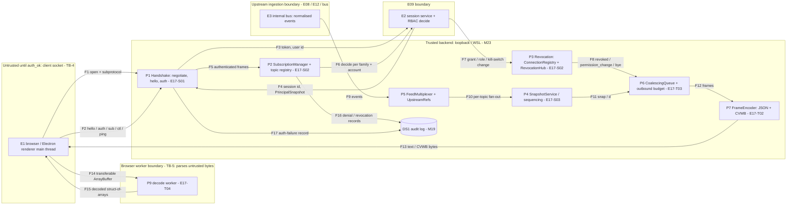

# E17 — STRIDE threat model: Client WS protocol and gateway

- Ticket: E17-X01 (issue #381). Owner: Security engineer (CODEOWNER). Status: **Approved** (2026-10-13;
  review log in §10). Accepted residuals WS-I04 and WS-R04 are owner-accepted per #1778 (2026-10-12; review date
  2027-01-15). WS-D15's control (SR-192, #2292) is built and its row is re-scored residual Medium (#3123; recorded as
  RR-08 in `04-security-program.md` §16.1, closure proposed, owner sign-off pending); WS-D16 is Open, tracked in #2293,
  and is residual Medium until #2293 merges.
- Method: `docs/plan/04-security-program.md` §5 template (L x I = risk), STRIDE per element and per flow
  (C-12.1). Format mirrors `E13-indicators.md`. Reuses the E09 auth/RBAC model (`e09-auth-rbac.md`, U-rows);
  those threats are **referenced, not duplicated**. Upstream Bybit connection security is E08's model.
- Inputs: `docs/plan/23-ws-protocol.md` (§2-§11, §16.2), ADR-0005, and the merged gateway code under
  `services/api/candleviewer/ws/` (E17-S01 lifecycle/gateway, E17-S02 topics/permissions/revocation/upstream,
  E17-T02 binary codec) at the commit this PR is based on.
- **Data classification (per flow).** Public market-data topics: **internal**. Private topics (`orders`,
  `positions`, `executions`, `wallet`, `trade_groups`, `rules`, `alerts`, `recorder`): **confidential**,
  account- or owner-scoped. `auth_ok` / `permission_change` payload: **confidential** (enumerates the account
  scope). Access tokens: **secret**.
- **Headline concerns** (`30-release-roadmap.md` §5.4): (1) WS authentication, including the bounded
  unauthenticated window (§4); (2) topic authorisation evaluated continuously, not once (§5); (3) resource
  exhaustion of a deliberately stateful server (§6).
- Gate note: enumerates weaknesses at design level only; no credentials, hosts or exploit detail appear.

## 1. Scope

In scope: the `/ws/v1` endpoint and module M23 — subprotocol negotiation, `hello`/`welcome`, `auth`/`auth_ok`
and in-place re-auth, heartbeats and close codes (E17-S01); the topic registry, parser, per-topic permission
matrix, limits and live revocation (E17-S02); snapshot+delta sequencing and resync (E17-S03, not built yet);
coalescing and the outbound budget (E17-T03, not built yet); the CVWB binary codec on both ends (E17-T02); the
web client and its decode worker (E17-T04, not built yet); error registry (E17-T05) and observability (E17-T06).

Out of scope: implementing controls (owned by the tickets in §9); executing adversarial tests (E17-X02);
the auth/session/RBAC systems themselves (E09); upstream Bybit connection security (E08); private-topic
payload semantics (E29/E34); replay clock and session lifecycle (E26).

### 1.1 State of the build at review time

The model is written against a partially built epic. Rows marked **(planned)** describe a control that is
specified in `23-ws-protocol.md` but not merged yet; their rating assumes the named ticket ships it. Known
open gaps, already tracked:

| Gap                                                                                                                                                                                                                 | Tracked in            | Rows affected       |
| ------------------------------------------------------------------------------------------------------------------------------------------------------------------------------------------------------------------- | --------------------- | ------------------- |
| Closed by #2155: a process-wide cap on sockets awaiting their first `auth_ok` (64, the next is shed with `1013`), a 6 s bound on each `auth` call (`1011` past it), and an explicit `maxsize` on the outbound queue | #2155                 | WS-S03, WS-D01, D02 |
| Web client offers subprotocols but never sends `hello`/`auth`                                                                                                                                                       | #413 (S5, from #2155) | WS-S05, WS-E05      |
| Closed by #2525: on the real backend the deployed principal is store-backed (`StorePrincipalLoader`, `ws_wiring.py`); the fake backend keeps deny-all                                                               | #377                  | WS-S01, WS-E01      |
| Closed by #2483: `cv.v1.msgpack` is served, and its client frames reach only the SR-185 decoder (WS-T08)                                                                                                            | E17-T07 / ADR-0005    | WS-T08              |
| ASGI-server WebSocket limits (message size, compression, queue, handshake timeouts) not explicitly configured                                                                                                       | #2176                 | WS-D11..D14         |
| Coalescing, the 8 MiB / 2 000-frame budget and the overflow ladder (E17-T03); snapshot/resync and the resync rate limit (E17-S03)                                                                                   | #412, #411            | WS-D03..D06         |

## 2. Data-flow diagram and trust boundaries

Text description: a client opens a socket offering a subprotocol (F1) and must send `hello` then `auth` with
an access token in the first frames (F2); the token is resolved by E09 to a session and a principal snapshot
(F3-F4). Only after `auth_ok` do `sub`/`unsub`/`ctl` reach the SubscriptionManager (F5), which asks E09's
`decide` per topic family and per account (F6). Grant, role, kill-switch, session-revocation and user-disable
events (F7) re-evaluate every live subscription and push `permission_change`/`revoked`/`bye` (F8). Market
events from the bus (F9) are multiplexed per topic (F10), sequenced (F11), coalesced and bounded (F12) and
encoded once per emission (F13). In the browser, binary bodies cross to a worker as transferables (F14) and
come back decoded (F15). Denials, revocations and repeated auth failures are audited (F16-F17).

Elements: external entities **E1-E3**; processes **P1-P7, P9** (P8 reserved for the E26 replay router, out of
scope); store **DS1**; flows **F1-F17**. Every element appears in the coverage matrix (§3.7).

Boundaries:

- **TB-4 client socket -> Handshake** (F1, F2): untrusted until `auth_ok`; semi-trusted (authenticated,
  RBAC-scoped) after it. The client enforces nothing.
- **Handshake -> E09** (F3, F4, F6, F7): the gateway consumes E09's `decide` and session service; it holds no
  copy of the rules.
- **Upstream ingestion boundary** (F9): bus content is trusted for integrity (E08/E12 models) but treated as
  unbounded in rate.
- **Encoder -> socket** (F12, F13): the server's own frames become untrusted input for the client decoder.
- **Browser main <-> worker, TB-5** (F14, F15; drawn as its own subgraph, separate from TB-4): same origin, but the worker parses untrusted bytes; a decoder fault
  must stay in the worker.

## 3. STRIDE table

Risk = L x I (Low/Med/High). Disposition: **M** mitigated by a named ticket (merged or planned), **A**
accepted (Owner sign-off in §10), **R** referenced (owned by another epic's model), **N/A** with a reason.
Verification layers follow `04-security-program.md`: unit, integration, contract, fuzz, load, chaos,
manual-review; adversarial cases go to E17-X02 (§7). Row ids are `WS-xnn`.

### 3.1 Spoofing

| ID     | Flow / element | Threat                                                                                               | L   | I   | Risk   | Control                                                                                                                                                                                                                           | Owner          | Verify            | Disp. | Residual |
| ------ | -------------- | ---------------------------------------------------------------------------------------------------- | --- | --- | ------ | --------------------------------------------------------------------------------------------------------------------------------------------------------------------------------------------------------------------------------- | -------------- | ----------------- | ----- | -------- |
| WS-S01 | F2-F4, P1      | Captured access token replayed on a new socket                                                       | L   | H   | Medium | Short-lived opaque access token validated by E09 on every `auth`; session revocation closes every socket of the session (`RevocationHub`, 4401); token expiry closes with `token_expired` (SR-074, SR-012/013; E09 U13)           | E17-S01 / E09  | integration       | M, R  | Low      |
| WS-S02 | F2, P1         | Stolen token used from another tailnet host                                                          | L   | H   | Medium | Tailnet-only reachability (SR-045/047); token TTL; session revocation path as WS-S01; device binding is E09's scope (U-rows), not re-modelled here                                                                                | E09            | manual-review     | R     | Low      |
| WS-S03 | F1, P1         | Unauthenticated socket held open to consume slots during the 10 s window                             | M   | M   | Medium | 10 s auth timeout, 3 auth attempts, 3 unauthenticated frames, inbound rate limit before auth, frame-size cap before decode; 64 sockets awaiting auth per process, 6 s per auth call (#2155) — see §4 Requirement: SR-074, SR-040. | E17-S01, #2155 | unit, load, chaos | M     | Low      |
| WS-S04 | F2, P1         | Re-auth on a live socket switches it to a different user                                             | L   | H   | Medium | In-place re-auth must resolve to the same `user_id` or counts as a failed attempt; subscriptions re-evaluated against the refreshed principal (`apply_snapshot`) Requirement: SR-074.                                             | E17-S01        | unit              | M     | Low      |
| WS-S05 | F2, P1         | `hello` claims another client build / shell / capabilities to unlock behaviour                       | M   | L   | Low    | `hello` fields are advisory only: no authorisation, limit or feature decision reads them; `welcome.limits` are server constants. Rule: no future control may key off `hello` content Requirement: SR-040.                         | E17-S01        | unit, review      | M     | Low      |
| WS-S06 | F1, P1         | Cross-site page in the user's browser opens a socket to the gateway (cross-site WebSocket hijacking) | L   | H   | Medium | Auth is a first-frame bearer token, not ambient cookies, so a foreign page cannot authenticate without the token; the upgrade also refuses any Origin outside the allow-list (SR-183, #2239)                                      | E17-S01        | integration       | M     | Low      |

### 3.2 Tampering

| ID     | Flow / element | Threat                                                                                                                        | L   | I   | Risk   | Control                                                                                                                                                                                                                                                       | Owner                 | Verify            | Disp. | Residual |
| ------ | -------------- | ----------------------------------------------------------------------------------------------------------------------------- | --- | --- | ------ | ------------------------------------------------------------------------------------------------------------------------------------------------------------------------------------------------------------------------------------------------------------- | --------------------- | ----------------- | ----- | -------- |
| WS-T01 | F13-F15, P9    | Hostile CVWB body: unbounded `record_count`, truncated body, wrong magic, unknown kind or flag bits (T-W1 on our own framing) | M   | M   | Medium | Decoder checks header length, magic, kind, then exact body length against the real buffer **before** any allocation sized from a wire count; raises one typed error (SR-128); fuzz corpus on Python and TS decoders (SR-155)                                  | E17-T02, E17-X02      | unit, fuzz        | M     | Low      |
| WS-T02 | F2, P1         | Oversized or deeply nested inbound JSON exhausts the parser                                                                   | M   | M   | Medium | 256 KiB cap on the raw frame **before** decoding (close 1009), 8 KiB until `auth_ok`; at most 1 024 JSON containers; a parse failure (including nesting depth) must count as a protocol violation, never an unhandled fault (SR-E17-02)                       | E17-S01               | unit, fuzz        | M     | Low      |
| WS-T03 | F5, P2         | Option injection: unknown keys, wrong types, out-of-range values in `opts`                                                    | M   | M   | Medium | Per-family declarative option schema; unknown keys and bad values rejected per topic (`invalid_options`), never coerced (SR-040)                                                                                                                              | E17-S02               | unit, contract    | M     | Low      |
| WS-T04 | F5, P2         | Topic-name injection: extra segments, wildcards, path-like or unknown family names to escape the registry                     | M   | H   | Medium | Deny-by-default registry: a topic resolves only to a registered family pattern with typed segments; unknown -> `unknown_topic`; symbol segments checked against the instrument cache (SR-074)                                                                 | E17-S02               | unit, fuzz        | M     | Low      |
| WS-T05 | F2, F5         | Envelope field injection: forged `ts`, `s`, `e`, or server-only fields in client frames                                       | L   | M   | Low    | Client envelopes carry only `t`/`id`/`p`; server never echoes client fields except `id`; sequence numbers are server-assigned per (connection, topic) (E17-S03, planned) Requirement: SR-040.                                                                 | E17-S01, E17-S03      | unit              | M     | Low      |
| WS-T06 | F5, P2         | `sub` entry carries extra fields (`user`, account ids outside opts) to influence leases or scope                              | L   | H   | Medium | Unknown topic-entry fields rejected; bar leases bound to the authenticated principal id, never a client value Requirement: SR-040.                                                                                                                            | E17-S02               | unit              | M     | Low      |
| WS-T07 | F9-F11, P4     | Stale or replayed sequence lets a client apply a delta across a gap                                                           | M   | M   | Medium | Server never emits a delta across an upstream gap; `snap` with `upstream_desync`; client gap detection triggers resync (E17-S03, E17-T04, planned) Requirement: SR-073.                                                                                       | E17-S03, E17-T04      | integration       | M     | Low      |
| WS-T08 | F2, P1         | msgpack decoder exposed to untrusted input without size/depth bounds                                                          | L   | M   | Low    | Served (#2483) behind SR-185: the WS-T02 size cap is checked before decoding; the C unpacker runs under depth 32, arrays of 128, maps of 32 and 16 384 values (72 until `auth_ok`); any failure is `frame_malformed` (SR-184); nightly fuzz targets (#2545)   | E17-T07               | fuzz, review      | M     | Low      |
| WS-T09 | F10-F11, P5    | Replay frames and live frames mixed on the same public topic, so a chart or rule treats replayed data as live                 | L   | M   | Low    | Replay subscriptions are keyed separately by `replay_session_id`; replay frames carry the `replay` header flag; the same `ch` live and replay are distinct subscriptions with separate sequence domains (E17-S03); replay routing is E26 Requirement: SR-040. | E17-S02, E17-S03, E26 | unit, integration | M, R  | Low      |

### 3.3 Repudiation

| ID     | Flow / element | Threat                                                                           | L   | I   | Risk   | Control                                                                                                                                                                                                                                                                                                                                                                                                                                                                                                                                                                                                                                                                                                                                                                                                                                                                                         | Owner            | Verify      | Disp. | Residual |
| ------ | -------------- | -------------------------------------------------------------------------------- | --- | --- | ------ | ----------------------------------------------------------------------------------------------------------------------------------------------------------------------------------------------------------------------------------------------------------------------------------------------------------------------------------------------------------------------------------------------------------------------------------------------------------------------------------------------------------------------------------------------------------------------------------------------------------------------------------------------------------------------------------------------------------------------------------------------------------------------------------------------------------------------------------------------------------------------------------------------- | ---------------- | ----------- | ----- | -------- |
| WS-R01 | F5, F16        | Subscription to a private topic leaves no trail                                  | M   | M   | Medium | Denied and rejected private-topic attempts write `ws.subscribe.denied`; **successful** private-topic subscriptions write one `ws.subscribe.granted` record per `sub` frame (actor, connection id, and each new subscription's `ch` and account ids: the first 10 listed, all counted) (SR-E17-04, #2174)                                                                                                                                                                                                                                                                                                                                                                                                                                                                                                                                                                                        | E17-S02, E17-T06 | integration | M     | Low      |
| WS-R02 | F7, F8, F16    | A revocation leaves no record                                                    | L   | M   | Low    | Every `revoked` frame writes `ws.subscription.revoked` with reason and removed accounts, a resync loop's too (#2174); session-revocation and user-disabled closes are counted (`ws_revoked_total`) and audited as `ws.connection.closed` with reason `session_revoked` / `user_disabled` and the user, session and source (#2486; pinned by #2174) (SR-E17-04)                                                                                                                                                                                                                                                                                                                                                                                                                                                                                                                                  | E17-S02          | integration | M     | Low      |
| WS-R03 | F17            | Repeated auth failures not attributable                                          | M   | L   | Low    | Third failure writes a `warning` audit entry naming the source address (`actor_ip`, #2174); every failure is counted (`cv_ws_auth_failures_total{reason}`) and logged with its source (`ws auth failed`), so spraying across sockets is visible per source (SR-E17-05)                                                                                                                                                                                                                                                                                                                                                                                                                                                                                                                                                                                                                          | E17-S01, E17-T06 | integration | M     | Low      |
| WS-R04 | F16, DS1       | Audit write failure silently drops the record (best-effort audit on the WS path) | L   | M   | Low    | Best-effort audit: each wait is bounded (2 s), the denial record's too; failures are logged and alerted (`cv_ws_audit_failures_total`, SR-E17-04). Accepted: denial still happens even when the record is lost. A close that stays within its bounds attempts its row until its own 2 s bound, and uvicorn's drain does not cut that attempt short (at the floor the margin is only its 0.1 s settle sleep): settings refuse a drain shorter than the 4 s one close can need, the flush plus the audit write (#2565); a handler that outlives the drain is still cancelled, and waiting for such tails is #2827. This is compatible with C-2.9 **only because no order, auth-credential or key action is carried over the WS** (order entry and the kill switch are REST, `23-ws-protocol.md` §1.2); if any such action is ever added to the WS, its audit must be write-ahead, not best-effort | E17-T06          | unit        | A     | Low      |

### 3.4 Information disclosure

| ID     | Flow / element | Threat                                                                                                                           | L   | I   | Risk   | Control                                                                                                                                                                                                                                                                                                                     | Owner            | Verify            | Disp. | Residual |
| ------ | -------------- | -------------------------------------------------------------------------------------------------------------------------------- | --- | --- | ------ | --------------------------------------------------------------------------------------------------------------------------------------------------------------------------------------------------------------------------------------------------------------------------------------------------------------------------- | ---------------- | ----------------- | ----- | -------- |
| WS-I01 | F1, F2         | Token in URL query string, log line, metric label or error message                                                               | M   | H   | Medium | Query string never read; token only in the `auth` frame body; logs bind connection/session/user ids, never the token (SR-122); `err` frames built by one builder, `internal_error` never carries text; no token-bearing metric labels                                                                                       | E17-S01, E17-T05 | unit, review      | M     | Low      |
| WS-I02 | F5, F6         | Cross-account data leak through scope narrowing                                                                                  | M   | H   | Medium | Requested accounts intersected with the principal's grants via E09 `decide`; effective list echoed in `sub_ok.effective`; fan-out filters events by the subscription's account set (E29/E34 producers, planned) Requirement: SR-074, SR-151.                                                                                | E17-S02          | integration       | M     | Low      |
| WS-I03 | F5             | Differential errors reveal which account ids exist                                                                               | M   | M   | Medium | One code and message (`account_scope_denied`) for absent, foreign and non-existent accounts Requirement: SR-074, SR-151.                                                                                                                                                                                                    | E17-S02          | unit              | M     | Low      |
| WS-I04 | F2, P1         | `connection_id`, `git_sha`, `server_version`, `request_id` exposed to a Viewer or pre-auth client                                | M   | L   | Low    | Exposed in `welcome` **before auth** to anyone who reaches the port. Accepted on a tailnet-only service: no secret, aids support. **Revisit trigger:** any change to the exposure model beyond the tailnet (`04-security-program.md` §5.10 N3) re-opens this row, and the fields move behind `auth_ok` Requirement: SR-047. | Owner            | review            | A     | Low      |
| WS-I05 | F8, `system`   | `system` topic content not filtered by role                                                                                      | M   | M   | Medium | `system` is implicit for every authenticated user; its payload must carry only role-neutral health/flag/kill-switch state, with role-specific fields filtered before emission (SR-E17-06). Built (#2175, #3125): Owner whole, Manager/Viewer neutral fields, nested allow-listed, no role nothing; guarded, counted (§8)    | E17-S03, E17-T06 | unit, arch guard  | M     | Low      |
| WS-I06 | F4, F8         | `auth_ok` / `permission_change` reveals the full permission and account list                                                     | L   | L   | Low    | Only the caller's own scope, its `kill_switch` cut as `system` is (#2175); confidential classification; never logged in full Requirement: SR-074.                                                                                                                                                                           | E17-S01          | review            | M     | Low      |
| WS-I07 | F14, P9        | Decoded private data leaks through worker `postMessage` to another context                                                       | L   | M   | Low    | Worker is same-origin and dedicated to the app; no cross-origin messaging; CSP (SR-127)                                                                                                                                                                                                                                     | E17-T04          | review            | M     | Low      |
| WS-I08 | F9-F13, P5/P7  | Account-scoped data reaches the wrong subscriber through the shared upstream reference or reuse of an encode-once fan-out buffer | L   | H   | Medium | Shared upstream refs and encode-once buffers are used only for **public** families; private families never take a shared upstream ref (`subscribe_upstream` skips them) and are encoded per subscription after account filtering; a test asserts no private frame buffer is shared across subscriptions (SR-190)            | E17-S02, E17-T03 | unit, integration | M     | Low      |
| WS-I09 | F10-F11, P4    | Cross-user alert disclosure through the fan-out: another user's `alerts` delta reaches a connection that may not read it         | M   | M   | Medium | `alerts` deltas reach only the owning user's connections, and nobody when the event names no owner. Since #2521 a private delta also needs the family's permission on the connection's current principal; `recorder` (scope NONE) relies on 23 §9.5 revocation plus that check. Tests: `tests/unit/ws/test_sequencing.py`   | E17-S03          | unit              | M     | Low      |
| WS-I10 | F2, F11, F13   | The span id `sp` links frames across users or connections, or a client's own `sp` is echoed, logged or trusted                   | M   | L   | Low    | `sp` is 8 bytes from the OS CSPRNG (`secrets`) for each stamped frame: never a counter, a seeded PRNG or derived from a user, account, session, order or request id, so ids link nothing; a log field, never a metric label (20 §12.1). The server never reads, echoes or logs a client's `sp` (23 §3.1)                    | E17-T06          | unit, contract    | M     | Low      |

### 3.5 Denial of service

| ID     | Flow / element   | Threat                                                                                                                                                                                                                                                                                                                                                            | L   | I   | Risk   | Control                                                                                                                                                                                                                                                                                                                             | Owner            | Verify                    | Disp. | Residual                  |
| ------ | ---------------- | ----------------------------------------------------------------------------------------------------------------------------------------------------------------------------------------------------------------------------------------------------------------------------------------------------------------------------------------------------------------- | --- | --- | ------ | ----------------------------------------------------------------------------------------------------------------------------------------------------------------------------------------------------------------------------------------------------------------------------------------------------------------------------------- | ---------------- | ------------------------- | ----- | ------------------------- |
| WS-D01 | F12, P6          | Slow consumer grows server memory                                                                                                                                                                                                                                                                                                                                 | H   | M   | High   | Today: 1 024-frame push bound, close `4429 slow_consumer`. Planned: 8 MiB / 2 000-frame budget and the four-step ladder (SR-073). The 8 MiB number is **both** the DoS control and the performance budget (§6); a flush past 2 s is abandoned, never the attempt (S11 exception, 23 §4.4)                                           | E17-T03, #2155   | unit, chaos               | M     | Low                       |
| WS-D02 | F3, P1           | Slow auth/principal lookup stalls the handshake while sockets accumulate                                                                                                                                                                                                                                                                                          | L   | M   | Low    | Auth timeout closes the socket; each call an `auth` makes is bounded at 6 s, past which the socket closes `bye internal_error` + `1011` (#2155, C-2.18) Requirement: SR-073.                                                                                                                                                        | #2155            | unit                      | M     | Low                       |
| WS-D03 | F11, P4          | Resync loop forces repeated snapshot rebuilds                                                                                                                                                                                                                                                                                                                     | M   | M   | Medium | 5 resyncs / topic / minute, then `resync_rate_limited` and revocation. `ctl`-triggered snapshots (identity change, resume) are outside the 23 §7.5 window and bounded today only by the inbound frame limit (WS-D05); tracked in WS-D16 (#2293) Requirement: SR-040.                                                                | E17-S03          | unit, chaos               | M     | Low                       |
| WS-D04 | F5, P2/P5        | Subscription / symbol exhaustion                                                                                                                                                                                                                                                                                                                                  | M   | M   | Medium | 50 topics per `sub` (a longer frame is refused whole before any entry is read, so per-frame work, reply size and audit writes stay bounded: WS-D15, #2292), 200 subscriptions and 40 symbols per connection, 8 connections per user; shared upstream refs with grace release Requirement: SR-073.                                   | E17-S02          | unit, load                | M     | Low                       |
| WS-D05 | F2, P1           | Inbound frame flood                                                                                                                                                                                                                                                                                                                                               | M   | M   | Medium | 30 frames/s and 300/min, before and after auth, a `pong` included until `auth_ok`; second breach closes `4429`; 3 protocol violations close `4400` Requirement: SR-040.                                                                                                                                                             | E17-S01          | unit                      | M     | Low                       |
| WS-D06 | F2, P1           | Oversized inbound frame                                                                                                                                                                                                                                                                                                                                           | M   | M   | Medium | 256 KiB (8 KiB until `auth_ok`) checked on raw bytes before decode, close 1009 Requirement: SR-040.                                                                                                                                                                                                                                 | E17-S01          | unit                      | M     | Low                       |
| WS-D07 | F1, P1           | Connection exhaustion per user and globally                                                                                                                                                                                                                                                                                                                       | M   | M   | Medium | 8 per user after auth (oldest idle closed), and 20 new sockets per user per minute (#2558); at most 64 sockets awaiting their first `auth_ok` per process, the next shed with `bye server_shedding_load` + `1013` (#2155) Requirement: SR-073.                                                                                      | E17-S01, #2155   | load                      | M     | Low                       |
| WS-D08 | F10-F13          | Expensive-topic amplification: 200-depth book plus 2 000-column heatmap across 40 symbols                                                                                                                                                                                                                                                                         | M   | M   | Medium | Per-family throttles and minimum 50 ms; encode-once-send-many; symbol cap; adaptive throttle classes (E17-T03); budgets measured by k6 (E17-Q03) Requirement: SR-073.                                                                                                                                                               | E17-T03, E17-Q03 | load                      | M     | Medium                    |
| WS-D09 | F7, P3           | Revocation fan-out blocked by one stalled socket                                                                                                                                                                                                                                                                                                                  | L   | M   | Low    | Subscriptions dropped synchronously before I/O; each send under a 2 s timeout; stalled socket unregistered and closed Requirement: SR-073, SR-074.                                                                                                                                                                                  | E17-S02          | unit                      | M     | Low                       |
| WS-D10 | F15, P9          | Decode fault or huge frame crashes the browser main thread                                                                                                                                                                                                                                                                                                        | M   | L   | Low    | Decode in a worker (E17-T04); decoder errors are typed and non-fatal; 4 MiB outbound frame cap with chunked snapshots Requirement: SR-128.                                                                                                                                                                                          | E17-T04, E17-S03 | unit, e2e                 | M     | Low                       |
| WS-D11 | F1-F2, P1        | Server-level WS message size applies before the app check: the ASGI server reassembles and decompresses a message before the 256 KiB check runs, so WS-D06 alone does not bound memory                                                                                                                                                                            | M   | M   | Medium | Server limits not explicitly configured today; explicit server message-size limit at or near the protocol cap (SR-191)                                                                                                                                                                                                              | #2176            | integration               | M     | Low after #2176           |
| WS-D12 | F1-F2, P1        | permessage-deflate amplification: a small compressed frame inflates to a large message before any app check                                                                                                                                                                                                                                                       | M   | M   | Medium | Server compression settings not explicitly configured; disable inbound compression or bound the decompressed size at the server (SR-191); the protocol does not require compression (§3.5)                                                                                                                                          | #2176            | integration               | M     | Low after #2176           |
| WS-D13 | F1-F2, P1        | Fragmentation reassembly: many continuation frames held open to accumulate buffered state                                                                                                                                                                                                                                                                         | L   | M   | Low    | Same server message-size limit bounds the reassembled message; per-connection server queue limit (SR-191); auth timeout closes idle pre-auth sockets                                                                                                                                                                                | #2176, E17-S01   | integration               | M     | Low                       |
| WS-D14 | F1, P1           | Slowloris on the upgrade: HTTP upgrade requests sent slowly to hold server slots before the app sees the socket                                                                                                                                                                                                                                                   | L   | M   | Low    | Server keep-alive/handshake timeouts not explicitly configured; set explicit server timeouts and connection limits (SR-191); tailnet-only reachability (SR-045/047)                                                                                                                                                                 | #2176            | integration               | M     | Low after #2176           |
| WS-D15 | F5, F16, P2, DS1 | Audit-store flooding: one 256 KiB `sub` frame carries ~21,842 entries; every entry denied with `forbidden` or `account_scope_denied`, and every private-family entry whatever its code, awaits an fsync'd denial audit append through the serialized writer that write-ahead order, auth and key audits also use (C-2.9). A full WAL makes audited actions refuse | M   | H   | High   | As built (#2292): a `sub` of more than `MAX_TOPICS_PER_SUB` (50) entries is refused whole before any entry is read (one small `too_many_topics` `err`, no audit row); the audited refusals of a processed frame are one `ws.subscribe.denied` record (count, codes, first 10 refusals); its reply holds at most 50 results (SR-192) | #2292, #3185     | unit, load, chaos (AC-29) | M     | Medium (until measured)   |
| WS-D16 | F5, F11, P2, P4  | Forced snapshot rebuilds bypass the resync limit: `ctl` changes to identity options (`resnapshot: true`, reason `reconfigure`) and unsub/sub churn (up to 50 snapshots per `sub`) rebuild snapshots; private families are never cached                                                                                                                            | M   | M   | Medium | WS-D03 limits only client `resync` frames (5/topic/min). Required: one rebuild budget across resync, `ctl`-forced and sub-churn paths, returning `resync_rate_limited` (SR-193). Only the generic 30 frames/s bounds this today                                                                                                     | #2293            | unit, load (AC-30)        | M     | Medium until #2293 merges |
| WS-D17 | F13, P1          | The planned shutdown outruns the container stop budget, or uvicorn's drain never ends: SIGKILL cuts off the storage flushes and secrets zeroing of the module teardown. Outside the sum today: `BarsRuntime.stop` (up to 30 s with bars on) and the metrics listener's unbounded drain, each able to use the budget alone (#2878); #2827 adds a 2 s term to it    | M   | M   | Medium | `Settings` refuses a `CV_WS_SHUTDOWN_GRACE_MS` that cannot fit `CV_API_STOP_BUDGET_S` (grace + 2 s flush + drain + 16 s for one hung module + 0.2 s of ticks; the lifespan's earlier stops are outside it); uvicorn drain bounded, and not below the 4 s one close can need; compose `stop_grace_period` equals the budget          | #2565, #2878     | unit                      | M     | Low                       |

### 3.6 Elevation of privilege

| ID     | Flow / element | Threat                                                                                                                                                           | L   | I   | Risk   | Control                                                                                                                                                                                                                                                                                                                                                                                     | Owner                 | Verify             | Disp. | Residual |
| ------ | -------------- | ---------------------------------------------------------------------------------------------------------------------------------------------------------------- | --- | --- | ------ | ------------------------------------------------------------------------------------------------------------------------------------------------------------------------------------------------------------------------------------------------------------------------------------------------------------------------------------------------------------------------------------------- | --------------------- | ------------------ | ----- | -------- |
| WS-E01 | F5, F6         | Subscribing to another account's private topic by a hand-crafted frame                                                                                           | M   | H   | Medium | Family permission + per-account `decide` on every `sub`; nothing pre-auth reaches the SubscriptionManager; matrix-driven tests per role x topic x grant (SR-074, SR-151)                                                                                                                                                                                                                    | E17-S02               | integration        | M     | Low      |
| WS-E02 | F7, P3         | Stale permission set survives a grant or role change                                                                                                             | M   | H   | Medium | Grant/role change re-resolves the principal and re-evaluates every live subscription; drops/narrows synchronously; `revoked` within 1 s (§5) Requirement: SR-074.                                                                                                                                                                                                                           | E17-S02, E09          | integration, chaos | M     | Low      |
| WS-E03 | F5, P2         | A `replay_session_id` reaches a private topic                                                                                                                    | L   | H   | Medium | Private families reject `replay_session_id` (`invalid_options`); replay id must be a UUID; replay routing ownership check is E26 Requirement: SR-074.                                                                                                                                                                                                                                       | E17-S02, E26          | unit               | M, R  | Low      |
| WS-E04 | F7, F8         | Kill-switch state not honoured on the socket                                                                                                                     | L   | H   | Medium | `auth_ok` carries kill-switch state; transitions re-evaluate every connected user; order entry is REST and enforced synchronously by the OMS (C-2.21). The WS only mirrors state. **Propagation bound:** a kill-switch transition reaches every connected socket (`system` update and any `revoked`) within 1 s, the same bound as revocation; measured by E17-Q02/Q04 Requirement: SR-074. | E17-S02, E29          | integration        | M, R  | Low      |
| WS-E05 | F2, P1         | Frame handled before `hello`/`auth_ok` reaches a privileged handler                                                                                              | L   | H   | Medium | Explicit lifecycle state machine; pre-auth only `auth`/`ping`/`pong`; `sub`/`unsub`/`ctl` dispatched only with an authorisation context present Requirement: SR-074.                                                                                                                                                                                                                        | E17-S01               | unit               | M     | Low      |
| WS-E06 | F8, E1         | Stale UI mirror: the UI shows "not killed" while the kill switch is engaged (missed `system` update, frozen tab, reconnect gap), so a user acts on a false state | M   | M   | Medium | Enforcement never depends on the mirror (OMS rejects orders synchronously, C-2.21); `auth_ok` carries the current state on every (re)connect; the client treats a stale or disconnected `system` stream as unknown, not as "not killed" (E17-T04); E17-Q04 asserts the state after reconnect Requirement: SR-074.                                                                           | E17-T04, E17-Q04, E29 | e2e                | M     | Low      |

### 3.7 Coverage matrix

| Element / flow                 | S                                                            | T                  | R             | I             | D             | E        |
| ------------------------------ | ------------------------------------------------------------ | ------------------ | ------------- | ------------- | ------------- | -------- |
| P1 Handshake (F1-F4)           | S01-S06                                                      | T02, T05, T08      | R03           | I01, I04, I06 | D02, D05-D07  | E05      |
| P2 SubscriptionManager (F5-F6) | S04                                                          | T03, T04, T06      | R01           | I02, I03      | D04, D15, D16 | E01, E03 |
| P3 Revocation (F7-F8)          | S01                                                          | —                  | R02           | I06           | D09           | E02, E04 |
| P4 Snapshot / sequencing (F11) | —                                                            | T05, T07           | —             | I05, I09, I10 | D03, D16      | —        |
| P5 Multiplexer (F9-F10)        | N/A: internal bus is authenticated by process boundary (E08) | T07                | —             | I02           | D04, D08      | —        |
| P6 Coalescing (F12)            | —                                                            | —                  | —             | —             | D01, D08      | —        |
| P7 Encoder (F13)               | —                                                            | T01                | —             | I01           | D08           | —        |
| P9 Worker (F14-F15)            | —                                                            | T01                | N/A: no actor | I07           | D10           | —        |
| DS1 Audit (F16-F17)            | —                                                            | R (E09 hash chain) | R01-R04       | —             | D15           | —        |
| E1 Client (F1-F2, F13)         | S05                                                          | T09                | —             | I08           | D11-D14, D17  | E06      |
| E2 Session service (F3-F4)     | S01, S02                                                     | —                  | —             | —             | —             | E02      |
| E3 Internal bus (F9)           | N/A: internal bus is authenticated by process boundary (E08) | T07                | —             | —             | D08           | —        |

Every STRIDE category has analysed rows. Counts: 52 rows (WS-D15, WS-D16 added 2026-10-13; WS-D17 added 2026-10-16;
WS-I09 and WS-I10 added 2026-10-17); two Highs (WS-D01 and WS-D15, inherent); no residual High (WS-D15 re-scored in #3123);
residual Medium: WS-D08, WS-D15 (until measured), WS-D16 (until #2293 merges), and WS-D11, WS-D12, WS-D14 until
#2176 merges (open items, §10).

## 4. WS authentication and the 10-second unauthenticated window

The window cannot be removed. Browser WebSockets cannot set an `Authorization` header, and a query-string
token is worse: it lands in proxy logs and browser history. The gateway therefore accepts the socket, then
requires `hello` as the first frame and `auth` with a bearer token within 10 s (`23-ws-protocol.md` §4.2-§4.3).
The argument is that the window is **bounded and cheap**:

- **Bounded in time.** `AUTH_TIMEOUT_S = 10` is evaluated by the per-connection watchdog against an injected
  clock; expiry sends `bye auth_timeout` and closes `4401`.
- **Bounded in attempts.** Three failed `auth` frames close `4401` with a `warning` audit entry. Three
  non-`auth` frames before `auth_ok` close the socket. Anything other than `hello` first closes `1002`.
- **Bounded in rate and size, before auth as well as after.** The 30/s and 300/min inbound limiter runs on
  every frame, a `pong` included until `auth_ok` and excepted after it. The size cap is checked on raw bytes
  before any decoding: 8 KiB until `auth_ok`, 256 KiB after. A JSON frame holds at most 1 024 containers,
  and a MessagePack frame at most 72 values until `auth_ok` (16 384 after).
- **Small, fixed allocation.** Before `auth_ok` a socket holds the connection object, one writer task, a
  bounded outbound queue and a rate-limiter deque capped at 301 timestamps. No subscription state, upstream
  reference or bar lease is created until `auth_ok`. Since SR-189 the first `auth` that passes `authenticate`
  registers the connection in the `ConnectionRegistry` and then re-checks the snapshot version (at most one
  extra principal read) before `auth_ok`. That still runs inside the auth deadline, the registry sends nothing to
  the socket before `auth_ok` (its `send` is silent until the connection is authenticated), and a failed
  re-check is undone, as the teardown undoes the entry for a socket that
  closes first. This is not literally "nothing beyond the socket", but it is constant-size per connection and
  independent of attacker input.
- **Not unique to an identity.** The 8-connections-per-user cap applies only after auth, because before auth
  there is no user. That is why the process-wide cap below exists.
- **Bounded in count (#2155).** At most 64 sockets (`MAX_UNAUTHENTICATED_SOCKETS`) count from `accept` to their
  first `auth_ok`, process-wide; the next is accepted and closed at once with `bye server_shedding_load` + `1013`,
  before any frame is read, and is never counted (`23-ws-protocol.md` §4.3). A socket stops counting at its first
  `auth_ok` or its end, however it ends. Each call an `auth` makes (the token check, the principal read and its
  SR-189 re-read) is bounded at 6 s, past which the socket closes `bye internal_error` + `1011`; the principal load
  fails closed to deny-all first, at 5 s (#2525). The outbound queue's `maxsize`: 1 024 data frames + the close items.

**Residual risk.** An unauthenticated party who can reach the port can occupy up to 64 such slots and a small
amount of memory per slot for 10 s at a time. Exposure is Tailscale-only with loopback/WSL-internal binds
(SR-045, SR-047), so "who can reach the port" means **a device already on the tailnet**. This is stated, not
assumed: if the exposure model changes (N3 in `04-security-program.md` §5.10), WS-S03 and WS-D07 rise to
High and the cap's size is reviewed first. Rated **Low** since #2155 (Medium before it). The cap bounds what sockets
that have not authenticated can hold; a per-source share of it is a follow-up for WS-D07 (#3146).

Related: token replay, token theft, and re-auth identity switching are WS-S01, WS-S02, WS-S04; the session
model itself is E09's (U13).

## 5. Topic authorisation is continuous, not once

A check at `sub` time is necessary but not sufficient, because a subscription can outlive the grant that
justified it. The merged design (E17-S02) has three parts:

1. **At subscribe.** The family's permission is checked with E09's `decide`; for account-scoped families each
   requested account is checked individually and the set is narrowed silently. An empty result returns one
   generic `account_scope_denied` (no existence oracle). Private families refuse `replay_session_id`.
2. **On change.** Role, permission, account-grant and kill-switch changes call the registry, which resolves a
   fresh principal snapshot and re-evaluates **every** live subscription of the user. Subscriptions that lost
   their permission or all accounts are removed; partial losses are narrowed in place. Removal happens
   **synchronously before any send**, so no further frame can be routed for a withdrawn account even if the
   client is not reading. `revoked` frames follow, each send under a 2 s timeout, and stalled sockets are
   closed. Session revocation closes every socket of the session; a disabled user gets `bye` + `4403`.
3. **On re-auth.** In-place re-auth resolves a new snapshot, must keep the same user, and re-evaluates.

**Gap analysis.** Once a subscription is narrowed or dropped, emission reads the subscription's own account
set, so a withdrawn account cannot be emitted after the synchronous step. The remaining windows are about
**which snapshot is applied** and **what is still queued**, not about emission:

- _Snapshot ordering._ Principal resolution is asynchronous, so the design must guarantee that the
  snapshot applied to a connection is never older than the latest grant change, including for a connection
  that is mid-handshake when the change happens. Since #2525 the principal is read from the store, so the race
  is reachable in production: a role or grant change that commits between the principal load and the socket's
  registration would miss the fan-out. Requirement **SR-E17-07** (SR-189, implemented in #2318): snapshots
  carry a monotonic version taken before the read, an older snapshot never replaces a newer one (it is
  refused, counted and audited: §8), and a connection re-checks the version after it registers, before
  `auth_ok` (§4). Owner: E17-S02 (§9). Tests: `tests/unit/ws/test_snapshot_versioning.py`, and E17-Q02's
  reconnect race (chaos scenario 6b) for AC-14.
- _Reconnect race_ (E17-Q02). A client that reconnects during a revocation gets a fresh `auth` against the
  current grants. With SR-E17-07 it cannot inherit a stale snapshot.
- _Producer-side filtering._ Private-topic producers (E29/E34) must route events of an account-scoped family
  by account through the subscription's account set, not by user. A SELF family (`alerts`) has no account:
  its events are routed by user, to the owner's connections only, and a NONE family (`recorder`) reaches
  every subscription that holds its permission (WS-I09). No producer or snapshot adapter for `alerts` or
  `recorder` exists yet; when they land, the `alerts` ones must scope by the connection's user. Recorded as a
  referenced control (WS-I02).
- _Queued and windowed data (E17-T03, flag on)._ With two outbound lanes (`23-ws-protocol.md` §8.4),
  `permission_change` and `revoked` ride the priority lane and overtake what the normal lane still holds, and a
  throttle window can hold data coalesced under the old scope. Requirement: in the narrowing step itself, before
  any frame that announces it is queued, the subscription's pre-narrowing window **and** every frame of it still
  queued on the normal lane are discarded; the subscription is then re-pended `reconfigure` and the snapshot is
  built under the new scope. What the priority lane holds of it (`orders`, `executions`) is queued ahead of
  `permission_change` in the same lane and needs no drop (dropping it would lose a kept account's last order
  transition). A subscription dropped outright loses its window and its queued normal-lane frames the same way.
  Invariant: no row of a removed account is delivered after the first frame that announces the narrowing:
  `permission_change`, or `auth_ok` on an in-place re-`auth`, which sends none. Owner: E17-T03 (#412); a test
  asserts it with a full window and a queued backlog (WS-E02). AC-13 covers a subscription dropped outright; no
  seed covers the kept-accounts case yet (M1 on `positions` [A, B], O withdraws B: no B row after the announcing
  frame, and a `reconfigure` snap that carries only A), so E17-T03's own test is its only coverage until E17-X02
  adds one. With the flag off the single FIFO queue sends everything already queued ahead of `permission_change`,
  so this window does not exist.

Detection: `ws_revoked_total{reason}`, the `ws.subscription.revoked` and `ws.subscribe.denied` audit actions,
and a metric for denied cross-account subscribes per identity (§8).

## 6. Resource exhaustion — where a security limit and a performance budget are the same number

The gateway deliberately holds per-connection state and queues. Every bound below is a DoS control **and** a
performance limit. **Neither may be relaxed for the other's reasons**: for example, loosening the 8 MiB
outbound budget to help a slow link silently removes WS-D01's control. A change to any number here needs a
security review in the same PR.

| Number                                 | Value                           | Security role (row)          | Performance role               | Status                                         |
| -------------------------------------- | ------------------------------- | ---------------------------- | ------------------------------ | ---------------------------------------------- |
| Auth timeout / attempts                | 10 s / 3                        | Pre-auth window (S03, D07)   | Reconnect latency              | merged                                         |
| Inbound frame cap                      | 256 KiB; 8 KiB until `auth_ok`  | Parser exhaustion (T02, D06) | —                              | merged                                         |
| JSON containers per frame              | 1 024                           | T02                          | —                              | merged                                         |
| MessagePack values per frame           | 16 384; 72 until `auth_ok`      | T08                          | —                              | merged                                         |
| Inbound rate                           | 30/s, 300/min                   | Frame flood (D05)            | Server CPU per connection      | merged                                         |
| Topics per `sub`                       | 50                              | D04                          | Subscribe latency              | merged                                         |
| Subscriptions / symbols per connection | 200 / 40                        | D04, D08                     | Load profile (8 x 40, E17-Q03) | merged                                         |
| Connections per user                   | 8                               | D07                          | Load profile                   | merged                                         |
| New connections per user               | 20 / min (sliding 60 s)         | Churn, audit growth (D07)    | Reconnect headroom             | merged                                         |
| Sockets awaiting auth (process)        | 64                              | Slots before auth (S03, D07) | Reconnect headroom             | merged (#2155)                                 |
| Auth call bound                        | 6 s per call                    | Handshake stall (D02)        | —                              | merged (#2155)                                 |
| Outbound budget                        | 8 MiB or 2 000 frames           | Slow consumer (D01)          | Epic AC: memory per connection | planned E17-T03 (1 024-frame push bound today) |
| Max outbound frame                     | 4 MiB, chunked snapshots        | D10                          | Snapshot latency               | planned E17-S03                                |
| Resync rate                            | 5 / topic / min                 | Resync loop (D03)            | Snapshot rebuild cost          | planned E17-S03                                |
| Min throttle                           | 50 ms (0 for orders/executions) | Amplification (D08)          | Budget #3 tick-to-screen       | planned E17-T03                                |
| Fan-out send timeout                   | 2 s                             | Revocation fan-out (D09)     | —                              | merged                                         |
| Fan-out audit row timeout / give-up    | 2 s / 3 failed rows in a row    | Revocation audit (R02, R04)  | Change duration                | merged                                         |
| Heartbeat interval / timeout           | 15 s / 45 s                     | Dead-socket reclamation      | Disconnect detection           | merged                                         |

Memory outside the outbound budget (WS-D01, #2552): each `heatmap` subscription remembers up to 2 000
complete buckets it sent (`SENT_COLUMNS_MEMORY`), about 150 to 210 KB measured (the review estimated 168 KB).
It is bounded by count, fills only as complete columns are emitted (one per time bucket), and is not counted in
`pending_bytes`. Heatmap subscriptions are per channel and replay session, so the bound is the 200-subscription
cap, not the 40-symbol one: up to about 42 MB per connection (200 x 210 KB) and about 336 MB per user (8
connections), on top of the 8 MiB outbound budget.

Wiring requirements (WS-D01, #412): after a `close` event the ladder latches and returns nothing, so the 8 MiB budget
holds only while the gateway closes the socket promptly. It must feed nothing after the event but the `bye` (no push,
no `Pacer.offer` or `tick`) and close in a `finally` around the best-effort close audit, so a slow or failed audit
write cannot leave the queue unbounded; the wiring tests (#412) must assert both. The `bye` and the close marker are
the only items admitted past the budget (`23-ws-protocol.md` §8.4): one small frame, so the bound holds to within one
frame. Until #2529, footprint bars that share an open time make every update `unmergeable`: the topic is
re-snapshotted per window with no rate bound (the 5 / topic / min limit covers client resyncs only, WS-D03). It
counts apart as `cv_ws_overflow_total{reason="unmergeable"}`: alert on its rate.

Amplification (WS-D08): one authenticated user can hold 8 x 40 symbols with 200-depth books and 2 000-column
heatmaps. Encode-once-send-many keeps CPU flat in client count, but per-user cost is real and unmeasured until
E17-Q03. Tracked as **RSK-063**.

**Outbound budget under `CV_WS_BACKPRESSURE_ENABLED` (E17-T03, WS-D01).** The flag (C-4.13, off by default,
removal #2900) swaps the mechanism that enforces the outbound bound; the bound itself exists in both states (1 024
frames while it is off), so the flag gates no safety invariant (C-4.14). With it on, both lanes of the queue are
inside the same 8 MiB / 2 000-frame accounting: a peer that cannot drain `orders`, `executions`, `system` or
control frames meets the same `slow_consumer` close as any other (`23-ws-protocol.md` §8.4), and no lane is
unbounded (C-2.18). `CV_WS_QUEUE_BYTES` and `CV_WS_QUEUE_FRAMES` accept values from their floors up to this
table's numbers: lowering never goes below the floor (4 194 304 bytes, one maximum outbound frame, and 256 frames,
above the 200-subscription cap), and a raise is a change to a number in this table, which needs a security review
in the same PR. Lowering is the safe direction for this threat, so the floors are typo guards and not a control:
they stop a misconfiguration from closing every connection at its first large frame, and promise no more than
that one frame fits. `CV_WS_CLASSIFY_INTERVAL_MS` is held to 500-10 000 ms. A closing connection is bound by one
2 s flush deadline, the close flush the gateway already has and `23-ws-protocol.md` §9.4 already counts once in
the stop budget: on deadline expiry the flush is abandoned and the transport closes with no `bye` (the S11
exception of `23-ws-protocol.md` §4.4). The `bye` is always enqueued before the 2 s starts, so the server abandons
an undeliverable flush, never the attempt. With the flag on an expiry is observable: the close audit row carries
`flush_abandoned: true` (with the `trigger` that `23-ws-protocol.md` §4.3 defines, `flush_deadline` only when no
step 3 trigger fired) and `cv_ws_overflow_total{reason="close_flush_deadline"}` counts it (`23-ws-protocol.md`
§8.4). Flag off, as built, neither is recorded, and the same 2 s starts when the reader returns, so a peer that is
silent as well as not reading is ended by the transport keepalive alone (15 s ping, 45 s timeout); the
`internal_error` close after a writer fault has no flush deadline at all (`23-ws-protocol.md` §10.1).

## 7. Abuse-case seeds (handed to E17-X02)

Each seed is executable as written against a test stack. "M1" is a Manager granted account A only; "V" is a
read-only role; "O" is the Owner. Expected = frame/close code plus the named metric or audit action.

| #     | Action                                                                                                                                     | Expected                                                                                                                                                | Rows            |
| ----- | ------------------------------------------------------------------------------------------------------------------------------------------ | ------------------------------------------------------------------------------------------------------------------------------------------------------- | --------------- |
| AC-01 | Open with `?access_token=<valid>` in the URL and send no `auth`                                                                            | Token ignored; `auth_timeout` + 4401 after 10 s                                                                                                         | S03, I01        |
| AC-02 | Send `sub` before `hello`; send `sub` after `hello` but before `auth`                                                                      | 1002 close; then `not_authenticated`, closed after 3                                                                                                    | E05             |
| AC-03 | Send 3 `auth` frames with invalid tokens                                                                                                   | 4401 + `warning` audit entry                                                                                                                            | S03, R03        |
| AC-04 | Re-auth on a live M1 socket with a valid token of another user                                                                             | Counted as failure; socket identity unchanged                                                                                                           | S04             |
| AC-05 | As M1, `sub positions` with `exchange_account_ids` = [B]; then [A, B]; then a random UUID                                                  | `account_scope_denied` (same message for B and random); [A,B] narrowed to [A]; audit `ws.subscribe.denied`                                              | E01, I02, I03   |
| AC-06 | As V, `sub orders`                                                                                                                         | `forbidden`; audit                                                                                                                                      | E01             |
| AC-07 | `sub` `positions` with a `replay_session_id`                                                                                               | `invalid_options`                                                                                                                                       | E03             |
| AC-08 | Topic names: extra segments, `*`, `../`, unknown family, unknown symbol, 10 KiB name                                                       | `unknown_topic` / `invalid_topic`, never a fault                                                                                                        | T04             |
| AC-09 | `opts` with unknown keys, wrong types, NaN-like strings, huge numbers; `sub` entry with extra fields                                       | `invalid_options` per topic; batch continues                                                                                                            | T03, T06        |
| AC-10 | Frame of 256 KiB + 1 byte; JSON nested 100 000 levels deep within the size cap                                                             | 1009; protocol violation (not a 1011 fault)                                                                                                             | T02, D06        |
| AC-11 | 31 frames in 1 s, twice                                                                                                                    | `client_rate_limited`, then 4429                                                                                                                        | D05             |
| AC-12 | Stop reading the socket for 60 s while subscribed to the reference workspace                                                               | Memory stays within budget; ladder then 4429; audit + metric                                                                                            | D01             |
| AC-13 | M1 subscribed to `positions` [A]; O withdraws A                                                                                            | `revoked` within 1 s naming A; no further A frame; audit `ws.subscription.revoked`                                                                      | E02, R02        |
| AC-14 | Withdraw A while M1 is mid-`auth` on a new socket, and while M1 re-auths on a live socket (reconnect race)                                 | Final state reflects the withdrawal on every socket                                                                                                     | E02 (SR-E17-07) |
| AC-15 | Open 9 sockets as M1; then, in a fresh 60 s window, open 21 sockets as one user (#2558)                                                    | Oldest idle closed `too_many_connections`; 21st: `bye client_rate_limited` + 4429, no `auth_ok`, no close row, `cv_ws_connect_rate_limited_total` +1    | D07             |
| AC-16 | Open many sockets and never send `auth`                                                                                                    | Each closed at 10 s; past 64 awaiting auth, the next gets `bye server_shedding_load` + `1013` at once (#2155)                                           | S03, D07        |
| AC-17 | 6 client `resync` requests on one topic within a minute                                                                                    | `resync_rate_limited`, subscription revoked                                                                                                             | D03             |
| AC-18 | Fuzz CVWB decoders (Python + TS) with header-only, wrong magic, unknown kind/flags, `record_count` near 2^32, truncated and trailing bytes | Typed decode error only; no allocation sized from the wire count before the length check                                                                | T01, D10        |
| AC-19 | Subscribe 40 symbols x `book.*.200` + heatmap on 8 sockets                                                                                 | Throttles hold; no other client sees a sequence gap or latency regression                                                                               | D08             |
| AC-20 | Grep logs, metric labels, `err` frames, `bye` text and WS close reasons during AC-01..AC-19 for the token value                            | Zero hits                                                                                                                                               | I01             |
| AC-21 | As V, read `system` after a kill-switch engage                                                                                             | Only role-neutral fields                                                                                                                                | I05, E04        |
| AC-22 | Offer only `cv.v1.msgpack`                                                                                                                 | `cv.v1.msgpack` echoed; its frames are decoded only under the SR-185 bounds (#2483)                                                                     | T08             |
| AC-23 | Open a socket with a foreign `Origin` header                                                                                               | Rejected at upgrade: HTTP 403 before `accept`, auth never reached (SR-183, #2239)                                                                       | S06             |
| AC-24 | Send a compressed inbound message whose inflated size exceeds the protocol cap; send one message as many small continuation fragments      | Refused at the server limit, not after full inflation (after #2176)                                                                                     | D11-D13         |
| AC-25 | Open many upgrade requests and send their headers slowly                                                                                   | Server times them out (after #2176)                                                                                                                     | D14             |
| AC-26 | Engage the kill switch; observe a connected and a reconnecting client                                                                      | `system` reflects it within 1 s; UI never shows "not killed" while stale                                                                                | E04, E06        |
| AC-27 | Two users subscribe to `positions` for different accounts on the same symbol; capture both streams                                         | No frame for one account reaches the other subscriber                                                                                                   | I08             |
| AC-28 | Subscribe the same public topic live and with a `replay_session_id`                                                                        | Two subscriptions, separate sequences; replay frames flagged `replay`                                                                                   | T09             |
| AC-29 | As V, send one 256 KiB `sub` frame of ~21,800 minimal entries (mix of denied and private-family)                                           | One bounded reply; O(1) audit appends (one aggregated denial record); no WAL growth proportional to entries; audited order path still succeeds (SR-192) | WS-D15          |
| AC-30 | Loop `ctl` identity-option flips on one topic, and 50-entry unsub/sub churn, for 60 s                                                      | Rebuilds capped by the shared budget; `resync_rate_limited`; no unbounded snapshot builds (SR-193)                                                      | WS-D16          |

AC-29 as built (#2292): the frame is refused whole before any entry is read, so it writes no audit row; a frame within the cap writes at most one aggregated `ws.subscribe.denied` record (23-ws-protocol.md §5.2). Its "audited order path still succeeds" leg is E17-X02's (#415).

## 8. Observability: threats that must be detectable

Prevention is not enough; these must be visible as abuse, each with an audit action **and** a metric (or, where an audit row would be the attack's amplifier, a capped log line and a metric, with the reason below the table):

| Signal                              | Audit action                         | Metric (no user-id label; per-identity in audit) | Rows     | Status                                   |
| ----------------------------------- | ------------------------------------ | ------------------------------------------------ | -------- | ---------------------------------------- |
| Repeated `auth_failed` per identity | auth-failure `warning` (3rd failure) | `cv_ws_auth_failures_total{reason}`              | S03, R03 | merged; per source by `actor_ip` (#2174) |
| Slow-consumer closes per identity   | `ws.connection.closed`, `warning`    | `cv_ws_closes_total{reason="slow_consumer"}`     | D01      | merged (#2486; alert #3035)              |
| Resync-rate-limit revocations       | `ws.subscription.revoked`            | `ws_revoked_total{reason="resync_rate_limited"}` | D03      | merged (#2174)                           |
| Denied cross-account subscribes     | `ws.subscribe.denied`                | `cv_ws_subscribe_total{result}`                  | E01, I03 | merged                                   |
| Revocation close failures           | —                                    | `ws_revocation_close_failures_total` (alerts)    | E02      | merged                                   |
| Refused stale snapshots (SR-E17-07) | `ws.permission_snapshot.refused`     | `cv_ws_permission_snapshots_refused_total`       | E02      | merged (#2318)                           |
| Withheld `system` frames (SR-188)   | none, by design (no row per frame)   | `cv_ws_system_frames_withheld_total{reason}`     | I05      | merged (#3125)                           |
| Audit write failures on the WS path | —                                    | `cv_ws_audit_failures_total{reason}`             | R04      | merged (#2174); `WsAuditWriteFailed`     |
| Refused WS upgrades (Origin check)  | `auth.ws_origin_refused` (#2269)     | `cv_ws_closes_total{reason="origin_forbidden"}`  | S06      | merged (#2239; audit #2269)              |
| User connect/close churn (#2322)    | `ws.connection.closed` (#2486)       | `cv_ws_handshake_seconds_count`                  | D07      | merged (#2486); capped by #2558          |
| Per-user connect-rate refusals      | none, by design; capped log line     | `cv_ws_connect_rate_limited_total`               | D07      | merged (#2558)                           |
| Sockets shed awaiting auth (#2155)  | none (no identity); capped log line  | `cv_ws_closes_total` (`server_shedding_load`)    | S03, D07 | merged (#2155)                           |

A `system` frame left out for its kind or its socket (`cv_ws_system_frames_withheld_total`) is a producer or
session fault, not a user action, so it writes no audit row: one per socket and frame would grow with both.
`unknown_kind` or `invalid_body` above zero is a producer bug; a deny-all socket (the fake backend, or after a
failed principal load) counts every other frame under `no_role` (`23-ws-protocol.md` §15.9).

The connect-rate limit (`CV_WS_MAX_AUTHS_PER_USER_PER_MIN`, 20 per user per sliding minute; `23-ws-protocol.md`
§4.3) is the control behind the last two rows. A `ws.connection.closed` row needs a counted `auth` first, so
connect/close churn adds at most that many rows per user per minute instead of one per loop iteration, and what
remains is visible as that audit action's rate per identity (the metrics carry no user label).
Private-topic `unsub`/`sub` churn also grows the `ws.subscribe.granted` rows; it is related to WS-D16 (#2293).

A refused connect writes **no** audit row. That narrows `04-security-program.md` §8.3 rule 5 (every denial,
`ratelimit.rejected`, is logged; no code emits that event yet) and, if a refused connect is an "auth event", C-2.9.
#2558 asks for refusals that add no audit rows, and a row per refusal would bring back the growth the limit stops.
The repo has precedent both ways (C-2.9 vs C-2.18): `/auth/refresh` 429s write no row, but the CSRF guard and the
session-fixation refusal write budgeted rows (up to 20 a minute per source) and count the rest as `audit_throttled`.
That budget is not taken here: per user it would add up to 20 refusal rows a minute to the 20 close rows the limit
allows. A row capped at one per user per window (gated by `first_refusal`) would be bounded and cheap, and would put a
refusal in the retained audit chain (C-12.8) instead of a log line. It is deferred, not rejected: it needs a new audit
action and an awaited append on the refusal path, so it is its own ticket if the Owner wants refusals in audit
retention. Until then the record is `cv_ws_connect_rate_limited_total` (every refusal) and the
`ws connect rate limited` warning (user, peer address, limit and `retry_after_ms`, never the token), which is capped at
a user's first refusal in a window. Every close also writes the generic `ws close` line, with no user.
`cv_ws_closes_total{reason="client_rate_limited"}` ticks for each refusal too, and is shared with the inbound frame
limiter's `4429` close (D05), so RSK-063's trigger reads the dedicated counter.

A `sub` refused whole (over 50 topics, or malformed; `23-ws-protocol.md` §5.2) is an accepted exception with no audit
row and no scraped metric: only the in-process `cv_ws_errors_total{code}` moves (pinned for malformed names by AC-WS-04
in `docs/security/abuse-cases/e09-auth.md`), where the connect-rate refusals keep a scraped counter and a capped log
line. A sender that keeps going past the frame limit is closed at its second breach and shows in the limiter's scraped
`cv_ws_closes_total{reason="client_rate_limited"}` (D05); one within the limit leaves no scraped trace. The over-cap refusal is answered with `too_many_topics` and
has no per-entry identity to audit (the frame is refused before any entry is read).

**Close detail (E17-T03).** A `slow_consumer` close is the one `ws.connection.closed` row at `warning`
(`23-ws-protocol.md` §4.3). With the backpressure flag on, a close also carries an `after_state` of at most two
bounded fields, as that section states them (flag off: none). `trigger` is `budget` or `redrop` for a close of §8.4
step 3 (`23-ws-protocol.md`), or `flush_deadline` for a close that had no step 3 trigger and whose `bye` flush missed
the 2 s deadline (the S11 exception of `23-ws-protocol.md` §4.4); `flush_abandoned: true` is added whenever that
deadline expired, so a `budget` close whose flush also expires keeps `budget`. The vocabulary is closed (three
trigger values and one flag, never a topic name or a count), so the row stays one fixed-size record, and the two
fields keep both facts of a close: an identity whose `redrop` closes repeat (a client that cannot recover its
snapshots) reads differently from one with `budget` closes (a client that cannot drain at all), and
`flush_abandoned: true` on either marks a peer that did not take the flush within 2 s. The same expiry counts in
`cv_ws_overflow_total{reason="close_flush_deadline"}` (`23-ws-protocol.md` §8.4), in addition to the step 3 value.
The registry's eviction of a connection whose `permission_change` or `revoked` send stalled or failed (the fan-out
send timeout above) is also a `slow_consumer` close: it carries no step 3 trigger (when its own flush expires it
carries `trigger` `flush_deadline` and `flush_abandoned: true`), and with the flag on, like every `slow_consumer`
close, it clears both lanes before the `bye`, so nothing queued under the old scope follows an identity change
(flag off, as built: the `bye` follows the frames already queued, `23-ws-protocol.md` §8.4). A non-droppable frame
(`orders`, `executions`, control, `system`) that cannot be encoded, or whose emission raises, closes the connection
`internal_error`: it fails closed and never drops silently, because a client that missed an order transition or a
`revoked` would act on a false state. That close is audited (`ws.connection.closed`, reason `internal_error`,
`warning`) and counted (`cv_ws_closes_total{reason="internal_error"}`), and the offending frame is logged by type,
family and error class, never its payload (C-12.6).

**Stale permission snapshots (SR-189, WS-E02).** The registry stamps every principal read with a monotonic
version taken before the read, and a connection never takes an older one (§5). A refusal is counted in
`cv_ws_permission_snapshots_refused_total{event}`, where `event` is the step that was refused: `reauth`,
`grant_change` or `handshake`. It also writes one `ws.permission_snapshot.refused` row at `warning` (outcome
`denied`, reason `stale`), whose `after_state` holds the `event` and the `applied_version` and
`refused_version`. Any increase means a grant change raced a re-auth or a handshake and the check kept the
newer snapshot. Like every WS audit write, the row is best effort (WS-R04 as built, §10).

## 9. Control-to-ticket map

Every E17-* ticket appears here; a missing row is a model defect (GOV-008,
`scripts/check_threat_model_ticket_map.py`). Requirement ids: `SR-192`, `SR-193` (added by the 2026-10-13 amendment), `SR-074`, `SR-073`, `SR-040`, `SR-128`,
`SR-155`, `SR-122`, `SR-151` (existing) and `SR-183..SR-191` (added to `04-security-program.md` §6.18 by this
PR; local aliases `SR-E17-01..07` in the rows above map 1:1 to SR-183..SR-189; SR-190 and SR-191 are cited directly).

| Ticket                      | Obligation                                                                                                                                                                                                                              |
| --------------------------- | --------------------------------------------------------------------------------------------------------------------------------------------------------------------------------------------------------------------------------------- |
| E17-K01                     | Spike (closed); no control. Its binary-vs-JSON decision fixes which decoders are exposed (T01, T08)                                                                                                                                     |
| E17-T01                     | Generated WS schemas are the strict validation source (SR-040); `ws_message_schemas` gate keeps doc and code equal                                                                                                                      |
| E17-T02                     | CVWB bounds-checked decode (SR-128) and fuzz corpus (SR-155) — merged; T01                                                                                                                                                              |
| E17-S01                     | Handshake, timeouts, attempts, rate limit, frame cap, re-auth identity, no query-string token (S01-S06, T02, D05-D07, E05, I01); Origin allow-list SR-183; nested-JSON handling SR-184; #2155 follow-ups (pre-auth cap, await timeouts) |
| E17-S02                     | Registry, option schema, per-account `decide`, generic denial, revocation, audit (T03-T06, I02, I03, E01-E03, R01, R02, D04, D09); snapshot versioning SR-189 (merged, #2318)                                                           |
| E17-S03                     | Sequencing, `upstream_desync` snap, resync rate limit, 4 MiB chunking (T05, T07, D03, D10); `system` payload filtering SR-188                                                                                                           |
| E17-T03                     | 8 MiB / 2 000-frame budget (lower only), both lanes inside it, overflow ladder, coalescing, throttles (D01, D08); narrowing drops queued and windowed data first (E02); an unsendable non-droppable frame closes `internal_error` (D01) |
| E17-T04                     | Web client `hello`/`auth` (#2155), worker decode, gap detection, no token in URL (T07, D10, I07)                                                                                                                                        |
| E17-T05                     | Single error builder; `internal_error` carries no text (I01)                                                                                                                                                                            |
| E17-T06                     | Detection metrics and audit-failure counter (§8, SR-186, SR-187)                                                                                                                                                                        |
| E17-T07                     | Protocol freeze; msgpack bounds and fuzz target before it is served (SR-185, T08)                                                                                                                                                       |
| E17-T08                     | Statechart-backed topic must register through the same family registry and permission matrix; no bypass of `decide` (E01)                                                                                                               |
| E17-Q01                     | Conformance suite asserts §6 limits and close codes; consumes AC-02, AC-08, AC-10, AC-11                                                                                                                                                |
| E17-Q02                     | Chaos: slow consumer (AC-12), reconnect race (AC-14), restart                                                                                                                                                                           |
| E17-Q03                     | k6 load: confirms §6 numbers and AC-19; feeds RSK-063                                                                                                                                                                                   |
| E17-Q04                     | E2E: kill-switch over WS (AC-21), revocation UI (AC-13)                                                                                                                                                                                 |
| E17-X01                     | This model                                                                                                                                                                                                                              |
| E17-X02                     | Executes AC-01..AC-30; decoder fuzzing; SAST rule that no WS handler reads the query string or logs a token                                                                                                                             |
| E17-D01 / D02 / D03 / D04   | Design: no security control; degraded/revoked states must not imply data is current                                                                                                                                                     |
| E09 / E08 / E26 / E29 / E34 | Referenced: session and RBAC (S01, S02, E02), upstream (P5), replay ownership (E03), producer account routing (I02), kill switch (E04)                                                                                                  |

**Amendment 2026-10-13 (QA Agent B pass).** Two missed threats were added: WS-D15 (audit-store flooding; issue #2292,
SR-192, E17-S02 #378) and WS-D16 (forced snapshot rebuilds; issue #2293, SR-193, E17-S02 #378). Controls handed to
owner tickets by comment: SR-185 to E17-T07 #572; SR-190 test to E17-S02/E17-T03 #412; WS-E06 to E17-T04 #413;
WS-E04 1 s bound to E17-Q02 #410 and E17-Q04 #569. Follow-ups #2172-#2176 and #2155 are on the project board.

**Gaps that become work.** Every control gap is already a ticket or owned by a named open E17 ticket: #2155
(web hello/auth, moved to #413; its cap and call bounds are built) and #2176 (server WS limits, SR-191). SR-189
(snapshot versioning, E17-S02) is implemented (#2318) and is no longer a gap. SR-183..SR-188 are requested as
scope on the open tickets named above.

## 10. Residual risks, review and sign-off

- **Accepted (owner-accepted per #1778 2026-10-12, orchestrator review, 2026-10-13):** WS-I04 (build and connection identifiers visible pre-auth on a
  tailnet-only service); WS-R04 (best-effort audit on the WS path: the denial still happens). Review date for both: 2027-01-15 (C-12.1).
- **WS-R04 as built (#2735, 2026-10-16):** the close row `ws.connection.closed` is attempted whenever an authenticated
  handler ends, including when its host cancels it (uvicorn's graceful timeout, which used to skip the whole teardown).
  The loss window that remains is within the acceptance: a write that has not started is abandoned if the handler is
  cancelled again while waiting for it (`AuditWriter.emit` finishes one that has). The host's drain does not cut a close
  short: settings refuse a uvicorn drain shorter than the 4 s one close can need (the 2 s flush, which a writer stalled
  on a peer that stopped reading starts only once uvicorn frees its handler, then the 2 s audit write), so a close that
  stays within its bounds attempts its row until its own bound before anything is cancelled. At the floor the margin
  is only uvicorn's 0.1 s settle sleep (the 5 s default leaves 1.1 s). A handler that outlives the drain is still
  cancelled, and its row is lost in one of two ways: `AuditWriter.emit` raises `AuditWriterStopped` once the writer has
  stopped (`audit_close` logs `ws close audit not confirmed`), or the cancel lands inside `emit()` and ends the handler
  with a `CancelledError`, which uvicorn logs only as its generic ASGI error. Making the lifespan wait for such tails is
  #2827. The reason `shutdown` is attributed
  only while the server marks itself shutting down (`GatewayHub.shutting_down`): while the server runs, a client's own
  `1012` cannot read as the server's; while it is shutting down it can (23-ws-protocol.md §4.3). There the label is
  best effort both ways: a client's own `1012`, or a drop just before the host cancels the handler, reads `shutdown`; a
  send that fails as the host closes the socket can read `client_closed`. Only the row's `reason` is affected (both are
  `info`), and no decision reads it.
- **WS-R04 as built (#2824, 2026-10-16):** the revocation fan-out writes its `ws.subscription.revoked` and
  `ws.permission_snapshot.refused` rows once every socket has its frames, also when the change raises or is cancelled
  part-way, one at a time and each bounded at 2 s. Its loss windows: a row still queued for the writer's lock at 2 s
  is lost (`ws audit not confirmed`, with the row's user) and one already appending lands late; once 3 rows in a row
  have raised or timed out, the rest are abandoned even when the writer would have taken them a moment later (a stall
  of 6 s or more; before #2292 bounded WS-D15's records per frame its flooding was one cause, and a sustained flood is
  still the residual rated in the WS-D15 bullet below), and so are the rows a cancellation during the writes leaves
  (both `ws audit rows abandoned`, with a count and the users). A socket whose re-evaluation raises is evicted like a
  stalled one: it gets no `revoked` frame and the revocations it had made get no row; its `ws.connection.closed` row
  reads `slow_consumer`, and only the error log `ws permission swap failed; socket evicted` names the cause. The
  revocations themselves never wait for a row. The alerting metric SR-E17-04 asks for is built (#2174, below).
- **SR-186 and SR-187 as built (#2174, 2026-10-17):** the new private-topic subscriptions of a `sub` frame are one
  `ws.subscribe.granted` record (WS-R01); session-revocation and user-disabled closes are `ws.connection.closed` rows
  naming the reason, user, session and source (WS-R02); a resync loop's revocation writes `ws.subscription.revoked`;
  the 3rd failed `auth`'s row names the source address (WS-R03). Every WS audit row not confirmed written counts once
  in `cv_ws_audit_failures_total{reason}` (`error`, `timeout`, `cancelled`, `abandoned`), and `WsAuditWriteFailed`
  raises a ticket on any increase (WS-R04, §8). Denied cross-account subscribes and slow-consumer closes already had an
  audit action and a metric (§8). The loss windows above are unchanged, now counted; WS-R04 stays accepted.
- **Residual High: none.** WS-D15 (audit-store flooding) was the one, a release blocker under the
  `04-security-program.md` §5.11 rule while SR-192 was unbuilt. It is re-scored Medium below (#3123).
- **Residual Medium (not eliminated):**
  - WS-D15: audit-store flooding, re-scored from High (#3123). Inherent High (likelihood Medium x impact High scores
    High in the `04-security-program.md` §5 template). With SR-192 built (#2292), a `sub` over 50 topics is refused
    whole before any entry is read and a processed frame writes at most one `ws.subscribe.denied` record, so likelihood
    drops to Low (sustained sending is needed) and impact stays High: likelihood Low x impact High scores Medium. What
    remains is at most one record per `sub` frame; the frame and connection limits (WS-D05, WS-D07) bound the rate. A
    per-connection budget for these rows is tracked as a follow-up to this re-score (#3185). The Medium is re-scored
    once that budget is built (#3185 tracks it if RR-08 closes); a failed order-path leg in E17-X02's AC-29 run
    re-scores it to High. AC-29's
    bounded-reply and audit-append legs are tested in #2292 (unit and contract); E17-X02 (#415) executes AC-29 whole.
    Recorded as RR-08 in `04-security-program.md` §16.1: closure proposed, owner sign-off pending (queued on #2701),
    review date 2026-11-15.
  - WS-D11, WS-D12, WS-D14: transport-layer limits enforced by the ASGI server are not explicitly configured;
    Low once #2176 merges. Part of **RSK-063**.
  - WS-D08: per-user amplification on hot symbols is bounded but unmeasured until E17-Q03. **RSK-063**.
- **Contingent Low:** WS-D01, WS-D03, WS-T07 and WS-D10 are rated on planned controls (E17-T03, E17-S03,
  E17-T04); re-triaged at each PR's security review if the control is missing. WS-E02 was Low contingent on
  SR-189, which is implemented (#2318), so it is Low as built. **RSK-064** (continuous authorisation) is
  Mitigating in `32-risk-register.md`.
- **Lowered by #2155:** WS-S03 and WS-D07 are Low: at most 64 sockets await auth per process, and each `auth` call
  is bounded at 6 s (§4). They were **RSK-063**'s first trigger; #3145 re-rates WG1 and RSK-063 to match.
- No High residual: WS-D15 was the one (re-scored above, #3123). The unauthenticated-window argument (§4) holds only
  for tailnet-only exposure.
- Status is **Approved** (2026-10-13). WS-D15 is residual Medium since SR-192 was built (#2292; re-scored in #3123;
  RR-08 in `04-security-program.md` §16.1, closure proposed, owner sign-off pending); WS-D16 is residual Medium
  until #2293 merges.

### Review log

| Date       | Reviewer                                          | Result                                                                                                                                       |
| ---------- | ------------------------------------------------- | -------------------------------------------------------------------------------------------------------------------------------------------- |
| 2026-10-10 | author (E17-X01 agent)                            | Draft submitted                                                                                                                              |
| 2026-10-10 | security-reviewer (PR #2171)                      | APPROVE at 63a1a6e after fix map (WS-D11..D14, E06, I08, T09)                                                                                |
| 2026-10-10 | code-reviewer (PR #2171)                          | APPROVE (twice)                                                                                                                              |
| 2026-10-12 | Architect pass = QA Agent B                       | FAIL: named missed threats WS-D15, WS-D16 and tracking gaps                                                                                  |
| 2026-10-13 | amendment author (agent)                          | Added WS-D15/D16, AC-29/30, SR mapping, matrix, #2292/#2293                                                                                  |
| 2026-10-13 | orchestrator Agent A                              | Approved: owner-approved per #1778 2026-10-12 (orchestrator review) for WS-I04/WS-R04 residuals                                              |
| 2026-10-13 | security-reviewer (sonnet, independent; PR #2307) | APPROVE; ratings, SR-192/193 numbering, code refs and WG3 edits verified; WS-D15/D16 residuals Open, not accepted                            |
| 2026-10-15 | security-reviewer (Fable, independent; PR #2307)  | REQUEST_CHANGES at 027e7666: WS-D15 rated Medium where the template gives High (Medium), plus three Lows (log, review date, 32 §10.1.1 hunk) |
| 2026-10-16 | amendment author (agent)                          | Fable findings addressed at cef393ba: WS-D15 rated High, RR-08 recorded (owner sign-off pending), review rows and dates added                |
| 2026-10-16 | author (agent; PR for #2735)                      | WS-R04 as built (#2735): a host-cancelled handler attempts its close row; the shutdown label is best effort in the window (§10)              |
| 2026-10-16 | author (agent; PR for #2565)                      | WS-D17 added (#2565): the planned shutdown against the stop budget and uvicorn's drain; WS-R04 as built gains the drain floor (#2827)        |
| 2026-10-16 | author (agent; PR for #2558)                      | WS-D07: per-user connect rate; §8 carve-out and its dedicated counter; AC-15 extended (§7, §8)                                               |
| 2026-10-16 | author (agent; PR for #412 contract)              | E17-T03 wiring contract: narrowing rider (§5), flag, floors and S11 flush deadline (§6), close fields and fail-closed close (§8), row (§9)   |
| 2026-10-16 | author (agent; PR for #412 S2a-0)                 | Pre-auth inbound frame limits, #412 S2a-0: §4, §6, WS-T02, WS-T08, WS-D05 and WS-D06 state them                                              |
| 2026-10-16 | author (agent; PR for #2824)                      | WS-R04 as built (#2824): fan-out rows after the frames, 2 s each, 3 failed in a row end them; swap eviction; D15 (§6, §10)                   |
| 2026-10-17 | author (agent; PR for #2322)                      | SR-189 as built (#2318): §4, §5, §8-§10, RSK-064; WS-I09 (#2521); WS-D03 `ctl` snapshots (#2556); §1.1 rows (#2525)                          |
| 2026-10-17 | author (agent; PR for #2175)                      | WS-I05 built (#2175): `system` and `auth_ok.kill_switch` filtered per socket (SR-188); out of the Contingent Low list (§3.4, §10)            |
| 2026-10-17 | author (agent; PR for #2292)                      | SR-192 as built: WS-D04/D15 controls, AC-29 note, §8 exception for a `sub` refused whole; D15 re-score in #3123                              |
| 2026-10-17 | author (agent; PR for #2155)                      | WS-S03, WS-D07 to Low: a cap of 64 sockets awaiting auth (`1013`); 6 s per auth call (D02); queue `maxsize` (§1.1-§10)                       |
| 2026-10-17 | author (agent; PR for #3123)                      | WS-D15 and WG9 re-scored Medium after SR-192; WS-D04 back to Low; RR-08 closure proposed; §8 exception names both halves                     |
| 2026-10-17 | author (agent; PR for #3125)                      | WS-I05 as built (#3125): nested allow-lists, a guard on the one queueing point, a counter for withheld frames (§3.4, §8)                     |
| 2026-10-17 | author (agent; PR for #2174)                      | SR-186/187 built (#2174): R01-R04 controls, §8 rows and §10 status; `cv_ws_audit_failures_total`, `WsAuditWriteFailed`                       |
| 2026-10-17 | author (agent; PR for #571 slice D2)              | WS-I10 added (#571 D2): `sp` from the OS CSPRNG per frame, a log field only; a client's `sp` never read, echoed or logged (§3.4, §3.7)       |
