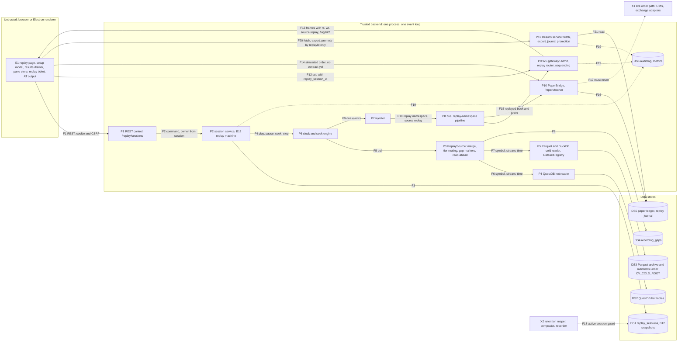

# E26 — STRIDE threat model: replay engine, replay data access and simulated trading

- Ticket: E26-X01 (issue #673). Owner: Security engineer (CODEOWNER). Status: **Approved** (2026-10-16; independent
  security review complete, Fable, #2681; owner acceptance of RR1-RR4 pending, queued on #2701; review log in §13).
- Method: `docs/plan/04-security-program.md` §5 template (L x I = risk), STRIDE per element (C-12.1). Format mirrors
  `E14-drawings.md`. Referenced, not repeated: `e16-recorder.md` (recorder, retention, archive writes),
  `E07-storage.md` (storage tiers, manifests, the query role), `E17-ws-gateway.md` (the gateway; its WS-T09, WS-E03
  and reserved element P8 are the replay seams), `e35-rule-engine.md` (rule simulation) and `e09-auth-rbac.md`
  (sessions, CSRF, RBAC mechanics).
- **Basis: the code as built, plus the contracts for what is not built yet.** The read path is the E26-T02 stack
  #2337 → #2342 → #2346 → #2348 → #2351 → #2359 → #2361 → #2362 → #2387 → #2368, read at head `99585dd2` of
  `feat/e26-t02-replay-wiring`. The replay clock is the E26-T03 stack #2640 → #2641 → #2642 → #2643 → #2644 → #2645 →
  #2646 (seven open drafts on the T02 tip, #2368), read at head `36261916` of `feat/e26-t03-clock-bench`. Its Injector
  is not in it: hpe-worker-1 posted a contract-gap BLOCKER on #626 (2026-10-15, 20:24 UTC) and escalated it to the
  coordinator (§10 item 16). The session table is #2516 (E26-T01 slice 1/3, `0023_replay_sessions`) at head
  `6b8b60f8`. Everything else is `main` at `c96974be`: the WS admission and replay markers (`ws/permissions.py`,
  `ws/sequencing.py`), the B12 `replay` chart and binding stubs, the cold-tier `DatasetRegistry`, and the retention
  reaper and compactor guards. The stack PRs are open and unmerged; paths and line numbers for them are on those
  heads and must be re-verified when they merge. Line numbers into `docs/plan/` files are at `c96974be` as well, except
  `04-security-program.md` and `22-api-openapi.yaml`, which are cited by anchor (requirement id, section, schema or
  operation name) because they move. The session service, injector, seek engine, REST surface, replay router,
  results service, PaperBridge, PaperMatcher and every client surface are **not built**; their rows are requirements,
  never claimed mitigations.
- **Rule used throughout:** a mitigation is listed as one only if it names the code that holds it and the test or rule
  that enforces it. Anything else is a requirement on a named ticket, or a gap (§12).
- **Trust posture:** single-tenant, tailnet-only deployment with a handful of users. The realistic adversaries are a
  lower-privileged internal user (Manager or Viewer), a compromised browser session, a careless or stalled client (a
  scrub drag, a tab left at 100x), and the trader themself acting on stale data. Replay is the only feature that
  puts a trading interface in front of stale market data, so that last case is modelled as seriously as an attacker.
- Gate note: no live ids, tokens, paths or user data appear in this file.

## 1. Scope

In scope, along the data flow client → REST control → session store → source readers (QuestDB, Parquet/DuckDB) →
clock → injector → bus → WS gateway → client, plus the paper-matcher branch and the results surface:

- REST `GET|POST /replay/sessions`, `GET|DELETE /replay/sessions/{replayId}`, `POST /replay/sessions/{replayId}/control`
  (`22-api-openapi.yaml`), consumption of `GET /market/data-coverage`.
- The session store: `replay_sessions` (`21-database-schema.md` §3.6.4), the B12 `replay` machine
  (`28-statechart-catalogue.md` §B12), the session service with quotas and idle reclaim (E26-T01).
- The read path: `replay/` (`models.py`, `merge.py`, `source.py`, `errors.py`, `metrics.py`), the hot reader
  `storage/questdb/recorded_reader.py`, the cold reader `storage/cold/recorded_reader.py` with
  `storage/cold/layout.py` (`DatasetRegistry`), `storage/repositories/recorded.py` and `replay_wiring.py`.
- Clock, seek engine and injector (E26-T03, E26-T04), the bus namespace they publish into, and the WS gateway's
  replay admission, router and markers (`23-ws-protocol.md` §11).
- The paper branch: PaperBridge (E26-S07), PaperMatcher and paper ledger (E38), the replay journal.
- The results surface: fetch, export and journal promotion (SCR-099; E26-S07, E26-D04).
- The client surfaces SCR-097/098/099, CMP-170/171/172, the replay order ticket and the assistive-technology output.

Out of scope (per ticket): implementing controls; the pen test; the recorder's own model (E16-X01); the paper
matcher's fill model and the opt-in comparison against real trades (E38-S05, E38-X01); OMS internals beyond the
refusal seam (E29-X01); rule simulation beyond the replay seam (E35-X01).

### 1.1 State of the build at review time

| Component                                                                    | Ticket            | State                                                                                                                                                  |
| ---------------------------------------------------------------------------- | ----------------- | ------------------------------------------------------------------------------------------------------------------------------------------------------ |
| `replay_sessions` + `replay_state`                                           | E26-T01 slice 1   | #2516 open (`migrations/versions/0023_replay_sessions.py`)                                                                                             |
| Repository, service, quotas, idle reclaim, B12 bindings                      | E26-T01 slice 2-3 | not built (slice 2 in progress); chart on `main` (`statechart/machines/B12.replay.machine.json`), bindings are stubs                                   |
| `ReplaySource`, merge, hot and cold readers, wiring                          | E26-T02           | stack open, tested; not constructed by the app yet                                                                                                     |
| Replay clock: pacing, steps, gap policy, backpressure, per-session TaskGroup | E26-T03           | seven open drafts, #2640-#2646, on the T02 tip; tested and benched; not wired to a session or the bus                                                  |
| Injector                                                                     | E26-T03           | not built: held by a contract-gap BLOCKER on #626 (topic format, recorded-to-live mapping, event identity), escalated to the coordinator (§10 item 16) |
| Seek engine                                                                  | E26-T04           | not built (#2224 follow-up)                                                                                                                            |
| REST surface, WS replay router                                               | E26-T05           | not built; WS admission and replay markers are on `main` (E17-S02, E17-S03)                                                                            |
| PaperBridge, PaperMatcher                                                    | E26-S07, E38      | not built; `paper/` is a scaffold                                                                                                                      |
| Results service: fetch, export, journal promotion                            | E26-S07           | not built; no route in the contract yet (§10 item 11)                                                                                                  |
| OMS submission pipeline                                                      | E29-T04           | not built; `oms/` holds only the read-only gate                                                                                                        |
| Retention and compaction guard for active replay                             | E07-T05, E16-T06  | guard logic on `main`, but `RetentionFacts.replay_session_for` has only test doubles; #2229 reads an empty set until E26 lands                         |
| Client surfaces                                                              | E26-S01..S08      | not built                                                                                                                                              |

## 2. Assets and data classification

| Asset                                                                     | Class                                          | Why                                                                                                     |
| ------------------------------------------------------------------------- | ---------------------------------------------- | ------------------------------------------------------------------------------------------------------- |
| Recorded market data (trades, book deltas and snapshots, tickers, klines) | **A-10** (C 1, I 3, A 2), objective **O8**     | replay is evidence for analysis and rehearsal; loss is permanent (no REST history beyond recent trades) |
| The order path (A-05) and every real account's state (A-06)               | crown jewel                                    | replay must never reach it, and simulated activity must never change it                                 |
| Replay session metadata (`replay_sessions`)                               | internal; `bookmarks` **P1** (21 §12, #2516)   | links a person (`user_id`) to an exchange account (`paper_account_id`) and holds personal notes         |
| Simulated fills, replay journal, results exports                          | A-12 journal and analytics, integrity-critical | a simulated result read as real is misrepresentation (risk R12) and bad decisions downstream            |
| Host capacity: event loop, memory, cold-scan slots, QuestDB, disk         | availability                                   | shared with the OMS, ingestion and the recorder in one process and one loop                             |
| `CV_COLD_ROOT` and the host filesystem                                    | confidentiality of paths, integrity of archive | S3 / SR-097                                                                                             |
| Audit log (A-11)                                                          | tamper-evident                                 | session lifecycle and refused live routing must be attributable                                         |

**Data classification confirmation.** Recorded market data is **A-10**, with integrity objective **O8**. It is
public content (confidentiality 1): every role holds `marketdata:read`, so replay grants no new read entitlement
and the confidentiality rows below are about paths, identities and simulated activity, not market data. Session
metadata **references accounts**: `user_id` (owner, `ON DELETE CASCADE`) and `paper_account_id` (an
`exchange_accounts` row, `ON DELETE SET NULL`, guarded by `rps_paper`). It is therefore confidential to the owner and
the Owner role, never logged in full, never a metric label and never in assistive-technology output. `bookmarks` is
P1 with a `PII:` column comment (#2516). Simulated fills inherit A-12 and must stay distinguishable from real ones
(RP-R01).

## 3. Data-flow diagram and trust boundaries

Elements: external entity **E1**, processes **P1-P11** (P11 is the results service), stores **DS1-DS6**, and two
neighbours modelled as elements because replay touches them: **X1** (the live order path, which replay must never reach)
and **X2** (retention and the recorder, which an active session holds back). Every element appears in the coverage
matrix (§5.1). DS1-DS5 are analysed with the process that owns them (DS1 with P2, DS2 with P4, DS3 with P5, DS4 with P3,
DS5 with P10, which P11 also reads); DS6 has its own row.

Boundaries:

- **TB1 → TB2** (F1, F12, F14, F20): all input is untrusted. The owner comes from the session, never from a body field.
  The client's REPLAY chrome is a usability measure; every control is server-side (C-2.12).
- **TB2 internal, replay namespace → live state** (F10, F11, F15, F17): the boundary that matters most. Replayed
  events must never reach live engines, the recorder, a live subscription or an exchange adapter.
- **TB2 → TB3** (F3, F6, F7, F8): datasets are addressed by stream id, symbol and time, never by a path (SR-097);
  SQL is literal with bound parameters.
- **TB2 → E1 output** (F13, F20, AT output): frames, error text, accessible names and the results export must not
  carry paths, dataset ids or identifiers the caller did not supply, and exported text is inert (RP-T13).

## 4. Numeric bounds: contract today, and gaps

| Input or resource               | Bound today                                                                                                                                                                                                                                                                                                                         | Where it lives; enforced by                                                                                                                                                                                                                 | Gap                                                                                                                                                                                               |
| ------------------------------- | ----------------------------------------------------------------------------------------------------------------------------------------------------------------------------------------------------------------------------------------------------------------------------------------------------------------------------------- | ------------------------------------------------------------------------------------------------------------------------------------------------------------------------------------------------------------------------------------------- | ------------------------------------------------------------------------------------------------------------------------------------------------------------------------------------------------- |
| Window length                   | 24 h by default (`CV_REPLAY_MAX_WINDOW_HOURS`, 1-744 h), checked three times                                                                                                                                                                                                                                                        | T01 `CV_REPLAY_MAX_WINDOW_HOURS`; `ReplayRequest.max_span_us`, which every caller sets from that same setting (`replay/models.py:69, 111-114`, `test_the_callers_cap_refuses_a_window_one_microsecond_over_it`); `replay/source.py:112-113` | `ReadAheadConfig.max_span_us` (6/10) still hard-codes 24 h, so a cap configured above 24 h is refused there; no REST refusal code (G8)                                                            |
| Symbols, streams, depth         | 1-8 unique symbols; recorded streams only; depth 1, 50, 200 or 500                                                                                                                                                                                                                                                                  | `CreateReplaySessionRequest` (`22-api-openapi.yaml`, schema); `ReplayRequest` (`replay/models.py:63-104`)                                                                                                                                   | `replay_sessions` has one `symbol` column (`21-database-schema.md:1776`), so a multi-symbol session cannot be stored or guarded (G7)                                                              |
| Sessions per user               | 2                                                                                                                                                                                                                                                                                                                                   | T01 `CV_REPLAY_MAX_SESSIONS_PER_USER` (unbuilt)                                                                                                                                                                                             | specified on create only (G6); no deployment-wide cap (G5)                                                                                                                                        |
| Speed                           | 0.1-100 in the database; 0-100 in the contract                                                                                                                                                                                                                                                                                      | `rps_speed` (`0023_replay_sessions.py:84`); `CreateReplaySessionRequest`, `ReplayControlRequest`                                                                                                                                            | the contract defines `speed: 0` as "as fast as possible" (G8, §10 item 1)                                                                                                                         |
| One step                        | at most 100 000 events or 3 600 000 ms of replay time                                                                                                                                                                                                                                                                               | `ReplayControlRequest` (`22-api-openapi.yaml`, schema)                                                                                                                                                                                      | a step is not metered against any CPU budget (G1)                                                                                                                                                 |
| Read-ahead                      | 131 072 events and 64 MiB, whichever binds first                                                                                                                                                                                                                                                                                    | `ReadAheadConfig` (`replay/source.py:50-87`); `CV_REPLAY_READAHEAD_*` (`settings.py:305-306`)                                                                                                                                               | none                                                                                                                                                                                              |
| Per-session memory ceiling      | 256 MiB, an estimate (512 B per event, 128 B per snapshot level)                                                                                                                                                                                                                                                                    | `CV_REPLAY_MEMORY_CEILING_BYTES` (`settings.py:307`, validator `:349-352`); per-cursor row caps (`replay/merge.py:232-240`)                                                                                                                 | an estimate, not resident size; excludes DuckDB scan memory                                                                                                                                       |
| Rows per storage read           | 8 192 (+1 to detect truncation) per `(symbol, stream)` event read and per symbol on the `recording_gaps` read; a symbol with more gap rows of the requested streams in the window is refused whole, never replayed with some of its gaps unreported                                                                                 | `DEFAULT_MAX_ROWS_PER_READ` (`replay/merge.py:128`); `RecordedMerge._markers` (`replay/merge.py:443`); the port's `limit` (`storage/repositories/recorded.py:303`); hot-reader `MAX_READ_ROWS` (`storage/questdb/recorded_reader.py:74`)    | markers sit outside the byte budget (32 MiB est., 8 symbols); unrequested streams' gap rows count (a port `streams` filter is a follow-up); 9/10 adapter: `LIMIT :limit`, refuse `limit < 1`      |
| Storage deadlines               | 20 s per tier read, below 30 s per merge read                                                                                                                                                                                                                                                                                       | `DEFAULT_TIMEOUT_S` in both readers; `DEFAULT_IO_TIMEOUT_S` (`replay/merge.py:88`); `test_every_reader_deadline_is_below_the_merge_deadline`                                                                                                | whether QuestDB stops a query after the client times out is not verified (E26-Q04)                                                                                                                |
| Cold scans                      | 2 concurrent per process; DuckDB `memory_limit` 256 MiB and 2 threads each; at most 1 000 partitions per read                                                                                                                                                                                                                       | `storage/cold/recorded_reader.py:57-60, 187-192, 263-264`                                                                                                                                                                                   | the two slots are shared by every user's sessions                                                                                                                                                 |
| Cold first-read verification    | at most 1 000 partitions per read; no byte, time or concurrency bound of its own: when any part of a partition is new or changed, every part of it is hashed whole (SHA-256) and its Parquet footer read, on the default thread pool, outside the two scan slots and the 20 s deadline; a verified part is cached by size and mtime | `ParquetRecordedReader._partition_files` (`storage/cold/recorded_reader.py:268-281`) awaiting `verify_partition` and `_first_mismatch` (`storage/cold/scrub.py:31-72`); only the 30 s merge deadline (`replay/merge.py:88, 374`) applies    | a read that times out does not stop its hashing thread, and the first read of a large span is the costliest one (RP-D08; an E26-Q04 chaos case; a verification slot in G1 if it proves unbounded) |
| Hot reads                       | one lock-serialised PGWire connection for all replay reads                                                                                                                                                                                                                                                                          | `replay_wiring.py:4-9, 33-45`                                                                                                                                                                                                               | shared by every user's sessions                                                                                                                                                                   |
| Seek anchor lookup              | 1 h lookback, 16 rows                                                                                                                                                                                                                                                                                                               | `ANCHOR_LOOKBACK_US` (`replay/merge.py:123`); `ANCHOR_ROWS` in both readers                                                                                                                                                                 | none                                                                                                                                                                                              |
| B12 inbox                       | `CV_INBOX_BOUND[lane]`: 128 (control) or 256 (platform), overflow refused                                                                                                                                                                                                                                                           | `statechart/config.py:30-34`; `statechart/factory.py:153, 197`                                                                                                                                                                              | the lane for `replay` is not chosen yet (T01)                                                                                                                                                     |
| Control calls, concurrent seeks | none                                                                                                                                                                                                                                                                                                                                | T05 debounce and rate limit, T04 cancellation and queue depth (unbuilt)                                                                                                                                                                     | values unset; proposal in §6.1                                                                                                                                                                    |
| Idle reclaim                    | 2 h without a control call                                                                                                                                                                                                                                                                                                          | T01 (unbuilt); orchestrator decision on #624: reclaim sends `DESTROY`, row becomes `destroyed`                                                                                                                                              | `DESTROY` is deferred while playing, buffering or stepping; no maximum lifetime (G6)                                                                                                              |
| WS replay subscriptions         | 200 subscriptions and 40 symbols per connection, 8 connections per user; history caps                                                                                                                                                                                                                                               | `ws/permissions.py` (E17-S02); `23-ws-protocol.md` §16.2 (bars ≤1 000, footprint ≤200, heatmap ≤900 s)                                                                                                                                      | none                                                                                                                                                                                              |
| Bookmarks                       | none                                                                                                                                                                                                                                                                                                                                | `bookmarks jsonb` (`0023_replay_sessions.py:75`); `ReplayBookmark` (`24-internal-schemas.md:3145-3148`) has unbounded `label` and `note`                                                                                                    | no count or length bound and no write contract (G8)                                                                                                                                               |
| Event-loop share of replay work | none for the share. Per turn, the T03 clock (open drafts) yields to the loop after 256 consecutive deliveries without a wait (C-2.17) and re-anchors, slowing rather than bursting, once an event is 250 ms behind schedule; its steps have no yield of their own                                                                   | `ClockConfig` (`replay/playback.py:124-139`); `ReplayClock._run` and `step_events`, `step_ms`, `step_bar` (`replay/clock.py:219-266, 368-370`), T03 stack                                                                                   | a per-turn yield is not a share cap (G1)                                                                                                                                                          |

## 5. STRIDE table

Risk = L x I on the programme scale: L/L, L/M and M/L are Low; L/H, M/M and H/L are Medium; M/H and H/M are **High**;
H/H is **Critical**. As in `04-security-program.md` §5.2 (O1) and §5.4 (F1), a threat whose realisation is itself an
order on an exchange that the order path never authorised, a breach of the order-path boundary, is raised one band;
that is RP-E01 only. A threat that only puts wrong data in front of a person or an engine keeps its own L x I, because
the arm toggle (SR-043), the risk caps (SR-052, SR-053) and the native SL (C-2.6) still stand between that data and an
exchange: RP-T06 (replayed events reaching the live rule engine) and RP-S04 (replayed data labelled live) stay Medium
for that reason, and RP-S05 is High on its likelihood alone. Risk is inherent (before the listed control); Residual
is after it.
Disposition: **M** mitigated and enforced by named code and a test or rule (on `main` or the open stack), **Q**
requirement on an unbuilt component with an owning ticket, **R** referenced to another epic's model, **G** no owning
control (gap, §12).

| T      | STRIDE | Element        | Threat                                                                                                                                                                                                                                                                                                                                                                                                                                                                                                                                                    | L   | I   | Risk         | Control: where it lives; enforcing test or rule                                                                                                                                                                                                                                                                                                                                                                                                                                                                                                                                                                                                                                                                                                                                                                                                                                                                                                                                                                                                                                                                                                                                                                                                                 | Disp. | Residual                            | Owner                                                                      |
| ------ | ------ | -------------- | --------------------------------------------------------------------------------------------------------------------------------------------------------------------------------------------------------------------------------------------------------------------------------------------------------------------------------------------------------------------------------------------------------------------------------------------------------------------------------------------------------------------------------------------------------- | --- | --- | ------------ | --------------------------------------------------------------------------------------------------------------------------------------------------------------------------------------------------------------------------------------------------------------------------------------------------------------------------------------------------------------------------------------------------------------------------------------------------------------------------------------------------------------------------------------------------------------------------------------------------------------------------------------------------------------------------------------------------------------------------------------------------------------------------------------------------------------------------------------------------------------------------------------------------------------------------------------------------------------------------------------------------------------------------------------------------------------------------------------------------------------------------------------------------------------------------------------------------------------------------------------------------------------- | ----- | ----------------------------------- | -------------------------------------------------------------------------- |
| RP-S01 | S      | P9             | Subscribing with another user's `replay_session_id` (leaked from a URL, a screenshot, a log or a frame's `rs`) to receive that session's frames, or to attach a slow consumer to it                                                                                                                                                                                                                                                                                                                                                                       | M   | M   | Medium       | Today `ConnectionAuthz._admit` (`ws/permissions.py:295-348`) checks only the UUID shape (`_replay_id`, `:208-216`) and admits any id; `test_live_and_replay_subscriptions_coexist_by_sub_id` subscribes an arbitrary one. No replay router exists yet, so no frame flows. Requirement: T05 resolves the id owner-scoped before the `Subscription` is created and answers `replay_session_not_found` identically for a missing id and for another user's session in any state (never `replay_session_ended` to a non-owner); the owner keeps `replay_session_ended` for a finished session of their own (§10 item 17)                                                                                                                                                                                                                                                                                                                                                                                                                                                                                                                                                                                                                                            | Q     | Low after E26-T05                   | E26-T05                                                                    |
| RP-S02 | S      | P1, P2, P11    | REST read, control, delete, results fetch or export of another user's session by id (IDOR), including a list cursor taken from another user's page                                                                                                                                                                                                                                                                                                                                                                                                        | M   | M   | Medium       | Requirement (T01 acceptance "one user cannot read another user's session"): every repository statement filters `user_id` at construction (SR-051 pattern), a foreign id returns the same 404 `not_found` body as a missing one, never 403; cursors scope-bound; the results and export routes (E26-S07) resolve the session the same way                                                                                                                                                                                                                                                                                                                                                                                                                                                                                                                                                                                                                                                                                                                                                                                                                                                                                                                        | Q     | Low after E26-T01, E26-T05, E26-S07 | E26-T01, E26-T05, E26-S07                                                  |
| RP-S03 | S      | P1             | Unauthenticated or cross-site (CSRF) create, control or delete                                                                                                                                                                                                                                                                                                                                                                                                                                                                                            | L   | M   | Low          | The contract declares `CsrfToken` on create, control and delete (`22-api-openapi.yaml`, the `/replay/sessions` paths); session resolution and CSRF (SR-041) are E09's. Requirement: T05 mounts the routes behind them and adds them to the route and RBAC matrix tests (SR-017, SR-018, SR-151)                                                                                                                                                                                                                                                                                                                                                                                                                                                                                                                                                                                                                                                                                                                                                                                                                                                                                                                                                                 | Q     | Low                                 | E26-T05, E09                                                               |
| RP-S04 | S      | P9             | Replayed data delivered on a live subscription and labelled live. The gateway derives `source`, `rs`, `wt` and the replay flag from the subscription, not the event (`ws/sequencing.py:433, 441-442, 506-511`), and `SequencingHub.publish` routes on the caller-supplied `replay_session_id` (`ws/sequencing.py:602-621`)                                                                                                                                                                                                                                | L   | H   | Medium       | Separate sequence domains and markers are tested: `test_replay_and_live_have_separate_sequence_domains_and_routing` (`tests/unit/ws/test_sequencing.py`), `test_s9_live_frames_never_carry_replay_markers` (`tests/contract/ws/test_ws_s2_s9.py`). Requirement: the T05 router takes the session id from the injected event's namespace and asserts `event.source == "replay"` exactly when the subscription has a `replay_session_id` (20-architecture §11.1 F18: a cross-namespace publish raises and is alerted)                                                                                                                                                                                                                                                                                                                                                                                                                                                                                                                                                                                                                                                                                                                                             | Q     | Low after E26-T05                   | E26-T05, E26-T03                                                           |
| RP-S05 | S      | E1             | Provenance confusion: replayed prices shown as live (missing REPLAY chrome, a "keep live" pane beside replay panes, a badge carried by colour only), so the trader acts on stale data, or treats a live pane as replay                                                                                                                                                                                                                                                                                                                                    | M   | H   | **High**     | Requirements: E26-S02 never renders a frame without the replay markers (SCR-097 sign-off); E26-S05 badges distinguishable without colour and the mode in each pane's accessible name, stores keyed by `sub_id`; jump to real time needs confirmation. Live orders still need the arm toggle (SR-043) and the environment chrome (C-2.11), which a replay page must never satisfy implicitly                                                                                                                                                                                                                                                                                                                                                                                                                                                                                                                                                                                                                                                                                                                                                                                                                                                                     | Q     | Medium (human factor)               | E26-S02, E26-S05, E26-D02, E26-D08                                         |
| RP-S06 | S      | P2             | A client names or forges a B12 lifecycle event (`RANGE_END`, `SOURCE_ERROR`, `KILL`, `CONSUMER_SLOW`) or its payload through the control path                                                                                                                                                                                                                                                                                                                                                                                                             | L   | M   | Low          | B12 runs `strict=True` through `statechart.factory` (C-2.22), so unknown events are refused; its event schemas are permissive placeholders today (`statechart/bindings/b12_replay.py:57-72`). Requirement: T05 maps the REST actions to a fixed event set and a client never names an event; T01 replaces the placeholders with closed schemas                                                                                                                                                                                                                                                                                                                                                                                                                                                                                                                                                                                                                                                                                                                                                                                                                                                                                                                  | Q     | Low                                 | E26-T01, E26-T05                                                           |
| RP-S07 | S      | P2             | `POST /rules/{ruleId}/simulate` (`SimulateRuleRequest.replay_session_id`) references another user's replay session                                                                                                                                                                                                                                                                                                                                                                                                                                        | L   | M   | Low          | No owner check is specified on E35-S05. Requirement: resolve the session exactly as RP-S01 does. See `e35-rule-engine.md` RE-I7                                                                                                                                                                                                                                                                                                                                                                                                                                                                                                                                                                                                                                                                                                                                                                                                                                                                                                                                                                                                                                                                                                                                 | G     | Low after G10                       | E35-S05                                                                    |
| RP-S08 | S      | P7, P8         | An injector publishes under another session's namespace (cross-session bleed)                                                                                                                                                                                                                                                                                                                                                                                                                                                                             | L   | M   | Low          | Requirement: T03 derives the namespace from the session object that owns the injector task and puts it in the topic key (format open, §10 item 16), never from a caller value; the F18 runtime assertion covers it                                                                                                                                                                                                                                                                                                                                                                                                                                                                                                                                                                                                                                                                                                                                                                                                                                                                                                                                                                                                                                              | Q     | Low                                 | E26-T03                                                                    |
| RP-T01 | T      | P1, P2, P6     | Window, cursor or seek target moved outside the session's window (crafted `seek.to`, a long `step_ms`, a restored `cursor_ts`). Market data is not entitlement-scoped beyond `marketdata:read`, so the effect is cost (RP-D01), not new data                                                                                                                                                                                                                                                                                                              | L   | M   | Low          | DB CHECKs `rps_range`, `rps_cursor` (`0023_replay_sessions.py:83, 86`; `test_invalid_session_is_rejected_by_its_named_constraint`). The read path re-checks the window (`ReplayRequest._ordered_and_bounded`, `replay/models.py:107-115`; `ReplaySource.__init__`, `replay/source.py:112-113`) and anchors refuse instants outside it (`RecordedMerge.anchor_at`, `replay/merge.py:413-416`; `test_anchor_requests_outside_the_replay_are_refused`). No contract route edits the window. Requirement: T04 validates every seek target against the session window                                                                                                                                                                                                                                                                                                                                                                                                                                                                                                                                                                                                                                                                                                | M, Q  | Low                                 | E26-T01, E26-T02, E26-T04                                                  |
| RP-T02 | T      | P1, P2         | `paper_account_id` changed after creation to an account the user may not use                                                                                                                                                                                                                                                                                                                                                                                                                                                                              | L   | H   | Medium       | Structural: no contract operation updates it, and `ReplayControlRequest` is closed (`additionalProperties: false`). Requirement: T05 keeps it so; the grant check itself is RP-E03                                                                                                                                                                                                                                                                                                                                                                                                                                                                                                                                                                                                                                                                                                                                                                                                                                                                                                                                                                                                                                                                              | Q     | Low                                 | E26-T05                                                                    |
| RP-T03 | T      | DS1, E1        | Stored bookmarks (label, note; P1) or the replay pane configuration crafted to inject markup into the scrub track, bookmark list, tooltips or live region, to flip a pane between live and replay, or to point a pane at another session. Bookmarks also travel with workspace export (US-RPL-008)                                                                                                                                                                                                                                                        | M   | H   | **High**     | Pane configuration is written through E15's closed `PaneConfigIn` (`api/workspaces_models.py`: at most 32 settings, 256-character strings, 4 096 bytes). Bookmarks have no server bound: `bookmarks jsonb` has no shape CHECK and `ReplayBookmark` no lengths; no write route exists in the contract. Requirements: E26-S06 renders notes as text only (SR-127) with a length bound; E26-S08 validates restored pane configuration on load; WS refuses a foreign session id (RP-S01)                                                                                                                                                                                                                                                                                                                                                                                                                                                                                                                                                                                                                                                                                                                                                                            | Q, G  | Low after E26-S06, E26-S08, G8      | E26-S06, E26-S08, E26-T05                                                  |
| RP-T04 | T      | P5, DS3        | A tampered or substituted Parquet part or manifest replays altered market data (O8)                                                                                                                                                                                                                                                                                                                                                                                                                                                                       | L   | M   | Low          | Parts verified against the manifest SHA-256 and row count on first read and whenever size or mtime changes (`ParquetRecordedReader._partition_files`, `storage/cold/recorded_reader.py:268-281`, `verify_partition`); manifests may name only `part-NNNN.parquet` inside the partition (`_contained`, `:116-126`). Tests: `test_a_tampered_part_fails_verification_instead_of_serving_partial_data`, `test_a_manifest_naming_a_file_outside_its_partition_is_refused`. Residual: an edit that keeps size and mtime is not re-hashed (`_verified`, `:193, 274-280`); manifests are unsigned (E07 S1/S14). Side effect: a mismatch quarantines the part (`verify_partition`, `storage/cold/scrub.py:49-72`): it leaves the dataset tree and the manifest, a CRITICAL `STORAGE_COLD_FILE_QUARANTINED` event is emitted and `storage_scrub_mismatches_total` counts it, so one user's replay can be what takes a part out of service for every user until it is restored (SR-094)                                                                                                                                                                                                                                                                                   | M     | Low                                 | E26-T02                                                                    |
| RP-T05 | T      | P4, DS2        | Fabricated rows in the QuestDB hot tables (ILP has no per-row authentication) replay as recorded truth                                                                                                                                                                                                                                                                                                                                                                                                                                                    | L   | M   | Low          | Referenced: `E07-storage.md` S11 (loopback ILP, gap reconciliation). Replay adds no hot-row integrity check                                                                                                                                                                                                                                                                                                                                                                                                                                                                                                                                                                                                                                                                                                                                                                                                                                                                                                                                                                                                                                                                                                                                                     | R     | Low                                 | E07, E16                                                                   |
| RP-T06 | T      | P7, P8, X2     | Replayed events reach live state: the live book, bar builders, rule engine, or the recorder, which would write replayed data back into A-10                                                                                                                                                                                                                                                                                                                                                                                                               | L   | H   | Medium       | Bus topics are `{env}.{domain}.{symbol}.{detail}` with no wildcard on publish (`bus/models.py:63-120`); live consumers subscribe a concrete `env` (`bars/builder_set.py:374-377`); `DomainEvent.source` is a closed literal on a frozen model (`domain/events.py:64-73`). Requirements: T03 puts the namespace in the topic key (format open, §10 item 16), runs a separate engine set per replay namespace and stamps `source="replay"`; its isolation test also asserts the recorder and rule engine saw nothing                                                                                                                                                                                                                                                                                                                                                                                                                                                                                                                                                                                                                                                                                                                                              | Q     | Low after E26-T03                   | E26-T03, E26-T06                                                           |
| RP-T07 | T      | P1, P3         | An explicit `source_tier` (the operator override) skips coverage checks and replays a span the tier lacks as silence, with no `ReplayGap` (`replay/merge.py:20-25, 329-331`; C-2.14)                                                                                                                                                                                                                                                                                                                                                                      | L   | M   | Low          | Structural: `CreateReplaySessionRequest` has no `source_tier` and is closed, so clients always get `auto`; `test_an_explicit_tier_never_consults_the_manifests` documents the override. Requirement: T05 keeps the override off the client contract (Owner-only if ever exposed)                                                                                                                                                                                                                                                                                                                                                                                                                                                                                                                                                                                                                                                                                                                                                                                                                                                                                                                                                                                | Q     | Low                                 | E26-T05                                                                    |
| RP-T08 | T      | P2, DS1        | Persisted session state edited (speed, cursor, tier) or a forged B12 snapshot restored into a running session                                                                                                                                                                                                                                                                                                                                                                                                                                             | L   | M   | Low          | DB CHECKs (RP-T01, `rps_speed`, `rps_tier`); B12 restores only through `statechart.persistence.restore`, which checks the HMAC envelope and `machine_hash` and quarantines a refusal (E50-T49, `statechart/persistence.py`)                                                                                                                                                                                                                                                                                                                                                                                                                                                                                                                                                                                                                                                                                                                                                                                                                                                                                                                                                                                                                                     | M     | Low                                 | E26-T01, E50                                                               |
| RP-T09 | T      | P1             | Control payload out of range or undefined: `speed` 0, negative or above 100, `step_events` or `step_ms` above their caps or both supplied, actions `set_speed` and `restart` that B12 does not define                                                                                                                                                                                                                                                                                                                                                     | M   | M   | Medium       | Contract bounds (`ReplayControlRequest`) and `rps_speed` 0.1-100. The meaning of `speed: 0` conflicts across the contract, 24 §13.7 and the database (§10 item 1). Requirement: T05 request models generated from the contract, `step` exclusivity enforced, and no client-reachable unbounded mode                                                                                                                                                                                                                                                                                                                                                                                                                                                                                                                                                                                                                                                                                                                                                                                                                                                                                                                                                             | Q, G  | Low after G8                        | E26-T05                                                                    |
| RP-T10 | T      | P9             | A client forges the server-only replay fields (`rs`, `wt`, `source`, header flag bit2)                                                                                                                                                                                                                                                                                                                                                                                                                                                                    | L   | L   | Low          | Referenced: `E17-ws-gateway.md` WS-T05 (client envelopes carry only `t`, `id`, `p`)                                                                                                                                                                                                                                                                                                                                                                                                                                                                                                                                                                                                                                                                                                                                                                                                                                                                                                                                                                                                                                                                                                                                                                             | R     | Low                                 | E17                                                                        |
| RP-T11 | T      | P4, P5         | Injection through symbol, stream or limit into QuestDB SQL or the DuckDB scan                                                                                                                                                                                                                                                                                                                                                                                                                                                                             | L   | H   | Medium       | Hot: one literal template per `StreamKind`, symbol and bounds bound as parameters, symbol pattern-checked, limit an int (`storage/questdb/recorded_reader.py:37-64, 111-128`; `test_unusable_reads_are_refused_before_any_sql`, `test_every_range_query_passes_the_hot_tier_query_lint`). Cold: constant SQL with named parameters, the file list a parameter (`storage/cold/recorded_reader.py:61-69`). Semgrep `cv-storage-sql-construction`, `cv-raw-sql-string-interpolation`. The query role is read-only (E07 S13)                                                                                                                                                                                                                                                                                                                                                                                                                                                                                                                                                                                                                                                                                                                                        | M     | Low                                 | E26-T02                                                                    |
| RP-T12 | T      | P6, X1, P9     | The replay clock becomes a time source for live components: a module-level or `settings`-held clock swapped for replay, one process-wide clock shared by live and replay engines, or the statechart factory's `clock=` reused for a replay session, so that during a 100x session live time bars close, rule timers and native-SL deadlines (B8, B9) fire, B12's own timers run, audit timestamps are stamped, or the gateway's `wt` is set on replay time. RP-T06 covers replayed events, not the time source                                            | L   | H   | Medium       | Today the live bar set is composed with wall time (`BarBuilderSet.tick` reads its injected `now_us`, `bars/builder_set.py:201, 209, 495`; `app.py:859`), the gateway stamps `wt` from an injected `wall_ms` that defaults to the system clock (`ws/gateway.py:148-150`, `ws/sequencing.py:442, 508`) and the statechart factory takes its clock as an argument and offers a wall-clock helper (`default_clock`, `statechart/factory.py:89-92, 163, 196`), but no test pins any of it against a replay session (`test_s9_live_frames_never_carry_replay_markers` covers markers, not time). The T03 clock offers its replay "now" to downstream clocks (`ReplayClock.now_us`, `replay/clock.py:283`, open stack). Requirement: the replay clock is a time source only for the replay engine set and its injector; every live component, the gateway `wt`, `DomainEvent.ts_ingest` of live events, audit timestamps and B12's timers keep wall time (what a replayed event's `ts_ingest` carries is §10 item 16); RSK-028's "single injected clock abstraction" must mean one interface with one instance per engine set, never one process-wide clock; T03's isolation test asserts that no live component observes replay time, and AC-21 asserts it end to end | Q     | Low after E26-T03                   | E26-T03                                                                    |
| RP-T13 | T      | P11, E1        | The results export and journal promotion carry user-authored text (bookmark labels and notes, any session or setup name the results carry) into a spreadsheet or document and into journal rows: a cell that starts with `=`, `+`, `-`, `@`, a tab or a carriage return is a formula (`=HYPERLINK(...)`) for whoever opens the file, and a bookmark that arrived through workspace export (US-RPL-008) is another user's text. The same text rendered as markup in SCR-099 is RP-T03's sink                                                               | L   | H   | Medium       | None: no results route exists in the contract (§10 item 11), and nothing yet says how exported text is handled. Requirement: E26-S07 escapes every exported text cell against formula injection (a leading single quote on any cell that starts with `=`, `+`, `-`, `@`, a tab or a carriage return) and renders the same text as text in SCR-099 (SR-127); the export is a server-generated download keyed by `replayId`, with no path, filename or format-template parameter (§6.2 site 11, RP-I01); AC-24 asserts both                                                                                                                                                                                                                                                                                                                                                                                                                                                                                                                                                                                                                                                                                                                                       | Q     | Low after E26-S07, E26-D04          | E26-S07, E26-D04                                                           |
| RP-R01 | R      | P10, DS5, P11  | A simulated fill cannot be told apart from a real one in the journal, analytics or an export (risk R12)                                                                                                                                                                                                                                                                                                                                                                                                                                                   | M   | H   | **High**     | Markers today: `trade_groups.origin = 'replay_sim'` (CHECK `tg_origin`) and `is_paper`. But `is_paper` is also forced true for demo groups (`tg_paper_env`, `21-database-schema.md:1085`, contradicting E38-S01), `journal_trades.origin` has no CHECK (`:1840`), and the schema has neither the `simulated` flag nor the separate replay journal that E26-S07 and US-RPL-006 require. Requirements: S07 persists `is_paper=true` and `origin='replay_sim'`, keeps a separate replay journal, flags every export and journal promotion `simulated=true` (`journal.simulated_import` audited, SR-098 watermark); E38-S05 excludes them from analytics by default                                                                                                                                                                                                                                                                                                                                                                                                                                                                                                                                                                                                 | Q, G  | Low after E26-S07, G3               | E26-S07, E38-S05                                                           |
| RP-R02 | R      | P2, DS6        | Session create, paper attach, destroy and idle reclaim leave no attributable record                                                                                                                                                                                                                                                                                                                                                                                                                                                                       | M   | L   | Low          | Requirement: T01 audits `replay.session.destroyed` with reason `idle_reclaim` or `client` (orchestrator decision on #624) and records create and paper attach; `04-security-program.md` §8.2 has no replay events yet. Replay simulated fills are deliberately outside the C-2.9 trading audit stream (E26-S07, SCR-097/098); the replay ADR records that decision so it is not reversed in either direction by accident                                                                                                                                                                                                                                                                                                                                                                                                                                                                                                                                                                                                                                                                                                                                                                                                                                        | Q     | Low                                 | E26-T01, E26-T07                                                           |
| RP-R03 | R      | X1             | A replay order or event refused at the live boundary leaves no trace, so a defect that keeps trying is invisible                                                                                                                                                                                                                                                                                                                                                                                                                                          | L   | H   | Medium       | Requirement: E26-S07's counter of blocked live-routing attempts (must stay at zero, alerted on any increase) plus an audit action (§9)                                                                                                                                                                                                                                                                                                                                                                                                                                                                                                                                                                                                                                                                                                                                                                                                                                                                                                                                                                                                                                                                                                                          | Q     | Low after E26-S07                   | E26-S07, E26-T07                                                           |
| RP-R04 | R      | P1, P9         | Cross-user probes (REST 404, WS `replay_session_not_found`) are not recorded, so enumeration is invisible                                                                                                                                                                                                                                                                                                                                                                                                                                                 | M   | L   | Low          | E17 audits WS denials (`handle_sub` / `_audit_denials` in `ws/permissions.py`). Requirement: T05 records foreign-id references (audit and counter, §9) without changing the response                                                                                                                                                                                                                                                                                                                                                                                                                                                                                                                                                                                                                                                                                                                                                                                                                                                                                                                                                                                                                                                                            | Q     | Low                                 | E26-T05                                                                    |
| RP-R05 | R      | P3             | What was actually replayed (tier, gaps, override) cannot be reconstructed for a disputed analysis                                                                                                                                                                                                                                                                                                                                                                                                                                                         | L   | L   | Low          | The resolved tier is logged once per session (`replay_source_tier`, `replay/merge.py:321-326`; `test_the_session_tier_is_resolved_and_logged_once_and_reads_are_counted`); markers are counted (`replay_gap_warnings_total`). Requirement: T01 and T03 persist the resolved tier and `gap_warnings` on the session row                                                                                                                                                                                                                                                                                                                                                                                                                                                                                                                                                                                                                                                                                                                                                                                                                                                                                                                                          | M, Q  | Low                                 | E26-T01, E26-T03                                                           |
| RP-I01 | I      | P5, DS3, P11   | **S3**: path traversal or symlink escape reads files outside the Parquet archive through replay, or a path, filename or format-template parameter on the results export (04 §5.8 S3, SR-097; 04 files S3 under E)                                                                                                                                                                                                                                                                                                                                         | M   | H   | **High**     | §6.2 in depth: no path parameter anywhere; datasets resolve only through `DatasetRegistry`; closed segment charset; resolved-path containment twice; DuckDB opens the resolved path. Tests listed in §6.2. The export is a server-generated download keyed by `replayId` (site 11, a requirement on E26-S07)                                                                                                                                                                                                                                                                                                                                                                                                                                                                                                                                                                                                                                                                                                                                                                                                                                                                                                                                                    | M, Q  | Low                                 | E26-T02, E26-X02, E26-S07                                                  |
| RP-I02 | I      | P1, P2, P9     | Error text leaks internal paths, `CV_COLD_ROOT`, tier names or storage codes. `DatasetNotRegistered` carries the refused value (`storage/cold/layout.py:94-96`) or the resolved absolute path and `CV_COLD_ROOT` (`:139-141`); the cold reader wraps it in path-free text but chains it (`storage/cold/recorded_reader.py:129-137`); `ReplaySourceUnavailable` names tier, stream and storage code (`replay/errors.py:49-61`); `ReplaySession.error` is a free string                                                                                     | M   | L   | Low          | Path-free wrappers at the cold-reader boundary (`storage/cold/recorded_reader.py:120, 125, 135, 137, 158, 279`); `test_a_refusal_names_the_field_and_type_never_the_value`, `test_each_error_carries_its_stable_code`. Requirement: T05 maps `ReplayError.code` to a registered problem code with fixed text and never serialises `str(exc)`, `__cause__` or a traceback into `error`, `detail` or a WS `err`; T01's `record_error` stores the code only                                                                                                                                                                                                                                                                                                                                                                                                                                                                                                                                                                                                                                                                                                                                                                                                        | M, Q  | Low                                 | E26-T02, E26-T05, E26-T01                                                  |
| RP-I03 | I      | E1             | Accessible names, live regions (the replay clock, at most 1 Hz), `aria-valuetext`, toasts or announced errors carry session ids, account ids, paths or dataset ids: the assistive-technology disclosure channel                                                                                                                                                                                                                                                                                                                                           | M   | L   | Low          | Requirements: E26-D05 (no account identifiers in accessible names), E26-D07 and E26-D08 copy review, E26-Q05 audit, E26-X02 assistive-technology output check                                                                                                                                                                                                                                                                                                                                                                                                                                                                                                                                                                                                                                                                                                                                                                                                                                                                                                                                                                                                                                                                                                   | Q     | Low                                 | E26-Q05, E26-X02, E26-D07                                                  |
| RP-I04 | I      | P10, P9        | Replay paper fills appear on the normal private topics of `paper_account_id` (`23-ws-protocol.md:1183`: `is_paper: true`, `environment` unchanged), so every other user granted that account sees one user's study trades, and a live account's blotter shows simulated fills marked `environment: live`                                                                                                                                                                                                                                                  | M   | M   | Medium       | None: E17 filters private frames by account set, not by the originating user                                                                                                                                                                                                                                                                                                                                                                                                                                                                                                                                                                                                                                                                                                                                                                                                                                                                                                                                                                                                                                                                                                                                                                                    | G     | Medium until G4                     | proposed (G4)                                                              |
| RP-I05 | I      | P2, DS1        | Session metadata (user ids, paper account ids, bookmarks) in logs or metric labels                                                                                                                                                                                                                                                                                                                                                                                                                                                                        | L   | L   | Low          | Metric labels are limited by `.semgrep/cv-obs-metric-label-allowlist.yml` (no user or session ids). Requirement: bookmarks are never logged (P1, 21 §12)                                                                                                                                                                                                                                                                                                                                                                                                                                                                                                                                                                                                                                                                                                                                                                                                                                                                                                                                                                                                                                                                                                        | M, Q  | Low                                 | E26-T01                                                                    |
| RP-I06 | I      | P1, P9         | Existence oracle: status, wording, header set or timing differs between a missing session and another user's session in any state (a non-owner told `replay_session_ended` learns that the id exists); `stepping` or `destroyed` leak through the API `ReplayState` (6 values against 8 in the database)                                                                                                                                                                                                                                                  | L   | L   | Low          | Requirement: one response for a missing session and for another user's session in any state; the owner of a finished session still gets `replay_session_ended` (the SCR-097 session-expired state); E26-X02 asserts equivalence (status, code, body, headers) and a bounded timing difference; a destroyed session is served as not found to a non-owner (#2516 follow-up), and the owner's code for it is §10 item 17                                                                                                                                                                                                                                                                                                                                                                                                                                                                                                                                                                                                                                                                                                                                                                                                                                          | Q     | Low                                 | E26-T05, E26-X02                                                           |
| RP-D01 | D      | P1, P2, P3     | Unbounded window: one request scans the whole lake                                                                                                                                                                                                                                                                                                                                                                                                                                                                                                        | M   | M   | Medium       | Three checks (§4): T01's service and `ReplayRequest` apply `CV_REPLAY_MAX_WINDOW_HOURS` (24 h by default); `ReplaySource` still hard-codes 24 h (built, tested). Width is bounded at 8 symbols and the recorded streams (`replay/models.py:63-104`)                                                                                                                                                                                                                                                                                                                                                                                                                                                                                                                                                                                                                                                                                                                                                                                                                                                                                                                                                                                                             | M, Q  | Low                                 | E26-T01, E26-T02                                                           |
| RP-D02 | D      | P2             | Many concurrent sessions, per user and across users                                                                                                                                                                                                                                                                                                                                                                                                                                                                                                       | M   | M   | Medium       | Requirement: per-user quota (default 2) checked before any buffer is allocated (T01 acceptance). No deployment-wide cap: three users hold six sessions, each up to the 256 MiB ceiling plus the shared DuckDB scans                                                                                                                                                                                                                                                                                                                                                                                                                                                                                                                                                                                                                                                                                                                                                                                                                                                                                                                                                                                                                                             | Q, G  | Low after E26-T01, G5               | E26-T01                                                                    |
| RP-D03 | D      | P2             | Quota bypass by revival: B12 lets `finished` and `error` re-enter `buffering` on `SEEK` (`28-statechart-catalogue.md` §B12.3), so a user at quota revives older sessions without passing the create-time check                                                                                                                                                                                                                                                                                                                                            | M   | M   | Medium       | None as specified: the T01 quota is checked on create                                                                                                                                                                                                                                                                                                                                                                                                                                                                                                                                                                                                                                                                                                                                                                                                                                                                                                                                                                                                                                                                                                                                                                                                           | G     | Low after G6                        | E26-T01 (G6)                                                               |
| RP-D04 | D      | P1, P6, P9     | Seek amplification by scrub-drag: a scrubber that seeks on every pointer move floods the session, B12 defers `SEEK` while `buffering`, and each deferred seek then runs in turn                                                                                                                                                                                                                                                                                                                                                                           | H   | M   | **High**     | §6.1. Bound today: the B12 inbox (`CV_INBOX_BOUND[lane]`, refuse). Requirements: T05 per-session debounce with the latest target authoritative and a per-session and per-user rate limit; T04 cancels a superseded seek and holds at most one pending; E26-S02 and E26-S03 throttle drag and key repeat                                                                                                                                                                                                                                                                                                                                                                                                                                                                                                                                                                                                                                                                                                                                                                                                                                                                                                                                                         | M, Q  | Low after E26-T04, E26-T05          | E26-T05, E26-T04, E26-S02                                                  |
| RP-D05 | D      | P3             | Read-ahead growth from a stalled consumer                                                                                                                                                                                                                                                                                                                                                                                                                                                                                                                 | H   | M   | **High**     | Queue bounded in events and bytes, producer blocks (`ReplaySource`, `replay/source.py:123-126, 194-205`); cursors share `memory_ceiling_bytes − readahead_bytes` and raise `ReplayMemoryCeilingExceeded` (`replay/merge.py:232-240, 299-308`). Tests: `test_a_slow_consumer_stops_storage_reads_and_loses_nothing`, `test_a_ceiling_that_leaves_no_room_for_one_row_is_refused`, `test_an_instant_denser_than_the_budget_raises_the_memory_ceiling`, `test_closing_from_another_task_wakes_a_consumer_parked_on_the_queue`. Residual: bounds are estimates, and a stalled playing session keeps its memory until reclaim (RP-D07)                                                                                                                                                                                                                                                                                                                                                                                                                                                                                                                                                                                                                               | M     | Medium until G6, then Low           | E26-T02, E26-T01                                                           |
| RP-D06 | D      | P6, P7, P8, X1 | 100x playback CPU on the shared event loop: at a speed the pipeline cannot sustain, backpressure slows the clock instead of shedding, so a playing session uses all the loop time it can get and delays the OMS, ingestion and the gateway                                                                                                                                                                                                                                                                                                                | M   | H   | **High**     | §6.1. None for the share of the loop today: speed is not a CPU bound, paper-fill gating above 25x is not a CPU control, and T03's per-session TaskGroup only frees CPU on destroy. The T03 stack (#2640-#2646) bounds a turn, not the share: its clock yields to the loop after 256 consecutive deliveries without a wait (C-2.17), awaits each delivery and, once an event is 250 ms behind schedule (`max_lag_s`), re-anchors its schedule so playback slows instead of bursting to catch up (`ClockConfig`, `replay/playback.py:124-139`). Its bench replays the dense busiest minute at 100x into a counting sink at about 405 k events per second, achieved ratio 0.999, nothing dropped (`docs/plan/notes/e26-replay-clock-bench.md` on #2646), so the clock and the in-memory source alone sustain 100x there and the unbounded part is the downstream pipeline                                                                                                                                                                                                                                                                                                                                                                                          | G     | High until G1                       | proposed (G1), E26-T03, E26-Q03                                            |
| RP-D07 | D      | P2, X2         | Destroy and idle reclaim do not free resources: `DESTROY` is deferred in `playing`, `buffering` and `stepping` (§B12.3, `"onUnhandled": "defer"`). A looping or 0.1x session (a 24 h window at 0.1x lasts 240 h) keeps its memory and keeps its partitions out of the retention reaper and compactor even at critical disk, so the recorder pauses (SR-096) and A-10 is lost                                                                                                                                                                              | M   | H   | **High**     | Guards that skip partitions of an active session: `RetentionFacts.replay_session_for` (`storage/retention/ports.py:50-52`, read at `reaper.py:160-162`) and the compactor idle guard (`storage/cold/compactor.py:110-120`); both have only test doubles for the session lookup. Relates to `e16-recorder.md` R-D5: as built, the bound is the session's lifetime, not a lease TTL. Requirement: T01 stops playback before `DESTROY` and T03 cancels the session's TaskGroup                                                                                                                                                                                                                                                                                                                                                                                                                                                                                                                                                                                                                                                                                                                                                                                     | Q, G  | Low after G6, G7                    | E26-T01, E26-T03                                                           |
| RP-D08 | D      | P5             | Cold-scan cost, abandoned scans and the first-read verification pass                                                                                                                                                                                                                                                                                                                                                                                                                                                                                      | M   | M   | Medium       | 20 s deadline; on timeout, cancellation or failure the scan is interrupted and its worker awaited before the slot is freed; 2 slots, `memory_limit` 256 MiB, 2 threads, at most 1 000 partitions and 8 193 rows per read (`storage/cold/recorded_reader.py:57-60, 187-192, 263-264, 283-307`). Tests: `test_a_cancelled_read_interrupts_its_scan_and_holds_the_slot_until_it_ends`, `test_a_scan_past_its_deadline_is_interrupted_awaited_and_typed`, `test_a_read_spanning_too_many_partitions_is_refused`. Residual: one user's heavy sessions can push others past the 30 s merge deadline (typed error). Not covered by these bounds: the first-read verification pass (§4). When any part of a partition is new or changed, every part of it is hashed whole and its footer read before any scan, on the default thread pool, outside the two slots and the 20 s deadline; only the 30 s merge deadline applies, and a timed-out read does not stop its hashing thread (`storage/cold/recorded_reader.py:268-281`, `storage/cold/scrub.py:31-72`). An E26-Q04 chaos case covers it; a verification slot goes into G1 if it proves unbounded                                                                                                                | M, Q  | Low, pending the E26-Q04 case       | E26-T02, E26-Q04                                                           |
| RP-D09 | D      | P4, DS2        | Replay reads load the QuestDB instance the recorder writes to                                                                                                                                                                                                                                                                                                                                                                                                                                                                                             | L   | M   | Low          | One lock-serialised PGWire connection for all replay reads (`replay_wiring.py:4-9, 33-45`); two-sided `ts` bounds; 20 s deadline; at most 8 193 rows per read. Residual: whether QuestDB stops a query after the client times out is unverified (E26-Q04)                                                                                                                                                                                                                                                                                                                                                                                                                                                                                                                                                                                                                                                                                                                                                                                                                                                                                                                                                                                                       | M     | Low                                 | E26-T02, E26-Q04                                                           |
| RP-D10 | D      | P9             | A seek storm becomes a snapshot storm (`replay_seek` re-snapshots every subscribed topic, `ws/sequencing.py:660-661`); replay subscriptions consume the WS caps                                                                                                                                                                                                                                                                                                                                                                                           | M   | M   | Medium       | Debounce at T05 (RP-D04). E17's caps and outbound budget apply to replay subscriptions; slow consumers take the E17-T03 ladder (`E17-ws-gateway.md` WS-D01, WS-D04)                                                                                                                                                                                                                                                                                                                                                                                                                                                                                                                                                                                                                                                                                                                                                                                                                                                                                                                                                                                                                                                                                             | Q, R  | Low                                 | E26-T05, E17                                                               |
| RP-D11 | D      | P2             | A control-call flood fills the B12 inbox                                                                                                                                                                                                                                                                                                                                                                                                                                                                                                                  | M   | L   | Low          | `max_queue_size=CV_INBOX_BOUND[lane]` with overflow refused (`statechart/factory.py:153, 197`; `test_build_applies_mandatory_config_per_lane`, `test_platform_lane_overflow_alerts_not_pages`). Requirement: T05 answers a refused send with a retryable 429 or 503, never a 500                                                                                                                                                                                                                                                                                                                                                                                                                                                                                                                                                                                                                                                                                                                                                                                                                                                                                                                                                                                | M, Q  | Low                                 | E26-T05                                                                    |
| RP-D12 | D      | P1, P6         | One control call triggers a large burst: `step_events` up to 100 000 or `step_ms` up to one hour of replay time, emitted as fast as consumers accept                                                                                                                                                                                                                                                                                                                                                                                                      | M   | M   | Medium       | Contract bounds only. T03 as drafted delivers a step in a loop with no yield of its own (`replay/clock.py:219-266`; only playback yields, after 256 consecutive deliveries without a wait, `:368-370`), so a 100 000-event step is one uninterrupted turn unless the source or the sink suspends. Requirement: T03 meters a step through the same replay budget as playback (G1); T05 rate-limits                                                                                                                                                                                                                                                                                                                                                                                                                                                                                                                                                                                                                                                                                                                                                                                                                                                               | Q, G  | Low after G1                        | E26-T03, E26-T05                                                           |
| RP-D13 | D      | P10            | Paper-matcher cost at high speed                                                                                                                                                                                                                                                                                                                                                                                                                                                                                                                          | L   | L   | Low          | Requirement: paper fills disabled above 25x (E26-S07, SCR-097); matcher throughput gated by E38-Q03                                                                                                                                                                                                                                                                                                                                                                                                                                                                                                                                                                                                                                                                                                                                                                                                                                                                                                                                                                                                                                                                                                                                                             | Q     | Low                                 | E26-S07, E38-Q03                                                           |
| RP-D14 | D      | P2             | Rule simulation enters the replay read path at `speed` 0 over multi-day windows outside the replay session quota (`SimulateRuleRequest`; E35-S05 benches a 14-day window)                                                                                                                                                                                                                                                                                                                                                                                 | M   | M   | Medium       | Referenced: `e35-rule-engine.md` RE-D3 (per-user concurrency and a row and time budget). Requirement: E35-S05 reads through `ReplaySource` (24 h cap, read-ahead) in bounded windows and counts against the replay budget (G1)                                                                                                                                                                                                                                                                                                                                                                                                                                                                                                                                                                                                                                                                                                                                                                                                                                                                                                                                                                                                                                  | R     | Low                                 | E35-S05                                                                    |
| RP-E01 | E      | P7, P10, X1    | A replay-sourced event or a replay-session order reaches an exchange adapter, live or demo: a real order placed from stale data. `paper` and `replay` "run the same code path as `exchange`" (`24-internal-schemas.md:96`)                                                                                                                                                                                                                                                                                                                                | M   | H   | **Critical** | Requirements: T03 stamps `source="replay"` at injection on the event object (`DomainEvent.source`, `domain/events.py:73`, frozen) and nothing clears it; S07's PaperBridge routes replay orders to the PaperMatcher with `ExecutionMode="replay"`; a synchronous refusal at the OMS boundary before any adapter call (C-2.21); E26-X02 spies on every adapter method and adds a Semgrep rule against clearing or overwriting `source`; S07's feature flag gates the bridge, never the refusal (C-4.14). No contract route or field carries a replay order (`PlaceOrderRequest` is closed) and no E29 ticket owns the OMS-side refusal. E38-S03's no-transport interlock (its `cv/paper/`, here the `paper/` module, imports no HTTP or WS client) and its routing that reaches the matcher only for `is_paper` accounts, re-checked in E38-X02, keep the simulator from reaching a transport; they do not refuse a replay-origin order that arrives on the live path, and that half has no owner (G2)                                                                                                                                                                                                                                                           | Q, G  | Low after G2, E26-S07               | E26-S07, E26-T03, E26-X02 (G2); E38-S03 and E38-X02 for the transport half |
| RP-E02 | E      | P9             | A private topic subscribed under a replay session                                                                                                                                                                                                                                                                                                                                                                                                                                                                                                         | L   | H   | Medium       | `ConnectionAuthz._admit` refuses `replay_session_id` on every private family with `invalid_options` (`ws/permissions.py:305-307`); `test_private_topic_with_replay_session_is_invalid_options` (orders, positions, executions, wallet)                                                                                                                                                                                                                                                                                                                                                                                                                                                                                                                                                                                                                                                                                                                                                                                                                                                                                                                                                                                                                          | M     | Low                                 | E17-S02, E26-T05                                                           |
| RP-E03 | E      | P2, P10        | A session created with a `paper_account_id` the caller was never granted, or kept after the grant is revoked                                                                                                                                                                                                                                                                                                                                                                                                                                              | M   | M   | Medium       | Requirement: T01 validates the grant in the service, not only the foreign key (T01 security notes); S07 re-checks it per simulated order (SR-050, two layers); one response for a missing and an ungranted account                                                                                                                                                                                                                                                                                                                                                                                                                                                                                                                                                                                                                                                                                                                                                                                                                                                                                                                                                                                                                                              | Q     | Low                                 | E26-T01, E26-S07                                                           |
| RP-E04 | E      | P1             | A Viewer creates or controls a session                                                                                                                                                                                                                                                                                                                                                                                                                                                                                                                    | M   | L   | Low          | Seed: viewer holds `replay:read` only (`migrations/versions/0001_identity_rbac_sessions_mfa.py:354`). Requirement: T05 routes carry `x-rbac` `replay:write` scope `self` and join the generated RBAC matrix test. `04-security-program.md` §7.2.2 row 7 disagrees (§10 item 4)                                                                                                                                                                                                                                                                                                                                                                                                                                                                                                                                                                                                                                                                                                                                                                                                                                                                                                                                                                                  | Q     | Low                                 | E26-T05                                                                    |
| RP-E05 | E      | P10, X1        | Simulated fills recorded against a real exchange account feed that account's real consumers: risk daily loss and lockout (C-12.5), reconciliation (SR-058, SR-070), rules and alerts reading private executions                                                                                                                                                                                                                                                                                                                                           | M   | H   | **High**     | None: no ticket requires risk, reconciliation, rules or alerts to ignore `is_paper` or `replay_sim` rows; E38-S05 covers analytics only                                                                                                                                                                                                                                                                                                                                                                                                                                                                                                                                                                                                                                                                                                                                                                                                                                                                                                                                                                                                                                                                                                                         | G     | High until G4                       | proposed (G4)                                                              |
| RP-E06 | E      | P1             | An `Idempotency-Key` reused by another user returns the first user's session                                                                                                                                                                                                                                                                                                                                                                                                                                                                              | L   | M   | Low          | Requirement: keys scoped per user and operation; the same key with another body is 409 `idempotency_key_reuse` (as `E14-drawings.md` DR39)                                                                                                                                                                                                                                                                                                                                                                                                                                                                                                                                                                                                                                                                                                                                                                                                                                                                                                                                                                                                                                                                                                                      | Q     | Low                                 | E26-T05                                                                    |
| RP-E07 | E      | P10, X1        | The paper matcher's per-account `fee_rate` call (24 §12.2: `GET /v5/account/fee-rate` per account and symbol; `TradingPort.fee_rate`, 24 §14.1) makes an authenticated exchange read from inside a replay session, under a real account's credentials and UID rate budget (C-3.2, C-12.7). It is the one adapter call a replay session is expected to cause, so E26-S07's "no exchange adapter call is made" and AC-06's "zero calls" cannot hold as written, and a handle typed as `TradingPort` that reaches replay code can also place orders (RP-E01) | M   | M   | Medium       | None: neither E26-S07 nor E38-S03 says where the call is made. E38-S03 says fee calls use the account's real credentials through the vault with no new credential path, and that the `paper/` module has no network transport (a structural test asserts it imports no HTTP or WS client). Requirement, the choice open at §10 item 14: either fees are snapshotted from the account service's cached `getFeeRate` value before the session, so the matcher holds a fee source and never an adapter handle and AC-06 stays at zero; or the one `fee_rate` read is allow-listed, made through the vault from outside `paper/` and `replay/`, counted separately by AC-06 and never on an order's path                                                                                                                                                                                                                                                                                                                                                                                                                                                                                                                                                            | Q     | Low after E26-S07, E38-S03          | E26-S07, E38-S03                                                           |

Tally: 53 rows. By STRIDE: S 8, T 13, R 5, I 6, D 14, E 7. Inherent: 1 Critical, 9 High, 21 Medium, 22 Low.
Dispositions (a row may carry two): M 15, Q 39, R 4, G 12.

### 5.1 Coverage matrix: every element against every category

A cell names the rows that analyse it, or states why the category does not apply.

| Element                   | S                                                                                             | T                                                                                                                                                    | R                                                                                                                        | I                                                                                                                                                                                                                                                                                              | D                                                                                                                                   | E                                                                                                                                      |
| ------------------------- | --------------------------------------------------------------------------------------------- | ---------------------------------------------------------------------------------------------------------------------------------------------------- | ------------------------------------------------------------------------------------------------------------------------ | ---------------------------------------------------------------------------------------------------------------------------------------------------------------------------------------------------------------------------------------------------------------------------------------------- | ----------------------------------------------------------------------------------------------------------------------------------- | -------------------------------------------------------------------------------------------------------------------------------------- |
| E1 Client                 | RP-S05                                                                                        | RP-T03, RP-T13                                                                                                                                       | N/A: client actions reach the server only through P1, P9 and P11, where E09 attributes them                              | RP-I03                                                                                                                                                                                                                                                                                         | N/A: render cost affects only the user's own client (budgets #2 and #15, E26-Q03)                                                   | RP-S05, RP-E01 (the ticket's mode is not the control)                                                                                  |
| P1 REST control           | RP-S02, RP-S03                                                                                | RP-T01, RP-T02, RP-T07, RP-T09                                                                                                                       | RP-R04                                                                                                                   | RP-I02, RP-I06                                                                                                                                                                                                                                                                                 | RP-D01, RP-D04, RP-D12                                                                                                              | RP-E04, RP-E06                                                                                                                         |
| P2 Session service, DS1   | RP-S02, RP-S06, RP-S07                                                                        | RP-T01, RP-T02, RP-T03, RP-T08                                                                                                                       | RP-R02                                                                                                                   | RP-I02, RP-I05                                                                                                                                                                                                                                                                                 | RP-D01, RP-D02, RP-D03, RP-D07, RP-D11, RP-D14                                                                                      | RP-E03                                                                                                                                 |
| P3 ReplaySource, DS4      | N/A: internal; takes a validated `ReplayRequest` from P2, no caller identity crosses          | RP-T01, RP-T07                                                                                                                                       | RP-R05                                                                                                                   | RP-I02                                                                                                                                                                                                                                                                                         | RP-D01, RP-D05                                                                                                                      | N/A: holds four read ports only (`ReplayTiers`, `replay/models.py:150-158`)                                                            |
| P4 QuestDB reader, DS2    | N/A: no client identity reaches it; it uses the service's own settings over loopback (SR-047) | RP-T05, RP-T11                                                                                                                                       | N/A: no actor; reads are not security events                                                                             | N/A: public market data (A-10, C 1)                                                                                                                                                                                                                                                            | RP-D09                                                                                                                              | RP-T11 (bounded by the read-only query role, E07 S13)                                                                                  |
| P5 Parquet reader, DS3    | N/A: datasets are named by the closed `StreamKind` and a validated symbol; no identity        | RP-T04, RP-T11                                                                                                                                       | N/A: no actor                                                                                                            | RP-I01, RP-I02                                                                                                                                                                                                                                                                                 | RP-D08                                                                                                                              | RP-I01 (04 files S3 under E)                                                                                                           |
| P6 Clock and seek         | N/A: driven only by P2's session object                                                       | RP-T01, RP-T12                                                                                                                                       | N/A: actions are attributed at P1 and P2                                                                                 | N/A: emits nothing to a client directly                                                                                                                                                                                                                                                        | RP-D04, RP-D06, RP-D12                                                                                                              | N/A: schedules the injector and holds no privilege of its own; replay time reaching a live component is RP-T12                         |
| P7 Injector               | RP-S08                                                                                        | RP-T06                                                                                                                                               | N/A: stamping is deterministic and covered by the E26-T06 determinism suite                                              | N/A: publishes public market data into the session namespace only                                                                                                                                                                                                                              | RP-D06                                                                                                                              | RP-E01                                                                                                                                 |
| P8 Bus, replay pipeline   | RP-S08                                                                                        | RP-T06                                                                                                                                               | N/A: in-process bus, no actor                                                                                            | N/A: replayed content is public market data                                                                                                                                                                                                                                                    | RP-D06 (`NEVER_DROP` lanes back-pressure the injector by design)                                                                    | RP-E01                                                                                                                                 |
| P9 WS gateway             | RP-S01, RP-S04                                                                                | RP-T10, RP-T12                                                                                                                                       | RP-R04                                                                                                                   | RP-S01, RP-I02, RP-I04, RP-I06                                                                                                                                                                                                                                                                 | RP-D04, RP-D10                                                                                                                      | RP-E02                                                                                                                                 |
| P10 Paper branch, DS5     | RP-E03 (whose account is simulated)                                                           | RP-T02, RP-R01                                                                                                                                       | RP-R01                                                                                                                   | RP-I04                                                                                                                                                                                                                                                                                         | RP-D13                                                                                                                              | RP-E01, RP-E03, RP-E05, RP-E07                                                                                                         |
| P11 Results service       | RP-S02 (results and export by `replayId`, owner-scoped)                                       | RP-T13                                                                                                                                               | RP-R01 (the simulated flag and watermark on every export and promotion; promotion audited as `journal.simulated_import`) | RP-I01 (§6.2 site 11: no path, filename or template parameter); the opt-in comparison with real trades is E38-S05's, scoped to the caller's granted accounts (SR-051; E38-X01)                                                                                                                 | N/A: results are computed once at session end and fetched once (SCR-099), so a request adds no replay work; fill volume is RP-D13's | N/A: holds no privilege of its own; it reads the session owner's rows under the session routes' RBAC and scope `self` (RP-E04, RP-S02) |
| X1 Live order path        | RP-E01 (a replay order presented as a live one)                                               | RP-E05, RP-T12                                                                                                                                       | RP-R03                                                                                                                   | N/A: replay reads no private account data of its own (RP-E02 refuses private topics); the one adapter read it can cause is the matcher's `fee_rate` (RP-E07), and the opt-in comparison with the caller's real trades is E38-S05's (E38-X01), scoped to the caller's granted accounts (SR-051) | RP-D06 (shared loop: order-path latency)                                                                                            | RP-E01, RP-E05, RP-E07                                                                                                                 |
| X2 Retention and recorder | N/A: the guard reads session rows; no identity crosses                                        | RP-T06 (the recorder must never record the replay namespace)                                                                                         | N/A: deletions are audited by E16 (`e16-recorder.md` R-R1)                                                               | N/A: no replay data flows into retention                                                                                                                                                                                                                                                       | RP-D07                                                                                                                              | N/A: replay holds no retention capability (`recording:write` is separate)                                                              |
| DS6 Audit log, metrics    | N/A: only the service identity writes it; replay adds writers, not a new store                | N/A: append-only role and hash chain are the audit design's (04 §8.1, SR-063, SR-066), unchanged by replay; audit timestamps stay wall time (RP-T12) | RP-R02, RP-R03, RP-R04                                                                                                   | RP-I05                                                                                                                                                                                                                                                                                         | N/A: replay writes a few lifecycle records per session, bounded by the RP-D04 and RP-D11 rate limits                                | N/A: no replay path reads or writes audit with elevated rights                                                                         |

## 6. The roadmap's two named threats in depth

`30-release-roadmap.md` §6.4 names "replay resource exhaustion" and "path handling for archived data" in the R2
security gate.

### 6.1 Replay resource exhaustion

Replay is the most expensive thing a client can start, and it runs in the same process and on the same event loop as
the OMS, ingestion and the gateway (`20-architecture.md:541`, rule 1; loop-lag SLO p99 ≤50 ms, `:545`). As in
`E17-ws-gateway.md` §6, every number below is a denial-of-service control and a performance budget at once; neither may
be relaxed for the other's reasons without a security review in the same PR.

**Grounding.** E26-Q03 has not run yet, so the numbers are E26-K01's (`docs/plan/notes/e26-replay-seek.md`, synthetic
dense 200-depth day, laptop) and the #2368 bench (`docs/plan/notes/e26-replay-source-bench.md` on that branch). They
are orders of magnitude, to be re-measured on a recorded day on the target (#2225) before any limit is final.

| Measure                                                                                                                                                                                  | Value                                                                                                                                                | Source                                                               |
| ---------------------------------------------------------------------------------------------------------------------------------------------------------------------------------------- | ---------------------------------------------------------------------------------------------------------------------------------------------------- | -------------------------------------------------------------------- |
| Events per second needed at 100x through the dense busiest minute                                                                                                                        | 0.41 M (243 678 events x 100 / 60 s)                                                                                                                 | K01 §3                                                               |
| `ReplaySource` throughput, in-memory tiers / cold Parquet                                                                                                                                | 0.45 M / 0.046 M events per second                                                                                                                   | #2368 bench (cold shortfall: #2367)                                  |
| Replay clock and in-memory `ReplaySource` into a counting sink, 100x, dense busiest minute                                                                                               | about 0.405 M events per second, achieved ratio 0.999, nothing dropped; 0.51 M events per second unbounded (a faster machine than the #2368 bench's) | E26-T03 bench (`docs/plan/notes/e26-replay-clock-bench.md` on #2646) |
| Live normalisation cost per event (the only per-event figure there is: replay re-emits normalised rows, so the apply cost of book, bars and footprint on a replayed event is unmeasured) | ≤15 µs per trade, ≤60 µs per 200-level delta                                                                                                         | `20-architecture.md:264`                                             |
| Seek p95, 60 s snapshots with collapsed deltas / 300 s per frame                                                                                                                         | 0.41 s / 8.6 s                                                                                                                                       | K01 §2, ADR-0035 (300 s is still the default until #2223)            |
| Read-ahead window of 30 s at 1x, dense                                                                                                                                                   | about 121 000 rows, 94 MB resident                                                                                                                   | K01 §3.1                                                             |
| Sort and dedup of one 8 192-row read on the loop                                                                                                                                         | about 8 ms                                                                                                                                           | #2359                                                                |

What the numbers say: the dense busiest minute at 100x needs the source alone to run at about 90 % of one core (0.41 M
of its 0.45 M events per second), and the downstream pipeline, if it cost as much per replayed event as live
normalisation does (15-60 µs; the apply cost of book, bars and footprint on replayed rows is the missing figure, E26-Q03
and RR6), would need 6-25 core-seconds per second. A dense session at 100x is therefore not expected to keep up, and
because backpressure slows the clock rather than shedding (24 §13.7, INV-B12-c), it consumes whatever loop time the
scheduler gives it. **The requested speed is not a CPU bound.** A single seek at 60 s snapshots with collapsed deltas
spends about 145 ms in delta re-apply and 177 ms in warm-up (K01 §2), each above C-2.17's 50 ms, so seek work must be
chunked or moved off the loop. One injector turn stays within C-2.17 only if it handles at most about 800 200-level
deltas (50 ms / 60 µs). Even the dense day's average, about 2 200 events per second (190 M delta rows over 86 400 s, K01
§1), needs 3-13 core-seconds per second at 100x downstream, on the same stand-in.

**As built on the T03 stack** (#2640-#2646): the clock awaits each delivery, yields to the loop after 256 consecutive
deliveries without a wait (C-2.17) and, once an event is 250 ms behind schedule (`max_lag_s`), re-anchors its schedule,
so a slow sink slows playback instead of provoking a catch-up burst (`ClockConfig`, `replay/playback.py:124-139`). Its
bench (`docs/plan/notes/e26-replay-clock-bench.md` on #2646, i7-13850HX) replays the dense busiest minute at 100x
through the in-memory `ReplaySource` and the clock into a counting sink at about 405 k events per second (0.999
achieved, nothing dropped; 0.51 M per second unbounded, so about 80 % of one core). The clock and the source alone
therefore sustain 100x, and the unbounded part is the pipeline downstream of them, as the argument above says. A
per-turn yield is not a cap on the share of the loop that all replay work takes (G1), and a step has no yield of its own
(RP-D12).

**The chain one user can drive with two sessions**, and what holds each step:

| Step                                                     | Bounded by                                                               | Status                         |
| -------------------------------------------------------- | ------------------------------------------------------------------------ | ------------------------------ |
| Create 24 h x 8 symbols over the dense day               | window caps (§4), symbol cap, per-user quota of 2                        | read path built; quota E26-T01 |
| Create a third, or revive a `finished` one with `SEEK`   | quota on create only                                                     | **G6**                         |
| Play at 100x, or loop, or step one hour at a time        | nothing on loop share                                                    | **G1**                         |
| Drag the scrubber                                        | B12 inbox (128 or 256, refuse); debounce, rate limit, seek cancellation  | inbox built; rest E26-T04/T05  |
| Stall the tab                                            | read-ahead queue and memory ceiling; storage reads stop                  | built (E26-T02)                |
| Never delete; idle reclaim sends `DESTROY` while playing | `DESTROY` deferred until the session pauses or ends; no maximum lifetime | **G6**                         |
| Keep partitions out of retention until the disk fills    | reaper and compactor skip active sessions, even at critical disk         | **G6, G7**                     |
| Several users do the same                                | per-user quota only                                                      | **G5**                         |

**Controls and the ticket that owns each:**

| Control                                                                                        | Location                                                                        | Ticket           | Status                               |
| ---------------------------------------------------------------------------------------------- | ------------------------------------------------------------------------------- | ---------------- | ------------------------------------ |
| Window cap, 24 h by default (setting, one hard cap)                                            | T01 service; `replay/models.py:69, 111-114`; `replay/source.py:112-113`         | E26-T01, E26-T02 | partial                              |
| Per-user session quota before allocation                                                       | T01 service                                                                     | E26-T01          | unbuilt                              |
| Quota on every transition into a buffer-holding state; destroy from every live state; lifetime | T01 service, B12 bindings                                                       | E26-T01 (G6)     | gap                                  |
| Deployment-wide session cap and memory budget                                                  | T01 service                                                                     | E26-T01 (G5)     | gap                                  |
| Read-ahead and per-session memory ceiling                                                      | `replay/source.py`, `replay/merge.py`, `settings.py`                            | E26-T02          | built                                |
| Rows per read, storage deadlines, cold-scan slots, serialised hot reads                        | `replay/merge.py`, both readers, `replay_wiring.py`                             | E26-T02          | built                                |
| Debounce, per-session and per-user control rate limit                                          | T05 control handler                                                             | E26-T05          | unbuilt                              |
| Seek cancellation, one pending seek, seek work off the loop or chunked                         | T04 seek engine                                                                 | E26-T04          | unbuilt                              |
| Per-session TaskGroup so destroy frees CPU and memory                                          | T03 clock and injector                                                          | E26-T03          | open draft (#2642); injector unbuilt |
| Replay work budget on the shared loop, steps metered                                           | T03 clock and injector                                                          | proposed (G1)    | gap                                  |
| Retention and compaction guard against `replay_sessions`, all symbols of a session             | `RetentionFacts.replay_session_for`, compactor idle guard                       | proposed (G7)    | gap                                  |
| Benchmarks with the limits enabled; order-path latency measured under replay load              | E26-Q03 harness                                                                 | E26-Q03 (+ G1)   | unbuilt                              |
| Chaos: slow consumer, storage failure, reclaim during a pause                                  | E26-Q04 scenarios 3, 6 and 7, plus a slow first-read verification pass (RP-D08) | E26-Q04          | unbuilt                              |

**Proposed values** for T04, T05 and G1, provisional until E26-Q03 measures them: at most one seek executing and one
pending per session, superseded seeks cancelled, so executed seeks per second are bounded by the seek's own cost
(about 2.4 per second at K01's 0.41 s p95); a debounce window of 100-250 ms with the latest target authoritative; 10
control calls per second per session and 20 per user, refused with 429 `rate_limited`; an injector turn of at most
50 ms of work (about 800 dense deltas); and a deployment-wide cap of 4 sessions that hold buffers (4 x 256 MiB plus
the two 256 MiB DuckDB scans is 1.5 GiB on a host shared with QuestDB and Postgres). Each value is recorded in the
replay ADR (E26-T07) with the measurement that justifies it.

### 6.2 Path handling for archived data (S3, SR-097)

SR-097: replay, export and import endpoints must not accept filesystem paths; datasets are addressed by registry ids;
path-traversal and symlink-escape tests are mandatory. 04 §5.8 rates S3 High (M x H). The replay read path holds it
structurally, at every site where a path is built (sites 1-10; site 11, the results export, is not built yet):

| Site                                     | What could reach it                                                      | Control                                                                                                                                                                                                          | Where it lives                                                                                                                               | Enforced by                                                                                                                                                                                                                                                              |
| ---------------------------------------- | ------------------------------------------------------------------------ | ---------------------------------------------------------------------------------------------------------------------------------------------------------------------------------------------------------------- | -------------------------------------------------------------------------------------------------------------------------------------------- | ------------------------------------------------------------------------------------------------------------------------------------------------------------------------------------------------------------------------------------------------------------------------ |
| 1. Every public interface                | a path or file parameter                                                 | none exists: requests carry symbol, stream, time and depth only                                                                                                                                                  | `CreateReplaySessionRequest` (closed); `ReplayRequest` (`extra="forbid"`); the reader Protocols (`storage/repositories/recorded.py:208-253`) | `test_reader_interface_takes_no_filesystem_path`, `test_the_cold_reader_is_addressed_by_stream_id_never_by_path`, `test_the_reader_is_addressed_by_stream_id_never_by_path`; the database: `test_no_column_can_carry_a_filesystem_path` (#2516), `rps_tier`              |
| 2. Symbol into a partition value         | `../`, `/`, `\`, `%2e`, drive letters, NUL                               | `Symbol` pattern `^[A-Z0-9]{4,20}$`, then the registry's closed segment charset (letters, digits, `_`, `-`, `=`; no `.` or `..`)                                                                                 | `domain/primitives.py:55`; `DatasetRegistry._validate_segment` (`storage/cold/layout.py:84, 93-96`)                                          | `test_a_path_shaped_symbol_is_refused_before_any_read`                                                                                                                                                                                                                   |
| 3. Time into `dt`, `hour`, `ym`, `y`     | nothing caller-written                                                   | keys generated from integers; at most 1 000 partitions per read                                                                                                                                                  | `_time_keys` (`storage/cold/recorded_reader.py:95-113`), `:263-264`                                                                          | `test_time_keys_name_every_partition_overlapping_the_window`, `test_a_read_spanning_too_many_partitions_is_refused`                                                                                                                                                      |
| 4. Partition directory                   | a symlinked or junctioned partition                                      | root resolved at construction; candidate resolved and required under it                                                                                                                                          | `DatasetRegistry.__init__`, `resolve_partition`, `_assert_within_root` (`storage/cold/layout.py:86-87, 98-141`)                              | `test_resolve_partition_rejects_symlinked_escape` (`tests/unit/storage/cold/test_layout.py`, POSIX); through the replay reader only on Windows (`test_a_partition_junction_escaping_the_cold_root_is_refused`), so AC-17 adds the POSIX end-to-end case                  |
| 5. Kline partitions                      | manifest documents                                                       | discovered under `_manifests/` and re-resolved through `resolve_partition`                                                                                                                                       | `manifested_partitions` (`storage/cold/layout.py:156-177`)                                                                                   | `test_klines_are_read_across_their_interval_partitions`                                                                                                                                                                                                                  |
| 6. Manifest entry into a part file       | `../x`, an absolute path, a planted link                                 | name must match `^part-\d{4}\.parquet$`; `resolve(strict=True)` and `relative_to(root)`; DuckDB is handed the resolved path, not the link                                                                        | `_contained` (`storage/cold/recorded_reader.py:116-126`), used at `:273`                                                                     | `test_a_manifest_naming_a_file_outside_its_partition_is_refused`, `test_a_part_file_symlinked_outside_the_cold_root_is_refused` (POSIX, runs on Linux CI), `test_a_manifest_naming_a_missing_part_is_refused`, `test_duckdb_opens_the_resolved_part_path_never_the_link` |
| 7. The DuckDB scan                       | a glob or a caller string                                                | constant SQL with named parameters; the file list is a bound parameter; `hive_partitioning = false`                                                                                                              | `_SOURCE`, `_RANGE_SQL` (`storage/cold/recorded_reader.py:61-69`)                                                                            | Semgrep `cv-storage-sql-construction`                                                                                                                                                                                                                                    |
| 8. Before any row is served              | a swapped or truncated part                                              | manifest SHA-256 and row count, re-run when size or mtime changes                                                                                                                                                | `_partition_files` (`storage/cold/recorded_reader.py:268-281`)                                                                               | `test_a_tampered_part_fails_verification_instead_of_serving_partial_data`                                                                                                                                                                                                |
| 9. Error text                            | the resolved path in an exception                                        | path-free wrapper messages at the reader boundary; the chained cause still holds the path (RP-I02)                                                                                                               | `storage/cold/recorded_reader.py:120, 125, 129-137`                                                                                          | `test_a_coverage_lookup_the_registry_refuses_is_typed`, `test_an_unreadable_partition_listing_is_a_typed_error`                                                                                                                                                          |
| 10. Persisted state and restore          | a path in a row, bookmark or pane setting                                | no path-shaped column; S08 must not store or restore paths                                                                                                                                                       | `0023_replay_sessions` (#2516); E26-S08                                                                                                      | `test_no_column_can_carry_a_filesystem_path`; S08 requirement                                                                                                                                                                                                            |
| 11. Results export and journal promotion | a path, filename or format-template parameter; another user's `replayId` | none exists: the download is generated by the server and keyed by `replayId` alone, owner-scoped (RP-S02); no path, filename or format-template parameter; text cells escaped against formula injection (RP-T13) | the results routes (unbuilt; no contract route yet, §10 item 11)                                                                             | none yet: AC-24 (extended); E26-S07, E26-D04                                                                                                                                                                                                                             |

**Residual.** A directory component of an already-resolved path could be swapped for a link between the check and
DuckDB's open. That needs write access to `CV_COLD_ROOT`, which is host-level access (AC-16) outside this model's
adversaries: Low. The verified-file cache is keyed on size and mtime, so an edit that preserves both is not re-hashed
until the weekly scrub (SR-094): Low.

**What keeps it true.** Every control above is structural: a refactor that adds a `path` or `file` parameter "for
tests", calls `DatasetRegistry.dataset_glob` (used by `duckdb_views.py`, `storage/cold/layout.py:142-149`) from the
replay path, switches the scan to a glob with `hive_partitioning = true`, adds a filename or format parameter to the
results export, or surfaces an exception's cause to a client silently removes one. The existing Semgrep rules are
narrow: `cv-storage-path-join-request` matches only `os.path.join` under `storage/cold/**`, and
`cv-storage-open-unrooted` only `open()` under `storage/**`; the planned `cv-path-from-request` rule (04 §12.2 item 12)
has not landed.

**Ticket mapping.** E26-T02 built and tested sites 1-9 (stack). E26-X02 adds the traversal fuzz (AC-17), an audit-hook
containment proof and the Semgrep coverage for pathlib joins, `replay/**` and `api/**` and for `read_parquet` arguments.
E26-T05 keeps every REST and WS operation path-free. E26-S08 keeps restore path-free. E26-S07 and E26-D04 build site 11
contract-first (C-6.1), and E26-X02 asserts it (AC-24). E26-D07 and E26-D08 keep paths and dataset ids out of copy.
E26-X03 confirms the controls in the shipped code. G9 adds the missing path-validation signal.

## 7. Where each control lives

Several replay controls are structural rather than procedural. A control's location is what decides whether a
refactor can remove it without a test failing, so each is recorded with the hazard that would remove it.

| Control                                        | Programme control                                | Location                                                                                                                                                                                                                                                                                                                                                                                                                                    | Pinned by                                                                                                                                                                                                                                  | Silent-removal hazard                                                                                                                                                                                                           | Owner            |
| ---------------------------------------------- | ------------------------------------------------ | ------------------------------------------------------------------------------------------------------------------------------------------------------------------------------------------------------------------------------------------------------------------------------------------------------------------------------------------------------------------------------------------------------------------------------------------- | ------------------------------------------------------------------------------------------------------------------------------------------------------------------------------------------------------------------------------------------ | ------------------------------------------------------------------------------------------------------------------------------------------------------------------------------------------------------------------------------- | ---------------- |
| `source="replay"` on every replayed event      | T03 invariant (24 §13.7 determinism guarantee 4) | field `DomainEvent.source` (`domain/events.py:73`, frozen, closed literal); stamped by the T03 injector (planned `replay/injector.py`)                                                                                                                                                                                                                                                                                                      | T03 adversarial test; E26-X02 Semgrep rule (planned)                                                                                                                                                                                       | `model_copy(update=...)` or `dataclasses.replace` on an event; rebuilding an event with the default `live`; a helper that constructs events                                                                                     | E26-T03, E26-X02 |
| Refusal of replay orders before any adapter    | T03 invariant, C-2.21                            | none yet: the OMS submission boundary (E29-T04) and the S07 PaperBridge                                                                                                                                                                                                                                                                                                                                                                     | E26-X02 adapter-method spies (planned)                                                                                                                                                                                                     | the check moved into the UI or a statechart guard; a flag around it (C-4.14); a test that mocks the adapter instead of spying on it                                                                                             | E26-S07 (G2)     |
| Replay namespace in the bus topic key          | T03 invariant                                    | T03 injector (format open, §10 item 16); `Topic` grammar (`bus/models.py:25-29, 63-120`), where `*` is legal only in a `TopicPattern` (`:124-150`)                                                                                                                                                                                                                                                                                          | T03 isolation test; F18 runtime assertion (planned)                                                                                                                                                                                        | a live consumer subscribing with a wildcard `env`; a filter applied after publication instead of a separate key                                                                                                                 | E26-T03          |
| Replay time reaches only the replay engine set | T03 invariant (RP-T12); RSK-028                  | T03 injects `ReplayClock.now_us` (`replay/clock.py:283`, open stack) into the replay engine set and its injector only; the live set keeps its wall `now_us` (`bars/builder_set.py:201, 209, 495`, composed at `app.py:859`); the gateway `wt` (`ws/gateway.py:148-150`, `ws/sequencing.py:442, 508`), `DomainEvent.ts_ingest` of live events, audit timestamps and B12's timers (`statechart/factory.py:89-92, 163, 196`) stay on wall time | T03 isolation test: no live component observes replay time (a live time bar, a rule timer and a native-SL deadline fire on the system clock during a 100x replay); AC-21; `test_s9_live_frames_never_carry_replay_markers` for the markers | a module-level or `settings`-held clock swapped for replay; one process-wide clock abstraction shared by live and replay sets; the factory `clock=` reused for a replay session; `wt` or `ts_ingest` read from the replay clock | E26-T03, E26-X02 |
| Registry-id addressing, no paths               | SR-097                                           | reader Protocols (`storage/repositories/recorded.py`), `DatasetRegistry` (`storage/cold/layout.py`), `_contained` (`storage/cold/recorded_reader.py`)                                                                                                                                                                                                                                                                                       | §6.2 tests                                                                                                                                                                                                                                 | see §6.2                                                                                                                                                                                                                        | E26-T02, E26-X02 |
| Results export is path-free and inert          | SR-097; SR-127                                   | the results routes (planned; no contract route yet, §10 item 11): a server-generated download keyed by `replayId`; text cells escaped on export and rendered as text in SCR-099                                                                                                                                                                                                                                                             | AC-24 (extended); E26-S07 tests (planned)                                                                                                                                                                                                  | a `path`, `filename` or `format` parameter added "for convenience"; a CSV or XLSX writer that emits cell text unescaped; a filename built from user text                                                                        | E26-S07, E26-D04 |
| Private topics never replayable                | RBAC, SR-074                                     | `ConnectionAuthz._admit` (`ws/permissions.py:305-307`)                                                                                                                                                                                                                                                                                                                                                                                      | `test_private_topic_with_replay_session_is_invalid_options`                                                                                                                                                                                | a new private family not flagged `private`; the check moved after authorisation                                                                                                                                                 | E17-S02, E26-T05 |
| Owner scoping of sessions                      | RBAC scope `self`, SR-051                        | T01 repository (planned); T05 WS admit lookup (planned)                                                                                                                                                                                                                                                                                                                                                                                     | T01 cross-user test; E26-X02 AC-01 to AC-03                                                                                                                                                                                                | fetch by id then compare owner (post-filtering) instead of `WHERE user_id = …`                                                                                                                                                  | E26-T01, E26-T05 |
| Quotas and window cap                          | T01 quotas                                       | T01 service; `replay/models.py:69, 111`; `replay/source.py:112`                                                                                                                                                                                                                                                                                                                                                                             | `test_the_callers_cap_refuses_a_window_one_microsecond_over_it`, `test_a_window_beyond_the_span_cap_is_refused_before_any_read`; AC-07, AC-08                                                                                              | the hard-coded 24 h cap diverging from the setting; a check placed after allocation                                                                                                                                             | E26-T01, E26-T02 |
| Read-ahead and memory ceiling                  | C-2.18                                           | `ReplaySource` (`replay/source.py:123-126`), `RecordedMerge` (`replay/merge.py:232-240`), settings validator (`settings.py:349-352`)                                                                                                                                                                                                                                                                                                        | `test_a_slow_consumer_stops_storage_reads_and_loses_nothing`                                                                                                                                                                               | an unbounded `asyncio.Queue()`; raising `readahead_bytes` past the ceiling                                                                                                                                                      | E26-T02          |
| Per-session task ownership                     | C-2.18                                           | `ReplaySource._start` and `aclose` (`replay/source.py:167-187`, `observability.spawn`); T03 TaskGroup (planned)                                                                                                                                                                                                                                                                                                                             | `test_closing_a_parked_source_cancels_the_producer_and_stops_iteration`; Semgrep `cv-bare-create-task`                                                                                                                                     | a fire-and-forget task; `DESTROY` deferred while playing (RP-D07)                                                                                                                                                               | E26-T02, E26-T03 |
| B12 inbox bound                                | C-2.22                                           | `statechart/factory.py:153, 197`, `statechart/config.py:30-34`                                                                                                                                                                                                                                                                                                                                                                              | `test_build_applies_mandatory_config_per_lane` (`tests/xstate_contract/test_factory.py`)                                                                                                                                                   | building the machine outside the factory (CI-blocked)                                                                                                                                                                           | E50, E26-T01     |
| Cold-scan bounds                               | C-2.17, C-2.18                                   | `ParquetRecordedReader._query` (`storage/cold/recorded_reader.py:283-307`)                                                                                                                                                                                                                                                                                                                                                                  | `test_a_cancelled_read_interrupts_its_scan_and_holds_the_slot_until_it_ends`                                                                                                                                                               | handling only `TimeoutError` (the earlier defect); releasing the slot before the worker ends                                                                                                                                    | E26-T02          |
| Error mapping at the edge                      | SR-120                                           | cold-reader wrappers (`storage/cold/recorded_reader.py:129-137`); T05 problem mapping (planned)                                                                                                                                                                                                                                                                                                                                             | AC-18                                                                                                                                                                                                                                      | serialising `str(exc)` or `__cause__` into `ReplaySession.error`                                                                                                                                                                | E26-T02, E26-T05 |

## 8. Abuse cases for E26-X02

Each case is written to be implemented as stated. "A" and "B" are Managers with disjoint grants; "V" is a Viewer;
"O" is the Owner. Fixtures are recorded or generated market data only (C-13.5); no case calls an exchange. "Ready"
names what must exist first.

| AC    | Rows                           | Setup and attempt                                                                                                                                                                                                                                                                                                                                                                                                                                                                                                                                                                                                           | Expected refusal and observable                                                                                                                                                                                                                                                                                                                                                                                                                                                                                                                                                                                                                                                                                                                                                                                                  | Refusing layer                                                                        | Level; ready                                                                                  |
| ----- | ------------------------------ | --------------------------------------------------------------------------------------------------------------------------------------------------------------------------------------------------------------------------------------------------------------------------------------------------------------------------------------------------------------------------------------------------------------------------------------------------------------------------------------------------------------------------------------------------------------------------------------------------------------------------- | -------------------------------------------------------------------------------------------------------------------------------------------------------------------------------------------------------------------------------------------------------------------------------------------------------------------------------------------------------------------------------------------------------------------------------------------------------------------------------------------------------------------------------------------------------------------------------------------------------------------------------------------------------------------------------------------------------------------------------------------------------------------------------------------------------------------------------- | ------------------------------------------------------------------------------------- | --------------------------------------------------------------------------------------------- |
| AC-01 | RP-S01, RP-I06                 | A owns session S, paused. B sends `sub` for `trades.BTCUSDT` with `replay_session_id` = S, then a random UUIDv4, then S again after S has `finished` and after it was destroyed; then A sends `sub` for its own `finished` session                                                                                                                                                                                                                                                                                                                                                                                          | Each of B's topic results is `error.code = replay_session_not_found` with identical message and fields, whatever S's state; no `Subscription` is recorded; when A plays, B receives no frame with `rs` = S; the foreign case increments the cross-user counter (§9). A's own `finished` session answers `replay_session_ended`, not `replay_session_not_found`                                                                                                                                                                                                                                                                                                                                                                                                                                                                   | WS admit, owner lookup (`ws/permissions.py` `ConnectionAuthz._admit`)                 | unit + WS contract harness; E26-T05                                                           |
| AC-02 | RP-S02, RP-I06                 | B calls `GET /api/v1/replay/sessions/{S}`, `POST /api/v1/replay/sessions/{S}/control` with `{"action": "pause"}` and `DELETE /api/v1/replay/sessions/{S}`; then the same three with a random UUID, and with S after it has finished and after it was destroyed                                                                                                                                                                                                                                                                                                                                                              | 404 `not_found` for every call; the foreign and random problem bodies are byte-identical apart from the correlation id, with the same header set; S's state, cursor and `updated_at` are unchanged; S's interpreter receives no event                                                                                                                                                                                                                                                                                                                                                                                                                                                                                                                                                                                            | T01 repository `WHERE user_id`; T05 handlers                                          | integration (real Postgres); E26-T05                                                          |
| AC-03 | RP-S02                         | B lists `GET /api/v1/replay/sessions` with a cursor copied from A's page                                                                                                                                                                                                                                                                                                                                                                                                                                                                                                                                                    | 400 `invalid_cursor` or an empty page; never one of A's rows                                                                                                                                                                                                                                                                                                                                                                                                                                                                                                                                                                                                                                                                                                                                                                     | T01 repository, cursor scope                                                          | integration; E26-T01                                                                          |
| AC-04 | RP-E03                         | B creates a session with `paper_account_id` = an account outside B's grants, then with a random UUID; then B (granted) has the grant revoked mid-session and places a simulated order                                                                                                                                                                                                                                                                                                                                                                                                                                       | 403 `account_scope_denied` for both creates, identical bodies, no row and no buffer; the post-revocation order is refused before the matcher sees it                                                                                                                                                                                                                                                                                                                                                                                                                                                                                                                                                                                                                                                                             | T01 service grant check (not only the foreign key); S07 PaperBridge per-order check   | integration; E26-T01, E26-S07                                                                 |
| AC-05 | RP-E02                         | `sub` with `replay_session_id` on every private family: `orders`, `positions`, `executions`, `wallet`, and every other family the registry flags private                                                                                                                                                                                                                                                                                                                                                                                                                                                                    | `invalid_options` with `error.field = "ch"` for each; no subscription                                                                                                                                                                                                                                                                                                                                                                                                                                                                                                                                                                                                                                                                                                                                                            | `ws/permissions.py:305-307`                                                           | unit; now (extend the existing test)                                                          |
| AC-06 | RP-E01, RP-R03, RP-E07         | Spies on every method of both adapter ports (24 §14.1), counted from session creation to destroy. A, with a paper account attached, places market and limit orders during replay; then tries to re-tag at each layer: (a) API: the replay order body with the replay reference removed or a `source`/`origin` field added; (b) service: call the submission entry for a replay-origin intent with the mode overridden; (c) OMS: submit an intent derived from an event whose `source` is `replay`                                                                                                                           | Every attempt refused synchronously; zero calls to any `TradingPort` method (the writes `place_order`, `place_batch`, `amend_order`, `cancel_order`, `cancel_all`, `set_trading_stop` and `set_leverage`; the reads `open_orders`, `order_history`, `positions`, `executions`, `closed_pnl`, `wallet` and `account_info`; and `subscribe_private`); `fee_rate` only as §10 item 14 resolves it (none if fees are snapshotted before the session, otherwise one read per account and symbol through the vault, counted apart and never on an order's path); `MarketDataPort` is public data and not counted here; (a) 422 for unknown fields or a refusal before the OMS router; the blocked-routing counter increments once per attempt with `stage` set; an audit action is written; simulated orders still fill in the matcher | S07 PaperBridge; OMS boundary refusal (G2); request models                            | integration; E26-S07, G2; (c) also waits for the replay-event identity decision (§10 item 16) |
| AC-07 | RP-D01                         | Create with `to - from` = 24 h + 1 µs, then exactly 24 h                                                                                                                                                                                                                                                                                                                                                                                                                                                                                                                                                                    | First: 422 with the registered window code (proposed `replay_window_too_large`), no row, no `ReplaySource` constructed and zero storage reads; second: 201                                                                                                                                                                                                                                                                                                                                                                                                                                                                                                                                                                                                                                                                       | T01 service, then `ReplayRequest`, then `ReplaySource` (read-path halves exist)       | unit + integration; E26-T01, G8                                                               |
| AC-08 | RP-D02                         | With the quota at its default (2): create two sessions, then a third; separately, fire 10 concurrent creates from one user                                                                                                                                                                                                                                                                                                                                                                                                                                                                                                  | Third: refused with the registered quota code (proposed 429 `replay_quota_exceeded`), no row, `replay_readahead_depth` unchanged; concurrent burst: exactly two succeed                                                                                                                                                                                                                                                                                                                                                                                                                                                                                                                                                                                                                                                          | T01 service (transactional count)                                                     | integration; E26-T01, G8                                                                      |
| AC-09 | RP-D03                         | A at quota with two playing sessions and a third `finished` one sends `{"action": "seek", "to": …}` to the finished one                                                                                                                                                                                                                                                                                                                                                                                                                                                                                                     | Refused with the quota code; the session stays `finished`; no buffer                                                                                                                                                                                                                                                                                                                                                                                                                                                                                                                                                                                                                                                                                                                                                             | T01 transition check                                                                  | integration; G6                                                                               |
| AC-10 | RP-D04, RP-D10, RP-D11         | 200 `seek` controls in 2 s with increasing targets on one session with 3 subscribed topics                                                                                                                                                                                                                                                                                                                                                                                                                                                                                                                                  | At any instant at most one seek executes and one is pending; superseded seeks are counted as cancelled; the final state equals a direct seek to the last target; calls above the configured rate get 429 `rate_limited` with `Retry-After`; `replay_seek` snapshots ≤ 3 x executed seeks; replay task count returns to baseline within 1 s                                                                                                                                                                                                                                                                                                                                                                                                                                                                                       | T05 debounce and rate limit; T04 cancellation; B12 inbox                              | integration; E26-T04, E26-T05                                                                 |
| AC-11 | RP-D05, RP-D07                 | Play a dense fixture at 100x, then stop reading the socket and the source; then advance the fake clock past the idle timeout                                                                                                                                                                                                                                                                                                                                                                                                                                                                                                | After the producer parks: zero storage reads over 500 scheduler turns, buffer ≤ queue slots + one batch, `tracemalloc` growth < 64 KiB; after the timeout: state `destroyed`, `replay_readahead_depth` back to 0, producer task gone, the retention guard no longer returns the session                                                                                                                                                                                                                                                                                                                                                                                                                                                                                                                                          | `ReplaySource` (built); T01 reclaim                                                   | unit + integration; now / E26-T01, G6                                                         |
| AC-12 | RP-D07                         | `DELETE` a session while `playing` at 0.1x with loop on, while `buffering` (a seek in flight) and while `stepping`                                                                                                                                                                                                                                                                                                                                                                                                                                                                                                          | 204 each time; within 1 s the state is `destroyed`, the session's tasks are cancelled, the read-ahead gauge is returned, the retention guard is released, and no `DESTROY` is left deferred in the machine                                                                                                                                                                                                                                                                                                                                                                                                                                                                                                                                                                                                                       | T01 destroy (stop playback, then `DESTROY`); T03 TaskGroup                            | integration; G6                                                                               |
| AC-13 | RP-D06                         | Users fill the deployment-wide session cap (G5) with sessions playing at 100x over the dense fixture while a client submits orders to the fake exchange                                                                                                                                                                                                                                                                                                                                                                                                                                                                     | Event-loop lag p99 ≤50 ms; order submit to ack within budget #4; every session reports an achieved rate below the requested one                                                                                                                                                                                                                                                                                                                                                                                                                                                                                                                                                                                                                                                                                                  | replay work budget (G1)                                                               | load (E26-Q03 harness); G1                                                                    |
| AC-14 | RP-D12, RP-T09                 | `{"action": "step", "step_ms": 3600000}` on the dense fixture; `{"action": "step", "step_events": 100001}`; a body with both `step_events` and `step_ms`                                                                                                                                                                                                                                                                                                                                                                                                                                                                    | The one-hour step runs within the same budget as AC-13; the other two are 422 with field errors                                                                                                                                                                                                                                                                                                                                                                                                                                                                                                                                                                                                                                                                                                                                  | T05 request model; G1                                                                 | integration; E26-T05, G1                                                                      |
| AC-15 | RP-T09                         | Controls `{"action": "play", "speed": 0}`, `{"speed": -1}`, `{"speed": 100.01}`, `{"speed": "NaN"}`, `{"action": "restart"}`, `{"action": "kill"}`                                                                                                                                                                                                                                                                                                                                                                                                                                                                          | 422 for each value the resolved contract does not allow (§10 item 1); no client-reachable request yields unbounded playback; no B12 event outside the mapped set is sent                                                                                                                                                                                                                                                                                                                                                                                                                                                                                                                                                                                                                                                         | T05 request model and action map                                                      | contract; E26-T05, G8                                                                         |
| AC-16 | RP-T07                         | Create with an extra field `"source_tier": "questdb"`                                                                                                                                                                                                                                                                                                                                                                                                                                                                                                                                                                       | 422 (closed model); a session created without it resolves `auto`                                                                                                                                                                                                                                                                                                                                                                                                                                                                                                                                                                                                                                                                                                                                                                 | T05 request model generated from `CreateReplaySessionRequest`                         | contract; E26-T05                                                                             |
| AC-17 | RP-I01                         | Path safety. (a1) `ReplayRequest(symbols=(...))` with `../../etc`, `BTCUSDT/..`, `%2e%2e%2f`, `C:\x`, a NUL byte and fullwidth dots; (a2) the same strings as `symbols` of `POST /replay/sessions`; (b) direct calls `ParquetRecordedReader.read("..", …)` and `DatasetRegistry` segment validation; (c) manifests naming `../part-0000.parquet`, an absolute path, a part symlinked outside the root, a partition directory linked or junctioned outside the root, a missing part; (d) Hypothesis over that grammar into every partition value, with a `sys.addaudit` hook recording `open`, `os.scandir` and `os.listdir` | (a1) refused by the `Symbol` pattern before any filesystem call; (a2) 422, no row; (b) refused before any filesystem call; (c) `ColdReplayReadError` each time and DuckDB opened only with resolved paths under the root; (d) zero filesystem access outside `CV_COLD_ROOT` across the corpus                                                                                                                                                                                                                                                                                                                                                                                                                                                                                                                                    | `Symbol`; `DatasetRegistry._validate_segment` and `_assert_within_root`; `_contained` | unit + fuzz; now for (a1), (b) and (c) ((c) exists); (a2) after E26-T05; (d) in E26-X02       |
| AC-18 | RP-I02                         | Provoke every refusal (registry refusal, missing part, failed verification, timeout, memory ceiling, tier straddle) through REST create and control and through WS                                                                                                                                                                                                                                                                                                                                                                                                                                                          | No `/`, `\`, drive letter, `CV_COLD_ROOT` or `parquet_root` value, part-file name, tier name or storage code (`COLD_REPLAY_READ_ERROR`, `STORAGE_*`) in any body, `ReplaySession.error`, WS `err` or close reason; every problem `code` is a registered replay code                                                                                                                                                                                                                                                                                                                                                                                                                                                                                                                                                              | T05 error mapping; T01 `record_error`                                                 | integration; E26-T05                                                                          |
| AC-19 | RP-I03                         | Snapshot the accessibility tree of SCR-097, SCR-098 and SCR-099 in play, seek, gap, error, session-expired and paper-fill states, plus every live-region announcement and toast                                                                                                                                                                                                                                                                                                                                                                                                                                             | No UUID-shaped string, account id, path or dataset id in any accessible name, description, live-region text or toast                                                                                                                                                                                                                                                                                                                                                                                                                                                                                                                                                                                                                                                                                                             | client surfaces (E26-S02, E26-S06, E26-S07)                                           | e2e + E26-Q05 audit; E26-S02                                                                  |
| AC-20 | RP-T03                         | Bookmarks with a 10 000-character label, a 1 MiB note, the note ``, control and bidi characters, and 10 000 bookmarks; a pane configuration with an unknown key, a 5 KiB body, and another user's `replay_session_id`; reload and restore each                                                                                                                                                                                                                                                                                                                                                  | Writes beyond the registered bounds are refused; stored text renders as text in the scrub track, list, tooltip and live region (no element created from it); pane configuration refused by `PaneConfigIn`; the foreign session id fails on restore with `replay_session_not_found`                                                                                                                                                                                                                                                                                                                                                                                                                                                                                                                                               | bookmark write contract (G8); `PaneConfigIn`; E26-S06, E26-S08 rendering              | integration + e2e; G8, E26-S06                                                                |
| AC-21 | RP-S04, RP-T06, RP-S08, RP-T12 | Replay BTCUSDT from a fixture while live BTCUSDT runs with a live and a replay subscription on one socket; a test double then publishes a replay event without its session id on the live path; a live time bar, a rule timer and a native-SL deadline are armed on a fake system clock that the test advances independently of the replay clock, while the replay runs at 100x                                                                                                                                                                                                                                             | Live book, bars, footprint and the recorder's written rows are unchanged; every injected event has `source == "replay"` and a key that no live subscription matches (whatever topic format §10 item 16 settles on: no injector key equals a live key or matches a concrete live pattern); the live subscription receives no frame with `rs`; the misrouted publish raises and is alerted (F18); the live time bar closes, the rule timer and the native-SL deadline fire at the fake system clock's instants with no replay time observed, and the gateway `wt` and the audit timestamps carry system time                                                                                                                                                                                                                       | T03 injector; T05 router; `ws/sequencing.py`                                          | integration; E26-T03, E26-T05; waits for the topic-format decision (§10 item 16)              |
| AC-22 | RP-E04                         | V calls `POST /api/v1/replay/sessions`, `POST …/control` and `DELETE …`                                                                                                                                                                                                                                                                                                                                                                                                                                                                                                                                                     | 403 `forbidden`, audited as `authz.denied`; V's `GET /api/v1/replay/sessions` returns 200 with an empty page                                                                                                                                                                                                                                                                                                                                                                                                                                                                                                                                                                                                                                                                                                                     | T05 `x-rbac`; generated RBAC matrix                                                   | contract; E26-T05                                                                             |
| AC-23 | RP-I04, RP-E05                 | A replays with a paper account on which B, for this case only, also holds a `read` grant; A takes simulated losses; B subscribes `executions` and `positions` for that account                                                                                                                                                                                                                                                                                                                                                                                                                                              | B receives no simulated frame; the account's real daily-loss and lockout state is unchanged; reconciliation reports no mismatch; no rule or alert on that account fires                                                                                                                                                                                                                                                                                                                                                                                                                                                                                                                                                                                                                                                          | G4                                                                                    | integration; G4                                                                               |
| AC-24 | RP-R01, RP-T13, RP-I01, RP-S02 | Promote a session to the journal and export its results; then try to clear the marker through every journal update route; A exports a session whose bookmark label and note and setup name begin with `=`, `+`, `-`, `@`, a tab and a carriage return, and calls the export with a `path`, `filename` or `format` parameter; B requests A's export by `replayId`                                                                                                                                                                                                                                                            | Every row carries the replay-simulated marker; default analytics queries exclude them (query-level test); the export carries the simulated flag and the SR-098 watermark; clearing is refused; every text cell that starts with one of those characters is exported with a leading single quote and renders as text in SCR-099; the extra parameters are refused (closed model, 422) and the download is keyed by `replayId` alone; B's request is refused exactly as AC-02                                                                                                                                                                                                                                                                                                                                                      | E26-S07 export route, E38-S05, G3                                                     | integration; G3, E26-S07 (the export route and its contract come first, §10 item 11)          |
| AC-25 | RP-E06                         | B sends `POST /api/v1/replay/sessions` with A's `Idempotency-Key`; then A reuses its own key with a different body                                                                                                                                                                                                                                                                                                                                                                                                                                                                                                          | B gets its own result, never A's; A's reuse is 409 `idempotency_key_reuse`                                                                                                                                                                                                                                                                                                                                                                                                                                                                                                                                                                                                                                                                                                                                                       | T05 idempotency layer                                                                 | integration; E26-T05                                                                          |
| AC-26 | RP-D08, RP-D09                 | Pause QuestDB mid-read; make the cold partition unreadable mid-read; cancel a cold read twice                                                                                                                                                                                                                                                                                                                                                                                                                                                                                                                               | The session reaches `error` within 30 s with a registered code; buffers released; the DuckDB slot freed only after the scan ends; no request hangs                                                                                                                                                                                                                                                                                                                                                                                                                                                                                                                                                                                                                                                                               | readers and merge (built); T01 error state                                            | integration (E26-Q04 scenario 7); now / E26-T01                                               |
| AC-27 | RP-S07, RP-D14                 | `POST /rules/{ruleId}/simulate` with another user's `replay_session_id`; then a 14-day window at `speed` 0 from one user while that user also holds two replay sessions                                                                                                                                                                                                                                                                                                                                                                                                                                                     | The foreign reference is refused exactly as AC-01; the window is read in bounded windows and counts against the replay budget                                                                                                                                                                                                                                                                                                                                                                                                                                                                                                                                                                                                                                                                                                    | E35-S05                                                                               | integration; G10, E35-S05                                                                     |
| AC-28 | RP-I01, RP-E01                 | Semgrep regression fixtures in `replay/**`, `api/**` and `storage/**`: `Path(root) / request.symbol`, `os.path.join(root, body.path)`, `read_parquet(f"{root}/{x}")`; and `event.model_copy(update={"source": "live"})`, `dataclasses.replace(event, source="live")`                                                                                                                                                                                                                                                                                                                                                        | Each fixture is flagged; negative fixtures through `DatasetRegistry` are not                                                                                                                                                                                                                                                                                                                                                                                                                                                                                                                                                                                                                                                                                                                                                     | E26-X02 Semgrep rules                                                                 | ci-gate; E26-X02                                                                              |
| AC-29 | RP-S06                         | Controls naming B12 events directly: `{"action": "RANGE_END"}`, `{"action": "SOURCE_ERROR"}`                                                                                                                                                                                                                                                                                                                                                                                                                                                                                                                                | 422; a spy on `statechart.gateway` sees only the mapped events                                                                                                                                                                                                                                                                                                                                                                                                                                                                                                                                                                                                                                                                                                                                                                   | T05 action map; B12 closed schemas                                                    | unit; E26-T05, E26-T01                                                                        |

Implementable now against the stack and `main`: AC-05, AC-11 (first half), AC-17 (a1, b, c) and AC-26 (reader half).
AC-17 (a2) waits for E26-T05, and AC-21 and AC-06 (c) wait for the injector decision (§10 item 16).

## 9. Security signals

The ticket asks for four signals. None exists yet. Labels below are on the allow-list
(`.semgrep/cv-obs-metric-label-allowlist.yml`); identities go to the audit log, never to labels.

| Signal                                 | Metric (proposed)                                                                                                                            | Audit action (proposed)                                                                                                                                                                                                             | Alert                                     | Emitted at                                                            | Owner                     |
| -------------------------------------- | -------------------------------------------------------------------------------------------------------------------------------------------- | ----------------------------------------------------------------------------------------------------------------------------------------------------------------------------------------------------------------------------------- | ----------------------------------------- | --------------------------------------------------------------------- | ------------------------- |
| Blocked live-routing attempts          | `replay_live_routing_blocked_total{stage}`, stage = api, service, oms or adapter                                                             | `replay.live_routing_blocked`                                                                                                                                                                                                       | any increase pages P1; must stay at zero  | PaperBridge and the OMS boundary                                      | E26-S07 (G2), E26-T07     |
| Rejected cross-user session references | `replay_session_refs_rejected_total{kind,reason}`, kind = rest, ws or simulate; reason = missing, foreign or ended                           | `replay.session_ref_denied` (foreign only)                                                                                                                                                                                          | burst per identity, aggregated from audit | T05 handlers, WS admit, E35-S05                                       | E26-T05, E26-T07          |
| Quota rejections                       | `replay_quota_rejections_total{reason}`, reason = sessions, window, memory, control_rate or global                                           | catalogued `ratelimit.rejected` (04 §8.2; no code emits it yet)                                                                                                                                                                     | sustained rate                            | T01 service, T05 control handler, `ReplayMemoryCeilingExceeded`       | E26-T01, E26-T05, E26-T07 |
| Path-validation failures               | `replay_path_validation_failures_total{reason}`, reason = unregistered, unsafe_segment, escape, not_part_file, missing_part or verify_failed | catalogued `checksum.mismatch` for verification failures (04 §8.2; no code emits it yet); the verify path already emits `STORAGE_COLD_FILE_QUARANTINED` and counts `storage_scrub_mismatches_total` (`storage/cold/scrub.py:61-64`) | any occurrence                            | `_typed_listing`, `_contained`, `_partition_files` in the cold reader | G9                        |

Already emitted on the stack: `replay_events_read_total{stream,tier}`, `replay_gap_warnings_total`,
`replay_source_read_seconds{tier}` and `replay_readahead_depth` (#2368), and on the T03 drafts `replay_clock_lag_ms`,
`replay_events_emitted_total`, `replay_backpressure_seconds_total` and `replay_achieved_speed_ratio` (#2645). E26-X02 asserts that every signal above
fires in its abuse case.

## 10. Plan inconsistencies that affect a control

1. **`speed: 0`.** The contract says "0 = as fast as possible" with minimum 0 (`22-api-openapi.yaml`, schema
   `CreateReplaySessionRequest`, `speed`); 24 §13.7 says 0 is step mode and -1 is as fast as possible
   (`24-internal-schemas.md:3138, 3155`); the database refuses anything below 0.1 (`21-database-schema.md:1794`). The
   T03 clock follows 24 §13.7 (`check_speed`, `replay/playback.py:40-44`), so mapping the contract's 0 is T05's to get
   right. An unbounded mode reachable from the REST contract is RP-D06's worst case. Resolve contract-first (G8).
2. **Environment of replay trading.** 24 §13.7 routes replay trading "with `environment="replay"`"
   (`24-internal-schemas.md:3159`), but `replay` is not an `Environment` value and §1.2 forbids collapsing the two axes
   (`:87-94`).
3. **No replay order path in the contract.** `20-architecture.md:1218` shows `POST /orders {account, session}`;
   `PlaceOrderRequest` is closed and has no such field (`22-api-openapi.yaml`, schema `PlaceOrderRequest`); no E29
   ticket mentions refusing replay-origin orders. This is G2.
4. **Viewer and `replay:write`.** `04-security-program.md` §7.2.2 row 7 grants a Viewer "✔(own)" for
   `createReplaySession` and `controlReplaySession`; §7.2.1 (the `replay:write` row), the seed
   (`migrations/versions/0001_identity_rbac_sessions_mfa.py:354`) and owner decision #1778 Z deny it. This model follows
   §7.2.1 (AC-22).
5. **One symbol per stored session.** `replay_sessions.symbol` is a single column (`21-database-schema.md:1776`)
   while the contract and `ReplayRequest` accept 1-8 symbols; `streams` and `depth` are not stored at all. The
   retention guard can only protect what the row names (G7).
6. **`is_paper` for demo.** `tg_paper_env CHECK (env <> 'demo' OR is_paper = true)` (`21-database-schema.md:1085`) and
   the column note (`:1043`) contradict E38-S01 ("`is_paper` stays false for demo") and 24 §1.2. The marker that
   separates simulated from real therefore means different things in different places (G3).
7. **No replay journal, no `simulated` column.** US-RPL-006 and E26-S07 require a separate replay journal and
   `simulated=true`; 21 has neither (`journal_trades`, `21-database-schema.md:1810-1860`) (G3).
8. **`DESTROY` is deferred while playing.** §B12.3 (`28-statechart-catalogue.md:5268-5290`) accepts `DESTROY` only from
   `created`, `paused`, `finished` and `error`, with `"onUnhandled": "defer"` (`:5083`); T05 promises "DELETE (204,
   frees buffers)" and the reclaim decision on #624 sends `DESTROY` (G6).
9. **The WS admits any session id today.** `ConnectionAuthz._admit` (`ws/permissions.py:295-348`) accepts any UUID, and
   `test_live_and_replay_subscriptions_coexist_by_sub_id` (`tests/unit/ws/test_subscriptions.py:268-277`) relies on it.
   T05 must add the owner lookup and give those tests a session fake.
10. **E16's replay lease.** `e16-recorder.md` R-D5 and AC-12 assume a read lease with a 1 h TTL. As built, the reaper
    and compactor ask whether an active `replay_sessions` row references the partition (`storage/retention/ports.py:50-52`,
    `storage/cold/compactor.py:110-120`), with no TTL, and no production implementation exists yet (G7).
11. **No refusal codes, no bookmark route, no results route.** `createReplaySession` lists only 201, 403 and 422
    (`22-api-openapi.yaml`, the operation's `responses`); nothing names the quota, window-cap or control-rate
    refusals, and no operation writes bookmarks (G8). No operation fetches, exports or promotes a session's results
    either (SCR-099, E26-S07): the export's download and its text handling (RP-T13, §6.2 site 11) belong in the same
    contract-first change (C-6.1), which E26-S07 owes before it builds the route.
12. **Control actions.** `ReplayControlRequest.action` includes `set_speed` and `restart` (`22-api-openapi.yaml`,
    schema `ReplayControlRequest`); B12 has no restart event and accepts `SET_SPEED` only while playing; E26-T05 lists
    play, pause, seek and step.
13. **Grant mode for a paper account** (`read` or `trade`) is not specified by E26-T01, E26-S01 or 04 §7.
14. **Fee lookups.** 24 §12.2 has the matcher call `GET /v5/account/fee-rate` per account and symbol
    (`TradingPort.fee_rate`, 24 §14.1), while E26-S07 says "no exchange adapter call is made" and E38-S03 gives
    the `paper/` module no network transport. RP-E07 records the threat. The choice is open: snapshot the fees from the account
    service's cached `getFeeRate` value before the session (AC-06 then stays at zero for every `TradingPort` method), or
    allow-list the one read, made through the vault from outside `paper/` and `replay/`. AC-06 counts every
    `TradingPort` method (§8) and treats `fee_rate` as above.
15. **Citations in the T02 stack.** #2361 and #2368 cite SR-047 for bound SQL parameters; SR-047 is the loopback-binding
    requirement (`04-security-program.md` §6.7). The SQL control is the Semgrep rules named in RP-T11.
16. **Replay topic namespace, recorded-to-live mapping and event identity.** The plan names the injector's topics
    `replay.{session_id}.*` (`20-architecture.md:465, 1214`, `26-chart-engine-design.md:616`, the #626 issue body), but a
    bus `Topic` is four segments, `{env}.{domain}.{symbol?}.{detail?}`, each matching `^[a-zA-Z0-9_-]+$`, and `*` is
    legal only in a `TopicPattern` (`bus/models.py:25-29, 63-120, 124-150`), so that name cannot be published as
    written; the client side dropped a separate replay topic family (`24-internal-schemas.md` §19.3, `:4180`). Where the
    session lands in the key is undecided, and RP-T06, RP-S08, §7 row 3 and AC-21 depend on it. Also undecided, per the
    BLOCKER: how a recorded row becomes a live event (21 §4 recorded rows lack several 24 §2 live-event fields, and the
    open-interest vocabularies differ), and which `event_id` and `ts_ingest` a replayed event carries
    (`domain/events.py:70-73`), which decides whether a replayed event can collide with the live event it was recorded
    from, and what RP-T12's wall-time rule means for it. hpe-worker-1 raised all of it as a contract-gap BLOCKER on #626
    (2026-10-15, 20:24 UTC), together with the `speed: 0` conflict of item 1; the interface-first decision (24 §13.7 and
    the replay topic format, CLAUDE.md §10 item 4) is with the coordinator. No gap is filed for it: #626 tracks it. AC-21
    and AC-06 (c) are "Ready" only after it (§8).
17. **Destroyed sessions, two codes.** `23-ws-protocol.md` §10.2 lists a destroyed session under both
    `replay_session_not_found` ("Unknown or destroyed") and `replay_session_ended` ("finished or was destroyed"). A
    non-owner must get the identical `replay_session_not_found` for a missing id and for another user's session in any
    state (RP-S01, RP-I06); an owner needs `replay_session_ended` for a finished session of their own (the SCR-097
    session-expired state). Which of the two an owner's own destroyed session gets is undecided, and so is whether a
    client ever sees `destroyed` (the API `ReplayState` has 6 values against 8 in the database); E26-T05 decides it
    contract-first (C-6.1).

## 11. Control-to-ticket map

Every E26 ticket appears here (GOV-008, `scripts/check_threat_model_ticket_map.py`).

| Ticket  | Obligation from this model                                                                                                                                                                                                                                                                                                                                      |
| ------- | --------------------------------------------------------------------------------------------------------------------------------------------------------------------------------------------------------------------------------------------------------------------------------------------------------------------------------------------------------------- |
| E26-D01 | No security control. Research artefacts carry no real account identifiers; confirm how traders tell replay from live (RP-S05)                                                                                                                                                                                                                                   |
| E26-D02 | REPLAY chrome and the simulated paper-fill state drawn so they cannot be mistaken for live (RP-S05)                                                                                                                                                                                                                                                             |
| E26-D03 | Paper-account selector lists only granted accounts; no path input; no implication that another user's session can be replayed (RP-E03, RP-I01)                                                                                                                                                                                                                  |
| E26-D04 | Export format includes the simulated flag, escapes text cells against formula injection and takes no path, filename or template parameter; promotion shown as an audited action (RP-R01, RP-T13, §6.2 site 11)                                                                                                                                                  |
| E26-D05 | No account identifiers in CMP-170/171/172 accessible names (RP-I03)                                                                                                                                                                                                                                                                                             |
| E26-D06 | REPLAY state by text and shape, never colour alone (RP-S05)                                                                                                                                                                                                                                                                                                     |
| E26-D07 | Copy deck: no paths, dataset ids or account identifiers in any message (RP-I02, RP-I03)                                                                                                                                                                                                                                                                         |
| E26-D08 | Confirms no path, dataset id or other user's session id is visible in the built surfaces (RP-I03)                                                                                                                                                                                                                                                               |
| E26-K01 | Spike, closed. Its numbers ground §6.1; it added no path-taking helper (SR-097)                                                                                                                                                                                                                                                                                 |
| E26-T01 | Owner-scoped repository (RP-S02); grant check on `paper_account_id` (RP-E03); quotas and window cap before allocation (RP-D01, RP-D02); closed B12 event schemas (RP-S06); lifecycle audit (RP-R02); G5, G6, G7                                                                                                                                                 |
| E26-T02 | Built: SR-097 read path (RP-I01, §6.2), read-ahead and ceiling (RP-D05), cold-scan bounds (RP-D08), hot-read bounds (RP-D09), injection-safe SQL (RP-T11), integrity on read (RP-T04)                                                                                                                                                                           |
| E26-T03 | `source="replay"` at injection, namespace in the topic key (format per §10 item 16), separate engines (RP-T06, RP-S08, RP-E01); the replay clock a time source for the replay engine set only (RP-T12); per-session TaskGroup (RP-D07); replay work budget and metered steps (G1, RP-D06, RP-D12)                                                               |
| E26-T04 | Seek target inside the window (RP-T01); cancel superseded seeks, one pending, seek work off the loop or chunked (RP-D04)                                                                                                                                                                                                                                        |
| E26-T05 | Owner lookup on WS and REST, answering a missing and a foreign session identically in any state and `replay_session_ended` only to the owner (RP-S01, RP-S02, RP-I06; §10 item 17); router keyed on the event's namespace (RP-S04); error mapping (RP-I02); debounce and rate limits (RP-D04, RP-D10, RP-D11); RBAC (RP-E04); idempotency (RP-E06); G8          |
| E26-T06 | The determinism harness also asserts live state, the recorder and the rule engine are untouched by replay (RP-T06)                                                                                                                                                                                                                                              |
| E26-T07 | Replay ADR records the security decisions (SR-097, private topics, `source="replay"`, the limits with their measurements, sims outside the trading audit); registers and alerts the §9 signals                                                                                                                                                                  |
| E26-S01 | Create flow: no path input, granted paper accounts only, not-found handled without revealing existence (RP-I01, RP-E03, RP-I06)                                                                                                                                                                                                                                 |
| E26-S02 | Never render a frame without replay markers; confirmation to leave replay; drag throttled (RP-S05, RP-D04)                                                                                                                                                                                                                                                      |
| E26-S03 | Hold-to-repeat step throttled client-side (RP-D04, RP-D12)                                                                                                                                                                                                                                                                                                      |
| E26-S04 | Depth bounded by the session's recorded depth; no new data exposure                                                                                                                                                                                                                                                                                             |
| E26-S05 | Live and replay panes distinguishable without colour; mode in the accessible name; stores keyed by `sub_id` (RP-S05)                                                                                                                                                                                                                                            |
| E26-S06 | Bookmark notes rendered as text and bounded (RP-T03, with G8)                                                                                                                                                                                                                                                                                                   |
| E26-S07 | PaperBridge, structural refusal, separate replay journal, simulated flag on exports, blocked-routing counter (RP-E01, RP-R01, RP-R03, RP-E03, RP-D13); results routes owner-scoped by `replayId` (RP-S02); export escaped against formula injection and path-free (RP-T13, §6.2 site 11); fee lookups kept off the order path (RP-E07); G2, G3, G4              |
| E26-S08 | Validate restored pane configuration; no paths stored or restored; not-found for another user's session (RP-T03, RP-S02)                                                                                                                                                                                                                                        |
| E26-Q01 | Black-box plan references AC-01 to AC-29                                                                                                                                                                                                                                                                                                                        |
| E26-Q02 | E2E keeps the zero-exchange-call assertion as a hard assertion (AC-06; `fee_rate` is the only allowance, and only in the form chosen at §10 item 14)                                                                                                                                                                                                            |
| E26-Q03 | Benchmarks run with the limits enabled and record them; measures loop lag and order-path latency under replay load (AC-13, G1)                                                                                                                                                                                                                                  |
| E26-Q04 | Chaos: slow consumer, storage failure, reclaim during a pause, and a slow first-read verification pass over a large cold span (the session reaches `error` within the merge deadline and the abandoned hashing is measured; a verification slot goes into G1 if it proves unbounded); verify QuestDB server-side cancel (RP-D05, RP-D07, RP-D08, RP-D09, AC-26) |
| E26-Q05 | Assistive-technology disclosure audit (RP-I03, AC-19)                                                                                                                                                                                                                                                                                                           |
| E26-Q06 | Independent QA confirmation of AC-01, AC-02, AC-06 and AC-17                                                                                                                                                                                                                                                                                                    |
| E26-X01 | This model                                                                                                                                                                                                                                                                                                                                                      |
| E26-X02 | Implements AC-01 to AC-29, the traversal fuzz and audit-hook proof, the Semgrep rules (paths from request data, clearing `source`), the ZAP role matrix, and asserts the §9 signals; G9                                                                                                                                                                         |
| E26-X03 | Confirms every control in §7 exists where stated in the shipped code, traces the E26/E38 seam end to end, and records shipped limit values                                                                                                                                                                                                                      |

Referenced epics: E09 (sessions, CSRF), E17 (gateway caps, WS-T05, WS-T09, WS-E03), E07 and E16 (storage, retention,
S11, R-D5), E29 (OMS boundary, G2), E35 (rule simulation, G10), E38 (PaperMatcher with its no-transport interlock,
E38-S03 and E38-X02; analytics exclusion and the opt-in real-trade comparison, E38-S05; G3, G4), E50 (statechart factory
and persistence).

## 12. Gaps: threats with no owning control

Filed as #2668–#2677, one issue per gap; each names the rows it closes and the suggested owner ticket, which may absorb it.

| Gap         | Proposed title                                                                       | One-line scope                                                                                                                                                                                                                                                                                                                                                                                                                                                                                 | Rows                           | Suggested owner               |
| ----------- | ------------------------------------------------------------------------------------ | ---------------------------------------------------------------------------------------------------------------------------------------------------------------------------------------------------------------------------------------------------------------------------------------------------------------------------------------------------------------------------------------------------------------------------------------------------------------------------------------------- | ------------------------------ | ----------------------------- |
| G1 (#2668)  | E26: bound replay work on the shared event loop                                      | A replay work budget (each injector, step or seek turn ≤50 ms, yield between batches, a deployment-wide replay rate or loop-share cap, or replay in its own process), with E26-Q03 measuring loop lag and order latency under replay                                                                                                                                                                                                                                                           | RP-D06, RP-D12, RP-D14         | E26-T03, E26-Q03              |
| G2 (#2669)  | Contract-first replay order path and synchronous OMS refusal of replay-origin orders | The unowned half of the refusal: add the replay order route or field to `22-api-openapi.yaml` (C-6.1), bind the replay origin to server-side session state, and refuse a replay-origin order at the E29-T04 submission boundary before any adapter call (C-2.21), with adapter-method spies. E38-S03's no-transport interlock and routing, re-checked by E38-X02, already keep the simulator from reaching a transport; they do not refuse a replay-origin order that arrives on the live path | RP-E01, RP-R03                 | E26-S07 with E29-T04          |
| G3 (#2670)  | Constrained simulated marker on replay-originated rows and exports                   | A CHECKed replay-simulated marker on orders, executions and journal rows, the separate replay journal, the flag in every export, and the demo `is_paper` conflict resolved in 21 and E38-S01                                                                                                                                                                                                                                                                                                   | RP-R01                         | E26-S07, E38                  |
| G4 (#2671)  | Keep replay paper fills out of real-account consumers and other grantees             | Simulated orders and fills visible only to the session owner and excluded from the real account's risk, reconciliation, rules and alerts, or attributed to a paper ledger that is not a real exchange account                                                                                                                                                                                                                                                                                  | RP-I04, RP-E05                 | E26-S07, E38-S03, E39         |
| G5 (#2672)  | Deployment-wide replay capacity cap                                                  | A cap on sessions holding buffers across all users and a global replay memory budget (sessions x ceiling + DuckDB scans), refused before allocation                                                                                                                                                                                                                                                                                                                                            | RP-D02                         | E26-T01                       |
| G6 (#2673)  | Replay session lifecycle hardening                                                   | Quota checked on every transition into a buffer-holding state; `DELETE` and idle reclaim stop playback before `DESTROY` from every live state; idle defined by client activity; a maximum session lifetime                                                                                                                                                                                                                                                                                     | RP-D03, RP-D07, RP-D05         | E26-T01 (slice 3), E26-T03    |
| G7 (#2674)  | Wire the retention and compaction replay guard to `replay_sessions`                  | Implement `RetentionFacts.replay_session_for` and the compactor idle guard against active sessions for every symbol and stream of a session (needs the multi-symbol column fix), bounded by G6's lifetime                                                                                                                                                                                                                                                                                      | RP-D07                         | E26-T01 with E16-T06, E07-T05 |
| G8 (#2675)  | Contract-first replay refusal codes, bookmark writes and speed semantics             | Register codes for quota, window-cap and control-rate refusals (proposed `replay_quota_exceeded` 429, `replay_window_too_large` 422, `rate_limited` reused), a bounded bookmark write operation, and one meaning for `speed: 0`                                                                                                                                                                                                                                                                | RP-T03, RP-T09, RP-D01, RP-D02 | E26-T05 with E26-S06          |
| G9 (#2676)  | Path-validation failure signal in the cold reader                                    | Count every registry refusal, containment failure and verification failure with `replay_path_validation_failures_total{reason}`, alert on any, and land 04 §12.2's `cv-path-from-request` rule                                                                                                                                                                                                                                                                                                 | RP-I01                         | E26-X02                       |
| G10 (#2677) | Owner-scope replay sessions referenced by rule simulation                            | `simulateRule` resolves `replay_session_id` owner-scoped and reads replay data in bounded windows that count against the replay budget                                                                                                                                                                                                                                                                                                                                                         | RP-S07, RP-D14                 | E35-S05                       |

**Proposed SRs (unnumbered)**, for the Security engineer to number at E26-X03 (§13):

- (a) Replay work is bounded on the shared event loop: no injector, step or seek turn exceeds C-2.17's 50 ms, and
  aggregate replay work yields to order-path work (G1).
- (b) No order or event with a replay origin reaches an exchange adapter; the refusal is synchronous, server-side and
  keyed on server state, never on a client field (G2).
- (c) Replay-simulated rows carry a constrained, non-removable marker through persistence, analytics and export (G3).
- (d) Replay simulated fills are visible only to the session owner and never feed a real account's risk,
  reconciliation, rules or alerts (G4).
- (e) A replay session reference is resolved owner-scoped on every surface (REST, WS, rule simulation) and answers
  identically for a missing session and for another user's session in any state (RP-S01, RP-S02, RP-S07); the owner
  keeps `replay_session_ended` for a finished session of their own.

## 13. Residual risks, review and sign-off

| ID  | Residual                                                                                                                                                                                                                                                                                                                                                                                                                                                      | Rating                                                                               | Owner / ticket            | Review                    |
| --- | ------------------------------------------------------------------------------------------------------------------------------------------------------------------------------------------------------------------------------------------------------------------------------------------------------------------------------------------------------------------------------------------------------------------------------------------------------------- | ------------------------------------------------------------------------------------ | ------------------------- | ------------------------- |
| RR1 | Replay CPU is unbounded on the loop the OMS shares (RP-D06, RSK-069): a dense session at 100x, a long step or a seek storm delays order handling. Release blocker for R2 under 04 §5.11 until G1 lands or the Owner signs it off in 04 §16                                                                                                                                                                                                                    | High until G1                                                                        | E26-T03, E26-Q03 (G1)     | before E26-X03            |
| RR2 | No contract path and no OMS owner for refusing a replay-origin order (RP-E01, G2). Critical as inherent risk: registered as RSK-070 at L 2 x I 5 = 10 (High) while no replay order path exists and E26-S07 is unbuilt, and re-scored to L 3, Critical (15), once E26-S07 starts with #2669 open. E38-S03's no-transport interlock, re-checked by E38-X02, covers the other half (the simulator never reaching a transport); the OMS-side refusal has no owner | Critical (inherent) until G2; High in the register until E26-S07 starts with G2 open | E26-S07, E29-T04 (G2)     | before E26-S07 starts     |
| RR3 | Simulated fills attributed to a real account reach its grantees and its risk and reconciliation consumers (RP-I04, RP-E05, RSK-071)                                                                                                                                                                                                                                                                                                                           | High until G4                                                                        | E26-S07, E38 (G4)         | before E26-S07 starts     |
| RR4 | Sessions that cannot be destroyed while playing pin memory and retention (RP-D07); quota bypass by revival (RP-D03); no register entry, tracked as G6 (#2673) and G7 (#2674)                                                                                                                                                                                                                                                                                  | High until G6, G7                                                                    | E26-T01 (G6, G7)          | at E26-T01 slice 3 review |
| RR5 | Provenance confusion between live and replay on one screen is a human-factor risk no server control removes (RP-S05)                                                                                                                                                                                                                                                                                                                                          | Medium, accepted with design controls                                                | E26-S02, E26-S05, E26-D08 | at E26-X03                |
| RR6 | Every limit in §6.1 is grounded in synthetic laptop numbers; E26-Q03 re-measures on a recorded day (#2225)                                                                                                                                                                                                                                                                                                                                                    | Medium                                                                               | E26-Q03                   | when #2225 reports        |
| RR7 | Directory-component swap between path resolution and DuckDB open; size- and mtime-preserving part edits (§6.2)                                                                                                                                                                                                                                                                                                                                                | Low, accepted (host-level actor)                                                     | Security engineer         | at sign-off               |

`32-risk-register.md` gains three entries from this model: RSK-069, replay load starving the shared event loop and the
order path (RR1, R8); RSK-070, a replay-origin order reaching an exchange (RR2, R4); and RSK-071, simulated replay
activity feeding a real account's risk state (RR3, R4). All three gate R2 (register §10.3). RSK-070 is scored L 2 x I 5
= 10, High, against this model's inherent Critical for RP-E01: L 2 reflects that no replay order path exists yet and
E26-S07 is unbuilt, and E26-S07 starting while #2669 is open re-scores it to L 3, Critical (15). RR1-RR3 are open and
not accepted; RR4 has no register entry and is tracked through G6 and G7. All four are recorded in
`04-security-program.md` §16.1 as RR-09 (RR1), RR-10 (RR2), RR-11 (RR3) and RR-12 (RR4), with owner sign-off pending
(queued on #2701) and review date 2026-11-15, or earlier at the review named in the table above.

### Sign-off

- Independent security review complete (Fable, #2681: round 1 at `4497ed4a`, round 2 at `12d46f85`, both APPROVE; the
  sonnet code review approved at `12d46f85`). Security-engineer sign-off by independent security review (Fable, PR
  #2681 rounds 1–2) and architect review via PR review, orchestrator-delegated per #1778 2026-10-12; owner acceptance
  of RR1–RR4 (04 §16.1 RR-09..RR-12) pending — queued on #2701 (agent-delivery adaptation, as in `E14-drawings.md`).
- **Requirement numbers.** The five proposed requirements in §12 stay unnumbered here. Numbering them, and registering
  them in `04-security-program.md` §6, is deferred to the Security engineer at E26-X03, in the form E27 used
  (`SR-E27-nn`, here `SR-E26-nn`).
- **Open, not accepted.** RR1-RR4 stay High or Critical until G1, G2, G4 and G6 / G7 land. They are release blockers
  for R2 under 04 §5.11 and are recorded as RR-09..RR-12 in 04 §16.1, owner sign-off pending (queued on #2701).
- **Tabletop walkthroughs** (to be re-run by E26-X02): (1) _A Manager watches the Owner's replay:_ REST is owner-scoped
  by design (RP-S02); on the WS today an arbitrary id is admitted but nothing flows, because no router exists; after
  E26-T05 the sub must fail with `replay_session_not_found` (AC-01). Open until E26-T05. (2) _A trader rehearsing a fill
  presses Buy in the replay ticket:_ no contract route carries a replay order and no OMS refusal exists; the outcome
  depends entirely on G2 and E26-S07. **Open.** (3) _A tab left at 100x on the dense day:_ memory stays flat and storage
  reads stop (built, AC-11); CPU is unbounded (G1) and the session pins its partitions until reclaim reaches playing
  sessions (G6, G7). **Open.**

### Review log

| Date       | Reviewer                                         | Result                                                                                                                                                                                                                                                                                                   |
| ---------- | ------------------------------------------------ | -------------------------------------------------------------------------------------------------------------------------------------------------------------------------------------------------------------------------------------------------------------------------------------------------------- |
| 2026-10-15 | author (hpe-worker-2 worker, E26-X01)            | Draft submitted                                                                                                                                                                                                                                                                                          |
| 2026-10-15 | security-reviewer (Fable, independent; PR #2681) | Round 1 at 4497ed4a: APPROVE (the four Gherkin scenarios, 19 C-x.y and 19 SR citations, every tally and L x I band verified)                                                                                                                                                                             |
| 2026-10-15 | code-reviewer (sonnet, independent; PR #2681)    | Round 1 at 4497ed4a: REQUEST_CHANGES (two majors, both rated minor on verification). Revision 2 (12d46f85) takes every finding from both reviews: rows RP-T12, RP-T13 and RP-E07, the results element P11 and §6.2 site 11, the replay topic namespace item (§10 item 16) and the T03 stack in the Basis |
| 2026-10-15 | security-reviewer (Fable, independent; PR #2681) | Round 2 at 12d46f85: APPROVE; every tally recounted (53 rows, S/T/R/I/D/E 8/13/5/6/14/7, C/H/M/L 1/9/21/22), register census 66, gates green                                                                                                                                                             |
| 2026-10-15 | code-reviewer (sonnet, independent; PR #2681)    | Round 2 at 12d46f85: APPROVE; seven doc minors tracked on #2733                                                                                                                                                                                                                                          |
| 2026-10-16 | QA (Fable, independent; #673)                    | FAIL on main cbd574a5: model not Approved, review log incomplete, RR1-RR4 in no 04 §16 entry; closed by this amendment                                                                                                                                                                                   |
| 2026-10-16 | amendment author (agent)                         | Status Approved; review log completed; RR1-RR4 recorded as RR-09..RR-12 in 04 §16.1 (owner sign-off pending, queued on #2701)                                                                                                                                                                            |
