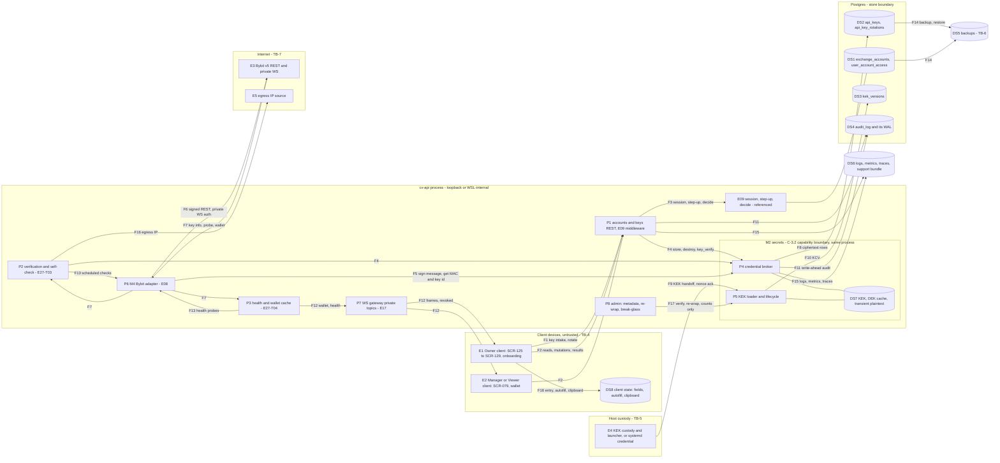

# E27 — STRIDE threat model: Accounts, sub-accounts and the API-key vault

- Ticket: E27-X01 (issue #838). Owner: Security engineer (CODEOWNER). Status: **Approved** (2026-10-16; independent
  reviews: opus security, sonnet code; Fable security pass APPROVE at 878d5c4e on re-check, REQUEST CHANGES at
  de649e42 resolved). Owner acceptance of the §11.2 residuals (RR-14) and of the F-27 residual High (RR-13) is
  pending, queued on #2701; review log at the end of §11.
- Method: `docs/plan/04-security-program.md` §5 template (L x I = risk), STRIDE per element and per flow
  (C-12.1), in the four-question frame: what are we building (§1, §2), what can go wrong (§3, §5, §7), what are
  we going to do about it (§9, §10), did we do a good job (§11). Format mirrors `E17-ws-gateway.md` and
  `E12-bars.md`. It consumes the E09 model (`e09-auth-rbac.md`, U-rows), the E08 model
  (`e08-exchange-boundary.md`, E8-rows) and the E17 model (`E17-ws-gateway.md`, WS-rows); those threats are
  **referenced, not repeated**.
- Inputs, read at `d3b52742`, rechecked at `771cab99` (#2352) and again at `9d4f9fb0` for what merged since (§1.1):
  ADR-0009 with Amendments 1 to 3, ADR-0010, the E27-K01 finding `docs/plan/spikes/e27-kek.md`, migrations
  `0017_exchange_accounts_api_keys`, `0019_snapshot_withdraw_transfer`, `0020_kek_versions`,
  `0024_api_keys_write_once` and `0026_kek_versions_env`, the M2 package `services/api/candleviewer/secrets/`
  (E27-T02, #835), `candleviewer/accounts/` and the accounts store
  `candleviewer/storage/repositories/accounts*.py` (E27-T01, #834), `candleviewer/auth/rbac_seed.json`,
  `services/api/tests/contract/rbac/matrix.yaml`, `candleviewer/api/step_up.py`, and the `exchange-accounts` paths of
  `docs/plan/22-api-openapi.yaml`. Facts about the exchange's key-info fields come from the Bybit v5 reference pages
  "Get API Key Information", "Modify Master API Key" and the two delete-key pages (read 2026-10-14). No recorded
  capture exists yet (#2240), so they are design inputs here, not fixtures (C-13.5).
- Path: the ticket names `docs/security/threat-models/E27.md`. GOV-008 (`scripts/check_threat_model_ticket_map.py`)
  scans only `E<nn>-<slug>.md`, and every merged model uses that form, so this file is `E27-accounts.md`.
  E27-X03's "documentation of the matrix in `E27.md`" means this file.
- Timing: the ticket asks for the model before the vault is built. E27-T02 merged first (#2236 to #2271, then
  #2350), so this model reviews the built broker and KEK loader and gates the rest of the epic. E27-T03, E27-T04,
  E27-T05 and E27-S01 to E27-S05 must reflect it (§10). Its Critical/High list (§11.1) was re-triaged against `main` at `9d4f9fb0` when the status flipped to Approved.
- Gate note: design-level weaknesses only. No credential, host, UID, IP address or exploit detail appears.
- Addendum: §12 (2026-10-16, #2893) covers the dev/test account-fixture transport, proposed with ADR-0036 and
  pending its own security review. The Approved status above covers §1 to §11.

## 1. Scope

In scope: registration and listing of main and sub-accounts (`exchange_accounts`); manager account grants as
E27 reads them (`user_account_access`); key intake, verification, storage, signing, rotation and revocation
(`api_keys`, `api_key_rotations`); the KEK, its custody, injection and rotation (`kek_versions`); the
withdrawal-permission self-check (C-2.8); the read paths (`GET /exchange-accounts*`, the `wallet` WS topic,
SCR-079, SCR-125, SCR-128); the audit records and telemetry these paths emit.

Out of scope: building the controls (owned by the tickets in §10); executing the abuse cases (E27-X02) and the
drills (E27-X04); the session, step-up and RBAC machinery itself (E09, consumed); the exchange adapter's transport
(E08) and the WS gateway's mechanics (E17), both referenced; the OMS (E29) and fan-out (E34); the R4 penetration
test (E43).

### 1.1 State of the build at review time

| Component                                                                                   | Status      | Evidence                                                                                                                                                                                                                                                                                    |
| ------------------------------------------------------------------------------------------- | ----------- | ------------------------------------------------------------------------------------------------------------------------------------------------------------------------------------------------------------------------------------------------------------------------------------------- |
| KEK custody finding, ADR-0009 Amendment 1                                                   | merged      | E27-K01 (#2150). The host launcher is not built (#2284); the host drill is owed (#2151)                                                                                                                                                                                                     |
| `exchange_accounts`, `api_keys`, `api_key_rotations`                                        | merged      | 0017 (#2153); the withdraw/transfer CHECK is 0019 (#2262); the `api_keys` ciphertext and identity columns are write-once from 0024 (`trg_api_keys_write_once`, #2336 via #2614), which also revokes DELETE on `api_keys` from `cv_app`                                                      |
| `kek_versions` (key check values)                                                           | merged      | 0020 (E27-T02); keyed `(env, version)` since 0026, one KEK lineage per environment (#2338 via #2697, ADR-0009 Amendment 3)                                                                                                                                                                  |
| M2: envelope, KEK loader, degraded latch, re-wrap, signing                                  | merged      | E27-T02 (#2236 to #2271). M2 computes the request MAC (#2350); the Bybit signer signs through it, and guard rule R10 refuses plaintext credential APIs in `exchange/` (#2352). The key gate applies the SR-030 allow-list before the deny-list (`secrets/_permissions.py`, #2270 via #2812) |
| M13 models, the C-2.8 predicate, the `AccountsRepository` facade and the M10 accounts store | merged      | `accounts/models.py`, `accounts/_permissions.py`, `accounts/repository.py`; `storage/repositories/accounts*.py` with SR-051 scoping in SQL, owner-only writes, key reads and rotations (E27-T01, #2684 to #2688); `AccountsService` is still a scaffold                                     |
| `/exchange-accounts*` routes                                                                | not mounted | matrix rows are `state: not_mounted`; step-up classes are pre-registered in `api/step_up.py`                                                                                                                                                                                                |
| Verification pipeline, scheduled self-check, health, wallet cache                           | partial     | E27-T03, E27-T04. Merged: the reply parser (`exchange/bybit/key_info.py`, #2797), the M13 pipeline (#2854), the check (#2975, #3002). #836 slice 2a3 wires its boot assertion and hourly run on the real backend. Not built: health, the wallet cache, the check's metrics and WS probe     |
| Runbooks                                                                                    | partial     | `docs/ops/runbooks/kek-custody.md` (E27-T02) and `docs/ops/runbooks/key-selfcheck.md` (E27-T03, not yet drilled on a host); rotation, compromise and restore runbooks owed by E27-T05                                                                                                       |

A row that rests on unbuilt work says "planned" and names the ticket. Its rating assumes the ticket ships the
control; the security review of that ticket re-triages the row if the control is missing.

### 1.2 Assets and data classification

E27-X01 fixes this classification. Every E27 child cites it rather than deciding it again.

| Asset                                                                                                                                                                                  | Class                            | Where it lives                                                                                                                                                                | Notes                                                                                                                                                               |
| -------------------------------------------------------------------------------------------------------------------------------------------------------------------------------------- | -------------------------------- | ----------------------------------------------------------------------------------------------------------------------------------------------------------------------------- | ------------------------------------------------------------------------------------------------------------------------------------------------------------------- |
| KEK (current, and the previous one during a rotation)                                                                                                                                  | **Secret** (highest)             | Host custody (Windows Credential Manager, or a systemd credential on the VPS), then M2 memory only                                                                            | Area 1 asset A-02. Never in Postgres, the environment, `Settings`, logs or an image layer                                                                           |
| Unwrapped DEKs; the plaintext API secret and key id                                                                                                                                    | **Secret**                       | M2 memory (DEK cache, TTL at most 300 s). The key id also leaves M2 for the request header, wrapped in `Secret`; on intake and rotation the plaintext also crosses P1 (below) | C-2.7                                                                                                                                                               |
| `secret_enc`, `key_id_enc`, `enc_nonce`, `dek_ref`                                                                                                                                     | **Secret**                       | `api_keys`                                                                                                                                                                    | The ticket names three; `key_id_enc` is added to match its column comment. A nonce is not secret in the cryptographic sense; the class keeps it with its ciphertext |
| `exchange_uid`, account and key `label`, `parent_account_id`, `permission_snapshot`, `ip_whitelist`, the egress IP, verification and test results, balances, fee rates, `key_id_last4` | **Confidential**                 | `exchange_accounts`, `api_keys`, the wallet cache, API responses                                                                                                              | Served only inside the caller's grants. Never in an analytics event or a metric label                                                                               |
| Health and connection states, key status and key-age state, `kek_version`, `kek_versions.kcv`                                                                                          | **Internal**                     | Responses, the `system` topic, metrics                                                                                                                                        | The KCV is 8 bytes of an HMAC under the KEK: it names a KEK version without revealing it                                                                            |
| `user_account_access` grants                                                                                                                                                           | Confidential, integrity-critical | Postgres                                                                                                                                                                      | Owned by E09; E27 only reads them                                                                                                                                   |

The plaintext key and secret also cross P1 on intake and rotation: the ASGI receive buffers, the request model's
`SecretStr` fields and any middleware that reads the body. No middleware may buffer, log or persist a
key-management body, and an idempotency fingerprint must leave out the secret fields or use a keyed hash
(KV-I20, SR-E27-20). On `main` no middleware reads a request body.

### 1.3 Rating

Risk = L x I on the programme scale (Low / Medium / High / Critical):

| L \ I | L      | M      | H        |
| ----- | ------ | ------ | -------- |
| L     | Low    | Low    | Medium   |
| M     | Low    | Medium | High     |
| H     | Medium | High   | Critical |

Impact **H\*** marks a threat that lets value leave the account: withdrawal, transfer, P2P or payment rights, or
trading by an actor who can sign at the deployment's egress IP (D2). It raises the cell by one band, as
`04-security-program.md` §5.1 rates K4. Disposition: **M** mitigated by a named ticket (merged or planned), **A**
accepted once the Owner signs off in §11.2 (pending, queued on #2701), **R** referenced (owned by another epic's model). Verification layers follow
`04-security-program.md` §6: unit, property, integration, contract, e2e, load, chaos, ci-gate, drill. Row ids are
`KV-xnn`.

## 2. Data-flow diagram and trust boundaries

Text description (the diagram is not the only carrier): the Owner submits a key and secret over the tailnet (F1)
to the accounts REST surface, which asks E09 for the session, the step-up state and the per-account decision
(F3). The verification pipeline has M2 sign a key-info call and a probe (F4, F5), which the Bybit adapter sends
(F6); the answers come back untrusted (F7). M2 seals the credential under a per-row DEK wrapped by the KEK and
stores ciphertext only (F8), writing a durable audit record before every store, borrow and destroy (F11). The
KEK reaches M2 once per boot from host custody (F9) and is checked against its key check value (F10). Owners,
Managers and Viewers read account metadata, verification results and balances over REST (F2) and over the
private `wallet`, `positions` and `system` topics (F12). Timers drive the self-check and the health probes
(F13). Backups (F14) and telemetry (F15) receive copies of what the stores and processes hold. The egress IP is
looked up for the whitelist check (F16). The admin module sees M2 only as metadata (F17). The browser holds form
state, autofill and clipboard contents (F18).

Elements: external entities **E1-E5**; processes **P1-P8** plus the referenced E09 decision point; data stores
**DS1-DS8**; flows **F1-F18**. Every element and flow is in the coverage matrix (§3.7).

Boundaries (`20-architecture.md` §2.2, `04-security-program.md` §4.1):

- **TB-4, client to API** (F1, F2, F12, F18; B1): untrusted until authenticated, RBAC-scoped after. The client
  enforces nothing (C-2.12).
- **TB-5, host custody to M2** (F9; through B2): the KEK crosses once per boot. On WSL the host launcher pushes it
  into a read-once FIFO; WSL interop is disabled so WSL code cannot reach Credential Manager (#2284).
- **Store boundary** (F8, F10, F11, F14): a database writer is its own integrity domain. Cryptographic binding means
  a writer can deny service or roll a row back, not make a row decrypt under another identity.
- **TB-7** (F6, F7, F16; B3): the exchange is semi-trusted (AC-08); the egress-IP source is advisory, because the
  exchange enforces the whitelist itself.
- **TB-6** (F14): backups are encrypted with a key distinct from the KEK (SR-091).
- **M2 capability boundary** (F4, F5, F17): C-3.2 facades inside one Python process. They stop accidental use,
  not hostile in-process code (§4.3, KV-I09). This is **not** a trust boundary.
- B4 (renderer to Electron main) carries no E27 flow: keys never reach the Electron main process (SR-119).

## 3. STRIDE table

Columns: the existing control is what `main` does today, with the test that proves it; the gap names the
mitigation and its ticket. `SR-E27-nn` are this model's requirements (§9).

### 3.1 Spoofing

| ID     | Element / flow | Threat                                                                                                                                                                                                                                                                                                                                                                                                                                                                                  | L   | I   | Risk   | Existing control                                                                                                                                                                                                                                                                                                                                                          | Gap → mitigation                                                                                                                                                                                                                                                | Owner                          | Verify                             | Disp. | Residual            |
| ------ | -------------- | --------------------------------------------------------------------------------------------------------------------------------------------------------------------------------------------------------------------------------------------------------------------------------------------------------------------------------------------------------------------------------------------------------------------------------------------------------------------------------------- | --- | --- | ------ | ------------------------------------------------------------------------------------------------------------------------------------------------------------------------------------------------------------------------------------------------------------------------------------------------------------------------------------------------------------------------- | --------------------------------------------------------------------------------------------------------------------------------------------------------------------------------------------------------------------------------------------------------------- | ------------------------------ | ---------------------------------- | ----- | ------------------- |
| KV-S01 | F1, F3         | Session fixation on the admin routes: a planted session drives key intake or rotation as the Owner                                                                                                                                                                                                                                                                                                                                                                                      | L   | H   | Medium | SR-013 rotation on login and MFA; refresh-family reuse revokes the family; fixation attempts audited as `auth.session_fixation_attempt` (#2316); CSRF double-submit (SR-041, #2238); `SameSite=Strict` (E09 U6)                                                                                                                                                           | None for E27. A fresh step-up on every key route (KV-S02) bounds what a fixed session can do                                                                                                                                                                    | E09                            | integration (E09-X02)              | R     | Low                 |
| KV-S02 | F1, F2, P1     | Forged or replayed step-up, or an account route mounted without step-up                                                                                                                                                                                                                                                                                                                                                                                                                 | L   | H   | Medium | Elevation is server-side per session and action class (E09 U18); `DANGEROUS_ROUTES` pre-registers `POST .../keys`, `POST .../rotate` and `DELETE .../keys/{keyId}`; `tests/unit/api/test_dangerous_route_registry.py` fails if a mounted write under `/exchange-accounts/{id}/keys` is ungated; 3 bad codes make the session read-only                                    | `POST /exchange-accounts`, `PATCH /exchange-accounts/{accountId}` and `DELETE /exchange-accounts/{accountId}` are neither registered nor matched by `DANGEROUS_PATH_PATTERN`, yet `accounts:write` is seeded dangerous and SCR-129 asks for step-up (SR-E27-02) | E27-S01, E27-S04, E27-X03      | unit (registry), integration       | M     | Low after SR-E27-02 |
| KV-S03 | F9, E4, P5     | Launcher impersonation: a local process feeds an attacker-chosen KEK into the handoff, so new keys are wrapped under a KEK the attacker knows. Precondition: code execution as the service uid or root on the host before the launcher runs, at a KEK version with no rows (first boot of an empty deployment, or a new per-environment lineage since #2338). With rows present a substituted KEK fails the trial unwrap and the boot degrades (`kek_mismatch`): denial of service only | L   | H   | Medium | No trust-on-first-use while rows exist: `RotatingBroker.verify_kcv` enrols an unknown KCV only if no live row is at that version or a trial unwrap succeeds (`test_kcv_wrong_kek_not_pinned_when_rows_exist`); `kv_kcv_unique`; the FIFO must be `0600` and owned by the service euid, opened `O_NOFOLLOW` (`test_symlink_refused`); a live FIFO needs the launcher nonce | The first-boot window is proposed for acceptance (§11.2) behind a procedural check: the Owner compares the enrolled KCV with the offline copy's KCV (SR-E27-15). Host launcher and interop-off not built (#2284)                                                | E27-T02, E27-T05, #2284, #2338 | unit, drill (#2151)                | M, A  | Low                 |
| KV-S04 | F9, E4         | A second reader drains the read-once FIFO (KEK theft during the handoff)                                                                                                                                                                                                                                                                                                                                                                                                                | L   | H   | Medium | Nonce ack written once after every handle is drained (`test_ack_written_once_after_all_handles`, `test_duplicate_ack_is_refused`); the launcher reads a missing or duplicate ack as an extra reader and stops the stack (e27-kek.md §3)                                                                                                                                   | Launcher side and its `security.kek_handoff_anomaly` record not built (#2284); non-visibility transcript owed (#2151)                                                                                                                                           | #2284, #2151                   | unit, drill                        | M     | Low after #2284     |
| KV-S05 | F6, F7, E3     | A spoofed exchange endpoint answers the key-info call with a clean permission set for a key that can withdraw                                                                                                                                                                                                                                                                                                                                                                           | L   | H   | Medium | TLS validation and the per-environment base-URL allow-list (E08 E8-1, E8-2, E8-4); the signed probe must also succeed (contract step 7)                                                                                                                                                                                                                                   | None new                                                                                                                                                                                                                                                        | E08                            | integration                        | R     | Low                 |
| KV-S06 | F1, P2         | A key of another UID is attached to an account (wrong sub-account, someone else's key)                                                                                                                                                                                                                                                                                                                                                                                                  | M   | M   | Medium | Planned: contract step 4 compares the key-info UID with `exchange_accounts.exchange_uid`; `expected_uid` is in the request                                                                                                                                                                                                                                                | Mismatch test for `key_uid_mismatch`                                                                                                                                                                                                                            | E27-T03                        | unit, contract                     | M     | Low                 |
| KV-S07 | F1, P2, DS2    | The Owner is tricked into pasting a key into an account of another environment (live, demo or testnet)                                                                                                                                                                                                                                                                                                                                                                                  | L   | H   | Medium | The data AAD binds the process environment (live, demo or testnet); reads are environment-namespaced; `store()` refuses another environment (`test_store_refuses_other_environment`, `test_demo_bound_broker_never_reads_a_live_row`); keys do not authenticate on another environment's hosts                                                                            | Planned `key_wrong_environment` check with hosts chosen from `exchange_accounts.env` and no fallback in any direction (US-ACCT-007)                                                                                                                             | E27-T03                        | unit, contract                     | M     | Low                 |
| KV-S08 | F7, E3, P2     | The key's IP whitelist also lists addresses outside the deployment, or a wildcard, so a stolen key works from the thief's address (Area 1 K5)                                                                                                                                                                                                                                                                                                                                           | M   | H   | High   | The exchange enforces the whitelist; SR-033 and SR-030a require the list to equal the deployment egress IP; the signed probe proves the egress IP is allowed                                                                                                                                                                                                              | Contract check 5 accepts any whitelist that merely contains the egress IP. Refuse an empty list, `*`, non-host ranges and any non-egress entry (SR-E27-04)                                                                                                      | E27-T03 (contract first)       | unit, contract                     | M     | Low                 |
| KV-S09 | E3, F16        | A compromised key stays valid at the exchange after a local revoke, or through a rotation overlap, so a thief keeps trading from an allowed address                                                                                                                                                                                                                                                                                                                                     | L   | H   | Medium | The whitelist confines use to the egress IP; revoke is local and immediate for new signatures (E27-S04); sessions per KV-E13; the compromise runbook ends with deletion at the exchange (E27-T05)                                                                                                                                                                         | Revoke ordering and the remote delete (SR-E27-06); one overlap value, never used for a compromise (SR-E27-10)                                                                                                                                                   | E27-S04, E27-S03, E27-T05      | e2e, drill (E27-X04, AC-35, AC-36) | M, A  | Low                 |

### 3.2 Tampering

| ID     | Element / flow | Threat                                                                                                                    | L   | I   | Risk   | Existing control                                                                                                                                                                                                                                                                                                                                                                                                                                                                                                                                                                                                                                                 | Gap → mitigation                                                                                                                                                                                                                                                                                                                                                                                                                                                                                                                                                                                                                                               | Owner                   | Verify                       | Disp. | Residual                                                                                                   |
| ------ | -------------- | ------------------------------------------------------------------------------------------------------------------------- | --- | --- | ------ | ---------------------------------------------------------------------------------------------------------------------------------------------------------------------------------------------------------------------------------------------------------------------------------------------------------------------------------------------------------------------------------------------------------------------------------------------------------------------------------------------------------------------------------------------------------------------------------------------------------------------------------------------------------------- | -------------------------------------------------------------------------------------------------------------------------------------------------------------------------------------------------------------------------------------------------------------------------------------------------------------------------------------------------------------------------------------------------------------------------------------------------------------------------------------------------------------------------------------------------------------------------------------------------------------------------------------------------------------- | ----------------------- | ---------------------------- | ----- | ---------------------------------------------------------------------------------------------------------- |
| KV-T01 | F8, DS2        | Ciphertext substitution: a database writer swaps `secret_enc`, `key_id_enc` or `dek_ref` between rows, accounts or fields | L   | H   | Medium | AES-256-GCM with length-prefixed AADs: data `cv-cred-v2‖env‖account_id‖credential_id‖field`, wrap `cv-dek-v2‖env‖credential_id‖kek_version` (SR-003, #2338); `enc_nonce` cross-checked. Unit tests: `test_broker_any_bitflip_is_rejected_property`, `test_broker_swapped_dek_between_rows_is_rejected`, `test_broker_aad_inputs_bound`, `test_unwrap_bound_to_credential_id_and_version`                                                                                                                                                                                                                                                                         | None                                                                                                                                                                                                                                                                                                                                                                                                                                                                                                                                                                                                                                                           | E27-T02                 | unit, property               | M     | Low                                                                                                        |
| KV-T02 | F8, DS2        | Ciphertext rollback: an older `secret_enc` and `dek_ref` restored for the same credential id still pass the GCM tag       | L   | H   | Medium | Every key version is a new row (`store()` mints a fresh id); the Postgres adapter only inserts ciphertext. Since 0024 (#2336) `trg_api_keys_write_once` (BEFORE UPDATE, `ENABLE ALWAYS`, the last BEFORE UPDATE trigger, SQLSTATE 23514 naming the column) refuses any change to `id`, `exchange_account_id`, `key_id_enc`, `key_id_last4`, `secret_enc`, `enc_nonce` or `enc_alg`, and `cv_app` has no DELETE on `api_keys` (`test_restoring_an_older_sealed_version_is_refused`, `test_changing_a_protected_column_is_refused_atomically`, `test_guard_is_the_last_before_update_row_trigger`, `test_cv_app_can_neither_delete_rows_nor_switch_the_guard_off`) | Carried residual (`21-database-schema.md` §3.2.3a): the trigger refuses UPDATEs only. A `cv_app` DELETE of the parent `exchange_accounts` row cascades to its keys, because referential actions run as the table owner (`test_account_delete_by_cv_app_still_cascades_to_its_keys`), after which a captured older row can be re-inserted under its old id and still decrypts, because every AAD input is reproducible. The owner role and superusers can disable or drop the trigger. Consider `REVOKE DELETE ON exchange_accounts FROM cv_app` (M13 soft-deletes; the store has no hard DELETE); audit, revoke-at-Bybit on rotation and SR-031 stay the cover | #2336 (merged)          | integration                  | M     | Low (#2336 merged); carried: parent-cascade DELETE then re-insert, owner or superuser dropping the trigger |
| KV-T03 | F8, DS2, P2    | `permission_snapshot` or `status` edited in the database to fake a passed verification or to promote a refused key        | L   | H   | Medium | `ak_snapshot_shape`, `ak_no_withdraw` and `ak_no_transfer` refuse a stored fund right; only `active` and `rotating` rows sign, `pending` only for `key_verify` (`test_pending_key_borrowable_only_for_verification`); planned: the live re-check overrides the stored snapshot (E27-T03) and E27-X02 runs "database-level tampering does not win"                                                                                                                                                                                                                                                                                                                | The borrow does not re-check C-2.8 (SR-E27-14, #2267 item 8). A writer can still set `status = 'active'`; detection rests on the re-check cadence (KV-E06). The store's own promotion is no gate either: `AccountsStore.transition_key_status` (`storage/repositories/accounts.py:209-211`; Postgres statement `_TRANSITION` in `accounts_sqlalchemy.py`) flips `pending` to `active` with a compare-and-set on the old status and no verification evidence, so E27-T03 must call it only after every check has passed and nothing else may call it (SR-E27-01, AC-34)                                                                                         | E27-T03, E27-X02, #2267 | integration (AC-34)          | M     | Low                                                                                                        |
| KV-T04 | F2, DS1        | `env`, `exchange_uid` or `kind` changed after creation, through the API or in SQL                                         | L   | H   | Medium | `UpdateExchangeAccountRequest` has no such field and `additionalProperties: false`; planned E27-S01 refusal; a row read under the other environment fails the tag (`test_aad_binds_the_sealing_env`, `test_env_layers_refuse_a_live_row_without_relabelling`); `trg_ea_env_parent` keeps a sub-account in its parent's environment                                                                                                                                                                                                                                                                                                                               | No database-level immutability: `env` is #2333; `exchange_uid` and `kind` are untracked (SR-E27-13, extend #2333)                                                                                                                                                                                                                                                                                                                                                                                                                                                                                                                                              | E27-S01, #2333          | unit, integration            | M     | Low                                                                                                        |
| KV-T05 | F16, E5        | The egress-IP answer is tampered with, to hide a whitelist mismatch or to raise a false one                               | L   | M   | Low    | The exchange enforces the whitelist; the signed probe succeeds only from an allowed address; SR-033 hourly detection and alert                                                                                                                                                                                                                                                                                                                                                                                                                                                                                                                                   | R4 exit criterion #2 reads "IP whitelist limited to the Tailscale-reachable addresses", which conflates the tailnet with the egress IP (Area 10 N7); doc fix (P-1)                                                                                                                                                                                                                                                                                                                                                                                                                                                                                             | E27-T03, P-1            | contract, drill (E27-X04)    | M     | Low                                                                                                        |
| KV-T06 | F1, F2         | Replay of a captured intake, rotate or revoke request                                                                     | L   | M   | Low    | TLS on the tailnet hop (SR-049); CSRF (SR-041); `x-idempotency: required` on intake and rotate; step-up per action class                                                                                                                                                                                                                                                                                                                                                                                                                                                                                                                                         | None                                                                                                                                                                                                                                                                                                                                                                                                                                                                                                                                                                                                                                                           | E09, E27-S02, E27-S03   | integration                  | M     | Low                                                                                                        |
| KV-T07 | F7, P2         | A hostile or malformed key-info response (types, sizes, lookalike right names) passes the gate                            | L   | H   | Medium | Strict schema validation (SR-040, E08 E8-8); `project_snapshot` keeps allow-listed fields and fails closed on non-JSON values; the M2, M13 and 0019 predicates are tested against one corpus (`tests/unit/accounts/_permission_cases.py`); the M2 gate refuses any group or right outside the SR-030 allow-list, spelled exactly (`require_allow_listed`, `secrets/_permissions.py:59-78`, #2270; `test_gate_refuses_any_right_in_a_group_outside_the_allow_list`, `test_store_refuses_a_key_outside_the_allow_list_before_any_write`)                                                                                                                           | M13 and the 0019 CHECK keep the substring rule and its spelling blind spots; a CHECK allow-list needs a new migration                                                                                                                                                                                                                                                                                                                                                                                                                                                                                                                                          | #2270 (merged), E27-T03 | unit, property               | M     | Low (#2270 merged)                                                                                         |
| KV-T08 | F17, P5, DS2   | A KEK re-wrap is interrupted, replayed, downgraded to a retired KEK or recorded as a no-op                                | L   | H   | Medium | Compare-and-set per row on `kek_version`; each new wrap is checked by opening `secret_enc` before the swap; `kek_reused`, `kek_retired` and `kek_version_out_of_sequence` refusals; `security.kek_rotation_*` records (`test_rewrap_all_resumes_after_kill_and_borrows_in_between`, `test_rewrap_refuses_reused_kek`)                                                                                                                                                                                                                                                                                                                                            | No entry point; the per-row record is not in the row's transaction; no stranded-row check (#2266)                                                                                                                                                                                                                                                                                                                                                                                                                                                                                                                                                              | #2266                   | unit, drill (E27-X04, AC-38) | M     | Low after #2266                                                                                            |
| KV-T09 | F2, P1         | Mass assignment: the client sets `trading_enabled`, `status`, `can_withdraw`, `read_only` or `kek_version`                | L   | H   | Medium | Request schemas carry none of these and set `additionalProperties: false`; `extra="forbid"` (SR-040); the database pins `can_withdraw` and `can_transfer` false                                                                                                                                                                                                                                                                                                                                                                                                                                                                                                  | None                                                                                                                                                                                                                                                                                                                                                                                                                                                                                                                                                                                                                                                           | E27-S01, E27-S02        | contract                     | M     | Low                                                                                                        |
| KV-T10 | F6, P6         | A request signed for one environment (live, demo or testnet) is sent to another environment's host                        | L   | H   | Medium | E08 E8-5; SR-040a capability record; one client instance per environment (C-2.11)                                                                                                                                                                                                                                                                                                                                                                                                                                                                                                                                                                                | None new                                                                                                                                                                                                                                                                                                                                                                                                                                                                                                                                                                                                                                                       | E08                     | unit                         | R     | Low                                                                                                        |
| KV-T11 | F2, P1         | A leverage or margin-mode change exceeds the account profile's cap                                                        | L   | H   | Medium | Planned: the server re-derives the cap and the scope before any exchange call (E27-S05, SR-052, C-12.5)                                                                                                                                                                                                                                                                                                                                                                                                                                                                                                                                                          | Profile caps are E28's model                                                                                                                                                                                                                                                                                                                                                                                                                                                                                                                                                                                                                                   | E27-S05, E28            | contract                     | M, R  | Low                                                                                                        |
| KV-T12 | P3, F12        | Health is asserted without evidence: an account shows healthy while orders cannot reach the exchange                      | M   | H   | High   | Planned (E27-T04): health comes only from positive evidence (an authenticated heartbeat or a REST success) and decays on silence; red within 30 s disables order entry for the account and invokes the dead-man's-switch policy                                                                                                                                                                                                                                                                                                                                                                                                                                  | Chaos proof (E27-Q03 private-WS drop)                                                                                                                                                                                                                                                                                                                                                                                                                                                                                                                                                                                                                          | E27-T04, E27-Q03        | chaos                        | M     | Low                                                                                                        |

### 3.3 Repudiation

| ID     | Element / flow  | Threat                                                                                                                                 | L   | I   | Risk   | Existing control                                                                                                                                                                                                                                                                                                                                                                                                                                        | Gap → mitigation                                                                                                                                                                                                                                                                  | Owner                              | Verify                                        | Disp. | Residual            |
| ------ | --------------- | -------------------------------------------------------------------------------------------------------------------------------------- | --- | --- | ------ | ------------------------------------------------------------------------------------------------------------------------------------------------------------------------------------------------------------------------------------------------------------------------------------------------------------------------------------------------------------------------------------------------------------------------------------------------------- | --------------------------------------------------------------------------------------------------------------------------------------------------------------------------------------------------------------------------------------------------------------------------------- | ---------------------------------- | --------------------------------------------- | ----- | ------------------- |
| KV-R01 | F4, F5, P4      | A credential is decrypted or used to sign with no audit record                                                                         | L   | H   | Medium | One audited decrypt path (`CredentialBroker._borrow`): `security.credential_borrowed` is written before decryption and carries the message digest, never the key id; a failure appends `security.credential_sign_failed`; store and destroy are audited first; an audit failure refuses the borrow (`test_broker_audit_timeout_fails_closed`, `test_borrowed_record_carries_the_digest_and_never_the_key_id`, `test_decrypt_path_is_used_only_by_sign`) | In-process code can still decrypt without a record (KV-I09, #2279)                                                                                                                                                                                                                | E27-T02, #2279                     | unit                                          | M     | Low                 |
| KV-R02 | F1, F2, P1, DS4 | A key or account action (attach, test, rotate, revoke, disable, delete, mark compromised, policy change) leaves no attributable record | M   | H   | High   | The registry holds `accounts.create`, `accounts.enable_trading` and `api_key.import`, `.rotate`, `.revoke`, `.reveal_attempt`; audit is write-ahead (C-2.9)                                                                                                                                                                                                                                                                                             | The tickets use other names (`account.*`, `admin.key_marked_compromised`, `admin.secrets_policy_changed`), none registered (SR-E27-09). M2 records the actor it is given: key management must pass the Owner (`actor_user_id`), else `system:secrets` is recorded (#2267 item 15) | E27-S01 to E27-S04, E27-T03, #2267 | unit (registry), integration (E27-X03, AC-37) | M     | Low after SR-E27-09 |
| KV-R03 | DS4             | The audit chain is broken or truncated to hide a key action                                                                            | L   | H   | Medium | E09 U14, U19, U20: append-only grants, hash chain, off-database checkpoint file                                                                                                                                                                                                                                                                                                                                                                         | Nightly chain verifier (#2111)                                                                                                                                                                                                                                                    | E09                                | integration                                   | R     | Low                 |
| KV-R04 | F2, P1          | The operator denies a revoke, or the branch chosen for open positions                                                                  | L   | M   | Low    | Planned: step-up, actor and branch in the revoke record (E27-S04); `security.credential_destroyed` is written before the row is revoked                                                                                                                                                                                                                                                                                                                 | Actor binding (KV-R02)                                                                                                                                                                                                                                                            | E27-S04, E27-X04                   | integration (AC-36, AC-37), drill             | M     | Low                 |
| KV-R05 | F9, P5          | KEK loads, failures and rotations cannot be attributed                                                                                 | L   | M   | Low    | `security.kek_loaded`, `.kek_enrolled`, `.kek_load_failed` and `.kek_rotation_*` with version and KCV; a re-wrap records the Owner (`test_rewrap_records_actor`)                                                                                                                                                                                                                                                                                        | The launcher's anomaly record is host-local (#2284)                                                                                                                                                                                                                               | E27-T02, #2284                     | unit                                          | M     | Low                 |
| KV-R06 | F13, P2         | Self-check verdicts are not kept, so "the key was compliant at time T" cannot be shown later                                           | M   | M   | Medium | SR-031 asks for every result, with the raw permission set, in the audit log                                                                                                                                                                                                                                                                                                                                                                             | Planned E27-T03 records; names per SR-E27-09                                                                                                                                                                                                                                      | E27-T03                            | integration                                   | M     | Low                 |

### 3.4 Information disclosure

| ID     | Element / flow  | Threat                                                                                                                                                                                                         | L   | I   | Risk   | Existing control                                                                                                                                                                                                                                                                                                                                                                                                                                                              | Gap → mitigation                                                                                                                                                                                                                                                 | Owner                            | Verify                   | Disp. | Residual                                                       |
| ------ | --------------- | -------------------------------------------------------------------------------------------------------------------------------------------------------------------------------------------------------------- | --- | --- | ------ | ----------------------------------------------------------------------------------------------------------------------------------------------------------------------------------------------------------------------------------------------------------------------------------------------------------------------------------------------------------------------------------------------------------------------------------------------------------------------------- | ---------------------------------------------------------------------------------------------------------------------------------------------------------------------------------------------------------------------------------------------------------------- | -------------------------------- | ------------------------ | ----- | -------------------------------------------------------------- |
| KV-I01 | DS2, DS5, F14   | A database dump, a stolen laptop with the Postgres volume, or a backup yields usable keys                                                                                                                      | M   | H   | High   | The KEK lives outside Postgres, WSL and every volume (ADR-0009 Amendment 1); one DEK per row; backups are encrypted with a separate key (SR-090 to SR-092); planned restore drill (E27-X04, #2151)                                                                                                                                                                                                                                                                            | TOTP and recovery-code keys are still env-provided (#2152). The cross-environment KEK hole (KV-E04) is closed by #2338 (merged)                                                                                                                                  | E27-X04, #2152 (#2338 merged)    | drill, integration       | M     | Low (#2338 merged)                                             |
| KV-I02 | F15, DS6        | A secret reaches a log line or a rendered traceback                                                                                                                                                            | M   | H   | High   | `Secret[T]` renders `***` and refuses pickling, copying and serialisation (SR-007; `test_render_paths_mask`, `test_serialise_paths_refuse`); redaction on every handler, third-party loggers included (SR-006, SR-121; `test_stream_handler_never_sees_plaintext`, `test_adr0009_crafted_key_absent_from_stdout_files_and_metrics`); `scrub_frames` on a failed MAC (`test_a_hook_kept_mac_failure_shows_no_plaintext`); Semgrep `cv-log-secret`, `cv-obs-log-secret-fstring` | A failed DEK unwrap leaves the KEK reachable through exception context (#2374); leak-test strength (#2267 item 6)                                                                                                                                                | E27-T02, E27-X02, #2374, #2267   | unit, ci-gate            | M     | Low                                                            |
| KV-I03 | F15, DS6        | Key material in a trace attribute or a span event                                                                                                                                                              | L   | H   | Medium | The borrow span carries ids only (`key_id`, `env`, `kek_version`, `purpose`); attribute filter (`test_trace_span_attribute_filter`)                                                                                                                                                                                                                                                                                                                                           | `record_exception` and `add_event` bypass the filter (#2267 item 5)                                                                                                                                                                                              | #2267                            | unit                     | M     | Low after #2267                                                |
| KV-I04 | F15, DS6        | A metric label exposes a UID, a key id or a label                                                                                                                                                              | L   | M   | Low    | M2 labels are bounded (`stage`, `result`, `reason`, constant `env`); Semgrep `cv-obs-metric-label-allowlist`                                                                                                                                                                                                                                                                                                                                                                  | The epic's planned `cv_exchange_rate_limit_remaining{uid}` would put the exchange UID in a label: use the internal account id (SR-E27-16)                                                                                                                        | E27-T04                          | ci-gate                  | M     | Low                                                            |
| KV-I05 | F2, P1          | An error body echoes a submitted secret or the exchange's error text                                                                                                                                           | M   | H   | High   | The 422 handler drops `input` and `ctx` and redacts `msg`; a 500 never echoes the exception (`api/error_redaction.py`); M2 errors carry codes only (`test_exception_text_never_contains_key_material`); exchange errors map to domain errors (E08 E8-20, E8-21)                                                                                                                                                                                                               | The contract has free-text `KeyTestResult.rest.error`, `websocket.error` and verification `warnings` (SR-E27-08)                                                                                                                                                 | E27-T03, E27-X02                 | unit, E27-X02 leak suite | M     | Low                                                            |
| KV-I06 | F2, P1          | A reveal path returns key material: a Viewer hunts for one, or the pre-registered `reveal-scope` path is mounted                                                                                               | L   | H   | Medium | Secrets are write-only (SR-005); no serialisable model has a ciphertext field (`test_models_never_expose_secret_columns`); `Secret` refuses serialisation; `keys:read` and `keys:manage` are Owner-only; `api_key.reveal_attempt` is registered                                                                                                                                                                                                                               | `reveal-scope` is pre-registered in `api/step_up.py` with no contract path (SR-E27-11); SR-005's contract test that no response schema carries a secret field is still owed                                                                                      | E27-X02, E27-X03, E27-S02        | contract, ci-gate        | M     | Low                                                            |
| KV-I07 | F2, P1          | `key_id_masked` is over-long: the contract promises the first 4 and the last 4 characters                                                                                                                      | M   | L   | Low    | Only `key_id_last4` is stored; `ApiKeyMetadata.key_id_masked` is `...` plus the last 4                                                                                                                                                                                                                                                                                                                                                                                        | The contract (`ApiKey.key_id_masked`, `listApiKeys`) and SR-005's "first 4" wording disagree with the code (SR-E27-03)                                                                                                                                           | E27-S02 (contract first), #2285  | contract                 | M     | Low                                                            |
| KV-I08 | DS7             | A core dump, swap or ptrace exposes the KEK, a DEK or plaintext                                                                                                                                                | M   | H   | High   | `harden_process`: `RLIMIT_CORE=0` and `PR_SET_DUMPABLE=0`, read back; a live boot fails closed when hardening fails (`test_hardening_failure_degrades_in_live_only`); the KEK is zeroed on close; DEK cache TTL at most 300 s; plaintext buffers zeroed after each MAC (`test_sign_zeroes_every_decrypted_buffer`)                                                                                                                                                            | Immutable `bytes` copies cannot be wiped (`secrets/_envelope.py`); swap and `ptrace_scope` are host settings (`kek-custody.md`, #2151); this is Area 1 K9                                                                                                        | E27-T02, #2151                   | unit, drill              | A     | Medium (K9, acceptance pending, §11.2)                         |
| KV-I09 | DS7, P4         | In-process code or a compromised dependency reads the KEK, DEKs or plaintext from memory, or calls the signing path directly                                                                                   | L   | H\* | High   | C-3.2 capability facades (closures, `_m2_only`, `ALLOWED_CALLERS`); an AST guard over every module with must-fail probes (`test_capability_boundary.py`, `test_m2_guard_probes.py`); supply-chain controls (SR-130 to SR-138)                                                                                                                                                                                                                                                 | The guards stop accidental use only. Such an actor signs at the egress IP, so the whitelist does not bound it and trade rights alone can move value out (KV-E11, D2). Fix: process isolation of signing (#2279, needs an ADR); until then the SR-E27-19 controls | #2279, SR-E27-19 owners          | ci-gate                  | M     | Medium after SR-E27-19 or #2279; High until then, not accepted |
| KV-I10 | DS8, F18        | Autofill or a password manager captures or fills the secret; the secret stays in form state or the DOM                                                                                                         | M   | H   | High   | Planned (E27-S02): `type=password` write-only fields, autocomplete suppressed, state cleared, no reveal control; SR-129; the "write-only" description of E27-D05                                                                                                                                                                                                                                                                                                              | Automated proof owed: E27-Q02 `key-intake.spec.ts` asserts the field attributes and that the field is never re-filled                                                                                                                                            | E27-S02, E27-Q02, E27-Q04        | e2e                      | M     | Low                                                            |
| KV-I11 | DS8, F18        | The clipboard or a screenshot carries the secret (a copy control on the wrong field, a support-bundle screenshot)                                                                                              | L   | M   | Low    | CopyButton only for the egress IP (US-ACCT-003); the bundle masks `Secret` (`test_support_bundle_masks`); SR-177                                                                                                                                                                                                                                                                                                                                                              | The Owner's own screen during entry (proposed for acceptance, §11.2)                                                                                                                                                                                             | E27-D06, E27-Q04                 | e2e, exploratory         | M, A  | Low                                                            |
| KV-I12 | F2, F12, P1, P7 | A Manager or Viewer reads another account's balances, UID, fee rates, health or keys, over REST or `wallet`                                                                                                    | M   | H   | High   | `decide` per account (SR-050, SR-051; E09 U15, U31); `wallet` narrows to the grants and answers one `account_scope_denied` (E17 WS-I02, WS-I03); matrix rows exist for every `/exchange-accounts*` route (`not_mounted`)                                                                                                                                                                                                                                                      | The matrix records only the capability layer (`manager_without_grant: allow` on `GET /exchange-accounts/{accountId}` and `/fee-rate`). Per-account scope, foreign versus non-existent and the WS rows are owed by E27-X03 when the routes mount                  | E27-X03                          | contract                 | M     | Low                                                            |
| KV-I13 | F2              | Account-existence oracle: 403 versus 404, or timing                                                                                                                                                            | M   | L   | Low    | `decide` gives the same deny for an absent and a foreign account (E09 U25)                                                                                                                                                                                                                                                                                                                                                                                                    | `getExchangeAccount` lists both 403 and 404: a Manager must see one shape (E27-X03 enumeration assertion)                                                                                                                                                        | E27-X03                          | contract                 | M     | Low                                                            |
| KV-I14 | F2              | Verification results, `permission_snapshot`, the whitelist or the egress IP reach a non-Owner                                                                                                                  | L   | M   | Low    | Confidential; `keys:read` and `keys:manage` are Owner-only in the seed and in the matrix                                                                                                                                                                                                                                                                                                                                                                                      | None                                                                                                                                                                                                                                                             | E27-X03                          | contract                 | M     | Low                                                            |
| KV-I15 | F2, P1          | A granted sub-account's `parent_account_id` shows a Manager the main account's id, which they were not granted                                                                                                 | M   | L   | Low    | Grants are flat (exact account match, no inheritance); only an opaque id is shown                                                                                                                                                                                                                                                                                                                                                                                             | Proposed for acceptance (§11.2)                                                                                                                                                                                                                                  | E27-S01                          | review                   | A     | Low                                                            |
| KV-I16 | F4, F5          | Plaintext crosses the M2 boundary: the adapter or the API layer holds the API secret                                                                                                                           | M   | H   | High   | C-2.7 as built: M2 computes the HMAC and `CredentialBorrower.sign` returns the hex MAC and the key id only (#2350, `test_sign_returns_only_the_mac_and_the_key_id`); minted once, for `exchange_adapter`, in `admin.wiring`; bounded messages (`check_message`: 64 KiB, 16 parts, one key-id slot); the Bybit signer signs through M2, and guard rule R10 refuses plaintext credential APIs, `hmac` and `SecretStr` in `exchange/` (#2352, ADR-0009 Amendment 2)              | Candidate-key verification has no designed path (SR-E27-01). Env-held credentials (KV-I17)                                                                                                                                                                       | E27-T02, #2352 (merged), E27-T03 | unit, ci-gate            | M     | Low                                                            |
| KV-I17 | `Settings`, DS6 | `CV_BYBIT_API_KEY` and `CV_BYBIT_API_SECRET` settings (required by `CV_FEED=live`) put a credential where `docker inspect` and `/proc/*/environ` see it, outside the vault, the C-2.8 gate and the audit trail | M   | H   | High   | `SecretStr` and `Settings` repr redaction; no production reader                                                                                                                                                                                                                                                                                                                                                                                                               | Prohibited by SR-004 and C-2.7: remove the fields and the live-feed requirement (#2386)                                                                                                                                                                          | #2386                            | unit                     | M     | Low after #2386                                                |
| KV-I18 | F1, F15         | Request-body or access logging captures the intake body                                                                                                                                                        | L   | H   | Medium | Body logging is off by default (SR-123); the redaction keys include `api_key`, `api_secret` and `secret`; C-12.6 names key-management bodies                                                                                                                                                                                                                                                                                                                                  | A crafted-body case in the E27-X02 leak suite                                                                                                                                                                                                                    | E27-X02                          | unit                     | M     | Low                                                            |
| KV-I19 | F15, DS6        | A support bundle or diagnostics export carries key material or Confidential account data                                                                                                                       | L   | H   | Medium | The bundle masks `Secret` (`test_support_bundle_masks`); SR-177; the deny-by-default bundle allow-list (RSK-054)                                                                                                                                                                                                                                                                                                                                                              | E27-X02 scans a generated bundle                                                                                                                                                                                                                                 | E27-X02                          | unit                     | M     | Low                                                            |
| KV-I20 | F1, P1          | The intake or rotate body (key and secret) is buffered, logged or persisted by middleware, or folded into an idempotency fingerprint, before M2 seals it                                                       | L   | H   | Medium | No middleware on `main` reads a request body (CSRF, mesh, correlation and the read-only guard use headers only); body logging is off by default (SR-123)                                                                                                                                                                                                                                                                                                                      | No middleware may buffer, log or persist a key-management body; idempotency fingerprints leave out the secret fields or use a keyed hash (SR-E27-20)                                                                                                             | E27-T03, E27-S02, E27-S03        | unit, AC-33              | M     | Low                                                            |

### 3.5 Denial of service

| ID     | Element / flow | Threat                                                                                                                                                                                                  | L   | I   | Risk   | Existing control                                                                                                                                                                                                                                                                                                                                                                                                   | Gap → mitigation                                                                                                                                                                | Owner                        | Verify                                                               | Disp. | Residual                           |
| ------ | -------------- | ------------------------------------------------------------------------------------------------------------------------------------------------------------------------------------------------------- | --- | --- | ------ | ------------------------------------------------------------------------------------------------------------------------------------------------------------------------------------------------------------------------------------------------------------------------------------------------------------------------------------------------------------------------------------------------------------------ | ------------------------------------------------------------------------------------------------------------------------------------------------------------------------------- | ---------------------------- | -------------------------------------------------------------------- | ----- | ---------------------------------- |
| KV-D01 | F13, F6, P2    | A verification or self-check storm (every key at boot, test-button spam, a retry loop) spends the per-UID budget, the per-IP ceiling or the new-connection budget that stops, cancels and flattens need | M   | H   | High   | Planned (E27-T03): `test` throttled to 1 per minute per key, 5 s per probe, 12 s overall, never on the order path. §4.3 per-UID buckets with a 40 % `critical` reserve; SR-044c per-IP bucket; SR-071                                                                                                                                                                                                              | The bucket that verification draws from is not stated (it must be `poll`, never `critical`); `include_ws` opens a fresh private WS per test (SR-039, SR-044e). SR-E27-05 and §6 | E27-T03, E27-Q03             | load (`key-verify-burst.js`), chaos (`10018` on the self-check path) | M     | Low                                |
| KV-D02 | P5, F9         | The KEK is unavailable (launcher failure, reboot, wrong KEK) and every signature stops, SL repair, cancel and flatten included                                                                          | M   | H   | High   | Fail closed: the degraded latch is set on the OMS read-only gate before anything else; health red, `system` notice, `cv_kek_degraded_state`, `cv_kek_load_failures_total{reason}`, critical alert and remediation text (`test_kek_unavailable_degrades_latches_and_sets_state_gauge`, `test_ws_authenticated_client_receives_broadcast_on_latch`); positions keep their exchange-side SL (C-2.6); `kek-custody.md` | Availability residual proposed for acceptance (ADR-0009 consequences; §11.2). Unattended reboot unproven (#2151, #2284); order routes must map the latch to 403 (#2331)         | E27-T02, #2151, #2284, #2331 | chaos (E27-Q03 KEK loss), drill (E27-X04)                            | A     | Medium (acceptance pending, §11.2) |
| KV-D03 | F2, P1         | Revoking the last active key of an account with open positions, orders or algos strands them                                                                                                            | M   | H   | High   | Planned (E27-S04): a consequence summary and the "revoke and leave positions" or "flatten first, then revoke" choice; the exchange-side SL stays (C-2.6)                                                                                                                                                                                                                                                           | The `revokeApiKey` contract has no branch parameter and no 409 (SR-E27-07)                                                                                                      | E27-S04 (contract first)     | integration, e2e (`revoke-and-delete.spec.ts`)                       | M     | Low                                |
| KV-D04 | F11, P4        | An audit WAL stall or failure refuses every borrow, risk-reducing signatures included                                                                                                                   | L   | H   | Medium | The WAL survives a Postgres outage (E09-T02); the M2 audit await is bounded (2 s) and typed (`audit_unavailable`)                                                                                                                                                                                                                                                                                                  | Measure durable-audit latency per borrow on the stop and cancel path (#2267 item 4, E27-Q03); keep the WAL off any volume the recorder can fill (SR-096)                        | #2267, E27-Q03               | load, chaos                                                          | M     | Medium until measured              |
| KV-D05 | P5, DS2        | Rows left at the previous KEK version after a rotation boot can no longer sign                                                                                                                          | L   | H   | Medium | `_dek_for` refuses an unknown version with `credential_unavailable`                                                                                                                                                                                                                                                                                                                                                | A stranded-row check that degrades or pages (#2266 item 5)                                                                                                                      | #2266                        | unit, drill (AC-38)                                                  | M     | Low after #2266                    |
| KV-D06 | F12, P7        | `wallet` fan-out or a slow consumer exhausts the gateway                                                                                                                                                | M   | M   | Medium | E17 WS-D01 and SR-073; 500 ms throttle with whole-object last-write-wins                                                                                                                                                                                                                                                                                                                                           | None new                                                                                                                                                                        | E17                          | load                                                                 | R     | Low                                |
| KV-D07 | F1, F2, P1     | A flood of intake or test calls exhausts the audit WAL or the key-info quota                                                                                                                            | L   | M   | Low    | Owner-only routes; step-up on intake; idempotency keys; per-session limits (SR-044); the `test` throttle                                                                                                                                                                                                                                                                                                           | None                                                                                                                                                                            | E27-T03                      | load                                                                 | M     | Low                                |
| KV-D08 | E3, P2         | The exchange's new-key restriction delays restoring trading after an emergency revoke                                                                                                                   | L   | M   | Low    | The revoke is local and immediate for new signatures; sessions per KV-E13; SLs stay on the exchange; the compromise runbook states the delay (E27-T05)                                                                                                                                                                                                                                                             | Proposed for acceptance (§11.2); E27-X04 records it                                                                                                                             | E27-T05, E27-X04             | drill                                                                | A     | Low                                |

### 3.6 Elevation of privilege

| ID     | Element / flow  | Threat                                                                                                                                                                                                                                                                                                                                                                                                                                                                  | L   | I   | Risk     | Existing control                                                                                                                                                                                                                                                                                                                                                                                                                                                                                                                                                                                                                                                                                              | Gap → mitigation                                                                                                                                                                                                                                                                                                                                                                                                                    | Owner                                                           | Verify                                  | Disp. | Residual                                                                                       |
| ------ | --------------- | ----------------------------------------------------------------------------------------------------------------------------------------------------------------------------------------------------------------------------------------------------------------------------------------------------------------------------------------------------------------------------------------------------------------------------------------------------------------------- | --- | --- | -------- | ------------------------------------------------------------------------------------------------------------------------------------------------------------------------------------------------------------------------------------------------------------------------------------------------------------------------------------------------------------------------------------------------------------------------------------------------------------------------------------------------------------------------------------------------------------------------------------------------------------------------------------------------------------------------------------------------------------- | ----------------------------------------------------------------------------------------------------------------------------------------------------------------------------------------------------------------------------------------------------------------------------------------------------------------------------------------------------------------------------------------------------------------------------------- | --------------------------------------------------------------- | --------------------------------------- | ----- | ---------------------------------------------------------------------------------------------- |
| KV-E01 | F2, F12, P1, P7 | A Manager reaches an account outside their grant over REST (including `PATCH /positions/{positionId}/leverage`) or with a raw WS `sub` frame                                                                                                                                                                                                                                                                                                                            | M   | H   | High     | Capability plus per-account `decide` (SR-050, SR-051; E09 U15, U31); the scope comes from the session, never from the request; WS narrowing and `account_scope_denied` (E17 WS-E01, SR-074); re-evaluation on every grant change (E17 WS-E02, SR-189)                                                                                                                                                                                                                                                                                                                                                                                                                                                         | The matrix run per role across granted, foreign and non-existent accounts, the WS narrowing and the enumeration resistance (E27-X03); the leverage route resolves the position's account server-side (E27-S05)                                                                                                                                                                                                                      | E27-X03, E27-S05                                                | contract                                | M     | Low                                                                                            |
| KV-E02 | DS1, P1         | `keys:manage`, `keys:read` or `accounts:write` leaks into a non-Owner role                                                                                                                                                                                                                                                                                                                                                                                              | L   | H   | Medium   | Permission codes are generated from `x-rbac` (`test_check_passes_against_committed_output`); Manager and Viewer hold none of the three; `matrix.yaml` is code-owned by Security (#2313) and expects 403 for both roles                                                                                                                                                                                                                                                                                                                                                                                                                                                                                        | The role mapping in `rbac_seed.json` is hand-authored: an invariant test that only `owner` holds `keys:*` and `accounts:write` (E27-X03)                                                                                                                                                                                                                                                                                            | E27-X03                                                         | contract, AC-37                         | M     | Low                                                                                            |
| KV-E03 | P5, `Settings`  | `CV_KEK_SOURCE=file` reaches a live deployment                                                                                                                                                                                                                                                                                                                                                                                                                          | L   | H   | Medium   | Refused before any module starts: `Settings._refuse_file_kek_on_live` and `validate_kek_settings` raise `kek_source_not_permitted` (`test_file_source_in_live_refused_by_settings_before_boot`, `test_validate_refuses_file_in_live`); a live FIFO handle without an ack path is fatal too (`test_live_fifo_handle_without_ack_path_refused_before_any_read`); no compose file carries `CV_KEK*` (`test_no_kek_in_compose_environment`)                                                                                                                                                                                                                                                                       | None for the live process. The cross-environment hole is KV-E04                                                                                                                                                                                                                                                                                                                                                                     | E27-T02                                                         | unit                                    | M     | Low                                                                                            |
| KV-E04 | DS3, P5         | Before #2338: a non-live process (dev, demo or testnet; `file` KEK; lax hardening) on the same Postgres could hold the KEK that wraps **live** DEKs, and could deny service: `_check_versions` compared against the highest KEK version of any environment, so a non-live process that enrolled a newer version made the next live boot refuse with `kek_version_out_of_sequence`. Since 0026 the lineage and the version policy are per environment (existing control) | M   | H   | High     | Live rows are environment-namespaced and AAD-bound, so a non-live process cannot borrow one. Since #2338 `kek_versions` is keyed `(env, version)`: the version policy and KCV enrolment run per environment, a KEK enrolled for another environment is refused as `kek_reused`, and the wrap AAD `cv-dek-v2` binds the environment the KEK was loaded for (`test_other_environment_versions_do_not_affect_a_live_boot`, `test_kek_enrolled_outside_live_never_joins_the_live_lineage`, `test_wrap_never_opens_under_another_environment_or_kek`; 0026 integration `test_lineages_keyed_by_environment_while_kcv_stays_globally_unique`)                                                                       | Shipped by #2338 (0026, ADR-0009 Amendment 3) as the gate before any live key is stored; AC-02 and AC-31 re-run it. Open: the E38 topology decision, a shared or a per-environment database (§11.3 item 4)                                                                                                                                                                                                                          | #2338 (merged), E38                                             | integration                             | M     | Low (#2338 merged)                                                                             |
| KV-E05 | F7, P2, P4, DS2 | A key that can withdraw, transfer or otherwise move funds is stored or used (C-2.8)                                                                                                                                                                                                                                                                                                                                                                                     | M   | H\* | Critical | The M2 gate refuses in two lines inside `store()`: the SR-030 allow-list first (`require_allow_listed`, `secrets/_permissions.py:59-78`, #2270), then the `reject_withdraw` deny-list for `withdraw` and `transfer` as a group or a right at any depth; M13 `PermissionSnapshot` and `ak_snapshot_shape`, `ak_no_withdraw`, `ak_no_transfer` (0019) keep the deny-list as backstops. Tests: `test_allow_list_is_the_sr030_minimum_trade_scope`, `test_deny_list_still_refuses_with_the_allow_list_bypassed`, `test_reject_withdraw_refuses_transfer_and_non_json`, `test_snapshot_refuses_right_listed_inside_wallet_group`, `test_broker_withdraw_permission_rejected`; Semgrep `cv-withdrawal-endpoint-ban` | Contract step 2 checks only `Withdraw` and its 201 example stores `Wallet: [AccountTransfer]` (SR-E27-04). The groups that move funds without either word (`FiatP2P`, `FiatBitPay`, `FiatConvertBroker`, `BitCard`; §5) and the spelling variants are refused by the M2 allow-list (#2270, merged). Still owed: the borrow re-check (SR-E27-14) and a recorded key-info capture, so the allow-list cannot refuse a real key (#2240) | E27-T03, #2267, #2240 (#2270 merged)                            | unit, property, contract                | M     | Low (#2270 merged); the contract text (SR-E27-04) and the borrow re-check (SR-E27-14) are owed |
| KV-E06 | F7, E3          | A stored key gains fund rights after verification (an edit in the exchange dashboard)                                                                                                                                                                                                                                                                                                                                                                                   | L   | H\* | High     | Periodic re-verification with refuse-to-trade (SR-031, SR-032; hourly per C-12.2). `update-api` and `create-sub-api` can only be called by a key that already holds a transfer or withdrawal right (§5), which the gate refuses                                                                                                                                                                                                                                                                                                                                                                                                                                                                               | The cadence is written three ways: hourly (C-12.2), 6 h (SR-031), nightly (contract) (SR-E27-05). Defence in depth: the Semgrep ban does not list the key-permission endpoints (SR-E27-12)                                                                                                                                                                                                                                          | E27-T03, E27-X02                                                | integration, ci-gate                    | M     | Low                                                                                            |
| KV-E07 | F4, P2          | Candidate-key verification gets a signing path outside M2: the pipeline sits in M13, which may depend only on M1 and M10, or the API layer signs the candidate itself                                                                                                                                                                                                                                                                                                   | M   | H   | High     | The import contracts (C-3.1, C-3.2) and `test_capability_boundary.py` fail an M13 import of M2 or M4; `pending` rows sign only for `key_verify`                                                                                                                                                                                                                                                                                                                                                                                                                                                                                                                                                               | E27-T03 must have M2 sign the candidate's calls, persist nothing usable before every check passes, and place the orchestration where the module table allows, or record an ADR (C-3.4) (SR-E27-01)                                                                                                                                                                                                                                  | E27-T03                                                         | ci-gate, unit, AC-34                    | M     | Low                                                                                            |
| KV-E08 | P8              | The break-glass or re-wrap entry point is used by a non-Owner or without the KEK                                                                                                                                                                                                                                                                                                                                                                                        | L   | H   | Medium   | Planned: break-glass needs host access, the KEK and, in live, an unused Owner recovery code, and audits before acting (e27-kek.md §8, #2119); the re-wrap goes through the metadata facade and records the Owner                                                                                                                                                                                                                                                                                                                                                                                                                                                                                              | Entry points not built (#2119, #2266)                                                                                                                                                                                                                                                                                                                                                                                               | #2119, #2266                                                    | drill                                   | M     | Low                                                                                            |
| KV-E09 | P6, F5          | A module other than M4 obtains a signing capability (mints a borrower, subclasses an M2 class, imports a private M2 name)                                                                                                                                                                                                                                                                                                                                               | L   | H   | Medium   | `mint_borrower` is called once, in `admin.wiring`; `ALLOWED_CALLERS = {"exchange_adapter"}`; `_m2_only` refuses subclasses outside `secrets/`; import-linter; AST guard (`test_mint_borrower_rejects_unknown_caller`, `test_broker_classes_refuse_subclass_outside_secrets`, `test_only_public_m2_surface_imported`)                                                                                                                                                                                                                                                                                                                                                                                          | The in-process residual (KV-I09, #2279)                                                                                                                                                                                                                                                                                                                                                                                             | E27-T02                                                         | ci-gate                                 | M     | Low                                                                                            |
| KV-E10 | DS2, E3         | A main-account key is used against sub-accounts (minting sub-account keys, moving funds between UIDs)                                                                                                                                                                                                                                                                                                                                                                   | L   | H\* | High     | `create-sub-api` and sub-member transfers need a key with a transfer or withdrawal right (§5), which the gate refuses; each sub-account key is its own row, UID-checked and whitelisted on its own (SR-033)                                                                                                                                                                                                                                                                                                                                                                                                                                                                                                   | Defence in depth: SR-E27-12                                                                                                                                                                                                                                                                                                                                                                                                         | E27-T03, E27-X02                                                | unit, ci-gate                           | M     | Low                                                                                            |
| KV-E11 | F5, F6, P4, P6  | Value extraction by trading. An actor who can sign at the egress IP (in-process code, a compromised dependency, a host compromise, or a coerced Owner) needs no fund right: wash trades against a counterparty it controls in a thin book, or a deliberate liquidation, move value out. The whitelist does not stop it, and SR-070 reconciliation is daily, after the fact                                                                                              | L   | H\* | High     | Withdrawal and transfer refused (KV-E05); one sub-UID per manager or strategy limits each key to one UID's balance (ADR-0009 item 6); profile caps and the kill switch bind orders that pass the OMS (E28, E39), not orders the actor signs directly                                                                                                                                                                                                                                                                                                                                                                                                                                                          | SR-E27-19: sub-UID balance sized to the strategy; near-real-time detection of executions and orders with no OMS intent on the private stream, with a P1 and an account freeze within seconds; exchange-side risk limits per sub-UID; process isolation (#2279)                                                                                                                                                                      | E29-T05 (#848), E29-T08 (#916), E45-T02 (#1274), E27-T05, #2279 | integration (AC-32), drill              | M     | Medium after SR-E27-19; High until then, not accepted                                          |
| KV-E12 | F13, P2         | A self-check that cannot conclude (exchange unreachable, `10006` or `10018` rate limits, `10002` clock drift, signature refused, timeout), or a check job that silently stops, leaves the last green verdict standing, so a key that gained a fund right keeps trading                                                                                                                                                                                                  | L   | H\* | High     | Planned (E27-T03): hourly re-check with force-disable on failure; the process read-only gate exists, but a passing network binding check clears every trip that is not latched: `ReadOnlyGate.clear()` returns early only once `latch()` has run (`net/read_only_gate.py:87-123`), and only the KEK path latches (`secrets/service.py:348-354`, `_latch`)                                                                                                                                                                                                                                                                                                                                                     | SR-E27-18: a key whose last successful verification is older than 1 h plus grace counts as failed; an inconclusive result is never green; a missed-run alert and a staleness metric; on failure the whole system goes read-only with a P1 (C-12.2) in a trip that a binding check cannot clear; cancel, flatten and SL repair still allowed                                                                                         | E27-T03, E27-Q03                                                | unit (fake clock), chaos (AC-29, AC-30) | M     | Low                                                                                            |
| KV-E13 | F6, P6          | Revocation does not end a live exchange session. `destroy()` only fences new borrows, so a private WS that authenticated earlier stays open under a revoked, force-disabled or compromised key, and a WS order-entry socket (live only, if it is ever enabled, SR-040a) would keep accepting `order.create` with no M2 borrow                                                                                                                                           | M   | H   | High     | REST signing stops at once: every request borrows, and `destroy()` fences the key before its audit (`test_destroy_fences_in_flight_borrow`); v1 enters orders over REST only (SR-040a)                                                                                                                                                                                                                                                                                                                                                                                                                                                                                                                        | SR-E27-17: before revoke, force-disable, mark-compromised or account-disable returns, every session that authenticated with the key is closed or re-authenticated with another key, and order entry for the account stays blocked until then; WS `auth` is signed with a short `expires`                                                                                                                                            | E27-S04, E29-T05 (#848), E08                                    | integration (AC-28, AC-35, AC-36)       | M     | Low                                                                                            |
| KV-E14 | F5, P4, P6      | `CredentialBorrower.sign` signs for whatever `key_id` it is given; M2 knows no actor and no account scope. If a request-supplied key or account id reaches M4 unchecked, a Manager's order is signed with another account's key                                                                                                                                                                                                                                         | L   | H   | Medium   | The borrower is minted only for `exchange_adapter`; no order route exists yet                                                                                                                                                                                                                                                                                                                                                                                                                                                                                                                                                                                                                                 | SR-E27-21: M4 takes the `key_id` only from the active key of the account the OMS has already scope-checked; no request field selects a key; E29-T04 tests it                                                                                                                                                                                                                                                                        | E29-T04 (#913), E27-X03                                         | contract, unit                          | M     | Low                                                                                            |

### 3.7 Coverage matrix

Cells list the rows that analyse the category: `KV-` ids are this model's rows; "E08 model", "E09 model" and
"E17 model" point to the referenced models' rows. `n/a·ee`: an external entity, for which STRIDE-per-element
weighs spoofing and repudiation only; its other categories are analysed on its flows. `n/a·ds`: a data store
neither acts nor authenticates; spoofing, repudiation and elevation are analysed on the processes that write it
(the audit store excepted). `n/a·df`: a data flow carries no identity and takes no action; spoofing, repudiation
and elevation are analysed on its endpoints.

| Element / flow                           | S                                                  | T                                                          | R                                                        | I                                                                                 | D                                                                               | E                                      |
| ---------------------------------------- | -------------------------------------------------- | ---------------------------------------------------------- | -------------------------------------------------------- | --------------------------------------------------------------------------------- | ------------------------------------------------------------------------------- | -------------------------------------- |
| E1 Owner client                          | KV-S01, KV-S02                                     | n/a·ee                                                     | KV-R02, KV-R04                                           | n/a·ee                                                                            | n/a·ee                                                                          | n/a·ee                                 |
| E2 Manager or Viewer client              | KV-S01; E09 model U1, U2, U5                       | n/a·ee                                                     | E09 model U7                                             | n/a·ee                                                                            | n/a·ee                                                                          | n/a·ee                                 |
| E3 Bybit                                 | KV-S05                                             | n/a·ee                                                     | KV-R06                                                   | n/a·ee                                                                            | n/a·ee                                                                          | n/a·ee                                 |
| E4 KEK custody and launcher              | KV-S03, KV-S04                                     | n/a·ee                                                     | KV-R05                                                   | n/a·ee                                                                            | n/a·ee                                                                          | n/a·ee                                 |
| E5 Egress-IP source                      | KV-T05 (a forged answer)                           | n/a·ee                                                     | N/A: advisory input; the exchange enforces the whitelist | n/a·ee                                                                            | n/a·ee                                                                          | n/a·ee                                 |
| P1 Accounts and keys REST                | KV-S01, KV-S02                                     | KV-T04, KV-T06, KV-T09, KV-T11                             | KV-R02, KV-R04                                           | KV-I05, KV-I06, KV-I07, KV-I12, KV-I13, KV-I14, KV-I15, KV-I18, KV-I20            | KV-D03, KV-D07                                                                  | KV-E01, KV-E02                         |
| P2 Verification and self-check           | KV-S06, KV-S07, KV-S08                             | KV-T03, KV-T05, KV-T07                                     | KV-R06                                                   | KV-I05, KV-I16                                                                    | KV-D01, KV-D08                                                                  | KV-E05, KV-E06, KV-E07, KV-E10, KV-E12 |
| P3 Health and wallet cache               | N/A: in-process producer; its input is F7 (KV-S05) | KV-T12                                                     | KV-R06                                                   | KV-I04, KV-I12                                                                    | KV-D01, KV-D06                                                                  | KV-E01                                 |
| P4 Credential broker                     | KV-E09 (the caller is bound at wiring)             | KV-T01, KV-T02, KV-T03                                     | KV-R01                                                   | KV-I02, KV-I08, KV-I09, KV-I16                                                    | KV-D04, KV-D05                                                                  | KV-E07, KV-E09, KV-E11, KV-E14         |
| P5 KEK loader and lifecycle              | KV-S03, KV-S04                                     | KV-T08                                                     | KV-R05                                                   | KV-I01, KV-I08                                                                    | KV-D02, KV-D05                                                                  | KV-E03, KV-E04, KV-E08                 |
| P6 M4 Bybit adapter                      | KV-S05; E08 model E8-1, E8-2                       | KV-T10; E08 model E8-5                                     | KV-R01                                                   | KV-I02, KV-I16; E08 model E8-19, E8-22, E8-23                                     | KV-D01; E08 model E8-24, E8-25                                                  | KV-E09, KV-E10, KV-E11, KV-E13, KV-E14 |
| P7 WS gateway private topics             | E17 model WS-S01 to WS-S06                         | E17 model WS-T03 to WS-T06                                 | E17 model WS-R01, WS-R02                                 | KV-I12; E17 model WS-I02, WS-I03                                                  | KV-D06                                                                          | KV-E01                                 |
| P8 Admin: metadata, re-wrap, break-glass | KV-E08                                             | KV-T08                                                     | KV-R05                                                   | KV-I09 (metadata-only facade)                                                     | KV-D05                                                                          | KV-E08                                 |
| DS1 `exchange_accounts`, grants          | n/a·ds                                             | KV-T04                                                     | n/a·ds                                                   | KV-I12, KV-I15                                                                    | E07 storage model; Postgres down blocks order entry (`20-architecture.md` §6.3) | n/a·ds                                 |
| DS2 `api_keys`, rotations                | n/a·ds                                             | KV-T01, KV-T02, KV-T03                                     | n/a·ds                                                   | KV-I01                                                                            | KV-D05                                                                          | n/a·ds                                 |
| DS3 `kek_versions`                       | n/a·ds                                             | KV-T08, KV-S03 (first boot)                                | n/a·ds                                                   | N/A: the KCV is non-secret by construction (Internal)                             | KV-D02 (`kcv_store_unavailable` degrades)                                       | n/a·ds                                 |
| DS4 Audit log and WAL                    | n/a·ds                                             | KV-R03; E09 model U14, U17                                 | KV-R01, KV-R02, KV-R03                                   | KV-I02 (payloads redacted before hashing, SR-069)                                 | KV-D04                                                                          | n/a·ds                                 |
| DS5 Backups                              | n/a·ds                                             | E07 storage model; SR-094                                  | n/a·ds                                                   | KV-I01                                                                            | SR-093 restore drills                                                           | n/a·ds                                 |
| DS6 Logs, metrics, traces, bundles       | n/a·ds                                             | E04 observability model                                    | n/a·ds                                                   | KV-I02, KV-I03, KV-I04, KV-I18, KV-I19                                            | E04 observability model                                                         | n/a·ds                                 |
| DS7 M2 process memory                    | n/a·ds                                             | KV-I09 (an in-process writer is a full compromise)         | n/a·ds                                                   | KV-I08, KV-I09                                                                    | KV-D02                                                                          | n/a·ds                                 |
| DS8 Client state                         | n/a·ds                                             | N/A: untrusted by design; the server re-validates (C-2.12) | n/a·ds                                                   | KV-I10, KV-I11                                                                    | N/A: client-only                                                                | n/a·ds                                 |
| F1 Key intake                            | KV-S01                                             | KV-T06                                                     | n/a·df                                                   | KV-I10, KV-I18, KV-I20                                                            | KV-D07                                                                          | n/a·df                                 |
| F2 Reads, mutations, results             | KV-S02                                             | KV-T04, KV-T09, KV-T11                                     | KV-R02, KV-R04                                           | KV-I05, KV-I06, KV-I07, KV-I12, KV-I13, KV-I14, KV-I15                            | KV-D03                                                                          | KV-E01                                 |
| F3 Session, step-up, decide              | KV-S01; E09 model U6, U18                          | E09 model U15, U18                                         | n/a·df                                                   | E09 model U25                                                                     | E09 model U28                                                                   | E09 model U31, U32                     |
| F4 Store, destroy, `key_verify`          | n/a·df                                             | KV-E07                                                     | KV-R01                                                   | KV-I16                                                                            | KV-D04                                                                          | KV-E07                                 |
| F5 Sign message                          | KV-E09                                             | KV-I16 (bounded message)                                   | KV-R01                                                   | KV-I16                                                                            | KV-D04                                                                          | KV-E09, KV-E11, KV-E14                 |
| F6 Signed REST, private WS auth          | KV-S05                                             | KV-T10                                                     | n/a·df                                                   | E08 model E8-19, E8-22                                                            | KV-D01                                                                          | KV-E11, KV-E13                         |
| F7 Key info, probe, wallet               | KV-S05                                             | KV-T07                                                     | KV-R06                                                   | E08 model E8-20, E8-21                                                            | KV-D01                                                                          | KV-E05, KV-E06                         |
| F8 Ciphertext rows                       | n/a·df                                             | KV-T01, KV-T02                                             | n/a·df                                                   | KV-I01                                                                            | KV-D05                                                                          | n/a·df                                 |
| F9 KEK handoff                           | KV-S03                                             | KV-S03                                                     | KV-R05                                                   | KV-S04                                                                            | KV-D02                                                                          | KV-E03                                 |
| F10 KCV                                  | n/a·df                                             | KV-T08                                                     | n/a·df                                                   | N/A: the KCV is non-secret                                                        | KV-D02                                                                          | n/a·df                                 |
| F11 Write-ahead audit                    | n/a·df                                             | E09 model U19                                              | KV-R01, KV-R02                                           | KV-I02                                                                            | KV-D04                                                                          | n/a·df                                 |
| F12 `wallet`, `positions`, `system`      | n/a·df                                             | KV-T12; E17 model WS-T07                                   | n/a·df                                                   | KV-I12                                                                            | KV-D06                                                                          | KV-E01                                 |
| F13 Scheduled checks                     | n/a·df                                             | KV-T12                                                     | KV-R06                                                   | N/A: an internal timer with no payload                                            | KV-D01                                                                          | KV-E12                                 |
| F14 Backup and restore                   | n/a·df                                             | E07 storage model                                          | n/a·df                                                   | KV-I01                                                                            | E07 storage model; SR-093                                                       | n/a·df                                 |
| F15 Logs, metrics, traces                | n/a·df                                             | E04 observability model                                    | n/a·df                                                   | KV-I02, KV-I03, KV-I04, KV-I19                                                    | E04 observability model                                                         | n/a·df                                 |
| F16 Egress IP                            | KV-T05                                             | KV-T05                                                     | n/a·df                                                   | N/A: returns the deployment's own address (Confidential, shown to the Owner only) | KV-T05 (a false mismatch blocks trading)                                        | n/a·df                                 |
| F17 Verify, re-wrap, counts only         | n/a·df                                             | KV-T08                                                     | KV-R05                                                   | N/A: metadata only (`test_metadata_protocol_is_metadata_only`)                    | KV-D05                                                                          | KV-E08                                 |
| F18 Entry, autofill, clipboard           | n/a·df                                             | N/A: client-side and untrusted                             | n/a·df                                                   | KV-I10, KV-I11                                                                    | N/A: client-only                                                                | n/a·df                                 |

Every category of every element and flow is analysed or marked N/A with its reason. Counts: 69 rows (9 S, 12 T,
6 R, 20 I, 8 D, 14 E). Inherent: 1 Critical (KV-E05), 23 High, 33 Medium, 12 Low. Residual after the planned
controls: no High; Medium on KV-I08 (accepted, Area 1 K9), KV-I09 and KV-E11 (High until SR-E27-19 or #2279, not
accepted), KV-D02 (accepted) and KV-D04 (until measured).

## 4. Structural conclusions and decisions

### 4.1 Secret columns never reach a serialisable model

Filtering fails open: a new field, a new route or a debug serialiser that forgets the filter leaks. So the control
is **structural**. The only type that holds `secret_enc`, `key_id_enc`, `enc_nonce` or `dek_ref` is M2's internal
`CredentialRow`. M10 satisfies the `CredentialStore` port with plain dictionaries and never imports M2. Every
serialisable model (`ExchangeAccount`, `ApiKeyMetadata`, `ApiKeyRotation`) has no ciphertext field, which
`test_models_never_expose_secret_columns` asserts, and `Secret` refuses serialisation outright. Rule for E27-S01
to E27-S05: response models are built from those types or an explicit projection, never from an ORM row. E27-X02
adds the Semgrep rule that fails a build where a secret column reaches a serialiser.

### 4.2 Account scope comes from the session, never from the client

A Manager enumerating accounts is the epic's most likely elevation path (KV-E01, KV-I12). The account id in a URL,
query or `sub` frame is an **object to check**, never a scope. `decide` runs on the per-request
`PrincipalSnapshot`, which E09 builds from the session. WS subscriptions intersect the requested accounts with that
snapshot and are re-evaluated on every grant change (E17). The rule covers every E27 route and topic, including
`PATCH /positions/{positionId}/leverage`, where the account is resolved from the position on the server. E27-X03
proves it with granted, foreign and non-existent accounts for every role.

### 4.3 What the M2 boundary does and does not buy

C-3.2 is enforced inside one Python process, by closures, a subclass guard, an import contract and an AST guard
with must-fail probes. That stops **accidental** use: a convenience import, a forgotten audit, a new caller. It does
not stop **hostile** in-process code. A compromised dependency or a debugger hook can reach the KEK by
introspection (KV-I09), and such a decrypt leaves no audit record (KV-R01). That actor already sits at the
deployment's egress IP, so the key whitelist does not bound it. Withdrawal being off (KV-E05) removes the direct
exit, not this one: trade rights alone move value out, through wash trades against a counterparty it controls or
a deliberate liquidation (KV-E11). SR-070 reconciliation is daily, so it finds this after the fact. The real
boundary is a separate signing process (#2279). Until it exists the residual is High and is not accepted (D2).
The compensating controls are SR-E27-19:

- one sub-UID per manager or strategy (ADR-0009 item 6), each funded only with the margin its strategy needs;
- near-real-time detection of executions and orders with no OMS intent on the private stream, with a P1 and an
  account freeze within seconds (E29-T05). As specified, the reconciler adopts such an order as `untracked` and
  only displays it (E29-T06), and `oms_untracked_orders` does not page (E29-T08);
- exchange-side risk limits per sub-UID, so one position's size is capped at the exchange.

### 4.4 Decisions recorded

The kickoff and review sessions with the Architect, DevSecOps and the backend lead are replaced, as for E12 and
E17, by this agent-written model, two independent reviews and the Owner's acceptance of residual risk
(agent-delivery adaptation, C-10.1). Decisions:

- **D1** The classification in §1.2.
- **D2** The rating scale in §1.3, including the H\* rule. H\* covers trade-based extraction by an actor who signs
  at the egress IP, so KV-I09 and KV-E11 are High and cannot be accepted as residuals. A key used from anywhere
  else is stopped by the whitelist, so plain disclosure stays H.
- **D3** The as-built AAD (environment, account, credential, field) is accepted as SR-003's key-version binding,
  contingent on write-once ciphertext (#2336). The contingency is met: 0024 refuses any change to an `api_keys`
  row's identity, ciphertext, nonce and algorithm columns (KV-T02).
- **D4** The model file is `E27-accounts.md` (GOV-008 naming).
- **D5** E27-T02 was built before this model. Its findings go to existing follow-ups (#2266, #2267, #2279, #2336,
  #2338, #2374), and the remaining E27 work must reflect this model before it merges.
- **D6** A fund-moving permission that the exchange reports under any name is a C-2.8 violation, whether or not the
  name contains "withdraw" or "transfer" (§5).
- **D7** A failed self-check, or a key past its verification freshness window (an inconclusive result never
  refreshes it), puts the whole system read-only with a P1 (C-12.2, C-2.8). The per-account force-disable of
  SR-032 and E27-T03 is an extra action, never a substitute. Narrowing the response to one account would weaken
  an entrenched invariant (C-2.8, C-16.2), so it needs a C-16.1 amendment plus the written owner decision that
  C-16.2 requires, recorded in `docs/research/24-owner-decisions.md`.
- **D8 (open, Owner decision)** Manual orders versus SR-E27-19. E29-T06 (#914) supports manual orders placed in
  the exchange dashboard: it adopts them as `untracked` and shows them. SR-E27-19 pages and freezes the account on
  any order with no OMS intent. Options: (a) no manual orders on sub-UIDs whose key is stored; (b) page-only on the
  main account, freeze on sub-UIDs; (c) a time-boxed manual mode per account, opened with step-up and audited,
  outside which the freeze applies. SR-E27-19 and RSK-068 follow the decision; until it is recorded, SR-E27-19
  applies as written. The Owner decides before E29-T06 merges.

## 5. The withdrawal and fund-movement gate, end to end

C-2.8 is the epic's safety core: a stored key must not be able to move funds, and the system must refuse trading
mode if one can. On `main` the M2 gate refuses a key in two lines, run inside `store()` by `project_snapshot`
(`secrets/_permissions.py`): the SR-030 allow-list first (`require_allow_listed`, L59-78, #2270), then the substring
deny-list `reject_withdraw`, which refuses any group or right whose name contains `withdraw` or `transfer` (any case,
any depth). The M13 model `PermissionSnapshot` and the 0019 CHECK `ak_snapshot_shape`, with `ak_no_withdraw` and
`ak_no_transfer`, keep only the deny-list, as backstops: C-3.2 bars M13 from importing M2, and an allow-list CHECK
needs a new migration (C-5.4). One case corpus keeps the layers in agreement. That is good defence in depth. Of the
five gaps below the second is closed at M2 (#2270); the other four are open:

1. **The contract is weaker than the rule.** `createApiKey` step 2 checks only `Withdraw`, and its 201 example stores
   a key with `Wallet: [AccountTransfer]`. A contract-first implementation of E27-T03 follows the text. The M2 gate
   still refuses the key, but the contract must change first (SR-E27-04).
2. **Fund-moving groups without either word (closed at M2 by #2270).** The key-info reference lists groups that
   move value out of an account and contain neither substring: `FiatP2P` (`FiatP2POrder`, `Advertising`),
   `FiatBitPay` (`FaitPayOrder`), `FiatConvertBroker` and `BitCard`. All are main-account only. The substring rule
   alone accepted them. The M2 gate now applies the allow-list of #2270 first (`require_allow_listed`,
   `secrets/_permissions.py:59-78`): accept only `ContractTrade` with `Order` and `Position`, and `Derivatives` with
   `DerivativesTrade`; require every other group to be empty; refuse anything unknown, non-ASCII or padded. Under
   D6 this is a C-2.8 matter, so it was due before any key is stored. M13 and the 0019 CHECK keep the substring
   rule as backstops until a new migration moves the CHECK to the allow-list, and M13 with it.
3. **Field semantics.** The reference marks `unified` as deprecated, so the UTA check must read `uta`. Write access
   is decided by `readOnly`: the reference example pairs `readOnly: 1` with trading rights. How a key with no IP
   binding reports `ips` is undocumented, and the modify-key sample shows `["*"]`. The gate must refuse an empty
   list, a wildcard, a non-host range and any address other than the configured egress IP (SR-030a "equals")
   (SR-E27-04). `project_snapshot` keeps eight fields and drops `uta`, so today UTA could only be checked live;
   SR-E27-04 checks it live on every verification and adds it to the stored snapshot. The contract's `require_ip_whitelist` setting must be
   deleted, not defaulted on: the allowlist is mandatory (owner decision #5), and a switch that turns it off gates
   a safety invariant (C-4.14).
4. **Cadence and failure.** C-12.2 requires the withdrawal and allowlist check at start-up and hourly; SR-031 says
   every 6 hours; the contract says nightly. C-12.2 wins (SR-E27-05). A check that cannot conclude, or a job that
   stops, must not keep a key green (KV-E12, SR-E27-18), and any failure puts the whole system read-only (D7). The
   borrow does not re-check the stored row (SR-E27-14).
5. **Evidence.** Every test is structural; no recorded, redacted key-info capture exists (#2240). The merged
   allow-list needs one, or it can refuse every real key.

Two vendor facts matter here. `update-api` and `create-sub-api` work only when the calling key already
holds `AccountTransfer`, `SubMemberTransfer` or a withdrawal right, so a key that passes the gate cannot raise its
own rights or mint sub-account keys through the API (KV-E06, KV-E10). The delete endpoints (`delete-api`,
`delete-sub-api`) need the same rights, so a compliant key cannot delete itself at the exchange either: deletion
there is a manual dashboard step (SR-E27-06; to confirm on demo when E27-S04 is built). A rights change made in the
exchange's dashboard is caught only by the periodic re-check, which is why its cadence matters.

## 6. Denial of service: how much exchange budget verification may use

Every signature, including stop repair, cancel and flatten, needs M2 and the exchange budget, so verification
traffic competes with the order path. Numbers below are this model's proposals for E27-T03 to implement and
E27-Q03 to measure. The per-UID shares come from `20-architecture.md` §4.3; the exchange ceilings from SR-044b,
SR-044c and SR-044e.

| Number                                      | Value                                                                                                                                       | Security role              | Status                           |
| ------------------------------------------- | ------------------------------------------------------------------------------------------------------------------------------------------- | -------------------------- | -------------------------------- |
| Exchange calls per key per verification     | 2 REST (key info and the signed probe); a private-WS `auth` only when `include_ws` is asked for                                             | KV-D01                     | contract                         |
| Budget share verification may draw          | The `poll` bucket only (20 % of the UID limit); never `critical` (40 %, reserved for stops, cancels, flatten); it waits rather than borrows | KV-D01, order-path reserve | proposal (SR-E27-05)             |
| Global verification rate, all UIDs together | At most 10 calls per second, under 10 % of the 600-per-5-s per-IP ceiling                                                                   | KV-D01                     | proposal (SR-E27-05)             |
| Private-WS opens from `test`                | At most 10 per 5 minutes per deployment (2 % of 500 per 5 minutes per IP); none from scheduled checks                                       | KV-D01                     | proposal (SR-E27-05)             |
| `test` throttle; probe and overall timeouts | 1 per minute per key; 5 s per probe, 12 s overall                                                                                           | KV-D01, KV-D07             | E27-T03 ticket body              |
| Self-check cadence                          | Start-up and hourly for fund rights and the allowlist (C-12.2)                                                                              | KV-E06                     | constitution; texts to reconcile |
| Verification freshness                      | Green only while the last successful verification is under 1 h plus 15 min grace; inconclusive results never refresh it                     | KV-E12                     | proposal (SR-E27-18)             |
| WS `auth` expiry                            | `expires` at most 10 s after signing                                                                                                        | KV-E13                     | proposal (SR-E27-17)             |
| DEK cache TTL                               | At most 300 s (`dek_cache_ttl_s`)                                                                                                           | KV-I08                     | merged                           |
| Signing message bound                       | 64 KiB, 16 parts, one key-id slot (`check_message`)                                                                                         | KV-I16                     | merged                           |
| KEK load timeout; M2 I/O and audit timeouts | 10 s plus a 5 s margin; 2 s each                                                                                                            | KV-D02, KV-D04             | merged                           |

Worked case: at boot every UID verifies its keys. With 6 accounts (main plus 5 subs) that is 12 REST calls, 2 per
UID. They come from each UID's `poll` bucket and stay under 2 % of the per-IP window, so the burst is not the risk.
The risks are a loop that retries a failed check without backoff, the `test` button opening private WS
connections during a reconnect wave, and a UID shared by two keys, whose budget is shared too (SR-044a). E27-Q03
`key-verify-burst.js` asserts that the `critical` tokens of every UID stay at their reserve throughout.

## 7. Abuse cases

### 7.1 Adversary narratives

**N1. A stolen laptop with the Postgres volume.** The adversary has the WSL disk image but not the Windows console.
`api_keys` gives ciphertext and wrapped DEKs; `kek_versions` gives check values, which reveal nothing. The KEK is
in no table, environment variable or volume, so nothing decrypts (epic acceptance "a database leak alone cannot
trade"; E27-X04 restore drill). What would break this: a `CV_BYBIT_API_SECRET` in an `.env` on the volume (KV-I17, #2386); TOTP and recovery
keys provided through the environment (#2152); swap or core files on the volume (KV-I08). A dev or demo process
configured with a `file` KEK against the same database no longer breaks it: since #2338 each environment has its
own KEK lineage and the wrap AAD binds the environment (KV-E04). A key that did
leak this way works only from the egress IP (KV-S08), unless the attacker can also run code on the host (KV-E11).

**N2. A malicious or coerced account manager.** The Manager has a password, TOTP and a grant on account A. They
request account B and a non-existent id and compare the answers; read B's fee rate; list A's keys; try to attach a
key, patch A's margin mode and change leverage on a position of B; send a `wallet` `sub` naming A and B; then keep
the socket open while the Owner withdraws the grant. Every attempt is refused or narrowed, the refusals look the
same for B and for a non-existent id, and each is audited (KV-E01, KV-E02, KV-I12, KV-I13). A coerced Manager hands
over exactly this scope and never key material, because no Manager route returns any.

**N3. A compromised dependency that reads process memory.** A malicious package imported by `cv-api`, or an APM
hook that keeps raised exceptions, walks the heap for the KEK, the DEK cache or the frames of a failed decrypt.
Today it can succeed (§4.3, KV-I09). The window is narrowed: DEKs live at most 300 s, plaintext is zeroed after
each MAC, and failed MACs scrub their frames; the unwrap path still needs #2374. The whitelist does not help here:
the package runs at the egress IP, so trade rights alone move value out (KV-E11), and SR-070 reconciliation is
daily. What bounds the damage is SR-E27-19: sub-UID balances sized to each strategy, executions with no OMS intent
detected within seconds, and exchange-side risk limits. The fix is #2279.

**N4. A valid Viewer session hunting for a reveal endpoint.** The Viewer tries `GET .../keys` and `.../keys/{keyId}`
with invented query flags, the pre-registered `reveal-scope` path, unknown WS topics such as `keys` or `secrets`,
malformed bodies to provoke an error echo, the support bundle and the audit log. Expected: 403, 404 or
`unknown_topic` throughout, a reveal-like attempt recorded as `api_key.reveal_attempt`, and no key material in any
answer, bundle or audit row (KV-I05, KV-I06, KV-I19; SR-069).

**N5. An Owner tricked into pasting a live key into a demo-bound account.** A message urges the Owner to "test the
key on the demo account first". The demo process signs for the demo host, where a live key does not authenticate.
Verification fails with `key_wrong_environment` and nothing usable is stored; a stored row would be AAD-bound to
`demo` anyway. No path falls back to live hosts (KV-S07). The residual is the human one: the live key has now been
shown to whoever sent the message. The compromise runbook applies: revoke, then delete at the exchange (E27-T05).
The same holds between demo and testnet.

### 7.2 Seeds for E27-X02

Each seed runs as written against a demo test stack, never `live` (E27-X04 guard). "M" is a Manager granted
account A only; "V" a Viewer; "O" the Owner.

| #     | Action                                                                                                                                                                                                                                                                                                                                                   | Expected                                                                                                                                                                                                                                                                                                                                                                                                                                                                                                                                           | Rows                           |
| ----- | -------------------------------------------------------------------------------------------------------------------------------------------------------------------------------------------------------------------------------------------------------------------------------------------------------------------------------------------------------- | -------------------------------------------------------------------------------------------------------------------------------------------------------------------------------------------------------------------------------------------------------------------------------------------------------------------------------------------------------------------------------------------------------------------------------------------------------------------------------------------------------------------------------------------------- | ------------------------------ |
| AC-01 | Restore a dump on a host with no KEK source; start in trading mode                                                                                                                                                                                                                                                                                       | Degraded, `kek_unavailable`, every key and order route 403, banner, nothing decrypts                                                                                                                                                                                                                                                                                                                                                                                                                                                               | KV-I01, KV-D02                 |
| AC-02 | Start a demo process with a `file` KEK against a database holding live rows                                                                                                                                                                                                                                                                              | Refused at boot, or every live unwrap fails the tag (since #2338)                                                                                                                                                                                                                                                                                                                                                                                                                                                                                  | KV-E04, KV-I01                 |
| AC-03 | Grep the restored volume, env files, swap and core files for key material                                                                                                                                                                                                                                                                                | Zero hits                                                                                                                                                                                                                                                                                                                                                                                                                                                                                                                                          | KV-I01, KV-I08, KV-I17         |
| AC-04 | As M, `GET /exchange-accounts/{B}` and the same for a random id; compare status, body and timing                                                                                                                                                                                                                                                         | Identical 403 bodies; the attempt audited                                                                                                                                                                                                                                                                                                                                                                                                                                                                                                          | KV-E01, KV-I12, KV-I13         |
| AC-05 | As M, `sub wallet` with accounts [A, B], then [B] only                                                                                                                                                                                                                                                                                                   | Narrowed to [A] in `sub_ok.effective`; then `account_scope_denied`; no B frame ever                                                                                                                                                                                                                                                                                                                                                                                                                                                                | KV-E01, KV-I12                 |
| AC-06 | As M and as V, call every keys route and every account mutation                                                                                                                                                                                                                                                                                          | 403 at the capability layer, nothing mutated, audited                                                                                                                                                                                                                                                                                                                                                                                                                                                                                              | KV-E01, KV-E02, KV-I14         |
| AC-07 | As M, `PATCH /positions/{id}/leverage` for a position of account B                                                                                                                                                                                                                                                                                       | 403; no exchange call                                                                                                                                                                                                                                                                                                                                                                                                                                                                                                                              | KV-E01, KV-T11                 |
| AC-08 | O withdraws M's grant on A while M holds `wallet` [A]                                                                                                                                                                                                                                                                                                    | `revoked` (`account_scope_changed`) within 1 s; no further A frame                                                                                                                                                                                                                                                                                                                                                                                                                                                                                 | KV-E01                         |
| AC-09 | Run the AST guard with planted probes (private M2 import, second borrower mint, subclass)                                                                                                                                                                                                                                                                | Every probe fails the build                                                                                                                                                                                                                                                                                                                                                                                                                                                                                                                        | KV-E09, KV-I09                 |
| AC-10 | Force a MAC failure and a DEK-unwrap failure with a hook that keeps raised exceptions                                                                                                                                                                                                                                                                    | No plaintext and no KEK reachable from the kept exception (unwrap after #2374)                                                                                                                                                                                                                                                                                                                                                                                                                                                                     | KV-I02                         |
| AC-11 | As V, hunt for a reveal path: `.../keys/{keyId}?include_secret=true`, `reveal-scope`, topics `keys` and `secrets`                                                                                                                                                                                                                                        | 403, 404 or `unknown_topic`; `api_key.reveal_attempt` recorded; no key material                                                                                                                                                                                                                                                                                                                                                                                                                                                                    | KV-I06                         |
| AC-12 | As O, post a malformed intake body (wrong types, oversized secret)                                                                                                                                                                                                                                                                                       | 422 without the input echoed                                                                                                                                                                                                                                                                                                                                                                                                                                                                                                                       | KV-I05                         |
| AC-13 | After a sign, scan logs, metrics, traces, error bodies and a generated support bundle for the stored key's values                                                                                                                                                                                                                                        | Zero hits                                                                                                                                                                                                                                                                                                                                                                                                                                                                                                                                          | KV-I02, KV-I03, KV-I18, KV-I19 |
| AC-14 | As O, attach a live key to a demo-bound account                                                                                                                                                                                                                                                                                                          | `key_wrong_environment`; nothing usable stored; no live host contacted                                                                                                                                                                                                                                                                                                                                                                                                                                                                             | KV-S07                         |
| AC-15 | As O, attach keys whose info shows `Wallet: [AccountTransfer]`, `FiatP2P: [FiatP2POrder]`, `ips: ["*"]`, `ips: []`, an extra IP, `uta: 0`                                                                                                                                                                                                                | Each refused with its own rule; nothing persisted                                                                                                                                                                                                                                                                                                                                                                                                                                                                                                  | KV-E05, KV-S08                 |
| AC-16 | Edit `permission_snapshot` and `status` directly in the database, then run the self-check                                                                                                                                                                                                                                                                | The live answer wins: a key that fails it puts the system read-only with a P1 and force-disables its account                                                                                                                                                                                                                                                                                                                                                                                                                                       | KV-T03                         |
| AC-17 | Race a revoke against an in-flight sign, repeatedly                                                                                                                                                                                                                                                                                                      | No exchange action under the key after the revoke returns: no new signature, and every session that authenticated with it is closed                                                                                                                                                                                                                                                                                                                                                                                                                | KV-S09, KV-R04, KV-E13         |
| AC-18 | Revoke the last key of an account with an open position, without choosing a branch                                                                                                                                                                                                                                                                       | 409 with the consequence summary (after SR-E27-07)                                                                                                                                                                                                                                                                                                                                                                                                                                                                                                 | KV-D03                         |
| AC-19 | Verify every key at once while order traffic runs                                                                                                                                                                                                                                                                                                        | `critical` tokens never drop below the reserve on any UID                                                                                                                                                                                                                                                                                                                                                                                                                                                                                          | KV-D01                         |
| AC-20 | Press `test` repeatedly on every key with `include_ws`                                                                                                                                                                                                                                                                                                   | 1 per minute per key; private-WS opens within the §6 cap                                                                                                                                                                                                                                                                                                                                                                                                                                                                                           | KV-D01, KV-D07                 |
| AC-21 | Remove the KEK handle and restart; then supply a wrong KEK                                                                                                                                                                                                                                                                                               | `kek_unavailable`, then `kek_mismatch`; latch, 403, banner and alert both times                                                                                                                                                                                                                                                                                                                                                                                                                                                                    | KV-D02                         |
| AC-22 | First boot of an empty deployment                                                                                                                                                                                                                                                                                                                        | `security.kek_enrolled` written; the Owner compares its KCV with the offline copy's (SR-E27-15)                                                                                                                                                                                                                                                                                                                                                                                                                                                    | KV-S03                         |
| AC-23 | `PATCH` an account's `env`, `exchange_uid` or `kind`; then try the same in SQL                                                                                                                                                                                                                                                                           | `validation_failed`; the SQL update refused (after #2333 and SR-E27-13)                                                                                                                                                                                                                                                                                                                                                                                                                                                                            | KV-T04                         |
| AC-24 | Restore an older `secret_enc` and `dek_ref` for a credential id in SQL                                                                                                                                                                                                                                                                                   | Refused by the write-once trigger (0024, #2336)                                                                                                                                                                                                                                                                                                                                                                                                                                                                                                    | KV-T02                         |
| AC-25 | Configure `CV_KEK_SOURCE=file` with the live environment                                                                                                                                                                                                                                                                                                 | Fatal before any module starts: `kek_source_not_permitted`                                                                                                                                                                                                                                                                                                                                                                                                                                                                                         | KV-E03                         |
| AC-26 | Create, patch and delete an account without a fresh step-up                                                                                                                                                                                                                                                                                              | 403 `step_up_required` (after SR-E27-02)                                                                                                                                                                                                                                                                                                                                                                                                                                                                                                           | KV-S02                         |
| AC-27 | Make the audit WAL fail while a stop is being repaired                                                                                                                                                                                                                                                                                                   | The borrow is refused and alerts; latency and the risk-reducing path are measured and recorded                                                                                                                                                                                                                                                                                                                                                                                                                                                     | KV-D04                         |
| AC-28 | Open a private WS (and, on live, a WS order-entry socket if it is ever enabled) with key K; then revoke K, force-disable it, mark it compromised and disable its account, each in turn                                                                                                                                                                   | Before each call returns, every session that authenticated with K is closed or re-authenticated with another key; no order is accepted on an old socket; order entry for the account stays blocked until then                                                                                                                                                                                                                                                                                                                                      | KV-E13                         |
| AC-29 | Make the hourly self-check inconclusive: exchange unreachable, `10018`, `10002`, a refused signature, a timeout                                                                                                                                                                                                                                          | Never green. After 1 h plus grace since the last success the system goes read-only with a P1; cancel and flatten still work; a passing binding check leaves the key-check trip in place                                                                                                                                                                                                                                                                                                                                                            | KV-E12                         |
| AC-30 | Stop the self-check job; advance the clock past 1 h plus grace                                                                                                                                                                                                                                                                                           | Missed-run alert; the staleness metric rises; the system goes read-only with a P1; a passing binding check leaves the key-check trip in place                                                                                                                                                                                                                                                                                                                                                                                                      | KV-E12                         |
| AC-31 | Start a non-live process on the shared database and enrol a newer KEK version; restart the live process                                                                                                                                                                                                                                                  | The live boot is not refused because of another environment's version (since #2338)                                                                                                                                                                                                                                                                                                                                                                                                                                                                | KV-E04                         |
| AC-32 | On demo, place an order on account A directly at the exchange, outside the OMS                                                                                                                                                                                                                                                                           | The execution arrives on the private stream with no OMS intent: a P1 within seconds and account A frozen                                                                                                                                                                                                                                                                                                                                                                                                                                           | KV-E11                         |
| AC-33 | Send a key-intake body through every middleware, then inspect the logs, the idempotency store and any buffers                                                                                                                                                                                                                                            | No key or secret persisted; the idempotency fingerprint leaves out the secret fields or is keyed                                                                                                                                                                                                                                                                                                                                                                                                                                                   | KV-I20                         |
| AC-34 | On demo, as O, run the E27-T03 intake with a candidate key whose verification fails, and with one whose verification is never run; then call the status transition `pending` to `active` directly (`AccountsStore.transition_key_status`) and sign with the row                                                                                          | Nothing usable is stored after a failed intake (destroyed in the same request). A `pending` row is promoted only by the pipeline's pass: the transition has one production caller, so a direct call is refused or unreachable. Until then the row signs only for `key_verify`                                                                                                                                                                                                                                                                      | KV-T03, KV-E07                 |
| AC-35 | As O, rotate key K1 to K2 with the default grace; complete the rotation; advance the fake clock past the cutover plus `grace_seconds`; then sign with K1 and use a private WS that authenticated under K1                                                                                                                                                | K1 is destroyed no later than the end of the grace: no new signature (`credential_unavailable`), every session that authenticated with K1 is closed, K2 signs, and `api_key_rotations` shows `completed_at`                                                                                                                                                                                                                                                                                                                                        | KV-S09, KV-E13                 |
| AC-36 | Mark key K1 compromised, then call rotate on K1, with and without a `grace_seconds`                                                                                                                                                                                                                                                                      | Refused, or run as a revoke: no overlap window, K1 stops signing at once and its sessions are closed (SR-E27-10, SR-E27-17); the revoke is audited with the actor                                                                                                                                                                                                                                                                                                                                                                                  | KV-S09, KV-E13, KV-R04         |
| AC-37 | As O, rotate a key; as M (granted on the account) and as V, call the rotate and rotation-step routes; then read `api_key_rotations`, the audit records and M2's store and destroy records                                                                                                                                                                | 403 for M and V and nothing written; for O, `started_by` and every audit record carry O's user id (SR-E27-09), never `system:secrets`                                                                                                                                                                                                                                                                                                                                                                                                              | KV-R02, KV-R04, KV-E02         |
| AC-38 | On demo with 20 keys at KEK version 1 and the version-2 KEK loaded, start the re-wrap (through the #2266 entry point), kill the process after about half the rows, restart it with both KEKs, borrow one key at each version, then resume the re-wrap twice; separately, skip the resume and boot with a version-3 KEK while rows are still at version 1 | Keys at both versions sign in between. The resume re-wraps only the rows still at version 1 (compare-and-set on `kek_version`, each new wrap opened against `secret_enc` first), ends with `security.kek_rotated` and no row left, and a second resume re-wraps no row. The audit log shows the interrupted run (`security.kek_rotation_started`, then `security.kek_rotation_incomplete` with `aborted` if the kill was catchable). The version-3 boot degrades or pages instead of leaving rows unable to sign (stranded-row check, after #2266) | KV-T08, KV-D05                 |

## 8. Observability: audit events and detection signals

### 8.1 Audit events

Every record is hash-chained (`20-architecture.md` §3.10, SR-063) and carries fingerprints or ids only, never key
material (SR-069). The table lists the events the model requires and what `audit/actions.py` registers today.

| Event the model requires                                                                                                                                           | Purpose                                                          | Registered today                                     | Owner                     |
| ------------------------------------------------------------------------------------------------------------------------------------------------------------------ | ---------------------------------------------------------------- | ---------------------------------------------------- | ------------------------- |
| `security.credential_stored`, `.credential_borrowed`, `.credential_sign_failed`, `.credential_destroyed`, `.credential_destroy_failed`, `.credential_store_failed` | Every M2 store, sign and destroy, write-ahead                    | yes                                                  | E27-T02                   |
| `security.kek_loaded`, `.kek_enrolled`, `.kek_load_failed`, `.kek_rotation_started`, `.kek_rotation_failed`, `.kek_rotation_incomplete`, `.kek_rotated`            | KEK lifecycle                                                    | yes                                                  | E27-T02                   |
| `security.kek_rotation_resumed`                                                                                                                                    | A resumed re-wrap                                                | no                                                   | #2266                     |
| `security.kek_handoff_anomaly`                                                                                                                                     | A second reader at the handoff                                   | host-local only                                      | #2284                     |
| Account registered and updated (tickets: `account.created`, `account.updated`)                                                                                     | Registration and metadata                                        | only `accounts.create`                               | E27-S01 (SR-E27-09)       |
| Key attached, rotated, revoked (tickets: `account.key_imported`, `account.key_rotated`, `account.key_revoked`)                                                     | Key lifecycle; a revoke lists the sessions it closed (SR-E27-17) | `api_key.import`, `api_key.rotate`, `api_key.revoke` | E27-T03, E27-S03, E27-S04 |
| Key tested; account force-disabled; policy violation (`account.tested`, `account.disabled_by_policy`, `security.key_policy_violation`)                             | Verification verdicts and the read-only trip (SR-E27-18)         | no                                                   | E27-T03                   |
| Trading enabled for an account                                                                                                                                     | The C-2.8 pass that arms trading                                 | `accounts.enable_trading`                            | E27-T03                   |
| Account disabled and deleted (`account.disabled`, `account.deleted`)                                                                                               | SCR-129                                                          | no                                                   | E27-S04                   |
| Key marked compromised; secrets policy changed (`admin.key_marked_compromised`, `admin.secrets_policy_changed`)                                                    | SCR-128                                                          | no                                                   | E27-S03                   |
| Health changed (`account.health_changed`)                                                                                                                          | E27-T04                                                          | no                                                   | E27-T04                   |
| Reveal attempt                                                                                                                                                     | Reveal hunting (N4)                                              | `api_key.reveal_attempt`                             | E27-X02, E27-X03          |
| Cross-account denials                                                                                                                                              | N2                                                               | `rbac.denied`, `ws.subscribe.denied`                 | E09, E17                  |

### 8.2 Metrics and alerts

| Signal                                                                                                                               | Detects                                       | Status                                                                                 |
| ------------------------------------------------------------------------------------------------------------------------------------ | --------------------------------------------- | -------------------------------------------------------------------------------------- |
| `cv_kek_load_failures_total{reason}`, `cv_kek_degraded_state`, `cv_kek_version_state`                                                | KV-D02, KV-S03 (`kek_mismatch`, `kek_reused`) | merged; KekUnavailable alert merged (#2271); panels #2332                              |
| `cv_credential_borrow_total{stage,result}`, `cv_credential_borrow_seconds`                                                           | Borrow rate: misuse, storms (KV-D01, KV-R01)  | merged; an alert on borrows without matching order or verification traffic is proposed |
| `cv_credential_outcome_audit_failures_total`, `cv_credential_touch_failures_total`, `cv_process_hardening_failures_total`            | KV-D04, KV-I08                                | merged                                                                                 |
| `cv_key_verification_total{result,rule}`, `cv_key_selfcheck_runs_total{result}`, `cv_keys_failing_policy`, `cv_clock_offset_ms`      | Failed verification counts (KV-E05, KV-E06)   | planned E27-T03                                                                        |
| `cv_account_health_state`, `cv_account_health_transitions_total`, `cv_wallet_snapshot_age_seconds`                                   | KV-T12                                        | planned E27-T04 (labels per SR-E27-16)                                                 |
| `oms_rate_tokens_available{account,bucket}`                                                                                          | KV-D01 reserve                                | `20-architecture.md` §4.3; page when `critical` is below 1 for 10 s                    |
| `cv_key_verification_age_seconds{account_id}` (age of the last successful verification), a missed-run counter for the self-check job | KV-E12                                        | proposed (SR-E27-18); internal ids only                                                |
| Executions or orders with no OMS intent, per account                                                                                 | KV-E11                                        | `oms_untracked_orders` planned but not paged (E29-T08); SR-E27-19 makes it a P1        |

Alerts that must reach the Owner's out-of-band channel (SR-126), each proven in the E27-X04 drills: KEK load
failure; a key with a fund right; an IP mismatch; a self-check failing; a missed self-check run; a key past its
verification freshness window; an execution with no OMS intent; an account red for more than 60 s; a key overdue
for rotation. The epic's names `cv_credential_borrow_total{result}` and `cv_kek_version` are
`{stage,result}` and `cv_kek_version_state` in the code; the code's names are authoritative.

## 9. Requirements added by this model

`SR-E27-nn` are epic-local ids (the convention of `SR-E12-nn` and `SR-E22-nn`), promoted into
`04-security-program.md` numbering when their owning ticket lands. Each names its owner.

| ID        | Requirement                                                                                                                                                                                                                                                                                                                                                                                                                                                                                                                                                                                                                                                                                                                                                                                                                                                                                                                                                                                                                                                                                                                                                                                      | Rows                   | Verify                          | Owner                                                                    |
| --------- | ------------------------------------------------------------------------------------------------------------------------------------------------------------------------------------------------------------------------------------------------------------------------------------------------------------------------------------------------------------------------------------------------------------------------------------------------------------------------------------------------------------------------------------------------------------------------------------------------------------------------------------------------------------------------------------------------------------------------------------------------------------------------------------------------------------------------------------------------------------------------------------------------------------------------------------------------------------------------------------------------------------------------------------------------------------------------------------------------------------------------------------------------------------------------------------------------ | ---------------------- | ------------------------------- | ------------------------------------------------------------------------ |
| SR-E27-01 | Candidate-key verification signs inside M2. Nothing usable is persisted before every check passes: a `pending` row, if used, signs only for `key_verify` and is destroyed in the same request on failure. The orchestration sits where the module table allows (C-3.1), or an ADR records the new edge (C-3.4). The promotion of a `pending` row to `active` follows the pipeline's pass and nothing else: `AccountsStore.transition_key_status` (`storage/repositories/accounts.py:209-211`) takes no verification evidence, so it has exactly one production caller (AC-34)                                                                                                                                                                                                                                                                                                                                                                                                                                                                                                                                                                                                                    | KV-E07, KV-I16, KV-T03 | unit, ci-gate, AC-34            | E27-T03                                                                  |
| SR-E27-02 | `POST /exchange-accounts`, `PATCH /exchange-accounts/{accountId}` and `DELETE /exchange-accounts/{accountId}` require a fresh step-up; `DANGEROUS_ROUTES` and `DANGEROUS_PATH_PATTERN` cover them, so the registry guard fails an ungated mount                                                                                                                                                                                                                                                                                                                                                                                                                                                                                                                                                                                                                                                                                                                                                                                                                                                                                                                                                  | KV-S02                 | unit, integration               | E27-S01, E27-S04, E27-X03                                                |
| SR-E27-03 | A key id is shown as at most its last 4 characters (`...` plus `key_id_last4`); the contract's "first 4 and last 4" text and SR-005's "first 4" wording are aligned with the code                                                                                                                                                                                                                                                                                                                                                                                                                                                                                                                                                                                                                                                                                                                                                                                                                                                                                                                                                                                                                | KV-I07                 | contract                        | E27-S02, #2285                                                           |
| SR-E27-04 | The key gate (contract, E27-T03 and M2) refuses every right outside an allow-list (#2270), including `Withdraw`, `AccountTransfer`, `SubMemberTransfer`, `SubMemberTransferList`, `FiatP2P`, `FiatBitPay`, `FiatConvertBroker` and `BitCard`; reads write access from `readOnly`; checks UTA from `uta` live on every verification and stores it in the snapshot; requires a non-empty whitelist of host addresses, no wildcard, all equal to the configured egress address; deletes the `require_ip_whitelist` setting rather than defaulting it on (C-4.14); corrects the contract's step 2, step 5 and 201 example                                                                                                                                                                                                                                                                                                                                                                                                                                                                                                                                                                            | KV-E05, KV-S08, KV-T07 | unit, contract, fixture (#2240) | E27-T03, #2270, #2240, #2417                                             |
| SR-E27-05 | Verification draws only from the `poll` bucket, never `critical`; at most 10 verification calls per second across UIDs; at most 10 private-WS opens per 5 minutes from `test`, none from scheduled checks; fund rights and the allowlist re-checked at start-up and hourly (C-12.2), with SR-031 and the contract text reconciled                                                                                                                                                                                                                                                                                                                                                                                                                                                                                                                                                                                                                                                                                                                                                                                                                                                                | KV-D01, KV-E06         | load, unit                      | E27-T03, E27-Q03, #2285                                                  |
| SR-E27-06 | A revoke fences the key first, and local destruction never waits on anything remote. The exchange's delete endpoints need a transfer or withdrawal right (vendor reference, read 2026-10-14; to confirm on demo), which C-2.8 refuses, so no compliant key can delete itself: deletion at the exchange is a manual dashboard step. The UI and the runbook say the key stays valid at the exchange until the Owner deletes it there. US-ACCT-006's "a Bybit delete is attempted" is dropped, and the contract's "never deletes keys on Bybit" stands                                                                                                                                                                                                                                                                                                                                                                                                                                                                                                                                                                                                                                              | KV-S09, KV-R04         | integration, drill              | E27-S04, E27-T05                                                         |
| SR-E27-07 | Revoking the last active key, or disabling or deleting an account, with open positions, orders or algos requires an explicit `leave_positions` or `flatten_first` choice in the request; without it the answer is 409 with the consequence summary                                                                                                                                                                                                                                                                                                                                                                                                                                                                                                                                                                                                                                                                                                                                                                                                                                                                                                                                               | KV-D03                 | contract, e2e                   | E27-S04                                                                  |
| SR-E27-08 | Verification and test results use a fixed vocabulary of error and warning codes; no exchange error text, header, URL or request fragment is echoed                                                                                                                                                                                                                                                                                                                                                                                                                                                                                                                                                                                                                                                                                                                                                                                                                                                                                                                                                                                                                                               | KV-I05                 | unit, contract                  | E27-T03                                                                  |
| SR-E27-09 | One E27 audit vocabulary (§8.1) is registered in `audit/actions.py` before the first route that emits it mounts; every key-management call passes the acting Owner to M2 as `actor_user_id`                                                                                                                                                                                                                                                                                                                                                                                                                                                                                                                                                                                                                                                                                                                                                                                                                                                                                                                                                                                                      | KV-R02, KV-R04, KV-R06 | unit, integration               | E27-S01 to E27-S04, E27-T03, #2267                                       |
| SR-E27-10 | One rotation-overlap value replaces the four in use (contract `overlap_seconds` 300, `grace_seconds` 900, US-ACCT-004 15 min, SR-035 and ADR-0009 24 h); a suspected compromise always takes the revoke path, never an overlap                                                                                                                                                                                                                                                                                                                                                                                                                                                                                                                                                                                                                                                                                                                                                                                                                                                                                                                                                                   | KV-S09                 | contract, e2e                   | E27-S03                                                                  |
| SR-E27-11 | The `reveal-scope` pre-registration is removed, or defined contract-first as metadata only; a contract test proves that no `/exchange-accounts*` response schema carries a secret-bearing field; reveal-like probes are recorded as `api_key.reveal_attempt`                                                                                                                                                                                                                                                                                                                                                                                                                                                                                                                                                                                                                                                                                                                                                                                                                                                                                                                                     | KV-I06                 | contract, ci-gate               | E27-X02, E27-X03, E27-S02                                                |
| SR-E27-12 | `cv-withdrawal-endpoint-ban`, or a sibling rule, also flags call sites of `/v5/user/update-api`, `/v5/user/update-sub-api`, `/v5/user/create-sub-api`, `/v5/user/delete-api`, `/v5/user/delete-sub-api` and the P2P (`/v5/p2p/`), Pay, card and fiat-convert families. Today the rule covers only `/v5/asset/withdraw/` and `/v5/asset/transfer/`; the Pay, card and fiat-convert prefixes are pinned from the vendor reference when the rule is written                                                                                                                                                                                                                                                                                                                                                                                                                                                                                                                                                                                                                                                                                                                                         | KV-E06, KV-E10         | ci-gate                         | E27-X02                                                                  |
| SR-E27-13 | `exchange_accounts.exchange_uid` and `kind` are immutable at the database level, as `env` will be (#2333)                                                                                                                                                                                                                                                                                                                                                                                                                                                                                                                                                                                                                                                                                                                                                                                                                                                                                                                                                                                                                                                                                        | KV-T04                 | integration                     | #2333                                                                    |
| SR-E27-14 | The borrow re-checks C-2.8 on the stored row (`can_withdraw` and `can_transfer` false, snapshot passes the gate) before it decrypts                                                                                                                                                                                                                                                                                                                                                                                                                                                                                                                                                                                                                                                                                                                                                                                                                                                                                                                                                                                                                                                              | KV-T03, KV-E05         | unit                            | #2267, E27-T03                                                           |
| SR-E27-15 | When a KEK version is enrolled, the Owner compares the recorded KCV with the KCV of the offline KEK copy; the custody runbook makes it a step                                                                                                                                                                                                                                                                                                                                                                                                                                                                                                                                                                                                                                                                                                                                                                                                                                                                                                                                                                                                                                                    | KV-S03                 | drill                           | E27-T05                                                                  |
| SR-E27-16 | No Confidential identifier (exchange UID, label, IP) is a metric label; E27 series label by internal account and key ids                                                                                                                                                                                                                                                                                                                                                                                                                                                                                                                                                                                                                                                                                                                                                                                                                                                                                                                                                                                                                                                                         | KV-I04                 | ci-gate                         | E27-T04                                                                  |
| SR-E27-17 | Before revoke, force-disable, mark-compromised or account-disable returns, every exchange session that authenticated with the key (private WS, and WS order entry if it is ever enabled) is closed or re-authenticated with another key, and order entry for the account stays blocked until then. The adapter signs WS `auth` with an `expires` at most 10 s ahead                                                                                                                                                                                                                                                                                                                                                                                                                                                                                                                                                                                                                                                                                                                                                                                                                              | KV-E13                 | integration (AC-28)             | E27-S04, E29-T05 (#848), E08                                             |
| SR-E27-18 | A key is green only while its last successful verification is younger than 1 h plus 15 min grace, checked where orders are admitted or by a watchdog independent of the check job. An inconclusive result (unreachable, `10006`, `10018`, `10002`, refused signature, timeout) never refreshes it. The check job has a missed-run alert and exports the age of each key's last success. A failure, or a key past its window, trips the process read-only gate for the whole system with a P1 (C-12.2); cancel, flatten and SL repair stay allowed (SR-032, SR-071); the per-account force-disable is extra, never a substitute (D7). A passing network binding check clears every gate trip that is not latched (`ReadOnlyGate.clear()` returns early only once `latch()` has run, `net/read_only_gate.py:87-123`; only the KEK path latches, `secrets/service.py:348-354`, `_latch`). E27-T03 therefore trips the gate with `latch()`, recovering by a restart whose boot check passes, or adds a reason-scoped trip and clear to `net/read_only_gate.py` that only a passing key check clears. The `net/` change is part of E27-T03, owned by the Backend lead with a Security-engineer review | KV-E12, KV-E05         | unit (fake clock), chaos        | E27-T03, E27-Q03, E29                                                    |
| SR-E27-19 | Trade-extraction controls. One sub-UID per manager or strategy (ADR-0009 item 6), each funded only with the margin its strategy needs, with any excess held on the main account and moved by the Owner in the exchange dashboard. Any execution or order on the private stream with no OMS intent raises a P1 and freezes the account within seconds, and an `untracked` adoption by the reconciler pages; manual dashboard orders follow the Owner decision D8; SR-070 stays as the daily backstop. Each sub-UID is set to the lowest exchange risk-limit tier that fits its strategy                                                                                                                                                                                                                                                                                                                                                                                                                                                                                                                                                                                                           | KV-E11, KV-I09         | integration (AC-32), drill      | E29-T05 (#848), E29-T06 (#914), E29-T08 (#916), E45-T02 (#1274), E27-T05 |
| SR-E27-20 | No middleware buffers, logs or persists a key-management request body; an idempotency fingerprint leaves out `api_key` and `api_secret` or is a keyed hash                                                                                                                                                                                                                                                                                                                                                                                                                                                                                                                                                                                                                                                                                                                                                                                                                                                                                                                                                                                                                                       | KV-I20                 | unit, AC-33                     | E27-T03, E27-S02, E27-S03                                                |
| SR-E27-21 | The signing boundary carries no account scope, so M4 takes the `key_id` only from the active key of the account the OMS has already scope-checked; no request field selects a key, and E29-T04 tests it                                                                                                                                                                                                                                                                                                                                                                                                                                                                                                                                                                                                                                                                                                                                                                                                                                                                                                                                                                                          | KV-E14                 | contract, unit                  | E29-T04 (#913), E27-X03                                                  |

## 10. Control-to-ticket map

Every E27 ticket appears here; a missing ticket is a model defect (GOV-008,
`scripts/check_threat_model_ticket_map.py`). Provenance tags: `[ticket body]` means already in the ticket text;
`shipped in #N` means merged; `required by this model` means not yet in the ticket, for the orchestrator to
request on the issue named. The two issues this model filed are in §10.2.

| Ticket                                  | Obligation                                                                                                                                                                                                                                                                                                                                                                                                                                                                |
| --------------------------------------- | ------------------------------------------------------------------------------------------------------------------------------------------------------------------------------------------------------------------------------------------------------------------------------------------------------------------------------------------------------------------------------------------------------------------------------------------------------------------------- |
| E27-K01                                 | KEK custody, handle injection, version policy and degraded mode: `shipped in #2150` (finding, ADR-0009 Amendment 1). Input to KV-S03, KV-S04, KV-D02, KV-E03, KV-E04. FU-1 drill #2151 and the host launcher #2284 remain                                                                                                                                                                                                                                                 |
| E27-T01                                 | Schema CHECKs, no serialisable ciphertext (§4.1), C-2.8 model predicate: `shipped in #2153, #2262`; the SR-051-scoped accounts store and facade, owner-only writes, key reads and rotations: `shipped in #2684 to #2688`. Required by this model: DB-level immutability of `exchange_uid` and `kind` with `env` (SR-E27-13, on #2333); the recorded key-info fixture (#2240)                                                                                              |
| E27-T02                                 | Envelope, AAD binding, KEK loader, degraded latch, KCV, re-wrap, write-ahead borrow audit, capability facades: `shipped in #2236 to #2271, #2350, #2352, #2614 (#2336), #2697 (#2338), #2812 (#2270)`. Follow-ups: #2266, #2267, #2279, #2374                                                                                                                                                                                                                             |
| E27-T03                                 | Verification pipeline, `test` throttle, boot assertion, force-disable, environment binding `[ticket body]`; the key-info and probe reply parser is `shipped in #2797`. Required by this model (on #836): SR-E27-01, SR-E27-04, SR-E27-05, SR-E27-08, SR-E27-14, SR-E27-18, SR-E27-20; the recorded key-info capture (#2240), so the merged M2 allow-list (#2270) cannot refuse a real key; promotion of a `pending` key only after the pipeline's pass (SR-E27-01, AC-34) |
| E27-T04                                 | Positive-evidence health, granted-scope `wallet`, ordering-enabled gate `[ticket body]`. Required by this model (on #837): SR-E27-16 metric labels; health changes recorded per SR-E27-09                                                                                                                                                                                                                                                                                 |
| E27-T05                                 | Custody, rotation, compromise and restore runbooks; ADR-0009 amendment `[ticket body]`. Required by this model (on #900): the KCV comparison step (SR-E27-15); manual deletion at the exchange (SR-E27-06); sub-UID balance sizing and risk-limit tiers (SR-E27-19); the amendment notes in §11.3                                                                                                                                                                         |
| E27-S01                                 | Server-side scope, immutable `env`, `exchange_uid` and `kind` on `PATCH`, audited mutations `[ticket body]`. Required by this model (on #895): step-up on account create and patch (SR-E27-02); registered event names (SR-E27-09)                                                                                                                                                                                                                                        |
| E27-S02                                 | Write-only fields, autocomplete suppressed, no reveal control, no echo `[ticket body]`. Required by this model (on #896): the contract-first mask fix (SR-E27-03, #2417); the `reveal-scope` decision (SR-E27-11); key versions stored as new rows (#2336, enforced since 0024); body handling (SR-E27-20)                                                                                                                                                                |
| E27-S03                                 | Verify-before-promote, idempotent rotation, step-up, mark-compromised `[ticket body]`. Required by this model (on #897): one overlap value and compromise via revoke (SR-E27-10); `admin.*` events registered (SR-E27-09); body handling (SR-E27-20)                                                                                                                                                                                                                      |
| E27-S04                                 | Local-first revoke, consequence summary, branch choice, rule disarm, `revoked` frames `[ticket body]`. Required by this model (on #898): sessions closed before the call returns (SR-E27-17); revoke ordering and manual deletion at the exchange (SR-E27-06); the contract branch and 409 (SR-E27-07, #2417); step-up on account delete (SR-E27-02)                                                                                                                      |
| E27-S05                                 | Granted-scope drawer and `wallet`, server-side cap on leverage `[ticket body]`. Required by this model (on #899): the leverage route resolves the position's account on the server (KV-E01)                                                                                                                                                                                                                                                                               |
| E27-D01                                 | UX research: no control. No real key, UID or IP in sessions `[ticket body]`                                                                                                                                                                                                                                                                                                                                                                                               |
| E27-D02                                 | Wireframes: no control. The frames must not imply a reveal is possible `[ticket body]`                                                                                                                                                                                                                                                                                                                                                                                    |
| E27-D03                                 | Hi-fi: a fund-right verdict is a blocking error, never a mild warning; Security signs off CMP-175 `[ticket body]`                                                                                                                                                                                                                                                                                                                                                         |
| E27-D04                                 | Motion: no control; danger states are not softened by motion `[ticket body]`                                                                                                                                                                                                                                                                                                                                                                                              |
| E27-D05                                 | A11y review: the secret field states it is write-only; destructive confirmations are announced (KV-I10) `[ticket body]`                                                                                                                                                                                                                                                                                                                                                   |
| E27-D06                                 | Handoff pack: restates no reveal affordance and no colour-only verdict; Security signs it `[ticket body]`. Required by this model (on #819): CopyButton only on the egress IP (KV-I11)                                                                                                                                                                                                                                                                                    |
| E27-D07                                 | Design QA: checks reveal-on-hover, echoed secrets, colour-only verdicts and screenshot capture (KV-I10, KV-I11) `[ticket body]`                                                                                                                                                                                                                                                                                                                                           |
| E27-Q01                                 | Black-box plan and fault fixtures, including key-info verdicts and a skewed clock `[ticket body]`. Required by this model (on #833): fixtures for `FiatP2P`, `ips: ["*"]`, `ips: []`, an extra IP and `uta: 0` (AC-15)                                                                                                                                                                                                                                                    |
| E27-Q02                                 | E2E: secret field `type=password`, never re-filled, no body echoes the secret `[ticket body]`. Required by this model (on #891): autocomplete attributes and no copy control on the secret fields (KV-I10, KV-I11)                                                                                                                                                                                                                                                        |
| E27-Q03                                 | Load, soak and chaos: verification burst against the per-UID budget, KEK loss, `10018` `[ticket body]`. Required by this model (on #892): the §6 numbers, AC-19, AC-20, AC-27, AC-29, AC-30 and the durable-audit latency of the borrow (#2267 item 4)                                                                                                                                                                                                                    |
| E27-Q04                                 | A11y audit and exploratory charter 1, "make the app show me a secret" `[ticket body]`; consumes N4                                                                                                                                                                                                                                                                                                                                                                        |
| E27-Q05                                 | Regression pack and QA sign-off; the sign-off states where secret material was looked for `[ticket body]`. No control of its own                                                                                                                                                                                                                                                                                                                                          |
| E27-X01                                 | This model                                                                                                                                                                                                                                                                                                                                                                                                                                                                |
| E27-X02                                 | Code review against §10.1, leak-assertion suite, abuse cases, Semgrep rules, DAST `[ticket body]`. Required by this model (on #901): run AC-01 to AC-38; SR-E27-11 contract test; SR-E27-12 rule; a crafted-body case (KV-I18)                                                                                                                                                                                                                                            |
| E27-X03                                 | RBAC and scope matrix for every route and topic, enumeration resistance, step-up assertions, coverage guard `[ticket body]`. Required by this model (on #902): the owner-only invariant for `keys:*` and `accounts:write` (KV-E02); step-up on account routes (SR-E27-02); the matrix documented here as the KV-E01 evidence                                                                                                                                              |
| E27-X04                                 | Restore, rotation, KEK rotation and compromise drills; egress-IP check; sign-off `[ticket body]`. Required by this model (on #903): AC-21, AC-22, AC-28, AC-32, AC-35, AC-36, AC-38; the §11.2 residuals re-reviewed; alerts proven to reach the Owner (§8.2)                                                                                                                                                                                                             |
| E09 / E08 / E17 / E28 / E29 / E38 / E45 | Referenced: sessions, step-up and `decide` (KV-S01, KV-S02, KV-R03, KV-E01); transport and environment isolation (KV-S05, KV-T10); private-topic narrowing (KV-I12, KV-D06); profile caps (KV-T11); session teardown and no-intent detection (E29-T05 #848, E29-T08 #916, E45-T02 #1274: KV-E11, KV-E13); the signing scope (E29-T04 #913: KV-E14); the environment topology decision that #2338 waits on (KV-E04)                                                        |

### 10.1 Control checklist

Each control a Critical or High row relies on, with the automated check that fails if the control is removed.
"Owed" means the check does not exist yet and the named ticket must add it; none of these rows is closed by
documentation alone.

| Control                                                                        | Rows                   | Automated check                                                                                                                                                                                                                                | Ticket                                      |
| ------------------------------------------------------------------------------ | ---------------------- | ---------------------------------------------------------------------------------------------------------------------------------------------------------------------------------------------------------------------------------------------- | ------------------------------------------- |
| Fund rights refused at store, in the model and in the database                 | KV-E05                 | `test_broker_withdraw_permission_rejected`, `test_snapshot_refuses_right_listed_inside_wallet_group`, 0019 CHECK tests via `_permission_cases.py`                                                                                              | E27-T02, E27-T01 (shipped)                  |
| Allow-list gate, `uta`, `readOnly`, strict whitelist                           | KV-E05, KV-S08         | Allow-list unit, property and mutant tests (`test_allow_list*.py`, structural); owed: the same on the recorded fixture (#2240); contract test of `createApiKey` step 2 and step 5                                                              | #2270, #2240, E27-T03                       |
| Hourly re-check, refuse-to-trade, borrow-time re-check                         | KV-E05, KV-E06, KV-T03 | Owed: integration test that a failed re-check sets the system read-only and force-disables the account; unit test of the borrow re-check                                                                                                       | E27-T03, #2267                              |
| KEK outside the database; restore without the KEK fails                        | KV-I01                 | `test_kek_unavailable_degrades_latches_and_sets_state_gauge`; owed: the restore drill transcript                                                                                                                                               | E27-T02, E27-X04, #2151                     |
| One KEK lineage per environment                                                | KV-E04, KV-I01         | `test_live_kek_refused_outside_live`, `test_other_environment_versions_do_not_affect_a_live_boot` and `test_demo_kek_cannot_open_a_live_row` (unit and `test_kek_lineage_shared_db.py`); mutation probes in `test_mutations.py`                | #2338                                       |
| Env-held exchange credentials removed                                          | KV-I17                 | Owed: unit test that `Settings` has no exchange credential field                                                                                                                                                                               | #2386                                       |
| Secret type and redaction on every sink                                        | KV-I02, KV-I05         | `test_render_paths_mask`, `test_serialise_paths_refuse`, `test_stream_handler_never_sees_plaintext`, `test_adr0009_crafted_key_absent_from_stdout_files_and_metrics`, `test_problem_body_never_echoes_exception_text`; Semgrep `cv-log-secret` | E27-T02, E43-T06 (shipped)                  |
| Frame scrubbing on MAC and unwrap failures                                     | KV-I02                 | `test_a_hook_kept_mac_failure_shows_no_plaintext`; owed: the unwrap equivalent                                                                                                                                                                 | E27-T02, #2374                              |
| Fixed error vocabulary for verification results                                | KV-I05                 | Owed: contract test of `KeyTestResult` and `KeyVerification`                                                                                                                                                                                   | E27-T03                                     |
| Plaintext stays in M2; one signing capability                                  | KV-I16, KV-E07         | `test_sign_returns_only_the_mac_and_the_key_id`, `test_capability_boundary.py`, `test_m2_guard_probes.py` (R10 in `exchange/` since #2352), `test_signer_holds_no_credential_material`; owed: the candidate-key path inside M2 (SR-E27-01)     | E27-T02, #2352 (shipped), E27-T03           |
| Process hardening                                                              | KV-I08                 | `test_harden_process_takes_effect`, `test_hardening_failure_degrades_in_live_only`                                                                                                                                                             | E27-T02 (shipped)                           |
| Client-side handling of the secret                                             | KV-I10                 | Owed: `key-intake.spec.ts` asserts `type=password`, autocomplete off, never re-filled                                                                                                                                                          | E27-S02, E27-Q02                            |
| Per-account scope on every route and topic                                     | KV-E01, KV-I12         | Owed: the E27-X03 matrix (granted, foreign, non-existent) and WS narrowing cases                                                                                                                                                               | E27-X03                                     |
| Audit vocabulary and actor binding                                             | KV-R02                 | `test_every_m2_audit_action_is_registered` (M2); owed: route-level "audited" cells in the E27-X03 matrix                                                                                                                                       | E27-S01 to E27-S04, E27-X03                 |
| Verification budget and reserve                                                | KV-D01                 | Owed: `key-verify-burst.js` asserting the `critical` reserve; unit test of the bucket assignment                                                                                                                                               | E27-T03, E27-Q03                            |
| Fail-closed degraded latch                                                     | KV-D02                 | `test_kek_unavailable_degrades_latches_and_sets_state_gauge`, `test_ws_authenticated_client_receives_broadcast_on_latch`; owed: order-route 403                                                                                                | E27-T02, #2331                              |
| Branch choice before revoking the last key                                     | KV-D03                 | Owed: contract test for the 409; e2e `revoke-and-delete.spec.ts`                                                                                                                                                                               | E27-S04                                     |
| Positive-evidence health                                                       | KV-T12                 | Owed: chaos run of a private-WS drop with the red deadline                                                                                                                                                                                     | E27-T04, E27-Q03                            |
| Strict whitelist and environment binding                                       | KV-S08, KV-S07         | Owed: unit tests for `*`, empty, extra IP and `key_wrong_environment`; `test_store_refuses_other_environment` (shipped)                                                                                                                        | E27-T03                                     |
| `file` KEK refused in live                                                     | KV-E03                 | `test_file_source_in_live_refused_by_settings_before_boot`, `test_validate_refuses_file_in_live`                                                                                                                                               | E27-T02 (shipped)                           |
| Revoke ends every exchange session under the key                               | KV-E13                 | Owed: integration test AC-28 with an open private WS                                                                                                                                                                                           | E27-S04, E29-T05                            |
| Stale or inconclusive verification counts as failed; the system goes read-only | KV-E12                 | Owed: unit test of the freshness rule on a fake clock; chaos AC-29 and AC-30                                                                                                                                                                   | E27-T03, E27-Q03                            |
| Trade-extraction controls                                                      | KV-E11, KV-I09         | Owed: no-intent detection test AC-32; sub-UID sizing and risk-limit tiers proven in the E27-X04 drills                                                                                                                                         | E29-T05, E29-T08, E45-T02, E27-T05, E27-X04 |

### 10.2 New issues filed by this model

- **P-1, #2416** (docs, roadmap): reword R4 exit criterion #2 of `30-release-roadmap.md` §8 so the key whitelist is
  the deployment egress IP, not "Tailscale-reachable addresses" (KV-T05, Area 10 N7).
- **P-2, #2417** (contract-first, `exchange-accounts`): one small PR, before E27-T03 and E27-S02 mount their routes,
  that lands SR-E27-03, SR-E27-04 (contract text), SR-E27-07, SR-E27-08, SR-E27-10 and the SR-E27-11 decision in
  `22-api-openapi.yaml`, so the four consuming tickets rebase onto one shape (C-6.1).

### 10.3 Existing follow-up issues this model relies on

| Issue | Scope                                                                                                                                                    | Rows                                   |
| ----- | -------------------------------------------------------------------------------------------------------------------------------------------------------- | -------------------------------------- |
| #2151 | FU-1 host drill: KEK non-visibility, unattended reboot, restore                                                                                          | KV-S03, KV-S04, KV-D02, KV-I08, KV-I01 |
| #2152 | E09 TOTP and recovery-code keys under the KEK                                                                                                            | KV-I01                                 |
| #2240 | Recorded, redacted key-info fixture; `can_trade` and `can_transfer` derived at insert                                                                    | KV-E05, KV-T07                         |
| #2266 | KEK rotation entry point, transactional per-row audit, `kek_rotation_resumed`, stranded rows                                                             | KV-T08, KV-D05, KV-E08                 |
| #2267 | Deferred E27-T02 findings: trace bypass (item 5), leak tests (6), borrow re-check (8), audit latency (4), actor (15)                                     | KV-I02, KV-I03, KV-T03, KV-D04, KV-R02 |
| #2270 | Allow-list at the M2 key gate (merged, #2812)                                                                                                            | KV-E05, KV-T07                         |
| #2279 | Process isolation of signing; the fix for KV-I09                                                                                                         | KV-I09, KV-E11, KV-R01                 |
| #2284 | Host launcher and WSL/VPS handoff                                                                                                                        | KV-S03, KV-S04, KV-D02                 |
| #2285 | Align SR-002 with ADR-0009 Amendment 1; requested extension: SR-005 mask, SR-030 stored-disabled, SR-031 cadence, SR-032 scope (C-12.2), ADR-0009 item 4 | KV-I07, KV-E06, KV-E12, KV-S08         |
| #2331 | Map the degraded latch to 403 on order routes                                                                                                            | KV-D02                                 |
| #2333 | `exchange_accounts.env` immutable                                                                                                                        | KV-T04                                 |
| #2336 | Write-once ciphertext (merged, 0024, #2614)                                                                                                              | KV-T02                                 |
| #2338 | Per-environment KEK lineage (merged, 0026, #2697)                                                                                                        | KV-E04, KV-I01                         |
| #2352 | M4 signs through M2; guard rule R10 refuses plaintext in `exchange/` (merged, ADR-0009 Amendment 2)                                                      | KV-I16                                 |
| #2374 | Scrub frames on a failed DEK unwrap                                                                                                                      | KV-I02                                 |
| #2386 | Remove `CV_BYBIT_API_KEY` and `CV_BYBIT_API_SECRET`                                                                                                      | KV-I17                                 |
| #2416 | P-1: align R4 exit criterion #2 with SR-033                                                                                                              | KV-T05                                 |
| #2417 | P-2: contract-first `exchange-accounts` alignment                                                                                                        | KV-E05, KV-S08, KV-I07, KV-I05, KV-D03 |
| #848  | E29-T05 private streams; requested: session teardown on revoke (SR-E27-17), no-intent detection (SR-E27-19)                                              | KV-E13, KV-E11                         |
| #913  | E29-T04 submission pipeline; requested: the key comes only from the scope-checked account (SR-E27-21)                                                    | KV-E14                                 |
| #916  | E29-T08 OMS alert set; requested: page on `oms_untracked_orders` (SR-E27-19)                                                                             | KV-E11                                 |
| #1274 | E45-T02 reconciliation triggers on start-up, on reconnect and every 30 s: the backstop for no-intent detection (SR-E27-19)                               | KV-E11                                 |
| #914  | E29-T06 reconciliation loop: its supported manual dashboard orders conflict with SR-E27-19's no-intent freeze (Owner decision D8, #1778 2026-10-14)      | KV-E11                                 |

The four requests in the #848, #913, #916 and #1274 rows were posted on 2026-10-16:
[#848](https://github.com/basiltt/CandleViewer/issues/848#issuecomment-6210959367) (SR-E27-17, SR-E27-19),
[#913](https://github.com/basiltt/CandleViewer/issues/913#issuecomment-6210959867) (SR-E27-21),
[#916](https://github.com/basiltt/CandleViewer/issues/916#issuecomment-6210960332) (SR-E27-19) and
[#1274](https://github.com/basiltt/CandleViewer/issues/1274#issuecomment-6210960885) (SR-E27-19). The hand-offs to
E27-X02 ([#901](https://github.com/basiltt/CandleViewer/issues/901#issuecomment-6210962862): abuse-case seeds, §10.1
checklist, SR-E27-11 and SR-E27-12) and E27-X03
([#902](https://github.com/basiltt/CandleViewer/issues/902#issuecomment-6210963344): the scope matrix, KV-E02 and
SR-E27-02) were posted the same day. How SR-E27-19's no-intent freeze treats manual dashboard orders (#914) is an open
Owner decision (D8); the model does not decide it.

## 11. Findings, residual risks, review and sign-off

### 11.1 Findings register

Severity is the risk the finding leaves open today. Due dates: "before any live key" means before the first `live`
`api_keys` row is stored; the R3 gate is 2027-02-04 (`30-release-roadmap.md` §7.5); no Critical or High may be
open there (§7.4).

| #    | Finding                                                                                                                                                                                                                                 | Rows                   | Severity      | Owner (role)      | Due                                                 | Tracked                                             |
| ---- | --------------------------------------------------------------------------------------------------------------------------------------------------------------------------------------------------------------------------------------- | ---------------------- | ------------- | ----------------- | --------------------------------------------------- | --------------------------------------------------- |
| F-01 | Fund-moving permission groups and spelling variants passed the substring gate; shipped: the M2 gate applies the SR-030 allow-list first (`secrets/_permissions.py:59-78`, #2270)                                                        | KV-E05, KV-T07         | Low (shipped) | Security engineer | Met (#2270 merged); #2240 before the first live key | #2270 (merged), #2240                               |
| F-02 | The contract's key gate is weaker than C-2.8 and SR-030a (transfer rights, whitelist equality, wildcard, `uta`), and keeps a `require_ip_whitelist` switch                                                                              | KV-E05, KV-S08         | High          | Security engineer | Before E27-T03 mounts                               | E27-T03, #2417                                      |
| F-03 | Non-live processes shared the KEK lineage that wraps live keys, and could deny service to live boots through the global version policy; shipped: one lineage and one version policy per environment (0026, #2338, ADR-0009 Amendment 3) | KV-E04, KV-I01         | Low (shipped) | Backend lead      | Met (#2338 merged); E38 topology open (§11.3)       | #2338 (merged)                                      |
| F-04 | Exchange credentials can be supplied through `Settings` environment fields                                                                                                                                                              | KV-I17                 | High          | Backend lead      | R3 gate                                             | #2386                                               |
| F-05 | Candidate-key verification has no designed signing path that respects C-2.7 and C-3.2, and promotion from `pending` to `active` is a bare status transition (`AccountsStore.transition_key_status`)                                     | KV-E07, KV-I16, KV-T03 | High          | Architect         | E27-T03 design, before implementation               | E27-T03                                             |
| F-06 | E27 audit vocabulary unregistered; actor binding for key management                                                                                                                                                                     | KV-R02                 | High          | Backend lead      | Before the first E27 route mounts                   | E27-S01 to S04, #2267                               |
| F-07 | Verification traffic has no stated bucket, rate or WS-open cap; cadence texts disagree                                                                                                                                                  | KV-D01, KV-E06         | High          | Backend lead      | E27-T03                                             | E27-T03, E27-Q03                                    |
| F-08 | The revoke contract lacks the open-position branch; deletion at the exchange is impossible for a compliant key and must be stated as manual                                                                                             | KV-D03, KV-S09         | High          | Backend lead      | E27-S04                                             | E27-S04, #2417                                      |
| F-09 | Per-account scope cells and enumeration resistance for the E27 routes                                                                                                                                                                   | KV-E01, KV-I12, KV-I13 | High          | Security engineer | When the routes mount                               | E27-X03                                             |
| F-10 | Client-side secret handling has no automated proof                                                                                                                                                                                      | KV-I10                 | High          | Frontend lead     | E27-S02                                             | E27-S02, E27-Q02                                    |
| F-11 | Account create, patch and delete are not step-up gated                                                                                                                                                                                  | KV-S02                 | Medium        | Security engineer | E27-S01, E27-S04                                    | SR-E27-02                                           |
| F-12 | `reveal-scope` is pre-registered with no contract                                                                                                                                                                                       | KV-I06                 | Medium        | Security engineer | E27-S02                                             | E27-X02, E27-X03                                    |
| F-13 | Free-text error and warning fields in verification results                                                                                                                                                                              | KV-I05                 | Medium        | Backend lead      | E27-T03                                             | E27-T03, #2417                                      |
| F-14 | Ciphertext was not write-once; shipped: `trg_api_keys_write_once` and no DELETE on `api_keys` for `cv_app` (0024, #2336); the residual is carried in KV-T02                                                                             | KV-T02                 | Low (shipped) | Backend lead      | Met (#2336 merged)                                  | #2336 (merged)                                      |
| F-15 | `exchange_uid` and `kind` can change in SQL                                                                                                                                                                                             | KV-T04                 | Medium        | Backend lead      | With #2333                                          | #2333 (SR-E27-13)                                   |
| F-16 | The borrow does not re-check C-2.8                                                                                                                                                                                                      | KV-T03, KV-E05         | Medium        | Backend lead      | E27-T03                                             | #2267 item 8                                        |
| F-17 | KEK rotation entry point, per-row audit and stranded rows                                                                                                                                                                               | KV-T08, KV-D05         | Medium        | Backend lead      | Before the first KEK rotation                       | #2266                                               |
| F-18 | Durable-audit latency on the risk-reducing signing path is unmeasured                                                                                                                                                                   | KV-D04                 | Medium        | Backend lead      | E27-Q03                                             | #2267 item 4                                        |
| F-19 | Four different rotation-overlap values                                                                                                                                                                                                  | KV-S09                 | Medium        | Owner/PO          | E27-S03                                             | E27-S03 (SR-E27-10)                                 |
| F-20 | Unwrap failure keeps the KEK reachable from exception context; trace bypass                                                                                                                                                             | KV-I02, KV-I03         | Medium        | Backend lead      | R3 gate                                             | #2374, #2267 item 5                                 |
| F-21 | `key_id_masked` over-long in the contract; SR-005 wording                                                                                                                                                                               | KV-I07                 | Low           | Security engineer | E27-S02                                             | E27-S02, #2285, #2417                               |
| F-22 | A planned metric labels by exchange UID                                                                                                                                                                                                 | KV-I04                 | Low           | Backend lead      | E27-T04                                             | E27-T04 (SR-E27-16)                                 |
| F-23 | Semgrep ban misses the key-permission endpoints                                                                                                                                                                                         | KV-E06, KV-E10         | Low           | Security engineer | E27-X02                                             | E27-X02 (SR-E27-12)                                 |
| F-24 | R4 exit criterion #2 conflates the tailnet with the egress IP                                                                                                                                                                           | KV-T05                 | Low           | Owner/PO          | Before R4                                           | #2416                                               |
| F-25 | Revocation leaves exchange sessions authenticated under the key                                                                                                                                                                         | KV-E13                 | High          | Backend lead      | Before E27-S04 merges                               | E27-S04, #848 (SR-E27-17)                           |
| F-26 | Inconclusive or stale self-checks can stay green, and the per-account response falls short of C-12.2                                                                                                                                    | KV-E12                 | High          | Security engineer | E27-T03                                             | E27-T03 (SR-E27-18)                                 |
| F-27 | Trade-based extraction from the egress IP is not bounded by the whitelist, and detection is daily                                                                                                                                       | KV-E11, KV-I09         | High          | Security engineer | R3 gate; before any live key                        | #2279, #848, #914, #916, #1274, E27-T05 (SR-E27-19) |
| F-28 | Key-management bodies and idempotency fingerprints are unconstrained                                                                                                                                                                    | KV-I20                 | Medium        | Backend lead      | E27-T03                                             | E27-T03, E27-S02, E27-S03 (SR-E27-20)               |
| F-29 | The signing boundary carries no account scope, and the M4 and OMS contract for it is unwritten                                                                                                                                          | KV-E14                 | Medium        | Architect         | Before E29-T04 merges                               | #913 (SR-E27-21)                                    |

### 11.2 Accepted residual risks

Owner acceptance pending — queued on #2701 (agent-delivery adaptation). Each has an owner and a review date; an expired
acceptance is re-decided, not extended (`32-risk-register.md` §1.3). The six rows below are recorded as RR-14 in
`04-security-program.md` §16.1.

| Row            | Residual                                                                                                                                                                    | Level  | Owner             | Review by                                                                                 |
| -------------- | --------------------------------------------------------------------------------------------------------------------------------------------------------------------------- | ------ | ----------------- | ----------------------------------------------------------------------------------------- |
| KV-I08         | Immutable copies of key material in memory; swap and ptrace depend on host configuration (Area 1 K9)                                                                        | Medium | Owner/PO          | Before the first live key is stored and by 2027-02-25 (R4), with the #2151 drill evidence |
| KV-D02         | A missing KEK stops every signature; open positions rely on their exchange-side SL (RSK-067)                                                                                | Medium | Owner/PO          | 2027-02-04 (R3 gate), after the #2151 unattended-reboot test                              |
| KV-S03         | First boot of an empty deployment, or of a new live lineage since #2338, enrols whatever KEK it is given (procedural check SR-E27-15)                                       | Low    | Owner/PO          | Before the first live key is stored and by 2027-02-25 (R4)                                |
| KV-S09, KV-D08 | A revoked key stays valid at the exchange until the Owner deletes it there, because no compliant key can delete itself (SR-E27-06); the new-key restriction delays recovery | Low    | Owner/PO          | 2027-03-25 (GA cut)                                                                       |
| KV-I11         | The Owner's own screen or clipboard during entry                                                                                                                            | Low    | Owner/PO          | 2027-03-25 (GA cut)                                                                       |
| KV-I15         | A granted sub-account shows its parent's opaque id                                                                                                                          | Low    | Security engineer | 2027-03-25 (GA cut)                                                                       |

KV-D04 stays Medium until E27-Q03 measures it; it is not accepted. KV-I09 and KV-E11 are High until the SR-E27-19
controls or #2279 exist, and are not accepted (D2); that open High (F-27) is recorded as RR-13 in
`04-security-program.md` §16.1, owner sign-off pending (queued on #2701), review date 2026-11-15. Once SR-E27-19 ships,
the Owner/PO decides whether to accept
their Medium residual, on the Security engineer's recommendation, before the first live key is stored and by
2027-02-25 (R4). No High residual remains once the tickets in §11.1 ship. The register entries are RSK-065 (F-03,
F-04), RSK-066 (F-01, F-02), RSK-067 (KV-D01, KV-D02, KV-D04) and RSK-068 (F-27).

### 11.3 Amendment notes owed

The model contradicts ADR-0009 and the security programme in the places below. E27-T05 owns the ADR-0009
amendment (#2352 added Amendment 2); #2285 owns the security-programme text:

1. Resolved: Amendment 2 (#2352) supersedes Design item 3's "only inside the exchange adapter". As C-2.7 requires,
   plaintext exists only inside M2, which computes the MAC (#2350).
2. Design item 5 rotates by creating the new key "via the Bybit API" and soaking for 24 h. A compliant key cannot
   call `create-sub-api` (§5), so keys are created in the dashboard; the overlap value is open (SR-E27-10).
3. Design item 2 lists a `key_version` on the row. As built, the credential id binds the version (D3, #2336).
4. Resolved: Amendment 3 (#2338) makes the KEK lineage per environment in the shared Postgres. The E38 topology is
   still open.
5. Design item 4 checks that the allowlist "includes the current egress IP"; SR-030a requires it to equal the egress
   IP (SR-E27-04).
6. SR-030 stores a key that fails verification "disabled"; the contract and the epic persist nothing usable
   (SR-E27-01). The text must pick one.
7. SR-032 disables only the failing credential; C-12.2 puts the whole system read-only (D7, SR-E27-18).
8. SR-005 allows "the first 4 characters of the key id" while the code shows the last 4 (SR-E27-03), and SR-031's
   6-hour cadence is looser than C-12.2's hourly one (SR-E27-05).

### Review log

| Date       | Reviewer                                                   | Result                                                                                                                                                                                                                                                                                                                                                                                                                                                                             |
| ---------- | ---------------------------------------------------------- | ---------------------------------------------------------------------------------------------------------------------------------------------------------------------------------------------------------------------------------------------------------------------------------------------------------------------------------------------------------------------------------------------------------------------------------------------------------------------------------- |
| 2026-10-14 | author (E27-X01 agent)                                     | Draft submitted                                                                                                                                                                                                                                                                                                                                                                                                                                                                    |
| 2026-10-14 | security-reviewer (opus, independent; PR #2405)            | Round 1: changes requested (three MAJORs, ten MINORs); revision 2 adds KV-E11 to KV-E14, KV-I20 and SR-E27-17 to SR-E27-21. APPROVE at 224f78a4: 69 rows recounted, 52 tests and 46 SR ids verified, disclosure check clean                                                                                                                                                                                                                                                        |
| 2026-10-14 | code-reviewer (sonnet, independent; PR #2405)              | APPROVE at 224f78a4: rule refs, GOV-008, the C-16.2 reading in D7 and single-source lists checked                                                                                                                                                                                                                                                                                                                                                                                  |
| 2026-10-14 | security-reviewer (opus, independent; PR #2408)            | APPROVE at cd244f98: the six #2405 items resolved, 53 tests and 47 SR ids verified; carried over 2026-10-15 at 21e0c300 (range-diff 3/3 equal)                                                                                                                                                                                                                                                                                                                                     |
| 2026-10-14 | code-reviewer (sonnet, independent; PR #2408)              | APPROVE at cd244f98 (refs, register partitions, C-16.5; carried over at 21e0c300); NIT folded here: #914 in §10.3 and F-27                                                                                                                                                                                                                                                                                                                                                         |
| 2026-10-16 | QA (Fable, independent; #838)                              | FAIL on main cbd574a5: Draft, incomplete log, F-27 and the §11.2 set in no 04 §16 entry, requests not posted; closed by this amendment (the Fable security pass is the next row)                                                                                                                                                                                                                                                                                                   |
| 2026-10-16 | security-reviewer (Fable, independent; PR #2815)           | REQUEST CHANGES at de649e42 against main 5f512771: 69 rows, L×I and H* arithmetic clean, 57 cited tests present, disclosure scan clean, shipped controls verified in secrets/ broker, _kek, _source, _rotation, service, credentials_sqlalchemy, 0017-0026, audit/actions, step_up, read_only_gate; owed: RR-13 in 04 §5.11 "Not accepted", re-triage F-01/F-03/F-14 as shipped (#2270/#2338/#2336), rotation and re-wrap abuse cases, KV-R01 disposition, 0024 re-insert residual |
| 2026-10-16 | amendment author (agent)                                   | Approved (Fable security pass REQUEST CHANGES at de649e42 resolved, APPROVE at 878d5c4e on re-check); RR-13 and RR-14 in 04 §16.1; requests posted on #848, #913, #916, #1274, #901, #902; Fable findings addressed in this revision                                                                                                                                                                                                                                               |
| 2026-10-16 | security-reviewer (Fable, independent; PR #2815, re-check) | APPROVE at 878d5c4e against main 93391b52: REQUEST CHANGES items of de649e42 verified closed (04 §5.11 Not accepted row with RR-13, F-01/F-03/F-14 re-triaged as shipped, AC-34 to AC-38, KV-R01 disposition, 0024 re-insert residual, citations); 69 rows, L×I and H* arithmetic clean, 69 cited tests present, disclosure scan clean; AC-38 wording change is doc-only and covered                                                                                               |

## 12. Addendum: the dev/test account-fixture transport (#2893)

Status: **proposed** with [ADR-0036](../../plan/27-adrs/ADR-0036-dev-only-account-fixture-transport.md), which
holds the decisions and their evidence (main-orchestrator rulings on #2893, 2026-10-16; owner ratification
pending). This addendum awaits its own security review and changes no row of §3 to §11. Scope: the
`CV_ACCOUNT_FIXTURE` stub transport that serves the E27 pack (`packages/fixtures/accounts/`) to a dev/test
stack. It stands in for E3 on F6 and F7 (§2), below P6, and adds one store, FX-DS: `CV_ACCOUNT_FIXTURE_DIR`
(the switch, anchor and clock files and the request log). Rows are `FX-xnn`; each control names the #2893
slice that ships it, and every code slice carries `security-review`. Paths follow ADR-0036's header.

### 12.1 The central threat: a mis-set variable on a stack holding real keys

If the stub answered for a real key, its key-info reply would show an empty `Wallet` group and the C-2.8
check would pass on fabricated data: a switch gating a safety invariant (C-4.14). Rated L x H\* (High) before
controls. Three layers stop it. A release image as built carries layer 1 and the `Settings` half of layer 2
(S2, in `candleviewer/`); the boot guard's key check (S8) and the per-request guard (S7) travel with `cvdev`,
so whatever bypasses layer 1 also brings layers 2 and 3. A builder-stage dev stack
(`infra/compose/docker-compose.dev.yml:10-11`) lacks layer 1 by design once S14's fixture override mounts
`cvdev` (the plain override mounts `candleviewer/` alone, `:24`), which is why layers 2 and 3 each fail closed
on their own:

1. **The release image cannot import the stub (S2, S3).** `cvdev` is outside the wheel and the image, so a
   set variable refuses boot instead of being ignored; S3's check, binding before every image push (ADR-0036,
   Enforcement), boots it with the structural values and accepts only the package-absent refusal. This is
   the `:dev`-tagged release image, which staging deploys (`.github/workflows/main.yml:172-174`,
   `deploy-staging.yml:104-105`). It holds for the image as built: the venv's editable `.pth` names `/build`
   (`_job-security.yml:495-496`), so a bind mount of `cvdev` there or a `PYTHONPATH` entry would restore the
   import. S14's compose tests pin the fixture stack to the builder stage and no published image, and layers
   2 and 3 come with `cvdev`.
2. **The boot guard (S2, S8).** `Settings` (S2, in every image) refuses the variable unless the environment
   is demo, the feed is synthetic and no `CV_BYBIT_API_*` is set. The key check (S8, in `cvdev`) then reads
   unrevoked keys only (`revoked_at IS NULL`) and refuses any outside demo, and any demo key whose last 4
   characters are not a pack tail.
3. **The per-request guard (S7).** `X-BAPI-API-KEY` must equal a pack key id exactly. Otherwise the request is
   never answered, and both the transport and the process read-only gate latch (`net/read_only_gate.py:87`)
   with `reason_code=account_fixture_guard`, which the `system` topic publishes as a critical notice
   (`net/system_topic.py:13-17`) beside the P0 log event.

A real key therefore gets no answer, which is inconclusive and never green (SR-E27-18); the C-2.8 check runs
unchanged, on stub data, for fixture keys only. Residual **Low**: a real demo key whose tail equals a pack
tail (about 44 in 62^4, 3e-6 per key) passes boot and is refused exactly on its first call; signing with it
also needs that environment's real KEK, or M2 degrades at the KCV check (`secrets/service.py:307-319`). Here
the boot check is weaker than #2893's scope item 2 and acceptance 5 (ADR-0036 decision 4).

**Live and testnet (C-2.11).** The transport serves only the demo REST and private-WS hosts
(`24-internal-schemas.md:3427`, `:3429`). Every other host, the rest of `ALLOWED_REST_HOSTS` included
(`exchange/bybit/config.py:20-33`), is refused by raising, never answered, and logged as `refused_host` with a
P0 event (E27 test plan §0.1). Withdraw and transfer paths are a P0 tripwire too (C-1.2 item 5): any
`/v5/asset/` path is refused, and the pack serves none. The live public market-data stream carries no key,
stays outside the transport and remains expected (test plan §9.6).

### 12.2 STRIDE

Columns follow §3 and the §1.3 rating in a reduced form: nothing is on `main` yet, so Control and Slice replace
the existing control, gap and owner, and every row's disposition is **M** (planned in a #2893 slice).

<!-- prettier-ignore -->
| ID | Element / flow | Threat | L | I | Risk | Control | Slice | Verify | Residual |
| --- | --- | --- | --- | --- | --- | --- | --- | --- | --- |
| FX-S01 | F6, F7, DS2 | A non-fixture key, or a fixture-shaped id outside the pack, is answered as a fixture | L | H\* | High | Exact key-id match per request; at boot, the environment and tail of every unrevoked key; a trip is never answered and latches (§12.1) | S3, S7, S8 | unit, integration, ci-gate | Low (tail collision, §12.1) |
| FX-S02 | F6 | A forged or mis-signed request counts as verified, hiding a signing defect | L | M | Low | HMAC-SHA256 recomputed with `fixture-<scenario>-secret-not-real` for the scenario the key was stored under (#2893 scope 6), over the message the signer builds (`exchange/bybit/signer.py:54-59`; payload `exchange/bybit/rest.py:301-316`); a mismatch answers `_base/error_10004.json` and logs `verified=false` | S7 | unit | Low |
| FX-T01 | FX-DS | The switch, anchor or clock files under `CV_ACCOUNT_FIXTURE_DIR` are swapped, symlinked or malformed to steer answers | L | M | Low | The directory is absolute, without `..` or a symlink (the rules of `settings.py:511-519`); reads are bounded, `O_NOFOLLOW` (`auth/testnet_clock.py:39-40`) and schema-checked; writes are atomic (temp file, then rename); payloads and manifests stay contained (`services/api/cvdev/account_fixture/pack.py:175-183`, `:195-204`); scenario names are tokens | S2, S5, S10 | unit | Low |
| FX-R01 | DS4, DS6, FX-DS | Fixture mode runs unnoticed, or an answer cannot be traced | L | M | Low | Boot writes the system audit record `system.config.account_fixture_enabled` and a warning, as `auth/testnet_clock.py:124-132` does, with only the scenario name and directory path in `after_state`, never key material; every answer, refusal and switch is in the request log; `CV_ACCOUNT_FIXTURE` joins the support-bundle allow-list (`observability/support_bundle.py:35-48`) | S2, S6, S8, S10 | unit | Low |
| FX-I01 | FX-DS, DS6 | The request log, or a refusal's exception text, holds a signature, a secret or a real key id (C-12.6, C-12.2) | L | H | Medium | The writer takes allow-listed scalar fields, never a request, header map or body; a non-fixture key is logged as `key_class=non_fixture` with none of its characters; field names avoid the redaction deny-list (`observability/redaction.py:33-47`); tests recompute every HMAC and search the log for it; the file is `0600`, `O_NOFOLLOW` and size-capped, and never pasted into a public issue (test plan §0.1). A guard raises with a fixed reason code only, never a header value: the client copies the exception text into its `TransportError` (`exchange/bybit/rest.py:390-393`), and the value-shape filter (`observability/redaction.py:74`) misses a 64-hex signature, the concern `ingestion/clock.py:105-111` records. S7's tests assert that `str(exc)` and the emitted log event hold no header value; callers log the exception type, as `accounts/selfcheck.py:256`, `:293` do | S6, S7 | unit | Low |
| FX-D01 | P6, F6 | A guard trip or a refusal storm leaves the stack unusable | M | L | Low | Fail closed by design: a trip latches the process read-only (`account_fixture_guard`) until the offending key row is revoked and the stack restarts, and both boot checks skip revoked rows, so that restart succeeds; reads are bounded; WS timers are bounded and supervised; a refusal raises a transport error that the client retries (`exchange/bybit/config.py:65`), so it can log several lines, but it is never answered | S7, S8, S10, S12 | unit | Low |
| FX-E01 | P6, P4 | The fixture path changes who may call what, or reaches M2 | L | H | Medium | RBAC is unaffected (C-2.12): the transport sits below M4, after route authorisation, scope and step-up; it adds no route (the switch is a host CLI writing a file, as #2086 does); auth, sessions and the auth clock are untouched; `cvdev` never imports `secrets` (C-3.2), held by the import-linter root that S3 adds (ADR-0036, Enforcement) | S3, S4, S10 | ci-gate, unit | Low |

Each slice's tests prove its controls. The gates that keep the stub out of release images (the Semgrep
confinement rule, the image check, the import-linter root and the `COPY` assertion) are listed in ADR-0036.
