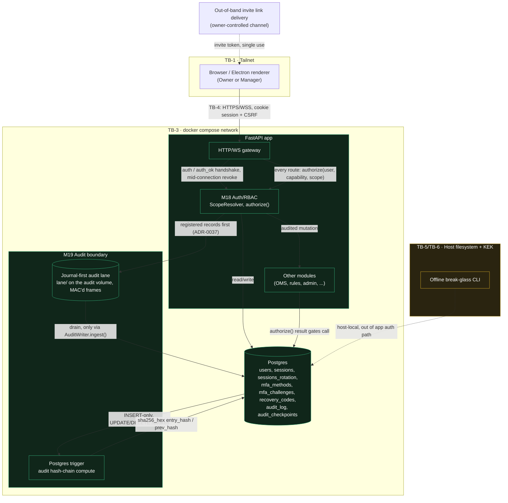

# E09 — STRIDE threat model: Authentication, sessions, 2FA, RBAC and audit

- Ticket: E09-X01 (issue #196)
- Owner: Security engineer (CODEOWNER)
- Status: Draft — pending Architect + epic-owner review session (see §7)
- Re-derives and extends `docs/plan/04-security-program.md` §5.6 (U1–U10) against the concrete design
  in ADR-0010 (`docs/plan/27-adrs/ADR-0010-auth-and-rbac.md`) and the schema in
  `docs/plan/21-database-schema.md` §3.1.
- Classification: this document itself is sensitive (enumerates auth weaknesses). No live secrets, host
  addresses or KEK material appear below — only references to where those live.

## 1. Scope

In scope: modules **M18 (Auth/RBAC)** and **M19 (Audit)** as built per ADR-0010 — password + mandatory
TOTP authentication, opaque server-side sessions (`sessions`, `sessions_rotation`), MFA (`mfa_methods`,
`mfa_challenges`, `recovery_codes`), the central `authorize()` / `ScopeResolver`, the WS `auth`/`auth_ok`
handshake, the invite flow, and the hash-chained append-only audit log (`audit_log`, `audit_checkpoints`).

Out of scope (per ticket "Out of scope" section): implementing controls (E09 `T*`/`S*` tickets),
detection-rule authoring (E09-X03), abuse-case execution (E09-X02), the review/drill (E09-X04), the
API-key vault's own model (E27), OMS/fan-out threats beyond their consumption of `authorize()`, and
external pen-testing (E43).

## 2. Data-flow diagram

Trust boundaries follow `04-security-program.md` §4 (TB-1..TB-9); this diagram is the auth-specific
detail behind TB-4 (client↔backend) and adds the auth-internal boundaries the programme-level diagram
does not show.

Elements analysed below (§3): Browser/client, Gateway (HTTP + WS), M18/`authorize()`/`ScopeResolver`,
Postgres identity/session/MFA tables, the audit trigger + `audit_log`/`audit_checkpoints`, the journal-first
audit lane (§3.6.2), the break-glass CLI + host filesystem + KEK, and the invite out-of-band channel. Every
element and every labelled flow above has at least one row in §3, or an explicit "not applicable" note.

## 3. STRIDE analysis

Table shape follows `04-security-program.md` §5 exactly (`T` id, STRIDE category, threat, L, I, Risk,
mitigations, residual) so this section folds into the programme doc without reformatting. Threat ids
keep the `U*` prefix from §5.6 so existing cross-references (E27, E39, E42, E43, E44) keep resolving;
`U1`–`U10` are re-derived (not just copied) against ADR-0010's concrete design, and `U11`+ are new,
design-specific threats this deeper pass surfaced. "Verify" names the test/metric that proves the
mitigation; a row with no verification is itself a finding (flagged `[FINDING]`).

### 3.1 Spoofing

<!-- prettier-ignore -->
| T | Threat | L | I | Risk | Mitigations | Verify | Residual |
|---|--------|---|---|------|-------------|--------|----------|
| U1 | Credential stuffing / brute force against a Manager account | M | H | **High** | SR-011 Argon2id (≥100 ms cost, excluded from budget #13); SR-015 per-account + per-IP throttling; SR-016 lockout after 5/15min + audit + owner notify | `test_login_lockout_after_five_failures`, `cv_auth_lockouts_total` alert on burst | Low |
| U2 | Phishing a Manager's password | M | H | **High** | SR-020 mandatory TOTP for every trading-capable role; SR-021 TOTP replay prevention (single-use `mfa_challenges` row consumed atomically) | `test_totp_replay_rejected`, contract test for `mfa_challenges` consumption | Low |
| U5 | Session-token theft via XSS or logs | M | H | **High** | SR-012 `HttpOnly`+`Secure`+`SameSite=Strict`; SR-112 CSP (no `unsafe-inline`/`unsafe-eval`); SR-122 redaction filter never logs tokens | `axe`/CSP header test, log-redaction unit test asserting session id never appears in any log sink | Low |
| U6 | Session fixation — id not rotated across login → MFA → privilege-change transitions | L | M | Medium | SR-013 rotate on every authentication state transition (`sessions_rotation` links old→new, old marked `revoked_reason='rotated'`) | `test_session_rotates_on_login_and_on_mfa_step_up`, `test_session_rotates_on_role_change` | Low |
| U11 | TOTP code replay within the ±1 step skew window (same 30 s code accepted twice) | L | H | Medium | SR-021 extended: `mfa_challenges` records the last-accepted counter per method; a second presentation of the same or an earlier counter is rejected even inside the skew window | `test_totp_same_counter_rejected_within_skew_window` | Low |
| U12 | Invite token guessed or replayed | L | H | Medium | Invite token is a 128-bit CSPRNG value, single-use, short TTL, hashed at rest like recovery codes (SR-022 pattern applied to invites); redemption revokes the token row atomically | `test_invite_token_single_use`, `test_invite_token_high_entropy_property` (hypothesis) | Low |
| U13 | WS `auth` frame replayed onto a second socket to piggyback a session | L | H | Medium | The WS handshake binds the session cookie + CSRF-equivalent to the specific socket via SR-012/SR-013's session validation plus `Origin` check (ADR-0010 §3 CSRF/Origin validation); a replayed `auth` frame without a live, un-revoked session id is rejected and audited | `test_ws_auth_frame_rejected_without_live_session`, `test_ws_origin_validated` | Low |

### 3.2 Tampering

<!-- prettier-ignore -->
| T | Threat | L | I | Risk | Mitigations | Verify | Residual |
|---|--------|---|---|------|-------------|--------|----------|
| U14 | Direct `UPDATE`/`DELETE` on `audit_log` | L | H | Medium | `REVOKE UPDATE, DELETE ON audit_log FROM cv_app, cv_ro` (schema §3.1, already applied at the SQL grant level); only an `INSERT`-only role is usable by the app | `test_audit_log_grants_deny_update_delete` (integration, asserts `SQLSTATE 42501`), nightly chain verifier (`cv_audit_chain_verified`) | Low |
| U15 | Forged `account_id` in a request body used to act outside the caller's grant | M | H | **High** | SR-050/SR-051 (shared with F1, Area 4): `ScopeResolver` intersects the *requested* account ids with the caller's granted set server-side on every route — the body's `account_id` is never trusted alone | `authorize()` contract test: every route × every role × in/out-of-scope account id | Low |
| U16 | Role/permission seed drift between the OpenAPI `x-rbac` vocabulary, the DB seed and the Python capability enum | M | H | **High** | Single source of truth: capability enum generates the OpenAPI `x-rbac` extension and the DB seed migration; a CI check diffs all three and fails on drift | `test_rbac_vocabulary_matches_openapi_and_seed` (generated-code required check) | Low |
| U17 | An Alembic migration silently widens a grant (e.g. re-adds `UPDATE` on `audit_log`, or grants a role more than intended) | L | H | Medium | Migration review checklist item + a schema-invariant test that asserts current grants on every startup/CI run, independent of migration history | `test_schema_grants_invariant_on_audit_and_rbac_tables` | Low |
| U18 | Client-side manipulation of the step-up ("MFA satisfied") marker to skip re-authentication for a high-risk action | M | H | **High** | `mfa_satisfied_at` lives server-side on the `sessions` row (schema §3.1.4), never client-supplied; SR-025 step-up re-auth checks server state and enforces a 5-minute freshness window (a no-grace grant is single-use, bound to the challenged request and lives 60 s; see U35), re-verified per action, not cached client-side | `test_step_up_marker_is_server_authoritative`, `test_step_up_expires_after_freshness_window` | Low |

### 3.3 Repudiation

<!-- prettier-ignore -->
| T | Threat | L | I | Risk | Mitigations | Verify | Residual |
|---|--------|---|---|------|-------------|--------|----------|
| U7 | Shared accounts make actions unattributable | M | M | Medium | SR-019 one identity per human, no shared logins; concurrent-session listing + forced logout in admin screens | `test_no_shared_login_enforced` (unique active credential per human by policy + review), `test_concurrent_sessions_listed_and_revocable` | Low |
| U19 | An authenticated, state-changing action completes with no corresponding audit row | L | H | Medium | Audit write is in the same transaction as the state change it records (write-before-return, per C-2.9); a route-coverage test asserts every mutating route has a paired audit-event type declared | `test_every_mutating_route_writes_audit_row` (route-coverage matrix), `cv_audit_chain_verified` | Low |
| U20 | Audit hash-chain gaps across a process restart or a migration | L | H | Medium | Chain continuity check on startup (verify `prev_hash` of the newest row against the last known checkpoint in `audit_checkpoints`) before the app accepts traffic; migrations touching `audit_log`/`audit_checkpoints` require a chain re-verification step in the migration runbook | `test_startup_chain_continuity_check`, `test_migration_preserves_chain_continuity` (round-trip) | Low |
| U21 | Clock manipulation (host or container clock skew) makes audit ordering untrustworthy independent of the hash chain | L | M | Medium | `audit_log.occurred_at` is a monotonic-checked server timestamp; the chain (`entry_hash`/`prev_hash`) provides tamper-evidence independent of wall-clock order, so a clock skew cannot silently reorder history without breaking the chain | `test_audit_ordering_survives_clock_skew_property` (hypothesis: shuffled timestamps still chain-verify by insertion order) | Low |

### 3.4 Information disclosure

<!-- prettier-ignore -->
| T | Threat | L | I | Risk | Mitigations | Verify | Residual |
|---|--------|---|---|------|-------------|--------|----------|
| U8 | User enumeration via differing login errors, status codes or timing | M | L | Low | SR-014 uniform error message + constant-time comparison + a dummy Argon2id hash run for unknown usernames (equalises latency) | `test_login_error_identical_for_unknown_and_wrong_password`, `test_login_timing_within_tolerance_property` | Low |
| U22 | A token (session id, TOTP secret, recovery code) leaks via a URL, log line, metric label, error message, or an error-reporting payload | M | H | **High** | SR-122 redaction filter on every logger; session ids never placed in query strings (cookie-only transport); metrics use bucketed/aggregated labels only, never raw ids | `test_redaction_filter_scrubs_session_and_totp_fields`, log-scan CI step (gitleaks-style pattern scan on structured log schema) | Low |
| U23 | Recovery codes persisted in the DOM or browser history after display | L | H | Medium | Recovery codes render once, in a non-persisted view (no route param, no browser-storage write, `autocomplete="off"`), with an explicit "save these now" modal that cannot be reopened | `test_recovery_codes_not_in_url_or_localstorage` (Playwright), a11y note routed to `E09-Q04` for the modal's screen-reader behaviour | Low |
| U24 | `users.email`, `sessions.ip`, `audit_log.actor_ip` (PII) exposed in an export or admin download without redaction/consent controls | M | M | Medium | Exports go through a role-scoped projection (SR-067 pattern from Area 7 D3, applied here to auth/audit PII); raw IP/email fields owner-only, redacted for Manager/Viewer exports | `test_export_projection_redacts_pii_for_non_owner_roles` | Low |
| U25 | A 403 response body/shape reveals the existence of a resource the caller has no grant to know about | L | L | Low | `authorize()` returns a uniform 403 body regardless of whether the resource exists or the caller merely lacks scope — no distinguishing "not found" vs "forbidden" leak | `test_403_body_identical_for_missing_vs_unauthorized_resource` | Low |
| U26 | Viewer-visible `build`/`git_sha` metadata aids a targeted exploit against a known-vulnerable build | L | L | Low | Build metadata surfaced only to Owner in admin screens; Viewer/Manager responses omit it | `test_build_metadata_hidden_from_viewer_and_manager_roles` | Low |

### 3.5 Denial of service

<!-- prettier-ignore -->
| T | Threat | L | I | Risk | Mitigations | Verify | Residual |
|---|--------|---|---|------|-------------|--------|----------|
| U10 | Owner locks themselves out (lost TOTP device and all recovery codes) | M | M | Medium | SR-023 sealed offline recovery-code envelope; documented host-local break-glass CLI requiring filesystem + KEK access (own trust boundary, §3.6) | `docs/security/runbooks` break-glass drill record (manual, per DoD "review session"), `test_break_glass_requires_host_filesystem_and_kek_present` (cannot be invoked over the network) | Low, but see §3.6 for the break-glass path's own residual risk |
| U27 | Lockout mechanism weaponised: an attacker deliberately fails login 5x against a legitimate user to lock them out ahead of a trade decision | M | M | Medium | Lockout is scoped per-account **and** per-IP (SR-015/SR-016 combined) so a remote attacker without the victim's IP cannot force a full account lock without also being rate-limited; owner alert fires on any lockout, enabling fast manual unlock | `test_lockout_alert_fires_on_every_lockout`, `test_admin_can_manually_clear_lockout` | Low |
| U28 | Argon2id's ≥100 ms cost used as a compute-amplification DoS vector (flood of login attempts) | M | M | Medium | Per-IP + per-account throttling (SR-015) applies *before* the Argon2id call is reached; a bounded queue (C-2.18) in front of the auth verify path prevents unbounded event-loop starvation | `test_login_rate_limit_applied_before_hash_verify`, load test (k6) against the login endpoint | Low |
| U29 | `sessions` table growth from unrevoked expired rows degrades query performance and, transitively, `GET /auth/session` p95 | L | M | Low | Scheduled reap of `revoked_at IS NOT NULL OR expires_at < now()` rows; partial index `ix_sessions_user_live`/`ix_sessions_expiry` (schema §3.1.4) keeps live-session lookups fast independent of table size | `test_expired_session_reap_job`, perf budget: `GET /auth/session` ≤100 ms p95 (Performance notes) | Low |

### 3.6 Elevation of privilege

<!-- prettier-ignore -->
| T | Threat | L | I | Risk | Mitigations | Verify | Residual |
|---|--------|---|---|------|-------------|--------|----------|
| U3 | Role check missing on a new endpoint | M | H | **Critical** | SR-017 deny-by-default router: every route must declare a capability via a decorator/registration step or the app **fails to start** (import-time failure, not a runtime 403) | `test_app_fails_to_start_with_undeclared_route` (asserts `SystemExit`/import error, not merely a lint warning — this is the ticket's own acceptance-criteria "Failure case"); SR-018 automated route-coverage test enumerating every registered route against the capability table | Low |
| U4 | Self-service role escalation | L | H | Medium | SR-055 role changes are Owner-only, cannot target self (`user_id != actor_id` invariant), require step-up auth | `test_role_change_rejects_self_target`, `test_role_change_requires_step_up` | Low |
| U9 | TOTP recovery codes reusable or weakly generated | L | H | Medium | SR-022 128-bit CSPRNG codes, single-use (row deleted/flagged on redemption), hashed at rest; regenerating the set invalidates the old one atomically | `test_recovery_code_single_use`, `test_recovery_code_regeneration_invalidates_old_set`, entropy property test | Low |
| U30 | `authorize()` called with a default-permissive argument (e.g. a missing/omitted scope parameter silently allows) | L | H | Medium | `ScopeResolver` API has **no** permissive default — the scope parameter is required and untyped/omitted calls fail mypy strict + a runtime `TypeError`; a lint rule (`no-implicit-authorize-default`) blocks call sites that don't pass an explicit scope | `test_authorize_requires_explicit_scope_argument` (raises on omission), mypy strict CI gate | Low |
| U31 | A route's declared capability is correct but its scope argument is wrong (e.g. checks role but not account membership) — the "second-layer" domain check gap | M | H | **High** | SR-050 second-layer domain check is a *distinct* control from the capability check, not a duplicate: `authorize()` verifies role+capability, then the caller's own domain logic re-verifies account membership against `user_account_access` before the mutation; contract test asserts both layers independently (a route with a valid capability but wrong scope arg must still 403) | `authorize()` contract test (route × role × correct-capability/wrong-scope matrix), specifically distinguishing this from U15/U16 | Low |
| U32 | A stale permission snapshot in a live session survives a role change (e.g. a demoted Manager's already-open session keeps prior access) | M | H | **High** | SR-013 rotation-on-privilege-change (U6's control) is necessary but not sufficient on its own for *authorization freshness* — every `authorize()` call re-reads current role/scope from Postgres (or a short-lived, explicitly-invalidated cache per ADR-0010 Consequences), never from data cached in the session object at login time | `test_role_change_takes_effect_on_next_request_without_relogin`, cache-invalidation unit test | Low |
| D1-shared | Admin route hidden in the UI but its API remains callable by a Manager (shared with Area 7 D1; listed here because it is `authorize()`'s job to prevent it) | M | H | **Critical** | SR-017 (see U3): server-side capability check is the only control; UI hiding is cosmetic. Route-coverage test calls every admin route as every role | Same as U3's `test_app_fails_to_start_with_undeclared_route` plus per-route role-matrix test | Low |
| U33 | The keyless-testnet server test clock (`CV_TEST_CLOCK`, #2086) moves auth time; reachable in live or demo, or beside an exchange key, it would revive an expired step-up or session, release a lockout early or stretch an invite. A path that is a symlink, FIFO or device node would redirect or stall the read | M | H | **High** | Settings refuses both test-clock keys unless `CV_ENVIRONMENT=testnet` with no exchange key, before any module starts (E16-FR-11, E49 T-E1), and `build_test_clock` re-checks it; no HTTP route moves time, only the host file; the path is absolute, without `..` and with no symlink in any component at load, and each read opens it non-blocking with `O_NOFOLLOW` (last component), requires a regular file and reads at most 33 bytes; an injected `auth_clock` always wins; boot logs `auth.test_clock_enabled` and writes the `system.config.test_clock_enabled` audit record, and a failed write fails boot; the release deploy checklist forbids both keys in production (`07-release-and-prr.md` §4.4) | `test_settings_test_clock_is_refused_unless_fully_set_on_a_keyless_testnet`, `test_build_test_clock_refuses_settings_that_skipped_validation`, `test_create_app_by_default_never_builds_the_test_clock`, `test_create_app_injected_auth_clock_wins_over_the_test_clock`, `test_settings_test_clock_file_must_not_be_under_a_symlinked_directory`, `test_offset_clock_never_follows_a_symlink`, `test_offset_clock_opens_without_blocking_or_following_a_symlink`, `test_offset_clock_refuses_a_character_device`, `test_lifespan_audits_the_test_clock_before_serving` | Low |
| U35 | A no-grace step-up grant (a class in `NO_GRACE_ACTION_CLASSES`, such as `killswitch`) authorises a request other than the one the dialog restated: an in-session script swaps the body after the user approves ("accounts: demo-1" sent as "scope global"), supersedes the user's challenge with its own, renames or duplicates labels so the restatement still reads as expected, or is shown a challenge naming an object RBAC or account scope would hide (#2304) | L | H | Medium | REST contract (#2304; PR #2290 ruling, rule 4; #189 security notes): the `POST /auth/step-up` "Challenges" and "Binding (no-grace classes)" paragraphs and the `Problem.action_summary`/`target` composition rule. The grant is bound to the SHA-256 fingerprint of the challenged request and lives 60 s; a no-grace step-up must send that challenge's `challenge_id`; any other request of the class is refused `403 step_up_required` and audited `auth.step_up_mismatch`; accounts are named by environment and UID, and labels are escaped; a challenge is issued only after authentication, CSRF, session state, validation, RBAC and account scope admit the caller | Contract (`tests/contract/test_step_up_challenge_contract.py`): `test_step_up_description_states_the_binding_rule`, `test_step_up_challenge_id_states_when_it_is_required`, `test_problem_challenge_field_states_its_rule`, `test_refusal_that_precedes_the_challenge_is_catalogued`. Runtime (`tests/unit/`): `test_bound_grant_refuses_a_swapped_payload`, `test_rules_grant_bound_to_one_rule_refuses_to_arm_another`, `test_identical_requests_racing_inside_the_window_use_the_grant_once`, `test_write_racing_the_use_of_a_grant_never_restores_it`. Postgres (`tests/integration/auth/test_step_up_grant_race_pg.py`): `test_a_write_queued_behind_the_use_of_a_grant_never_restores_it`. Strict xfail until the route slice of #2304 closes the gap each names: `test_challenge_not_issued_to_a_refused_caller` (the path-gated middleware still challenges before the route's RBAC) and `test_step_up_required_route_body_carries_the_challenge` (no `action_summary`/`target` yet) | Medium until the route slice of #2304 clears both strict xfails, then Low. Naming a rule by its label and environments is provisional: the route slice decides whether a rule is also named by its bound accounts and whether the grant that arms it is bound to its active version |
| U45 | A client that holds only a socket, for a user whose `status` became `disabled` (or whose row was deleted) with no session sweep, keeps streaming what it could already read until its access token ends, at most 12 minutes. The `require_active` backstop (#2911) meets a session only when a REST call or an `auth` frame presents a token that is still valid, and this client does neither: its refresh is refused and its old token is then refused as expired, both before the backstop. So nothing revokes, counts or alerts on its session, and the row stays live until its absolute expiry, 12 hours after the login that started its session chain (#3029) | L | M | Medium | Bounded and not renewable: the gateway ends a socket's identity at its access-token deadline (`bye` `token_expired`, 4401, `23-ws-protocol.md` §4.3), and a REST refresh refuses a disabled user before it claims, so no new token is minted. **The backstop does not fire for this client.** The client flow refreshes over REST at `expires_at` − 60 s and then re-`auth`s with the new token (`23-ws-protocol.md` §4.1, §4.3). `SessionService.refresh` refuses the disabled user before the claim and neither revokes the row nor counts it. The old token is then refused as expired by `SessionService.authenticate_access_token`, before it reaches `require_active`. So the breach counter, the WARNING, the hub publish and the `AuthDisabledUserSessionRevoked` ticket stay silent, and the row stays un-revoked until its absolute expiry (`ABSOLUTE_LIFETIME`: 12 hours after the login that started the session chain, which a refresh keeps). The only trace that names the cause is the refusal's audit pair: the write-ahead `auth.session_refreshed` record and the denied one with reason `user_disabled`; when the denied one cannot be written, the loss is counted in `auth_audit_outcome_lost_total{action="auth.session_refreshed"}`, logged as `auth.session_audit.outcome_lost` and raises the `AuthAuditOutcomeLost` ticket (EX-07). The backstop does meet a client that presents a token that is still valid: its next REST call, or a socket `auth` inside the token's life. No write path on a socket: orders, amends, cancels and the kill switch are REST only (`23-ws-protocol.md` §2.4), and a REST call with a valid token meets the backstop on every route except `POST /auth/logout` and `DELETE /me/sessions/{sessionId}`, which only end the caller's own sessions. The normal disable cascade (E42-T04, #965) revokes sessions and closes sockets within 5 s (UL1-E2). Not built: a per-socket status check in the gateway, which would shorten a window of at most 12 minutes on a path the disable service removes; and a revoke and count when the refresh refuses a disabled user, which would close the live row and make the ticket fire for this client (not scheduled; [requested on #3029](https://github.com/basiltt/CandleViewer/issues/3029#issuecomment-6237718957)) | `test_require_active_refuses_a_disabled_users_live_session` (the backstop on a session read with a valid token), `test_refresh_refuses_a_disabled_user` (`tests/unit/auth/test_session_user_status.py`: the refused refresh leaves the row unclaimed and un-revoked), `test_refresh_of_a_disabled_user_is_401_audited_and_rotates_nothing` (`tests/unit/api/test_sessions_router.py`: the 401, the two audit records, `revoked_at` still `None`), `test_access_token_lookups_reject_unknown_expired_and_revoked` (`tests/unit/auth/test_session_service_edges.py`: an expired token is refused), `test_an_expired_access_token_of_a_disabled_user_is_refused_before_the_backstop` (`tests/unit/auth/test_session_check_order.py`: the token's expiry is checked before `require_active`, so the disabled user's row stays un-revoked and nothing is counted or published), `test_disable_user_drill_stray_token_is_refused_auth_failed_on_a_fresh_socket` (`tests/security/auth/test_disable_user_drill.py`), `test_token_expiry_without_reauth_sends_bye_token_expired_4401` (`tests/unit/ws/test_lifecycle_socket.py`), `test_only_logout_and_revoke_my_session_skip_the_backstop` (`tests/unit/api/test_sessions_router.py`, the two routes above). The window itself is the access-token TTL, a design bound with no test | **Accepted risk for the streaming window, dated 2026-10-17** (proposed in the [DoR comment on #3029](https://github.com/basiltt/CandleViewer/issues/3029#issuecomment-6230914129); ruled by the main-orchestrator 2026-10-17 07:26Z, [recorded on #3029](https://github.com/basiltt/CandleViewer/issues/3029#issuecomment-6235965501)). That ruling rested on the DoR's premise that a socket's re-`auth` meets the backstop, which does not hold for a client in the protocol's refresh flow, so **the live row and the silent counter await the main-orchestrator's confirmation** ([requested on #3029](https://github.com/basiltt/CandleViewer/issues/3029#issuecomment-6237718957)). Owner sign-off pending (§7), no new RSK id: its streaming window is the residual carried as UL1-E2 (`e42-user-lifecycle.md` §6, owner Security engineer, review by the R3 gate 2027-02-04); the live row and the silent counter are this row's own. Revisit if #965 slips, if the gateway gains a periodic permission re-check, which could carry a status check, or if the refused refresh comes to revoke and count |

#### 3.6.1 Break-glass path — its own trust boundary (U10 edge case)

The offline break-glass CLI is modelled as a trust boundary distinct from the running application:

- **Who can reach it:** anyone with local filesystem access to the trading host (Windows account with
  access to the WSL2 volume) **and** access to unwrap the KEK (OS keyring / `age` identity, TB-5). This
  is intentionally a narrower set than "anyone who can reach the app over the tailnet" — it requires
  physical/host-level compromise, not just network or session compromise.
- **What it can do:** mint a recovery path for the Owner without going through password+TOTP. This is
  necessarily powerful — it is the escape hatch for total lockout (U10) — so it is scoped to run only
  with the process detached from any network listener, and every invocation writes an audit row on the
  _next_ successful application start (the audit chain cannot be written while the app is down, so the
  break-glass tool logs to a host-local, append-only file that is folded into `audit_log` on next boot
  and chain-verified against it).
- **Residual risk stated explicitly (not assumed away):** an attacker who has already achieved
  host-level compromise (RDP/SSH into the Windows host, or physical access) can use break-glass to
  mint Owner access regardless of TOTP. This risk is **not mitigated by this ticket's scope** — it is
  bounded by host hardening (out of scope for M18, tracked as RSK-022's sibling concern) and by the
  fact that host-level compromise already implies access to the KEK and therefore to A-01/A-02 (all
  exchange keys), which is a strictly larger loss than auth bypass alone. This asymmetry is recorded so
  it is not silently assumed safe: **the break-glass path's blast radius equals a full host compromise's
  blast radius, not merely an auth bypass.**

#### 3.6.2 Journal-first audit lane — a new audit write path (#3009, ADR-0037, proposed)

The lane (`docs/plan/27-adrs/ADR-0037-journal-first-audit-lane.md`; format, scan and drain rules in
`docs/plan/24-internal-schemas.md` §15.6) will be a host-local, append-only journal. cv-api writes the registered
auth outcome records and risk-reducing intent records to it first, and drains them into `audit_log` only
through `AuditWriter.ingest()`. It is a boundary of its own inside the backend (node LANE in §2):

- **What crosses it:** an `AuditEmission` that `AuditWriter.build()` has validated and redacted, admitted only
  if its action and outcome have a row in `LANE_ACTIONS`.
- **Who writes and reads it:** the running cv-api alone (it holds `lane.lock` exclusively), through
  `AuditService.lane`; its drain task is the only reader. No route or WS topic reaches it, and the only CLI that
  does is the offline release command (S2c, in `admin/`), which runs only while cv-api is stopped.
- **Where it rests:** `<dir of CV_AUDIT_WAL_PATH>/lane/` on the audit volume (#2615), uid 10001, `0700`/`0600`.
  The MAC key is a secret file named by `CV_AUDIT_LANE_KEY_FILE`, never on that volume or in the process
  environment (S2b refuses boot otherwise), and never passes through M2 (C-3.2).
- **Spoofing,** considered: an in-process caller can already write any registered action, `audit.lane_*`
  included, through `AuditWriter.emit()`, so the lane adds no identity to forge.

| T   | Threat                                                                                                                                                                                                                                         | L   | I   | Risk     | Mitigations                                                                                                                                                                                                                                                                                                                                                                                                                                                                                                                                                                                   | Verify                                                                                                                                                                                                             | Residual                                   |
| --- | ---------------------------------------------------------------------------------------------------------------------------------------------------------------------------------------------------------------------------------------------- | --- | --- | -------- | --------------------------------------------------------------------------------------------------------------------------------------------------------------------------------------------------------------------------------------------------------------------------------------------------------------------------------------------------------------------------------------------------------------------------------------------------------------------------------------------------------------------------------------------------------------------------------------------- | ------------------------------------------------------------------------------------------------------------------------------------------------------------------------------------------------------------------ | ------------------------------------------ |
| U36 | Tampering: a waiting frame or the confirmation marker is altered, reordered, duplicated or spliced in from another lane, so a false record enters the chain or a true one is skipped                                                           | L   | H   | Medium   | HMAC-SHA256 over each frame's `seq`, `prev` (the previous frame's MAC), lane id, class and record, under a key that is not on the volume (S2b refuses boot when a key file is under the directory of `CV_AUDIT_WAL_PATH`); a MAC'd marker holding the scan state; nothing that is not authentic and in sequence is ingested; each run of such material is one critical `audit.lane_anomaly` row, its id keyed under the lane key, in its chain position; the next authentic frame re-anchors the chain, and the run's bytes go to `quarantine/`                                               | S1a tamper suite (one `test_lane_rejects_*` per case in ADR-0037 S1a) and transition-table tests, S2b `test_tampered_frame_becomes_one_anomaly_row`                                                                | Low; with the key, RR-01                   |
| U37 | Destruction or rollback: waiting frames are deleted (a middle or oldest segment, the newest frames, the whole lane), or `lane/` is replaced by an older authentic copy                                                                         | L   | H   | Medium   | `seq` and `prev`, checked from the marker's state, expose a missing middle or head (`seq_gap`); a rolled-back marker over deleted segments is a `seq_gap` run marked `marker_behind`; for the rest, evidence off the volume: one `audit.lane.appended` log line per accepted frame (with a `mac` prefix), `cv_audit_lane_last_seq` with `AuditLaneSeqRegressed`, each boot's `audit.lane_resumed` row with the head `seq` and `mac`, and `AuditLaneCreated` (page)                                                                                                                            | S1a `test_lane_detects_a_deleted_segment`, S2a2 `test_resumed_row_records_the_head`, S4a promtool tests                                                                                                            | Low, needs host access (RR-01); residual 2 |
| U38 | Repudiation: a sign-out, a revocation or a reuse attempt leaves no row because the sink refused                                                                                                                                                | M   | H   | **High** | Journal-first for the registry's actions (ADR-0037 decision 1); a drained record keeps its actor, session, address, `request_id` and `event_ts`; only a double refusal loses an outcome row (counted by `auth_audit_outcome_lost_total`, on #2914's branch, not yet on `main`) or refuses an intent (`503`)                                                                                                                                                                                                                                                                                   | S3 per-row tests with `_RefusingWriter`, S2a2 integration restart test                                                                                                                                             | Low                                        |
| U39 | Denial of service: an unauthenticated flood (failed logins) or a reuse storm fills the lane, so a sign-out, or later a stop, is refused                                                                                                        | M   | M   | Medium   | The class comes from the registry, never the caller; `shared` is held to its share of the bytes and `reserved` keeps the rest; per-class waiter caps with `reserved` first, and a frame cap (values: §15.6, Limits); a refusal is immediate and falls back to the sink (C-2.18); login throttles act before the row (SR-015); the refresh route's per-address and per-session throttles (`api/sessions.py:266-272`, `:378-382`) bound replays of rotated tokens, the one `reserved` row reachable without a session (ADR-0037 Q9)                                                             | S1b quota and waiter tests, S3 `test_login_flood_leaves_room_for_logout`                                                                                                                                           | Low                                        |
| U40 | Denial of service: the audit volume is full or read-only, so the lane and the WAL refuse together; or the lane grows without bound                                                                                                             | L   | M   | Low      | Lane bytes are capped; quarantine grows only by copies of bytes already written, and `AuditLaneQuarantineGrowing` tickets; a double refusal behaves as today (`503`, or a counted loss) and `AuditLaneRefusing` and `AuditSinkRefusing` page                                                                                                                                                                                                                                                                                                                                                  | S1b cap test, S2b chaos run with the audit volume full (C-13.6 scenario 13's disk-full fault)                                                                                                                      | Low; no worse than today (ADR-0037 Q5)     |
| U41 | Information disclosure: frames and quarantine hold user and session ids and `actor_ip` (PII) at rest; a log line, metric, error, `docker inspect` or `/proc/<pid>/environ` leaks a record or the key                                           | L   | M   | Low      | Records are redacted before the lane (SR-069, C-12.6); directory `0700`, files `0600`, `O_NOFOLLOW`; logs carry `seq`, class, action, a `mac` prefix and error classes only; metric labels are closed sets; the key is a secret file (`0400`, uid 10001) named by `CV_AUDIT_LANE_KEY_FILE`, opened with `O_NOFOLLOW` and read once; boot is refused when `CV_AUDIT_LANE_KEY_HEX` is set, so no environment form exists, and when a key file is under the directory of `CV_AUDIT_WAL_PATH`, so the key is never on the volume; the key is never logged, and the key id is a one-way derivation | S1a `test_lane_logs_and_errors_carry_no_record_or_key`, S2b permission test, a boot-refusal test for a key file under the audit directory, and a compose test that the key is a secret, absent from `environment:` | Low; quarantine retention is ADR-0037 Q8   |
| U42 | Elevation of privilege: a module, route, CLI or other process writes frames or drops held ones, or a mint's intent row goes through the lane so that a session is minted during an outage                                                      | L   | H   | Medium   | Only `AuditService.lane` appends (other modules reach audit only through `AuditService`, `audit/__init__.py`); admission by action and outcome, which excludes mints (ADR-0037 decision 3); a frame made without the key fails its MAC; `lane.lock` is exclusive; no route or topic reaches the lane; the release command needs host access, the key and a stopped cv-api, and leaves a `released` row; the Owner-only flag (ADR-0037 decision 12) only switches between two audited paths, and its changes are audited (`flags.change`); the break-glass CLI keeps its own journal           | S1b `test_lane_refuses_an_unregistered_action_or_outcome`, S2b `test_second_process_cannot_take_the_lane`, S2c `test_release_refuses_while_cv_api_runs`, route enumeration                                         | Low                                        |
| U43 | Replay: a record is ingested twice or out of order, or deleted before the chain holds it                                                                                                                                                       | L   | H   | Medium   | The drain runs in `seq` order; the marker moves only past records whose commit tokens the writer reports committed; boot re-ingests from the marker; `ON CONFLICT (record_id) DO NOTHING`; a segment is deleted only when it lies wholly before the marker                                                                                                                                                                                                                                                                                                                                    | S2a2 integration, S2b chaos runs (C-13.6 scenarios 10 and 12)                                                                                                                                                      | Low                                        |
| U44 | Denial of service on the drain: an authentic frame that `ingest()` refuses for good (a retired action, an incompatible `AuditEmission`) or a planted unknown-`kid` frame stops the drain, and the lane quietly falls back to today's loss mode | L   | M   | Low      | A permanent refusal becomes a one-frame `record_invalid` run and the drain moves on; an unknown `kid` or `v` holds, which stops the lane: appends are refused with `held`, the façade falls back, and `AuditLaneDrainHeld` pages; a restored key or S2c's audited release ends the hold; while the writer's flusher is dead the drain waits for a restart instead of spinning; retiring an action needs an empty lane (S4b)                                                                                                                                                                   | S2a2 `test_poison_frame_is_quarantined_and_passed`, S2c release test                                                                                                                                               | Low                                        |

**Abuse cases** (each executed by the named slice's tests; AC-LANE-01, -04 and -09 also in S4b's drill):

- **AC-LANE-01.** Flip one byte of a waiting frame's record and restart. Expected: one `audit.lane_anomaly`
  (`frame_rejected`), the bytes in `quarantine/`, the altered record never in `audit_log`, the later frames still
  drained, a page (S1a, S2b).
- **AC-LANE-02.** Delete the oldest unconfirmed segment while the sink refuses. Expected: a `seq_gap` row naming
  the range, and the later frames still drain (S1a, S2a2).
- **AC-LANE-03.** Roll the marker forward by copying a later frame's MAC into an unkeyed marker. Expected: the
  marker fails its MAC, a `marker_lost` row, everything re-ingested, nothing skipped (S1a).
- **AC-LANE-04.** Flood failed logins from many addresses while the sink refuses, then sign out. Expected: the
  `shared` share fills and further login rows are counted lost; the sign-out is journaled and answers `204` (S3).
- **AC-LANE-05.** Send a refresh mint's `auth.session_refreshed` (`success`) through the lane. Expected: the
  registry refuses it (S1b, S3).
- **AC-LANE-06.** Start a second cv-api on the same audit volume. Expected: it refuses to boot (S2b).
- **AC-LANE-07.** Drop the previous key while frames under it wait, or plant a frame under an unknown `kid`.
  Expected: the lane holds, refusing appends with `held` so the façade falls back, and `AuditLaneDrainHeld` pages;
  the frames drain once the key is back, or the release command quarantines the planted frame and leaves one
  `released` row (S2a2, S2c).
- **AC-LANE-08.** Leave a frame whose action is no longer registered. Expected: one `record_invalid` row, the
  frame in `quarantine/`, the frames after it drained (S2a2).
- **AC-LANE-09.** Replace `lane/` with an older copy, or edit the newest frame's `len` so it reads as torn.
  Expected: a lower head in the next `audit.lane_resumed` row and an `AuditLaneSeqRegressed` page; the `len`
  edit also leaves a `torn_tail` row (S2a2, S4a).

**Residual risks** (to be accepted under RR-01, `04-security-program.md` §16.1, whose text S4b extends to the
lane, and reviewed with it):

1. Anyone with cv-api's uid or root can read the key and forge, destroy, garble or roll back frames, just as
   they can forge WAL frames or insert rows as `cv_app` today; garbling yields at most one row per run.
2. Deleting the newest frames or the whole lane, or restoring an older copy, leaves no trace on the volume, only
   off it (U37).
3. A full or read-only audit volume refuses the lane and the WAL together (ADR-0037 Q5).
4. Once ingested, a record waits in the CRC-only WAL like any `emit()` record (ADR-0037 Q6).
5. A double refusal still loses an outcome row (counted and alerted) or answers `503` for an intent, as today.
6. An intent made durable in the lane whose action then fails, or whose caller was cancelled, leaves an intent
   without an outcome, as the `emit()` docstring says of a cancelled append (`audit/writer.py:317-324`).
7. `quarantine/` grows with every incident and keeps PII for good (ADR-0037 Q8).

## 4. Control mapping

Every threat above maps to an existing SR id (`04-security-program.md` §6) or a newly proposed
requirement. No threat is left with only an accepted risk with no control — the two U10/break-glass
edge cases (§3.6.1) and the socket-only window (U45) are the accepted-residual-risk items, and they
are dated below.

<!-- prettier-ignore -->
| Threat ids | SR id(s) | New requirement proposed? |
|---|---|---|
| U1, U27, U28 | SR-011, SR-015, SR-016 | no |
| U2, U11 | SR-020, SR-021 (extended per U11) | **SR-021 amendment**: last-accepted-counter tracking (§3.1 U11) |
| U5, U22 | SR-012, SR-112, SR-122 | no |
| U6, U32 | SR-013 | **SR-013 clarification**: "on every authentication state transition" includes role change, and authorization reads are never session-cached beyond an explicitly invalidated short-lived cache (ADR-0010 Consequences) |
| U12 | (pattern of SR-022 applied to invites) | **new: SR-024** invite-token issuance/redemption (128-bit CSPRNG, single-use, hashed, short TTL) |
| U13 | SR-012, SR-013, CSRF/Origin validation (ADR-0010 §3) | no |
| U14, U19, U20, U21 | C-2.9 (audit write-ahead), schema `REVOKE UPDATE, DELETE` | no |
| U15, U31 | SR-050, SR-051 | no — U31 clarifies SR-050 is a **distinct second layer**, not a duplicate of the capability check |
| U16 | (none existing) | **new: SR-052** single-source RBAC vocabulary (enum → OpenAPI `x-rbac` → DB seed) with a CI drift check |
| U17 | (none existing) | **new: SR-053** schema-grants invariant test, independent of migration history |
| U18 | SR-025 | no |
| U3, D1-shared | SR-017, SR-018 | no |
| U4 | SR-055 | no |
| U7 | SR-019 | no |
| U8 | SR-014 | no |
| U9 | SR-022 | no |
| U10, U29 | SR-023 | no |
| U23 | (pattern of SR-022) | **new: SR-054** recovery-code/step-up display surfaces never persist to DOM/browser storage |
| U24 | SR-067 (Area 7 pattern, applied to auth/audit exports) | no |
| U25, U26 | (none existing) | **new: SR-056** uniform error responses (403 vs 404 indistinguishable; build metadata Owner-only) |
| U30 | (none existing) | **new: SR-057** `authorize()`/`ScopeResolver` API has no permissive default; enforced by type system + lint + test |
| U33 | E16-FR-11 (E16 R-E3), E49 T-E1/T-E2, C-2.11 | no — the test-clock gate and its boot audit record (#2086, #2728) |
| U35 | SR-025 (which actions need a step-up); the binding itself comes from the PR #2290 ruling (rule 4) and #189's security notes and is recorded in the REST contract (#2304) | no |
| U36–U44 | SR-063 (the chain pattern, keyed here), SR-066, SR-069, C-2.9, C-2.18, C-12.6; `04-security-program.md` §8.3 rules 1 and 2 | no — ADR-0037 records the design; S4b extends RR-01 to its residuals (§3.6.2) |
| §3.6.1 break-glass residual | SR-023 (envelope) + host hardening (out of scope) | **Accepted risk, dated 2026-09-29**, Owner sign-off pending at the review session (§7) — host-level compromise defeats break-glass isolation; bounded by the fact it already implies A-01/A-02 compromise |
| U45 | SR-029 (a disabled user's sessions end); the backstop of #2911 and the disable cascade of E42-T04 (#965) | no — **Accepted risk for the streaming window, dated 2026-10-17** (ruled by the main-orchestrator 2026-10-17 07:26Z, [recorded on #3029](https://github.com/basiltt/CandleViewer/issues/3029#issuecomment-6235965501)); the live row and the silent counter await the main-orchestrator's confirmation ([requested on #3029](https://github.com/basiltt/CandleViewer/issues/3029#issuecomment-6237718957)). Owner sign-off pending (§7): a status change that skipped the sweep leaves a socket-only client up to the 12-minute access-token life, and the backstop never meets it (its refresh is refused and its old token expires), so its row stays live to the 12-hour expiry with nothing counted; it has no write path, and the streaming window is UL1-E2's |

`04-security-program.md` §6 should be amended in a follow-up PR to add SR-021 (amend), SR-013 (clarify),
SR-024, SR-052, SR-053, SR-054, SR-056, SR-057 to its numbered lists (§6.1–6.4 as applicable) — this
ticket's scope is the threat model itself; the SR-number reservations above are provisional pending that
programme-doc PR, flagged so `E09-T*` implementers know which new requirement each control obligation is.

## 5. Verification mapping

Verification tests are named inline in each STRIDE row's "Verify" column (§3). Cross-reference to the
epic's own verification tickets:

- Unit/property tests named above → implemented alongside their `E09-T*`/`S*` control ticket.
- `E09-Q02` E2E specs cover: login lockout, TOTP enrolment/replay, session rotation, step-up re-auth,
  recovery-code single-use, admin-route role matrix (U3/D1-shared, U4, D-series).
- `E09-Q03` matrix cell: the full route × role × scope contract test (U15, U16, U31) is one matrix, not
  N separate suites — implementers should extend the existing matrix rather than hand-roll per-route tests.
- U33 (test clock): the unit tests named in its row (`test_settings_test_clock.py`,
  `test_testnet_clock.py`, `test_main_lifespan.py`); the cases that use the clock run only on the
  seeded e2e stack (`qa/plans/e09-auth-rbac-test-plan.md` §6.3).
- `E09-X03` SAST/DAST rules cover: log-redaction pattern scan (U22), CSP header assertion (U5),
  `0.0.0.0` binding lint (shared with RSK-022), Semgrep rule for raw `authorize()` calls missing an
  explicit scope argument (U30).
- No mitigation row in §3 is left without a named verification; where a specific test does not yet exist
  in the repo, its intended name is given so the implementer creates exactly that test (not an
  equivalently-scoped substitute) — this satisfies the ticket's "gaps filed as findings" requirement by
  making every gap a to-be-written, precisely-named test rather than an open-ended TODO.

## 6. Residual-risk register update

`docs/plan/32-risk-register.md` already tracks this area at **RSK-020** (RBAC bypass) and **RSK-021**
(session/2FA weakness). This model does not retire either — both remain live and are refined:

- **RSK-020** — description extended by U16 (RBAC vocabulary drift), U30 (`authorize()` permissive
  default), U31 (second-layer scope-check gap). Mitigation bullet gains: "single-source RBAC vocabulary
  with CI drift check (SR-052); `ScopeResolver` has no permissive default (SR-057); second-layer domain
  check is verified as a distinct control from the capability check." No score change — new findings
  are refinements of the same root cause (a large route surface with a single point of RBAC truth), not
  a new risk class.
- **RSK-021** — description extended by U11 (TOTP same-counter replay inside skew window), U12 (invite
  token replay), U13 (WS auth-frame replay), U18/U32 (step-up/permission staleness). Mitigation bullet
  gains: "TOTP counter tracked per method to reject replay inside the skew window; invite tokens follow
  the recovery-code entropy/single-use pattern (SR-024); WS auth frames are bound to a live, un-revoked
  session and the frame's `Origin`; step-up freshness and role-change propagation are server-authoritative
  with no session-side caching beyond an explicitly invalidated short-lived cache." No score change.
- **New entry proposed:** none — the break-glass residual (§3.6.1) is recorded as an **accepted risk**
  inline in this document rather than a new RSK id, because it is bounded by (and does not exceed) the
  existing blast radius already captured for host/KEK compromise under RSK-022 (Tailscale/public-exposure
  assumption) and the A-01/A-02 asset entries in `04-security-program.md` §2 — adding a duplicate RSK
  entry would double-count the same host-compromise scenario the register's own §10.1.1 reconciliation
  guards against. If the Architect/epic-owner review (§7) disagrees, a new RSK-0xx should be drafted in
  a follow-up PR rather than inline here, to avoid breaking the register's invariant count (46) outside
  its own change process.
- **Also none: U45** (the socket-only window of a disabled user, #3029) is a second inline **accepted
  risk**, dated 2026-10-17. Its streaming window is the residual already carried as UL1-E2 in
  `e42-user-lifecycle.md` §6 (owner Security engineer, review by the R3 gate 2027-02-04), so a
  new RSK id would count that window twice; the live row it leaves (§3.6, U45) is its own, and awaits
  the confirmation [requested on #3029](https://github.com/basiltt/CandleViewer/issues/3029#issuecomment-6237718957).
  The same §7 review confirms it; if it disagrees, the RSK-0xx is drafted in a follow-up PR, as above.

## 7. Review session record

_(To be completed at the scheduled review with the Architect and epic owner — this section is left as
the template the session fills in, per the ticket's Definition of Done. This PR delivers the model for
that review; it does not itself constitute the review.)_

- Date:
- Attendees: Architect, Epic owner (E09), Security engineer (author)
- Comments:
- Risk-register changes confirmed: RSK-020, RSK-021 refined per §6; break-glass accepted risk confirmed
  or converted to a new RSK id; U45 (socket-only window, dated 2026-10-17) accepted risk confirmed or
  converted to a new RSK id.
- Security-engineer sign-off: pending this session.

## 8. Findings summary (routing)

<!-- prettier-ignore -->
| Finding | Routes to |
|---|---|
| U3/D1-shared fail-closed route registration must be a startup failure, not a review-dependent control | `E09-T04` (PDP) implementation + its own regression test |
| SR-024/052/053/054/056/057 need formal numbers in `04-security-program.md` §6 | follow-up docs PR before `E09-T*` tickets cite them by final number |
| Break-glass abuse detection (beyond audit-on-next-boot) | `E09-X03` (detection rules) routed it; delivered by #2496 as two pages: `AuthBreakGlassUsed` while a reset's `break_glass_used` system event is unresolved, and `AuthBreakGlassAttempted` when a CLI run is recorded, a refused or cut-short one included (a rise of the count of `auth.break_glass_attempt` rows in `audit_log`). Not the folded-in trail: the CLI flushes its records to `audit_log`, so the boot fold-in carries only what Postgres refused. A reader that cannot read leaves both pages silent, which `AuthBreakGlassStateReadFailing` (a ticket) reports. Residual: a run that reached neither the host journal nor `audit_log` leaves only the CLI's own log (a pre-audit refusal), and `AuthBreakGlassAttempted` sees no rise with no sample in the 7 days before the last 15 minutes (a Prometheus with no history of the series, or a refused run after cv-api was stopped for more than a week) |
| Abuse-case exercises for U11–U13, U18, U30–U32 | `E09-X02` |
| Accessibility note on recovery-code/step-up modal screen-reader behaviour (U23) | `E09-Q04` |
| Audit WAL frames carry a CRC, not a MAC, so a lane record loses the lane's MAC once ingested (§3.6.2 residual 4) | a follow-up ticket if Security agrees (ADR-0037 Q6) |
